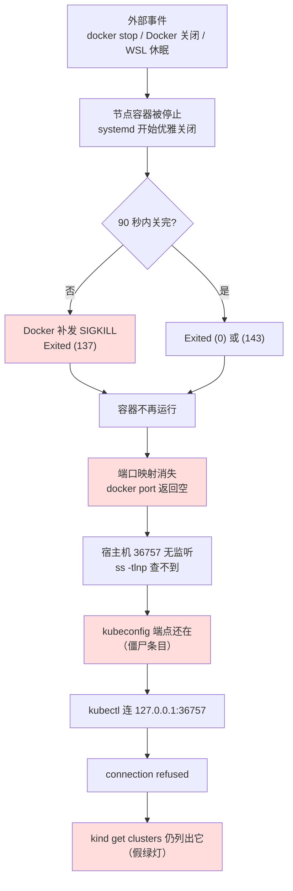

# 课 4：kind 集群的排障与坑

> 前置提示：本课依赖**课 1**（节点是容器、容器名前缀规律）与**课 2**（端口从哪来、为什么随机）。若不清楚"控制面是一个名为 `<集群名>-control-plane` 的容器"，请先回看课 1。
>
> 本课环境（本机实测基线）：
> - kind `v0.30.0`，节点镜像 `kindest/node:v1.34.0`，WSL2 Ubuntu 24.04
> - 事故现场：`k8s-c1-calico`（3 节点，Exited 137）、`otel-l11`（1 节点，Exited 137）
> - 一次性集群 `kind-zombie`（复现僵尸 kubeconfig，验完即删）
> - 用 `kind-lab2` 验证 LoadBalancer 行为
>
> 结论全部本机实测；未能实测处显式标 `⚠️ 未实测`。

---

## 第一幕 · 场景引入：那个"看着像乱码"的端口号

你昨天还好好的 kind 集群，今天打开终端：

```bash
kubectl get nodes
The connection to the server 127.0.0.1:36757 was refused - did you specify the right host or port?
```

**`36757` 是哪来的？** 你从没写过这个数。它不像 8080、6443 这种"认识"的端口，看着就像随机生成的乱码。于是你的第一反应通常是：

- "我是不是 kubeconfig 配错了？" → 去改 `~/.kube/config`
- "是不是 6443 被占了？" → 去查端口占用
- "重装 kind 吧" → 最坏的选择

**这三个方向全是错的。** 这个端口号不是错误本身，它是**上一条线索**。本课要做的，就是把这个数字还原成一条能走的因果链。

先看本机真实的事故现场（这是本课所有结论的来源，不是编造的场景）：

```text
$ kind get clusters
k8s-c1
k8s-c1-calico      ← 容器已 Exited
k8s-c2
kind-lab2
otel-l11           ← 容器已 Exited

$ kubectl --context kind-k8s-c1-calico get nodes
The connection to the server 127.0.0.1:40271 was refused

$ kubectl --context kind-otel-l11 get nodes
The connection to the server 127.0.0.1:36757 was refused
```

**注意这里最反直觉的一点**：`kind get clusters` 老老实实列出了 5 个集群，其中两个已经死了，但它**一个字都没提示**。kind 说"它存在"，kubectl 说"连不上"——两个工具说的都是真话，只是它们关心的东西不一样。

---

## 第二幕 · 认知冲突：三个"事实"互相打架

### 冲突：集群到底存不存在？

同一个集群，三个工具给出三个说法：

| 工具 | 说 `k8s-c1-calico` 存在吗 | 它实际在查什么 |
|------|--------------------------|---------------|
| `kind get clusters` | ✅ 存在 | 宿主机上带 `io.x-k8s.kind.cluster` label 的容器（**不管死活**） |
| `docker ps` | ❌ 不存在 | 只列**运行中**的容器 |
| `kubectl get nodes` | ❌ 连不上 | 真的去连 `127.0.0.1:40271` |

实测证据（本机真实输出）：

```text
$ kind get clusters
k8s-c1
k8s-c1-calico        ← 声称存在
k8s-c2
kind-lab2
otel-l11

$ docker ps --filter "label=io.x-k8s.kind.cluster" --format "{{.Names}}"
k8s-c1-control-plane
k8s-c2-control-plane
kind-lab2-control-plane
kind-lab2-worker
                ← k8s-c1-calico 和 otel-l11 一个都没有
```

**这就是"假绿灯"**：`kind get clusters` 判断的是"**有没有这个集群的容器（尸体也算）**"，不是"**这个集群活着吗**"。

想一眼看穿它，用 `-a`：

```bash
docker ps -a --filter "label=io.x-k8s.kind.cluster"
```

`-a` 把已停止的容器也列出来，这才是"kind 眼里的世界"。

### 冲突：137 是怎么回事？

再看死掉的容器：

```text
k8s-c1-calico-control-plane | Exited (137) 45 minutes ago
k8s-c1-calico-worker        | Exited (137) 45 minutes ago
otel-l11-control-plane      | Exited (137) 47 minutes ago
```

**`137` 是什么？** 它是 `128 + 9`，而 9 号信号是 `SIGKILL`——**不可捕获、不可忽略、进程必死**。

但"被 SIGKILL"有两种完全不同的故事，必须分清：

1. **内核 OOM Killer 杀的**（内存不够）。这是**故障**。
2. **外部显式停止**（`docker stop` / Docker 关闭 / 系统关机），且进程没在优雅期内退出，Docker 兜底发了 SIGKILL。这是**正常操作**。

本机实测的判定证据：

```text
$ docker inspect k8s-c1-calico-control-plane --format '{{.State.OOMKilled}} {{.State.ExitCode}}'
false 137
```

**`OOMKilled=false`** —— 不是 OOM。那是什么？看容器的最后几行日志：

```text
[  OK  ] Stopped cri-containerd-525…ee890ad73cca4462045d4569d3278b699.
[  OK  ] Removed slice kubelet-kube…daf635b03be03bd5302932bb1fb.slice.
[ ***  ] (2 of 3) Job cri-containerd-3878a7d…scope/stop running (9s / 1min 30s)
```

**日志是 systemd 在优雅关闭**（`Stopped` / `Removed` / `Job ... stop running`）。这不是崩溃，是有人按了停止键，容器内的 systemd 开始按序关闭服务，但 90 秒（1min 30s）没关完，Docker 就补了一记 SIGKILL。

**所以 `Exited (137)` 在本机的真实含义是：被正常停止，只是停得慢了点。** 它不是故障信号，是"**有人关过它**"的信号。

> ⚠️ 判定口诀：**先看 `OOMKilled`，再看日志末尾**。OOMKilled=true 才是资源问题；日志里是 systemd 优雅关闭就是操作问题。两者都可能报 137。

### 冲突：端口为什么"随机"？

回到开头的 `36757`。它来自容器的端口映射：

```text
$ docker inspect otel-l11-control-plane --format '{{json .HostConfig.PortBindings}}'
{"6443/tcp":[{"HostIp":"127.0.0.1","HostPort":"36757"}]}
```

**6443 是 apiserver 在容器内的固定端口**，而宿主机侧这个 `36757` 是 **kind 建集群时随机挑的空闲端口**（课 2 讲过：不写 `networking.apiServerPort` 就是随机）。它一旦选定，就**写死在容器的 `HostConfig.PortBindings` 里**。

kubeconfig 里记的就是这个数：

> 📌 **以下为事故现场快照**（本课实验开始时的状态）。其中 `k8s-c1-calico` 已在第四幕用 `kind delete` 清除，当前本机为 4 个集群。**照做时请以你自己的输出为准**，重点是看懂"每个集群一个随机端口"这一规律。

```text
cluster-name=kind-k8s-c1                  server=https://127.0.0.1:45145
cluster-name=kind-k8s-c1-calico           server=https://127.0.0.1:40271
cluster-name=kind-k8s-c2                  server=https://127.0.0.1:36637
cluster-name=kind-kind-lab2               server=https://127.0.0.1:36343
cluster-name=kind-otel-l11                server=https://127.0.0.1:36757
```

**五个集群，五个随机端口，没有一个重复。** 这就是为什么报错里的端口号"看着像乱码"——它不是乱码，是 kind 当初随机的结果。

---

## 第三幕 · 层层揭示：`connection refused` 的完整因果链

把上面三块拼起来，就是完整链条。**箭头方向很重要，要从左往右读**：



链条上有**四个"坏点"**（红色），但只有**一个源头**（最上面的 A）。kubectl 报的 `refused` 是链条**末端**，你在末端使劲是没用的。

### 关键机制一：端口映射随容器消失

```text
$ docker port k8s-c1-calico-control-plane
                              ← 空！什么都没有
$ docker port otel-l11-control-plane
                              ← 空！
```

容器一死，端口映射**连同容器一起消失**。这就是"端口拒绝"的直接原因——不是端口被占，是**根本没人监听**：

```text
$ ss -tlnp | grep -E "40271|36757"
  (无监听：40271 / 36757 均未监听)
```

对比活着的集群（有 `docker-proxy` 在监听）：

```text
LISTEN 0  4096  127.0.0.1:45145  users:(("docker-proxy",pid=63104,fd=8))
LISTEN 0  4096  127.0.0.1:36637  users:(("docker-proxy",pid=504900,fd=8))
LISTEN 0  4096  127.0.0.1:36343  users:(("docker-proxy",pid=455655,fd=8))
```

**`docker-proxy` 就是端口映射的宿主侧实现**。它随容器起，随容器死。`ss` 里能看到 `docker-proxy` = 映射活着；看不到 = 容器死了。

### 关键机制二：kubeconfig 条目不会自己消失

容器死了、端口没了，但 `~/.kube/config` 里那条记录**一个字都没少**。它就是"**僵尸条目**"——指向一个不存在的端点。

kind 不会在你每次敲 `kubectl` 时去重写 kubeconfig，它只在 `create` 和 `delete` 时动它。所以：

> **僵尸条目 = 容器死时留下的墓碑。** 它不碍事（只是 `kubectl` 连不上），但会误导你——因为 `kubectl config get-contexts` 照样列它，看起来就像"集群还在，只是坏了"。

### 关键机制三：kind 的"存在"判断与实际状态脱节

这是本课最需要记住的一条：

```text
kind get clusters  →  5 个（含 2 具尸体）
docker ps          →  3 个集群在运行
```

**`kind get clusters` 不是健康检查。** 它只是"列目录"。想知道死活，必须看 `docker ps`。

---

## 第四幕 · 实操验证：两条修复路径

> 环境改动提示：以下操作**真实改动本机环境**。本课已征得同意，用**已停止的 `otel-l11`** 与**一次性集群 `kind-zombie`** 做演示，不触碰在用的 `k8s-c1` / `k8s-c2` / `kind-lab2`。

### 路径 A：能救的就救 —— `docker start` 恢复

`otel-l11` 只是被停了，容器还在（尸体完好），那就把它叫醒：

```bash
$ docker start otel-l11-control-plane
otel-l11-control-plane

$ docker ps --filter "name=otel-l11" --format "{{.Names}} | {{.Status}}"
otel-l11-control-plane | Up 8 seconds

$ docker port otel-l11-control-plane
6443/tcp -> 127.0.0.1:36757
```

**端口回来了，而且还是 36757。** 然后 kubectl：

```bash
$ kubectl --context kind-otel-l11 get nodes
NAME                     STATUS   ROLES           AGE   VERSION
otel-l11-control-plane   Ready    control-plane   35d   v1.34.0
```

**连上了。** 注意 `AGE 35d`——集群的"年龄"没重置，因为它被创建于 35 天前，这次只是恢复。

#### 重点：为什么端口没变？

这里有个极易误解的地方。课 2 说"端口是随机的"，那重启后为什么还是 36757？

因为**随机发生在 `create` 那一刻，之后写死**：

```text
HostConfig.PortBindings（创建时写死，不随 start/stop 变）：
{"6443/tcp":[{"HostIp":"127.0.0.1","HostPort":"36757"}]}
```

实测 `stop` 再 `start`，端口纹丝不动：

```bash
$ docker stop otel-l11-control-plane && docker start otel-l11-control-plane
$ docker port otel-l11-control-plane | grep 6443
6443/tcp -> 127.0.0.1:36757        ← 还是它
$ kubectl --context kind-otel-l11 get nodes
otel-l11-control-plane   Ready    control-plane   35d   v1.34.0
```

**结论**：`docker start` 恢复的是**同一个容器**，端口映射是容器的固有属性，不随启停改变。**只有 `kind delete` + `kind create` 才会换端口**（因为那是个新容器）。

#### 容器起来了，k8s 也活着吗？

容器 Up 不等于 apiserver 正常。必须验证集群内部状态：

```bash
$ kubectl --context kind-otel-l11 get ns
NAME                           STATUS   AGE
cert-manager                   Active   35d
default                        Active   35d
kube-node-lease                Active   35d
kube-public                    Active   35d
kube-system                    Active   35d
l11-demo                       Active   35d
local-path-storage             Active   35d
opentelemetry-operator-system  Active   35d
```

**8 个 namespace 全 Active，AGE 全是 35d** —— 数据完好无损。etcd 里的数据在容器的可写层里，容器没删，数据就在。

> ⚠️ 自查提醒：这条结论最初被写成"7 个"，是因为查看时用了 `head -8`（首行是表头，只显示 7 条数据），**误把截断当全部**。`kubectl ... | wc -l` 也会因表头多算一行。**数资源条数请用 `--no-headers`**。

> **这是 kind 相对"真集群"的一个巨大优势**：节点状态持久化在容器文件系统里，重启节点 = 重启一台机器，不是重装系统。

### 路径 B：该弃的就弃 —— `kind delete` 清理

`k8s-c1-calico` 是 3 节点的 Calico 实验环境（创建于 2026-09-17），已停止且不再需要。正确删法：

```bash
$ kind delete cluster --name k8s-c1-calico
Deleting cluster "k8s-c1-calico" ...
Deleted nodes: ["k8s-c1-calico-worker" "k8s-c1-calico-control-plane" "k8s-c1-calico-worker2"]
```

**先看它做对了什么**（这是 `docker rm` 做不到的）：

```text
删除前 context 数：5
删除后 context 数：4
剩余 context：kind-k8s-c1 / kind-k8s-c2 / kind-kind-lab2 / kind-otel-l11
                                    ← kind-k8s-c1-calico 不见了
```

**`kind delete` 会自动把 kubeconfig 里的僵尸条目一起删掉。** 这是它相对 `docker rm` 的核心价值——不留垃圾。

再验证容器确实没了：

```bash
$ docker ps -a --filter "label=io.x-k8s.kind.cluster=k8s-c1-calico" | wc -l
0
```

#### 实测耗时：1 分 51 秒

```text
real	1m51.711s
```

删**3 个节点**花了将近 2 分钟。这不是 kind 慢，是它要**逐个 stop + rm 每个节点容器**，而每个节点容器内的 systemd 都要走一遍优雅关闭（就是第二幕看到的 90 秒超时逻辑的一部分）。

> **实用提示**：删大集群时别以为卡死了。3 节点约 2 分钟是正常速度。

#### `kind delete` 是幂等的

help 里写得清清楚楚：

```text
Deletes a Kind cluster from the system.

This is an idempotent operation, meaning it may be called multiple times without
changing the result beyond the initial application.
```

实测删一个已经删掉的集群：

```bash
$ kind delete cluster --name k8s-c1-calico
Deleting cluster "k8s-c1-calico" ...
$ echo $?
0
```

**退出码 0，不报错。** 这意味着你可以放心地在脚本里写 `kind delete cluster --name foo || true`，不用担心"集群不存在"导致脚本中断。

### 对照：`docker rm` 会造成什么（错误做法复现）

为了看清"为什么必须用 `kind delete`"，我建了个一次性集群 `kind-zombie` 真删一次：

```bash
$ kind create cluster --name kind-zombie        # 建
$ kubectl config get-contexts -o name | grep zombie
kind-kind-zombie                                 # 条目在
# 端点：https://127.0.0.1:42875

$ docker rm -f kind-zombie-control-plane         # 错误做法：只删容器
kind-zombie-control-plane

$ kubectl --context kind-kind-zombie get nodes
The connection to the server 127.0.0.1:42875 was refused
```

现在看留下了什么：

```text
$ kind get clusters | grep zombie
                          ← 空（kind 不列它了，因为容器没了）
$ kubectl config get-contexts -o name | grep zombie
kind-kind-zombie          ← 还在！（kubeconfig 条目残留）
```

**这就是"半僵尸"状态**，和第一幕的"假绿灯"正好相反：

| 状态 | `kind get clusters` | kubeconfig 条目 | 成因 |
|------|--------------------|-----------------|------|
| **假绿灯** | ✅ 列出 | ✅ 存在 | 容器 Exited（未删） |
| **半僵尸** | ❌ 不列 | ✅ 残留 | `docker rm` 删了容器 |
| **干净** | ❌ 不列 | ❌ 不存在 | `kind delete` |

半僵尸最坑的地方：**`kind delete` 也没法救它**，因为 kind 已经不承认这个集群存在了（`get clusters` 里没有），你删它会提示不存在。清理只能手动改 `~/.kube/config`。

而用 `kind delete` 收拾残局：

```bash
$ kind delete cluster --name kind-zombie
Deleting cluster "kind-zombie" ...
$ kind get clusters | grep -c zombie
0
$ kubectl config get-contexts -o name | grep -c zombie
0
```

**两处都清干净了。** 结论：**永远用 `kind delete`，不要用 `docker rm`。**

---

## 第五幕 · 体系收束：三分钟现场判据

### 主判据：四步定位

看到 `connection refused`，按这个顺序走，**不要跳步**：

```bash
# 第 1 步：容器在不在？（最关键，一眼定生死）
docker ps -a --filter "label=io.x-k8s.kind.cluster" --format "{{.Names}} | {{.Status}} | {{.CreatedAt}}"

# 第 2 步：如果在（Up）但连不上，看端口映射
docker port <集群名>-control-plane

# 第 3 步：看宿主机到底有没有人监听这个端口
ss -tlnp | grep <报错里的端口号>

# 第 4 步：对照 kind 的"目录"和实际存活
kind get clusters     # 含尸体
docker ps --filter "label=io.x-k8s.kind.cluster" --format "{{.Names}}" | sed 's/-control-plane//;s/-worker[0-9]*//' | sort -u
                      # 只含活的
```

**判定矩阵**：

| 第 1 步结果 | 第 2 步 | 第 3 步 | 诊断 | 动作 |
|------------|--------|--------|------|------|
| `Exited` | 空 | 无监听 | 集群被停了 | `docker start <容器名>`（保数据）或 `kind delete` + 重建（要新端口） |
| `Up` | 有映射 | 有 `docker-proxy` | 端口对但认证/网络问题 | 查证书、查 `--kubeconfig` 路径 |
| `Up` | 空 | 无监听 | 映射丢了 | `kind delete` + 重建 |
| 容器不存在 | — | — | 已被 `docker rm` | 手动清 kubeconfig 僵尸条目 |

### 高频坑速查

#### 坑 1：`Exited (137)` 不一定是故障

```bash
docker inspect <容器名> --format '{{.State.OOMKilled}} {{.State.ExitCode}}'
```

- `false 137` → 被显式停止（正常），日志末尾是 systemd 优雅关闭
- `true 137` → 真 OOM，要查内存

本机实测：4 个 Exited 容器**全部** `OOMKilled=false`，全是被停的。

#### 坑 2：`LoadBalancer` 永远 `<pending>`

在 `kind-lab2` 实测：

```bash
$ kubectl run lbtest --image=alpine:3.20 --restart=Never -- sleep 300
$ kubectl expose pod lbtest --port=80 --type=LoadBalancer --name=lbtest-svc
$ kubectl get svc lbtest-svc
NAME         TYPE           CLUSTER-IP     EXTERNAL-IP   PORT(S)        AGE
lbtest-svc   LoadBalancer   10.96.134.35   <pending>     80:31171/TCP   6s
```

`EXTERNAL-IP` 永远是 `<pending>`，`describe` 里 `Events: <none>`——**没有任何报错，就是没人管**。

根因（实测集群里所有 Pod，确认没有 LB 控制器）：

```text
default/lbtest
kube-system/coredns-66bc5c9577-k5h9l
kube-system/coredns-66bc5c9577-mw5tk
kube-system/etcd-kind-lab2-control-plane
kube-system/kindnet-lszfg
kube-system/kindnet-mll8w
kube-system/kube-apiserver-kind-lab2-control-plane
kube-system/kube-controller-manager-kind-lab2-control-plane
kube-system/kube-proxy-2np98
kube-system/kube-proxy-sqssc
kube-system/kube-scheduler-kind-lab2-control-plane
local-path-storage/local-path-provisioner
```

**没有一个 `metallb` / `cloud-controller`。** LoadBalancer 类型的 Service 需要一个"云厂商"来分配外部 IP，而 kind **不实现它**。

> ⚠️ 未实测：装 metallb 解决（需额外环境改动，本课未做）。
>
> **替代方案（已实测可用，见课 3）**：用 `NodePort` + `extraPortMappings`，宿主机 `curl 127.0.0.1:30080` 实测返回 `NODEPORT-OK`。

#### 坑 3：`Too many open files` / inotify 耗尽

本机实测的限制值：

```text
宿主机：ulimit -n = 10240
节点容器内：ulimit -n = 1024        ← 差 10 倍！
inotify max_user_instances = 512
inotify max_user_watches = 524288
```

**关键发现**：节点容器内的文件描述符上限只有 **1024**，而宿主机有 10240。在 kind 节点里跑大量文件监听（文件同步工具、开发服务器、热重载）时，容易先撞上容器内的 1024。

**`inotify max_user_instances = 512`** 是另一个常见瓶颈——每个需要文件监听的进程都要占一个 instance。

> ⚠️ 未实测：调整这些值（属系统参数改动，需用户授权，本课未做）。
>
> 缓解思路：减少节点内的文件监听进程；确需调整时改 `/proc/sys/fs/inotify/max_user_instances`（宿主机改了，节点容器因共享内核通常也生效——⚠️ 此推断未实测）。

#### 坑 4：删节点容器 ≠ 删集群

见第四幕的对照表。**永远用 `kind delete cluster --name <名字>`**。

`kind delete` 做三件事：`docker rm` 只做第一件。

| 动作 | 删容器 | 清 kubeconfig | 清 kind 元数据 |
|------|-------|--------------|---------------|
| `kind delete cluster` | ✅ | ✅ | ✅ |
| `docker rm -f <节点>` | ✅ | ❌ | ❌ |
| `docker stop <节点>` | ❌（转 Exited） | ❌ | ❌ |

### WSL / Docker 生命周期与集群存活

本机实测 Docker 状态：

```text
Containers: 198 | Running: 6 | Stopped: 192
```

**198 个容器里 192 个是停止的。** 这是长期使用 kind / 各种实验后的常态。

关于"WSL 睡一觉集群就失联"，本机的实测补充：

```text
系统 uptime: up 1 day, 6:02
容器死亡时间：15:23 ~ 15:26（约 45 分钟前）
Docker 守护进程启动：2026-10-08 10:09:20
```

**注意**：WSL 已经跑了 1 天多没重启，但容器在 45 分钟前死了。这说明**本次事故不是 WSL 重启导致的**，而是 15:23-15:26 之间的一次**批量停止操作**（可能是 Docker Desktop 重启、或手动批量 stop）。

更重要的实测事实——**容器的重启策略**：

```bash
$ docker inspect <节点容器> --format '{{.HostConfig.RestartPolicy.Name}}'
on-failure
```

**是 `on-failure`，不是 `always`。** 这意味着：

- Docker 重启后，节点容器**不会自动启动**（`on-failure` 只在非零退出码时重启，且被显式 stop 的不算 failure）
- 所以"Docker 重启 → 集群失联"是**必然**的，不是偶发
- 想自动恢复，就得手动 `docker start`

> **判据**：WSL 休眠 / Docker 重启后集群失联，**不要用 `kind delete` 重建**（会丢数据、换端口）。先试 `docker start <集群名>-control-plane`，大概率直接活。

### 本课实测数据汇总

| 项目 | 实测结果 |
|------|---------|
| `kind get clusters` vs `docker ps` | 5 个 vs 3 个（2 个 Exited 造成假绿灯） |
| Exited 容器退出码 | 4 个全是 137，`OOMKilled=false`（被停非崩溃） |
| `docker start` 恢复 | 成功；端口 36757 **不变**；数据完整（8 ns，AGE 35d） |
| 端口不变的原因 | `HostConfig.PortBindings` 创建时写死 |
| `kind delete` 3 节点耗时 | **1m51.711s** |
| `kind delete` 幂等性 | 删已删的集群，退出码 0 |
| `kind delete` 清 kubeconfig | 5 context → 4 context |
| `docker rm` 后果 | kind 不列，但 kubeconfig 残留（半僵尸） |
| LoadBalancer `EXTERNAL-IP` | 永远 `<pending>`，集群内无 LB 控制器 |
| 宿主机 vs 节点 `ulimit -n` | 10240 vs **1024** |
| `inotify max_user_instances` | 512 |
| Docker 总容器数 | 198（运行 6 / 停止 192） |
| 节点容器重启策略 | `on-failure`（非 `always`） |

---

## 一句话记住

> **`connection refused` 报的端口号不是错误，是地址——`docker ps -a` 看容器死没死，`docker port` 看映射在不在，`ss` 看有没有人听；容器只是被停了就 `docker start`（数据都在、端口不变），真不要了才 `kind delete`（它会连 kubeconfig 一起扫干净）。**

---

## 速览卡

| 症状 | 第一动作 | 判据 |
|------|---------|------|
| `connection refused: 127.0.0.1:XXXXX` | `docker ps -a --filter label=io.x-k8s.kind.cluster` | `Exited` → `docker start` |
| `Exited (137)` | `docker inspect --format '{{.State.OOMKilled}}'` | `false`=被停，`true`=OOM |
| 死集群仍在 `kind get clusters` | 正常现象 | kind 列目录不查死活 |
| `docker rm` 后集群"消失"但 kubectl 仍报 refused | 检查 kubeconfig | 半僵尸，手动清条目 |
| LoadBalancer `EXTERNAL-IP <pending>` | 确认无 metallb | kind 不实现 LB，改用 NodePort |
| 节点内 `too many open files` | 查容器内 `ulimit -n` | 容器内仅 1024（宿主机 10240） |
| Docker 重启后集群失联 | `docker start <集群名>-control-plane` | 重启策略是 `on-failure`，不会自启 |

---

## 小测

1. `kind get clusters` 列出了某集群，但它连不上。为什么 kind 说它"存在"？
2. 某节点容器 `Exited (137)`，你怎么判断它是被 OOM 杀的还是被正常停止的？
3. 用 `docker start` 恢复一个停止的 kind 集群后，kubeconfig 里的端口号会变吗？为什么？
4. `docker rm -f <节点容器>` 和 `kind delete cluster` 相比，少了哪两件事？
5. kind 集群里 LoadBalancer 类型的 Service 为什么 `EXTERNAL-IP` 永远是 `<pending>`？有什么替代方案？

<details>
<summary>答案</summary>

1. **`kind get clusters` 只列"有没有这个集群的容器"，不判断死活**（它按 label 找容器，Exited 的也算）。要看死活得用 `docker ps`（不带 `-a` 只列运行中的）。这就是"假绿灯"。

2. **看 `docker inspect --format '{{.State.OOMKilled}}'`**：`true` 是 OOM 杀的；`false` 再看日志末尾——是 systemd 优雅关闭（`Stopped` / `Removed` / `Job ... stop running`）就是被正常停止，137 只是因为 90 秒优雅期内没关完，Docker 兜底发了 SIGKILL。

3. **不会变**。因为端口写死在容器的 `HostConfig.PortBindings` 里，是 `create` 时随机选定后就固定的属性。`docker start` 恢复的是同一个容器，端口不变。只有 `kind delete` + `create`（新容器）才会换新端口。

4. 少了**清理 kubeconfig 条目**和**清理 kind 元数据**。`docker rm` 只删容器，留下 kubeconfig 里的僵尸条目（半僵尸状态：kind 不列它了，但 `kubectl config get-contexts` 还在）。

5. **kind 不实现 LoadBalancer**（集群里没有任何 metallb / cloud-controller 来分配外部 IP），所以永远 `<pending>`，且不报错（Events 为空）。替代方案：用 `NodePort` + `extraPortMappings`（课 3 实测 `curl 127.0.0.1:30080` 返回 `NODEPORT-OK`），或自己装 metallb（⚠️ 本课未实测）。

</details>

---

## 课程导航

- **上一课**：[课 3：镜像怎么进集群](03-镜像怎么进集群.md)
- **返回**：[kind 专项 overview](../overview.md)
- **主线相关**：[课 18：分层排障五层模型](../../../stages/6-排障运维与扩展/lessons/18-系统化排障分层定位法.md)、[00-环境准备](../../../00-环境准备.md)

---

## 接力提示词

```text
kind 专项四课已全部完成（是什么 / 怎么配 / 镜像怎么进 / 坏了怎么救）。

如需继续深入，可考虑：
1. 实操补齐未实测项：装 metallb 让 LoadBalancer 拿到 EXTERNAL-IP；调 inotify 参数验证文件监听上限
2. 回收本机环境：192 个停止容器（含 83 个 Exited(255)）可用 docker container prune 清理
3. 回到主线继续后续阶段学习
```
