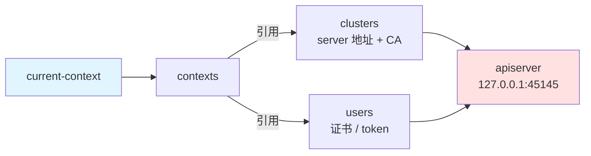
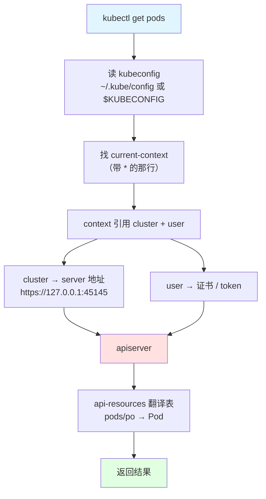

# 课 1：kubectl 怎么找到集群

> 前置提示：本课假定你已了解主线**阶段 1** 的三个概念——**Pod**、**声明式 API**、**GVK/GVR 资源模型**（主线课 2 知识点 3）。若这三个还陌生，建议先回看主线课 1-2。
>
> 本课环境（本机实测基线 · 2026-10-09）：
> - kubectl `v1.34.0`（`Kustomize Version: v5.7.1`）
> - 集群 `k8s-c1`（kind 单节点，v1.34.0）
> - WSL2 Ubuntu 24.04 · bash 5.2.21
> - 本机另有 `k8s-c2` / `kind-lab2` / `otel-l11` 三个 context
>
> 本课**所有结论均为本机实测**；未能实测处显式标 `⚠️ 未实测`。
> ⚠️ **版本偏差**：[官方快速参考](https://kubernetes.io/zh-cn/docs/reference/kubectl/quick-reference/)标注适用于 **v1.37**，本机为 **v1.34.0**。凡文档与实测冲突处**以实测为准并标注**。

---

## 第一幕 · 场景引入：那条命令到底干了什么

你每天敲很多次这条命令：

```bash
kubectl get pods
```

它返回了 Pod 列表。于是你得到一个印象："kubectl 连上了我的集群"。

这句话不算错，但它跳过了**三个环节**——而这三个环节，正是出问题时你不知道该查哪儿的根源：

1. kubectl 是**怎么知道**连哪个集群的？（它没被告诉过地址）
2. `pods` 这三个字母，kubectl 是**怎么知道**指的是什么的？（集群里明明叫 `Pod`）
3. 你敲 `pods` 和敲 `po` 和敲 `pod`，返回完全一样——**凭什么**？

更实际的问题是这两个：

- 哪天你敲 `kubectl get pods` 回 `The connection to the server 127.0.0.1:45145 was refused`，那个**看着像乱码的端口号**是哪来的？
- 哪天你装了个新 CRD，敲 `kubectl get foos` 报 `error: the server doesn't have a resource type "foos"`——为什么有时能认有时不能认？

这一课要把"kubectl 连上了集群"从一句黑话，变成一张**能查、能验证、能排障**的链路图。

---

## 第二幕 · 认知冲突：三个"理所当然"其实都不理所当然

### 冲突一：kubectl 凭什么知道连哪个集群？

你从没在命令里写过集群地址。但 `kubectl get pods` 就是连上了。

**本机实测**——先把证据摆出来：

```bash
# ① kubectl 客户端版本
kubectl version --client
```

输出（实测）：

```text
Client Version: v1.34.0
Kustomize Version: v5.7.1
```

```bash
# ② 集群地址从哪来？查环境变量与默认文件
echo "KUBECONFIG 环境变量: [${KUBECONFIG:-未设置}]"
ls -la ~/.kube/config
```

输出（实测）：

```text
KUBECONFIG 环境变量: [未设置]
-rw------- 1 root root 22149 Oct  9 16:22 /root/.kube/config
```

**关键发现**：环境变量**没设置**，但文件在。所以 kubectl 走的是**默认路径** `~/.kube/config`。

再看它选中了哪一个（本机有 4 个 context）：

```bash
kubectl config current-context
kubectl config get-contexts
```

输出（实测）：

```text
kind-k8s-c1

CURRENT   NAME             CLUSTER          AUTHINFO         NAMESPACE
*         kind-k8s-c1      kind-k8s-c1      kind-k8s-c1      
          kind-k8s-c2      kind-k8s-c2      kind-k8s-c2      
          kind-kind-lab2   kind-kind-lab2   kind-kind-lab2   
          kind-otel-l11    kind-otel-l11    kind-otel-l11    
```

那个 `*` 就是答案：**kubeconfig 里存着一堆集群，当前生效的是被 `current-context` 指中的那一个**。

把 kubeconfig 拆开看它的骨架（三段式）：

```bash
kubectl config view -o jsonpath='{range .clusters[*]}cluster: {.name}  server: {.cluster.server}{"\n"}{end}'
```

输出（实测，截取）：

```text
cluster: kind-k8s-c1  server: https://127.0.0.1:45145
cluster: kind-k8s-c2  server: https://127.0.0.1:36637
...
```

**那个"看着像乱码"的 45145 出现了**——它就是 `k8s-c1` 的 apiserver 端口，由 kind 在建集群时随机分配并写进 kubeconfig。

> 💡 **这条链路就是第一课的核心**：
> `kubectl` → 读 `~/.kube/config`（或 `$KUBECONFIG`）→ 找 `current-context` → 该 context 指向一个 **cluster**（含 server 地址）+ 一个 **user**（含证书/token）→ 拿这两样去连 apiserver。
>
> 端口拒绝 = 这条链上**任何一环**断了。以后看到 `connection refused`，你该查的是"这条链哪一环"，而不是"kubectl 坏了"。

### 冲突二：`pods` 是怎么变成 `Pod` 的？

集群里的资源叫 `Pod`（单数、首字母大写），你敲的是 `pods`（复数、全小写）。kubectl 做了转换。

**本机实测**——查它能认多少资源：

```bash
kubectl api-resources --no-headers | wc -l
kubectl api-resources --no-headers | head -15
```

输出（实测）：

```text
68

bindings                                       v1                                true    Binding
componentstatuses                   cs         v1                                false   ComponentStatus
configmaps                          cm         v1                                true    ConfigMap
endpoints                           ep         v1                                true    Endpoints
events                              ev         v1                                true    Event
limitranges                         limits     v1                                true    LimitRange
namespaces                          ns         v1                                false   Namespace
nodes                               no         v1                                false   Node
persistentvolumeclaims              pvc        v1                                true    PersistentVolumeClaim
persistentvolumes                   pv         v1                                false   PersistentVolume
pods                                po         v1                                true    Pod
podtemplates                                   v1                                true    PodTemplate
replicationcontrollers              rc         v1                                true    ReplicationController
resourcequotas                      quota      v1                                true    ResourceQuota
secrets                                        v1                                true    Secret
```

**68 条**。注意列头是 `NAME SHORTNAMES APIVERSION NAMESPACED KIND`——这张表本身就是**翻译词典**：

| 你敲的 | 集群里的 |
|--------|---------|
| `pods`（NAME 列） | `Pod`（KIND 列，第 5 列） |
| `po`（SHORTNAMES 列） | `Pod` |
| `pod`（单数） | `Pod` |

> ⚠️ **这个数字 68 不是通用的**——它取决于**这个集群装了什么 CRD**。实测本机四个集群各不相同：
>
> | 集群 | `api-resources` | `api-versions` |
> |------|----------------|----------------|
> | `k8s-c1`（本课基线） | **68** | **24** |
> | `k8s-c2` | 67 | 23 |
> | `kind-lab2` | 65 | 22 |
> | `otel-l11` | 75 | 26 |
>
> 差异来源实测：`k8s-c1` 比 `k8s-c2` 多一个 `widgets` CRD（主线课 20 建的）。`otel-l11` 最多（75）是因为装了 OpenTelemetry Operator。
>
> **所以别把"68"当常数记**。它的用途是**对比**：怀疑某个 CRD 没装上时，用安装前后的数字差来确认，而不是记绝对值。

**实测验证四种写法等价**：

```bash
kubectl get pods    -n kube-system --no-headers | wc -l   # 9
kubectl get pod     -n kube-system --no-headers | wc -l   # 9
kubectl get po      -n kube-system --no-headers | wc -l   # 9
kubectl get pod/<具体名字> -n kube-system --no-headers | wc -l   # 1
```

输出（实测）：

```text
9
9
9
1
```

前三个**完全相等**（9 = 9 = 9）→ 复数/单数/缩写等价。第四个是 1，因为指定了具体名字（这验证了 `TYPE/NAME` 写法也合法）。

> ⚠️ **注意第三个的真实含义**：`po` 能用的前提是**集群里有这个资源且它有缩写**。你自己装的 CRD 如果没定义短名，`kubectl get foo` 能行但 `kubectl get f` 不行。这不是 kubectl 的问题，是 CRD 没申报缩写。
>
> 📌 **实测坑（同名不同组）**：`kubectl api-resources` 里 `pods` 出现了**两次**：
>
> ```text
> pods    po    v1                      true    Pod
> pods          metrics.k8s.io/v1beta1  true    PodMetrics
> ```
>
> 第一行是核心组的 `Pod`（有缩写 `po`），第二行是 `metrics.k8s.io` 组的 `PodMetrics`（**无缩写**）。两者 NAME 都叫 `pods`，KIND 却不同。
>
> 所以精确查询要限定组：
>
> ```bash
> kubectl api-resources --no-headers --api-group="" | awk '$1=="pods"{print $2}'   # 输出 po
> kubectl api-resources --no-headers | awk '$1=="pods"{print $2}'                   # 输出 po 和 metrics.k8s.io/v1beta1 两行
> ```
>
> 这也是 `kubectl get pods` 有时行为让人困惑的原因之一——**你以为在查 Pod，实际可能匹配到别的组**。

### 冲突三：为什么有些资源加 `-n` 报错，有些不报？

按常理，命名空间级资源（Pod）要 `-n`，集群级资源（Node）不该加 `-n`。

**本机实测**——先查清楚集群级资源有哪些：

```bash
kubectl api-resources --no-headers | awk '$4=="false" {print "  "$1" ("$5")"}'
```

输出（实测）：

```text
  componentstatuses (ComponentStatus)
  namespaces (Namespace)
  nodes (Node)
  persistentvolumes (PersistentVolume)
  customresourcedefinitions (CustomResourceDefinition)
  certificatesigningrequests (CertificateSigningRequest)
  ipaddresses (IPAddress)
  priorityclasses (PriorityClass)
  storageclasses (StorageClass)
  volumeattributesclasses (VolumeAttributesClass)
```

只有 **10 个**是集群级的，其余 58 个都是命名空间级的。

现在验证"加了会怎样"：

```bash
kubectl get nodes -n kube-system --no-headers | head -2
```

输出（实测）：

```text
k8s-c1-control-plane   Ready   control-plane   10d   v1.34.0
```

**反直觉结论**：给集群级资源加 `-n` **不报错，直接忽略**。

这不是 bug，是设计——`-n` 对集群级资源是**无效但无害**的。知道这条能省你排查时间：**当你怀疑"是不是命名空间写错了"时，先确认这个资源到底是不是命名空间级的**（查 `api-resources` 第 4 列），而不是盲目换 `-n`。

对照——命名空间级资源**不加** `-n` 会怎样：

```bash
kubectl get pods --no-headers | head -2
```

输出（实测 · `k8s-c1` 集群，其 `default` 下无 Pod）：

```text
No resources found in default namespace.
```

它用了 `default`。这就是为什么你常常"明明有 Pod 却查不到"——**它们在 `kube-system`，而你在 `default`**。

> ⚠️ **这条输出同样依赖集群状态**：`default` 下有没有 Pod 取决于该集群部署了什么。实测本机 `k8s-c1` 的 `default` 在课 1 交付时（2026-10-09 上午）为 **0 个** Pod，但同日下午即变为 **2 个**（`web-6d689fbfdf-*`，由 `web` Deployment 创建，`nginx:alpine`）——**集群状态会随时间变化**。
>
> 所以判据不是"看到什么输出"，而是 **"不加 `-n` 时作用于 `default`" 这条规则**。验证它最稳的方式是显式对照：
>
> ```bash
> kubectl get pods --no-headers | wc -l                      # default
> kubectl get pods -n kube-system --no-headers | wc -l       # kube-system
> ```
>
> ⚠️ **统计时注意**：`kubectl get --no-headers` 在**无资源**时会输出一行 `No resources found in <ns> namespace.` 提示，`wc -l` 会把它算成 1。正确做法是过滤后计数：
>
> ```bash
> kubectl get pods --no-headers 2>/dev/null | grep -v "No resources found" | wc -l
> ```

---

## 第三幕 · 层层揭示：把链路一层层拆开

### 第 1 层：命令的四段式结构

官方文档 [conventions](https://kubernetes.io/zh-cn/docs/reference/kubectl/conventions/) 给的结构是：

```text
kubectl [command] [TYPE] [NAME] [flags]
```

**本机实测**——拆一条真实命令：

```bash
kubectl get pods coredns-66bc5c9577-mqn99 -n kube-system -o wide
```

| 段 | 值 | 作用 |
|----|-----|------|
| `command` | `get` | 要做什么 |
| `TYPE` | `pods` | 对什么资源（可写 `pods` / `pod` / `po`） |
| `NAME` | `coredns-66bc5c9577-mqn99` | 对哪一个（省略=全部） |
| `flags` | `-n kube-system -o wide` | 修饰 |

实测输出：

```text
NAME                       READY   STATUS    RESTARTS      AGE   IP           NODE                   NOMINATED NODE   READINESS GATES
coredns-66bc5c9577-mqn99   1/1     Running   2 (38m ago)   10d   10.244.0.3   k8s-c1-control-plane   <none>           <none>
```

**`NAME` 可省略**这点很实用：省略即"全部"，加上即"单个"。所以 `kubectl get pods` 和 `kubectl get pods xxx` 是同一条命令的两种用法。

### 第 2 层：kubeconfig 的三段式

kubeconfig 不是"一个地址"，是**三个互相引用的列表**。实测结构：

```bash
kubectl config view --raw -o jsonpath='{.clusters[0].name}{"\n"}{.users[0].name}{"\n"}{.contexts[0].name}{"\n"}'
```

逻辑上它是这样：



**context = cluster + user 的一个组合**。这就是为什么"切 context"能一次换掉"连哪个集群 + 用什么身份"。

**实测切换**（本机有两个可用集群）：

```bash
kubectl config use-context kind-k8s-c1
kubectl get nodes --no-headers | head -1
```

输出（实测）：

```text
Switched to context "kind-k8s-c1".
k8s-c1-control-plane   Ready   control-plane   10d   v1.34.0
```

> ⚠️ **一个真实事故**（本机 2026-10-09 实测）：
>
> 本机曾有一个 `kind-k8s-c1-calico` context，其集群容器被销毁后：
> - `kind get clusters` → **不再列出**（kind 靠容器 label 认集群）
> - `kubectl config use-context kind-k8s-c1-calico` → `error: no context exists with the name: "kind-k8s-c1-calico"`
>
> 但注意**因果方向**：context 消失**不是**容器销毁直接导致的。实测 `docker events` 显示容器于 `16:15~16:16` 被 destroy，而 kubeconfig 的 mtime 是 `16:22`——**两者相差 6 分钟，是两次独立操作**。
>
> **判据**：容器没了 → `kind get clusters` 立刻不列；但**kubeconfig 条目不会自动消失**，需要显式清理（课 4 讲）。别把"连不上"直接归因于"context 没了"，要分别查。

### 第 3 层：资源模型的三级——Group / Version / Kind

主线课 2 讲过 GVK 概念。这里把它变成**能敲出来的命令**。

**实测拆解**：

```bash
kubectl api-resources --no-headers | awk '$1=="pods" || $1=="deployments" || $1=="nodes" {print $1"  APIVERSION="$3"  KIND="$5}'
```

输出（实测）：

```text
pods                  APIVERSION=v1  KIND=Pod
deployments           APIVERSION=apps/v1  KIND=Deployment
nodes                 APIVERSION=v1  KIND=Node
```

对照表：

| 资源 | Group | Version | Kind | 说明 |
|------|-------|---------|------|------|
| `pods` | *（核心组，省略）* | `v1` | `Pod` | 核心资源，无组名 |
| `deployments` | `apps` | `v1` | `Deployment` | 有组名 |
| `nodes` | *（核心组）* | `v1` | `Node` | 集群级 |

**为什么 `deployments` 有时要写 `deployments.apps`？** 因为不同组可能有同名资源。写全 `名称.组名` 可消歧：

```bash
kubectl get deployments.apps --no-headers    # 明确指定 apps 组
```

再看**版本有多少个**（这是本课此前完全没讲过的命令，实测 0 次覆盖）：

```bash
kubectl api-versions | wc -l
kubectl api-versions | head -12
```

输出（实测）：

```text
24

admissionregistration.k8s.io/v1
apiextensions.k8s.io/v1
apiregistration.k8s.io/v1
apps/v1
authentication.k8s.io/v1
authorization.k8s.io/v1
autoscaling/v1
autoscaling/v2
certificates.k8s.io/v1
coordination.k8s.io/v1
discovery.k8s.io/v1
...
```

**24 个 API 组/版本**。注意 `autoscaling/v1` 和 `autoscaling/v2` **同时存在**——这就是 HPA 有时行为诡异的原因：你写 `autoscaling/v1` 用不了 v2 的字段（主线课 13 讲过）。

### 第 4 层：`explain` —— 比查文档快的自查方式

[web-index](../../../web-index/INDEX.md) 里有一条建议："命令类细节优先用 `kubectl explain` / `kubectl --help`，比 fetch 文档快"。

**实测验证这个说法**：

```bash
kubectl explain pod.spec.containers.resources.requests
```

输出（实测）：

```text
KIND:       Pod
VERSION:    v1

FIELD: requests <map[string]Quantity>


DESCRIPTION:
    Requests describes the minimum amount of compute resources required. If
    Requests is omitted for a container, it defaults to Limits if that is
    explicitly specified, otherwise to an implementation-defined value. Requests
```

**一个关键细节被这段话直接讲清了**：*Requests 省略时默认等于 Limits*——这正是主线课 13 讲「只写 limits 反得 Guaranteed」的根源，而 `explain` 里白纸黑字写着。

**字段不存在时**（实测）：

```bash
kubectl explain pod.spec.notexistfield
```

输出（实测）：

```text
KIND:       Pod
VERSION:    v1
```

⚠️ **这是个坑**：查不存在的字段**不报错**，只输出 `KIND` 和 `VERSION`，**没有 `FIELD` 行**。所以判断字段是否存在的判据是**有没有 `FIELD:` 那一行**，而不是看命令是否报错。

### 第 5 层：版本偏差约束

kubectl 与集群版本不必完全一致，但有约束。官方策略是 **±1 个次版本**。

**本机实测**（client 与 server 对齐）：

```bash
kubectl version -o yaml | grep -E "gitVersion|major|minor"
```

输出（实测）：

```text
  gitVersion: v1.34.0
  major: "1"
  minor: "34"
  gitVersion: v1.34.0
  major: "1"
  minor: "34"
```

> ⚠️ **实测坑（重要）**：[官方快速参考](https://kubernetes.io/zh-cn/docs/reference/kubectl/quick-reference/)与既有讲义提到的 `kubectl version --short`，在 **v1.34.0 已被移除**：
>
> ```bash
> kubectl version --short
> ```
>
> 输出（实测）：
>
> ```text
> error: unknown flag: --short
> See 'kubectl version --help' for usage.
> ```
>
> **正确写法是 `kubectl version -o yaml`**（或 `-o json`）。
>
> 📌 **待修正项**：既有讲义 [00-环境准备.md:181](../../../00-环境准备.md) 仍写着"加 `--short` 或看 `Server Version` 才是集群版本"，**该说法在 v1.34 已失效**。此项不属于本专项范围，已记录待处理。
>
> 这正是"文档版本 ≠ 你的版本"的活教材：**官方文档标注适用 v1.37，你跑 v1.34，抄来的命令可能直接报错。**

---

## 第四幕 · 实操验证：把链路走一遍

> 下面每一步都在本机真跑过。你可以照抄。
>
> ⚠️ **动手前先确认基线**：本课全部实测基于 context `kind-k8s-c1`。若你当前 context 不同，**数字会不一样**（详见第二幕的集群对比表）。先执行：
>
> ```bash
> kubectl config use-context kind-k8s-c1   # 换成你的目标集群
> kubectl config current-context           # 确认
> ```
>
> 本机现有 4 个 context（`k8s-c1` / `k8s-c2` / `kind-lab2` / `otel-l11`），若你的环境只有一个集群，跳过切换即可。

### 第 1 步：确认 kubectl 与集群版本

```bash
kubectl version --client
kubectl version -o yaml | grep -E "gitVersion|minor"
```

预期：看到 `v1.34.0`（client 与 server 一致）。

### 第 2 步：查 kubectl 怎么找到集群

```bash
echo "KUBECONFIG=[${KUBECONFIG:-未设置}]"
ls -la ~/.kube/config
kubectl config current-context
kubectl config get-contexts
```

预期：`KUBECONFIG` 未设置时走默认路径；`get-contexts` 里 `*` 标记当前 context。

### 第 3 步：找出当前集群的真实地址

```bash
kubectl config view --minify -o jsonpath='{.clusters[0].cluster.server}'
```

输出（实测）：

```text
https://127.0.0.1:45145
```

> 💡 **记住这一条**：以后看到 `connection refused` 报某个端口，就用这条命令反查**它原本该连哪个集群**，再用 `docker ps` 看那个集群的容器还在不在。

### 第 4 步：查资源清单与缩写

```bash
kubectl api-resources --no-headers | wc -l
kubectl api-resources --no-headers | grep -E "^pods|^deployments|^services|^nodes"
```

预期：68 条；能看到 `pods po`、`deployments deploy`、`services svc`、`nodes no`。

### 第 5 步：验证 TYPE 四种写法等价

```bash
kubectl get pods    -n kube-system --no-headers | wc -l
kubectl get pod     -n kube-system --no-headers | wc -l
kubectl get po      -n kube-system --no-headers | wc -l
```

预期：三个数字**完全相同**（本机实测均为 9）。

### 第 6 步：区分命名空间级与集群级

```bash
# 集群级资源清单
kubectl api-resources --no-headers | awk '$4=="false" {print $1}'

# 验证：给集群级资源加 -n 不报错
kubectl get nodes -n kube-system --no-headers | head -1

# 对照：命名空间级不加 -n 会落到 default
kubectl get pods --no-headers | head -1
```

预期：`nodes` 加 `-n` 正常返回（不报错）；`pods` 不加 `-n` 回 `No resources found in default namespace.`

### 第 7 步：用 explain 自查字段

```bash
kubectl explain pod.spec.containers.resources
kubectl explain pod.spec.notexistfield
```

预期：第一个有 `FIELD: resources <ResourceRequirements>`；第二个**只有 KIND/VERSION，没有 FIELD 行**——这就是"字段不存在"的判据。

### 第 8 步：切换 context 并还原

```bash
OLD=$(kubectl config current-context)
kubectl config use-context kind-k8s-c1
kubectl get nodes --no-headers | head -1
kubectl config use-context "$OLD"
```

预期：切过去能拿到该集群的节点；切回来恢复原状。

> ⚠️ 若目标 context 不存在（如集群已销毁），会报：
> `error: no context exists with the name: "xxx"`
> 此时**不会改变当前 context**——所以你的后续命令仍作用于原集群，别误判为"切换成功"。

---

## 第五幕 · 体系收束

### 一句话记住

**kubectl 靠 `~/.kube/config` 里的 `current-context` 找到集群；context = cluster（地址）+ user（身份）；`pods`/`pod`/`po` 三种写法由 `api-resources` 这张 68 行的翻译表统一成 `Pod`。**

### 核心链路图



### 排障映射（本课能回答的症状）

| 症状 | 查哪一环 | 命令 |
|------|---------|------|
| `connection refused` 报某端口 | cluster 地址 / 容器是否还在 | `kubectl config view --minify -o jsonpath='{.clusters[0].cluster.server}'` + `docker ps` |
| `No resources found in default namespace` | 命名空间没对 | `kubectl api-resources \| grep <资源>` 看第 4 列 |
| `the server doesn't have a resource type "xxx"` | 资源未注册 / CRD 未装 | `kubectl api-resources \| wc -l` 对比 |
| `error: no context exists with the name` | context 名写错或已清理 | `kubectl config get-contexts` |
| `error: unknown flag: --short` | 命令在新版本已移除 | `kubectl version -o yaml` |

### 速览表

| 命令 | 作用 | 本课实测值（`k8s-c1`） |
|------|------|-----------|
| `kubectl version --client` | client 版本 | `v1.34.0` |
| `kubectl version -o yaml` | client + server 版本（`--short` 已失效） | 均 `v1.34.0` |
| `kubectl config current-context` | 当前 context | `kind-k8s-c1` |
| `kubectl config get-contexts` | 全部 context | 4 个 |
| `kubectl config view --minify -o jsonpath='{.clusters[0].cluster.server}'` | 当前集群地址 | `https://127.0.0.1:45145` |
| `kubectl config use-context <名>` | 切集群 | — |
| `kubectl api-resources` | 资源清单 | 68 条（**随集群而变**，见第二幕） |
| `kubectl api-versions` | API 组/版本 | 24 条（**随集群而变**） |
| `kubectl explain <字段路径>` | 自查字段 | 无 `FIELD:` 行 = 字段不存在 |

### 三条守则

1. **连不上先查链路，别怪 kubectl**：`current-context` → `cluster.server` → 容器在不在，三步定位。
2. **查不到资源先确认作用域**：命名空间级还是集群级，看 `api-resources` 第 4 列，别盲目换 `-n`。
3. **字段含义用 `explain` 自查，比翻文档快**；但记住它**不报错**——判断存在与否看有没有 `FIELD:` 行。

### 小测（自测用）

1. `kubectl get pods` 没写集群地址，它怎么知道连哪儿？
2. `pods`、`pod`、`po` 为什么等价？如果某个 CRD 没有缩写，敲缩写会怎样？
3. 给集群级资源（如 `nodes`）加 `-n kube-system`，会报错吗？实测结论是什么？
4. `kubectl explain` 查一个不存在的字段，会报错吗？正确判据是什么？
5. `kubectl version --short` 在 v1.34 还能用吗？不能的话用什么？

<details>
<summary>参考答案</summary>

1. 读 `~/.kube/config`（或 `$KUBECONFIG`），取 `current-context`，该 context 引用 cluster（含 server 地址）与 user（含身份）。
2. 由 `kubectl api-resources` 这张翻译表统一 —— NAME / 单数 / SHORTNAMES 三种写法都映射到同一个 KIND。CRD 没定义短名则缩写不可用（会报 resource type 不识别）。
3. **不报错**，`-n` 被忽略，正常返回。实测 `kubectl get nodes -n kube-system` 正常输出节点。
4. **不报错**，只输出 `KIND` 和 `VERSION`。判据是**有没有 `FIELD:` 那一行**。
5. 不能，报 `error: unknown flag: --short`。改用 `kubectl version -o yaml`。

</details>

### 接力提示词

> 下一课要把 `get` 这条命令的**输出体系**讲透——`-o wide` / `yaml` / `json` / `jsonpath` / `custom-columns` 五种输出怎么选，`-l` 标签选择器与 `--field-selector` 有什么实测差异。
>
> 复制这段继续：
> ```
> 继续 kubectl 专项课 2：查看与筛选。要求：① 五种输出格式全部本机实测并给出选型建议；
> ② jsonpath 语法按官方文档验证，并实测"不支持正则"这一边界；③ -l 与 --field-selector
> 的差异用真实例子对比；④ 保持五幕结构与实测标注体例。
> ```

### 课程导航

- **上一课**：无（本课为 kubectl 专项第 1 课）
- **下一课**：[课 2：查看与筛选](02-查看与筛选.md)
- **专项首页**：[kubectl 专项 overview](../overview.md)
- **相关主线课**：[课 2 声明式 API 与调谐循环](../../../stages/1-心智模型与架构/lessons/02-声明式API与调谐循环.md)（GVK/GVR 概念）
- **相关工具**：[09-排障速查手册](../../../09-排障速查手册.md)（出事时翻）
