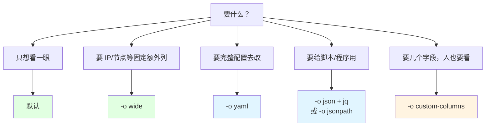
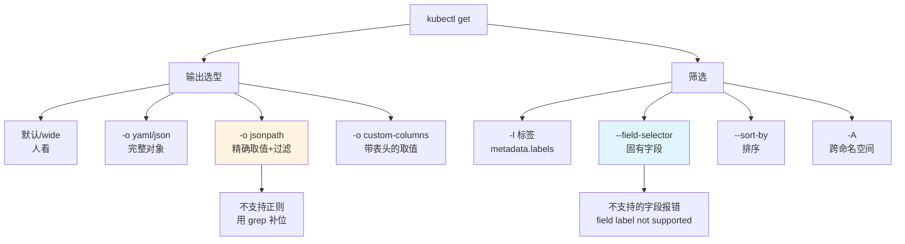

# 课 2：查看与筛选

> 前置：完成 [课 1：kubectl 怎么找到集群](01-kubectl怎么找到集群.md)（知道 kubeconfig / context / 资源模型）。本课讲 `get` 这条命令本身。
>
> 本课环境（本机实测基线 · 2026-10-09 下午）：
> - kubectl `v1.34.0` · 集群 `k8s-c1`（kind 单节点 v1.34.0）· WSL2 Ubuntu 24.04 · bash 5.2.21
> - 基线 context：`kind-k8s-c1`（**动手前先确认**，见第四幕）
>
> 本课**所有结论均为本机实测**；未能实测处显式标 `⚠️ 未实测`。
> ⚠️ **集群状态会变**：本课实测时 `k8s-c1` 分布为 `kube-system` 9 个 Pod、`default` 2 个（`web-*`）、`local-path-storage` 1 个，共 12 个。你照抄时数字可能不同——**看规则，不要记数字**。

---

## 第一幕 · 场景引入：你真的会"看"吗

课 1 结束时你能敲 `kubectl get pods` 了。现在遇到这些日常需求：

- "把所有 Pod 的 IP 列出来，我要粘到脚本里" → 你用 `kubectl get pods -o wide`，然后**手动从一堆列里抠 IP**
- "找出所有不在 Running 状态的 Pod" → 你 `kubectl get pods`，然后**用眼睛扫**
- "这个 Pod 挂在哪个节点上、镜像是什么版本" → 你连敲三条命令
- "统计每个命名空间有多少 Pod" → 你 `kubectl get pods -A`，然后**数数**

这些需求有个共同点：**你要的不是"全部信息"，而是"某个字段"**。但默认输出给的是**一张为人类排版的表**——它适合看，不适合用。

于是大家发明了各种土办法：`grep`、`awk`、`cut` 去切那张表。这些办法能work，但脆——**列顺序一变就错，字段里有空格就串位**。

kubectl 其实自带一套**精确的字段提取机制**：`-o jsonpath` 和 `-o custom-columns`。

这一课要解决的正是：**怎么让 kubectl 只吐出你要的那一个字段，且不怕格式变化。**

---

## 第二幕 · 认知冲突：三个"够用"其实都不够用

### 冲突一：默认输出给的信息，比你以为的少得多

先看默认输出：

```bash
kubectl get pods -n kube-system --no-headers | head -2
```

输出（实测）：

```text
coredns-66bc5c9577-mqn99                       1/1   Running   2 (74m ago)   10d
coredns-66bc5c9577-n8zhf                       1/1   Running   2 (74m ago)   10d
```

5 列：NAME / READY / STATUS / RESTARTS / AGE。

那**这个 Pod 的完整信息**有多少？实测同一个 Pod 五种输出格式的**字节数**：

```bash
P=coredns-66bc5c9577-mqn99
for F in "" "-o wide" "-o yaml" "-o json"; do
  printf "%-10s %s bytes\n" "${F:-默认}" "$(kubectl get pod $P -n kube-system $F | wc -c)"
done
echo "jsonpath   $(kubectl get pod $P -n kube-system -o jsonpath='{.metadata.name}' | wc -c) bytes"
```

输出（实测）：

```text
默认        126 bytes
-o wide     259 bytes
-o yaml    5889 bytes
-o json   12374 bytes
jsonpath     24 bytes
```

**默认输出只是完整对象的 1%**（126 / 12374 ≈ 1.0%）。

> 💡 这个对比是选型的核心依据：**默认输出是"摘要"，`-o yaml/json` 是"完整对象"，`jsonpath` 是"精确取值"。** 别用摘要去干精确取值的活。

### 冲突二：`-o wide` 不是"更宽的默认输出"，它是另一组列

很多人以为 `-o wide` = 默认输出 + 更多列。实测：

```bash
kubectl get pods -n kube-system -o wide --no-headers | head -2
```

输出（实测）：

```text
coredns-66bc5c9577-mqn99   1/1   Running   2 (74m ago)   10d   10.244.0.3   k8s-c1-control-plane   <none>   <none>
coredns-66bc5c9577-n8zhf   1/1   Running   2 (74m ago)   10d   10.244.0.4   k8s-c1-control-plane   <none>   <none>
```

确实多了 `IP` / `NODE` / `NOMINATED NODE` / `READINESS GATES` 四列。

**但坑在于**：`-o wide` 多出来的列**因资源类型而异**。实测不同资源：

| 资源 | `-o wide` 多出的列 |
|------|-------------------|
| `pods` | IP、NODE、NOMINATED NODE、READINESS GATES |
| `nodes` | INTERNAL-IP、EXTERNAL-IP、OS-IMAGE、KERNEL-VERSION、CONTAINER-RUNTIME |
| `services` | 无变化（Service 的 wide 与默认相同） |

⚠️ **未实测全部资源类型**（本机仅验证了 pods / nodes / services 三种）。所以别假设"wide 一定会多出我想要的列"。

### 冲突三：`grep` 切表是脆的——它依赖列位置

这是最需要扭转的习惯。看这个常见写法：

```bash
kubectl get pods -A --no-headers | awk '{print $1}' | sort | uniq -c
```

你会以为它在"统计每个 Pod 出现的次数"。实测输出：

```text
      2 default
      9 kube-system
      1 local-path-storage
```

**它统计的是命名空间分布**——因为 `kubectl get pods -A` 的第一列是 **NAMESPACE**，不是 NAME！

实测对照（`-A` 输出的原始前 3 行）：

```text
default              web-6d689fbfdf-7cjqq                           1/1   Running   0             29m
default              web-6d689fbfdf-hpkqh                           1/1   Running   0             29m
kube-system          coredns-66bc5c9577-mqn99                       1/1   Running   2 (75m ago)   10d
```

> 💡 **这就是 `awk '{print $N}'` 的致命伤**：它依赖"第 N 列是什么"，而**列集合会随 `-o wide`、`-A` 等 flag 变化**。加个 `-A` 就从"取名字"变成"取命名空间"，且**不报错、静默给错结果**。
>
> jsonpath 不依赖列位置，它直接取对象字段：
> ```bash
> kubectl get pods -A -o jsonpath='{range .items[*]}{.metadata.namespace}{"\n"}{end}' | sort | uniq -c
> ```
> 这条**明确说"我要 namespace 字段"**，加不加 `-A` 都对。

---

## 第三幕 · 层层揭示：输出体系与筛选机制

### 第 1 层：五种输出的定位

| 输出 | 实测体积 | 定位 | 什么时候用 |
|------|---------|------|-----------|
| 默认 | 126 B | 人类速览摘要 | 日常"看一眼" |
| `-o wide` | 259 B | 摘要 + 少量关键列 | 想看 IP / 节点时 |
| `-o yaml` | 5889 B | **完整对象**（含注释语义） | 要抄 YAML 改配置、查完整字段 |
| `-o json` | 12374 B | 完整对象（机器友好） | 喂给 `jq` / 脚本处理 |
| `-o jsonpath` | 24 B | **精确取值** | 只要一个/几个字段 |

> ⚠️ **yaml 和 json 差了一倍**（5889 vs 12374）。两者内容相同，json 体积大是因为缩进与引号。要人读用 yaml，要机器处理用 json。

**`custom-columns` 是第六种**（课 1 未列，这里补上）——它介于"表"和"jsonpath"之间：

```bash
kubectl get pods -n kube-system -o custom-columns='NAME:.metadata.name,NS:.metadata.namespace'
```

输出（实测）：

```text
NAME                                           NS
coredns-66bc5c9577-mqn99                       kube-system
coredns-66bc5c9577-n8zhf                       kube-system
etcd-k8s-c1-control-plane                      kube-system
```

它**自带表头且自动对齐**，比 jsonpath 好看，比默认输出精确。

**选型决策**：



### 第 2 层：jsonpath 语法（逐条实测）

官方 [jsonpath 文档](https://kubernetes.io/zh-cn/docs/reference/kubectl/jsonpath/) 给了语法，本课逐条**实测验证**（本机 v1.34.0）：

| # | 语法 | 实测示例 | 输出 |
|---|------|---------|------|
| ① | 取单个字段 | `-o jsonpath='{.items[0].metadata.name}'` | `coredns-66bc5c9577-mqn99` |
| ② | 取全部 `[*]` | `-o jsonpath='{.items[*].metadata.name}'` | 9 个名字**空格分隔一行** |
| ③ | 换行 `{range}...{end}` | `{range .items[*]}{.metadata.name}{"\n"}{end}` | 每行一个 |
| ④ | 多字段 | `{range .items[*]}{.metadata.name}{"\t"}{.status.phase}{"\n"}{end}` | `名字\tRunning` |
| ⑤ | 递归 `..` | `-o jsonpath='{..labels}'` | 所有层级的 labels |
| ⑥ | 过滤 `?()` | `{range .items[?(@.status.phase=="Running")]}{.metadata.name}{"\n"}{end}` | 仅 Running 的 |
| ⑦ | 数组下标 | `-o jsonpath='{.items[0].spec.containers[0].name}'` | `coredns` |

**② 的坑**（实测）：`[*]` 取出来的多个值**默认用空格连成一行**，不是换行：

```text
coredns-66bc5c9577-mqn99 coredns-66bc5c9577-n8zhf etcd-k8s-c1-control-plane kindnet-tg9br ...
```

要换行**必须用 `{range}...{end}` 配合 `{"\n"}`**——这是新手最容易卡住的地方。

**⑥ 过滤器实测**（找 Running 的 Pod）：

```bash
kubectl get pods -n kube-system -o jsonpath='{range .items[?(@.status.phase=="Running")]}{.metadata.name}{"\n"}{end}'
```

实测返回 9 行（该命名空间下全部 Running）。

### 第 3 层：jsonpath **不支持正则**（官方边界 · 实测）

官方文档明确写了 jsonpath 不支持正则表达式。本课**实测确认**——用 `=~` 正则匹配：

```bash
kubectl get pods -n kube-system -o jsonpath='{range .items[?(@.metadata.name=~/^coredns.*/)]}{.metadata.name}{"\n"}{end}'
```

输出（实测——**直接报错**）：

```text
error: error parsing jsonpath {range .items[?(@.metadata.name=~/^coredns.*/)]}{.metadata.name}{"\n"}{end}, unrecognized character in action: U+007E '~'
```

**报错原文记牢**：`unrecognized character in action: U+007E '~'`——`~` 这个字符 jsonpath 不认。

> ✅ **好处**：它**报错**而不是静默返回空。这是"显式失败"，比静默给错结果好得多。
>
> **替代方案**：用 `==` / `!=` 精确匹配，或用 `-l` 标签选择器（见第 5 层），或把结果管道给 `grep`：
>
> ```bash
> kubectl get pods -n kube-system -o jsonpath='{range .items[*]}{.metadata.name}{"\n"}{end}' | grep '^coredns'
> ```

### 第 4 层：custom-columns vs jsonpath（实测对照）

做同一件事——列出 Pod 名、IP、节点：

**custom-columns**（自带表头、自动对齐）：

```bash
kubectl get pods -n kube-system -o custom-columns='POD:.metadata.name,IP:.status.podIP,NODE:.spec.nodeName'
```

输出（实测）：

```text
POD                                            IP           NODE
coredns-66bc5c9577-mqn99                       10.244.0.3   k8s-c1-control-plane
coredns-66bc5c9577-n8zhf                       10.244.0.4   k8s-c1-control-plane
etcd-k8s-c1-control-plane                      172.27.0.2   k8s-c1-control-plane
```

**jsonpath**（无表头、需自己对齐）：

```bash
kubectl get pods -n kube-system -o jsonpath='{range .items[*]}{.metadata.name}{"\t"}{.status.podIP}{"\t"}{.spec.nodeName}{"\n"}{end}'
```

输出（实测）：

```text
coredns-66bc5c9577-mqn99	10.244.0.3	k8s-c1-control-plane
coredns-66bc5c9577-n8zhf	10.244.0.4	k8s-c1-control-plane
etcd-k8s-c1-control-plane	172.27.0.2	k8s-c1-control-plane
```

| 维度 | custom-columns | jsonpath |
|------|---------------|----------|
| 表头 | 自动（用你起的列名） | 无，需自己 `printf` |
| 对齐 | 自动 | 需 `\t` 手动（长度不齐会歪） |
| 多值字段 | 支持（如数组） | 支持 |
| 过滤 `?()` | ❌ 不支持 | ✅ 支持 |
| 适合 | 人看 | 脚本用 |

> 💡 **结论**：**要过滤用 jsonpath，要好看用 custom-columns**。

### 第 5 层：`-l` 标签选择器（六种运算符实测）

先看数据——`kube-system` 下 Pod 的标签（实测）：

```bash
kubectl get pods -n kube-system -o jsonpath='{range .items[*]}{.metadata.name}{" => "}{.metadata.labels}{"\n"}{end}'
```

输出（实测，截取）：

```text
coredns-66bc5c9577-mqn99 => {"k8s-app":"kube-dns","pod-template-hash":"66bc5c9577"}
etcd-k8s-c1-control-plane => {"component":"etcd","tier":"control-plane"}
kindnet-tg9br => {"app":"kindnet","controller-revision-hash":"577fcf9744","k8s-app":"kindnet","pod-template-generation":"1","tier":"node"}
```

六种运算符逐条实测：

| # | 运算符 | 命令 | 实测结果 |
|---|--------|------|---------|
| ① | 等值 `=` | `-l k8s-app=kube-dns` | 2 个 coredns |
| ② | 不等值 `!=` | `-l 'k8s-app!=kube-dns'` | 7 个（非 coredns） |
| ③ | 存在性 | `-l k8s-app` | 5 个（含 kindnet/kube-proxy/metrics-server） |
| ④ | 不存在 | `-l '!k8s-app'` | 4 个（etcd/apiserver/controller-manager/scheduler） |
| ⑤ | 集合 `in` | `-l 'k8s-app in (kube-dns,kube-proxy)'` | 3 个 |
| ⑥ | 逗号 AND | `-l 'k8s-app=kube-dns,tier=control-plane'` | **空** |

**⑥ 为什么空**？实测核实——coredns 的标签只有 `k8s-app` 和 `pod-template-hash`，**没有 `tier`**：

```text
coredns-66bc5c9577-mqn99 => {"k8s-app":"kube-dns","pod-template-hash":"66bc5c9577"}
```

所以 AND 条件无匹配。**这是正确行为**，不是命令错了。

> ⚠️ **`!` 在 bash 里的引号问题**：`-l '!k8s-app'` **必须加单引号**。不加的话 bash 会做历史扩展（`!` 是 bash 的历史命令符号），导致命令被替换。这是纯 shell 层面的坑，与 kubectl 无关。

### 第 6 层：`--field-selector` —— 与 `-l` 的本质区别

这是本课**最重要的一组对比**。

- **`-l`（标签选择器）**：筛的是 `metadata.labels` —— **用户自定义**的键值对
- **`--field-selector`（字段选择器）**：筛的是**资源对象固有的字段**（不是标签）

**实测支持哪些字段**（Pod，本机 v1.34.0）：

| # | 字段 | 命令 | 实测 |
|---|------|------|------|
| ① | `status.phase` | `--field-selector status.phase=Running` | ✅ 正常返回 |
| ② | `spec.nodeName` | `--field-selector spec.nodeName=k8s-c1-control-plane` | ✅ 正常返回 |
| ③ | `metadata.name` | `--field-selector metadata.name=coredns-...` | ✅ 正常返回 |
| ④ | `metadata.labels.*` | `--field-selector metadata.labels.k8s-app=kube-dns` | ❌ **报错** |
| ⑤ | `status.podIP` | `--field-selector status.podIP=10.244.0.3` | ✅ **实测支持** |

**④ 的报错原文**（实测）：

```text
Error from server (BadRequest): Unable to find "/v1, Resource=pods" that match label selector "", field selector "metadata.labels.k8s-app=kube-dns": field label not supported: metadata.labels.k8s-app
```

关键短语：**`field label not supported`**。

**⑤ 的判定方法值得学**——光看到"返回了结果"不能证明 selector 生效（可能是被忽略而返回全部）。正确做法是**用一个不存在的值反测**：

```bash
kubectl get pods -n kube-system --field-selector status.podIP=9.9.9.9 --no-headers
```

输出（实测）：

```text
No resources found in kube-system namespace.
```

返回空 → **证明 selector 真的生效了**（若被忽略会返回全部 9 个）。

> 💡 **这个"反测"手法是本课核心技能**：**任何筛选条件，都要用一个必然不匹配的值测一遍**，确认它在筛选而不是被静默忽略。静默忽略比报错危险得多。

**支持字段的完整清单**随资源类型与 k8s 版本而异。⚠️ **未实测全部**。判定方法就是上面的反测法，或直接看报错。

### 第 7 层：`--sort-by` 与 `-A`

**`--sort-by`** 用 jsonpath 表达式指定排序字段（实测）：

```bash
kubectl get pods -n kube-system --sort-by=.metadata.creationTimestamp --no-headers | head -3
```

输出（实测——按创建时间，最早在前）：

```text
kube-controller-manager-k8s-c1-control-plane   1/1   Running   2 (74m ago)   10d
kube-scheduler-k8s-c1-control-plane            1/1   Running   2 (74m ago)   10d
kindnet-tg9br                                  1/1   Running   2 (74m ago)   10d
```

```bash
kubectl get pods -n kube-system --sort-by=.metadata.name --no-headers | head -3
```

输出（实测——按名字字典序）：

```text
coredns-66bc5c9577-mqn99                       1/1   Running   2 (74m ago)   10d
coredns-66bc5c9577-n8zhf                       1/1   Running   2 (74m ago)   10d
etcd-k8s-c1-control-plane                      1/1   Running   0             74m
```

> ⚠️ **注意 `--sort-by` 前要加 `.`**（`.metadata.name`），这与 `-o jsonpath` 里的写法一致。

**`-A`（`--all-namespaces`）** 跨命名空间。实测：

```bash
kubectl get pods -A --no-headers | wc -l          # 12
```

⚠️ **重申第二幕的坑**：`-A` 输出的**第一列是 NAMESPACE**。所以：

| 你想统计 | 错误写法（依赖列位置） | 正确写法（按字段名） |
|---------|---------------------|-------------------|
| 各命名空间的 Pod 数 | `awk '{print $1}' \| uniq -c` ⚠️ 恰好对，但靠的是巧合 | `-o jsonpath='{range .items[*]}{.metadata.namespace}{"\n"}{end}' \| sort \| uniq -c` |
| 所有 Pod 名 | `awk '{print $2}'` ⚠️ 不加 `-A` 时错 | `-o jsonpath='{range .items[*]}{.metadata.name}{"\n"}{end}'` |

---

## 第四幕 · 实操验证

> 下面每步都在本机真跑过。动手前**先确认基线**：
>
> ```bash
> kubectl config use-context kind-k8s-c1   # 换成你的目标集群
> kubectl config current-context
> ```

### 第 1 步：看五种输出的体积差异（建立选型直觉）

```bash
P=coredns-66bc5c9577-mqn99   # 换成你集群里实际存在的 Pod 名
for F in "" "-o wide" "-o yaml" "-o json"; do
  printf "%-10s %s bytes\n" "${F:-默认}" "$(kubectl get pod $P -n kube-system $F | wc -c)"
done
echo "jsonpath   $(kubectl get pod $P -n kube-system -o jsonpath='{.metadata.name}' | wc -c) bytes"
```

预期：默认 ≈ 126 B，yaml ≈ 5.9 KB，json ≈ 12.4 KB，jsonpath ≈ 24 B。**默认只占完整的约 1%**。

### 第 2 步：默认 vs wide vs custom-columns

```bash
kubectl get pods -n kube-system --no-headers | head -2
kubectl get pods -n kube-system -o wide --no-headers | head -2
kubectl get pods -n kube-system -o custom-columns='POD:.metadata.name,IP:.status.podIP,NODE:.spec.nodeName' | head -4
```

预期：`wide` 多出 IP/NODE 列；`custom-columns` 只显示你指定的三列且带表头。

### 第 3 步：jsonpath 七种语法逐个试

```bash
kubectl get pods -n kube-system -o jsonpath='{.items[0].metadata.name}'; echo
kubectl get pods -n kube-system -o jsonpath='{.items[*].metadata.name}'; echo
kubectl get pods -n kube-system -o jsonpath='{range .items[*]}{.metadata.name}{"\n"}{end}' | head -3
kubectl get pods -n kube-system -o jsonpath='{range .items[*]}{.metadata.name}{"\t"}{.status.phase}{"\n"}{end}' | head -3
kubectl get pods -n kube-system -o jsonpath='{..labels}' | head -c 200; echo
kubectl get pods -n kube-system -o jsonpath='{range .items[?(@.status.phase=="Running")]}{.metadata.name}{"\n"}{end}' | head -3
kubectl get pods -n kube-system -o jsonpath='{.items[0].spec.containers[0].name}'; echo
```

预期：①单个名字 ②一行空格分隔 ③每行一个 ④名字+Tab+Running ⑤labels JSON ⑥Running 的 Pod ⑦容器名（如 `coredns`）。

### 第 4 步：验证"不支持正则"

```bash
kubectl get pods -n kube-system -o jsonpath='{range .items[?(@.metadata.name=~/^coredns.*/)]}{.metadata.name}{"\n"}{end}'
```

预期：**报错** `unrecognized character in action: U+007E '~'`。

再试替代方案：

```bash
kubectl get pods -n kube-system -o jsonpath='{range .items[*]}{.metadata.name}{"\n"}{end}' | grep '^coredns'
```

预期：正常列出 coredns 开头的 Pod。

### 第 5 步：`-l` 六种运算符

```bash
kubectl get pods -n kube-system -l k8s-app=kube-dns --no-headers
kubectl get pods -n kube-system -l 'k8s-app!=kube-dns' --no-headers | head -3
kubectl get pods -n kube-system -l k8s-app --no-headers | head -3
kubectl get pods -n kube-system -l '!k8s-app' --no-headers | head -3
kubectl get pods -n kube-system -l 'k8s-app in (kube-dns,kube-proxy)' --no-headers | head -3
kubectl get pods -n kube-system -l 'k8s-app=kube-dns,tier=control-plane' --no-headers
```

预期：前五个有结果；**第六个为空**（coredns 无 `tier` 标签，AND 无匹配）。

> ⚠️ `'!k8s-app'` **必须单引号**——否则 bash 历史扩展会吃掉 `!`。

### 第 6 步：`--field-selector` 与反测法

```bash
# 支持的字段
kubectl get pods -n kube-system --field-selector status.phase=Running --no-headers | head -2
kubectl get pods -n kube-system --field-selector spec.nodeName=k8s-c1-control-plane --no-headers | head -2

# 不支持的字段（会报错）
kubectl get pods -n kube-system --field-selector 'metadata.labels.k8s-app=kube-dns' 2>&1 | head -2

# 反测法：确认 selector 真的生效
kubectl get pods -n kube-system --field-selector status.podIP=9.9.9.9 --no-headers
```

预期：前两条有结果；第三条报 `field label not supported`；**第四条返回空**（证明生效）。

### 第 7 步：排序与跨命名空间

```bash
kubectl get pods -n kube-system --sort-by=.metadata.name --no-headers | head -3
kubectl get pods -A --no-headers | wc -l
kubectl get pods -A -o jsonpath='{range .items[*]}{.metadata.namespace}{"\n"}{end}' | sort | uniq -c
```

预期：排序生效；`-A` 给出总数；最后一条给出**各命名空间的 Pod 数**（按字段名取，不依赖列位置）。

### 第 8 步：自己造个场景练手

**"找出所有 Running 且不在 `kube-system` 的 Pod，列出 命名空间/名字/IP"**：

```bash
kubectl get pods -A \
  -o jsonpath='{range .items[?(@.status.phase=="Running")]}{.metadata.namespace}{"\t"}{.metadata.name}{"\t"}{.status.podIP}{"\n"}{end}' \
  | grep -v '^kube-system'
```

> 💡 这条命令综合了本课三个知识点：`jsonpath` 取值 + `?()` 过滤 + `grep` 补位（因为 jsonpath 不支持正则）。

---

## 第五幕 · 体系收束

### 一句话记住

**默认输出只是完整对象的 1%；要字段用 `jsonpath`（可过滤），要好看用 `custom-columns`（不可过滤）；筛标签用 `-l`，筛固有字段用 `--field-selector`，且任何筛选都要用"必然不匹配的值"反测一遍确认它生效。**

### 知识地图



### 决策速查

| 需求 | 用什么 |
|------|--------|
| 看一眼有啥 | 默认 |
| 要 IP / 节点 | `-o wide` |
| 抄 YAML 去改 | `-o yaml` |
| 给 jq / 脚本 | `-o json` |
| 只要一个字段，给脚本 | `-o jsonpath='{.items[*].xxx}'` |
| 要几个字段，人也要看 | `-o custom-columns` |
| 按标签筛 | `-l key=value` |
| 按状态/节点筛 | `--field-selector status.phase=Running` |
| 排序 | `--sort-by=.metadata.name` |
| 所有命名空间 | `-A`（**注意首列是 NAMESPACE**） |

### 三条守则

1. **别用 `awk '{print $N}'` 切 kubectl 输出**——列集合随 flag 变化，会静默给错结果。用 `jsonpath` 按字段名取。
2. **任何筛选条件都用"必然不匹配的值"反测**——返回空才证明生效；返回全部说明被静默忽略。
3. **jsonpath 不支持正则**——需要模式匹配就管道给 `grep`。

### 小测

1. 默认输出约是完整对象的百分之多少？实测依据是什么？
2. 想"每行一个 Pod 名"，为什么 `-o jsonpath='{.items[*].metadata.name}'` 达不到？
3. jsonpath 用 `=~` 做正则匹配会怎样？报错原文是什么？
4. `kubectl get pods -A --no-headers | awk '{print $1}'` 取到的是什么字段？为什么危险？
5. 怎么证明 `--field-selector status.podIP=10.244.0.3` 是真的在筛选，而不是被忽略？

<details>
<summary>参考答案</summary>

1. **约 1%**。实测同一 Pod：默认 126 B，完整 json 12374 B（126/12374 ≈ 1.0%）。
2. 因为 `[*]` 取多值默认**用空格连成一行**。要换行须用 `{range .items[*]}{.metadata.name}{"\n"}{end}`。
3. **报错**：`error: error parsing jsonpath ... unrecognized character in action: U+007E '~'`。
4. 取到的是 **NAMESPACE**（`-A` 输出第一列是命名空间，不是名字）。危险在于它**不报错**，静默给错结果——不加 `-A` 时第一列才是 NAME。
5. 用**必然不匹配的 IP 反测**：`--field-selector status.podIP=9.9.9.9` 应返回 `No resources found`。若返回全部 9 个，说明 selector 被静默忽略。

</details>

### 接力提示词

> 下一课进入**改写对象**——`apply` 的三方合并是怎么工作的（`last-applied-configuration` 注解），`patch` 的三种语义（strategic / merge / json）实测差在哪，`edit`/`replace` 何时该用，以及 `diff` 与 `--dry-run` 预演。
>
> 复制这段继续：
> ```
> 继续 kubectl 专项课 3：改写与调试。要求：① apply 三方合并机制讲清并实测 last-applied-configuration
> 注解；② patch 三种语义用同一场景实测对比（尤其数组字段的行为差异）；③ edit/replace 取舍与
> --force 的破坏性；④ diff 与 --dry-run 两种模式的边界；⑤ 涉及创建对象时用一次性命名空间并课后清理。
> ```

### 课程导航

- **上一课**：[课 1：kubectl 怎么找到集群](01-kubectl怎么找到集群.md)
- **下一课**：[课 3：改写与调试](03-改写与调试.md)
- **专项首页**：[kubectl 专项 overview](../overview.md)
- **相关主线课**：[课 7：Service 与 CoreDNS](../../../stages/3-网络与服务暴露/lessons/07-Service与CoreDNS.md)（Service 与标签选择器的关系）
- **官方文档**：[jsonpath](https://kubernetes.io/zh-cn/docs/reference/kubectl/jsonpath/)、[快速参考](https://kubernetes.io/zh-cn/docs/reference/kubectl/quick-reference/)
