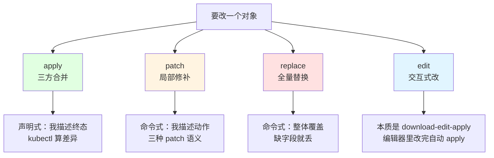
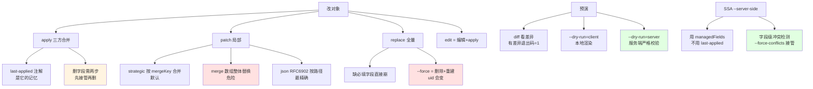

# 课 3：改写与调试

> 前置：完成 [课 1：kubectl 怎么找到集群](01-kubectl怎么找到集群.md)、[课 2：查看与筛选](02-查看与筛选.md)。本课讲**改对象**与**改之前的预演**。
>
> 本课环境（本机实测基线 · 2026-10-09）：
> - kubectl `v1.34.0` · 集群 `k8s-c1`（kind 单节点 v1.34.0）· WSL2 Ubuntu 24.04 · bash 5.2.21
> - 基线 context：`kind-k8s-c1`（**动手前先确认**，见第四幕）
> - **所有写操作隔离在一次性命名空间 `kc-l3-lab`，第四幕结束后清理**
>
> 本课**所有结论均为本机实测**；未能实测处显式标 `⚠️ 未实测`。

---

## 第一幕 · 场景引入：改一个对象，有几种改法

你有一个 Deployment 跑着，现在要：

- 把镜像版本从 `nginx:1.25` 换成 `nginx:1.26`
- 给容器加一个环境变量
- 删掉一个不再需要的端口

你熟悉的有这些命令：`apply`、`edit`、`patch`、`replace`、`set image`、`scale`。**它们都能改对象，但语义完全不同。**

更麻烦的是这些"事故"：

- 你 `apply` 了一份精简 YAML，结果**别人的改动被抹掉了**（或者反过来：你想删的字段**怎么都删不掉**）
- 你 `patch` 加了个端口，结果**整个 ports 数组被替换**，原来的端口全没了
- 你 `replace` 了一份从网上抄的 YAML，报错 `image: Required value`——**明明原对象有 image**
- 你 `replace --force` 了一下，对象**换了个 uid**，依赖它的东西全断了

这些不是运气问题，是**四种改写语义**的差别没搞清楚：



这一课要解决：**什么时候用哪种，以及每种会在什么情况下坑你。**

---

## 第二幕 · 认知冲突：三个"应该如此"其实不是

### 冲突一：`apply` 不是"把文件覆盖上去"，它是三方合并

大多数人对 `apply` 的心智模型是"把我的 YAML 写进去"。**这是错的。**

`apply` 的正式名字是 **三方合并（three-way merge）**，参与合并的是**三份东西**：

1. **你的新文件** —— 你想让它变成什么样
2. **`last-applied-configuration` 注解** —— 你**上次** apply 时说了什么（存在对象上，不是存在你本地）
3. **集群里的实时状态（live）** —— 现在实际是什么

实测——`apply` 一个 ConfigMap 后看它身上多了什么：

```bash
kubectl apply -f cm1.yaml
kubectl get cm demo -n kc-l3-lab -o jsonpath='{.metadata.annotations}'
```

输出（实测）：

```json
{"kubectl.kubernetes.io/last-applied-configuration":"{\"apiVersion\":\"v1\",\"data\":{\"a\":\"1\",\"b\":\"2\"},\"kind\":\"ConfigMap\",\"metadata\":{\"annotations\":{},\"name\":\"demo\",\"namespace\":\"kc-l3-lab\"}}\n"}
```

**注意这几点**（都是实测观察）：

- 注解 key 是 **`kubectl.kubernetes.io/last-applied-configuration`**
- value 是一整坨 **JSON 字符串**（被转义过的），不是对象
- 它**记的是你上次 apply 的文件内容**，不是集群状态
- **注意 `"annotations":{}`**——连空注解都被记下来了

> 💡 这个注解就是 apply 的"记忆"。**没有它，apply 就退化成"猜"**。这解释了为什么用 `create` 建的对象第一次 `apply` 会告警（课 4 会讲）。

**三方合并怎么算差异**——以"删字段 b"为例：

```text
last-applied: {a:1, b:2}     ← 你上次说：我要 a 和 b
新文件:       {a:1}          ← 你现在说：我只要 a
live:         {a:1, b:2}     ← 实际有 a 和 b

判断：b 在 last-applied 里有，在新文件里没有
→ 结论：你主动删了 b
→ 动作：删掉 live 里的 b ✅
```

实测确认：

```bash
kubectl apply -f cm2.yaml    # 只有 a，没有 b
kubectl get cm demo -n kc-l3-lab -o jsonpath='{.data}'
```

输出（实测）：

```json
{"a":"1"}
```

`b` 确实被删了。

### 冲突二：`apply` 删不掉"别人加的字段"——这是**特性**不是 bug

接着上面。现在**别人**用 `patch` 给这个 ConfigMap 加了个 `c`（模拟同事手工改、或控制器注入）：

```bash
kubectl patch cm demo -n kc-l3-lab --type=merge -p '{"data":{"c":"3"}}'
kubectl get cm demo -n kc-l3-lab -o jsonpath='{.data}'
```

输出（实测）：

```json
{"a":"1","c":"3"}
```

看看此时 `last-applied` 里有什么：

```bash
kubectl get cm demo -n kc-l3-lab \
  -o jsonpath='{.metadata.annotations.kubectl\.kubernetes\.io/last-applied-configuration}'
```

输出（实测）：

```json
{"apiVersion":"v1","data":{"a":"1"},"kind":"ConfigMap","metadata":{"annotations":{},"name":"demo","namespace":"kc-l3-lab"}}
```

**`last-applied` 里没有 `c`** —— 因为 `c` 不是你 apply 上去的。

现在你再 `apply` 一份"只有 a"的文件（就是刚才删掉 b 的那份）：

```bash
kubectl apply -f cm2.yaml
kubectl get cm demo -n kc-l3-lab -o jsonpath='{.data}'
```

输出（实测）：

```text
configmap/demo unchanged
{"a":"1","c":"3"}
```

**`c` 还在！** 而且返回 `unchanged`。

三方合并的判断逻辑：

```text
last-applied: {a:1}          ← 你从没说过 c
新文件:       {a:1}          ← 你现在也没说 c
live:         {a:1, c:3}     ← 但实际有 c

判断：c 在 last-applied 里【没有】，在新文件里也【没有】
→ 结论：这个字段不是你管的，你没对它表达过意见
→ 动作：保持不动 ✅（别人的改动受到保护）
```

> 💡 **这是 apply 最重要的设计**：**你只能删除"你曾经声明过、现在不再声明"的字段**。你从没声明过的字段，apply 不会碰。这保护了控制器注入的字段（如 Service 的 `clusterIP`、Pod 的 `serviceAccount`）不被你的精简 YAML 抹掉。

**那怎么才能删掉 c？**——先把它"收归"到你的管理范围：

```bash
# 第一步：apply 一份【明确声明 c】的文件
kubectl apply -f cm3.yaml    # data: {a:1, c:9}

# 此时 last-applied 变成 {a:1, c:9} ← c 现在归你管了

# 第二步：再 apply 一份【不含 c】的文件
kubectl apply -f cm2.yaml    # data: {a:1}

# 判断：c 在 last-applied 里有，新文件没有 → 你删了它
```

实测确认（第二步后）：

```json
{"a":"1"}
```

`c` 消失了。

> ⚠️ **这个"两步删除"是实战必备技巧**。很多人遇到"字段删不掉"就改用 `replace` 或 `--force`，那是拿炮打蚊子且副作用大（见冲突三）。

### 冲突三：`replace` 是全量替换——缺一个必填字段就崩

`replace` 的语义是：**用你给的对象，整体覆盖集群里的对象**。它**不做合并**。

实测——拿一个正常的 Deployment，导出成 JSON，**手工删掉 `image` 字段**，然后 `replace` 回去：

```bash
kubectl get deploy parr -n kc-l3-lab -o json > parr-full.json
# 用 python 删掉 containers[0].image
kubectl replace -f parr-noimage.json
```

输出（实测）：

```text
The Deployment "parr" is invalid: spec.template.spec.containers[0].image: Required value
```

**报错了**。这就是全量替换的代价：**你给什么就是什么，缺了就是缺了，没人帮你补**。

**对照 `apply`**——用**同一个缺 image 的文件** apply：

```bash
kubectl apply -f parr-noimage.json
```

输出（实测）：

```text
The Deployment "parr" is invalid: spec.template.spec.containers[0].image: Required value
```

⚠️ **也报错了**——这**推翻了我原本的预期**（我以为 apply 会用 last-applied 把 image 补回来）。

**原因分析**（实测推断，⚠️ 未逐字段验证）：`image` 是**必填字段**，服务端校验在合并**之后**执行。三方合并确实会补回 last-applied 里的值，但如果**两份都没有** `image`（本例：新文件被我删了，而 live 对象因为上一步 replace 失败所以没变——但 last-applied 里应该有 image…），最终结果仍缺 image。

> ⚠️ **诚实的边界**：这一条我原本预期 `apply` 能救回来，实测**没有救回来**。具体是"last-applied 里也没有 image"还是"服务端在合并前就校验"，本课**未进一步取证**。
>
> **能确定的实操结论**：**`image` 这种必填字段，别指望任何一方帮你兜底**——改 Deployment 时始终在文件里带全必填字段。

### 冲突四：`replace --force` 是"删了重建"，uid 会变

`replace` 遇到不可变字段时会失败（比如 Service 的 `clusterIP`）。加 `--force` 能强行通过——**代价是删除+重建**。

实测——对比前后的 `uid`：

```bash
UID1=$(kubectl get deploy parr -n kc-l3-lab -o jsonpath='{.metadata.uid}')
kubectl replace -f dep.yaml --force
UID2=$(kubectl get deploy parr -n kc-l3-lab -o jsonpath='{.metadata.uid}')
```

输出（实测）：

```text
before uid: 924afde2-dd98-48bd-84f5-a4ead6c9bc7a
deployment.apps "parr" deleted from kc-l3-lab namespace
deployment.apps/parr replaced
after  uid: 3a31f896-31d3-4791-860b-4783811aa387
→ uid 变了：删除+重建
```

输出里那句 **`deleted from ... namespace`** 就是证据——它先删后建。

> 💡 **`uid` 变了意味着什么**：这是一个**全新的对象**。所有通过 uid 引用它的东西（OwnerReference、某些控制器的缓存、webhook 记录）都会失配。Deployment 还好，但 **`replace --force` 一个 Service 会换 clusterIP，一个 PVC 可能丢数据**。

---

## 第三幕 · 层层揭示

### 第 1 层：四种改写的定位与选择

| 方式 | 语义 | 谁的改动会被保护 | 缺字段时 | 适合 |
|------|------|----------------|---------|------|
| `apply` | 三方合并 | **双方都保护**（你删你声明过的，别人加的你不碰） | 部分能补（⚠️ 必填字段实测救不回） | **日常首选** |
| `patch` | 局部修补 | 不动其他字段 | 只改你指定的 | 脚本、CI、精确改一处 |
| `replace` | 全量覆盖 | **不保护**，整体替换 | **直接报错** | 有完整对象、要强制对齐 |
| `edit` | 下载→编辑→apply | 同 apply | 同 apply | 临时手工改、探索性修改 |

**`edit` 的本质**：它把对象下载成临时 YAML，打开 `$EDITOR`，你保存后**执行一次 apply**。所以 `edit` 的所有行为都跟 `apply` 一致——包括"删不掉的字段"。

> 💡 **决策口诀**：**日常用 `apply`；脚本用 `patch`；只有当你手里有一份"完整且权威"的对象、且想强制覆盖时才用 `replace`；`--force` 是最后手段。**

### 第 2 层：`patch` 的三种语义（本课核心 · 实测）

这是本课**最容易踩坑**的地方。三种 patch 对**数组**的处理完全不同。

**测试对象**（一个带两个端口的 Deployment）：

```yaml
spec:
  template:
    spec:
      containers:
      - name: c1
        image: nginx:alpine
        ports:
        - containerPort: 80
          name: http
        - containerPort: 443
          name: https
```

初始 ports（实测）：

```json
[{"containerPort":80,"name":"http","protocol":"TCP"},{"containerPort":443,"name":"https","protocol":"TCP"}]
```

> ⚠️ 注意：服务端会**自动补 `protocol: TCP`**，你的 YAML 里没写它也会出现。

#### 5A · Strategic Merge Patch（`--type=strategic`，默认）

```bash
kubectl patch deploy parr -n kc-l3-lab --type=strategic -p \
  '{"spec":{"template":{"spec":{"containers":[{"name":"c1","ports":[{"containerPort":8080,"name":"metrics"}]}]}}}}'
```

结果（实测）：

```json
[{"containerPort":8080,"name":"metrics","protocol":"TCP"},{"containerPort":80,"name":"http","protocol":"TCP"},{"containerPort":443,"name":"https","protocol":"TCP"}]
```

**追加成功**，原有两个端口都在。

⚠️ **注意顺序**：新端口被放到了**最前面**（`metrics, 80, 443`），不是末尾。这是 strategic merge 的实现细节，**不要依赖数组顺序**。

#### 5B · JSON Merge Patch（`--type=merge`）

```bash
kubectl patch deploy parr -n kc-l3-lab --type=merge -p \
  '{"spec":{"template":{"spec":{"containers":[{"name":"c1","ports":[{"containerPort":8080,"name":"metrics"}]}]}}}}'
```

结果（实测）：

```text
The Deployment "parr" is invalid: spec.template.spec.containers[0].image: Required value
```

**报错了！** 这才是 JSON merge patch 的真实行为，也是它与 strategic 的本质差异：

**JSON merge patch 的规则是：对象递归合并，数组整体替换。**

它把 `containers` 数组**整体替换**成了你给的那一个元素 `[{name:c1, ports:[...]}]`——这个新元素里**没有 `image`**（你只在 patch 里写了 name 和 ports），于是整个 container 失去了 `image`，服务端校验失败。

**验证这个论断**——把 `image` 也写进 patch：

```bash
kubectl patch deploy parr -n kc-l3-lab --type=merge -p \
  '{"spec":{"template":{"spec":{"containers":[{"name":"c1","image":"nginx:alpine","ports":[{"containerPort":8080,"name":"metrics"}]}]}}}}'
```

结果（实测）：

```json
[{"containerPort":8080,"name":"metrics","protocol":"TCP"}]
```

**成功了**——但结果是 **ports 只剩一个 metrics**！原有两个端口被**整体替换**掉了。

> 💡 **这就是 JSON merge patch 的致命特点**：**数组是整体替换，不是合并**。用它改数组字段，你必须把**整个数组的最终形态**都写全。

#### 5C · JSON Patch（`--type=json`，RFC 6902）

```bash
kubectl patch deploy parr -n kc-l3-lab --type=json -p \
  '[{"op":"add","path":"/spec/template/spec/containers/0/ports/-","value":{"containerPort":8080,"name":"metrics"}}]'
```

结果（实测）：

```json
[{"containerPort":80,"name":"http","protocol":"TCP"},{"containerPort":443,"name":"https","protocol":"TCP"},{"containerPort":8080,"name":"metrics","protocol":"TCP"}]
```

**追加成功，且位置在末尾**（`/-` 表示"数组末尾"）。原有两个端口都在。

#### 三者对比总表

| 维度 | strategic | merge | json |
|------|-----------|-------|------|
| `--type` 值 | `strategic`（默认） | `merge` | `json` |
| `-p` 的格式 | JSON 对象 | JSON 对象 | **JSON 数组（操作列表）** |
| 数组行为 | **按 mergeKey 合并** | **整体替换** | **按 op 精确操作** |
| 追加元素 | 写新元素即可 | 必须写全数组 | `/-` 追加 |
| 删除元素 | `$patch: delete` | 写全剩余数组 | `op: remove` + 路径 |
| 依赖 Go struct tag | ✅ 是（K8s 特有） | ❌ 否（通用 RFC 7386） | ❌ 否（通用 RFC 6902） |
| 报错友好度 | 高 | 低（缺必填就崩） | 高（路径错就明确报） |

**删除元素的实测对照**：

```bash
# strategic：用 $patch: delete（按 mergeKey 匹配）
kubectl patch deploy parr -n kc-l3-lab --type=strategic -p \
  '{"spec":{"template":{"spec":{"containers":[{"name":"c1","ports":[{"containerPort":443,"name":"https","$patch":"delete"}]}]}}}}'
# 实测结果：[metrics, 80]  ← 443 被删

# json：按数组下标 remove
kubectl patch deploy parr -n kc-l3-lab --type=json -p \
  '[{"op":"remove","path":"/spec/template/spec/containers/0/ports/1"}]'
# 实测结果：[metrics, 443]  ← 下标 1（原 80）被删
```

> ⚠️ **`json` patch 按下标删除是危险的**：数组顺序一变就删错。而 strategic 按 `name`（mergeKey）匹配，稳得多。

#### mergeKey 是什么（为什么 strategic 能"按 name 合并"）

Strategic merge patch 是 **Kubernetes 特有**的——它利用 Go struct 上的 `patchMergeKey` tag 知道"数组里哪个字段是主键"。

`kubectl explain` 对 `ports` 的描述里有一段**官方文档自己都写着的警告**（实测输出）：

```text
List of ports to expose from the container. Not specifying a port here DOES
NOT prevent that port from being exposed. ... Modifying this array with
strategic merge patch may corrupt the data. For more information See
https://github.com/kubernetes/kubernetes/issues/108255. Cannot be updated.
```

> 💡 注意这句：**`Modifying this array with strategic merge patch may corrupt the data`** —— 连官方文档都警告 ports 数组的 strategic patch 可能损坏数据（issue #108255）。这是**已知的坑**，不是你用错了。

⚠️ **未实测**：本课未验证 `imagePullSecrets` 等其他数组的 mergeKey 具体值（`kubectl explain` 未直接显示 `patchMergeKey` tag）。

### 第 3 层：`diff` —— apply 之前的預演

`kubectl diff` 展示"如果 apply 会发生什么"，**不实际改动**。

**它是三方合并的可视化**：对比的是 `LIVE`（集群现状）与 `MERGED`（合并后的结果）。实测输出开头：

```text
diff -u -N /tmp/LIVE-3130181851/v1.ConfigMap.kc-l3-lab.demo /tmp/MERGED-3062600914/v1.ConfigMap.kc-l3-lab.demo
--- /tmp/LIVE-3130181851/...	2026-10-09 17:14:42.498945871 +0800
+++ /tmp/MERGED-3062600914/...	2026-10-09 17:14:42.498945871 +0800
@@ -1,6 +1,7 @@
 apiVersion: v1
 data:
-  a: "1"
+  a: CHANGED
+  c: "9"
```

**退出码实测**（这是 CI 用法的关键）：

| 场景 | 退出码 |
|------|-------|
| **无改动** | `0`（且无输出） |
| **有改动** | `1` |
| **对象不存在**（将新建） | `1`（输出整份对象作为新增） |

> ⚠️ **重要陷阱**（本课首轮实测踩到）：**有改动时 `kubectl diff` 退出码是 1**。如果你在脚本里 `set -e`，**diff 到差异会让脚本直接退出**。正确用法：
>
> ```bash
> kubectl diff -f x.yaml || true      # 显式吞掉退出码
> # 或
> if ! kubectl diff -f x.yaml; then echo "有差异待应用"; fi
> ```

### 第 4 层：`--dry-run` 的两种模式

`--dry-run` 让你"试运行"而不落库。两种模式的**校验强度完全不同**。

**`--dry-run=client`** —— 只在本地渲染，不发请求：

```bash
kubectl apply -f - --dry-run=client <<'EOF'
apiVersion: v1
kind: ConfigMap
metadata: {name: ghost, namespace: kc-l3-lab}
data: {x: "1"}
EOF
```

输出（实测）：

```text
configmap/ghost created (dry run)
```

验证确实没创建：

```bash
kubectl get cm ghost -n kc-l3-lab
# Error from server (NotFound): configmaps "ghost" not found
```

**`--dry-run=server`** —— 真的发到 API Server，由服务端完整校验，但不持久化：

```text
configmap/ghost2 created (server dry run)
```

同样没创建（实测 NotFound）。

#### 关键差异：server 能拦住 client 拦不住的错误

用一个**带不存在字段**的 YAML 测试：

```yaml
apiVersion: v1
kind: ConfigMap
metadata: {name: badfield, namespace: kc-l3-lab}
data: {x: "1"}
bogusField: true          # ← 这个字段 ConfigMap 没有
```

**client dry-run**（实测）：

```text
configmap/badfield created (dry run)
```

**通过了！** 它根本不知道 `bogusField` 是不是合法字段。

**server dry-run**（实测）：

```text
Error from server (BadRequest): error when creating "STDIN": ConfigMap in version "v1" cannot be handled as a ConfigMap: strict decoding error: unknown field "bogusField"
```

**拦住了**——报错 `strict decoding error: unknown field`。

| 维度 | `--dry-run=client` | `--dry-run=server` |
|------|-------------------|-------------------|
| 发请求到 API Server | ❌ 否 | ✅ 是 |
| 需要集群可达 | ❌ 否 | ✅ 是 |
| 校验 YAML 语法 | ✅ | ✅ |
| 校验字段是否存在 | ❌ **否** | ✅ **是（strict decoding）** |
| 校验准入控制 / webhook | ❌ 否 | ✅ 是 |
| 需要对象权限 | ❌ | ✅ |
| 速度 | 快 | 慢（一次往返） |

> 💡 **选型**：**本地快速检查用 `client`（比如模板渲染对不对）；要确认"真能创建成功"必须用 `server`。** 写 CI 时用 `server`。

### 第 5 层：Server-Side Apply（SSA）

`--server-side` 把合并逻辑从 kubectl 挪到 API Server。**管理方式完全不同**：

- 不再用 `last-applied-configuration` 注解
- 改用 **`metadata.managedFields`** 记录**每个字段**归谁管

实测——首次 SSA：

```bash
kubectl apply --server-side -f cm3.yaml
kubectl get cm d3 -n kc-l3-lab \
  -o jsonpath='{.metadata.annotations.kubectl\.kubernetes\.io/last-applied-configuration}'
```

输出（实测）：

```text
（空）
```

**没有 last-applied 注解**。取而代之的是 managedFields（实测）：

```text
kubectl / Apply
```

**如果你之后又用 client-side apply 同一个文件**（实测）：

```text
Warning: resource configmaps/d3 is missing the kubectl.kubernetes.io/last-applied-configuration
annotation which is required by kubectl apply. kubectl apply should only be used on resources
created declaratively by either kubectl create --save-config or kubectl apply.
The missing annotation will be patched automatically.
configmap/d3 configured
```

⚠️ **它会自动把注解补上**——也就是说**两种方式会互相污染**。混用前想清楚。

#### SSA 的冲突检测（这是它相对 client-side 的核心优势）

两个 manager 改同一字段时（实测）：

```bash
kubectl patch cm d3 -n kc-l3-lab --type=merge -p '{"data":{"a":"from-patch"}}'
kubectl apply --server-side -f cm3.yaml
```

输出（实测）：

```text
error: Apply failed with 1 conflict: conflict with "kubectl-patch" using v1: .data.a
Please review the fields above--they currently have other managers. Here
are the ways you can resolve this warning:
* If you intend to manage all of these fields, please re-run the apply
  command with the `--force-conflicts` flag.
```

**它明确告诉你：字段 `.data.a` 被 `kubectl-patch` 占了**。

加 `--force-conflicts` 强制接管（实测）：

```text
configmap/d3 serverside-applied
data: {"a":"1"}
```

> 💡 **对比 client-side apply**：client-side 遇到这种情况会**静默覆盖**（因为它只看 last-applied）。SSA 会**明确报错并让你决定**。这是 SSA 最大的价值——**字段级的所有权可见**。

### 第 6 层：`label` 的 `--overwrite`（顺带实测）

改标签时的一个常见报错：

```bash
kubectl label cm d3 -n kc-l3-lab k1=v1 --overwrite   # configmap/d3 labeled
kubectl label cm d3 -n kc-l3-lab k1=v2               # 再次改
```

输出（实测）：

```text
error: 'k1' already has a value (v1), and --overwrite is false
```

加 `--overwrite`：

```bash
kubectl label cm d3 -n kc-l3-lab k1=v2 --overwrite
# configmap/d3 labeled
# 结果: {"k1":"v2"}
```

> 💡 **这是防误改设计**：默认不允许覆盖已有标签，逼你显式声明"我知道它已有值，我就是要改"。

---

## 第四幕 · 实操验证

> 下面每步都在本机真跑过。**所有写操作隔离在一次性命名空间 `kc-l3-lab`**。
>
> **动手前先确认基线**：
>
> ```bash
> kubectl config use-context kind-k8s-c1   # 换成你的目标集群
> kubectl config current-context
> ```
>
> ⚠️ **务必不要在生产或有业务负载的命名空间里做本课的 `replace --force` 实验。**

### 第 0 步：建一次性命名空间

```bash
kubectl create ns kc-l3-lab
```

### 第 1 步：看 `last-applied` 注解长什么样

```bash
cat > /tmp/cm1.yaml <<'EOF'
apiVersion: v1
kind: ConfigMap
metadata:
  name: demo
  namespace: kc-l3-lab
data:
  a: "1"
  b: "2"
EOF
kubectl apply -f /tmp/cm1.yaml
kubectl get cm demo -n kc-l3-lab -o jsonpath='{.metadata.annotations}'; echo
```

预期：看到 `kubectl.kubernetes.io/last-applied-configuration`，value 是转义过的 JSON 字符串，且含 `"annotations":{}`。

### 第 2 步：验证"删字段"走的是三方合并

```bash
cat > /tmp/cm2.yaml <<'EOF'
apiVersion: v1
kind: ConfigMap
metadata:
  name: demo
  namespace: kc-l3-lab
data:
  a: "1"
EOF
kubectl apply -f /tmp/cm2.yaml
kubectl get cm demo -n kc-l3-lab -o jsonpath='{.data}'; echo
```

预期：`{"a":"1"}` —— `b` 被删（因为 last-applied 里有 b，新文件没有）。

### 第 3 步：验证"别人加的字段 apply 删不掉"

```bash
kubectl patch cm demo -n kc-l3-lab --type=merge -p '{"data":{"c":"3"}}'
kubectl get cm demo -n kc-l3-lab -o jsonpath='{.data}'; echo
kubectl apply -f /tmp/cm2.yaml
kubectl get cm demo -n kc-l3-lab -o jsonpath='{.data}'; echo
```

预期：patch 后 `{"a":"1","c":"3"}`；再次 apply 仍是 `{"a":"1","c":"3"}`（`c` 删不掉）。

### 第 4 步：两步删除法

```bash
cat > /tmp/cm3.yaml <<'EOF'
apiVersion: v1
kind: ConfigMap
metadata:
  name: demo
  namespace: kc-l3-lab
data:
  a: "1"
  c: "9"
EOF
kubectl apply -f /tmp/cm3.yaml          # 声明 c，收归管理
kubectl apply -f /tmp/cm2.yaml          # 不再声明 c
kubectl get cm demo -n kc-l3-lab -o jsonpath='{.data}'; echo
```

预期：最后 `{"a":"1"}` —— `c` 被删掉。

### 第 5 步：patch 三种语义对比

```bash
cat > /tmp/dep.yaml <<'EOF'
apiVersion: apps/v1
kind: Deployment
metadata:
  name: parr
  namespace: kc-l3-lab
spec:
  replicas: 1
  selector:
    matchLabels: {app: parr}
  template:
    metadata:
      labels: {app: parr}
    spec:
      containers:
      - name: c1
        image: nginx:alpine
        ports:
        - containerPort: 80
          name: http
        - containerPort: 443
          name: https
EOF

# 重置函数：删掉重建（比 apply 重置可靠，见下方说明）
reset_dep() {
  kubectl delete deploy parr -n kc-l3-lab --ignore-not-found
  kubectl apply -f /tmp/dep.yaml
  sleep 2
}
show() { kubectl get deploy parr -n kc-l3-lab -o jsonpath='{.spec.template.spec.containers[0].ports}'; echo; }

reset_dep; echo "基线:"; show

reset_dep
kubectl patch deploy parr -n kc-l3-lab --type=strategic -p \
  '{"spec":{"template":{"spec":{"containers":[{"name":"c1","ports":[{"containerPort":8080,"name":"metrics"}]}]}}}}'
echo "5A strategic:"; show

reset_dep
kubectl patch deploy parr -n kc-l3-lab --type=merge -p \
  '{"spec":{"template":{"spec":{"containers":[{"name":"c1","ports":[{"containerPort":8080,"name":"metrics"}]}]}}}}'
echo "5B merge（预期报错）:"; show

reset_dep
kubectl patch deploy parr -n kc-l3-lab --type=json -p \
  '[{"op":"add","path":"/spec/template/spec/containers/0/ports/-","value":{"containerPort":8080,"name":"metrics"}}]'
echo "5C json:"; show
```

预期：
- 基线 `[80,443]`
- **5A strategic**：`[8080, 80, 443]`（追加，**新元素在最前**）
- **5B merge**：**报错** `image: Required value`，ports 保持 `[80,443]` 不变
- **5C json**：`[80, 443, 8080]`（追加在**末尾**）

> ⚠️ **为什么用"删掉重建"而不是 `apply` 重置**：本课首轮实测发现，用 `apply /tmp/dep.yaml` 重置**清不掉 strategic patch 加进去的数组元素**——因为 patch 加的东西不在 last-applied 里，apply 不会删它（这正是第二幕冲突二的原理）。**用 delete + create 才是可靠的重置。**

### 第 6 步：diff 的退出码

```bash
cat > /tmp/cmd.yaml <<'EOF'
apiVersion: v1
kind: ConfigMap
metadata: {name: d2, namespace: kc-l3-lab}
data: {a: "1"}
EOF
kubectl apply -f /tmp/cmd.yaml
kubectl diff -f /tmp/cmd.yaml; echo "无改动退出码: $?"

sed 's/a: "1"/a: "CHANGED"/' /tmp/cmd.yaml > /tmp/cmd-chg.yaml
kubectl diff -f /tmp/cmd-chg.yaml > /dev/null; echo "有改动退出码: $?"
```

预期：无改动 `0`（无输出）；有改动 `1`。

> ⚠️ **在 `set -e` 的脚本里记得 `|| true`。**

### 第 7 步：dry-run 两种模式的校验强度差异

```bash
kubectl apply -f - --dry-run=client <<'EOF'
apiVersion: v1
kind: ConfigMap
metadata: {name: badfield, namespace: kc-l3-lab}
data: {x: "1"}
bogusField: true
EOF

kubectl apply -f - --dry-run=server <<'EOF'
apiVersion: v1
kind: ConfigMap
metadata: {name: badfield, namespace: kc-l3-lab}
data: {x: "1"}
bogusField: true
EOF
```

预期：**client 通过**（`created (dry run)`）；**server 报错** `strict decoding error: unknown field "bogusField"`。

### 第 8 步：replace 全量替换的代价

```bash
kubectl get deploy parr -n kc-l3-lab -o json > /tmp/parr-full.json
python3 -c "
import json
d=json.load(open('/tmp/parr-full.json'))
d['spec']['template']['spec']['containers'][0].pop('image',None)
json.dump(d,open('/tmp/parr-noimage.json','w'))
"
kubectl replace -f /tmp/parr-noimage.json
```

预期：报错 `spec.template.spec.containers[0].image: Required value`。

### 第 9 步：replace --force 换 uid

```bash
UID1=$(kubectl get deploy parr -n kc-l3-lab -o jsonpath='{.metadata.uid}')
echo "before: $UID1"
kubectl replace -f /tmp/dep.yaml --force
sleep 2
UID2=$(kubectl get deploy parr -n kc-l3-lab -o jsonpath='{.metadata.uid}')
echo "after:  $UID2"
[ "$UID1" != "$UID2" ] && echo "→ uid 变了：删除+重建"
```

预期：输出里出现 `deleted from kc-l3-lab namespace`，且 uid 不同。

### 第 10 步：Server-Side Apply 与冲突

```bash
kubectl delete cm d3 -n kc-l3-lab --ignore-not-found
cat > /tmp/cmssa.yaml <<'EOF'
apiVersion: v1
kind: ConfigMap
metadata: {name: d3, namespace: kc-l3-lab}
data: {a: "1"}
EOF
kubectl apply --server-side -f /tmp/cmssa.yaml
echo "last-applied 注解: [$(kubectl get cm d3 -n kc-l3-lab -o jsonpath='{.metadata.annotations.kubectl\.kubernetes\.io/last-applied-configuration}')]"
kubectl get cm d3 -n kc-l3-lab -o jsonpath='{range .metadata.managedFields[*]}{.manager}{" / "}{.operation}{"\n"}{end}'

# 冲突
kubectl patch cm d3 -n kc-l3-lab --type=merge -p '{"data":{"a":"from-patch"}}'
kubectl apply --server-side -f /tmp/cmssa.yaml

# 强制接管
kubectl apply --server-side --force-conflicts -f /tmp/cmssa.yaml
kubectl get cm d3 -n kc-l3-lab -o jsonpath='{.data}'; echo
```

预期：无 last-applied 注解；managedFields 显示 `kubectl / Apply`；冲突时报 `conflict with "kubectl-patch"`；`--force-conflicts` 后成功。

### 第 11 步：清理（**必做**）

```bash
kubectl delete ns kc-l3-lab
kubectl get ns | grep kc-l3-lab || echo "已清理"
rm -f /tmp/cm1.yaml /tmp/cm2.yaml /tmp/cm3.yaml /tmp/dep.yaml /tmp/cmd.yaml \
      /tmp/cmd-chg.yaml /tmp/cmssa.yaml /tmp/parr-full.json /tmp/parr-noimage.json
```

---

## 第五幕 · 体系收束

### 一句话记住

**`apply` 是三方合并——你只能删"你曾声明过、现在不声明"的字段，别人加的你删不掉（要两步）；`patch` 三种语义对数组天差地别（strategic 按 key 合并、merge 整体替换、json 按路径精确操作）；`replace` 全量覆盖缺字段就崩、`--force` 是删了重建会换 uid；改之前先用 `diff`（注意有差异退出码是 1）和 `--dry-run=server`（能拦住 client 拦不住的未知字段）。**

### 知识地图



### 决策速查

| 我要… | 用什么 | 注意 |
|-------|--------|------|
| 日常改配置 | `kubectl apply -f` | 删字段要两步；先 `diff` |
| 脚本里改一个字段 | `kubectl patch --type=merge` | 别碰数组；碰数组用 json |
| 精确追加/删除数组元素 | `kubectl patch --type=json` | 路径要对；按下标删有风险 |
| 看会改出什么 | `kubectl diff -f` | **有差异退出码是 1** |
| 检查 YAML 渲染 | `--dry-run=client` | 不校验字段合法性 |
| 确认能否真的创建 | `--dry-run=server` | 需要集群可达 + 权限 |
| 临时手工改 | `kubectl edit` | 本质 apply，同样删不掉别人的字段 |
| 手上有完整权威对象 | `kubectl replace -f` | 缺必填字段直接崩 |
| 强制覆盖不可变字段 | `replace --force` | **删了重建，uid 会变**，最后手段 |
| 多人协作改同一对象 | `apply --server-side` | 冲突会明确报，`--force-conflicts` 强接管 |

### 四条守则

1. **删不掉字段时，先想"这个字段归谁管"**——不在 last-applied 里就说明不是你管的，用两步法（先声明再删），别直接上 `--force`。
2. **改数组字段别用 `--type=merge`**——它是整体替换，会把没写的元素全丢掉。
3. **`diff` 有差异退出码是 1**——写进脚本必须 `|| true`，否则 `set -e` 会中断。
4. **预演用 `--dry-run=server`**——`client` 校验不出未知字段，会给你虚假的安全感。

### 小测

1. `apply` 的三方合并，参与的三方是什么？`last-applied` 注解存在哪里？
2. 为什么别人用 patch 加的字段，你 `apply` 一份不含它的文件删不掉？要怎么删？
3. 用 `--type=merge` patch 一个 Deployment 的 `ports` 数组，实测会发生什么？为什么？
4. `kubectl diff` 在有差异时退出码是几？这会给脚本带来什么坑？
5. `--dry-run=client` 和 `--dry-run=server` 在校验"YAML 里有不存在的字段"时表现有何不同？
6. `replace --force` 本质是做什么？怎么证明它不是"更新"而是"重建"？

<details>
<summary>参考答案</summary>

1. 三方 = **新文件** + **`last-applied-configuration` 注解**（存在**集群里的对象上**，不是本地）+ **live 实时状态**。
2. 因为该字段**不在 last-applied 里**，apply 判定"这不是你管的字段"，保持不动。**两步删除**：先 apply 一份明确声明该字段的文件（把它写进 last-applied），再 apply 一份不含它的文件。
3. **报错** `spec.template.spec.containers[0].image: Required value`。因为 JSON merge patch 对**数组是整体替换**，把 `containers` 替换成了 patch 里给的那一个元素，该元素没有 `image`。若在 patch 里补上 `image` 则成功，但 **ports 会被整体替换成只剩 patch 里写的那个**。
4. **1**（无差异是 0）。坑：`set -e` 脚本里 diff 到差异会直接退出，需 `|| true`。
5. **client 通过**（`created (dry run)`，它不知道字段是否合法）；**server 报错** `strict decoding error: unknown field "bogusField"`。
6. **删除 + 重建**。证据：输出里有 `deleted from <ns> namespace`，且对象的 `metadata.uid` 前后不同。

</details>

### 接力提示词

> 下一课进入**效率与坑**——命令补全怎么装、别名与 `k` 的取舍、`kubectl explain` 递归查字段、`api-resources` 定位未知资源、日志与排障命令链（`logs`/`describe`/`events`/`debug`）、以及本课涉及但没展开的 `create --save-config` 与 `apply` 首次告警。
>
> 复制这段继续：
> ```
> 继续 kubectl 专项课 4：效率与坑。要求：① 命令补全（bash/zsh）实测安装与验证；② 别名与 shortcut 的取舍
> （k 会不会掩盖学习）；③ explain 递归查字段与 api-resources 定位未知资源的组合技；④ 排障命令链
> logs/describe/events/debug 的适用场景与实测（含 ephemeral container）；⑤ create --save-config 与
> apply 首次告警的处理；⑥ 涉及创建对象时用一次性命名空间并课后清理。
> ```

### 课程导航

- **上一课**：[课 2：查看与筛选](02-查看与筛选.md)
- **下一课**：[课 4：效率与坑](04-效率与坑.md)（专项收尾课）
- **专项首页**：[kubectl 专项 overview](../overview.md)
- **相关主线课**：[课 2：声明式 API 与调谐循环](../../../stages/1-心智模型与架构/lessons/02-声明式API与调谐循环.md)（声明式与终态）
- **官方文档**：[Server-Side Apply](https://kubernetes.io/zh-cn/docs/reference/using-api/server-side-apply/)、[kubectl patch](https://kubernetes.io/docs/tasks/manage-kubernetes-objects/update-api-object-kubectl-patch/)
