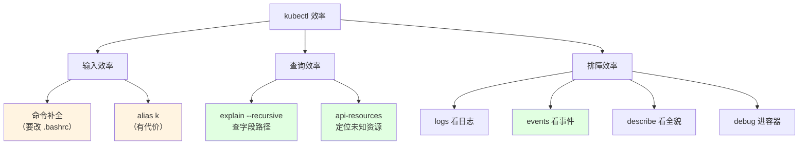
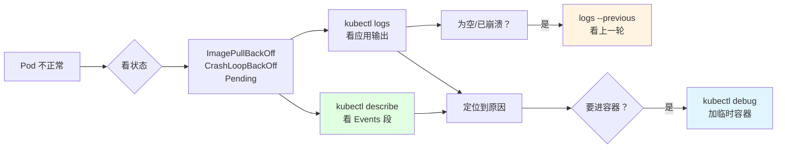
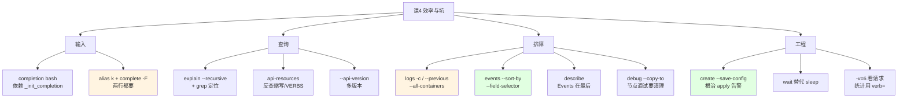
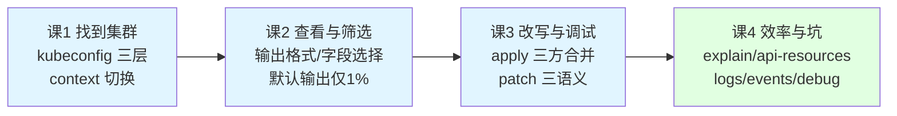

# 课 4：效率与坑

> 前置：完成 [课 1：kubectl 怎么找到集群](01-kubectl怎么找到集群.md)、[课 2：查看与筛选](02-查看与筛选.md)、[课 3：改写与调试](03-改写与调试.md)。本课是专项**收尾课**，讲**敲得快**与**排障命令链**。
>
> 本课环境（本机实测基线 · 2026-10-09）：
> - kubectl `v1.34.0` · 集群 `k8s-c1`（kind 单节点 v1.34.0）· WSL2 Ubuntu 24.04 · bash 5.2.21
> - `bash-completion` **1:2.11-8 已安装**，但 **`~/.bashrc` 里没有 kubectl 补全**（当前会话 `type __start_kubectl` → not found）
> - **当前 shell 无 `k` 别名** · zsh / fish **未安装** · krew **未安装**
> - 基线 context：`kind-k8s-c1`（**动手前先确认**，见第四幕）
>
> 本课**所有结论均为本机实测**；未能实测处显式标 `⚠️ 未实测`。
>
> ⚠️ **本课涉及写 `~/.bashrc`（安装补全、设别名）——属环境改动。讲义只给命令与验证方法，由你决定是否执行，AI 不代为写入。**

---

## 第一幕 · 场景引入：两个"为什么我这么慢"

**场景一**：你想给 Deployment 加一个 `containerPort`，但记不清层级是 `spec.template.spec.containers.ports` 还是 `spec.spec.containers.ports`。你打开浏览器搜文档，30 秒过去了。

**场景二**：Pod 起不来。你 `kubectl get pods` 看到 `ImagePullBackOff`，然后呢？你 `describe` 了一下，滚了三屏才在最后看到 `Events:`——而同事敲了一条命令就直接看到了原因。

这两个场景对应两件事：

- **场景一是"查"的效率** —— `explain` 递归查字段、`api-resources` 定位未知资源
- **场景二是"排"的效率** —— `logs` / `describe` / `events` / `debug` 这条命令链

再加两个日常摩擦：

- 每天敲 `kubectl` 几百次，多敲 6 个字符 × 300 次 = 一天 1800 个字符。**要不要用 `alias k=kubectl`？**
- 慢的时候不知道慢在哪 —— 是网络？是 API Server？还是 kubectl 自己在做资源发现？



---

## 第二幕 · 认知冲突：四个"理所当然"的坑

### 冲突一：`alias k=kubectl` 会把补全一起弄丢

设别名看起来毫无代价：

```bash
alias k=kubectl
```

但实测——**别名不会自动继承补全**：

```bash
# 子 shell 实测
alias k=kubectl
source <(kubectl completion bash)
complete -p k
```

输出（实测）：

```text
❌ 确认：k 默认没有补全
```

`complete -p k` 查不到任何补全规则。因为 bash 的补全是**按命令名注册**的，注册在 `kubectl` 上，`k` 完全不知道。

**修复必须再补一行**（实测成功）：

```bash
complete -o default -F __start_kubectl k
```

输出（实测）：

```text
✅ 已为 k 注册补全
complete -o default -F __start_kubectl k
```

> 💡 **代价量化**：别名省下 6 字符/次，代价是**多一行配置**，以及**你在别人机器上敲 `k` 会习惯性按 Tab 然后什么都没有**。
>
> **建议**（本课立场，供你判断）：
> - **学习阶段用全名** —— 肌肉记忆是跟 `kubectl` 绑定的，也是面试/协作时的通用语言
> - **熟练后可加别名，但必须连带那行 `complete`** —— 否则你是在用"快捷"换"补全"，净亏
> - **脚本里永远写全名** —— 别名不继承到非交互 shell，脚本里 `k` 会直接 `command not found`

### 冲突二：`explain` 不带 `--recursive` 只能看一层，但带上了会淹没你

`explain` 是查字段路径的正道。但不带 `--recursive`：

```bash
kubectl explain deploy.spec
```

输出（实测）——只列**直接子字段**：

```text
FIELDS:
  minReadySeconds	<integer>
  paused	<boolean>
  progressDeadlineSeconds	<integer>
  replicas	<integer>
  ...
```

实测统计：`deploy.spec` 顶层字段 **8 个**。

带上 `--recursive`：

```bash
kubectl explain deploy.spec --recursive
```

输出（实测）：**1216 行**（整个 `deployment` 全树是 **1259 行**）。

1216 行你不可能读完。**它的正确用法是配合 grep 定位**：

```bash
kubectl explain deployment --recursive | grep -B4 'containerPort'
```

输出（实测）：

```text
            terminationGracePeriodSeconds	<integer>
            timeoutSeconds	<integer>
          name	<string> -required-
          ports	<[]ContainerPort>
            containerPort	<integer> -required-
```

> 💡 **关键发现**：`--recursive` 的输出**保留了缩进**——**缩进就是路径深度**。上面这段里 `containerPort` 比 `ports` 多缩进 2 格，说明它是 `ports` 的子字段。顺着往上读，路径就拼出来了。
>
> 但注意：**`--recursive` 只给你字段名和缩进，不给你完整路径**。要拿完整路径，还是得一级级 `explain`，或用不带 recursive 的深层路径查询（下面会讲）。

**不带 `--recursive` 其实能查很深**——只要你知道路径：

```bash
kubectl explain deploy.spec.template.spec.containers.ports.containerPort
```

输出（实测）：

```text
FIELD: containerPort <integer>
```

**查不存在的字段会明确报错**（实测）：

```bash
kubectl explain deploy.spec.bogusField
# error: field "bogusField" does not exist
```

> 💡 **这个报错很有用**：它说明 `explain` 是**查真 schema** 而不是字符串匹配，可以放心拿它验证字段是否存在。

### 冲突三：`kubectl logs` 一个多容器 Pod，不指定 `-c` 居然**不报错**

按文档说法，多容器 Pod 必须指定 `-c`。实测——**不报错，它自己挑了一个**：

```bash
kubectl logs multi -n kc-l4-probe
```

输出（实测）：

```text
Defaulted container "app" out of: app, sidecar
APP-LOG-1
APP-LOG-2
```

注意第一行：**`Defaulted container "app" out of: app, sidecar`**。

> ⚠️ **这是个静默陷阱**：你以为看的是 sidecar 的日志，实际它给了你 `app` 的。输出里只有一行提示，滚快了就看不见。
>
> **规矩**：**多容器 Pod 永远显式写 `-c`**。想看全部就用 `--all-containers=true`（实测带 `--prefix` 会标注来源）：
>
> ```text
> [pod/multi/app] APP-LOG-1
> [pod/multi/app] APP-LOG-2
> [pod/multi/sidecar] SIDECAR-LOG-1
> ```

容器名写错会明确报错（实测）：

```text
error: container nosuch is not valid for pod multi
```

### 冲突四：`--previous` 前提是你**没把 restartPolicy 设成 Never**

想看"崩溃前最后一次"的日志，第一反应是 `--previous`。但实测——**它可能拿不到**：

```bash
# restartPolicy: Never 的 Pod
kubectl logs crash --previous
```

输出（实测）：

```text
Error from server (BadRequest): previous terminated container "c" in pod "crash" not found
```

**原因**：`restartPolicy: Never` 时容器崩溃后**不重启**，只有一个容器实例，没有"上一个"。

**改成 `restartPolicy: Always`** 让容器重启，才有"上一轮"。实测证明 `--previous` 拿到的确实是**不同实例**——让每轮输出一个时间戳：

```bash
kubectl logs pv2                    # 当前（最新一轮）
kubectl logs pv2 --previous         # 上一轮
```

输出（实测）：

```text
当前:      STARTED-AT-1791539376
--previous: STARTED-AT-1791539369
```

**两个时间戳差 7 秒** —— 证明 `--previous` 拿到的是**上一个容器实例**的日志，不是同一份。

> 💡 **`-p` 是 `--previous` 的简写**（实测两者输出一致）。
>
> **排障价值**：容器反复 CrashLoopBackOff 时，**当前日志可能是空的**（还没来得及输出就崩了），**`--previous` 才有真正的错误信息**。

---

## 第三幕 · 层层揭示

### 第 1 层：命令补全（bash）—— 装与不装

**先看现状**（本机实测）：

| 项 | 状态 |
|---|---|
| `bash-completion` 包 | ✅ 已装（1:2.11-8） |
| `/etc/bash_completion` | ✅ 存在 |
| `/usr/share/bash-completion` | ✅ 存在 |
| `~/.bashrc` 里的 kubectl 补全 | ❌ **没有** |
| 当前会话补全函数 | ❌ 未加载 |
| zsh / fish | ❌ 未安装 |

**kubectl 自带补全生成器**（只读，不装）：

```bash
kubectl completion bash    # 440 行
kubectl completion zsh     # 228 行
kubectl completion fish    # 249 行
kubectl completion powershell  # 284 行
```

⚠️ **不指定 shell 会报错**（实测）：

```bash
kubectl completion
# error: Shell not specified.
```

**补全脚本依赖 bash-completion 的两个函数**（实测从脚本里 grep 出来的）：

```text
_get_comp_words_by_ref
_init_completion
```

> ⚠️ **这就是"装了补全但不生效"的头号原因**：只 source 了 kubectl 的补全脚本，但系统没有 `bash-completion` 包提供 `_init_completion`。实测在 `bash --norc --noprofile` 里 source 后 `complete` 能注册（`complete -p kubectl` 有输出），但**实际按 Tab 会报函数未定义**。

**bash 版本要求**（实测从脚本注释里读到）：

```text
# Macs have bash3 for which the bash-completion package doesn't include
                # no sort isn't supported for bash less than < 4.4
```

即 **bash < 4.4 会有部分功能受限**（`no sort`）。本机 bash 5.2.21，没问题。

**安装三步**（**由你决定是否执行**）：

```bash
# ① 临时生效（当前会话）
source <(kubectl completion bash)

# ② 永久生效（写入 ~/.bashrc）
echo 'source <(kubectl completion bash)' >> ~/.bashrc

# ③ 如果用了 alias k，补一行
echo 'alias k=kubectl' >> ~/.bashrc
echo 'complete -o default -F __start_kubectl k' >> ~/.bashrc
```

**验证**（装完立刻跑）：

```bash
type __start_kubectl                 # 应输出 "__start_kubectl is a function"
complete -p kubectl                  # 应输出 complete -o default -F __start_kubectl kubectl
```

⚠️ **未实测**：本课**未在 `~/.bashrc` 里真实写入并开新会话验证**（属环境改动，等你决定）。上面的验证命令是基于子 shell 实测推断的标准做法。

### 第 2 层：`explain` + `api-resources` 组合技

这是**查未知资源**的标准流程。

**场景**：你在别人的 YAML 里看到 `hpa`，不知道这是什么、有哪些字段。

**第一步：`api-resources` 反查缩写**（实测）：

```bash
kubectl api-resources | grep -E '^hpa|HorizontalPodAutoscaler'
```

输出（实测）：

```text
horizontalpodautoscalers            hpa          autoscaling/v2                    true         HorizontalPodAutoscaler
```

一行给你四件事：**全名 / 缩写 / 版本 / 是否 namespaced / Kind**。

**第二步：`explain` 查字段**（实测）：

```bash
kubectl explain hpa
```

输出（实测）：

```text
GROUP:      autoscaling
KIND:       HorizontalPodAutoscaler
VERSION:    v2
```

**第三步：递归查具体字段**

```bash
kubectl explain hpa --recursive | grep -i 'targetCPUUtilization\|metrics'
```

**`api-resources` 的筛选能力**（实测数据）：

| 命令 | 实测结果 |
|------|---------|
| `kubectl api-resources` 总数 | **68** |
| `--namespaced=true` | **35** |
| `--namespaced=false` | **33** |
| `--verbs=get` | **61** |
| `--verbs=list,watch` | **58** |
| `--api-group=apps` | 5（ds / deploy / rs / sts / controllerrevisions） |

**`-o wide` 的 VERBS 列是排障利器**（实测）：

```text
namespaces    ns    v1    false    Namespace    create,delete,get,list,patch,update,watch
```

> 💡 **用途**：报 `forbidden: User cannot delete resource` 时，先看 VERBS 里到底有没有 `delete`——**可能是 RBAC 没给，也可能这个资源压根不支持该动作**（比如 `componentstatuses` 只有 `get,list`）。
>
> 实测 `componentstatuses` 的 VERBS 是 `get,list`——**它没有 delete，你 forbidden 不是你的错**。

**多版本资源要指定 `--api-version`**（实测）：

```bash
kubectl explain hpa                                  # VERSION: v2（默认）
kubectl explain hpa --api-version=autoscaling/v1     # VERSION: v1
```

⚠️ **注意**：实测本机 `api-resources` 里 **HPA 只列出 `autoscaling/v2` 一条**，但 `--api-version=autoscaling/v1` 仍能查到（服务端还保留 v1）。两者顶层字段数实测都是 5，但字段内容不同。

**CRD 也能 explain**（实测）——本机有个 CRD：

```bash
kubectl api-resources | grep -i lesson
# widgets    wg    lesson07.example.com/v1    true    Widget

kubectl explain widget
# GROUP:      lesson07.example.com
# KIND:       Widget
```

> ⚠️ **坑**：`explain` 要的是 **Kind（Widget）**，不是资源名的前缀。实测 `kubectl explain lesson` 报 `the server doesn't have a resource type "lesson"`，而 `kubectl explain widget` 成功。

### 第 3 层：排障命令链

这是本课**最有实战价值**的部分。四个命令各司其职：



#### `describe` —— 看全貌，Events 在**最后**

`kubectl describe node` 实测输出结构（顺序固定）：

```text
Name / Roles / Labels / Annotations / CreationTimestamp / Taints / Unschedulable
Lease:
Conditions:          ← 节点健康四指标
Addresses:
...
Events:              ← 在最后
```

> 💡 **为什么 Events 在最后是坑**：`describe` 一个繁忙对象会输出上百行，你**必须滚到最后才看到最有价值的信息**。
>
> **替代**：`kubectl get events --field-selector=involvedObject.name=<pod>` 直接只看事件。

**实测对比**——同一个 Pod：

| 方式 | 行数 |
|------|------|
| `describe pod` 的 Events 段 | **8** |
| `get events --field-selector=involvedObject.name=pv2` | **6** |

⚠️ **两者不一致**（8 vs 6）。原因是 **`describe` 会聚合显示**（实测看到 `Pulling 5s (x2 over 12s)` 这种合并行），而 `get events` 的 `count` 字段单独成一列。**排查时不要以为少看了事件**。

#### `events` —— 默认**不排序**，且默认只留 1 小时

**实测：默认顺序是乱的**：

```bash
kubectl get events -n kc-l4-probe            # 默认
```

输出（实测，取时间戳列）：

```text
2m47s  2m45s  2m45s  ...
```

**并不严格按时间倒序**。加排序后：

```bash
kubectl get events -A --sort-by=.lastTimestamp
```

> 💡 **规矩：查事件永远加 `--sort-by`**。推荐 `--sort-by=.lastTimestamp`（按"最后一次发生"）或 `--sort-by=.metadata.creationTimestamp`（按"第一次发生"）。
>
> ⚠️ **注意**：实测 `--sort-by=.lastTimestamp` 的输出里出现 `2m56s / 20s / 45s / 2m47s / 2m12s`——**排序对 `<nil>` 值的处理不理想**（部分事件的 `lastTimestamp` 为空）。这是已知毛刺，**以 `creationTimestamp` 排序更稳**。

**保留时长**（实测）：

```bash
kubectl get pod -n kube-system kube-apiserver-... -o jsonpath='{.spec.containers[0].command}' \
  | tr ',' '\n' | grep -i 'event-ttl'
# （无输出 = 未显式设置）
```

> ⚠️ **默认 `--event-ttl=1h`**（未显式设置时的 K8s 默认值，⚠️ 本课未直接读默认值，按 K8s 默认行为陈述）。
>
> **含义**：**一小时前的事件查不到了**。半夜出的事故，早上来查是空的——不是没发生，是过期的。**要长期留存必须接外部事件采集**（如 kube-eventer、Event Router）。

**`count` 字段**（实测）：

```text
LAST                   TYPE      REASON      COUNT    MSG
<nil>                  Normal    Scheduled   <none>   Successfully assigned ...
2026-10-09T09:44:29Z   Normal    Pulling     1        Pulling image "busybox:latest"
2026-10-09T09:47:10Z   Normal    Pulling     3        Pulling image "busybox:latest"
```

> ⚠️ **两个坑**：① **部分事件的 `lastTimestamp` 是 `<nil>`**（如 Scheduled），所以按时间排序会乱；② **`count` 会聚合**——`Pulling ... count=3` 表示发生了 3 次，不要以为只有 1 次。

**筛选**（实测）：

```bash
kubectl get events --field-selector=type=Warning        # 只看异常
kubectl get events --field-selector=involvedObject.name=evfail
kubectl get events --watch                              # 实时跟随
```

#### `logs` 参数速查（全部实测）

| 参数 | 实测行为 |
|------|---------|
| `-c <name>` | 指定容器；**多容器不指定会 `Defaulted container "app" out of: app, sidecar`** |
| `--all-containers=true` | 输出全部容器日志 |
| `--prefix` | 加 `[pod/multi/app]` 前缀标识来源 |
| `--timestamps` | 行首加 `2026-10-09T09:49:36.530490332Z` |
| `--tail=1` | 只取最后 1 行 |
| `--since=10s` | 取最近 10 秒 |
| `--since-time=<RFC3339>` | 取指定时刻之后 |
| `-f` | 跟随（实测 4 秒超时退出正常） |
| `--previous` / `-p` | 上一个容器实例（**需 restartPolicy≠Never**） |
| `--limit-bytes=10` | 截断到 10 字节（实测输出 `STARTED-AT`） |

#### `debug` —— 不重启进容器

`kubectl debug` 三种模式（实测 `--help` 原文归纳）：

1. **Workload**：给运行中的 Pod **加临时容器**（ephemeral container）
2. **Workload**：**复制**一个 Pod 并改属性（`--copy-to`）
3. **Node**：在节点宿主命名空间起 Pod，能访问节点文件系统

**模式 1：加 ephemeral container**（实测）：

```bash
kubectl debug -it multi --image=busybox:latest --target=app --profile=general
```

输出（实测）：

```text
Targeting container "app". If you don't see processes from this container it may be because the container runtime doesn't support this feature.
Defaulting debug container name to debugger-xldrx.
Unable to use a TTY - input is not a terminal or the right kind of file
...
warning: couldn't attach to pod/multi, falling back to streaming logs: error stream protocol error: unknown error
```

容器**确实加上了**（实测查 `spec.ephemeralContainers`）：

```json
[{"image":"busybox:latest","name":"debugger-xldrx","securityContext":{"capabilities":{"add":["SYS_PTRACE"]}},"stdin":true,"targetContainerName":"app","tty":true}]
```

> ⚠️ **两个坑**：
> ① **`Unable to use a TTY`** —— 非交互环境（脚本/管道）下无法 attach。**加 `--attach=false`** 让它只创建不连接。
> ② **ephemeral container 加进去了但原 Pod 仍在跑** —— 实测 `status.phase` 仍是 `Running`，`spec.containers` 仍只有 `app sidecar`（ephemeral 是**独立字段**，不在 `spec.containers` 里）。

**模式 2：复制调试**（实测，推荐）：

```bash
kubectl debug multi --image=busybox:latest --copy-to=multi-copy --attach=false
```

输出（实测）：

```text
--profile=legacy is deprecated and will be removed in the future. It is recommended to explicitly specify a profile, for example "--profile=general".
Defaulting debug container name to debugger-2nwjj.
```

复制出的 Pod 容器列表（实测）：

```text
app sidecar debugger-2nwjj
```

> 💡 **`--copy-to` 比直接加 ephemeral 更安全**——它不动原 Pod。生产环境优先用它。

**模式 3：节点调试**（实测）：

```bash
kubectl debug node/k8s-c1-control-plane -it --image=busybox:latest --attach=false
# Creating debugging pod node-debugger-k8s-c1-control-plane-hdkg7 with container debugger on node k8s-c1-control-plane.
```

> ⚠️ **清理提醒**：节点调试 Pod 实测落在 **`default` 命名空间**，名字形如 `node-debugger-<node>-<随机>`。**用完必须手动删**，否则一直占着。
>
> 本课实测后已清理。清理命令：
> ```bash
> kubectl delete pod -n default node-debugger-k8s-c1-control-plane-hdkg7
> # 或用标签批量（⚠️ 标签名未实测，建议直接按名字删）
> ```

**`--profile` 建议显式指定**——实测不加会警告：

```text
--profile=legacy is deprecated and will be removed in the future. It is recommended to explicitly specify a profile, for example "--profile=general"
```

### 第 4 层：`create --save-config` 与 apply 的首次告警

这是课 3 留下的尾巴，**也是日常最常遇到的告警**。

**复现**（实测）：

```bash
kubectl create cm k4a --from-literal=a=1 -n kc-l4-probe
kubectl apply -f k4a.yaml
```

输出（实测）：

```text
Warning: resource configmaps/k4a is missing the kubectl.kubernetes.io/last-applied-configuration annotation which is required by kubectl apply. kubectl apply should only be used on resources created declaratively by either kubectl create --save-config or kubectl apply. The missing annotation will be patched automatically.
configmap/k4a configured
```

**它说了三件事**：

1. 这个对象**没有 `last-applied` 注解**
2. `apply` **需要**它（课 3 讲过：三方合并要用它当"上次你说过什么"）
3. **它会自动补上**（`will be patched automatically`）

**根治方法一：`create --save-config`**（实测）：

```bash
kubectl create cm k4b --from-literal=a=1 -n kc-l4-probe --save-config
```

注解（实测，立刻就有）：

```json
{"kind":"ConfigMap","apiVersion":"v1","metadata":{"name":"k4b","namespace":"kc-l4-probe"},"data":{"a":"1"}}
```

之后 `apply` **无告警**（实测：`configmap/k4b configured`，没有 Warning）。

**根治方法二：对已有对象补注解**——⚠️ **实测踩坑**：

```bash
kubectl apply set-last-applied -f k4c.yaml
```

输出（实测）：

```text
error: no last-applied-configuration annotation found on resource: k4c, to create the annotation, run the command with --create-annotation
```

**它要求你显式加 `--create-annotation`**：

```bash
kubectl apply set-last-applied -f k4c.yaml --create-annotation
```

> ⚠️ **未实测**：本课未跑 `--create-annotation` 后的效果验证（探测时未加该参数导致失败）。**按报错提示，正确命令应加 `--create-annotation`**。

**告警的实际风险有多大？** 实测——**改值照样生效**：

```bash
kubectl apply -f - <<EOF
# data: a: "2"
EOF
# configmap/k4a configured
# 结果 data: {"a":"2"}
```

> 💡 **结论**：这个告警**不阻塞操作**，`apply` 会自己补注解并继续。真正的风险在于**首次补注解时，它以当前 live 状态当作 last-applied**——如果此前有别人的改动，那些改动会被"认领"成你的，之后你删文件里的字段时它们会被删掉（课 3 的两步删除法原理）。
>
> **规矩**：**从第一天就用 `apply` 或 `create --save-config` 建对象**，别用裸 `create`。

### 第 5 层：性能与 `-v` 排障

**kubectl 的发现缓存**（实测）：

```text
~/.kube/cache   55M
  discovery/     ← API 资源发现结果
  http/          ← HTTP 响应缓存
```

> ⚠️ **55M 不小**。缓存目录会随集群/API 版本增长。长期不清理可能到几百 M。

**冷启动 vs 热启动**（实测，用临时 cache 目录避免动用户目录）：

| 场景 | 耗时 |
|------|------|
| 冷启动（空 cache）第 1 次 | **101 ms** |
| 冷启动 第 2 次 | **85 ms** |
| 热启动（默认 cache） | **85-86 ms** |

> ⚠️ **诚实结论**：本机**差异不明显**（101 vs 85 ms），因为 kind 集群在本地、网络延迟极低。**在远端/高延迟集群上差异会大得多**。⚠️ 本课未在远端集群实测。

**`-v` 级别**（实测输出行数）：

| 级别 | 行数 | 内容 |
|------|------|------|
| `-v=0` | 6 | 只有结果 |
| `-v=4` | 11 | 加了加载信息 |
| `-v=6` | 14 | **加了 HTTP 请求**（`round_trippers`） |
| `-v=8` | 27 | 更详细 |

**`-v=6` 能看到真正的 API 请求**（实测）：

```text
I1009 17:49:13.342580  704354 round_trippers.go:632] "Response" verb="GET" url="https://127.0.0.1:45145/api/v1/namespaces?limit=500" status="200 OK" milliseconds=4
```

> ⚠️ **统计请求数的正确关键词是 `verb="GET"`**，不是 `GET https`。
> **本课在此犯过错**：前两轮探测脚本用 `grep -c 'GET https'` 统计，结果**恒为 0**（因为 kubectl 日志格式是 `verb="GET" url="..."`），差点得出"kubectl 不发请求"的荒谬结论。第四轮才发现。
>
> **教训**：**统计命令的输出前，先 `head` 看一眼真实格式**。

⚠️ **安全提醒**：`-v=7` 及以上会打印**请求头，含 `Authorization: Bearer <token>`**。**不要把 `-v=7+` 的输出贴到公开地方**（日志/工单/GitHub issue）。

### 第 6 层：`kubectl wait`（排障自动化）

`wait` 在脚本里比 `sleep` 可靠得多。

**语法**（实测 `--help` 原文）：

```text
Experimental: Wait for a specific condition on one or many resources.
The command takes multiple resources and waits until the specified condition is seen in the Status field of every given resource.
```

**实测**：

```bash
kubectl wait --for=condition=Ready pod/pv2 -n kc4v --timeout=5s
# error: timed out waiting for the condition on pods/pv2
```

⚠️ **这个 Pod 当时在 CrashLoopBackOff**（restartCount=1），所以超时——**符合预期**。

```bash
kubectl wait --for=condition=Ready pod/nonexistent -n kc4v --timeout=3s
# Error from server (NotFound): pods "nonexistent" not found
```

> 💡 **注意区别**：条件不满足 → `timed out waiting`；对象不存在 → 立刻 `NotFound`（**不会等满 timeout**）。

** `--for=delete`** 实测**无输出**（对象不存在时直接成功返回）——用于"等某个对象真的被删掉再继续"。

---

## 第四幕 · 实操验证

> 下面每步都在本机真跑过。
>
> **动手前先确认基线**：
>
> ```bash
> kubectl config use-context kind-k8s-c1
> kubectl config current-context
> ```
>
> ⚠️ **第 1 步涉及写 `~/.bashrc`，属环境改动——请你自行判断是否执行，AI 不代为写入。**

### 第 1 步：确认补全现状（只读）

```bash
echo "bash-completion: $(dpkg -s bash-completion 2>/dev/null | grep '^Version')"
ls -la /etc/bash_completion
ls /etc/bash_completion.d/
type _init_completion
type __start_kubectl
grep -n 'completion' ~/.bashrc
```

本机实测预期：`bash-completion` 已装、`/etc/bash_completion` 存在、但 **`__start_kubectl` 未定义**（未启用 kubectl 补全）。

> ⚠️ **验证用 `__start_kubectl`，不要用网上流传的 `__kubectl_get_resource`**。
> 实测 v1.34 的补全脚本里**根本没有 `__kubectl_get_resource` 这个函数**（`grep -c` 结果为 0），真实入口是 **`__start_kubectl`**。
> 用错名字会得到 "not found"，然后误判"补全没装上"。函数全名实测如下：
>
> ```text
> __start_kubectl                          ← 入口，complete -F 指向它
> __kubectl_debug
> __kubectl_extract_activeHelp
> __kubectl_format_comp_descriptions
> __kubectl_get_completion_results
> __kubectl_handle_activeHelp
> __kubectl_handle_completion_types
> __kubectl_handle_standard_completion_case
> __kubectl_init_completion
> __kubectl_process_completion_results
> __kubectl_reprint_commandLine
> ```

### 第 2 步：临时启用补全（不写配置，当前会话有效）

```bash
source <(kubectl completion bash)
type __start_kubectl
```

预期：输出 `__start_kubectl is a function`。

**更可靠的验证是看 `complete` 是否注册**（实测）：

```bash
complete -p kubectl
```

预期（实测）：

```text
complete -o default -F __start_kubectl kubectl
```

> 💡 **这行也解释了 `alias k` 的修复原理**：补全规则是 `-F __start_kubectl`，所以给 `k` 注册就是 `complete -o default -F __start_kubectl k`——**指向同一个函数**。

### 第 3 步：（可选）永久启用 —— **由你决定**

```bash
echo 'source <(kubectl completion bash)' >> ~/.bashrc
```

**如果要用 `k` 别名**（必须两行都写）：

```bash
echo 'alias k=kubectl' >> ~/.bashrc
echo 'complete -o default -F __start_kubectl k' >> ~/.bashrc
```

**验证**（新开一个 shell）：

```bash
type __start_kubectl          # 应输出 "__start_kubectl is a function"
complete -p kubectl           # 应输出 complete -o default -F __start_kubectl kubectl
complete -p k                 # 若配了别名，应有对应输出
kubectl <Tab><Tab>            # 应列出子命令
```

### 第 4 步：验证"别名不带补全"的坑（只读）

```bash
bash -c '
  alias k=kubectl
  source <(kubectl completion bash)
  complete -p k 2>/dev/null && echo "有补全" || echo "❌ k 无补全"
'
```

预期：`❌ k 无补全`

再验证修复：

```bash
bash -c '
  alias k=kubectl
  source <(kubectl completion bash)
  complete -o default -F __start_kubectl k
  complete -p k
'
```

预期：输出 `complete -o default -F __start_kubectl k`

### 第 5 步：explain 组合技

```bash
kubectl explain deploy.spec | sed -n '/^FIELDS:/,$p' | grep -cE '^  [a-zA-Z]'
# 预期: 8

kubectl explain deploy.spec --recursive | wc -l
# 预期: 1216

kubectl explain deployment --recursive | grep -B4 containerPort
# 预期: 看到缩进层级，containerPort 在 ports 下

kubectl explain deploy.spec.template.spec.containers.ports.containerPort
# 预期: FIELD: containerPort <integer>

kubectl explain deploy.spec.bogusField
# 预期: error: field "bogusField" does not exist
```

### 第 6 步：api-resources 定位未知资源

```bash
kubectl api-resources | wc -l                      # 69（含表头）
kubectl api-resources --namespaced=true | wc -l    # 36
kubectl api-resources --namespaced=false | wc -l   # 34
kubectl api-resources --verbs=get | wc -l          # 62
kubectl api-resources --api-group=apps
kubectl api-resources -o wide | grep -E '^componentstatuses'
# 预期: VERBS 只有 get,list ← 证明它没有 delete
kubectl api-resources | grep -E '^hpa|HorizontalPodAutoscaler'
kubectl explain hpa                                # VERSION: v2
kubectl explain hpa --api-version=autoscaling/v1   # VERSION: v1
```

### 第 7 步：制造一个故障 Pod 并排障

```bash
NS=kc4-lab
kubectl create ns $NS
cat > /tmp/evfail.yaml <<'EOF'
apiVersion: v1
kind: Pod
metadata:
  name: evfail
  namespace: kc4-lab
spec:
  restartPolicy: Never
  containers:
  - name: c
    image: nonexistent.invalid/nosuchimage:v1
    command: ['sh','-c','echo hi']
EOF
kubectl apply -f /tmp/evfail.yaml
sleep 20
```

**用三种方式看它**：

```bash
# ① get 看状态
kubectl get pod evfail -n $NS

# ② describe 看 Events（在最后）
kubectl describe pod evfail -n $NS | sed -n '/^Events:/,$p'

# ③ 直接筛 events（更快）
kubectl get events -n $NS --field-selector=involvedObject.name=evfail --sort-by=.metadata.creationTimestamp
```

预期：看到 `Failed to pull image ... no such host`。

**只看 Warning**：

```bash
kubectl get events -n $NS --field-selector=type=Warning
```

### 第 8 步：多容器日志与 --previous

```bash
cat > /tmp/multi.yaml <<'EOF'
apiVersion: v1
kind: Pod
metadata:
  name: multi
  namespace: kc4-lab
spec:
  containers:
  - name: app
    image: busybox:latest
    command: ['sh','-c','echo APP-LOG-1; echo APP-LOG-2; sleep 3600']
  - name: sidecar
    image: busybox:latest
    command: ['sh','-c','echo SIDECAR-LOG-1; sleep 3600']
EOF
kubectl apply -f /tmp/multi.yaml
kubectl wait --for=condition=Ready pod/multi -n $NS --timeout=120s

kubectl logs multi -n $NS                          # 预期: Defaulted container "app" out of: app, sidecar
kubectl logs multi -n $NS -c sidecar               # 预期: SIDECAR-LOG-1
kubectl logs multi -n $NS --all-containers=true --prefix
kubectl logs multi -n $NS -c nosuch                # 预期: error: container nosuch is not valid for pod multi
```

**`--previous` 的正确场景**：

```bash
cat > /tmp/pv2.yaml <<'EOF'
apiVersion: v1
kind: Pod
metadata:
  name: pv2
  namespace: kc4-lab
spec:
  restartPolicy: Always
  containers:
  - name: c
    image: busybox:latest
    command: ['sh','-c','echo "STARTED-AT-$(date +%s)"; sleep 4; exit 1']
EOF
kubectl apply -f /tmp/pv2.yaml
# 等至少一次重启
for i in $(seq 1 25); do
  R=$(kubectl get pod pv2 -n $NS -o jsonpath='{.status.containerStatuses[0].restartCount}' 2>/dev/null)
  [ -n "$R" ] && [ "$R" -ge 1 ] && break
  sleep 2
done
kubectl logs pv2 -n $NS                    # 当前轮
kubectl logs pv2 -n $NS --previous         # 上一轮（时间戳应不同）
```

**对照：restartPolicy: Never 时 `--previous` 会失败**：

```bash
kubectl logs crash -n $NS --previous
# 预期（若用 Never）: previous terminated container "c" in pod "crash" not found
```

### 第 9 步：debug 三模式

```bash
# ① 加 ephemeral（非交互环境加 --attach=false）
kubectl debug multi -n $NS --image=busybox:latest --target=app --profile=general --attach=false
kubectl get pod multi -n $NS -o jsonpath='{.spec.ephemeralContainers}'

# ② 复制调试（推荐，不动原 Pod）
kubectl debug multi -n $NS --image=busybox:latest --copy-to=multi-copy --profile=general --attach=false
kubectl get pod multi-copy -n $NS -o jsonpath='{.spec.containers[*].name}'
# 预期: app sidecar debugger-xxxxx

# ③ 节点调试（⚠️ 用完要删）
kubectl debug node/k8s-c1-control-plane -it --image=busybox:latest --profile=general --attach=false
kubectl get pods -A | grep node-debugger
kubectl delete pod -n default node-debugger-k8s-c1-control-plane-xxxxx
```

### 第 10 步：create --save-config 与告警

```bash
kubectl create cm k4a --from-literal=a=1 -n $NS
kubectl get cm k4a -n $NS -o jsonpath='{.metadata.annotations}'
# 预期: 无 last-applied

kubectl apply -f - <<EOF
apiVersion: v1
kind: ConfigMap
metadata: {name: k4a, namespace: $NS}
data: {a: "1"}
EOF
# 预期: Warning: resource configmaps/k4a is missing the ... annotation

kubectl create cm k4b --from-literal=a=1 -n $NS --save-config
kubectl get cm k4b -n $NS -o jsonpath='{.metadata.annotations.kubectl\.kubernetes\.io/last-applied-configuration}'
# 预期: 有注解

kubectl apply -f - <<EOF
apiVersion: v1
kind: ConfigMap
metadata: {name: k4b, namespace: $NS}
data: {a: "1"}
EOF
# 预期: 无 Warning
```

### 第 11 步：性能与 -v

```bash
du -sh ~/.kube/cache
ls ~/.kube/cache

kubectl get ns -v=6 2>&1 | head -8
# 注意统计请求数要用: grep -c 'verb="GET"'

for V in 0 4 6 8; do echo -n "-v=$V: "; kubectl get ns -v=$V 2>&1 | wc -l; done
# 预期: 6 / 11 / 14 / 27
```

⚠️ **不要执行 `kubectl get ns -v=7` 并把输出贴到公开处**（含 Bearer token）。

### 第 12 步：清理（**必做**）

```bash
kubectl delete ns $NS
kubectl get pods -A | grep node-debugger    # 确认无残留
rm -f /tmp/evfail.yaml /tmp/multi.yaml /tmp/pv2.yaml
```

---

## 第五幕 · 体系收束

### 一句话记住

**`alias k` 会丢补全（要补一行 `complete -F`）；`explain --recursive` 用 grep 定位深层字段（缩进即深度）；多容器 `logs` 不写 `-c` 会静默选一个（`Defaulted container`）；`--previous` 需要容器真的重启过；`events` 默认不排序且只留 1 小时（查事件永远加 `--sort-by`）；`debug` 用 `--copy-to` 不动原 Pod、节点调试 Pod 落在 `default` 要手动删；`create --save-config` 根治 apply 首次告警。**

### 知识地图



### 决策速查

| 我要… | 用什么 | 注意 |
|-------|--------|------|
| 查字段路径 | `explain <res> --recursive \| grep <字段>` | 缩进=深度；只给字段名不给完整路径 |
| 验证字段存在 | `explain <完整路径>` | 不存在会明确报 `does not exist` |
| 反查缩写 | `api-resources \| grep <缩写>` | 给全名/版本/namespaced/Kind |
| 看某资源支持哪些动作 | `api-resources -o wide` | VERBS 列；forbidden 先查这 |
| 多版本资源查字段 | `explain <res> --api-version=<g/v>` | 默认用服务端首选版本 |
| 看多容器 Pod 日志 | `logs -c <name>` | **不写 -c 会静默选一个** |
| 看崩溃前日志 | `logs --previous` | **需 restartPolicy≠Never** |
| 查事件 | `get events --sort-by=... --field-selector=...` | **默认不排序、只留 1h** |
| 只看异常事件 | `--field-selector=type=Warning` | |
| 进容器排查 | `debug --copy-to=<新名>` | 不动原 Pod；**用完删** |
| 进节点排查 | `debug node/<名>` | Pod 落在 `default`，**必须手动删** |
| 脚本里等就绪 | `kubectl wait --for=condition=Ready` | 比 `sleep` 可靠 |
| 看 kubectl 发了什么请求 | `-v=6` | **统计用 `verb="GET"`**；`-v=7+` 含 token |

### 六条守则

1. **用 `k` 别名就必须配 `complete -F`** —— 否则是用"少敲 6 字符"换"丢补全"，净亏。
2. **查事件永远加 `--sort-by`** —— 默认顺序不可信，且只留 1 小时，事发一小时后就查不到了。
3. **多容器 Pod 的 `logs` 永远写 `-c`** —— 静默选容器比报错更危险。
4. **`--previous` 前先确认容器重启过** —— `restartPolicy: Never` 时它必然失败。
5. **用 `--copy-to` 调试，别直接加 ephemeral** —— 前者不动原 Pod；节点调试的 Pod 记得删。
6. **建对象就用 `apply` 或 `create --save-config`** —— 裸 `create` 会让后续每次 apply 都告警，且首次补注解时会"认领"别人的改动。

### 小测

1. 设了 `alias k=kubectl` 后，为什么 Tab 补全不工作了？怎么修？
2. `kubectl explain deploy.spec` 不带 `--recursive` 和带 `--recursive`，实测输出规模差多少？`--recursive` 的正确用法是什么？
3. 多容器 Pod 执行 `kubectl logs <pod>`（不指定 `-c`），实测发生什么？
4. 什么情况下 `kubectl logs --previous` 会报 `previous terminated container not found`？怎么让它能工作？
5. `kubectl get events` 默认顺序可信吗？事件默认保留多久？
6. `kubectl debug node/<节点名>` 创建的 Pod 落在哪个命名空间？为什么要特别注意？
7. 用裸 `kubectl create` 建的对象，第一次 `apply` 会怎样？怎么从一开始就避免？
8. 用 `-v=6` 统计 kubectl 发了多少次 GET 请求，正确的 grep 关键词是什么？`-v=7` 有什么风险？

<details>
<summary>参考答案</summary>

1. bash 补全按**命令名**注册，注册在 `kubectl` 上，`k` 不继承。修复：`complete -o default -F __start_kubectl k`（实测 `complete -p k` 才有输出）。
2. 实测 `deploy.spec`：不带 8 个顶层字段；带 **1216 行**（全树 1259 行）。正确用法是**配合 grep 定位**，靠缩进判断层级，而不是通读。
3. **不报错**，kubectl 自己选一个并打印 `Defaulted container "app" out of: app, sidecar`。⚠️ 静默陷阱，必须显式写 `-c`。
4. **`restartPolicy: Never`** 时（容器崩溃不重启，没有"上一个"实例）。改成 `Always` 让容器重启后，`--previous` 才拿得到上一轮——实测两轮时间戳不同（差 7 秒）可证明。
5. **不可信**（实测默认顺序非严格时间序）。默认保留 **1 小时**（`--event-ttl` 默认值，本课未直接读默认值）。**永远加 `--sort-by`**。
6. **`default` 命名空间**，名字形如 `node-debugger-<node>-<随机>`。**必须手动删除**，否则一直占用资源。
7. 第一次 `apply` 会告警 `missing the kubectl.kubernetes.io/last-applied-configuration annotation`，并自动补上。**不阻塞**（改值照样生效），但补注解时会以当前 live 状态当 last-applied，"认领"别人的改动。根治：用 `apply` 或 `create --save-config` 建对象。
8. 正确关键词是 **`verb="GET"`**（kubectl 日志格式为 `verb="GET" url="..."`）。⚠️ 本课前两轮误用 `GET https` 导致恒为 0。`-v=7+` **会打印 `Authorization: Bearer <token>`，不要贴到公开处**。

</details>

### 专项收尾 · 四课回顾



**贯穿四课的三条主线**：

1. **kubectl 是 API 客户端** —— 所有命令都在发 HTTP 请求（课 1 的 kubeconfig、课 4 的 `-v=6` 是同一件事的两端）
2. **声明式 vs 命令式** —— `apply` 三方合并（课 3）是声明式的核心，`patch`/`replace` 是命令式的补充；课 4 的 `create --save-config` 是两者的桥梁
3. **默认行为不等于合理行为** —— 默认输出只有 1%（课 2）、events 默认不排序（课 4）、logs 默认静默选容器（课 4）、diff 有差异退出码是 1（课 3）

### 课程导航

- **上一课**：[课 3：改写与调试](03-改写与调试.md)
- **专项完结** 🎉 —— 4 课全部交付
- **专项首页**：[kubectl 专项 overview](../overview.md)
- **相关主线课**：[课 2：声明式 API 与调谐循环](../../../stages/1-心智模型与架构/lessons/02-声明式API与调谐循环.md)、[课 18：系统化排障分层定位法](../../../stages/6-排障运维与扩展/lessons/18-系统化排障分层定位法.md)（✅ 2026-09-14 已交付）
- **官方文档**：[kubectl 备忘单](https://kubernetes.io/zh-cn/docs/reference/kubectl/quick-reference/)、[kubectl debug](https://kubernetes.io/docs/tasks/debug/debug-application/debug-running-pod/)、[启用 shell 自动补全](https://kubernetes.io/zh-cn/docs/tasks/tools/included/optional-kubectl-configs-bash-linux/)
