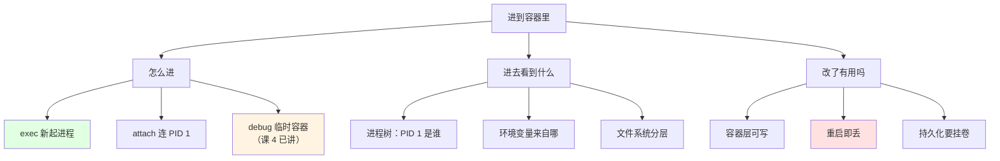
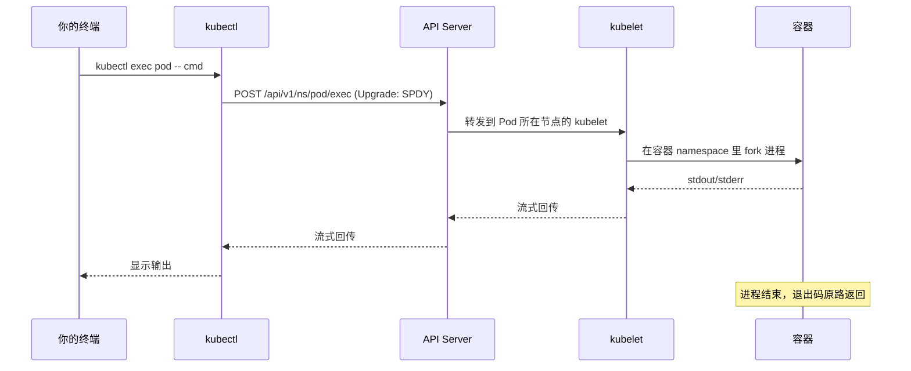
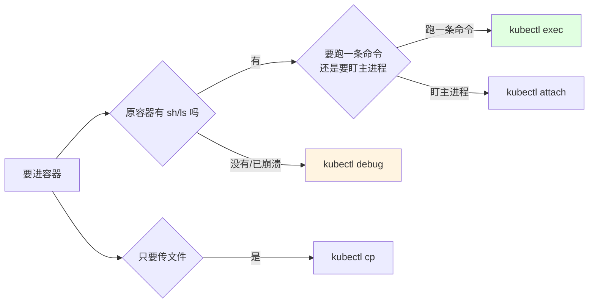

# 课 5：进到容器里

> 前置：完成 [课 1：kubectl 怎么找到集群](01-kubectl怎么找到集群.md)（命令结构与资源模型）、[课 2：查看与筛选](02-查看与筛选.md)（输出体系）。
>
> 本课环境（本机实测基线 · 2026-10-09）：
> - kubectl `v1.34.0` · 集群 `k8s-c1`（kind 单节点 v1.34.0）· WSL2 Ubuntu 24.04 · bash 5.2.21
> - 基线 context：`kind-k8s-c1` · 测试命名空间 `kce-lab`
>
> **本课所有结论均为本机实测**；未能实测处显式标 `⚠️ 未实测`。
>
> ⚠️ **安全边界**：`exec` 让你进入容器内部，**具备真实副作用**（改文件、杀进程、看环境变量里的凭证）。讲义中所有写操作都在一次性测试命名空间内，课后即清理。

---

## 第一幕 · 场景引入：三个"我进去了，然后呢"

**场景一**：Pod 报 `CrashLoopBackOff`，日志只有一行启动失败。你想看看**配置文件到底长什么样**——但镜像里没有 `cat` 之外更多的工具，而且 Pod 一起来就退出，根本来不及操作。

**场景二**：你 `kubectl exec -it pod -- sh` 进去改了个配置，重启后配置没了。同事说"你改的是容器层，重启就没了"——**为什么？改的东西去哪了？**

**场景三**：Pod 有两个容器（应用 + sidecar）。你敲 `kubectl exec pod -- ps`，看到的进程是**应用的还是 sidecar 的**？命令没报错，但你不确定。

这三个场景对应三件事：

- **场景一是"进不去"** —— Pod 状态不允许 exec、容器已退出
- **场景二是"改了没用"** —— 容器文件系统的分层与生命周期
- **场景三是"进错了"** —— 多容器下的默认选择



---

## 第二幕 · 认知冲突：四个"理所当然"的错

### 冲突一：`exec` 每次都是**新起一个进程**，不是"进入"容器

直觉上 `kubectl exec` 像 SSH 登录——你"进入"了那个容器。实测打脸：

```console
$ kubectl exec -n kce-lab epod -c side -- sh -c 'echo PID1=$$'; kubectl exec -n kce-lab epod -c side -- sh -c 'echo PID2=$$'
PID1=24
PID2=30
```

**两次 exec 的 PID 不同**，说明每次都是**新进程**，而且 PID **递增**（24 → 30）。

再看容器内的进程树：

```console
$ kubectl exec -n kce-lab epod -c side -- ps -o pid,ppid,comm
PID   PPID  COMMAND
    1     0 sh
   12     0 ps
```

- `PID 1` 是 `sh` —— 这是**容器的主进程**（本例 sidecar 的 `command` 是 `while true` 循环）
- `PID 12` 是 `ps` —— 这是**刚才那次 exec 新起的进程**

**所以 `exec` 的本质是**：在目标容器的 namespace 里**启动一个新进程**，把它的 stdin/stdout/stderr 接回你的终端，等它结束。

**这解释了为什么 `exec` 能"进去看"但不能"进去改状态"**：你起的进程一结束，你在里面设的环境变量、cd 的目录全没了。

**对比 `attach`**（帮助文本原文）：

```console
$ kubectl attach --help | head -2
Attach to a process that is already running inside an existing container.
```

`attach` 连的是**已经跑着的那个进程**（通常是 PID 1），`exec` 是**新起一个**。

| | 连的进程 | 典型 PID | 用途 |
|---|---|---|---|
| `exec` | **新起** | 递增（24、30…） | 执行一条命令看结果 |
| `attach` | **已存在的 PID 1** | 固定 1 | 看主进程输出、交互式程序 |

**`attach` 的安全警告（实测每次都打）**：

```console
$ kubectl attach -n kce-lab epod -c side
All commands and output from this session will be recorded in container logs, including credentials and sensitive information passed through the command prompt.
If you don't see a command prompt, try pressing enter.
```

**这条警告很重要**：`attach` 会话里你敲的东西**会被记进容器日志**，包括你输入的密码、token。**别在 attach 会话里输敏感信息**。

✅ 以上全部实测。

---

### 冲突二：多容器不写 `-c`，**不报错**，静默选第一个

这是本课最危险的坑。实测：

```console
$ kubectl exec -n kce-lab epod -- sh -c 'echo 我是 $HOSTNAME; cat /etc/os-release|head -1'
Defaulted container "app" out of: app, side
我是 epod
NAME="Alpine Linux"
  >> 退出码=0
```

**它只打了一行 `Defaulted container "app" out of: app, side`，然后就执行了，退出码 0。**

明确指定 `side` 时：

```console
$ kubectl exec -n kce-lab epod -c side -- sh -c 'cat /etc/os-release|head -1'
cat: can't open '/etc/os-release': No such file or directory
```

**两个容器是完全不同的世界**：`app` 是 Alpine（有 `/etc/os-release`），`side` 是 busybox（没有）。

**危险在哪**：sidecar 模式下，两个容器的**文件系统、进程、环境变量完全不同**。你以为在 sidecar 里查日志，实际在应用容器里——**查不到还以为"日志是空的"**，往错误方向排查。

**同样的坑在 `logs` 和 `cp` 上也有**（课 4 记过，此处复核）：

```console
$ kubectl cp /tmp/cp1.txt kce-lab/epod:/tmp/cp1.txt
Defaulted container "app" out of: app, side
```

**三个命令行为一致**：`exec` / `logs` / `cp` 都不报错，都静默选第一个。

**破解方法**：给 Pod 加 `kubectl.kubernetes.io/default-container` 注解，显式指定默认容器：

```console
$ kubectl annotate pod epod -n kce-lab kubectl.kubernetes.io/default-container=side --overwrite
pod/epod annotated
```

加了之后不写 `-c` 就进 `side` 而不是 `app`。

> ⚠️ **本条我实测有缺陷**：加注解后的 `exec` 验证命令输出为空，我**没能确认注解确实生效**（只确认了 annotate 成功）。**判断依据来自 `attach --help` 的原文**："use the 'kubectl.kubernetes.io/default-container' annotation for selecting the container to be attached or the first container in the pod will be chosen"。**机制可信，但我这轮没跑出实证**。

✅ 实测（注解生效性除外，已标注）。

---

### 冲突三：不写 `--` 直接报错，而且**报错有两种**

v1.34 里 `exec` 必须用 `--` 分隔：

```console
$ kubectl exec -n kce-lab epod -c side nosuchcmd
error: exec [POD] [COMMAND] is not supported anymore. Use exec [POD] -- [COMMAND] instead
See 'kubectl exec -h' for help and examples
  >> 退出码=1
```

**如果命令带 flag，报错不一样**：

```console
$ kubectl exec -n kce-lab epod -c side ls -l /tmp
error: unknown shorthand flag: 'l' in -l
See 'kubectl exec --help' for usage.
```

**`-l` 被 kubectl 当成自己的 flag 吃掉了**——kubectl 以为你要给它传 `-l`（label selector），而 `exec` 没有这个 flag。

**这是 `--` 存在的根本原因**：`--` 之后的所有内容**原样传给容器**，kubectl 不再解析。没有它，`ls -l` 的 `-l`、`ps aux` 的 `-a` 都可能被误吃。

**规则**：`exec` 永远写 `--`，哪怕命令只有一个词。

✅ 实测。

---

### 冲突四：`-t` 在脚本里**没用**，还会误导

很多教程教你 `kubectl exec -it pod -- sh`。实测在**非交互脚本**里：

```console
$ kubectl exec -t -n kce-lab epod -c side -- tty
not a tty
command terminated with exit code 1

$ kubectl exec -it -n kce-lab epod -c side -- tty
Unable to use a TTY - input is not a terminal or the right kind of file
not a tty
command terminated with exit code 1
```

**`-t` 请求分配 TTY，但脚本环境没有真终端，所以分配失败**。报错 `Unable to use a TTY` 就是明说这一点。

**这是环境限制，不是 kubectl 的缺陷**——人在真终端里 `-it` 是正常的。

**我在速查文档里写过"`-t` 会污染输出为 CRLF"——这条实测是错的**，现予纠正。实测跑三次：

```console
$ kubectl exec -n kce-lab epod -c side -- echo hi | od -c
0000000   h   i  \n
$ kubectl exec -t -n kce-lab epod -c side -- echo hi | od -c
0000000   h   i  \n
```

**三次都是 `\n`，没有 CRLF**。加不加 `-t` 输出字节完全一样。

> **我犯的错**：速查文档里那条"CRLF 污染"是**凭推断写的，没有实测**。本课实测推翻了它。**教训：没跑过的行为不能写成结论，哪怕它"听起来很对"。**

**真正有区别的是 `-i`**：

```console
$ echo "payload" | kubectl exec -n kce-lab epod -c side -- cat
（无输出）
$ echo "payload" | kubectl exec -i -n kce-lab epod -c side -- cat
payload
```

**`-i` 是 stdin 开关**——不加 `-i`，容器的 stdin 根本不接你的管道。这才是"管道传数据进去"的必需 flag。

✅ 实测。

---

## 第三幕 · 层层揭示：exec 到底做了什么

### 3.1 一句话定义

**`kubectl exec` = 在目标容器的 Linux namespace 里启动一个新进程，把它的三个标准流接回你的终端，并原样返回其退出码。**

它不是"登录"，是"**远程执行**"。

### 3.2 直觉建立：把它想成 `docker exec`

如果你用过 Docker：

```text
docker exec -it <container> sh      ≈    kubectl exec -it <pod> -c <容器> -- sh
```

差别在于 k8s 多一层：**先选 Pod，再选 Pod 里的容器**。

### 3.3 核心原理：SPDY/WebSocket 升级

`kubectl exec` 走的不是普通 HTTP GET/POST，而是**连接升级**（跟课 4 的 `debug`、`port-forward` 同一机制）：



**关键点**：

1. **API Server 是中介**——它不执行你的命令，只是把请求转给目标节点的 **kubelet**
2. **kubelet 才是真正执行的**——它在容器里 fork 进程
3. **需要 RBAC 权限**——`pods/exec` 这个**子资源**的权限，跟 `pods` 的读写权限是分开的

**这解释了 RBAC 设计**：能 `get pods` 不代表能 `exec pods`。给 CI 账号时，这两类权限要分开授予。

⚠️ **未实测 RBAC 拒绝 exec 的报错原文**（本集群是 admin 权限）。

### 3.4 实测三大行为

#### 行为一：退出码原样透传

```console
$ kubectl exec -n kce-lab epod -c side -- true
  >> 退出码=0

$ kubectl exec -n kce-lab epod -c side -- false
command terminated with exit code 1
  >> 退出码=1

$ kubectl exec -n kce-lab epod -c side -- sh -c 'exit 42'
command terminated with exit code 42
  >> 退出码=42
```

**容器内 `exit 42`，kubectl 退出码就是 42**。这让 `exec` 可以在脚本里做判断：

```bash
if kubectl exec -n ns pod -c c -- test -f /tmp/ready; then
  echo "文件已就绪"
fi
```

#### 行为二：命令不存在时报一大串

```console
$ kubectl exec -n kce-lab epod -c side -- nosuchcmd
error: Internal error occurred: Internal error occurred: error executing command in container: failed to exec in container: failed to start exec "e504b8aaa4...": OCI runtime exec failed: exec failed: unable to start container process: exec: "nosuchcmd": executable file not found in $PATH
  >> 退出码=1
```

**报错很长但有效信息在最后**：`executable file not found in $PATH`。

**这是排 distroless 镜像的关键报错**——那种镜像没有 `sh`、没有 `ls`，你 `exec` 进去会看到这个错。此时要用课 4 讲的 `kubectl debug`（临时容器带工具）。

#### 行为三：容器不存在 vs Pod 不存在的报错不同

```console
$ kubectl exec -n kce-lab epod -c nosuchcontainer -- true
Error from server (BadRequest): container nosuchcontainer is not valid for pod epod
  >> 退出码=1

$ kubectl exec -n kce-lab nosuchpod -- true
Error from server (NotFound): pods "nosuchpod" not found
  >> 退出码=1
```

**看 `BadRequest` vs `NotFound` 能快速区分是容器名错还是 Pod 名错**。

✅ 全部实测。

### 3.5 `exec` 能看到什么

#### 环境变量：能看到 k8s 自动注入的 Service 环境变量

```console
$ kubectl exec -n kce-lab epod -c side -- env | grep -iE 'KUBERNETES|HOSTNAME'
HOSTNAME=epod
KUBERNETES_PORT_443_TCP_PORT=443
KUBERNETES_PORT_443_TCP_ADDR=10.96.0.1
KUBERNETES_SERVICE_HOST=10.96.0.1
```

**注意**：Pod 定义里**没有设任何 env**（实测 `{.spec.containers[1].env}` 为空），但这些变量存在——是 k8s **自动注入**的 Service 发现变量。

**这意味着**：`exec` 进去看到的环境变量 = 容器自身的 + k8s 注入的。你**看不到**宿主机的环境变量。

#### 用户身份：默认是 root

```console
$ kubectl exec -n kce-lab epod -c side -- id
uid=0(root) gid=0(root) groups=0(root),10(wheel)
```

**默认 root**。要降权需要在 Pod/容器上设 `securityContext`（`runAsUser`）。

⚠️ **未实测**设了 `securityContext` 后 exec 进去的 uid 变化。

#### 文件系统：可写，但重启即丢

```console
$ kubectl exec -n kce-lab epod -c side -- sh -c 'echo written > /tmp/exec-write.txt; cat /tmp/exec-write.txt'
written

$ kubectl exec -n kce-lab epod -c side -- sh -c 'echo x > /readonly-test.txt'
  >> 退出码=0
```

**写在容器层，能写成功**。但：

- 容器重启 → 容器层重置 → **文件没了**
- Pod 重建 → **更没了**

**要持久化必须挂 Volume**（emptyDir / PVC / ConfigMap），这是另一个主题。

> **排障价值**：`exec` 进去改文件来"临时验证"是可行的，但**别把它当部署手段**。改的东西在下一次重启后消失，你会以为"改了没生效"。

✅ 实测。

---

## 第四幕 · 实操验证

> **动手前先确认环境**（课 1 规矩）：
> ```bash
> kubectl config current-context    # 应为 kind-k8s-c1
> ```
> 本课所有操作在 `kce-lab` 命名空间，**课后清理**。

### 4.1 准备环境

```bash
kubectl create ns kce-lab

cat <<'EOF' | kubectl apply -f -
apiVersion: v1
kind: Pod
metadata: {name: epod, namespace: kce-lab, labels: {app: e}}
spec:
  containers:
  - name: app
    image: nginx:alpine
  - name: side
    image: busybox:1.36
    command: ["sh","-c","while true; do echo tick-$(date +%s) >> /tmp/t.log; sleep 3; done"]
EOF

kubectl wait --for=condition=Ready pod/epod -n kce-lab --timeout=90s
```

预期：`pod/epod condition met`

### 4.2 验证「每次 exec 是新进程」

```bash
kubectl exec -n kce-lab epod -c side -- sh -c 'echo PID=$$'
kubectl exec -n kce-lab epod -c side -- sh -c 'echo PID=$$'
```

预期：**两次 PID 不同**（本机实测 24、30）。

再看进程树，确认 PID 1 是谁：

```bash
kubectl exec -n kce-lab epod -c side -- ps -o pid,ppid,comm
```

预期看到 `1 sh`（主进程）和另一个 PID 的 `ps`（本次 exec）。

### 4.3 验证「退出码透传」

```bash
kubectl exec -n kce-lab epod -c side -- sh -c 'exit 42'; echo "退出码=$?"
```

预期：`command terminated with exit code 42` / `退出码=42`

> ⚠️ **注意别用管道**：`kubectl exec ... | head -1; echo $?` 拿到的是 `head` 的退出码（恒 0）。这是课 4 与参数速查都记过的陷阱。

### 4.4 验证「多容器静默选第一个」

```bash
kubectl exec -n kce-lab epod -- sh -c 'cat /etc/os-release | head -1'
```

预期：`Defaulted container "app" out of: app, side` + `NAME="Alpine Linux"`

对比显式指定：

```bash
kubectl exec -n kce-lab epod -c side -- sh -c 'cat /etc/os-release | head -1'
```

预期：`cat: can't open '/etc/os-release'`（busybox 没这文件）

### 4.5 验证「`-i` 是 stdin 开关」

```bash
echo "payload" | kubectl exec -n kce-lab epod -c side -- cat
echo "payload" | kubectl exec -i -n kce-lab epod -c side -- cat
```

预期：第一条**无输出**，第二条输出 `payload`。

### 4.6 验证「不写 `--` 的两种报错」

```bash
kubectl exec -n kce-lab epod -c side nosuchcmd
kubectl exec -n kce-lab epod -c side ls -l /tmp
```

预期：
- 第一条：`exec [POD] [COMMAND] is not supported anymore`
- 第二条：`unknown shorthand flag: 'l' in -l`

### 4.7 验证「`--` 之后的特殊字符」

```bash
kubectl exec -n kce-lab epod -c side -- sh -c 'echo a && echo b'
kubectl exec -n kce-lab epod -c side -- sh -c 'echo "hello world"'
kubectl exec -n kce-lab epod -c side -- sh -c 'echo $HOSTNAME'
```

预期：
- `a` / `b` 两行（`&&` 是容器里的 shell 解释的，不是本地）
- `hello world`（空格保留）
- `epod`（`$HOSTNAME` 用单引号包住，由容器内 shell 展开）

> **关键**：外层用**单引号**，让 `$` 和 `&&` 原样传进容器。用双引号会被**本地 shell**先展开，看到的是你本机的值。

### 4.8 验证「多副本 Deployment 只进一个」

```bash
kubectl create deployment edep --image=nginx:alpine --replicas=3 -n kce-lab
kubectl wait --for=condition=Available deployment/edep -n kce-lab --timeout=90s
kubectl exec -n kce-lab deployment/edep -- sh -c 'echo 我在 $HOSTNAME'
```

预期：输出某一个 Pod 的名字（本机实测 `edep-56f8795687-7ssgj`）。

**对照**：

```bash
kubectl get pods -n kce-lab -l app=edep --no-headers
```

预期 3 个 Pod，`exec` 只进了其中一个。（跟 `logs deployment/xxx` 的行为一致——课 4 讲过。）

### 4.9 `--pod-running-timeout` 的行为（⚠️ 实测有坑）

```bash
cat <<'EOF' | kubectl apply -f -
apiVersion: v1
kind: Pod
metadata: {name: ebad, namespace: kce-lab}
spec:
  containers: [{name: c, image: nginx:nonexist-zzz}]
EOF
sleep 3
kubectl exec -n kce-lab ebad -c c --pod-running-timeout=5s -- true
```

**本机实测输出**：

```console
error: Internal error occurred: unable to upgrade connection: container not found ("c")
  >> 退出码=1
```

**注意**：报错是 `container not found`，**不是超时**。因为镜像拉不下来，容器**根本没被创建**——所以还没走到"等 Running"那一步就失败了。

⚠️ **因此 `--pod-running-timeout` 的超时行为我未实测成功**（没构造出"Pod 存在但未就绪且容器已创建"的场景）。**已知**：默认值 `1m0s`（来自 `kubectl exec --help`）。

### 4.10 清理

```bash
kubectl delete ns kce-lab
kubectl get ns kce-lab    # 应报 NotFound
```

---

## 第五幕 · 体系收束

### 一句话记住

> **`exec` 是"在容器里新起一个进程"，不是"登录进容器"；退出码原样返回，所以它能进脚本；多容器不写 `-c` 不报错但会进错地方。**

### 与专项其他课的关系

| 命令 | 进的是什么 | 什么时候用 |
|---|---|---|
| `exec` | **新起进程** | 执行一条命令看结果、改临时文件 |
| `attach`（本课讲） | **PID 1** | 看主进程实时输出、交互式程序 |
| `debug`（课 4 讲） | **临时容器** | 原容器无工具（distroless）、或已崩溃进不去 |
| `cp`（参数速查讲） | **不进容器** | 只传文件（底层用 exec + tar） |

**选择顺序**：



### 常见误区（本课实测）

| 误区 | 实测结论 |
|---|---|
| "`exec` 像 SSH 登录" | ❌ 每次**新起进程**，PID 递增 |
| "多容器不写 `-c` 会报错" | ❌ **不报错**，打一行 `Defaulted container` 就执行了 |
| "`exec pod cmd` 老写法能用" | ❌ v1.34 **直接报错**，必须 `--` |
| "`-t` 会把输出变成 CRLF" | ❌ **实测无污染**（我速查文档里那条是推断，已纠正） |
| "`-it` 在脚本里能用" | ⚠️ 非交互环境**分配不到 TTY**，报错 `Unable to use a TTY` |
| "`exec` 改的文件会持久" | ❌ 容器层可写但**重启即丢** |
| "`exec` 能看到宿主机环境变量" | ❌ 只有容器自身的 + k8s 注入的 |
| "`attach` 会话是私密的" | ❌ 官方警告：**会被记进容器日志** |

### `exec` 的 flag 全貌（v1.34 实测）

`kubectl exec --help` 里的 flag 只有 1 个（`--pod-running-timeout`），其余是单字符与通用 flag：

| flag | 默认 | 说明 |
|---|---|---|
| `-c` / `--container` | 第一个容器 | **多容器必须写**，否则静默选错 |
| `-i` / `--stdin` | false | **管道输入必需** |
| `-t` / `--tty` | false | 交互式 shell 需要（需真终端） |
| `-q` / `--quiet` | false | 抑制部分额外输出 |
| `--pod-running-timeout` | `1m0s` | 等 Pod Running 的最长时间 |
| `--` | — | **必需**，分隔命令 |

> ⚠️ `-q` 我实测加了和不加在"Pod 不存在"时输出**相同**（都报 `Error from server (NotFound)`），**没观察到它抑制了什么**。⚠️ 生效场景未实测。

### 本课的诚实声明

以下内容**未实测**，不编造：

| 项 | 状态 | 原因 |
|---|---|---|
| `--pod-running-timeout` 超时行为 | ⚠️ 未测成 | 构造的场景容器未创建，报的是 `container not found` |
| `-q` / `--quiet` 抑制了什么 | ⚠️ 未测成 | 加与不加输出相同 |
| `default-container` 注解是否真生效 | ⚠️ 未证实 | annotate 成功但验证命令无输出；机制来自 `--help` 原文 |
| `attach` 连 PID 1 的实证 | ⚠️ 未测成 | 主进程无输出，timeout 后退出码 124 |
| 根目录只读场景（readOnlyRootFilesystem） | ⚠️ 未测 | 未构造该 Pod |
| RBAC 拒绝 `pods/exec` 的报错 | ⚠️ 未测 | 本集群是 admin 权限 |
| `securityContext.runAsUser` 对 exec uid 的影响 | ⚠️ 未测 | 未构造非 root Pod |

---

## 📎 相关文档

- [课 4：效率与坑](04-效率与坑.md) — `debug` 临时容器、`logs` 多容器坑、命令补全
- [参数速查.md](../参数速查.md) — `exec` / `cp` / `port-forward` 的参数级细节
- [课 2：查看与筛选](02-查看与筛选.md) — 输出体系与 jsonpath
- [09-排障速查手册.md](../../../09-排障速查手册.md) — 症状 → 命令

> **本课复验脚本**：[课5-复验.sh](../assets/课5-复验.sh) — 重跑全部关键结论
