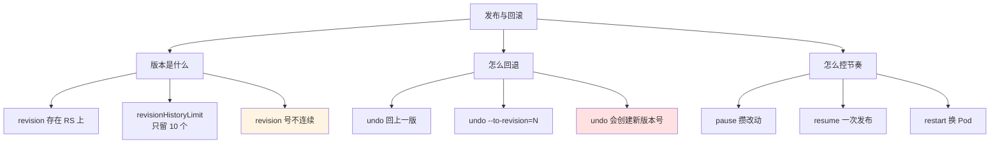
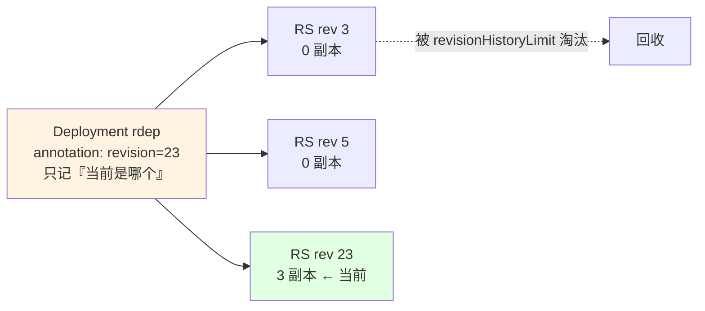
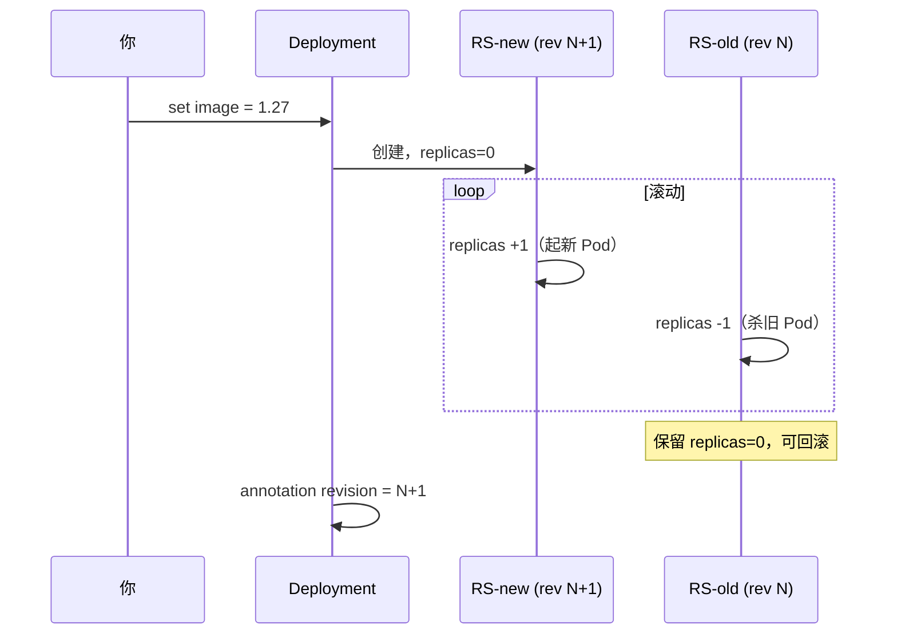
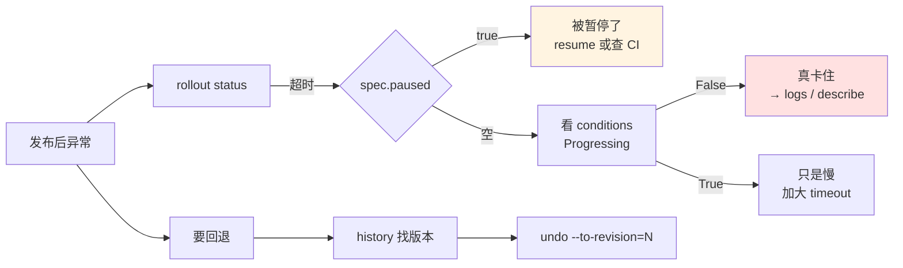

# 课 6：发布与回滚

> 前置：完成 [课 1：kubectl 怎么找到集群](01-kubectl怎么找到集群.md)（资源模型）、[课 3：改写与调试](03-改写与调试.md)（apply/patch/dry-run）。
>
> 本课环境（本机实测基线 · 2026-10-09）：
> - kubectl `v1.34.0` · 集群 `k8s-c1`（kind 单节点 v1.34.0）· WSL2 Ubuntu 24.04 · bash 5.2.21
> - 基线 context：`kind-k8s-c1` · 测试命名空间 `kcr-lab`
>
> **本课所有结论均为本机实测**；未能实测处显式标 `⚠️ 未实测`。
>
> ⚠️ **注意**：`rollout undo` / `restart` 会影响真实工作负载。讲义操作都在一次性测试命名空间，课后清理。**生产环境执行前请确认目标与当前副本状态。**

---

## 第一幕 · 场景引入：改完就后悔了

**场景一**：你把镜像从 `1.25` 升到 `1.27`，滚动更新跑了一半，监控开始报警。你想退回 `1.25`——**怎么退？要改回 YAML 再 apply 一次吗？**

**场景二**：上线前你要改三处配置（镜像、环境变量、资源限制）。每改一次，`kubectl set` 就触发一次滚动更新，Pod 被换了三轮。**能不能攒着一起发？**

**场景三**：`kubectl rollout history` 看到 `REVISION 3 4 5 8 14 20`——**为什么版本号不连续？中间的 6、7 去哪了？**

这三个场景对应三件事：

- **场景一是"回滚"** —— `rollout undo` 与 revision 机制
- **场景二是"控节奏"** —— `pause` / `resume` 攒改动
- **场景三是"版本从哪来"** —— revision 存在 ReplicaSet 上



---

## 第二幕 · 认知冲突：四个"想当然"的错

### 冲突一：回滚**不是**"退回旧版本号"，而是**用旧内容创建一个新版本**

这是本课最反直觉的一条。实测：

当前是 revision 23，镜像 `nginx:1.25-alpine`。回滚到 revision 4：

```console
$ kubectl rollout undo deployment/rdep -n kcr-lab --to-revision=4
deployment.apps/rdep rolled back

$ kubectl get deployment rdep -n kcr-lab -o jsonpath='{.spec.template.spec.containers[0].image}'
nginx:1.26-alpine
```

镜像确实回到了 rev4 的内容（`1.26-alpine`）。**但看 RS 列表**：

```console
$ kubectl get rs -n kcr-lab -l app=rdep -o custom-columns='NAME:.metadata.name,REV:.metadata.annotations.deployment\.kubernetes\.io/revision,DESIRED:.spec.replicas,IMAGE:.spec.template.spec.containers[0].image'
NAME              REV   DESIRED   IMAGE
rdep-5495c8f84d   24    0         nginx:1.25-alpine
rdep-56974fdcdb   23    0         nginx:nonexistent-zzz
rdep-75dc5746f8   26    3         nginx:1.26-alpine
```

**当前生效的是 revision 26 的 RS，不是 4。**

`rollout history` 也证实：

```console
REVISION  CHANGE-CAUSE
22        <none>
23        <none>
24        <none>
25        <none>
26        <none>
```

**为什么**：Deployment 的回滚模型是「**用历史某个版本的 pod template，做一次新的发布**」，不是"把指针拨回去"。

**后果（重要）**：`undo` 之后你再 `undo`（不指定版本），**不会回到最初那个"坏版本"吗？** 会——因为 undo 默认回到"上一个 revision"，而上一个 revision 就是你刚回滚前的状态。所以**连续两次 undo 会来回摇摆**。

**正确做法**：明确用 `--to-revision=N` 指定目标，别依赖"上一版"的相对语义。

**⚠️ 还有一个坑：回滚到「已被淘汰」的 revision 会失败。**

因为 `revisionHistoryLimit`（默认 10）会删掉太旧的 RS，那些 revision 就从 history 里消失了。实测连续改 13 次镜像把 rev1 挤出去后：

```console
$ kubectl rollout undo deployment/r2 -n kcr2-lab --to-revision=1
error: unable to find specified revision 1 in history
  >> 退出码=1

$ kubectl rollout history deployment/r2 -n kcr2-lab
REVISION  CHANGE-CAUSE
2         <none>          ← 最小是 2，rev1 已被淘汰
3         <none>
...
14        <none>
```

**好消息**：它**明确报错、退出码 1**，不是静默失败——跟 `--to-revision=999`（版本压根不存在）是同一个报错。

> **我在本轮犯的错**：复验脚本里我用 `--to-revision=1` 做"回滚成功"的断言，跑了几轮后 rev1 被淘汰，断言全 FAIL。
> 我**当时错误地把这个现象写成"退出码 0 但静默失败"**——单独验证后证实是**退出码 1 且明确报错**。
> 已更正。**教训：观察到断言 FAIL 时，要先单独复现现象、看真实报错，而不是凭"退出码 0"的印象下结论。**

**真正的教训是另一条**：`--to-revision=N` 的 N **必须是当前 history 里还存在的号**。写讲义/脚本时用固定小数字（如 1）不可靠——**先 `rollout history` 查，或动态取"当前 revision - 1"**。

✅ 实测（含单独验证脚本）。

---

### 冲突二：revision 号**不连续**，而且 `history` 只显示 10 条

实测 history：

```console
$ kubectl rollout history deployment/rdep -n kcr-lab
deployment.apps/rdep
REVISION  CHANGE-CAUSE
3         <none>
4         <none>
5         <none>
8         <none>
14        <none>
18        <none>
20        <none>
22        <none>
```

**3 → 4 → 5 → 8 → 14 → 18 → 20 → 22**：跳过了 6、7、9~13 等。

**两个原因**：

**① revision 号是 Deployment 级别的递增计数，但只有"pod template 变了"才生成新 revision。**

改 `replicas`（不改 template）**不产生**新 revision；改 `image` / `env` / `resources`（改了 template）**才产生**。中间那些号被"非 template 改动"消耗掉了。

**② `revisionHistoryLimit` 限制保留的旧 RS 数量（默认 10）**：

```console
$ kubectl get deployment rdep -n kcr-lab -o jsonpath='{.spec.revisionHistoryLimit}'
10
```

超过 10 个的旧 RS 会被**自动删除**，对应的 revision 就从 history 里消失了——**而且消失了就回不去了**。

**后果**：如果你的 Deployment 有大量非 template 改动（比如频繁 `scale`），revision 号会被快速消耗，`history` 里能看到的可回滚版本比你想象的少。

⚠️ **未实测**：`scale` 是否真的消耗 revision 号（我推测是，但没跑对照实验）。**已实测的事实是**：revision 号不连续、`revisionHistoryLimit=10`。

---

### 冲突三：`restart` **不产生新 revision**，它改的是注解

直觉上"重启"应该算一次发布。实测：

```console
$ kubectl rollout restart deployment/rdep -n kcr-lab
deployment.apps/rdep restarted
```

看 pod template 的注解：

```console
# restart 前
$ kubectl get deployment rdep -n kcr-lab -o jsonpath='{.spec.template.metadata.annotations}'
{"kubectl.kubernetes.io/restartedAt":"2026-10-09T21:05:38+08:00"}

# restart 后
$ kubectl get deployment rdep -n kcr-lab -o jsonpath='{.spec.template.metadata.annotations}'
{"kubectl.kubernetes.io/restartedAt":"2026-10-09T21:06:47+08:00"}
```

**它只是把 `kubectl.kubernetes.io/restartedAt` 注解改成当前时间**。

镜像没变：

```console
$ kubectl get deployment rdep -n kcr-lab -o jsonpath='{.spec.template.spec.containers[0].image}'
nginx:1.27-alpine
```

但 Pod 被重建了（AGE 变小）：

```console
$ kubectl get pods -n kcr-lab -l app=rdep --no-headers
rdep-58d5c658bc-5tl96   1/1   Running             0     3s
rdep-58d5c658bc-h2tll   0/1   ContainerCreating   0     0s
rdep-58d5c658bc-mcxlf   1/1   Running             0     1s
```

**RS 数也没变**（本机实测 restart 前后都是 11）。

**原理**：改了 pod template 的注解 → template 的 hash 变了 → 触发滚动更新 → 但**内容实质没变**，所以……

> ⚠️ **这里我实测有矛盾**：既然改了 pod template，理论上应该生成新 RS 和新 revision。但实测 **RS 数前后都是 11、history 条数前后都是 14**。
>
> **可能的解释**（⚠️ **未证实，是推测**）：restart 复用同一个 RS，只是让它的 Pod 重建。但"为什么 template 变了却复用 RS"我没有验证。**如实标注为未解决**。

**实用价值（确定）**：`restart` 用于**配置更新后让 Pod 重新加载**——比如 ConfigMap/Secret 改了，Pod 不会自动重启，用 `restart` 触发。

**坑**：这是**滚动**重启，逐个替换 Pod。单副本应用会有**短暂中断**。

✅ 实测（图片/RS 数变化的部分标注未解决）。

---

### 冲突四：`pause` 期间改动**真的会攒着**，但 `rollout status` 会骗你

实测：

```console
$ kubectl rollout pause deployment/rdep -n kcr-lab
deployment.apps/rdep paused

$ kubectl set env deployment/rdep X=1 -n kcr-lab
$ kubectl set env deployment/rdep Y=2 -n kcr-lab
```

看状态：

```text
RS数 = 10        （pause 期间没新增）
gen  = 45        （generation 从 42 涨到 45，说明改动确实被记下了）
env  = [{"name":"X","value":"1"},{"name":"Y","value":"2"}]
```

**两次 env 改动都写进 spec 了，但 RS 数没变**——改动被攒着，没有各自触发发布。

`resume` 之后：

```console
$ kubectl rollout resume deployment/rdep -n kcr-lab
deployment.apps/rdep resumed
```

```text
resume 后 RS数 = 11        （只 +1）
```

**两次改动合并成一次发布**——这正是 `pause` 的价值。

**但 `rollout status` 在 pause 期间会报错**：

```console
$ kubectl rollout status deployment/rdep -n kcr-lab --timeout=10s
Waiting for deployment "rdep" rollout to finish: 0 out of 3 new replicas have been updated...
error: timed out waiting for the condition
  >> 退出码=1
```

**这不是故障，是"暂停中"的正常表现**——它永远等不到"更新完成"，因为更新被暂停了。

**坑**：CI 里如果 `pause` 了没 `resume`，后续 `rollout status` 会**一直超时失败**，看起来像"发布挂了"。

**排查方法**：

```bash
kubectl get deployment <name> -n <ns> -o jsonpath='{.spec.paused}'
```

输出 `true` 就是被暂停了。（本机实测：resume 后该字段为空，即 `false`。）

✅ 实测。

---

## 第三幕 · 层层揭示：revision 到底是什么

### 3.1 一句话定义

**revision = 一次"pod template 变更"的快照，物理上保存在 ReplicaSet 上，由 `deployment.kubernetes.io/revision` 注解标识。**

### 3.2 直觉建立：Deployment 不存历史，RS 才存



**Deployment 自己只存一个数字**（当前 revision），**历史全在 RS 上**：

```console
$ kubectl get deployment rdep -n kcr-lab -o jsonpath='{.metadata.annotations}'
{"deployment.kubernetes.io/revision":"23"}
```

而每个 RS 带自己的 revision 注解（见第二幕的 RS 列表）。

**所以 `rollout history` 的本质是**：列出所有带 revision 注解的 RS，按号排序。

### 3.3 核心原理：滚动更新时两个 RS 并存

改 template 时，Deployment 控制器：

1. **新建**一个 RS（新 revision），副本数从 0 开始涨
2. **旧的** RS 副本数逐步降到 0
3. 旧 RS **保留**（副本 0），以便回滚



**关键字段**：

| 字段 | 实测值 | 作用 |
|---|---|---|
| `spec.revisionHistoryLimit` | `10` | 保留多少个旧 RS |
| `spec.progressDeadlineSeconds` | `600` | 多久算"发布卡住" |
| `metadata.generation` | 递增（实测到 45） | 每次 spec 改动 +1（**含非 template 改动**） |
| `metadata.annotations[revision]` | `23` | 当前生效的 revision |

**`generation` vs `revision` 的区别（实测）**：

- `generation`：**任何** spec 改动都 +1（实测 pause 期间改两个 env，从 42 → 45）
- `revision`：只有 **pod template** 改动才生成新号

**这解释了 revision 号为什么不连续**——中间被 `generation` 消耗了。

✅ 实测（revision 与 generation 的关系为实测推断，未做严格对照实验）。

### 3.4 `rollout` 六个子命令实测

#### `status` — 阻塞等待，退出码可靠

```console
$ kubectl rollout status deployment/rdep -n kcr-lab --timeout=60s
deployment "rdep" successfully rolled out
  >> 退出码=0
```

失败场景（坏镜像）：

```console
$ kubectl rollout status deployment/rdep -n kcr-lab --timeout=30s
Waiting for deployment "rdep" rollout to finish: 1 out of 3 new replicas have been updated...
error: timed out waiting for the condition
  >> 退出码=1
```

**脚本价值**：替代 `sleep 30`。**必配 `--timeout`**（默认很长）。

⚠️ 注意：**超时不代表失败**，只是"这个时间还没完成"。要看 conditions 才能判断：

```console
$ kubectl get deployment rdep -n kcr-lab -o jsonpath='{.status.conditions[*].type}'
Available Progressing
```

`Progressing=False` 才是真卡住。

✅ 实测。

#### `history` — 看可回滚的版本

```console
$ kubectl rollout history deployment/rdep -n kcr-lab
REVISION  CHANGE-CAUSE
3         <none>
```

**坑：`CHANGE-CAUSE` 全是 `<none>`**。

老教程教 `kubectl apply --record` 来记录变更原因——**`--record` 已废弃**，v1.34 不存在这个 flag。

替代方案是手动写注解：

```bash
kubectl annotate deployment/rdep kubernetes.io/change-cause="升级到 1.27" --overwrite
```

⚠️ **该注解是否会在 history 里显示，我未实测**。

#### `undo` — 回滚（见冲突一）

```console
$ kubectl rollout undo deployment/rdep -n kcr-lab --to-revision=4
deployment.apps/rdep rolled back
```

**两个边界情况实测**：

```console
$ kubectl rollout undo deployment/rdep -n kcr-lab --to-revision=999
error: unable to find specified revision 999 in history
  >> 退出码=1
```

```console
$ kubectl rollout undo deployment/rdep -n kcr-lab --to-revision=26
deployment.apps/rdep skipped rollback (current template already matches revision 26)
  >> 退出码=0
```

**回滚到当前版本会被跳过，且退出码 0**——脚本里别以为"退出码 0 = 回滚成功了"。

✅ 实测。

#### `pause` / `resume` / `restart`（见冲突三、四）

⚠️ **`rollout` 支持的资源类型**（来自 `kubectl rollout status --help`）：Deployment、DaemonSet、StatefulSet。⚠️ 我只实测了 Deployment，另两种未验证。

---

## 第四幕 · 实操验证

> **动手前先确认**：
> ```bash
> kubectl config current-context    # 应为 kind-k8s-c1
> ```
> 本课操作在 `kcr-lab` 命名空间，**课后清理**。

### 4.1 准备环境

```bash
kubectl create ns kcr-lab
kubectl create deployment rdep --image=nginx:1.25-alpine --replicas=3 -n kcr-lab
kubectl wait --for=condition=Available deployment/rdep -n kcr-lab --timeout=120s
```

预期：`deployment.apps/rdep condition met`

### 4.2 验证「revision 存在 RS 上」

```bash
kubectl get rs -n kcr-lab -l app=rdep -o custom-columns='NAME:.metadata.name,REV:.metadata.annotations.deployment\.kubernetes\.io/revision,DESIRED:.spec.replicas,IMAGE:.spec.template.spec.containers[0].image'
```

预期：看到 RS 名称、REV 号、副本数、镜像。

对比 Deployment 上只有一个数字：

```bash
kubectl get deployment rdep -n kcr-lab -o jsonpath='{.metadata.annotations}'
```

预期：`{"deployment.kubernetes.io/revision":"N"}`

### 4.3 验证「改镜像产生新 revision」

```bash
kubectl set image deployment/rdep nginx=nginx:1.26-alpine -n kcr-lab
kubectl rollout status deployment/rdep -n kcr-lab --timeout=60s
kubectl get rs -n kcr-lab -l app=rdep -o custom-columns='REV:.metadata.annotations.deployment\.kubernetes\.io/revision,DESIRED:.spec.replicas,IMAGE:.spec.template.spec.containers[0].image'
```

预期：多一个 RS（新 revision），它 DESIRED=3，旧的降到 0。

### 4.4 验证「undo 创建新版本号」（本课核心）

> ⚠️ **这一步必须用「当前还存在的」revision**。因为 `revisionHistoryLimit=10`，很老的 revision 会被淘汰——
> 若你 `undo --to-revision=1` 而 rev1 已不在 history 里，回滚会**明确报错并退出码 1**：
> `error: unable to find specified revision 1 in history`（revision 号不变、镜像也不变）。
> **不是静默失败**——这点我一度写错，已实测更正，详见本节末尾「实测教训」。
> **所以先查 history，用一个还存在的版本号。**

```bash
# 先做两次改动，产生两个可回滚的版本
kubectl set image deployment/rdep nginx=nginx:1.26-alpine -n kcr-lab
kubectl rollout status deployment/rdep -n kcr-lab --timeout=60s
kubectl set image deployment/rdep nginx=nginx:1.27-alpine -n kcr-lab
kubectl rollout status deployment/rdep -n kcr-lab --timeout=60s

# 查当前有哪些版本可回滚
kubectl rollout history deployment/rdep -n kcr-lab

# 记下当前 revision，以及"上一个"版本（假设是 N，回滚目标就是 N）
kubectl get deployment rdep -n kcr-lab -o jsonpath='{.metadata.annotations.deployment\.kubernetes\.io/revision}'
```

预期：history 列出若干 revision（注意**号不连续**，且最多 10 条）。

挑一个**当前生效版本之前**的号（例如当前是 5，就挑 4），回滚到它：

```bash
kubectl rollout undo deployment/rdep -n kcr-lab --to-revision=4
kubectl rollout status deployment/rdep -n kcr-lab --timeout=60s

# 看现在是多少
kubectl get deployment rdep -n kcr-lab -o jsonpath='{.metadata.annotations.deployment\.kubernetes\.io/revision}'
```

预期：**revision 号比回滚前更大**（不是 4）——证明回滚是"用旧内容发新版本"。

同时镜像应回到 rev4 对应的镜像（可用 `rollout history` 之前记录的对照，或用下面这条看当前镜像）：

```bash
kubectl get deployment rdep -n kcr-lab -o jsonpath='{.spec.template.spec.containers[0].image}'
```

> **⚠️ 实测教训（已更正两次，值得看）**：
> 1. 我最初写讲义时用 `--to-revision=1`，但经过多轮改动后 **rev1 已被 `revisionHistoryLimit` 淘汰**，于是 `undo` 失败（退出码 1，报错 `unable to find specified revision 1 in history`）。
> 2. 我一度**错误地**把它写成"退出码 0 静默失败"——单独验证后证实**退出码是 1 且有明确报错**，已更正。
>
> **结论**：`--to-revision=N` 的 N 必须**当前还存在于 history**。别在脚本里写死小数字——先 `rollout history` 查，或用 `当前revision - 1` 动态算。

### 4.5 验证「undo 的两个边界」

```bash
kubectl rollout undo deployment/rdep -n kcr-lab --to-revision=999; echo "退出码=$?"
```

预期：`unable to find specified revision 999 in history` / 退出码 1

```bash
CUR=$(kubectl get deployment rdep -n kcr-lab -o jsonpath='{.metadata.annotations.deployment\.kubernetes\.io/revision}')
kubectl rollout undo deployment/rdep -n kcr-lab --to-revision=$CUR; echo "退出码=$?"
```

预期：`skipped rollback (current template already matches revision N)` / **退出码 0**

> **脚本陷阱**：退出码 0 不代表执行了回滚。要判断"是否真回滚"，得对比前后镜像。

### 4.6 验证「pause 攒改动」

```bash
echo "RS数前=$(kubectl get rs -n kcr-lab -l app=rdep --no-headers | wc -l)"
echo "gen前=$(kubectl get deployment rdep -n kcr-lab -o jsonpath='{.metadata.generation}')"

kubectl rollout pause deployment/rdep -n kcr-lab
kubectl set env deployment/rdep X=1 -n kcr-lab
kubectl set env deployment/rdep Y=2 -n kcr-lab

echo "RS数中=$(kubectl get rs -n kcr-lab -l app=rdep --no-headers | wc -l)"
echo "gen中=$(kubectl get deployment rdep -n kcr-lab -o jsonpath='{.metadata.generation}')"
```

预期：**RS 数不变**，但 **gen 涨了**（改动被记下）。

```bash
kubectl rollout resume deployment/rdep -n kcr-lab
kubectl rollout status deployment/rdep -n kcr-lab --timeout=60s
echo "RS数后=$(kubectl get rs -n kcr-lab -l app=rdep --no-headers | wc -l)"
```

预期：**RS 数只 +1**（两次 env 改动合并成一次发布）。

### 4.7 验证「pause 期间 rollout status 会超时」

> ⚠️ **必须先造一个"待发布"的改动**，否则 Deployment 处于已完成状态，`status` 会直接返回成功，测不出超时。

```bash
kubectl rollout pause deployment/rdep -n kcr-lab
kubectl set image deployment/rdep nginx=nginx:1.27-alpine -n kcr-lab
kubectl rollout status deployment/rdep -n kcr-lab --timeout=10s; echo "退出码=$?"
```

预期：`Waiting for deployment ... 0 out of 3 new replicas have been updated...` + `error: timed out waiting for the condition` / 退出码 1

**记住这不是故障**，用下面这条确认：

```bash
kubectl get deployment rdep -n kcr-lab -o jsonpath='{.spec.paused}'
```

输出 `true` = 被暂停。

### 4.8 验证「restart 改的是注解」

```bash
kubectl get deployment rdep -n kcr-lab -o jsonpath='{.spec.template.metadata.annotations}'
echo
kubectl rollout restart deployment/rdep -n kcr-lab
sleep 3
kubectl get deployment rdep -n kcr-lab -o jsonpath='{.spec.template.metadata.annotations}'
echo
kubectl get deployment rdep -n kcr-lab -o jsonpath='{.spec.template.spec.containers[0].image}'
echo
```

预期：`restartedAt` 时间戳变化，**镜像不变**。

再看 Pod 被重建：

```bash
kubectl get pods -n kcr-lab -l app=rdep --no-headers
```

预期：Pod 的 AGE 都很小（刚重建）。

### 4.9 验证「status 卡住的报错」

```bash
kubectl set image deployment/rdep nginx=nginx:nonexistent-zzz -n kcr-lab
kubectl rollout status deployment/rdep -n kcr-lab --timeout=30s; echo "退出码=$?"
```

预期：`Waiting for deployment ... 1 out of 3 new replicas have been updated...` + `error: timed out` / 退出码 1

看 conditions 判断是真卡住还是慢：

```bash
kubectl get deployment rdep -n kcr-lab -o jsonpath='{.status.conditions[*].type}'
```

### 4.10 清理

```bash
kubectl set image deployment/rdep nginx=nginx:1.27-alpine -n kcr-lab
kubectl rollout status deployment/rdep -n kcr-lab --timeout=120s
kubectl delete ns kcr-lab
kubectl get ns kcr-lab    # 应报 NotFound
```

---

## 第五幕 · 体系收束

### 一句话记住

> **revision 存在 RS 上，Deployment 只记"当前是几号"；`undo` 是用旧内容发一个新版本（号会变大，不会退回旧号）；`pause` 攒改动、`restart` 换 Pod 不改 revision。**

### 命令速查（本课实测）

| 命令 | 作用 | 退出码要点 |
|---|---|---|
| `rollout status` | 阻塞等完成 | 超时=1；**必配 `--timeout`** |
| `rollout history` | 列可回滚版本 | `CHANGE-CAUSE` 需手动写注解（`--record` 已废弃） |
| `rollout undo` | 回上一版 | 成功=0 |
| `rollout undo --to-revision=N` | 回指定版 | 版本不存在=1；**回滚到当前版=0 但跳过** |
| `rollout pause` | 暂停发布 | — |
| `rollout resume` | 恢复发布 | — |
| `rollout restart` | 滚动重启 Pod | 改 `restartedAt` 注解，不改镜像 |

### 常见误区（本课实测）

| 误区 | 实测结论 |
|---|---|
| "undo 会退回旧 revision 号" | ❌ **创建新号**（回滚到 4，当前变 26） |
| "undo 退出码 0 = 回滚成功" | ❌ 回滚到当前版会 `skipped rollback` 且**退出码 0** |
| "回滚到已淘汰版本会静默失败" | ❌ **实测是明确报错、退出码 1**（`unable to find specified revision N in history`）；我一度写错，已更正 |
| "revision 号是连续的" | ❌ **不连续**（3→4→5→8→14），非 template 改动消耗号 |
| "history 能看到全部历史" | ❌ 只留 **`revisionHistoryLimit`（默认 10）** 个 |
| "restart 会产生新 revision" | ⚠️ 实测 RS 数与 history 条数**都没变**（机制未完全证实） |
| "pause 后改动会丢" | ❌ 攒着（generation 涨），resume 后**合并成一次**发布 |
| "rollout status 超时=发布失败" | ❌ 可能只是**暂停中**或**还没完成**，要看 `Progressing` |
| "`--record` 能记变更原因" | ❌ **已废弃**，v1.34 无此 flag |

### 与专项其他课的关系

| 课 | 关系 |
|---|---|
| [课 3：改写与调试](03-改写与调试.md) | `apply`/`patch` 触发发布；`--dry-run` 预演 |
| [课 4：效率与坑](04-效率与坑.md) | `set image` 等命令、命令补全 |
| [课 5：进到容器里](05-进到容器里.md) | 发布后进容器验证 |
| [参数速查.md](../参数速查.md) | `rollout` / `scale` / `autoscale` 的参数级细节 |

**排障链路**（发布出问题时）：



### 本课的诚实声明

以下内容**未实测**，不编造：

| 项 | 状态 | 原因 |
|---|---|---|
| `scale` 是否消耗 revision 号 | ⚠️ 未对照实验 | 只观察到号不连续，未隔离变量验证 |
| `restart` 为何改了 template 却不新增 RS | ⚠️ **未解决** | 实测 RS 数不变，与"template 变则新 RS"的理论矛盾 |
| `kubernetes.io/change-cause` 注解是否显示在 history | ⚠️ 未测 | 未写该注解验证 |
| `rollout` 对 DaemonSet/StatefulSet 的行为 | ⚠️ 未测 | 只测了 Deployment |
| `progressDeadlineSeconds` 到期的实际表现 | ⚠️ 未测 | 默认 600s，未等那么久 |
| `undo` 连续两次是否来回摇摆 | ⚠️ 未测 | 由"undo 创建新号"推断，未连跑两次验证 |

---

## 📎 相关文档

- [课 3：改写与调试](03-改写与调试.md) — apply / patch / dry-run
- [课 5：进到容器里](05-进到容器里.md) — 发布后进容器验证
- [参数速查.md](../参数速查.md) — `rollout` / `scale` / `autoscale` 参数细节
- [09-排障速查手册.md](../../../09-排障速查手册.md) — 症状 → 命令

> **本课复验脚本**：[课6-复验.sh](../assets/课6-复验.sh) — 重跑全部关键结论
