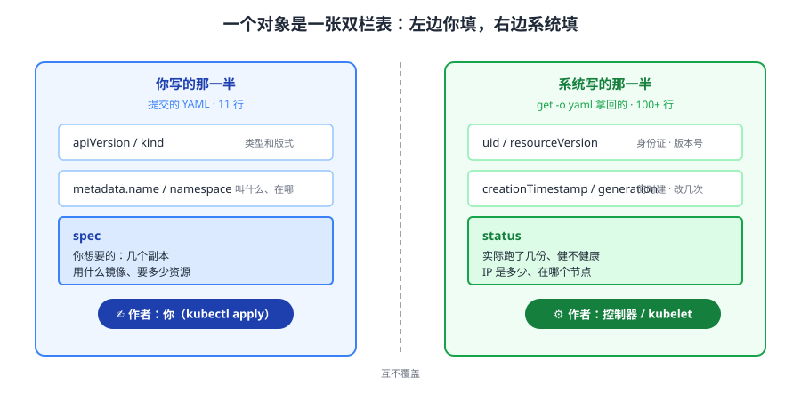
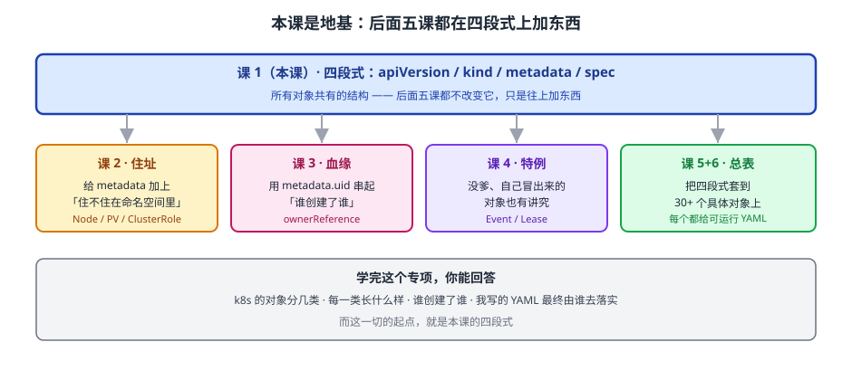

# 课 1：一切皆对象——四段式与 YAML 解剖

> 📍 所属：子教程[《对象体系专项》](../overview.md)（第 1 课 · 模型视角）
> 📖 故事章节：**看懂** —— 你会写 YAML，现在要看清 YAML 写出来的到底是什么
> 🧭 下一课：[课 2《两个住址：命名空间级与集群级》](02-两个住址：命名空间级与集群级.md)
> ⚙️ 实操环境：WSL2 Ubuntu 24.04 · bash 5.2.21 · kubectl v1.34.0 · kind 集群 `k8s-c1`（3 节点） · k8s v1.34.0
> 📖 结论已按官方文档核对（核对于 2026-10 ｜ 来源：[Kubernetes 对象](https://kubernetes.io/zh-cn/docs/concepts/overview/working-with-objects/kubernetes-objects/)、[API 约定](https://kubernetes.io/docs/reference/using-api/api-concepts/)）
> ✅ 本节命令实测于 WSL2 Ubuntu 24.04 / kubectl v1.34.0 / k8s v1.34.0（一次性命名空间 `obj-lab`，课后清理）

## 🎯 本课目标

学完本课，你应当能够：

- 说出「对象」在 k8s 里的准确定位：**一条「你想要的」与「实际是什么」的双栏记录**
- 拆解任意对象的**四段式**（`apiVersion` / `kind` / `metadata` / `spec`），并说清每段归谁负责
- 讲清 **spec 你写、status 系统写**，以及为什么你写的 status 会被丢掉
- 认全 metadata 里那些**每个对象都有**的通用字段，重点是 `uid` 与 `resourceVersion` 各自解决什么问题
- 拿到一份没见过的对象 YAML，能**按模型推断**它大概怎么用，而不是从零学

---

## 第一幕：起源与场景引入 —— "这 YAML 我抄了三个月"

### 场景

你接手了一个别人搭的 k8s 服务。上线前 leader 让你确认配置没问题，你打开那份 YAML：

```yaml
apiVersion: apps/v1
kind: Deployment
metadata:
  name: web
  namespace: prod
spec:
  replicas: 3
  selector:
    matchLabels:
      app: web
  template:
    metadata:
      labels:
        app: web
    spec:
      containers:
      - name: app
        image: nginx:1.25
```

你逐行看下来，**每个字都认识**。然后 leader 问了三个问题：

> 1. "这个对象现在**实际跑了几份**？"
> 2. "你怎么知道它**有没有在正常工作**？"
> 3. "你要把它从 3 份改成 5 份，改完之后**谁去真的启动那 2 个 Pod**？"

你答不上来。因为这份 YAML 里**根本没写**这些——`replicas: 3` 是你想要 3 份，但实际跑了几份、是否健康，不在这份文件里。

你去集群里看：

```bash
kubectl get deployment web -n prod -o yaml
```

输出比你的文件**长了好几倍**，多出来的主要是这一段：

```yaml
status:
  availableReplicas: 3
  readyReplicas: 3
  replicas: 3
  updatedReplicas: 3
  conditions:
  - type: Available
    status: "True"
    reason: MinimumReplicasAvailable
```

**关键发现**：你提交的对象和集群里存的对象，**不是同一个东西的两份拷贝，而是同一条记录的两半**——一半你写，一半系统写。

### 一句话本质

**k8s 里没有"配置文件"，只有"对象"：每一份 YAML 都是在 etcd 里创建一条记录，这条记录分两栏——`spec` 记你想要的，`status` 记实际发生了什么，两栏合起来才是一个完整对象。**

### 处境对照

| | 把它当"配置文件" | 把它当"对象记录" |
|---|---|---|
| 改副本数 | "改了文件就该生效" | 改 `spec`，**控制器**负责让它变成真的 |
| 看运行状态 | 翻 YAML、查日志 | 直接读 `status` 那一栏 |
| 出问题 | 不知道该改哪里 | 先分清：是 `spec` 写错了，还是 `spec` 对但 `status` 没跟上 |
| 写 status | 以为能改 | **写了也白写**（本课实测） |

> 💡 量化锚点：本课实测的 Pod 对象，你提交的 YAML 是 **11 行**，`kubectl get -o yaml` 拿回的完整对象是 **100+ 行**——多出来的部分是系统填的 `status` 与默认补齐的 `spec` 字段。

---

## 第二幕：认知冲突 —— 我明明改了，为什么没生效？

你学到「status 记实际状态」，自然会想试一下。你执行：

```bash
kubectl patch pod obj-pod -n obj-lab --subresource=status \
  --type=merge -p '{"status":{"phase":"Bogus"}}'
```

返回 `pod/obj-pod patched`，**看起来成功了**。你立刻去查：

```bash
kubectl get pod obj-pod -n obj-lab -o jsonpath='{.status.phase}'
# 输出：Running
```

**还是 Running。** 你写的 `Bogus` 去哪了？

你换个写法，不带 `--subresource`：

```bash
kubectl patch pod obj-pod -n obj-lab \
  --type=merge -p '{"status":{"phase":"Bogus2"}}'
# 返回：pod/obj-pod patched (no change)
```

`no change`——**直接告诉你没改**。

这里有两个矛盾需要解释：

1. **第一种写法报成功却被覆盖，第二种报没改**：同样是改 status，为什么行为不一样？
2. **为什么"我想要的"和"实际是什么"非要分成两栏**：合成一栏不是更简单？

> 🎯 **先剧透**：第一个矛盾的答案是——`status` 不是普通字段，它是**子资源**，有独立的写入口，且**写的人不是你**。第二个矛盾的答案在本课第三幕。

---

## 第三幕：层层揭示

### 一眼全局图



**看图**：左边是你提交的 YAML——只填了"我要什么"。右边是集群里完整的对象——多出一栏"实际是什么"。中间那道竖线是 k8s 的核心设计：**两边由不同的人写，互不覆盖**。你永远写不了右栏，系统也永远不改你的左栏。

### 本课地图

| 步 | 这一步要解决什么 | 知识点 |
|----|-----------------|--------|
| 第 1 步 | 这条记录长什么样、分几段 | 知识点 1：对象的四段式 |
| 第 2 步 | 两栏为什么不能合成一栏、谁写哪一栏 | 知识点 2：spec 与 status 的分工 |
| 第 3 步 | 每段开头那些固定字段是干嘛的 | 知识点 3：metadata 通用字段 |
| 第 4 步 | 两个人同时改一条记录怎么办 | 知识点 4：resourceVersion 与乐观锁 |

---

### 🧭 第 1/4 步｜承接：第二幕"我改了却没生效" → 本步：先把这条记录的固定格式拆清楚

#### 知识点 1：对象的四段式

**一句话定义**：集群里每个对象都是同一套四段结构——`apiVersion`（归哪个组、哪个版本）、`kind`（是什么类型）、`metadata`（描述信息）、`spec`（你想要什么）。

**直觉建立**：把它想成**一张快递单**。

- `kind` = 寄什么类型的件（文件 / 生鲜 / 大件）——决定这张单子有哪些格子要填
- `apiVersion` = 用哪一版的单子——同一类型可能有多版格式
- `metadata` = 收件人、单号、下单时间——**不管寄什么都有这几项**
- `spec` = 你要寄的东西与要求

**核心原理**：逐段拆（用本课实测的 Pod 真值）：

```yaml
apiVersion: v1          # ① 组/版本：core 组省略组名，只写 v1
kind: Pod               # ② 类型
metadata:               # ③ 描述信息（所有对象通用）
  name: obj-pod
  namespace: obj-lab
  uid: 585c4f3c-d75b-4fdd-b8da-33ee6901d11f
  resourceVersion: "954293"
  generation: 1
  creationTimestamp: "2026-10-14T01:38:30Z"
spec:                   # ④ 你想要的
  containers:
  - name: app
    image: nginx:alpine
```

**① `apiVersion` = 组 + 版本**。实测对比：

| 对象 | apiVersion | 说明 |
|------|-----------|------|
| Pod | `v1` | **core 组（legacy）省略组名**，直接写版本 |
| Deployment | `apps/v1` | 有组名：`apps` 组 + `v1` 版本 |

> ⚠️ 这是初学者最容易卡的地方：`v1` 不是"没有组"，是 **core 组的简写**。完整写法是 `core/v1` 但在 YAML 里只写 `v1`。

**② `kind` 决定这张单子有哪些格子**。`Pod` 有 `containers`，`Service` 有 `ports`，`ConfigMap` 有 `data`——**不同 kind 的 spec 完全不同**，这是它们唯一的区别所在。

**示例演示**：本课集群里实际存在的 API 组（实测 24 条，节选）：

```text
v1                              ← core 组（Pod/Service/ConfigMap/Secret/Node...）
apps/v1                         ← Deployment/ReplicaSet/StatefulSet/DaemonSet
batch/v1                        ← Job/CronJob
networking.k8s.io/v1            ← Ingress/NetworkPolicy
rbac.authorization.k8s.io/v1    ← Role/RoleBinding/ClusterRole...
storage.k8s.io/v1               ← StorageClass/VolumeAttachment
coordination.k8s.io/v1          ← Lease（课 4 主角）
apiextensions.k8s.io/v1         ← CustomResourceDefinition（课 6）
events.k8s.io/v1                ← Event（课 4 主角）
```

**常见误区**：

> 🐞 **误区 1**："`apiVersion: v1` 是老版本，新的应该写 `v1beta1` 之类。"
> 恰恰相反——**`v1` 是最稳定的正式版**，`v1beta1` 才是"还没定稿"。组名带 `.k8s.io` 反而说明它是**后来独立出来的组**（如 `networking.k8s.io`）。

> 🐞 **误区 2**："不同 kind 要记不同的 YAML 模板。"
> **只记四段式就够了**：`spec` 里填什么，用 `kubectl explain <kind>` 现查。本课的目标是让你**看到任何对象都不陌生**，不是背下所有字段。

**一句话记住**：**四段式是 k8s 的"通用快递单"——kind 决定格子，apiVersion 决定版式，metadata 是通用抬头，spec 是你的具体要求。**

---

### 🧭 第 2/4 步｜承接：拆完四段 → 本步：解释第二幕"改了却没生效"，讲清两栏分工

#### 知识点 2：spec 与 status 的分工

**一句话定义**：`spec` 是你声明的**期望状态**（你写），`status` 是系统观测到的**实际状态**（系统写），二者合起来才是完整对象。

**直觉建立**：像**恒温空调**。

- `spec` = 你把温度设在 26 度（你只负责设）
- `status` = 面板上显示的"当前室温 28 度"（空调负责测）

你**按遥控器改不了面板读数**——你只能改设定值，屋子真到了 26 度，读数自己会变。

**核心原理**：`status` 在 API 里是**子资源（subresource）**，有独立的访问路径 `/status`。它有两个后果：

1. **改主资源时，你写的 status 会被静默丢弃**（实测：`patched (no change)`）
2. **改子资源需要专门权限**（RBAC 里 `pods` 与 `pods/status` 是两个资源）

回到第二幕那个反直觉的实测：

```bash
# 写法 A：明确走 status 子资源
kubectl patch pod obj-pod -n obj-lab --subresource=status \
  --type=merge -p '{"status":{"phase":"Bogus"}}'
# → pod/obj-pod patched        ← 报成功
# → 实际查：Running            ← 但没生效

# 写法 B：走主资源
kubectl patch pod obj-pod -n obj-lab \
  --type=merge -p '{"status":{"phase":"Bogus2"}}'
# → pod/obj-pod patched (no change)   ← 直接说没改
```

**为什么 A 报成功却没变？** 因为**写 status 的不止你一个**。`kubelet` 每秒都在上报 Pod 状态，你写进去的 `Bogus` 在下一轮上报时被**抢回**成了 `Running`。这不是 bug，是设计——status 的**权威作者是控制器，不是你**。

**实测佐证**（`managedFields` 显示这份对象被谁改过）：

```text
manager=kubectl-client-side-apply  operation=Update
manager=kubelet                    operation=Update
```

两行说明：**你（kubectl）和 kubelet 都改过这条记录**，而且 kubelet 改的是 status 那一栏。

**示例演示**：本课实测的 Pod，两栏真实值对照：

| 栏 | 字段 | 值 | 谁写的 |
|----|------|-----|--------|
| spec | `spec.containers[0].image` | `nginx:alpine` | 你（YAML） |
| status | `status.phase` | `Running` | kubelet |
| status | `status.podIP` | `10.244.0.17` | CNI + kubelet |
| status | `status.hostIP` | `172.27.0.2` | kubelet |

> ⚠️ **敏感信息提示**：Pod IP 属集群内部地址，此处为教学示例环境的**一次性命名空间**取值，不指向任何真实生产环境。

**常见误区**：

> 🐞 **误区 3**："我把 status 改了，就能伪造出'运行正常'。"
> 改不了持久——**控制器下一轮就抢回来**。这也是为什么 k8s 的状态**可信**：它不是谁都能写的公告板，是有唯一作者的账本。

> 🐞 **误区 4**："`spec` 写了就一定生效。"
> `spec` 只是**意图**。写了 `replicas: 5` 但资源不足、镜像拉不下来，`status` 里会老老实实记录 `readyReplicas: 0`。**判断成功与否永远看 status，不看 spec**。

**一句话记住**：**spec 是订单，status 是物流——你只能下单，不能自己签收。**

---

### 🧭 第 3/4 步｜承接：两栏分工清楚了 → 本步：metadata 里那些"每张单子都有"的通用字段

#### 知识点 3：metadata 通用字段

**一句话定义**：`metadata` 是**所有对象共有的描述信息**，不随 kind 变化；其中 `name` + `namespace` 定位对象，`uid` 是全局唯一身份证。

**直觉建立**：像**身份证 + 户口本**。

- `name` = 你的名字（**同一个班里不能重名**，但隔壁班可以有同名）
- `namespace` = 你户口所在的班（Namespace 对象，见课 2）
- `uid` = 身份证号（**全集群唯一、永不复用**，哪怕同名同班也能区分）
- `resourceVersion` = 这份档案的版本号（改一次 +1）
- `labels` / `annotations` = 贴在档案袋外面的标签与备注

**核心原理**：逐个拆本课实测的真值：

| 字段 | 实测值 | 解决什么问题 |
|------|--------|-------------|
| `name` | `obj-pod` | 命名空间内唯一标识 |
| `namespace` | `obj-lab` | 分租户（课 2 展开） |
| `uid` | `585c4f3c-d75b-4fdd-b8da-33ee6901d11f` | **全局唯一**；**ownerReference 靠它认爹**（课 3 主角） |
| `resourceVersion` | `954293` | 乐观锁（下一个知识点） |
| `generation` | `1` | spec 改过几次（status 变不变它都不动） |
| `creationTimestamp` | `2026-10-14T01:38:30Z` | 创建时间 |
| `managedFields` | 见上 | 记录**哪个管理器改过哪些字段**（SSA 的基础） |

**为什么 `uid` 重要**：`name` 可以复用——你删掉 `obj-pod` 再建一个同名 Pod，新 Pod 是个**全新对象**。但 `uid` 一定不同。所以「谁是谁的爹」这种关系**必须用 uid 记**，用 name 记会认错人（重名就串了）。

**示例演示**：`labels` 与 `annotations` 的分工（这是最常被搞混的一对）：

| | labels（标签） | annotations（注解） |
|---|---|---|
| 用途 | **给机器看的**——用来筛选 | **给人/工具看的**——存附加信息 |
| 能当选择器吗 | ✅ `kubectl get pods -l app=web` | ❌ 不能用于筛选 |
| 大小限制 | 小（key+value 各 ≤63 字符） | 大（总量 ≤256 KB） |
| 典型内容 | `app: web`、`tier: frontend` | 构建号、负责人、监控配置、last-applied |

> 💡 **last-applied 注解**：你用 `kubectl apply` 后对象上会多出 `kubectl.kubernetes.io/last-applied-configuration`，它记着你上次提交的内容——这就是 apply 能做三方合并的"记忆"。详见 [kubectl 专项课 3](../../kubectl专项/lessons/03-改写与调试.md)。

**常见误区**：

> 🐞 **误区 5**："annotation 和 label 差不多，随便选一个。"
> 判断标准就一句：**要不要用它筛选对象**。要筛 → label；只是存信息 → annotation。用 annotation 存了需要筛选的维度，后面会发现选不出来。

**一句话记住**：**name 定位、uid 认人、resourceVersion 防冲突、label 用来筛、annotation 用来存。**

---

### 🧭 第 4/4 步｜承接：metadata 认全了 → 本步：两个人同时改同一条记录会怎样

#### 知识点 4：resourceVersion 与乐观锁

**一句话定义**：`resourceVersion` 是对象的**版本号**（每次变更 +1），k8s 用它做**乐观并发控制**——提交时必须带上你基于的版本，若已被人改过则拒绝。

**直觉建立**：像**协同编辑文档的"基于最新版本编辑"**。

你打开文档开始改，这时候同事也改了一版并保存。你再保存时系统提示"文档已变更，请刷新后重试"——**你的改动基于的是旧版本，直接覆盖会丢掉同事的修改**。

**核心原理**：实测（本课取证脚本第 3 步）：

```bash
# 先取当前版本号
RV=$(kubectl get pod obj-pod -n obj-lab -o jsonpath='{.metadata.resourceVersion}')
# 实测：RV=954352

# 用过期版本号（RV-1）提交更新
kubectl patch pod obj-pod -n obj-lab --type=merge \
  -p '{"metadata":{"resourceVersion":"954351"}, ...}'

# 实测报错：
# Error from server (Conflict): Operation cannot be fulfilled on pods "obj-pod":
# the object has been modified; please apply your changes to the latest version
# and try again
```

**这就是乐观锁**（optimistic concurrency control）：

- 不加锁、不排队
- 提交时**校验版本号**：你基于的版本 ≠ 当前版本 → 拒绝
- 拒绝后由客户端**重新读取、重新提交**

**为什么需要它**：k8s 里改同一个对象的**不止你一个**——你、控制器、kubelet 可能同时动手。没有版本校验，后写的会**静默覆盖**先写的，丢失更新。

**示例演示**：`resourceVersion` 的三个用途

| 用途 | 怎么用 |
|------|--------|
| 乐观锁 | 更新请求里带上，服务端校验（上面的实测） |
| **watch 的断点续传** | 从某个 `resourceVersion` 开始监听变更，断线后能接着来 |
| 判断对象是否变过 | 轮询时比较版本号，变了才去拉全量 |

> 💡 **watch 与 informer 的关系**：控制器正是靠 `resourceVersion` 做增量监听的。详见 [Python 客户端专项「watch 与 informer」](../../Python客户端专项/lessons/lesson-06-watch与informer.md)。

**常见误区**：

> 🐞 **误区 6**："resourceVersion 是单调递增的整数，可以拿来比较大小。"
> 它是**不透明字符串**（实测输出带引号：`"954293"`）。**只能判相等/不等，不能比大小**，也不能做算术。上面取证脚本里做 `RV-1` 仅为构造一个"必然过期的值"，实际代码里不能这么算。

**一句话记住**：**resourceVersion 是对象的版本号，只用来判"你基于的是不是最新版"，不能当数字用。**

---

## 第四幕：实操验证

> ✅ 本节命令实测于 WSL2 Ubuntu 24.04 / kubectl v1.34.0 / kind 集群 `k8s-c1` / k8s v1.34.0（一次性命名空间 `obj-lab`）

### 4.1 机制验证

跟着做一遍，把第三幕的每个机制亲手验证：

```bash
# ① 建一个一次性命名空间（课后清理）
kubectl create namespace obj-lab

# ② 写一个最小 Pod —— 注意它只有 11 行
cat <<'EOF' | kubectl apply -f -
apiVersion: v1
kind: Pod
metadata:
  name: obj-pod
  namespace: obj-lab
spec:
  containers:
  - name: app
    image: nginx:alpine
    imagePullPolicy: IfNotPresent
EOF
# 实测输出：pod/obj-pod created

# ③ 看完整的对象 —— 比你的 YAML 长得多
kubectl get pod obj-pod -n obj-lab -o yaml | head -20
# 实测：能看到 creationTimestamp / generation / uid / resourceVersion
#       这些你都没写，是系统加的

# ④ 验证 status 两栏归属
kubectl get pod obj-pod -n obj-lab -o jsonpath='{.status.phase}|{.status.podIP}'
# 实测输出：Running|10.244.0.17   ← 系统填的

# ⑤ 验证"你写的 status 会被丢掉"
kubectl patch pod obj-pod -n obj-lab --type=merge -p '{"status":{"phase":"Bogus2"}}'
# 实测输出：pod/obj-pod patched (no change)

# ⑥ 验证乐观锁
RV=$(kubectl get pod obj-pod -n obj-lab -o jsonpath='{.metadata.resourceVersion}')
echo "RV=$RV"
kubectl patch pod obj-pod -n obj-lab --type=merge \
  -p "{\"metadata\":{\"resourceVersion\":\"$((RV-1))\"},\"spec\":{\"containers\":[{\"name\":\"app\",\"image\":\"nginx:alpine\"}]}}"
# 实测输出：Error from server (Conflict): ... the object has been modified

# ⑦ 验证谁改过这份对象
kubectl get pod obj-pod -n obj-lab \
  -o jsonpath='{range .metadata.managedFields[*]}manager={.manager} op={.operation}{"\n"}{end}'
# 实测输出两行：kubectl-client-side-apply(Update) 与 kubelet(Update)

# ⑧ 四段式的 apiVersion 两种写法
kubectl get pod obj-pod -n obj-lab -o jsonpath='{.apiVersion}'; echo
kubectl get deployment -n kube-system coredns -o jsonpath='{.apiVersion}'; echo
# 实测输出：v1 与 apps/v1
```

**输出回扣第一幕**：现在你能回答 leader 那三个问题了——

1. "实际跑了几份？" → 读 `status`，不在这份 YAML 里
2. "有没有正常工作？" → 读 `status.conditions`，同样是系统写的
3. "谁去真的启动？" → 你改 `spec`，**控制器**负责把它变成真的

### 4.2 本课不配应用实战

本课是**模型认知课**（建立"对象 = 双栏记录"的心智模型），按子教程轻量口径不配应用实战。**动手环节就是上面的 4.1**——它已经把模型落到真值上了。

> 🎯 想继续动手：课 5、课 6 会给出 **30+ 个对象的可运行 YAML**，届时每一个都能照着本课的四段式拆解。

---

## 第五幕：体系收束

### 本课在对象体系中的位置



**看图**：本课建立的是**地基**——所有对象共有的四段式。后面五课都不改变这个结构，只是在它上面加东西：课 2 加"住址"分类，课 3 加"血缘"关系，课 4 加"自己冒出来"的特例，课 5、课 6 把这个模型套到 30+ 个具体对象上。

### 你现在会了什么

- 看到任何 YAML，能拆出四段并说清每段职责
- 知道 `status` 是系统写的、你写不进去、也不该写
- 认全了 metadata 通用字段，知道 `uid` 与 `resourceVersion` 各自解决什么问题
- 理解了为什么 k8s 的状态可信：**每一栏只有一个作者**

### 接下来学什么

课 2 会回答一个你在写 YAML 时一定纠结过的问题：**`namespace` 到底什么时候该写、什么时候不能写**。有些对象（Node、PV、ClusterRole）你写了 `namespace` 反而会出错——它们根本不住在命名空间里。

### 🐞 本课误区速记

| # | 误区 | 正解 |
|---|------|------|
| 1 | `v1` 是旧版本 | `v1` 是最稳定正式版，`v1beta1` 才是未定稿 |
| 2 | 不同 kind 要背不同模板 | 只记四段式，spec 字段用 `explain` 现查 |
| 3 | 改 status 能伪造状态 | 下一轮就被控制器抢回 |
| 4 | 写了 spec 就生效 | spec 是意图，成败看 status |
| 5 | label 与 annotation 随便选 | 要筛选用 label，只存信息用 annotation |
| 6 | resourceVersion 能比大小 | 不透明字符串，只能判相等 |

### 📚 官方文档

| 用途 | 链接 |
|------|------|
| 对象模型总纲 | [Kubernetes 对象](https://kubernetes.io/zh-cn/docs/concepts/overview/working-with-objects/kubernetes-objects/) |
| 标签与注解 | [标签和选择算符](https://kubernetes.io/zh-cn/docs/concepts/overview/working-with-objects/labels/) |
| 乐观锁与 API 语义 | [API 约定](https://kubernetes.io/docs/reference/using-api/api-concepts/) |

### 🧭 课程导航

- 📖 上一课：（本专项首课）
- 📖 下一课：[课 2《两个住址：命名空间级与集群级》](02-两个住址：命名空间级与集群级.md)
- 🏠 返回：[对象体系专项](../overview.md) ｜ [课程目录](../../../02-课程目录.md)

---

## 🚀 下一批接力提示词

> 学完本课后，**复制下面这段文字发给 AI**，即可无缝进入下一课（无需重新描述上下文）：

```text
继续学 k8s 的《对象体系专项》。我的学习档案在 k8s/子教程/对象体系专项/overview.md，
刚学完课 1《一切皆对象——四段式与 YAML 解剖》（知识点：四段式 / spec 与 status 分工 /
metadata 通用字段 / resourceVersion 乐观锁），
请按大纲继续讲解课 2《两个住址：命名空间级与集群级》。
```
