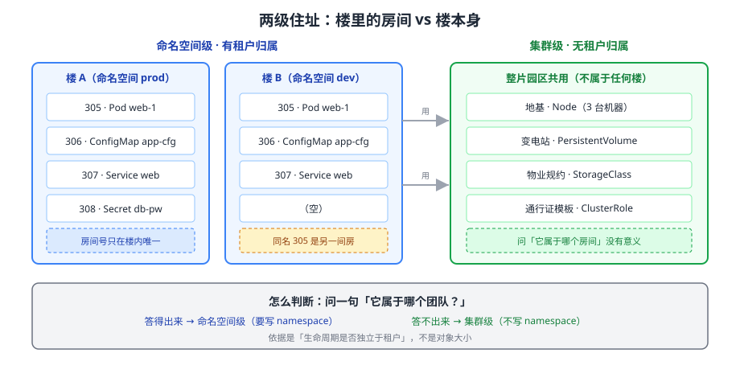

# 课 2：两个住址——命名空间级与集群级

> 📍 所属：子教程[《对象体系专项》](../overview.md)（第 2 课 · 模型视角）
> 📖 故事章节：**分类** —— 搞清楚它们是不是都住在同一个地方
> 🧭 上一课：[课 1《一切皆对象：四段式与 YAML 解剖》](01-一切皆对象：四段式与YAML解剖.md) ｜ 下一课：[课 3《谁生谁》](03-谁生谁：ownerReference与级联删除.md)
> ⚙️ 实操环境：WSL2 Ubuntu 24.04 · bash 5.2.21 · kubectl v1.34.0 · kind 集群 `k8s-c1`（3 节点） · k8s v1.34.0
> 📖 结论已按官方文档核对（核对于 2026-10 ｜ 来源：[命名空间](https://kubernetes.io/zh-cn/docs/concepts/overview/working-with-objects/namespaces/)、[API 约定](https://kubernetes.io/docs/reference/using-api/api-concepts/)）
> ✅ 本节命令实测于 WSL2 Ubuntu 24.04 / kubectl v1.34.0 / k8s v1.34.0（一次性命名空间 `obj2-lab`，课后清理）

## 🎯 本课目标

学完本课，你应当能够：

- 说清为什么对象要分**命名空间级**与**集群级**两级，判断依据是什么
- 用**一条命令**查出任意对象属于哪一级，而不是靠记
- 列出集群级对象的**完整清单**（本集群实测 33 条），并知道哪些是你日常会碰到的
- 避开三个高频坑：**给集群级对象加 `-n` 不报错**、**`kubectl get all` 名不副实**、**删命名空间会连带清空**
- 给集群级对象写 YAML 时，知道**不能写 `metadata.namespace`**

---

## 第一幕：起源与场景引入 —— "这个 namespace 到底该不该写？"

### 场景

你在写一份 YAML。写到 `metadata` 这一段时手停住了：

```yaml
apiVersion: v1
kind: PersistentVolume      # 这个要不要写 namespace？
metadata:
  name: data-pv
  namespace: ???            # ← 卡在这里
spec:
  ...
```

你回忆之前见过的 YAML：Deployment 写了 `namespace: prod`，Service 也写了，但……**Node 好像从来没人写过**？PV 呢？ClusterRole 呢？

你试了两个办法：

1. **抄最近的一份 YAML**——结果那份是 Deployment，你把 `namespace` 带到了 PV 上
2. **不写，看看报不报错**——不报错，但你不知道是"本来就不用写"还是"写错地方被忽略了"

更糟的是第二点带来的**隐性风险**：你给集群级对象加了 `namespace`，命令**不报错、照样返回结果**——它**静默忽略**了这个参数。你以为自己查的是某个命名空间下的对象，实际上查的是**全集群**的。

### 一句话本质

**k8s 的对象分两种住址：大部分住在命名空间里（按租户隔开），小部分住在集群级（全集群共享、没有租户概念）。判断依据不是"这个对象大不大"，而是"它的生命周期是否独立于任何租户"。**

### 处境对照

| | 分不清两级时 | 分清之后 |
|---|---|---|
| 写 YAML | 每个对象都纠结要不要写 `namespace` | 集群级**根本不写**，写了是错的 |
| 查对象 | 靠猜、靠抄 | 一条 `api-resources` 命令查清楚 |
| `get all` | 以为看到全部 | 知道它**漏了 ConfigMap / Secret / PVC 等一整类** |
| 删命名空间 | 以为只删一个空壳 | 知道会**连带清空里面所有对象** |

---

## 第二幕：认知冲突 —— 三个"看起来对其实错"的瞬间

你在集群里做了三组实验，每组结果都和直觉相反：

**实验一**：给集群级对象加 `-n`，**不报错**

```bash
kubectl get node k8s-c1-control-plane -n obj2-lab
# 实测输出：k8s-c1-control-plane   Ready   control-plane   15d   v1.34.0
# 退出码：0
```

`obj2-lab` 这个命名空间**当时根本不存在**。它照样返回了节点信息，**连警告都没有**。

**实验二**：`kubectl get all` 说"没有资源"，但对象明明在

```bash
kubectl get all -n obj2-lab
# 实测输出：No resources found in obj2-lab namespace.

kubectl get cm,secret -n obj2-lab
# 实测输出：
# configmap/hidden-cm          1     1s
# configmap/kube-root-ca.crt   1     1s
# secret/hidden-secret   Opaque   1     0s
```

**`all` 不 all。**

**实验三**：删命名空间，ConfigMap 跟着没了

```bash
kubectl delete namespace obj2-lab
kubectl get cm obj2-cm -n obj2-lab
# 实测输出：Error from server (NotFound): namespaces "obj2-lab" not found
```

你只删了命名空间这一个对象，里面的 ConfigMap **连问都没问你就一起没了**。

> 🎯 **这三个现象指向同一个根因**：**命名空间不是"文件夹"，是一条有实际约束力的归属关系**。下面第三幕逐层拆开。

---

## 第三幕：层层揭示

### 一眼全局图



**看图**：左边那栋楼是**命名空间**——楼里每个房间（Pod、ConfigMap、Service）都是「某一栋楼的某间房」，房间号（name）在不同楼里可以重复。右边是**楼本身和地基**（Node、PV、StorageClass）——它们不属于任何一栋楼，全楼共用。**你不会问"这栋地基属于哪个房间"**，同理集群级对象没有 namespace。

### 本课地图

| 步 | 这一步要解决什么 | 知识点 |
|----|-----------------|--------|
| 第 1 步 | 为什么非要分两级、按什么分 | 知识点 1：两级划分的依据 |
| 第 2 步 | 拿到一个对象怎么查它属于哪级 | 知识点 2：怎么查与完整清单 |
| 第 3 步 | 第二幕那三个反直觉现象怎么解释 | 知识点 3：三个高频坑 |
| 第 4 步 | 给这两类对象写 YAML 有什么不同 | 知识点 4：YAML 写法差异 |

---

### 🧭 第 1/4 步｜承接：第二幕三个反直觉现象 → 本步：先讲清分级的依据

#### 知识点 1：两级划分的依据

**一句话定义**：**命名空间级对象**的生命周期隶属于某个 Namespace（租户内可见、名在租户内唯一）；**集群级对象**不属于任何 Namespace（全集群唯一、全集群可见）。

**直觉建立**：像**办公楼**。

- **命名空间 = 一栋楼**。楼里的房间号（对象名）**只在楼内唯一**——A 座 305 和 B 座 305 是两间不同的房
- **集群级对象 = 楼本身、地基、变电站**。它们**不属于任何一间房**，整栋楼共用
- 你可以问"305 在 A 座还是 B 座"，但**问"变电站属于哪个房间"没有意义**

**核心原理**：判断依据不是"对象大不大"，而是——

> **这个对象的生命周期，是否独立于任何租户（Namespace）？**

| 判断 | 例子 | 为什么 |
|------|------|--------|
| **集群级** | Node | 节点是物理/虚拟机器，**不属于任何一个业务租户** |
| **集群级** | PersistentVolume | 存储是集群资源，先有 PV 再由租户来申领（PVC） |
| **集群级** | StorageClass / IngressClass | 定义"集群提供哪几档服务"，租户只管用 |
| **集群级** | ClusterRole | 授权规则要**跨租户复用**，绑到某个租户就没意义了 |
| **集群级** | Namespace 自己 | **命名空间不能住在命名空间里**（否则无限套娃） |
| **集群级** | CRD / APIService / Webhook 配置 | 扩展的是**整个集群的 API**，不是某个租户的 |
| **命名空间级** | Pod / Deployment / Service | 业务应用，**天然属于某个团队/环境** |
| **命名空间级** | ConfigMap / Secret | 配置与凭据**按租户隔离**才有意义 |
| **命名空间级** | PVC / Role / RoleBinding | 申领与授权都发生在租户内部 |

**典型的两级配对**（记住这几对，能覆盖大部分场景）：

| 集群级 | 命名空间级 | 关系 |
|--------|-----------|------|
| Node | Pod | Pod 被调度到 Node 上，**但 Pod 不属于 Node 的"子对象"** |
| PersistentVolume | PersistentVolumeClaim | PVC 申领 PV，PV 可跨租户复用 |
| StorageClass | PersistentVolumeClaim | PVC 指定用哪个 StorageClass 来动态造 PV |
| ClusterRole | RoleBinding | RoleBinding 把 ClusterRole 的权**限收窄到本租户**内授予 |
| Namespace | 里面的一切 | 命名空间是**容器**，删它会连带清空 |

**常见误区**：

> 🐞 **误区 1**："Node 那么大，肯定是集群级；ConfigMap 那么小，肯定是命名空间级。按大小记。"
> **依据是生命周期是否独立于租户，不是对象大小**。`Namespace` 本身很小却是集群级；`Role` 只管一个租户却是命名空间级。**别按体量猜**。

> 🐞 **误区 2**："集群级对象是'全局单例'，所以全集群只有一个。"
> 错。`PersistentVolume`、`StorageClass`、`IngressClass` 都可以有很多个——**集群级只表示"不属于任何租户"，不表示"只有一个"**。

**一句话记住**：**问一句"它属于哪个团队"——答得出来是命名空间级，答不出来是集群级。**

---

### 🧭 第 2/4 步｜承接：分级依据清楚了 → 本步：拿到具体对象怎么查、清单长什么样

#### 知识点 2：怎么查与完整清单

**一句话定义**：`kubectl api-resources` 的 `NAMESPACED` 列直接给出答案，`true` = 命名空间级，`false` = 集群级。

**直觉建立**：这是集群自带的**住户登记表**——不用记，问它就行。

**核心原理**：三条命令覆盖所有查询需求：

```bash
# ① 查某一个对象是哪一级
kubectl api-resources --no-headers | grep -w persistentvolumes
# 看最后一列 NAMESPACED 是 true 还是 false

# ② 只列集群级
kubectl api-resources --namespaced=false

# ③ 只列命名空间级
kubectl api-resources --namespaced=true
```

**示例演示**：本集群实测的两级数量

| 级别 | 实测条数 | 说明 |
|------|---------|------|
| 集群级 | **33** | `--namespaced=false` |
| 命名空间级 | **35** | `--namespaced=true` |

> ⚠️ **这个数字随集群而变，别当常数记**。差异来源是 **CRD**——装了不同的 Operator，就会多出不同的自定义资源。它的用途是**前后对比**（比如"我装了 OTel Operator 之后多了几种对象"），不是背下来。

**集群级对象完整清单（本集群实测 33 条，按常用度分组）**：

| 分组 | 对象 | 你会在哪遇到 |
|------|------|-------------|
| **集群本身** | `Namespace` | 每个 `kubectl get ns` |
| **节点与存储** | `Node`、`PersistentVolume`、`StorageClass`、`CSIDriver`、`CSINode`、`VolumeAttachment`、`VolumeAttributesClass` | 运维、PVC 绑定 |
| **授权** | `ClusterRole`、`ClusterRoleBinding` | RBAC（主线课 15） |
| **准入与扩展** | `CustomResourceDefinition`、`APIService`、`MutatingWebhookConfiguration`、`ValidatingWebhookConfiguration`、`ValidatingAdmissionPolicy` | 扩展机制（主线课 20） |
| **流量治理** | `IngressClass`、`FlowSchema`、`PriorityLevelConfiguration`、`PriorityClass` | 入口选型、API 优先级与公平性 |
| **运行时** | `RuntimeClass`、`DeviceClass`、`ResourceSlice`、`IPAddress`、`ServiceCIDR` | 容器运行时选择、设备与网络资源 |
| **证书与自查** | `CertificateSigningRequest`、`TokenReview`、`SubjectAccessReview`、`SelfSubjectAccessReview`、`SelfSubjectRulesReview`、`SelfSubjectReview` | 证书签发、权限自查（**这些是"查询接口"而非"存储对象"**） |
| **监控类 CRD** | `NodeMetrics`、`ComponentStatus` | metrics-server 装的 CRD |

> 💡 **`CertificateSigningRequest` / `TokenReview` / `SubjectAccessReview` 这类**：它们出现在集群级清单里，但本质是**"问 API Server 一个问题"的接口**，不是持久存储的业务对象。区分方法是看它有没有 `spec` + `status` 之外的实际资源语义——**课 5、课 6 的总表只收"你会真正创建和管理"的对象**。

**常见误区**：

> 🐞 **误区 3**："背下这张表就能判断了。"
> 表会变（装个 Operator 就多几种）。**正确做法是记住查询命令**，遇到没见过的对象现场查。

**一句话记住**：**别记清单，记 `kubectl api-resources --namespaced=false` 这条命令。**

---

### 🧭 第 3/4 步｜承接：会查了 → 本步：解释第二幕那三个反直觉现象

#### 知识点 3：三个高频坑

##### 坑 1：给集群级对象加 `-n`，不报错、静默忽略

```bash
# obj2-lab 命名空间当时根本不存在，照样返回结果
kubectl get node k8s-c1-control-plane -n obj2-lab
# 实测：k8s-c1-control-plane   Ready   control-plane   15d   v1.34.0
# 退出码：0
```

**为什么**：kubectl 对**集群级资源**会**直接忽略** `-n` 参数——它拼 URL 时压根不带 namespace 段。**不是"查了不存在的位置然后兜底"，是"这个参数对它没意义"**。

**危害**：写脚本时用变量拼 `-n $NS`，若某个资源恰好是集群级，你会**误以为自己查的是限定范围**，实际拿到全集群数据。

**对照**：命名空间级对象写错 namespace 会**明确报错**：

```bash
kubectl get cm obj2-cm -n no-such-ns
# 实测：Error from server (NotFound): namespaces "no-such-ns" not found
```

> 📌 交叉参考：这个坑在 [kubectl 专项课 1](../../kubectl专项/lessons/01-kubectl怎么找到集群.md) 也有实测记录（讲义第 581 行「验证：给集群级资源加 -n 不报错」），两处结论一致。

##### 坑 2：`kubectl get all` 名不副实

```bash
kubectl get all -n obj2-lab
# 实测：No resources found in obj2-lab namespace.

kubectl get cm,secret -n obj2-lab
# 实测：hidden-cm / kube-root-ca.crt / hidden-secret 三个都在
```

**为什么**：`all` 只覆盖**一组固定的工作负载相关类型**（Pod / Service / DaemonSet / Deployment / ReplicaSet / StatefulSet / Job / CronJob / ReplicationController）。

**`all` 不包含**（这些才是你最常漏的）：

- `ConfigMap`、`Secret` ← **配置与凭据，恰恰是最需要盘点的**
- `PersistentVolumeClaim`
- `Ingress`、`NetworkPolicy`
- `ServiceAccount`、`Role`、`RoleBinding`
- `HPA`、`ResourceQuota`、`LimitRange`

**正确做法**：

```bash
# 列出这个命名空间里"实际存在"的所有类型
kubectl api-resources --verbs=list --namespaced -o name \
  | xargs -n 1 kubectl get --show-kind --ignore-not-found -n <ns>
```

##### 坑 3：删命名空间会连带清空里面的对象

```bash
kubectl delete namespace obj2-lab
kubectl get cm obj2-cm -n obj2-lab
# 实测：Error from server (NotFound): namespaces "obj2-lab" not found
```

**为什么**：命名空间是**容器**。删它 = 删掉整个租户，里面的对象**不再有归属**，会被垃圾回收一起清掉（底层机制是下一课 **ownerReference + 级联删除**）。

**危害**：`kubectl delete ns prod` 是**不可逆的高危操作**——它没有"确认要删除里面 237 个对象吗"这一步，直接执行。

**防护手段**（两条，生产必备）：

```bash
# ① 删之前先看清楚里面有什么（注意别用 get all，它会漏）
kubectl api-resources --verbs=list --namespaced -o name \
  | xargs -n 1 kubectl get --show-kind --ignore-not-found -n prod

# ② 用 admission 策略禁止删除关键命名空间（主线课 16 / 课 20）
```

**常见误区**：

> 🐞 **误区 4**："命名空间删了，里面的对象会变成孤儿留在集群里。"
> 不会——**会被级联删除**（下一课详述孤儿是怎么产生的，那种情况是显式用了 `--cascade=orphan`）。

**一句话记住**：**`all` 不等于全部、`-n` 对集群级无效、删 ns 是连锅端。**

---

### 🧭 第 4/4 步｜承接：坑认全了 → 本步：落到 YAML 写法上

#### 知识点 4：YAML 写法差异

**一句话定义**：命名空间级对象的 YAML **可以**写 `metadata.namespace`（不写则落到 `default` 或当前 context 的命名空间）；集群级对象**不写**，写了会被服务端判为无效或忽略。

**核心原理**：两者的完整 YAML 对照（都是**可运行**的）。

**命名空间级（ConfigMap）—— 写了 namespace**：

```yaml
apiVersion: v1
kind: ConfigMap
metadata:
  name: obj2-cm
  namespace: obj2-lab        # ← 可以写，不写则落到 default
data:
  key: value
```

实测：`kubectl apply -f` → `configmap/obj2-cm created`

**集群级（PersistentVolume）—— 不写 namespace**：

```yaml
apiVersion: v1
kind: PersistentVolume
metadata:
  name: obj2-pv              # ← 注意：没有 namespace 字段
spec:
  capacity:
    storage: 1Gi
  accessModes:
  - ReadWriteOnce
  hostPath:
    path: /tmp/obj2-pv-data
  storageClassName: manual
```

**集群级（StorageClass）**：

```yaml
apiVersion: storage.k8s.io/v1
kind: StorageClass
metadata:
  name: manual               # ← 同样没有 namespace
provisioner: kubernetes.io/no-provisioner
volumeBindingMode: WaitForFirstConsumer
```

**对照表**：

| 项 | 命名空间级 | 集群级 |
|----|-----------|--------|
| `metadata.namespace` | 可写（省略则 default） | **不写** |
| 名字唯一范围 | 命名空间内 | **全集群** |
| 查询 | `kubectl get X -n ns` | `kubectl get X`（`-n` 被忽略） |
| 删除连带 | 删 ns 会带走它 | 删 ns **不影响**它 |
| 例子 | Pod / Service / ConfigMap / PVC / Role | Node / PV / StorageClass / ClusterRole / Namespace |

**示例演示**：一个容易混的配对——`Role` vs `ClusterRole`

```yaml
# Role：命名空间级，只在本租户内有效
apiVersion: rbac.authorization.k8s.io/v1
kind: Role
metadata:
  name: pod-reader
  namespace: obj2-lab          # ← 必须有
rules:
- apiGroups: [""]
  resources: ["pods"]
  verbs: ["get", "list"]
```

```yaml
# ClusterRole：集群级，可跨租户复用
apiVersion: rbac.authorization.k8s.io/v1
kind: ClusterRole
metadata:
  name: pod-reader-global      # ← 没有 namespace
rules:
- apiGroups: [""]
  resources: ["pods"]
  verbs: ["get", "list"]
```

> 💡 这两个的搭配用法（`ClusterRole` + `RoleBinding` 把权限收窄到单租户）见主线 [课 15](../overview.md)。

**常见误区**：

> 🐞 **误区 5**："我给集群级对象写了 namespace，apply 也没报错，说明可以写。"
> **没报错不等于对**。服务端可能忽略了这个字段，你留下的是一份**误导后来人**的 YAML——下一个人会以为这个 PV 只属于某个租户。

**一句话记住**：**集群级 YAML 里出现 `namespace:` 就是错的，哪怕它 apply 成功。**

---

## 第四幕：实操验证

> ✅ 本节命令实测于 WSL2 Ubuntu 24.04 / kubectl v1.34.0 / kind 集群 `k8s-c1` / k8s v1.34.0（一次性命名空间 `obj2-lab`，课后清理）

### 4.1 机制验证

```bash
# ① 本集群两级各有多少（数字随 CRD 变化）
kubectl api-resources --namespaced=false --no-headers | wc -l   # 实测：33
kubectl api-resources --namespaced=true  --no-headers | wc -l   # 实测：35

# ② 单个对象属于哪一级：看 NAMESPACED 列
kubectl api-resources --no-headers | grep -wE 'persistentvolumes|configmaps|nodes'
# 实测：persistentvolumes false / configmaps true / nodes false

# ③ 坑 1：集群级加 -n 不报错（obj2-lab 当时不存在）
kubectl get node k8s-c1-control-plane -n obj2-lab
# 实测：k8s-c1-control-plane   Ready   control-plane   15d   v1.34.0
# 退出码 0

# ④ 对照：命名空间级写错 ns 明确报错
kubectl create namespace obj2-lab
kubectl get cm obj2-cm -n no-such-ns
# 实测：Error from server (NotFound): namespaces "no-such-ns" not found

# ⑤ 坑 2：get all 漏掉 ConfigMap / Secret
kubectl create configmap hidden-cm -n obj2-lab --from-literal=key=value
kubectl create secret generic hidden-secret -n obj2-lab --from-literal=pw=example
kubectl get all -n obj2-lab
# 实测：No resources found in obj2-lab namespace.
kubectl get cm,secret -n obj2-lab
# 实测：hidden-cm / kube-root-ca.crt / hidden-secret 三个都在

# ⑥ 坑 3：删命名空间连带清空
kubectl delete namespace obj2-lab
kubectl get cm hidden-cm -n obj2-lab
# 实测：Error from server (NotFound): namespaces "obj2-lab" not found

# ⑦ 清理断言
kubectl get ns obj2-lab
# 实测：Error from server (NotFound): namespaces "obj2-lab" not found  ← 零残留
```

**输出回扣第一幕**：现在你不用再纠结 `namespace:` 该不该写——**先查对象是哪一级，集群级就不写**。

### 4.2 本课不配应用实战

本课是**分类认知课**，按子教程轻量口径不配应用实战。动手环节为上面的 4.1。

> 🎯 课 5、课 6 的总表里，每个对象都会标注「命名空间级 / 集群级」——本课的判断方法届时会反复用到。

---

## 第五幕：体系收束

### 本课在对象体系中的位置

课 1 给了你**统一长相**（四段式），本课在它上面加了**第一个分类维度**——住址。下一课会加**第二个维度**：血缘（谁创建了谁）。

```
课 1 四段式（所有对象通用）
   └─ 课 2 住址（命名空间级 / 集群级）        ← 本课
        └─ 课 3 血缘（ownerReference 串起来）
             └─ 课 4 特例（Event / Lease 不在这条链上）
                  └─ 课 5+6 总表（30+ 对象逐个套模型）
```

### 你现在会了什么

- 判断依据：**问"它属于哪个团队"**，答得出是命名空间级，答不出是集群级
- 一条命令查清楚：`kubectl api-resources --namespaced=false`
- 三个坑：集群级 `-n` 被静默忽略、`get all` 漏掉一整类、删 ns 连锅端
- 写 YAML：集群级**不写** `namespace`

### 接下来学什么

课 3 会回答一个天天见却没想过的问题：**Deployment 删掉之后，它生的那些 Pod 为什么也跟着没了**？答案写在一个字段里——`metadata.ownerReference`，它靠的是**课 1 讲过的 `uid`**。两级住址决定了"能不能互相引用"（跨租户不能认爹），血缘决定了"删一个带走谁"。

### 🐞 本课误区速记

| # | 误区 | 正解 |
|---|------|------|
| 1 | 按对象大小判断级别 | 依据是生命周期是否独立于租户 |
| 2 | 集群级 = 全集群只有一个 | 只是"不属于任何租户"，PV/StorageClass 可有很多 |
| 3 | 背下清单就能判断 | 记查询命令，清单随 CRD 变 |
| 4 | 删 ns 后对象变孤儿 | 会被级联删除，不留孤儿 |
| 5 | 集群级写了 namespace 没报错就没事 | 没报错≠对，留下的是误导性 YAML |

### 📚 官方文档

| 用途 | 链接 |
|------|------|
| 命名空间概念 | [命名空间](https://kubernetes.io/zh-cn/docs/concepts/overview/working-with-objects/namespaces/) |
| 资源与 API 语义 | [API 约定](https://kubernetes.io/docs/reference/using-api/api-concepts/) |
| 命令行查询 | [kubectl 快速参考](https://kubernetes.io/zh-cn/docs/reference/kubectl/quick-reference/) |

### 🧭 课程导航

- 📖 上一课：[课 1《一切皆对象：四段式与 YAML 解剖》](01-一切皆对象：四段式与YAML解剖.md)
- 📖 下一课：[课 3《谁生谁：ownerReference 与级联删除》](03-谁生谁：ownerReference与级联删除.md)
- 🏠 返回：[对象体系专项](../overview.md) ｜ [课程目录](../../../02-课程目录.md)

---

## 🚀 下一批接力提示词

> 学完本课后，**复制下面这段文字发给 AI**，即可无缝进入下一课（无需重新描述上下文）：

```text
继续学 k8s 的《对象体系专项》。我的学习档案在 k8s/子教程/对象体系专项/overview.md，
刚学完课 2《两个住址：命名空间级与集群级》（知识点：两级划分依据 / 怎么查与完整清单 /
三个高频坑 / YAML 写法差异），
请按大纲继续讲解课 3《谁生谁：ownerReference 与级联删除》。
```
