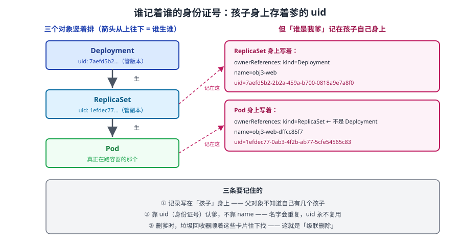

# 课 3：谁生谁——ownerReference 与级联删除

> 📍 所属：子教程[《对象体系专项》](../overview.md)（第 3 课 · 模型视角）
> 📖 故事章节：**血缘** —— 对象不是平铺的，是一棵树
> 🧭 上一课：[课 2《两个住址》](02-两个住址：命名空间级与集群级.md) ｜ 下一课：[课 4《自己冒出来的对象》](04-自己冒出来的对象：Event与Lease.md)
> ⚙️ 实操环境：WSL2 Ubuntu 24.04 · bash 5.2.21 · kubectl v1.34.0 · kind 集群 `k8s-c1`（3 节点） · k8s v1.34.0
> 📖 结论已按官方文档核对（核对于 2026-10 ｜ 来源：[属主引用与垃圾回收](https://kubernetes.io/zh-cn/docs/concepts/architecture/garbage-collection/)）
> ✅ 本节命令实测于 WSL2 Ubuntu 24.04 / kubectl v1.34.0 / k8s v1.34.0（一次性命名空间 `obj3-lab`，课后清理）

## 🎯 本课目标

学完本课，你应当能够：

- 从真实对象上抓取 `ownerReference` 字段，逐字段说清它每个键的含义
- 讲清 **Deployment → ReplicaSet → Pod** 这条**两跳链**是怎么串起来的
- 区分三种级联删除策略，并知道 **`--cascade=orphan` 到底留下了什么**
- 解释**删除卡住**的真凶：`finalizer`，以及命名空间卡在 `Terminating` 时该怎么排查
- 理解**为什么 Event 不挂在 Pod 上**（下一课的引子）

---

## 第一幕：起源与场景引入 —— "我只删了 Deployment"

### 场景

你执行了一条很普通的命令：

```bash
kubectl delete deployment web -n prod
```

返回 `deployment.apps "web" deleted`。然后你顺手看了一眼：

```bash
kubectl get pods -n prod
# No resources found in prod namespace.
```

**Pod 全没了。** 你只删了一个 Deployment，但**十几个 Pod 跟着消失了**。

你心里一紧——这些 Pod 你**从来没手动创建过**（是 Deployment 生成的），也**从来没手动删过**（是系统删的）。它们从生到死，你只下过一个命令。

反过来，你想起上周另一个场景：删掉一个 Job 之后，**它产生的 Pod 却还在**，占着资源，最后是运维催着才手动清掉的。

**为什么同样是"删掉会生成 Pod 的对象"，一个带走 Pod、一个不带走？**

### 一句话本质

**k8s 的对象之间有一条显式的"父子"记录——`metadata.ownerReference`，它写在子对象上、指向父对象的 `uid`；删除时集群按这条记录决定"要不要连坐"，这就是级联删除。**

### 处境对照

| | 不知道 ownerReference | 知道之后 |
|---|---|---|
| 删对象 | 靠试、靠运气 | 看 ownerReference 就知道会带走谁 |
| 残留 Pod | 不知道哪来的 | 一眼看出"这是孤儿"，知道怎么清 |
| 删除卡住 | 反复重试 `delete` | 知道是 `finalizer` 没摘，去查是谁加的 |
| 跨租户引用 | 可能写出非法引用 | 知道**跨命名空间的 owner 引用无效**（课 2 的住址在这里起了约束作用） |

---

## 第二幕：认知冲突 —— "孤儿"这个词被用错了

你用 `--cascade=orphan` 删了一个 Deployment，预期是"留下孤儿 Pod"。你去看：

```bash
kubectl delete deployment obj3-orphan --cascade=orphan
kubectl get pods -l app=obj3-orphan
# 实测：还剩 2 个 Pod
```

符合预期。但当你去查这个"孤儿" Pod 的 `ownerReference` 时，**发现它还认着爹**：

```bash
kubectl get pod obj3-orphan-6c457d4887-nn5jl -o jsonpath='{.metadata.ownerReferences[0].name}'
# 实测：obj3-orphan-6c457d4887      ← RS 的名字

kubectl get rs --no-headers | wc -l
# 实测：1                            ← RS 还活着！
```

**矛盾出现了**：

1. 这个 Pod 被叫做"孤儿"，但它的 `ownerReference` **还在**，而且它爹（RS）**还活着**
2. 那它到底算不算孤儿？**垃圾回收器为什么不回收它？**
3. 如果它不算孤儿，那 `--cascade=orphan` 留下的到底是什么？

> 🎯 **剧透**：这里有个术语陷阱——`--cascade=orphan` **孤立的不是 Pod，是 RS**。下面第三幕拆开讲。

---

## 第三幕：层层揭示

### 一眼全局图



**看图**：左边是三个对象**竖着排**——Deployment 生 ReplicaSet，ReplicaSet 生 Pod。箭头从爹指向孩子，但**记录却写在孩子身上**（右边那张卡片）：每个子对象的 `metadata.ownerReferences` 里存着爹的 `kind`、`name` 和 **`uid`**。删爹时，垃圾回收器顺着这些卡片往下找，决定带走谁。

### 本课地图

| 步 | 这一步要解决什么 | 知识点 |
|----|-----------------|--------|
| 第 1 步 | 这条"父子"记录长什么样、每个字段什么意思 | 知识点 1：ownerReference 字段解剖 |
| 第 2 步 | Deployment 到 Pod 为什么是两跳 | 知识点 2：两跳链与控制器 |
| 第 3 步 | 删一个带走谁、三种策略差在哪 | 知识点 3：级联删除三种策略 |
| 第 4 步 | 为什么删除会卡住、怎么排查 | 知识点 4：finalizer 与 Terminating |

---

### 🧭 第 1/4 步｜承接：第二幕"孤儿"术语陷阱 → 本步：先把字段本身拆清楚

#### 知识点 1：ownerReference 字段解剖

**一句话定义**：`ownerReference` 是写在**子对象** `metadata` 里的一组引用，记录"我的父对象是谁"，靠 **`uid`** 精确指认（不是靠名字）。

**直觉建立**：像**出生证明上父亲那一栏**。

- 证明是**孩子的档案**（写在子对象上），不是父亲的档案
- 填的是**父亲的身份证号（uid）**，不是名字——**因为名字会重复、身份证号不会**（这正是课 1 讲的 `uid` 的用途）
- 一个人可以有多个"家长"（养父/生父），所以它是**数组**

**核心原理**：本课实测的真值（从 Pod 上原样抓下来的）：

```json
[
  {
    "apiVersion": "apps/v1",
    "blockOwnerDeletion": true,
    "controller": true,
    "kind": "ReplicaSet",
    "name": "obj3-web-dffcc85f7",
    "uid": "1efdec77-0ab3-4f2b-ab77-5cfe54565c83"
  }
]
```

逐字段拆解：

| 字段 | 实测值 | 含义 |
|------|--------|------|
| `kind` | `ReplicaSet` | 爹的类型 |
| `name` | `obj3-web-dffcc85f7` | 爹的名字（**给人看的**） |
| `uid` | `1efdec77-0ab3-...` | 爹的身份证号（**给机器用的，真正的锚点**） |
| `apiVersion` | `apps/v1` | 爹属于哪个组哪个版本 |
| `controller` | `true` | **是不是"主爹"**——`true` 表示这个爹负责管我 |
| `blockOwnerDeletion` | `true` | 爹被删时，**先别让爹消失，等孩子清完再让爹走** |

**两个 `true` 值得单独讲**：

- **`controller: true`**：一个子对象可以有多个 owner（比如后来手动加的引用），但**只能有一个"控制器 owner"**。它决定"谁负责调谐我"。kubectl 的 `get` 输出里那些自动生成的名字，背后就是它在起作用。
- **`blockOwnerDeletion: true`**：配合 **Foreground 级联策略**——删爹时先标记 `deletionTimestamp`，**等所有孩子真的删完了，才让爹消失**。这保证了不会出现"爹没了但孩子还在清理中"的中间态。

**怎么读它**（三条常用命令）：

```bash
# ① 看某个对象的爹是谁
kubectl get pod <pod> -n <ns> -o jsonpath='{.metadata.ownerReferences}'

# ② 看爹的 uid（用来跟孩子的引用对上号）
kubectl get rs <rs> -n <ns> -o jsonpath='{.metadata.uid}'

# ③ 反查：找出某个命名空间里的孤儿（有 owner 但爹已不存在）
#    思路：列出所有对象的 ownerReferences，逐个去查 uid 是否还存在
```

**常见误区**：

> 🐞 **误区 1**："ownerReference 写在父对象上，列出它有哪些孩子。"
> **反了**——写在**子对象**上。父对象**不知道**自己有哪些孩子。这也是为什么"查某个 Deployment 有哪些 Pod"必须靠 **label selector** 而不是靠 owner 关系反查。

> 🐞 **误区 2**："它是靠 name 认爹的。"
> **靠 uid**。name 只是给人看的冗余信息。同名对象在不同时间被创建时 uid 一定不同——**用 name 认爹会在重建场景下认错人**。

**一句话记住**：**ownerReference 是孩子的出生证明，靠 uid 认爹；爹不知道自己有几个孩子。**

---

### 🧭 第 2/4 步｜承接：字段拆完了 → 本步：解释为什么是两跳而不是一跳

#### 知识点 2：两跳链与控制器

**一句话定义**：Deployment **不直接**创建 Pod，而是创建 ReplicaSet，由 ReplicaSet 创建 Pod——所以链是**两跳**。

**核心原理**：本课实测的两跳真值：

```
Deployment  obj3-web
   │  uid = 7aefd5b2-2b2a-459a-b700-0818a9e7a8f0
   ▼
ReplicaSet  obj3-web-dffcc85f7
   │  ownerReference.uid = 7aefd5b2-...        ← 指向 Deployment
   │  uid = 1efdec77-0ab3-4f2b-ab77-5cfe54565c83
   ▼
Pod         obj3-web-dffcc85f7-7mh54
      ownerReference.uid = 1efdec77-...        ← 指向 ReplicaSet（不是 Deployment！）
```

**注意 Pod 认的是 RS，不是 Deployment**——这是初学者最常搞错的一点。

**为什么要多一层 ReplicaSet**：因为 **Deployment 的本职是"管理版本"**，不是"管理副本"。

- 你要发布新版本 → Deployment 创建**一个新的 RS**，新 RS 起新 Pod，老 RS 缩到 0
- 回滚 → Deployment 把老 RS 重新扩容
- **老 RS 被保留**（受 `revisionHistoryLimit` 限制），所以能秒回滚

如果 Deployment 直接管 Pod，发布时就得自己逐个替换，**版本号与副本管理会糊在一起**。

**这条链上的三个"控制器"**：

| 控制器 |  watches | 创建 | 职责 |
|--------|---------|------|------|
| Deployment 控制器 | Deployment | ReplicaSet | 版本与发布策略 |
| ReplicaSet 控制器 | ReplicaSet | Pod | 副本数维持 |
| kubelet | Pod（绑定到本节点的） | 容器 | 真正把容器跑起来 |

> 💡 版本与 revision 的细节见 [kubectl 专项课 6《发布与回滚》](../../kubectl专项/lessons/06-发布与回滚.md)——那里实测了 revision 号存在 RS 上的证据。

**同类链条**（课 4 会展开）：

| 父 | 子 | 说明 |
|----|----|------|
| StatefulSet | Pod | **直接**创建，没有中间层 |
| Job | Pod | 直接创建 |
| CronJob | Job | CronJob → Job → Pod（两跳） |
| Service | **EndpointSlice** | 不是 Pod！Service 管的是端点列表 |
| PVC | PV（绑定） | 是**绑定**关系，不是 owner 关系 |

**常见误区**：

> 🐞 **误区 3**："Pod 的 owner 是 Deployment。"
> 实测是 **ReplicaSet**。Deployment 是"爷爷"。判断方法：`kubectl get pod -o jsonpath='{.metadata.ownerReferences[0].kind}'`。

**一句话记住**：**Deployment 管版本、RS 管副本、kubelet 管容器——Pod 的爹是 RS。**

---

### 🧭 第 3/4 步｜承接：链清楚了 → 本步：解释删除时到底带走谁（回应第二幕的"孤儿"陷阱）

#### 知识点 3：级联删除三种策略

**一句话定义**：删除父对象时，k8s 按 `--cascade` 指定的策略决定是否删除子对象，共三种：`Background`（默认）、`Foreground`、`Orphan`。

**直觉建立**：像**拆一栋违规建筑**。

- **Background**：推土机开进来，楼（父）**立刻**推倒，里面的东西（子）**后台慢慢清**——你看到的是"楼没了"
- **Foreground**：先贴封条（`deletionTimestamp`），**等里面清空、确认人走光了**，才推楼——你看到的是"楼还在，但已封"
- **Orphan**：只摘掉楼门牌上的"隶属关系"，**楼和里面的东西都留着**

**核心原理**：三种策略对照

| 策略 | 命令 | 父对象何时消失 | 子对象 | 实测 |
|------|------|--------------|--------|------|
| **Background**（默认） | `kubectl delete deployment X` | **立即** | 后台异步删除 | 删完 Pod 数 = **0** |
| **Foreground** | `kubectl delete deployment X --cascade=foreground` | **等子对象删完** | 先删子 | 父对象会先处于 Terminating |
| **Orphan** | `kubectl delete deployment X --cascade=orphan` | 立即 | **保留** | 删完 Pod 数 = **2** |

**回到第二幕那个陷阱**：`--cascade=orphan` 删 Deployment 后实测：

```bash
kubectl get rs --no-headers | wc -l
# 实测：1        ← RS 还活着

kubectl get pod obj3-orphan-... -o jsonpath='{.metadata.ownerReferences[0].name}'
# 实测：obj3-orphan-6c457d4887     ← Pod 仍认 RS 为爹
```

**所以真相是**：

- `--cascade=orphan` **割断的是"Deployment → RS"这一跳**
- RS 成了真正的孤儿（它的 owner Deployment 没了）
- 但 **Pod 的爹（RS）还活着**，所以 Pod **不会被垃圾回收**——它**不是孤儿**，只是"爹没了爹的孤儿"

> ⚠️ **术语纠正**：严格说，`--cascade=orphan` 留下的是**一整棵失去了根的子树**，而不只是"几个孤儿 Pod"。**Pod 仍在 RS 的管辖下**，如果此时 RS 的 `replicas` 还是 2，Pod 被删了甚至会被**重新拉起**。

**孤儿怎么收拾**：孤儿不会被自动清理，必须**手动删**。而且要从**上往下删**——先删 RS（否则 RS 会把 Pod 重新拉起来）：

```bash
# 正确顺序：先删控制器，再删 Pod
kubectl delete rs <rs-name> -n <ns>
kubectl delete pod -l app=<label> -n <ns>

# 错误顺序：只删 Pod → RS 发现副本数不够，立刻重建
```

**常见误区**：

> 🐞 **误区 4**："删了父对象，子对象一定跟着没。"
> 取决于 `--cascade`。**默认会**，但显式 orphan 不会。**CI/CD 脚本里尤其要留意**——有些工具默认用 orphan 防止误删。

> 🐞 **误区 5**："孤儿 Pod 直接 `kubectl delete pod` 就干净了。"
> 若它的爹（RS）还在，**会被立刻重建**。必须先删控制器。

**一句话记住**：**默认连坐、orphan 断链；清孤儿要先删控制器再删 Pod。**

---

### 🧭 第 4/4 步｜承接：会删了 → 本步：为什么有时候删不掉

#### 知识点 4：finalizer 与 Terminating

**一句话定义**：`finalizer`（终结器）是写在 `metadata.finalizers` 里的一段**钩子名单**；只要名单非空，对象被删时就只会被标记 `deletionTimestamp` 并进入 `Terminating`，**直到有控制器把名单清空才真正消失**。

**直觉建立**：像**退房验收**。

你退房（发删除请求），酒店不会立刻把房间标记为"可用"，而是**先让保洁、工程、财务各签一个字**。只要还有一个环节没签字，房间就一直挂着"待验收"——**哪怕你已经把钥匙交了**。

**核心原理**：实测（本课取证脚本第 5 步）——给 ConfigMap 加一个没人处理的 finalizer：

```yaml
apiVersion: v1
kind: ConfigMap
metadata:
  name: obj3-stuck
  namespace: obj3-lab
  finalizers:
  - example.com/never-done      # ← 没有控制器会去摘它
data:
  key: value
```

删除它：

```bash
kubectl delete cm obj3-stuck -n obj3-lab
# 返回：configmap "obj3-stuck" deleted        ← 看起来删掉了

kubectl get cm obj3-stuck -n obj3-lab \
  -o jsonpath='{.metadata.deletionTimestamp}|{.metadata.finalizers}'
# 实测：2026-10-14T01:48:00Z|["example.com/never-done"]
```

**它还在**，只是多了 `deletionTimestamp`（删除时间戳），处于 `Terminating` 状态。

**这就是"删除卡住"的真凶**。它与级联删除的关系：

- 删父对象 → 触发级联 → 要删子对象
- 子对象有 finalizer 且没人摘 → 子对象卡在 Terminating
- 父对象（尤其用 Foreground 时）**也跟着卡住**

**命名空间卡在 Terminating 的排查路径**：

```bash
# ① 看命名空间本身卡在哪个 finalizer
kubectl get ns <ns> -o jsonpath='{.spec.finalizers}|{.metadata.finalizers}'

# ② 找出里面还在 Terminating 的对象（这就是卡住的根因）
kubectl api-resources --verbs=list --namespaced -o name \
  | xargs -n 1 kubectl get --show-kind --ignore-not-found -n <ns>

# ③ 逐个摘掉 finalizer（⚠️ 高危：先确认为什么没人摘它）
kubectl patch <resource> <name> -n <ns> --type=merge -p '{"metadata":{"finalizers":[]}}'
```

> ⚠️ **风险提示**：清空 finalizer 是**绕过正常清理流程**的强制手段。它跳过的可能是"删除云盘""回收 IP"这类**有副作用的清理动作**。生产环境动手前务必确认：这个 finalizer 为什么要存在、是谁负责摘它、跳过后会不会留下云资源残留。
> 📌 交叉参考：主线 [课 18《系统化排障》](../../../stages/6-排障运维与扩展/lessons/18-系统化排障分层定位法.md) 的删除卡住处置手法与本课一致。

**哪些对象常见 finalizer**：

| 对象 | 典型 finalizer | 它在等什么 |
|------|---------------|-----------|
| Namespace | `kubernetes` | 等里面所有对象清完 |
| PVC | `kubernetes.io/pvc-protection` | 等还在用它的 Pod 被删 |
| PV | `kubernetes.io/pv-protection` | 等绑定它的 PVC 被删 |
| 自定义资源（CR） | Operator 自己加的 | 等 Operator 完成外部资源清理 |

**常见误区**：

> 🐞 **误区 6**："delete 返回成功就是删掉了。"
> 看 `deletionTimestamp` 是否存在。**有它就是还在 Terminating**，无论命令返回什么。

**一句话记住**：**finalizer 是退房验收单——有人没签字，房间就一直挂着。**

---

## 第四幕：实操验证

> ✅ 本节命令实测于 WSL2 Ubuntu 24.04 / kubectl v1.34.0 / kind 集群 `k8s-c1` / k8s v1.34.0（一次性命名空间 `obj3-lab`，课后清理）

### 4.1 机制验证

```bash
# ① 建一个 Deployment
kubectl create namespace obj3-lab
cat <<'EOF' | kubectl apply -f -
apiVersion: apps/v1
kind: Deployment
metadata: {name: obj3-web, namespace: obj3-lab}
spec:
  replicas: 2
  selector: {matchLabels: {app: obj3-web}}
  template:
    metadata: {labels: {app: obj3-web}}
    spec:
      containers:
      - {name: app, image: nginx:alpine, imagePullPolicy: IfNotPresent}
EOF

# ② 看 Pod 上的 ownerReference（注意 kind 是 ReplicaSet）
kubectl get pod -l app=obj3-web -n obj3-lab --no-headers | head -1 | awk '{print $1}' | \
  xargs -I{} kubectl get pod {} -n obj3-lab -o jsonpath='{.metadata.ownerReferences}'
# 实测：[{"apiVersion":"apps/v1","blockOwnerDeletion":true,"controller":true,
#         "kind":"ReplicaSet","name":"obj3-web-dffcc85f7",
#         "uid":"1efdec77-0ab3-4f2b-ab77-5cfe54565c83"}]

# ③ 验证两跳：RS 也认 Deployment 为爹
kubectl get rs -n obj3-lab --no-headers | head -1 | awk '{print $1}' | \
  xargs -I{} kubectl get rs {} -n obj3-lab -o jsonpath='{.metadata.ownerReferences}'
# 实测：kind=Deployment, name=obj3-web, uid=7aefd5b2-...

# ④ 默认级联（Background）：删 Deployment，Pod 被回收
kubectl delete deployment obj3-web -n obj3-lab
sleep 6
kubectl get pod -n obj3-lab -l app=obj3-web --no-headers | wc -l
# 实测：0

# ⑤ Orphan：留下的是整棵子树（RS 也活着）
kubectl delete deployment obj3-orphan -n obj3-lab --cascade=orphan
kubectl get pod -n obj3-lab -l app=obj3-orphan --no-headers | wc -l
# 实测：2
kubectl get rs -n obj3-lab --no-headers | wc -l
# 实测：1   ← RS 还在，所以 Pod 不是真孤儿

# ⑥ finalizer 让删除卡住
kubectl patch cm obj3-stuck -n obj3-lab --type=merge -p '{"metadata":{"finalizers":[]}}'
# 摘掉后才能真正删除

# ⑦ 清理断言
kubectl delete namespace obj3-lab
kubectl get ns obj3-lab
# 实测：Error from server (NotFound)  ← 零残留
```

**输出回扣第一幕**：现在你知道了——删 Deployment 带走 Pod，靠的是 Pod 身上那条指向 RS 的 `ownerReference`；而删 Job 后 Pod 还在，是因为 Job 的清理策略不同（或用了 orphan）。

### 4.2 本课不配应用实战

本课是**关系机制课**，按子教程轻量口径不配应用实战。动手环节为上面的 4.1。

---

## 第五幕：体系收束

### 本课在对象体系中的位置

```
课 1 四段式（所有对象通用）
   └─ 课 2 住址（命名空间级 / 集群级）
        └─ 课 3 血缘（ownerReference 串成树）      ← 本课
             └─ 课 4 特例（Event / Lease 不在树上）
                  └─ 课 5+6 总表（30+ 对象逐个套模型）
```

**课 2 与课 3 的交汇点**：ownerReference 有一条**硬约束**——**同命名空间内的 owner 引用才有效**。跨命名空间的 owner 引用会被垃圾回收器视为无效（孩子会被当成孤儿删掉）。**住址决定了谁能认谁做爹。**

### 你现在会了什么

- 能从真实对象上抓出 `ownerReference`，逐字段说清含义
- 知道 Pod 的爹是 **RS 不是 Deployment**（两跳链）
- 三种级联策略的差异，以及 **orphan 留下的是整棵子树**这个术语陷阱
- 删除卡住 = `finalizer` 没摘，知道排查路径与风险

### 接下来学什么

课 3 讲的对象都有爹。但有一类对象**没有爹、自己冒出来**，而且**数量巨大**——**Event**。你天天在 `describe` 里看到它，却可能没想过：

- 它为什么**不是 Pod 的子对象**？（如果它是，删一个 Pod 会连带删掉一堆 Event，而 Event 本来就是用来记录 Pod 一生的）
- 它为什么**过一小时就不见了**？
- 还有一个更神秘的 **Lease**——它不在 `kubectl get all` 里，但每个节点、每个选主程序都在用它

课 4 会讲这两个"没有爹的对象"，以及**控制器生成对象**的完整全景链。

### 🐞 本课误区速记

| # | 误区 | 正解 |
|---|------|------|
| 1 | ownerReference 写在父对象上 | 写在**子对象**上，父不知道自己有几个孩子 |
| 2 | 靠 name 认爹 | 靠 **uid** |
| 3 | Pod 的 owner 是 Deployment | 是 **ReplicaSet**（两跳） |
| 4 | 删父一定带走子 | 取决于 `--cascade`，orphan 不带走 |
| 5 | 孤儿 Pod 直接删就干净 | 爹还在会被重建，先删控制器 |
| 6 | delete 返回成功就是删掉了 | 看 `deletionTimestamp`，有就是 Terminating |

### 📚 官方文档

| 用途 | 链接 |
|------|------|
| 属主与垃圾回收 | [属主引用与垃圾回收](https://kubernetes.io/zh-cn/docs/concepts/architecture/garbage-collection/) |
| finalizer 机制 | [使用 Finalizer](https://kubernetes.io/zh-cn/docs/concepts/overview/working-with-objects/finalizers/) |
| 命名空间删除卡住 | [命名空间生命周期](https://kubernetes.io/zh-cn/docs/concepts/overview/working-with-objects/namespaces/) |

### 🧭 课程导航

- 📖 上一课：[课 2《两个住址：命名空间级与集群级》](02-两个住址：命名空间级与集群级.md)
- 📖 下一课：[课 4《自己冒出来的对象：Event 与 Lease》](04-自己冒出来的对象：Event与Lease.md)
- 🏠 返回：[对象体系专项](../overview.md) ｜ [课程目录](../../../02-课程目录.md)

---

## 🚀 下一批接力提示词

> 学完本课后，**复制下面这段文字发给 AI**，即可无缝进入下一课（无需重新描述上下文）：

```text
继续学 k8s 的《对象体系专项》。我的学习档案在 k8s/子教程/对象体系专项/overview.md，
刚学完课 3《谁生谁：ownerReference 与级联删除》（知识点：ownerReference 字段解剖 /
两跳链 / 三种级联策略 / finalizer 与 Terminating），
请按大纲继续讲解课 4《自己冒出来的对象：Event 与 Lease》。
```
