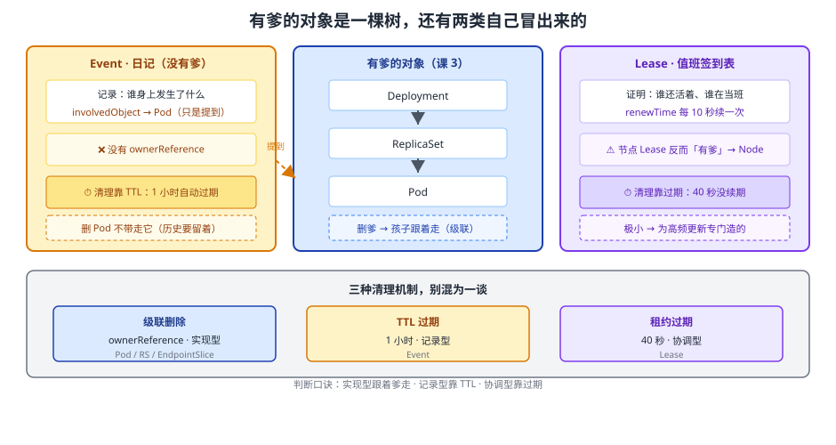

# 课 4：自己冒出来的对象——Event 与 Lease

> 📍 所属：子教程[《对象体系专项》](../overview.md)（第 4 课 · 模型视角）
> 📖 故事章节：**例外** —— 有些对象没有爹，而且数量巨大
> 🧭 上一课：[课 3《谁生谁》](03-谁生谁：ownerReference与级联删除.md) ｜ 下一课：[课 5《对象总表（上）》](05-对象总表上：工作负载·配置·存储.md)
> ⚙️ 实操环境：WSL2 Ubuntu 24.04 · bash 5.2.21 · kubectl v1.34.0 · kind 集群 `k8s-c1`（3 节点） · k8s v1.34.0
> 📖 结论已按官方文档核对（核对于 2026-10 ｜ 来源：[Event API 参考](https://kubernetes.io/docs/reference/generated/kubernetes-api/v1.34/#event-v1-core)、[Lease API 参考](https://kubernetes.io/docs/reference/generated/kubernetes-api/v1.34/#lease-v1-coordination-k8s-io)、[分布式系统协调](https://kubernetes.io/zh-cn/docs/concepts/architecture/leases/)）
> ✅ 本节命令实测于 WSL2 Ubuntu 24.04 / kubectl v1.34.0 / k8s v1.34.0（一次性命名空间 `obj4-lab`，课后清理）

## 🎯 本课目标

学完本课，你应当能够：

- 证明 **Event 是一个真正的对象**（有 `apiVersion` / `kind` / `uid`），而不是 `describe` 输出里的一段文字
- 讲清 **Event 为什么不是 Pod 的子对象**，以及它用什么字段指向 Pod
- 说清 Event 的 **1 小时 TTL** 与 `count` 聚合，知道"查不到 Event"不等于"没发生过"
- 解释 **Lease 是什么**、它为什么**不用 ConfigMap 而单独造一种对象**
- 画出**控制器生成对象**的全景链（Service→EndpointSlice、CronJob→Job→Pod 等）

---

## 第一幕：起源与场景引入 —— "Event 是不是 describe 的一段输出？"

### 场景

你排查一个 Pod 起不来的问题，标准动作是：

```bash
kubectl describe pod web-xxx
# 输出最后一段：
# Events:
#   Type     Reason     Age   From     Message
#   ----     ------     ---   ----     -------
#   Warning  Failed     2m    kubelet  Error: ImagePullBackOff
```

你天天看这段，**但你可能从来没想过它是个对象**。

直到有一天你遇到两件事：

**第一件**：你想查一小时前那次调度失败的原因，执行 `kubectl get events`，**什么都没有**。可是那个 Pod 明明失败过——Event 去哪了？

**第二件**：你在 `kube-system` 里看到一个从没见过的东西：

```bash
kubectl get lease -n kube-node-lease
# k8s-c1-control-plane   k8s-c1-control-plane   15d
```

`Lease`？租约？**谁跟谁签了租约**？它不在 `kubectl get all` 里，你没创建过它，它却已经存在 15 天了。

### 一句话本质

**有一类对象不是你创建的，而是控制器与 kubelet 在运行过程中"写"出来的——Event 是系统的日记（记发生过什么），Lease 是系统的心跳与选票（证明谁还活着、谁在当班）。它们没有爹，也不该有爹。**

### 处境对照

| | 把它们当"输出/附属品" | 把它们当"对象" |
|---|---|---|
| Event 查不到 | 以为"没发生过" | 知道**1 小时过期**，去找持久化方案 |
| 想统计故障 | 只能肉眼看 | 能 `get events -o json` 做聚合分析 |
| 见到 Lease | 以为是某种配置 | 知道是**心跳**，删了会导致节点被判死 |
| 备份集群 | 把 Event 一起备了 | 知道 **Event / Lease 不该进备份**（备份了也是废数据） |

---

## 第二幕：认知冲突 —— "它明明是 Pod 的事，为什么不是 Pod 的孩子？"

课 3 刚讲过：子对象身上有 `ownerReference` 认爹。那你自然会想——Event 记的是 Pod 的事，**它应该是 Pod 的子对象吧**？

你去查（本课实测）：

```bash
kubectl get events -n obj4-lab -o jsonpath='{range .items[0]}
  involvedObject={.involvedObject.kind}/{.involvedObject.name}
  ownerRef={.metadata.ownerReferences}'
```

实测输出：

```text
involvedObject=Pod/obj4-pod
ownerRef=                        ← 空的！没有 ownerReference
```

**它有 `involvedObject`（涉及的对象），但没有 `ownerReference`（属主引用）。**

这两个字段名字很像，却是**完全不同的两回事**。矛盾来了：

1. **为什么 Event 不挂在 Pod 上？** 如果挂了，删 Pod 就会级联删掉它的所有 Event——**而 Event 正是用来记录"这个 Pod 一生发生了什么"的，Pod 没了日志也没了，那还查什么？**
2. **不挂 ownerReference，谁来清理它们？** 一个跑了一年的集群，Event 会不会把 etcd 撑爆？

> 🎯 **剧透**：第一个问题的答案是**故意不挂**；第二个问题的答案是 **TTL（1 小时自动过期）**——这是与 ownerReference 完全不同的另一套清理机制。下面第三幕拆开。

---

## 第三幕：层层揭示

### 一眼全局图



**看图**：中间那列是**你创建的、有爹的对象**（课 3 那棵树）。左右两侧是**自己冒出来、没有爹**的两类：左边是 **Event（日记）**——记录别人身上发生了什么，但**不挂在别人名下**（虚线表示"只是提到你，不属于你"）；右边是 **Lease（值班表）**——证明"谁还活着、谁在当班"。

### 本课地图

| 步 | 这一步要解决什么 | 知识点 |
|----|-----------------|--------|
| 第 1 步 | Event 到底是不是对象、字段长什么样 | 知识点 1：Event 作为对象 |
| 第 2 步 | 它为什么不挂 ownerReference、怎么清理 | 知识点 2：不挂爹的两条理由与 TTL |
| 第 3 步 | Lease 是什么、为什么单独造一种 | 知识点 3：Lease 的两种用途 |
| 第 4 步 | 还有哪些对象是"生成"出来的 | 知识点 4：控制器生成对象全景 |

---

### 🧭 第 1/4 步｜承接：第二幕"有 involvedObject 却没 ownerReference" → 本步：先把 Event 当对象认全

#### 知识点 1：Event 作为对象

**一句话定义**：Event 是 `v1/Event`（另有一份 `events.k8s.io/v1` 版本）类型的**命名空间级对象**，由 kubelet 与各控制器写入，记录"某个对象身上发生了什么"。

**直觉建立**：像**小区门口的公告板**。

- 公告板上贴着"3 号楼 502 停水通知"——**它提到 502，但不属于 502**
- 公告板**自己也有编号、也有张贴时间**（它是个实体）
- 贴满了一会，物业会**定期撕掉旧的**

**核心原理**：本课实测抓到的**真实 Event YAML**（原样节选）：

```yaml
apiVersion: v1
kind: Event
metadata:
  creationTimestamp: "2026-10-14T01:51:55Z"
  name: obj4-pod.18de4267e83769a7      # ← 名字是「对象名.哈希」拼出来的
  namespace: obj4-lab
  resourceVersion: "955605"
  uid: b35c969f-e9a2-4bce-ad42-42ef2f205ef5
involvedObject:                        # ← 提到谁（不是 ownerReference！）
  apiVersion: v1
  kind: Pod
  name: obj4-pod
  namespace: obj4-lab
  uid: fb34b711-7710-44f8-9829-a3a87796b56f
reason: Scheduled
message: Successfully assigned obj4-lab/obj4-pod to k8s-c1-control-plane
source: {}
reportingComponent: default-scheduler
type: Normal
eventTime: "2026-10-14T01:51:55.785039Z"
```

**四段式套上去**（课 1 的模型）：

| 段 | Event 的值 |
|----|-----------|
| `apiVersion` | `v1`（core 组，另有 `events.k8s.io/v1`） |
| `kind` | `Event` |
| `metadata.name` | `obj4-pod.18de4267e83769a7` —— **对象名 + 哈希**，不是你起的 |
| `metadata.namespace` | `obj4-lab` —— **与被记录对象同命名空间** |
| `spec`？ | **没有 spec** —— 它是"已发生的事实"，字段是平铺的 |

> 💡 **这是本课第一个反模型点**：课 1 说对象分 spec/status 两栏，但 **Event 没有 spec**——它记录的是**已经发生的事**（status 语义），没什么"期望状态"可言。

**两个关键字段的对照**（这是本课最容易混的一对）：

| 字段 | 性质 | 作用 | 删除连带 |
|------|------|------|---------|
| `involvedObject` | **引用（提到）** | 说明这条 Event 说的是谁 | ❌ 删 Pod **不影响** Event |
| `ownerReference` | **归属（是我爹）** | 决定级联删除 | ✅ 删爹会带走 |

**实测证据**：本课抓的 Event 上 `ownerRef=` 为空，`involvedObject=Pod/obj4-pod`。

**`apiVersion` 有两个版本**（实测 `api-resources` 输出两行）：

```text
events   ev   v1                 true   Event
events   ev   events.k8s.io/v1   true   Event
```

- `v1`（core 组）：老版本，字段平铺
- `events.k8s.io/v1`：从 core 组**独立出来的新组**，结构更规范
- 现在**两者并存**，`kubectl get events` 默认取其一

**常见误区**：

> 🐞 **误区 1**："Event 是 describe 输出里的一部分，不算对象。"
> 它**有 uid、有 resourceVersion、能 `get -o yaml`**——是货真价实的对象，只是**没有 spec 栏**。

> 🐞 **误区 2**："`involvedObject` 就是 ownerReference 的别名。"
> 完全不同。`involvedObject` **只记录不约束**，删 Pod 不会带走 Event；`ownerReference` 会触发级联删除（课 3）。

**一句话记住**：**Event 是公告板——它提到你，但不属于你。**

---

### 🧭 第 2/4 步｜承接：Event 认全了 → 本步：回答"为什么不挂爹、谁来清理"

#### 知识点 2：不挂爹的两条理由与 TTL

**一句话定义**：Event 不用 `ownerReference` 是为了**避免级联删除炸掉历史记录**、并**避免 etcd 写入放大**；清理靠 **TTL（默认 1 小时自动过期）**。

**核心原理**：两条设计理由——

**理由一：语义上不成立——日记不能随人一起烧掉**

Event 的用途是"记录这个对象一生发生了什么"。如果它是 Pod 的子对象：

- 删 Pod → 级联删掉它的所有 Event
- 结果：**Pod 一死，它为什么死的历史也一起没了**——恰恰是最需要查的时候查不到

**理由二：规模上受不了——写入量太大**

Event 是**全集群写入最频繁的对象之一**。实测本课刚建的一个 Pod，8 秒内就产生了 **4 条 Event**（组件统计：`kubelet` 3 条、`default-scheduler` 1 条）。

如果一个 Deployment 有 100 个 Pod、每个 Pod 一生几十条 Event，全挂上 ownerReference 意味着：

- 每次 Pod 增删都要维护大量 owner 关系
- **级联删除时会产生巨大的删除风暴**

**那谁来清理？TTL**。

Event **默认保留 1 小时**（由 kube-apiserver 的 `--event-ttl` 控制，默认 `1h`）。到点自动删除，**与级联删除是完全不同的两套机制**。

> ⚠️ **这是本课最重要的实践结论**：**查不到 Event ≠ 没发生过**。一个昨晚失败的调度，今天早上 `get events` 一定查不到。

**实践应对**：

```bash
# ① 查 Event 时按时间排序（默认不排序）
kubectl get events --sort-by=.lastTimestamp

# ② 要长期保留，必须外接日志/事件采集（如 kube-events、Prometheus + event-exporter）
#    k8s 本身不提供 Event 的长期存储

# ③ 排查"历史事件"的正确路径：去节点日志 / 容器运行时 / 监控系统，而不是 Event
```

**`count` 聚合字段**：相同 Event 重复发生时**不会无限创建新对象**，而是累加 `count`：

```yaml
count: 1            # ← 同样的事发生了几次
firstTimestamp: ... # ← 第一次
lastTimestamp: ...  # ← 最近一次
```

> 💡 这也是为什么 Event 名字里带**哈希**（`obj4-pod.18de4267e83769a7`）——相同（对象 + reason + message）的 Event 会聚到同一个对象上。

**常见误区**：

> 🐞 **误区 3**："Pod 有问题，`get events` 一定能看到。"
> **1 小时窗口**。过期的 Event 不是"没有"，是**已被删除**。

> 🐞 **误区 4**："Event 会一直累积，要定期手动清理。"
> 有 TTL 自动过期，**通常不用手动清**。真正需要担心的是**短时间内的 Event 风暴**（如大量 Pod 同时 CrashLoop），那会瞬间推高 apiserver 负载。

**一句话记住**：**Event 有 TTL 没爹——1 小时后自动消失，所以查不到不等于没发生。**

---

### 🧭 第 3/4 步｜承接：Event 讲完 → 本步：那个神秘的 Lease 是什么

#### 知识点 3：Lease 的两种用途

**一句话定义**：Lease（`coordination.k8s.io/v1`，命名空间级）是一种**轻量心跳对象**，用于**节点上报存活**与**多副本选主**，靠 `renewTime` 续期、`leaseDurationSeconds` 判定超时。

**直觉建立**：像**值班签到表**。

- 每个人（节点/副本）每隔几十秒来签一次到，更新"我最后一次出现的时间"
- 超过 `leaseDurationSeconds` 没签到 → 大家认为你**掉线了**，换个值班的
- 签到表本身**很小**（就几个时间字段），所以签起来很快

**核心原理**：本课实测的**真实节点 Lease YAML**：

```yaml
apiVersion: coordination.k8s.io/v1
kind: Lease
metadata:
  creationTimestamp: "2026-09-28T09:17:24Z"
  name: k8s-c1-control-plane
  namespace: kube-node-lease          # ← 专用命名空间
  ownerReferences:                    # ← 注意：Lease 是有爹的！
  - apiVersion: v1
    kind: Node
    name: k8s-c1-control-plane
    uid: 5e9b7caf-0f6d-4ce8-93c2-8b888c8c6567
  uid: f35e7854-4296-4b55-a649-e05253b2a7f2
spec:
  holderIdentity: k8s-c1-control-plane   # ← 谁持有这个租约
  leaseDurationSeconds: 40               # ← 40 秒没续期算过期
  renewTime: "2026-10-14T01:51:55.370557Z"  # ← 最后续期时间
```

**⚠️ 本课最反直觉的一点**：**Lease 有 `ownerReference`，指向 Node**；而 Event **没有**。

- **节点 Lease 有爹**（Node）——节点删了，它的 Lease 跟着删，合理
- **Event 没爹**——前面已解释
- **选主用的 Lease 通常没爹**（它是多个副本**共同争夺**的资源，挂在任何一方名下都不合适）

**用途一：节点心跳**（`kube-node-lease` 命名空间）

- 每个节点一个 Lease，kubelet 每 **10 秒**续期一次（实测 `leaseDurationSeconds: 40`）
- 为什么不用 Node 对象本身？——**Node 对象太大**（含状态、容量、地址等），高频更新会压垮 etcd
- 用一个**极小的 Lease** 做心跳，Node 对象本身只在状态**真正变化**时才更新

**用途二：选主（leader election）**

- 多副本控制器（如 Deployment 的 controller-manager）需要**只有一个在干活**
- 谁先在 Lease 上写下自己的 `holderIdentity`，谁就是 leader
- leader 持续续期；它挂了之后租约过期，**其他副本抢过来**
- 实测参考：[Python 客户端专项「多副本选主」](../../Python客户端专项/lessons/lesson-06-async2-多副本选主leaderelection.md)

**为什么不用 ConfigMap 来做**（这是历史上真实走过的弯路）：

| | ConfigMap | Lease |
|---|-----------|-------|
| 对象大小 | 有 `data` 字段，**带任意内容** | **只有 4 个 spec 字段**，极小 |
| 更新开销 | 每次更新写整个对象 + 触发 watch 广播 | 极小，专为高频更新设计 |
| 语义 | 存配置 | **明确表达"租约/心跳"语义** |
| 历史 | 早期用它做选主（需加 `control-plane.alpha.kubernetes.io/leader` 注解） | 1.14 起官方替代方案 |

> 💡 **这就是"为什么 k8s 要为一种小事单独造一个对象种类"的答案**：**高频小幅更新**是 etcd 最怕的负载模式，值得为它专门设计一种极小的对象。

**常见误区**：

> 🐞 **误区 5**："Lease 是配置，可以随便删。"
> **删掉节点 Lease 会让节点被判定为 NotReady**（虽然 kubelet 会重建）。选主 Lease 被删会触发**重新选主**，造成短暂抖动。

> 🐞 **误区 6**："备份集群时要把所有对象都备上。"
> **Event / Lease 不该进备份**——它们是**瞬时状态**，备份了也是废数据，恢复时还会造成混乱。交叉参考：运维专项课 7 的备份范围讨论。

**一句话记住**：**Lease 是签到表——极小、高频、只记时间；为它单独造一种对象，是为了不压垮 etcd。**

---

### 🧭 第 4/4 步｜承接：两个特例讲完 → 本步：回到全景，看还有哪些"生成出来的对象"

#### 知识点 4：控制器生成对象全景

**一句话定义**：k8s 里大量对象**不是人写的**，而是控制器"读一个对象的 spec、去创建/更新另一个对象"的产物；理解"谁生成谁"是看懂集群的关键。

**核心原理**：本课实测的 **Service → EndpointSlice** 链：

```bash
kubectl apply -f service.yaml       # 你只写了 Service
kubectl get endpointslice -n obj4-lab
# 实测：obj4-svc-t5mcx   IPv4   <unset>   <unset>   4s    ← 自动出现

kubectl get endpointslice -n obj4-lab \
  -o jsonpath='{range .items[0]}{.metadata.ownerReferences}{"\n"}{end}'
# 实测：[{"apiVersion":"v1","blockOwnerDeletion":true,"controller":true,
#         "kind":"Service","name":"obj4-svc","uid":"4bf6a7fe-..."}]
```

**注意**：EndpointSlice **有 ownerReference 指向 Service**（与 Event 相反）。所以删 Service 会带走 EndpointSlice——**这是对的**，因为 EndpointSlice 是 Service 的**实现细节**，不是历史记录。

**生成关系全景表**：

| 你写的 | 系统生成的 | 有 ownerReference？ | 为什么 |
|--------|-----------|-------------------|--------|
| Deployment | ReplicaSet → Pod | ✅ 有 | 是实现的一部分，删了要带走 |
| StatefulSet | Pod | ✅ 有 | 同上 |
| CronJob | Job → Pod | ✅ 有（两跳） | 同上 |
| Service | **EndpointSlice** | ✅ 有 | 同上（Service 不直接管 Pod！） |
| PVC | 动态 PV（由 StorageClass provisioner 造） | ⚠️ 视实现 | 有回收策略（Delete/Retain） |
| Pod（运行） | **Event** | ❌ **没有** | 历史记录，不能随对象消失 |
| 节点存活 | **Lease**（节点心跳） | ✅ 有（指向 Node） | 节点删了，心跳也该消失 |
| 多副本选主 | **Lease**（选主） | 通常❌没有 | 多方争夺，不该挂在任何一方 |

**三类"生成"的区别**（这是理解集群动态的关键）：

| 类型 | 例子 | 生命周期 | 删除连带 |
|------|------|---------|---------|
| **实现型**（有 owner） | RS / Pod / EndpointSlice | 跟随父对象 | ✅ 带走 |
| **记录型**（无 owner） | Event | **TTL 过期** | ❌ 不带走 |
| **协调型**（通常无 owner） | 选主 Lease | 过期/被抢占 | ❌ 不带走 |

**常见误区**：

> 🐞 **误区 7**："Service 直接把流量转到 Pod。"
> 中间还有一层 **EndpointSlice**（早期是 Endpoints）。**Service 不认识 Pod，它认识的是端点列表**。排查"Service 不通"时，`kubectl get endpointslice` 看后端列表空不空是**必查项**（交叉参考：主线课 7）。

**一句话记住**：**实现型跟着爹走、记录型靠 TTL、协调型靠过期——三种清理机制别混。**

---

## 第四幕：实操验证

> ✅ 本节命令实测于 WSL2 Ubuntu 24.04 / kubectl v1.34.0 / kind 集群 `k8s-c1` / k8s v1.34.0（一次性命名空间 `obj4-lab`，课后清理）

### 4.1 机制验证

```bash
# ① 证明 Event 是对象：抓完整 YAML
kubectl create namespace obj4-lab
kubectl run obj4-pod -n obj4-lab --image=nginx:alpine --image-pull-policy=IfNotPresent
sleep 8
kubectl get events -n obj4-lab -o yaml | head -40
# 实测：能看到 apiVersion: v1 / kind: Event / metadata.uid / involvedObject

# ② Event 有 involvedObject 却没有 ownerReference
kubectl get events -n obj4-lab -o jsonpath='{range .items[0]}
  involvedObject={.involvedObject.kind}/{.involvedObject.name}
  ownerRef={.metadata.ownerReferences}'
# 实测：involvedObject=Pod/obj4-pod   ownerRef=（空）

# ③ 谁在写 Event：按组件统计
kubectl get events -n obj4-lab \
  -o jsonpath='{range .items[*]}{.source.component}{"\n"}{end}' | sort | uniq -c
# 实测：kubelet 3 条、default-scheduler 1 条（一个 Pod 8 秒内 4 条）

# ④ Lease：节点心跳
kubectl get lease -n kube-node-lease
# 实测：k8s-c1-control-plane   k8s-c1-control-plane   15d
kubectl get lease k8s-c1-control-plane -n kube-node-lease -o yaml
# 实测：holderIdentity / leaseDurationSeconds: 40 / renewTime
#       且 ownerReferences 指向 Node ← 与 Event 相反

# ⑤ 两级归属与两个 API 组
kubectl api-resources --no-headers | grep -wE 'leases|events'
# 实测：events v1(true) + events events.k8s.io/v1(true)；leases coordination.k8s.io/v1(true)

# ⑥ 控制器生成对象：Service → EndpointSlice
kubectl apply -f - <<'EOF'
apiVersion: v1
kind: Service
metadata: {name: obj4-svc, namespace: obj4-lab}
spec:
  selector: {app: obj4-pod}
  ports: [{port: 80, targetPort: 80}]
EOF
kubectl get endpointslice -n obj4-lab
# 实测：obj4-svc-t5mcx 自动出现（你只写了 Service）
kubectl get endpointslice -n obj4-lab -o jsonpath='{range .items[0]}{.metadata.ownerReferences}{"\n"}{end}'
# 实测：owner 指向 Service obj4-svc

# ⑦ 清理断言
kubectl delete namespace obj4-lab
kubectl get ns obj4-lab        # 实测：NotFound
```

**输出回扣第一幕**：现在你明白了——Event 是**对象**（有 uid），但它**不挂在任何对象名下**，且 **1 小时就过期**；Lease 是**心跳签到表**，节点靠它续命、副本靠它选主。

### 4.2 本课不配应用实战

本课是**特例认知课**，按子教程轻量口径不配应用实战。动手环节为上面的 4.1。

---

## 第五幕：体系收束

### 本课在对象体系中的位置

```
课 1 四段式 → 课 2 住址 → 课 3 血缘（有爹的树）
                              └─ 课 4 例外：没有爹的对象        ← 本课
                                   • Event（记录型 · TTL 清理）
                                   • Lease（协调型 · 过期清理）
                                   └─ 课 5+6 总表（30+ 对象逐个套模型）
```

**本课修正了课 3 的一个隐含假设**：课 3 讲"对象是一棵树"，容易让人以为**所有对象都有爹**。本课说明——**有三种清理机制**，不是只有级联删除：

| 清理机制 | 适用 | 代表对象 |
|---------|------|---------|
| **级联删除**（ownerReference） | 实现型对象 | Pod / RS / EndpointSlice |
| **TTL 过期** | 记录型对象 | Event（1 小时） |
| **租约过期** | 协调型对象 | Lease（40 秒） |

### 你现在会了什么

- 能证明 Event 是对象，并说清 `involvedObject` 与 `ownerReference` 的本质区别
- 知道 **Event 1 小时过期**——查不到不等于没发生
- 知道 Lease 的两种用途，以及**为什么为它单独造一种对象**（高频小幅更新压垮 etcd）
- 能把生成关系分成**实现型 / 记录型 / 协调型**三类

### 接下来学什么

模型部分（课 1–4）讲完了。接下来两课是**交付重点**：**课 5、课 6 的对象总表**，覆盖 **30+ 个常用对象**，**每一个都给一份最小可运行 YAML**，并标注「命名空间级 / 集群级」「归哪个 API 组」「谁来管它」。

从此你见到任何对象，都能用这四课的模型**当场定位它**。

### 🐞 本课误区速记

| # | 误区 | 正解 |
|---|------|------|
| 1 | Event 是 describe 的一段输出 | 是**对象**（有 uid），只是没有 spec 栏 |
| 2 | involvedObject = ownerReference | 完全不同：前者只记录，后者触发级联删除 |
| 3 | 查不到 Event 就是没发生过 | **1 小时 TTL** 过期了 |
| 4 | Event 会一直累积要手动清 | TTL 自动过期；真正要防的是**瞬时风暴** |
| 5 | Lease 是配置可以随便删 | 删了会导致节点 NotReady / 触发重新选主 |
| 6 | 备份要备所有对象 | **Event / Lease 不进备份** |
| 7 | Service 直接转流量到 Pod | 中间有 **EndpointSlice** 一层 |

### 📚 官方文档

| 用途 | 链接 |
|------|------|
| Event 字段定义 | [Event v1 API 参考](https://kubernetes.io/docs/reference/generated/kubernetes-api/v1.34/#event-v1-core) |
| Lease 字段定义 | [Lease v1 API 参考](https://kubernetes.io/docs/reference/generated/kubernetes-api/v1.34/#lease-v1-coordination-k8s-io) |
| 租约与协调 | [分布式协调（Lease）](https://kubernetes.io/zh-cn/docs/concepts/architecture/leases/) |
| 垃圾回收 | [属主引用与垃圾回收](https://kubernetes.io/zh-cn/docs/concepts/architecture/garbage-collection/) |

### 🧭 课程导航

- 📖 上一课：[课 3《谁生谁：ownerReference 与级联删除》](03-谁生谁：ownerReference与级联删除.md)
- 📖 下一课：[课 5《对象总表（上）：工作负载 · 配置 · 存储》](05-对象总表上：工作负载·配置·存储.md)
- 🏠 返回：[对象体系专项](../overview.md) ｜ [课程目录](../../../02-课程目录.md)

---

## 🚀 下一批接力提示词

> 学完本课后，**复制下面这段文字发给 AI**，即可无缝进入下一课（无需重新描述上下文）：

```text
继续学 k8s 的《对象体系专项》。我的学习档案在 k8s/子教程/对象体系专项/overview.md，
刚学完课 4《自己冒出来的对象：Event 与 Lease》（知识点：Event 作为对象 / 不挂爹与 TTL /
Lease 两种用途 / 控制器生成对象全景），
请按大纲继续讲解课 5《对象总表（上）：工作负载 · 配置 · 存储》，
每个对象都要给最小可运行 YAML 并实测通过。
```
