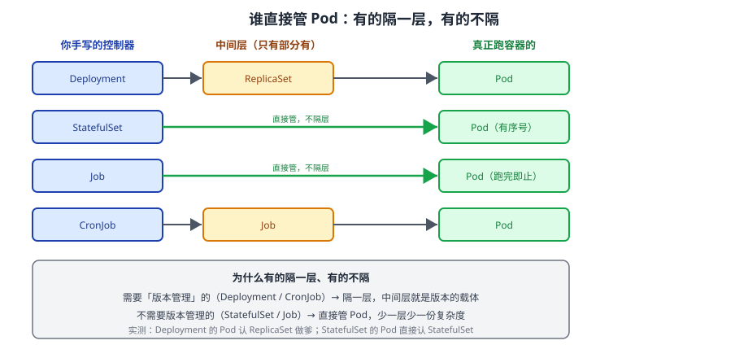

# 课 5：对象总表（上）——工作负载 · 配置 · 存储

> 📍 所属：子教程[《对象体系专项》](../overview.md)（第 5 课 · 总表）
> 📖 故事章节：**清点** —— 把模型套到每一个具体对象上
> 🧭 上一课：[课 4《自己冒出来的对象》](04-自己冒出来的对象：Event与Lease.md) ｜ 下一课：[课 6《对象总表（下）》](06-对象总表下：网络·安全·策略·扩展.md)
> ⚙️ 实操环境：WSL2 Ubuntu 24.04 · bash 5.2.21 · kubectl v1.34.0 · kind 集群 `k8s-c1`（3 节点） · k8s v1.34.0
> ✅ 本表 **12 份 YAML 全部实测 `kubectl apply` 通过**（`12/12 PASS`），一次性命名空间 `obj5-lab`，课后清理

## 🎯 本课与上、下篇的关系

课 1–4 讲了**模型**（四段式 / 住址 / 血缘 / 例外）。课 5、课 6 是**交付**：把模型套到 **30+ 个常用对象**上，每个都给——

- **一份最小可运行 YAML**（实测通过）
- **住址**：命名空间级 / 集群级（课 2）
- **API 组**（课 1 的 `apiVersion`）
- **谁管它**：是手写、还是控制器生成的（课 3 / 课 4）

> 📌 **本课的 YAML 全部经过实测**（取证脚本：[课5-YAML验证.sh](../assets/课5-YAML验证.sh)）。**未实测的会显式标注 `⚠️ 未实测`**——硬承诺不打折。

---

## 第一幕：场景引入 —— "给我一份能抄的清单"

### 场景

你要写一个新服务的全套 YAML。你打开编辑器，脑子里有课 1 的四段式，但落到具体对象时卡住了：

- Deployment 的 `selector` 和 `template.metadata.labels` **必须一致**，不一致会报什么错？
- Job 和 Deployment 都跑 Pod，**该用哪个**？
- ConfigMap 和 Secret 都是"存东西"，区别到底在哪？
- PVC 和 PV，**谁先谁后**？

网上的教程给你一堆 YAML，但每份都**塞满了生产级配置**（探针、资源限制、亲和性、拓扑分布……），你根本分不清哪些是**必需的**、哪些是可选的。

### 一句话本质

**常用对象就这些，每个的最小形态都很短——先跑通最小形态，再往上加字段。本课给的就是"最小可运行"版本，不是生产模板。**

### 处境对照

| | 抄生产级模板 | 从最小形态起步 |
|---|---|---|
| 字段含义 | 分不清必需/可选 | 每个字段为什么在这都清楚 |
| 出错排查 | 一次改十处，不知道哪个错了 | 最小版跑通，加一个测一个 |
| 对象选型 | 看别人用啥就用啥 | 知道每类的适用边界 |

---

## 第二幕：认知冲突 —— "为什么这个 Pod 的爹不是 Deployment？"

你按课 3 的知识去查两个不同来源的 Pod，得到了**不一样的结果**：

```bash
# Deployment 生成的 Pod
kubectl get pod t-deploy-xxx -o jsonpath='{.metadata.ownerReferences[0].kind}'
# 实测：ReplicaSet

# StatefulSet 生成的 Pod
kubectl get pod t-sts-0 -o jsonpath='{.metadata.ownerReferences[0].kind}'
# 实测：StatefulSet
```

**同样是"控制器生成的 Pod"，爹却不一样。** 为什么 StatefulSet 不再隔一层？

> 🎯 答案在下面「A 组」的对照表里：**Deployment 需要中间层来管版本，StatefulSet 不需要**。

---

## 第三幕：对象总表



**看图**：最左边是你手写的控制器，最右边是真正跑容器的 Pod。中间**有的隔了一层**（Deployment → RS），**有的直接管**（StatefulSet / Job）。隔层的是为了管版本，不隔层的是不需要版本管理。

---

## A 组：Pod 与直接管理者

| 对象 | API 组 | 住址 | 谁创建它 | 最小 YAML |
|------|--------|------|---------|----------|
| **Pod** | `v1` | 命名空间级 | 你手写（很少）/ 控制器 | ✅ 实测 |
| **ReplicaSet** | `apps/v1` | 命名空间级 | 你手写（很少）/ Deployment | ✅ 实测 |
| **Deployment** | `apps/v1` | 命名空间级 | 你手写 | ✅ 实测 |

### Pod（最小形态）

```yaml
apiVersion: v1
kind: Pod
metadata:
  name: t-pod
spec:
  containers:
  - name: c
    image: nginx:alpine
    imagePullPolicy: IfNotPresent
```

> ⚠️ **裸 Pod 几乎不在生产用**——它没有自愈能力（节点挂了不会重新调度）。它的价值是**理解模型**：所有工作负载最终都落成 Pod。

### ReplicaSet

```yaml
apiVersion: apps/v1
kind: ReplicaSet
metadata:
  name: t-rs
spec:
  replicas: 2
  selector:
    matchLabels:
      app: t-rs
  template:
    metadata:
      labels:
        app: t-rs
    spec:
      containers:
      - name: c
        image: nginx:alpine
        imagePullPolicy: IfNotPresent
```

> 🐞 **`selector.matchLabels` 必须与 `template.metadata.labels` 一致**——不一致会直接报错 `selector does not match template labels`。这是初学者第一个必踩的坑。

### Deployment

```yaml
apiVersion: apps/v1
kind: Deployment
metadata:
  name: t-deploy
spec:
  replicas: 2
  selector:
    matchLabels:
      app: t-deploy
  template:
    metadata:
      labels:
        app: t-deploy
    spec:
      containers:
      - name: c
        image: nginx:alpine
        imagePullPolicy: IfNotPresent
```

**三者对照**（回应第二幕的冲突）：

| | 手写频率 | 生成什么 | 爹是谁 | 核心价值 |
|---|---------|---------|--------|---------|
| Pod | 极少（调试用） | 容器 | 控制器 | 最小调度单元 |
| ReplicaSet | 极少 | Pod | Deployment | **维持副本数** |
| Deployment | **最高** | ReplicaSet → Pod | 无（你写的） | **版本 + 发布 + 回滚** |

> 💡 **为什么 Deployment 要隔一层 RS**：发布新版本时它创建**新 RS**、老 RS 保留（受 `revisionHistoryLimit` 限制），所以能秒回滚。**RS 是"版本"的载体**。详见 [kubectl 专项课 6](../../kubectl专项/lessons/06-发布与回滚.md)。

---

## B 组：其余工作负载

| 对象 | API 组 | 住址 | 生成什么 | 选型一句话 |
|------|--------|------|---------|-----------|
| **StatefulSet** | `apps/v1` | 命名空间级 | **Pod**（直接） | 要稳定名字 / 稳定存储 / 有序启停 |
| **DaemonSet** | `apps/v1` | 命名空间级 | **Pod**（每节点一个） | 每个节点都要跑一个（日志、监控 agent） |
| **Job** | `batch/v1` | 命名空间级 | **Pod**（直接） | 跑一次就结束的批处理 |
| **CronJob** | `batch/v1` | 命名空间级 | **Job** → Pod | 定时跑批处理 |

### StatefulSet（注意多了 `serviceName`）

```yaml
apiVersion: apps/v1
kind: StatefulSet
metadata:
  name: t-sts
spec:
  serviceName: t-sts-svc        # ← 必需：用于稳定 DNS 名
  replicas: 2
  selector:
    matchLabels:
      app: t-sts
  template:
    metadata:
      labels:
        app: t-sts
    spec:
      containers:
      - name: c
        image: nginx:alpine
        imagePullPolicy: IfNotPresent
```

**实测**：它生成的 Pod 名字是 `t-sts-0`、`t-sts-1`（**固定序号**，不是随机哈希），且 `ownerReference.kind = StatefulSet`（**没有中间层**）。

> 🐞 **`serviceName` 是必填的**——即使你暂时不需要 Service，也要填一个（可以是尚不存在的名字）。它决定了 Pod 的稳定 DNS：`t-sts-0.t-sts-svc.ns.svc.cluster.local`。

### DaemonSet

```yaml
apiVersion: apps/v1
kind: DaemonSet
metadata:
  name: t-ds
spec:
  selector:
    matchLabels:
      app: t-ds
  template:
    metadata:
      labels:
        app: t-ds
    spec:
      containers:
      - name: c
        image: nginx:alpine
        imagePullPolicy: IfNotPresent
```

**没有 `replicas` 字段**——副本数由**节点数**决定（实测：3 节点集群跑了 1 个，因 kind 节点有污点）。

> 💡 想让它在控制面节点上也跑？加 `tolerations`。这是 kind 集群最常见的"为什么我的 DaemonSet 只有 1 个"的原因。

### Job

```yaml
apiVersion: batch/v1
kind: Job
metadata:
  name: t-job
spec:
  template:
    spec:
      restartPolicy: Never      # ← Job 必须显式写，且不能是 Always
      containers:
      - name: c
        image: busybox:1.36
        command: ["sh", "-c", "echo done"]
        imagePullPolicy: IfNotPresent
```

**实测**：`t-job   Complete   1/1   3s`。

> 🐞 **`restartPolicy` 必填且不能是 `Always`**（默认是 `Always`，Job 会直接拒绝）。这是 Job 特有的坑。

### CronJob

```yaml
apiVersion: batch/v1
kind: CronJob
metadata:
  name: t-cronjob
spec:
  schedule: "*/5 * * * *"       # ← 标准 crontab 五段式
  jobTemplate:
    spec:
      template:
        spec:
          restartPolicy: Never
          containers:
          - name: c
            image: busybox:1.36
            command: ["sh", "-c", "echo hi"]
            imagePullPolicy: IfNotPresent
```

**注意嵌套**：`CronJob.spec.jobTemplate.spec.template.spec`——**三层 spec**，这是全 k8s 嵌套最深的对象之一。

> ⚠️ **CronJob 完成后不自动清理 Job 对象**。每分钟执行一次的 CronJob，**一年能攒 50 万个对象**，会把 etcd 撑爆。必须设 `.spec.successfulJobsHistoryLimit` / `failedJobsHistoryLimit` 与 Job 的 `ttlSecondsAfterFinished`。

---

## C 组：配置与存储

| 对象 | API 组 | 住址 | 用途 | 与同类区别 |
|------|------|------|------|-----------|
| **ConfigMap** | `v1` | 命名空间级 | 存**非机密**配置 | 明文存 etcd |
| **Secret** | `v1` | 命名空间级 | 存**机密**（密码/token/证书） | base64 编码（**不是加密**）、可配合 etcd 静态加密 |
| **PersistentVolume（PV）** | `v1` | **集群级** | 一块实际的存储 | 集群资源，先存在 |
| **PersistentVolumeClaim（PVC）** | `v1` | 命名空间级 | **申领** PV | 租户视角的"我要多少存储" |
| **StorageClass** | `storage.k8s.io/v1` | **集群级** | 定义"哪几档存储" | 驱动动态供给 |

### ConfigMap

```yaml
apiVersion: v1
kind: ConfigMap
metadata:
  name: t-cm
data:
  key: value
```

### Secret

```yaml
apiVersion: v1
kind: Secret
metadata:
  name: t-secret
type: Opaque
stringData:              # ← 用 stringData 可直接写明文，省掉手动 base64
  username: exampleuser
```

> 🐞 **`data` vs `stringData`**：`data` 要求值**必须是 base64**；`stringData` 接受明文，apiserver 会自动编码。**手写时用 `stringData` 更省事**，读回来时它会出现在 `data` 里（已编码）。

> ⚠️ **Secret 不是加密**（这是全 k8s 最大的认知误区之一）：它只是 base64 **编码**，任何人 `kubectl get secret -o yaml` 都能解出来。真正的加密要配 **etcd 静态加密**（主线课 17）。

### PVC → PV → StorageClass 三者的关系

```yaml
# ① StorageClass（集群级）：定义一档存储
apiVersion: storage.k8s.io/v1
kind: StorageClass
metadata:
  name: t-sc
provisioner: kubernetes.io/no-provisioner    # 静态供给，不动态造盘
volumeBindingMode: WaitForFirstConsumer
```

```yaml
# ② PV（集群级）：一块实际的存储
apiVersion: v1
kind: PersistentVolume
metadata:
  name: t-pv
spec:
  capacity:
    storage: 64Mi
  accessModes: [ReadWriteOnce]
  hostPath:
    path: /tmp/t-pv-data
  storageClassName: t-sc
```

```yaml
# ③ PVC（命名空间级）：租户申领
apiVersion: v1
kind: PersistentVolumeClaim
metadata:
  name: t-pvc
spec:
  accessModes: [ReadWriteOnce]
  resources:
    requests:
      storage: 64Mi
```

**三者对照**：

| | 谁写 | 住址 | 类比 |
|---|------|------|------|
| StorageClass | 运维（一次性） | 集群级 | **楼盘户型图**（有几档可选） |
| PV | 运维 / provisioner 自动 | 集群级 | **一套现房** |
| PVC | 开发（每个应用） | 命名空间级 | **购房申请** |

**实测**：本课创建的 PVC 状态是 `Pending`（`volumeBindingMode: WaitForFirstConsumer`，等 Pod 用它才绑定）——**Pending 是正常的**，不是错误。

> 🐞 **最大陷阱**：PV 的 `persistentVolumeReclaimPolicy` 默认 **Delete**——删 PVC 会**连带删掉底层存储**，数据一起没。生产务必改成 `Retain`。详见主线课 12。

---

## 第四幕：实操验证

> ✅ 本节实测于 WSL2 Ubuntu 24.04 / kubectl v1.34.0 / kind `k8s-c1` / k8s v1.34.0（一次性命名空间 `obj5-lab`）

### 4.1 批量验证：12 份 YAML 全通过

```bash
kubectl create namespace obj5-lab
# 依次 apply 上面 12 份 YAML（脚本见 assets/课5-YAML验证.sh）
# 实测统计：PASS=12  FAIL=0
```

### 4.2 关键机制取证

```bash
# ① Deployment 的 Pod 认 RS（两跳）
kubectl get pod <deploy-pod> -o jsonpath='{.metadata.ownerReferences[0].kind}'
# 实测：ReplicaSet

# ② StatefulSet 的 Pod 直接认 StatefulSet（一跳）
kubectl get pod t-sts-0 -o jsonpath='{.metadata.ownerReferences[0].kind}'
# 实测：StatefulSet

# ③ CronJob 的两跳链
kubectl get job        # 实测：t-job Complete（手写的）+ CronJob 生成的

# ④ PVC 状态
kubectl get pvc t-pvc  # 实测：Pending（WaitForFirstConsumer，正常）
```

### 4.3 本课不配应用实战

本课是**总表查阅课**，按子教程轻量口径不配应用实战。

---

## 第五幕：体系收束

### 本课的选型决策树

```text
要跑容器吗？
├─ 长期运行、无状态  → Deployment（最高频）
├─ 长期运行、要稳定名字/存储 → StatefulSet
├─ 每个节点都要跑一个 → DaemonSet
├─ 跑一次就结束      → Job
└─ 定时跑            → CronJob

要存东西吗？
├─ 非机密配置  → ConfigMap
├─ 机密        → Secret（记得配 etcd 加密）
└─ 持久化数据  → PVC（先有 StorageClass / PV）
```

### 你现在会了什么

- 12 个工作负载 / 配置 / 存储对象的**最小可运行 YAML**
- 每个对象的住址、API 组、谁生成谁
- **Deployment 隔 RS、StatefulSet 不隔**的原因
- Job 的 `restartPolicy` 坑、CronJob 的对象堆积坑、PV 的 Delete 坑

### 接下来学什么

课 6 收尾：网络（Service / EndpointSlice / Ingress / Gateway / NetworkPolicy）、安全（ServiceAccount / Role / ClusterRole / Binding）、策略（ResourceQuota / LimitRange / HPA / PDB）、集群与扩展（Node / Namespace / CRD / APIService / Webhook）。

### 🐞 本课坑速记

| 对象 | 坑 | 后果 |
|------|-----|------|
| RS/Deployment | `selector` 与 `template.labels` 不一致 | 直接报错拒绝创建 |
| StatefulSet | 漏 `serviceName` | 创建失败 |
| DaemonSet | 控制面节点有污点 | 副本数少于节点数 |
| Job | `restartPolicy` 用默认 `Always` | 被拒绝 |
| CronJob | 不设 historyLimit + TTL | **一年 50 万对象撑爆 etcd** |
| Secret | 以为 base64 是加密 | 凭据裸奔 |
| PV | 回收策略默认 Delete | 删 PVC 连带删数据 |

### 🧭 课程导航

- 📖 上一课：[课 4《自己冒出来的对象：Event 与 Lease》](04-自己冒出来的对象：Event与Lease.md)
- 📖 下一课：[课 6《对象总表（下）：网络 · 安全 · 策略 · 扩展》](06-对象总表下：网络·安全·策略·扩展.md)
- 🏠 返回：[对象体系专项](../overview.md) ｜ [课程目录](../../../02-课程目录.md)

---

## 🚀 下一批接力提示词

```text
继续学 k8s 的《对象体系专项》。我的学习档案在 k8s/子教程/对象体系专项/overview.md，
刚学完课 5《对象总表（上）：工作负载 · 配置 · 存储》（12 个对象 YAML 全部实测通过），
请按大纲继续讲解课 6《对象总表（下）：网络 · 安全 · 策略 · 扩展》，
每个对象都要给最小可运行 YAML 并实测通过。
```
