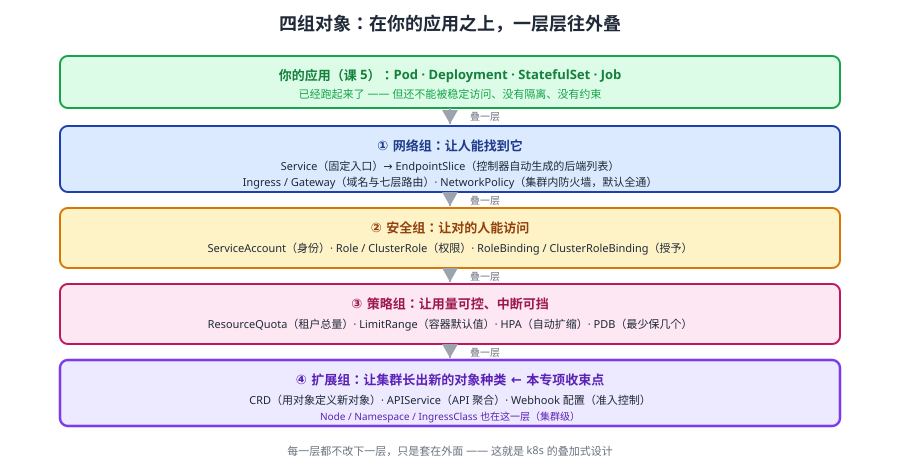

# 课 6：对象总表（下）——网络 · 安全 · 策略 · 扩展

> 📍 所属：子教程[《对象体系专项》](../overview.md)（第 6 课 · 总表 · **收官**）
> 📖 故事章节：**收束** —— 最后一类，以及"对象种类本身也是对象"
> 🧭 上一课：[课 5《对象总表（上）》](05-对象总表上：工作负载·配置·存储.md)
> ⚙️ 实操环境：WSL2 Ubuntu 24.04 · bash 5.2.21 · kubectl v1.34.0 · kind 集群 `k8s-c1`（3 节点） · k8s v1.34.0
> ✅ 本表 **14 份 YAML 全部实测 `kubectl apply` 通过**（`14/14 PASS`），一次性命名空间 `obj6-lab`，课后清理

## 🎯 本课定位

课 5 覆盖了**工作负载 / 配置 / 存储**（12 个），本课覆盖剩下四大组（14 个）：

- **网络与入口**（Service / EndpointSlice / Ingress / Gateway / NetworkPolicy）
- **安全**（ServiceAccount / Role / RoleBinding / ClusterRole / ClusterRoleBinding）
- **策略与限制**（ResourceQuota / LimitRange / HPA / PDB）
- **集群与扩展**（Node / Namespace / CRD / IngressClass / APIService / Webhook）

**最后一节的 CRD 是本专项的收束点**：它证明"**对象种类本身也是一种对象**"——课 1 的四段式套到它自己身上，闭环。

---

## 第一幕：场景引入 —— "从 Pod 到能访问，还要写几个对象？"

### 场景

你写完 Deployment，Pod 跑起来了。leader 说"能访问了吗？"你说"Pod 是 Running 的"，然后发现：

- Pod 的 IP 会变（重建就换）
- 集群外访问不到
- 谁都能访问你的服务，没有隔离

于是你开始加东西：**Service** 给个固定入口 → **Ingress** 给个域名 → **NetworkPolicy** 限制谁能来。

你突然意识到：**"跑起来"和"能安全地用起来"之间，隔着一整套对象**。而且这些对象各有各的层——加错了层，要么不生效，要么过度设计。

### 一句话本质

**网络组解决"怎么找到服务"，安全组解决"谁能访问"，策略组解决"用多少、保几个"，扩展组解决"集群本身怎么长"。四组都是"在你写的应用之上再叠一层"。**

### 处境对照

| | 逐个试错 | 分层理解 |
|---|---|---|
| 服务不通 | 从头到尾乱查 | 按 Service → EndpointSlice → Ingress 逐层定位 |
| 权限问题 | 直接给 cluster-admin | Role / ClusterRole + Binding 精确授予 |
| 资源失控 | 事后救火 | ResourceQuota / LimitRange 事前约束 |

---

## 第二幕：认知冲突 —— "CRD 是对象，那对象的种类是什么？"

学到扩展组时，你遇到一个**递归问题**：

```bash
# 建一个 CRD
kubectl apply -f crd.yaml
# 实测：customresourcedefinition.apiextensions.k8s.io/widgets.example.com created

# 然后……集群里多了一种对象
kubectl api-resources | grep widget
# 实测：widgets   example.com/v1   true   Widget

# 用这个新种类建对象
kubectl apply -f widget.yaml
# 实测：widget.example.com/t-widget created
```

**你用一个对象（CRD），创造了一种新的对象种类（Widget），然后用这个种类创建对象。**

那问题来了：**CRD 自己是对象，它有 `apiVersion` 和 `kind`——那"对象种类"这个概念本身，是不是也是对象？**

> 🎯 **答案是"是的"，这是本专项的收束**：k8s 的 API 是**自描述**的——对象种类用对象来定义，所以整个体系能无限扩展而不需要改 k8s 本身。

---

## 第三幕：对象总表



**看图**：从下往上是**叠加关系**——应用（课 5 的工作负载）在最底层，往上依次叠「网络」（让人能找到）、「安全」（让对的人能访问）、「策略」（让用量可控）、「扩展」（让集群长出新的对象种类）。**每一层都不改下一层，只是套在外面。**

---

## A 组：网络与入口

| 对象 | API 组 | 住址 | 谁创建它 | 作用 |
|------|--------|------|---------|------|
| **Service** | `v1` | 命名空间级 | 你手写 | 给一组 Pod 一个**固定入口**（ClusterIP） |
| **EndpointSlice** | `discovery.k8s.io/v1` | 命名空间级 | **控制器生成** | Service 的后端列表 |
| **Ingress** | `networking.k8s.io/v1` | 命名空间级 | 你手写 | **七层**（HTTP）路由，域名/路径 → Service |
| **Gateway / HTTPRoute** | `gateway.networking.k8s.io` | 命名空间级 | 你手写 | Ingress 的下一代标准 |
| **NetworkPolicy** | `networking.k8s.io/v1` | 命名空间级 | 你手写 | 集群内防火墙（**默认全通**） |
| **IngressClass** | `networking.k8s.io/v1` | **集群级** | 运维 | 指定用哪个 Ingress 控制器 |

### Service

```yaml
apiVersion: v1
kind: Service
metadata:
  name: t-svc
spec:
  selector:
    app: t-app
  ports:
  - port: 80
    targetPort: 80
```

> 💡 **`selector` 是关键**：Service 不直接引用 Pod，它**按标签选**。Pod 重建后 IP 变了，只要标签对就自动进后端。

### EndpointSlice（本课实测的生成关系）

**你不用写它**——建了 Service 之后它自动出现：

```bash
kubectl get endpointslice
# 实测：t-svc-whbtw   IPv4   <unset>   <unset>   5s

kubectl get endpointslice -o jsonpath='{.items[0].metadata.ownerReferences[0].kind}'
# 实测：Service       ← 爹是 Service，删 Service 会带走它
```

> 🐞 **排障要点**：Service 不通时，**先查 EndpointSlice 的后端列表空不空**。空 = selector 没匹配上 Pod，这是最高频的原因。

### Ingress

```yaml
apiVersion: networking.k8s.io/v1
kind: Ingress
metadata:
  name: t-ing
spec:
  ingressClassName: nginx          # ← 必须有对应的 IngressClass / 控制器
  rules:
  - host: app.example.com
    http:
      paths:
      - path: /
        pathType: Prefix
        backend:
          service:
            name: t-svc
            port:
              number: 80
```

> ⚠️ **Ingress 只是配置**——真正干活的是**Ingress 控制器**（nginx / traefik 等，需额外安装）。**没有控制器，Ingress 写了也不生效**。

### NetworkPolicy

```yaml
apiVersion: networking.k8s.io/v1
kind: NetworkPolicy
metadata:
  name: t-netpol
spec:
  podSelector:
    matchLabels:
      app: t-app
  policyTypes: [Ingress]
  ingress:
  - from:
    - podSelector:
        matchLabels:
          app: t-client
```

> 🐞 **最大的坑**：**NetworkPolicy 默认全通**。你不写任何策略 = **所有 Pod 之间互相都能访问**。而且策略是**白名单**——一旦给某个 Pod 加了 Ingress 策略，**没被明确放行的流量全部拒绝**。

---

## B 组：安全（RBAC）

| 对象 | API 组 | 住址 | 作用 |
|------|--------|------|------|
| **ServiceAccount** | `v1` | 命名空间级 | Pod 的"身份"（不是给人用的） |
| **Role** | `rbac.authorization.k8s.io/v1` | 命名空间级 | 定义**单租户内**的权限 |
| **RoleBinding** | `rbac.authorization.k8s.io/v1` | 命名空间级 | 把 Role 授予某个主体 |
| **ClusterRole** | `rbac.authorization.k8s.io/v1` | **集群级** | 定义**跨租户**可复用的权限 |
| **ClusterRoleBinding** | `rbac.authorization.k8s.io/v1` | **集群级** | 把 ClusterRole 授予某个主体 |

### ServiceAccount

```yaml
apiVersion: v1
kind: ServiceAccount
metadata:
  name: t-sa
```

> ⚠️ **Sa 默认会自动挂载 token 到 Pod**（`automountServiceAccountToken: true`）——这是最易忽略的提权风险。不需要访问 API 的 Pod 应显式关掉。

### Role（命名空间级）

```yaml
apiVersion: rbac.authorization.k8s.io/v1
kind: Role
metadata:
  name: t-role
rules:
- apiGroups: [""]
  resources: ["pods"]
  verbs: ["get", "list"]
```

### RoleBinding

```yaml
apiVersion: rbac.authorization.k8s.io/v1
kind: RoleBinding
metadata:
  name: t-rb
subjects:
- kind: ServiceAccount
  name: t-sa
  namespace: obj6-lab
roleRef:
  kind: Role
  name: t-role
  apiGroup: rbac.authorization.k8s.io
```

### ClusterRole / ClusterRoleBinding（集群级，**不写 namespace**）

```yaml
apiVersion: rbac.authorization.k8s.io/v1
kind: ClusterRole
metadata:
  name: t-crole          # ← 没有 namespace
rules:
- apiGroups: [""]
  resources: ["nodes"]
  verbs: ["get", "list"]
```

```yaml
apiVersion: rbac.authorization.k8s.io/v1
kind: ClusterRoleBinding
metadata:
  name: t-crb
subjects:
- kind: ServiceAccount
  name: t-sa
  namespace: obj6-lab    # ← subject 里要写清 SA 在哪个 ns
roleRef:
  kind: ClusterRole
  name: t-crole
  apiGroup: rbac.authorization.k8s.io
```

**两级配对速记**（课 2 的知识在这里落地）：

| 组合 | 效果 |
|------|------|
| Role + RoleBinding | 权限**只在单租户内**有效 |
| **ClusterRole + RoleBinding** | ⭐ **把集群级权限收窄到单租户授予**（最常用、最推荐） |
| ClusterRole + ClusterRoleBinding | 全集群生效（**权限最大，慎用**） |

---

## C 组：策略与限制

| 对象 | API 组 | 住址 | 作用 |
|------|--------|------|------|
| **ResourceQuota** | `v1` | 命名空间级 | 限制**整个命名空间**的资源总量 |
| **LimitRange** | `v1` | 命名空间级 | 给**单个容器**设默认值与上下限 |
| **HPA** | `autoscaling/v2` | 命名空间级 | 按指标**自动扩缩副本** |
| **PDB** | `policy/v1` | 命名空间级 | 保证**自愿中断时**至少剩几个 |

### ResourceQuota

```yaml
apiVersion: v1
kind: ResourceQuota
metadata:
  name: t-quota
spec:
  hard:
    pods: "10"
    requests.cpu: "2"
```

### LimitRange

```yaml
apiVersion: v1
kind: LimitRange
metadata:
  name: t-limits
spec:
  limits:
  - type: Container
    default:           # ← 没写 limits 时自动补
      cpu: 200m
      memory: 256Mi
    defaultRequest:    # ← 没写 requests 时自动补
      cpu: 100m
      memory: 128Mi
```

> 💡 **Quota 与 LimitRange 的分工**：Quota 管**总量**（这个租户最多用多少），LimitRange 管**个体**（每个容器默认给多少）。**两者配合**——只设 Quota 不设 LimitRange，用户不写 requests 就创建不了 Pod。

### HPA

```yaml
apiVersion: autoscaling/v2
kind: HorizontalPodAutoscaler
metadata:
  name: t-hpa
spec:
  scaleTargetRef:
    apiVersion: apps/v1
    kind: Deployment
    name: t-app
  minReplicas: 1
  maxReplicas: 5
  metrics:
  - type: Resource
    resource:
      name: cpu
      target:
        type: Utilization
        averageUtilization: 80
```

> ⚠️ **HPA 需要 metrics-server**（否则拿不到 CPU 指标）。缩容有 **300 秒稳定窗口**，扩容快——这是课 13 的实测结论。

### PDB

```yaml
apiVersion: policy/v1
kind: PodDisruptionBudget
metadata:
  name: t-pdb
spec:
  minAvailable: 1
  selector:
    matchLabels:
      app: t-app
```

> 🐞 **PDB 只挡"自愿中断"**（`kubectl drain`、节点维护），**挡不住节点直接断电**。它保护的是运维操作期间的服务可用性。

---

## D 组：集群与扩展（**本专项的收束**）

| 对象 | API 组 | 住址 | 作用 |
|------|--------|------|------|
| **Node** | `v1` | **集群级** | 一台机器 |
| **Namespace** | `v1` | **集群级** | 租户容器 |
| **IngressClass** | `networking.k8s.io/v1` | **集群级** | 指定 Ingress 控制器 |
| **CRD** | `apiextensions.k8s.io/v1` | **集群级** | ⭐ **定义新的对象种类** |
| **APIService** | `apiregistration.k8s.io/v1` | **集群级** | 注册 API 聚合服务 |
| **Webhook 配置** | `admissionregistration.k8s.io/v1` | **集群级** | 准入控制钩子 |

### IngressClass（集群级）

```yaml
apiVersion: networking.k8s.io/v1
kind: IngressClass
metadata:
  name: t-ingclass
spec:
  controller: example.com/ingress-controller
```

### CRD —— 定义新的对象种类（本节是收束点）

```yaml
apiVersion: apiextensions.k8s.io/v1
kind: CustomResourceDefinition
metadata:
  name: widgets.example.com        # ← 必须是「复数.组名」格式
spec:
  group: example.com
  names:
    kind: Widget
    plural: widgets
    singular: widget
  scope: Namespaced                # ← 这个新种类是命名空间级还是集群级
  versions:
  - name: v1
    served: true
    storage: true
    schema:
      openAPIV3Schema:
        type: object
        properties:
          spec:
            type: object
            properties:
              size:
                type: integer
```

**实测闭环（本课取证脚本）**：

```bash
# ① 建 CRD
kubectl apply -f crd.yaml
# → customresourcedefinition.apiextensions.k8s.io/widgets.example.com created

# ② 集群里真的多了一种对象
kubectl api-resources | grep widget
# → widgets   example.com/v1   true   Widget
#                              ↑ true = 命名空间级（与 CRD 里 scope 一致）

# ③ 用这个新种类建对象
kubectl apply -f widget.yaml
# → widget.example.com/t-widget created
```

**这就是本专项的收束**：

```
课 1 四段式（apiVersion / kind / metadata / spec）
   ↓
CRD 本身也长这样（apiVersion: apiextensions.k8s.io/v1, kind: CustomResourceDefinition）
   ↓
但它创造的，是「新的 kind」
   ↓
所以 k8s 的对象体系是「自描述」的 —— 用对象定义对象种类
```

> 💡 **这也是为什么 k8s 能长成今天的生态**：Operator、Prometheus、Istio、ArgoCD……**全都是用 CRD 往集群里加新对象种类**，而 k8s 核心代码一行不用改。

**扩展的两条路线**（课 20 详述）：

| 路线 | 对象 | 特点 |
|------|------|------|
| **CRD** | `CustomResourceDefinition` | 声明式、简单、够用（90% 场景） |
| **API 聚合** | `APIService` | 独立 APIServer，能做任意逻辑，复杂度高 |

---

## 第四幕：实操验证

> ✅ 本节实测于 WSL2 Ubuntu 24.04 / kubectl v1.34.0 / kind `k8s-c1` / k8s v1.34.0（一次性命名空间 `obj6-lab`）

### 4.1 批量验证：14 份 YAML 全通过

```bash
kubectl create namespace obj6-lab
# 依次 apply 课 6 的 14 份 YAML（脚本见 assets/课6-YAML验证.sh）
# 实测统计：PASS=14  FAIL=0
```

### 4.2 关键机制取证

```bash
# ① Service 自动生成 EndpointSlice，且爹是 Service
kubectl get endpointslice
kubectl get endpointslice -o jsonpath='{.items[0].metadata.ownerReferences[0].kind}'
# 实测：Service

# ② CRD 闭环：建 CRD → 新种类出现 → 用它建对象
kubectl api-resources | grep widget      # 实测：widgets example.com/v1 true Widget
kubectl apply -f widget.yaml             # 实测：widget.example.com/t-widget created

# ③ 两级归属核对（课 2 的方法落地）
kubectl api-resources | grep -wE 'clusterroles|roles|customresourcedefinitions'
# 实测：clusterroles → false（集群级）
#       roles → true（命名空间级）
#       customresourcedefinitions → false（集群级）
```

### 4.3 本课不配应用实战

本课是**总表查阅课 + 收官课**，按子教程轻量口径不配应用实战。

---

## 第五幕：体系收束（**整个专项的收束**）

### 六课走过的路

```text
课 1 四段式   → 所有对象通用的长相（spec 你写 / status 系统写）
课 2 住址     → 命名空间级 vs 集群级
课 3 血缘     → ownerReference 串成树，级联删除
课 4 例外     → Event / Lease 没有爹，靠 TTL / 租约过期
课 5 总表上   → 工作负载 · 配置 · 存储（12 个 YAML 实测）
课 6 总表下   → 网络 · 安全 · 策略 · 扩展（14 个 YAML 实测）  ← 本课
     └─ CRD：对象种类本身也是对象 → 闭环
```

### 学到的判断框架（见任何对象都能用）

1. **它长什么样** → 四段式，`spec` 还是 `status`？（课 1）
2. **它住哪** → 命名空间级还是集群级？集群级不写 `namespace`（课 2）
3. **它有爹吗** → `ownerReference` 指向谁？删爹会带走它吗？（课 3）
4. **没爹的话怎么清理** → TTL（Event）还是租约过期（Lease）？（课 4）
5. **它在全景里属于哪一组** → 工作负载 / 配置 / 存储 / 网络 / 安全 / 策略 / 扩展（课 5、6）

### 完整清单：本专项覆盖的 30+ 对象

| 组 | 对象 |
|----|------|
| 工作负载 | Pod、ReplicaSet、Deployment、StatefulSet、DaemonSet、Job、CronJob |
| 配置存储 | ConfigMap、Secret、PV、PVC、StorageClass |
| 网络 | Service、**EndpointSlice**、Ingress、Gateway/HTTPRoute、NetworkPolicy、IngressClass |
| 安全 | ServiceAccount、Role、RoleBinding、ClusterRole、ClusterRoleBinding |
| 策略 | ResourceQuota、LimitRange、HPA、PDB |
| 集群扩展 | Node、Namespace、**CRD**、APIService、Webhook 配置 |
| 例外（无爹） | **Event**、**Lease** |

> 🎯 **加粗的三个是本专项补齐的主线缺口**：Event（从未当对象讲）、Lease（主线未介绍）、EndpointSlice（主线只在排障时带过）。

### 🐞 本课坑速记

| 对象 | 坑 | 后果 |
|------|-----|------|
| Service | selector 不匹配 | EndpointSlice 后端列表为空，服务不通 |
| Ingress | 没装控制器 | 写了也不生效 |
| NetworkPolicy | 默认全通 | 以为有隔离其实没有；加了策略又变成白名单 |
| ServiceAccount | 默认自动挂 token | 提权风险 |
| RBAC | 直接给 cluster-admin | 权限过大 |
| LimitRange | 只设 Quota 不设它 | 用户不写 requests 就建不了 Pod |
| HPA | 没装 metrics-server | 拿不到指标，永远不扩缩 |
| PDB | 以为能挡所有中断 | 只挡自愿中断 |
| CRD | `metadata.name` 格式错 | 必须是「复数.组名」 |

### 🧭 课程导航

- 📖 上一课：[课 5《对象总表（上）：工作负载 · 配置 · 存储》](05-对象总表上：工作负载·配置·存储.md)
- 🎉 **本专项六课已全部完成** —— 返回 [对象体系专项](../overview.md) 查看完整清单与速查
- 🏠 返回：[课程目录](../../../02-课程目录.md) ｜ [主线课程](../../../01-学习路径总览.md)

---

## 🎉 专项完成

六课的知识讲完了。接下来你可以：

1. **按需查阅**：课 5、课 6 的总表是**速查手册**，遇到没见过的对象回来翻
2. **回主线深化**：本专项讲**对象是什么**，主线讲**怎么用**（如 Deployment 滚动更新、Service 选型、RBAC 实战）
3. **交叉学习**：[kubectl 专项](../../kubectl专项/overview.md)（怎么操作这些对象）、[Python 客户端专项](../../Python客户端专项/overview.md)（怎么用代码操作）

> 💡 **一句话带走**：**k8s 里没有配置文件，只有对象——每个对象都是一张双栏表，一半你写、一半系统写；对象之间靠 uid 认爹，没爹的靠 TTL 或租约清理；而"对象种类"本身也是对象，所以这个体系能无限生长。**
