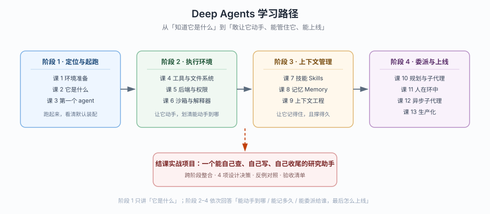

# Deep Agents 系统学习 · 学习路径总览

> 本文件是活文档，随学习进度动态调整。阶段依赖图统一用 SVG。

## 🧭 本教程支持 Python + TypeScript 双语

课文 13 课与应用实战 10 篇的每个代码示例都是 `::: code-group` 双标签页：`[Python]` 是主线，`[TypeScript]` 是平行线，内容一一对应。

**两条线怎么选**（挑一条走通即可，不必两边都跑）：

- **只学一种语言就够了**——两侧讲的是同一套 harness 心智模型与能力边界，差的是写法不是概念
- **Python 主线**：`deepagents 0.7.28`，写法最贴近官方文档与源码，`源码解析/` 6 篇只覆盖这一侧
- **TypeScript 平行线**：`deepagents 1.15.1`（npm 版本号独立演进，别对着 0.7 找），差异逐条沉淀在 [`playground-ts/API-MAPPING.md`](./playground-ts/API-MAPPING.md)，共 58 条

**TS 侧三个入口**：

| 要去哪 | 路径 | 用途 |
|--------|------|------|
| 装环境、跑脚本 | [`playground-ts/README.md`](./playground-ts/README.md) | 可运行工程：13 个 `lNN-*.ts` 与课文一一对应，`npm run check` 过类型、`npm run lNN` 真跑 |
| 查两侧 API 差异 | [`playground-ts/API-MAPPING.md`](./playground-ts/API-MAPPING.md) | 参数映射表 + 58 条行为差异，写 TS 代码前先查这张表 |
| 查 TS 官方文档 | [`web-index/docs-deepagents-js/index.md`](./web-index/docs-deepagents-js/index.md) | 30 页索引（`/oss/javascript/deepagents`），选型与参数名以这侧为准 |

> ⚠️ 双语不等于等价。有几条差异会**静默失效**而不是报错，最典型的三个：Store 里存的值是 `FileData` 结构且两侧必填字段刚好互换（照抄 Python 的 `{content, encoding}` 会读成空）、`permissions` 的 `interrupt` 档在 TS 侧静默当 allow、`batched` 混合决策会丢掉被批准的调用。这些在对应课文的 `🇹🇸` 段落里都有实测对照。

## 🎯 学习目标

- **目标类型**：动手实操（能力实操 + 环境验证）
- **目标说明**：学完能独立判断"这个任务该不该用 Deep Agents"，能用 `create_deep_agent` 组装出一个带文件系统、技能、记忆、子代理的可控 agent，并把它的能力边界（能读写哪、能执行什么、能花多少 token）说清楚、管住、上线
- **前置**：已完成 [`../langchain/`](../langchain/02-课程目录.md)（4 阶段 / 13 课）——本教程只提及并回扣 LangChain 概念，不重讲 `@tool` / middleware 基础 / message 结构

> 学习目标是全局基准，决定各阶段/课的取舍与实操比重。目标变更时更新此处，并同步调整相关课。

## 故事主线

- **主角**：一个已经会用 `create_agent` 的开发者，接到了一个"要跑几小时、要看一堆文件、要写报告"的需求
- **冲突**：`create_agent` 只给你一个空转的循环——文件系统、上下文压缩、子代理、记忆，全得自己拼；拼完还会踩一堆"顺序错了 / 权限没管住 / 上下文爆了"的坑
- **收束**：搞清 harness 替你装好了什么、边界在哪、什么时候该拆回 LangChain 自己搭——**从"自己拼装"到"知道该不该用现成的"**

> 整个课程是这条故事线的展开，每个阶段是故事的一个"章节"，每课是章节中的一个"情节"。

## 学习路径图

> 看图：横轴四个阶段是你"信任一个 agent 去干活"的四道门槛——先知道它是什么（阶段 1），再让它动手并划清边界（阶段 2），再让它记得住、撑得久（阶段 3），最后才敢把活分出去并上线（阶段 4）；虚线指向的结课项目是四道门槛合起来才能过的关。

## 阶段总览

### 阶段 1：定位与起跑

- **目标**：说清 Deep Agents 是什么、和 LangChain / LangGraph 什么关系；跑通第一个 deep agent 并看清它默认装了什么
- **学习重点**：harness 心智模型、三层分工、`create_deep_agent` 签名、默认中间件栈的完整顺序、Profiles
- **必须掌握**：能画出"deepagents → LangChain → LangGraph"三层依赖；能说出 `create_deep_agent` 只给 model 时会自动装上哪几层中间件；能自己装包并跑通一个带文件工具的最小 agent
- **对应课**：课 1（环境准备）、课 2（Deep Agents 是什么）、课 3（第一个 deep agent 与它的默认装配）

### 阶段 2：执行环境

- **目标**：掌控 agent "在哪动手"——工具、虚拟文件系统、后端存储、权限、代码执行
- **学习重点**：内置文件工具清单与 `delete` 的可见性、六种内置后端的取舍、`CompositeBackend` 路由、`permissions` 的 first-match-wins、沙箱与解释器的边界
- **必须掌握**：能为一组任务选对后端组合；能写出禁止 agent 读 `.env` 的权限规则并说清它管不到沙箱；能判断"这件事该给 `execute` 还是 `eval`"
- **对应课**：课 4（工具与虚拟文件系统）、课 5（Backends 后端与 Permissions 权限）、课 6（代码执行：Sandboxes 与 Interpreters）

### 阶段 3：上下文管理

- **目标**：让 agent 记得住（技能 / 记忆）、撑得久（压缩 / 卸载 / 隔离 / 缓存）
- **学习重点**：Skills 的渐进式披露、Memory 的全量加载（两者加载时机正好相反）、上下文四段流、提示缓存的真实触发条件
- **必须掌握**：能说清"什么该放 skills、什么该放 AGENTS.md"；能解释长任务为什么不爆上下文；能指出提示缓存只在 Anthropic / Bedrock 默认生效这一坑
- **对应课**：课 7（Skills 技能）、课 8（Memory 记忆）、课 9（上下文工程）

### 阶段 4：委派与上线

- **目标**：把活分给子代理、让人能在关键处插手、最后把能力开关配齐准备上线
- **学习重点**：`write_todos` 的 v0.7 opt-in 变更、`task` 工具与子代理五特征、`isolated` vs `fork`、`interrupt_on` 审批、异步子代理五工具、容错与流式
- **必须掌握**：能判断该用同步 / 异步 / 动态子代理；能配出"改文件前必须人工批准"；能列出上线前必查的开关清单
- **对应课**：课 10（任务规划与子代理）、课 11（人在环中）、课 12（异步与动态子代理）、课 13（生产化：容错、流式与上线）

## 结课综合实战（Phase 3）

- **目标**：跨阶段整合，独立交付一个"能自己查、自己写、自己收尾"的研究助手
- **覆盖**：模型接入 + 虚拟文件系统 + 权限 + 技能 + 记忆 + 子代理 + 审批 + 流式观测
- **形式**：多文件工程 + 设计决策 + 反例对照 + 验收清单（待生成，见 `projects/`）

## 当前进度

- [x] 阶段 1：定位与起跑（课 1-3）
- [x] 阶段 2：执行环境（课 4-6）
- [x] 阶段 3：上下文管理（课 7-9）
- [x] 阶段 4：委派与上线（课 10-13）
- [ ] 结课综合实战项目
- [ ] 收尾产物：实战经验 / 排障速查手册 / 场景解法库 / 课程手册

> 课文正文 13 课、应用实战 10 篇、源码解析 6 篇已全部完成，并已双语化（详见 [00-学习档案.md](./00-学习档案.md) 第 0 节）。剩余为 Phase 3 结课项目与 Phase 5 收尾产物。

## 范围说明（素材归属）

> 对照官方 `/oss/python/deepagents` 全量 34 页逐页核对，以下内容不进课，各有归处。

- **前端四页**（frontend/overview、subagent-streaming、todo-list、sandbox）：属 UI 集成，本教程在课 13 只做定位级提及，不展开
- **协议两页**（ACP / AG-UI）：暴露给编辑器与前端协议，同样只定位级提及
- **官方三篇教程**（deep-research / content-builder / rag）：Phase 3 结课项目的参考素材
- **Managed Deep Agents**（LangSmith 侧）：属托管平台，不在本教程范围
- **`middleware` 页**：已 307 迁到 LangChain 分区，本教程引 LangChain 索引

## 延伸方向（不在本课程范围，学完主干后按需开启）

- **LangGraph 深入**：图执行模型、checkpointer、durable execution——本教程只在"Deep Agents 用了它什么"处点到，深入请转 [`../langgraph/`](../langgraph/01-学习路径总览.md)
- **前端集成与协议**：子代理流式 UI、待办列表 UI、类 IDE 沙箱界面、ACP / AG-UI
- **Managed Deep Agents**：把 agent 作为"一个目录的文件"交给 LangSmith 跑
