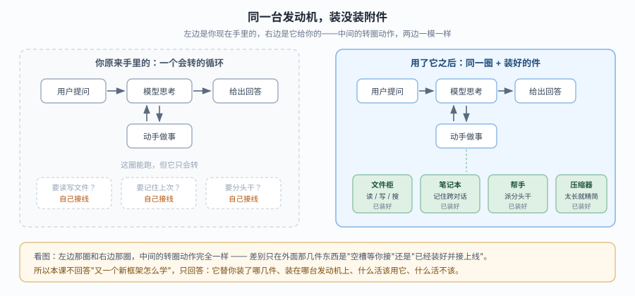
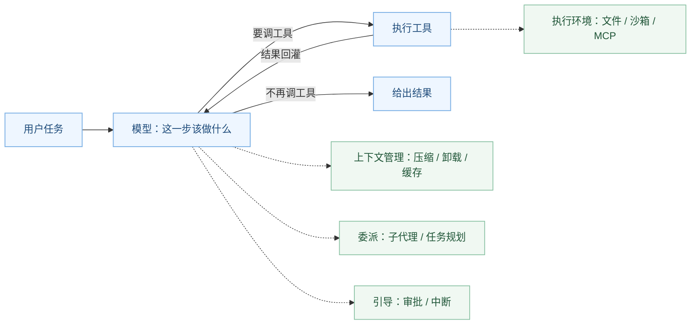
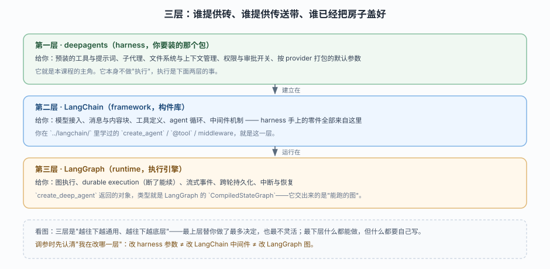
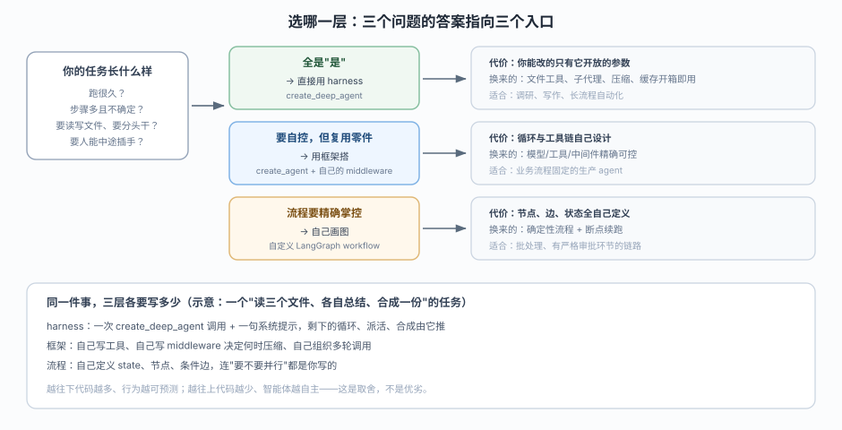
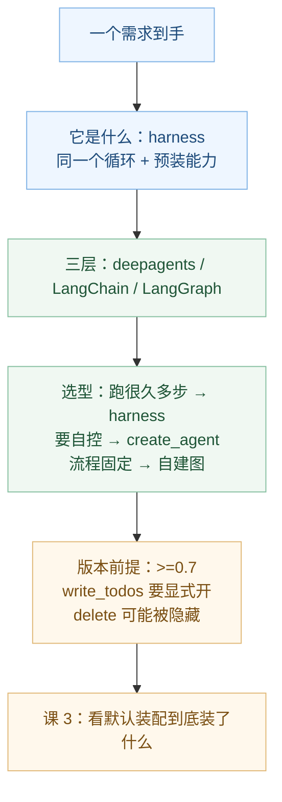

# 课 2：Deep Agents 是什么

> 所属阶段：阶段 1《定位与起跑》｜ 水平：进阶 ｜ 本课知识点：harness 心智模型、三层分工（deepagents / LangChain / LangGraph）、选型边界与版本演进
> 故事情节：主角发现官方有个"开箱即用"的包，但必须先搞清它到底是新框架还是包装纸——否则后面每次调参都会调错地方
> 📖 结论已按官方文档核对（核对于 2026-10 ｜ 来源：docs.langchain.com/oss/python/deepagents/overview、comparison、concepts/products、PyPI 与 GitHub CHANGELOG）
> ✅ 代码结论实测于 2026-10-20 ｜ `deepagents 0.7.28` / `langchain 1.4.6` / `langgraph 1.2.16`

## 🎯 本课目标

- 用一句话说清 Deep Agents 是什么：**不是新框架，是预装好的 agent harness**（核心仍是 tool calling loop）
- 画出 `deepagents` → LangChain → LangGraph 三层依赖，指出各层职责
- 判断一个需求该用 `create_deep_agent` 还是 `create_agent`，并说出 v0.7 的两处破坏性变更

---

## 第一幕：起源与场景引入

> 🏛️ **起源**：`deepagents` 首次发布于 2025-07-29（PyPI `0.0.1`）（核查于 2026-10）。它要解决的不是"怎么调模型"，而是"怎么让 agent 跑几个小时不崩"——长任务里上下文会涨、结果要落盘、子任务要分头做，这些东西每个团队都在重复实现。LangChain 团队的做法是把它们打包成一个"已装配好的 harness"，而不是再发明一套 agent 抽象。到 2026-10 已迭代到 `0.7.28`，且 `0.7` 明确把自己往"更薄的默认、更显式的开关"方向调（详见知识点 3）。

你已经用 `create_agent` 搭过 agent，也大概知道 middleware 怎么插。现在来了个活：**"每天早上抓 30 个源，逐个读、交叉比对、写成一份 20 页报告，中间我要能看一眼再放行。"**

你按老办法开工：先写 3 个工具（抓网页、写文件、读文件），再写一个 middleware 在上下文超过阈值时压缩历史，再写一段逻辑决定什么时候派子任务并行……写到第 400 行时你发现，**真正跟"这份报告"有关的代码不到 30 行，其余全是在造一套通用的脚手架。**

> 🎬 **场景**：你第 N 次手写"文件工具 + 上下文压缩 + 子代理调度"，而这次你听说官方已经打包好了。

> 📌 **一句话本质**：把"每次都要自己拼的那套脚手架"变成"一次调用就拿到的成品"，让你只写跟任务有关的那部分。
>
> ⚖️ **处境对照**：自己拼一套等效能力，至少要逐个定义 7 个文件工具、写一个压缩中间件、接一个子代理调度器，再自己决定缓存策略——按 `../langchain/` 课 4 / 7 / 8 / 10 的写法，这是几百行装配代码；用 harness 是一行 `create_deep_agent(...)`，实测它开箱就注册了 **9 个工具**、交出 **5 个节点的可执行图**。代价是这 9 个工具的边界由它定，你只能在它开放的参数里改。

---

## 第二幕：认知冲突

于是问题来了——**这东西到底是"新框架"还是"包装纸"？**

两种答案会把你带向完全相反的学习路径：

- 如果它是新框架，那你得从头学它的一套概念（新的 Agent 类、新的 Tool 协议、新的状态管理），`create_agent` 的经验基本作废。
- 如果它只是包装纸，那它随时可能被一层薄封装替代，不值得投入，出了问题也该去 LangChain 那边找原因。

而现实是：官方管它叫 "agent harness"，又确实给了你一个全新的入口函数 `create_deep_agent`，返回值还长得不像 `create_agent`。

> ❓ **问题**：它多出来的到底是什么？是新的抽象层，还是同一套东西换了个装配方式？如果搞不清，后面每次出问题你都会修错地方。

---

## 第三幕：层层揭示

### 一眼全局图（进入细节前先看一眼）



> 看图：左边那圈和右边那圈，中间的转圈动作完全一样（问 → 想 → 做 → 再想）；差别只在外面那几件东西，是"空槽等你接"还是"已经装好并接上线"。

### 本课地图（分几步走）

| 步 | 这一步要解决什么（人话） | 对应知识点 |
|:--:|------------------------|-----------|
| 1 | 先确认它多出来的是"装好的件"而不是"新发动机" | 知识点 1：harness 心智模型 |
| 2 | 再看这些件分别属于哪一层、出问题该去哪层找 | 知识点 2：三层分工 |
| 3 | 最后决定手上的活该不该用它，以及用哪个版本的行为 | 知识点 3：选型边界与版本演进 |

---

### 知识点 1：harness 心智模型

> 🧭 第 1/3 步｜承接：第二幕留下的"新框架还是包装纸" → 本步：给出官方定性，并把它翻译成你能验证的一句话
> 本知识点关键点：官方原话与它的含义、"六大能力"清单、这个认知的实践价值（出问题先问是哪一类）

#### 一句话定义

Deep Agents 是一个 **agent harness**：**核心仍是那个 tool calling loop**，只是把长任务常用的能力预先装好、预先接好线。

#### 直觉建立（类比）

买整车和买底盘的区别。底盘 + 发动机 + 变速箱，你自己也能攒出一辆能跑的车；但厂家的整车已经把空调、座椅、线束、油路都接好了，你上车就能开。**发动机是同一台**——决定"能跑"的从来不是这些附件，但决定"能跑多远、跑得舒不舒服"的，恰恰是这些附件。

> 💡 **类比的边界**：整车你没法换发动机；harness 可以。`deepagents` 允许你把中间的模型、工具、中间件、后端全换掉——它装的是"件"，不是"焊死的壳"。

#### 核心原理

官方原话是这么定的：

> Deep Agents is an "agent harness". It is the same core tool calling loop as other agent frameworks, but with built-in capabilities that make agents reliable for real tasks.

拆成两句就是本知识点的全部内容：

1. **同一个 loop**。模型收到消息 → 决定调工具 → 工具返回 → 模型继续，直到不再调工具。这条链你在 `../langchain/` 课 5 已经拆过，harness 没有换掉它。
2. **多了"预装能力"**。官方在 overview 首页先列六条能力，再在 Core capabilities 里归成四组。两份清单是同一件事的"散列"与"归类"，对照着看最清楚：

| 官方六条能力（overview 原文） | 归到哪一组 |
|---|---|
| Take actions in an environment：通过工具行动、读写文件、执行代码 | 执行环境 |
| Connect to your data：在对的时机加载 memory、skills、领域知识 | 上下文管理 |
| Manage growing context：压缩历史、把大结果卸载到别处 | 上下文管理 |
| Parallelize tasks：把活派给隔离上下文里的通用 / 专用子代理 | 委派 |
| Stay in the loop：关键决策点暂停等人批准 | 引导 |
| Improve over time：根据真实使用情况更新 memory、skills、提示词 | 上下文管理（落在"写回"那一侧） |

四组的展开是这样：

| 组 | 装了什么 | 解决什么现实问题 |
|----|---------|-----------------|
| 执行环境（Execution environment） | 工具与 MCP 接入、虚拟文件系统、文件权限、代码执行（沙箱 / 解释器） | 让它能真的读你的资料、写你的文件、跑你的命令 |
| 上下文管理（Context management） | Skills、Memory、摘要与结果卸载、提示缓存 | 让它跑几小时后上下文不炸、不烧钱 |
| 委派（Delegation） | 子代理（`task`）、可选的任务规划（`write_todos`） | 让复杂任务能拆开、能并行 |
| 引导（Steering） | 人在环中审批与中断 | 让关键动作前有人踩刹车 |

这四组不是并列的功能清单，而是**一条长任务从"能开始"到"能收尾"的四个必要条件**：没有执行环境它做不了事，没有上下文管理它跑不长，没有委派它拆不开，没有引导你不敢放它跑。



> 读图指引：蓝色那圈是**没变的部分**（还是 tool calling loop）；绿色四块是**harness 挂上去的**——注意它们都是虚线挂在 loop 上，意思是"在循环的某些位置介入"，而不是"另起一套循环"。

#### 示例演示

这个认知的第一个实际用途，是**在报错时判断该查哪里**。三条对照：

| 你看到的现象 | 属于哪一类 | 该去哪找答案 |
|-------------|-----------|-------------|
| 模型压根没调文件工具 | 执行环境（工具没注册 / 后端不支持被隐藏） | 课 4、课 5 |
| 跑到第 40 轮开始答非所问、胡乱编 | 上下文管理（该压缩没压缩 / 卸载没生效） | 课 9 |
| 明明让它拆成三步做，它一口气硬写完 | 委派（任务规划默认没了，见知识点 3） | 课 10 |
| 它直接删了目录，你想拦 | 引导（权限 / 审批没配） | 课 5、课 11 |

> 这张表的价值在于：**它把"agent 不听话"这类模糊抱怨，转成了四个可定位的类别**。你后面 11 课遇到的绝大部分问题，都能落进其中一格。

#### 常见误区

1. **误区：harness = 更高级的框架，所以 `create_agent` 要被淘汰。**
   事实是两者同源：harness 建在 LangChain 的构件之上。你学 `create_agent` 的经验不会作废——恰恰相反，课 3 会看到它的返回值和 `create_agent` 是同一类东西，只是中间件栈更厚。

2. **误区：既然是"预装"，那它一定更重、更慢、更贵。**
   预装的是**能力**，不是"每轮都全量塞进 prompt"。默认提示词在 0.7 反而变薄了（官方 CHANGELOG 明确写了 "Default agent prompts are now lean"），工具描述也做过压缩。是否变贵取决于你开了哪些能力、模型是否命中缓存（课 9）。

#### 一句话记住

**同一个循环，多了一套预装并接好线的能力——所以要分清"我是在改循环，还是在调附件"。**

#### 🗣️ 行话对照

- **Agent harness（智能体外壳 / 智能体装配层）**：把常用能力预装好、开箱可用的 agent 套件——就是本课说的"装好附件的整车"。中文无官方定名，"智能体外壳"是社区常见叫法（官方未定名，本文沿用）；在哪遇到：官方文档标题与概念页 `Runtimes, frameworks, and harnesses`、`deepagents` 的 README 首段
- **Tool calling loop（工具调用循环）**：模型决定调工具 → 执行 → 结果回灌 → 再决定，直到不再调——就是本课说的"那圈转圈动作"；在哪遇到：`../langchain/` 课 5 的 agent 循环图、各家 agent 框架文档的第一张图
- **Context offloading（上下文卸载）**：把大块中间结果挪到文件里，只留一句"我写到哪了"——就是本课说的"太长就精简"里的"搬走"那一半；在哪遇到：官方 overview 的 `Summarization and context offloading` 小节、课 9

#### 官方文档

- Deep Agents overview：https://docs.langchain.com/oss/python/deepagents/overview
- Runtimes, frameworks, and harnesses：https://docs.langchain.com/oss/python/concepts/products

---

### 知识点 2：三层分工

> 🧭 第 2/3 步｜承接：上一步确认了"多出来的是附件"，但没说这些附件是谁造的 → 本步：把三层拆开，指出每层给什么、出问题去哪层
> 本知识点关键点：`deepagents` 是独立库、建在 LangChain 构件之上；运行时用 LangGraph；三层选择口诀

#### 一句话定义

三层是"**harness 提供成品 → framework 提供零件 → runtime 提供执行**"的叠放关系，不是三个竞争产品。

#### 直觉建立（类比）

装修。**runtime 是水电与承重结构**（能不能通电、楼会不会塌）；**framework 是建材市场**（电线、开关、瓷砖，规格统一、随取随用）；**harness 是精装样板间**（走进去就能住，但墙不能随便砸）。你要砸墙，得回到建材与结构那层去改。

> 💡 **类比的边界**：样板间砸了还能自己重装；harness 的部分能力**不能**简单拆掉（比如摘要中间件是默认装配的一部分），想彻底不要它，正确做法是回到 framework 层用 `create_agent` 自己搭，而不是硬拆 harness。

#### 核心原理



> 看图：三条横带从上到下是"越通用 → 越底层"；上层能改的东西少但开箱即用，下层什么都能改但什么都要自己写。

三层的职责与证据：

| 层 | 它给你什么 | 怎么验证"我确实在用这一层" |
|----|-----------|--------------------------|
| `deepagents`（harness） | 预装工具与提示词、子代理、文件系统与上下文管理、权限与审批、按 provider 打包的默认参数（profiles） | `import deepagents` 的版本号；`create_deep_agent` 的签名 |
| LangChain（framework） | 模型接入、消息与内容块、`@tool`、agent 循环、middleware 机制 | `from langchain.agents.middleware import TodoListMiddleware` 能直接用——harness 的"可选能力"就是 LangChain 的中间件 |
| LangGraph（runtime） | 图执行、durable execution、流式事件、跨轮持久化、中断恢复 | `type(agent)` 是 `langgraph.graph.state.CompiledStateGraph` |

> 第三行是最硬的证据：`create_deep_agent` 交回来的不是"某个 Deep Agents 对象"，而是一张 **LangGraph 编译好的图**。这意味着后面课 13 讲的流式、课 11 讲的中断，用的都是 LangGraph 那一套 API——不需要另学一套。

#### 示例演示

上一步的实测已经能同时证明三件事（下一节 4.1 会给完整命令）：

```
返回对象类型: langgraph.graph.state.CompiledStateGraph
默认工具: ['delete', 'edit_file', 'execute', 'glob', 'grep', 'ls', 'read_file', 'task', 'write_file']
加 TodoListMiddleware 后: [..., 'write_todos']
```

三行输出分别对应三层：

- 第一行证明**运行时是 LangGraph**（不是自研执行器）。
- 第二行是**harness 的预装**（你不用一个个定义）。
- 第三行是**framework 的构件**（`TodoListMiddleware` 来自 `langchain.agents.middleware`，harness 只是替你决定要不要装）。

#### 常见误区

1. **误区：`deepagents` 是 LangChain 的"下一代"，学新的就不用管旧的。**
   反了——它是 LangChain 的**上层消费者**。你在 `../langchain/` 学的 middleware 写法，正是这里定制 harness 的主要手段（课 3 会看到用户 middleware 如何"原位替换"默认中间件）。

2. **误区：既然运行时是 LangGraph，那我先得把 LangGraph 学透。**
   不必。官方明确写了"用 LangChain 不需要懂 LangGraph"，harness 更不需要。你只需要知道**能力来自哪**，遇到流式 / 中断 / 断点续跑时知道去 LangGraph 那层找文档就够了。

3. **误区：三层是"选一个"的关系。**
   它们总是同时在场。选型选的是"**你从哪一层进入**"——从 harness 进、从 framework 进，还是从 runtime 进。

#### 一句话记住

**harness 给成品，framework 给零件，runtime 给执行——改哪层，就去哪层找原因。**

#### 🗣️ 行话对照

| 本课说法（人话） | 行业标准叫法 | 典型配置 / 在哪遇到 | 代价 |
|---|---|---|---|
| 已经盖好的房子 | Agent harness | `from deepagents import create_deep_agent`；官方概念页 `Runtimes, frameworks, and harnesses` 的 Harness 列 | 开箱即用，但只能改它开放的参数 |
| 建材市场 | Agent framework | `from langchain.agents import create_agent`；`langchain.agents.middleware` | 需要自己设计循环与工具链 |
| 水电与承重 | Agent runtime | `langgraph.graph.state.CompiledStateGraph`；`langgraph` 的 `interrupt` / `stream` | 最灵活，但节点与状态全自己定义 |

> 补充一个容易混的同类词：**Agent SDK**（如 `Claude Agent SDK`）在官方分类里同属 harness，只是绑定不同模型生态。别把 "SDK" 当成"比 harness 更底层"。

#### 官方文档

- Runtimes, frameworks, and harnesses：https://docs.langchain.com/oss/python/concepts/products
- Deep Agents overview（三层关系段）：https://docs.langchain.com/oss/python/deepagents/overview

---

### 知识点 3：选型边界与版本演进

> 🧭 第 3/3 步｜承接：现在知道三层各给什么了，但"我这活该从哪层进"还没答案 → 本步：给三个判据 + 两条 0.7 的行为变更，避免你按旧教程写出"工具消失"的 bug
> 本知识点关键点：与 Claude Agent SDK 的定位差异；v0.7 变更一（任务规划转 opt-in）；v0.7 变更二（新增 `delete`）；模型硬要求

#### 一句话定义

选型不是选"哪个更强"，而是选"**你愿意让出多少控制权，换取多少开箱能力**"；而版本演进决定了这份"开箱能力"的默认值是什么。

#### 直觉建立（类比）

点外卖 vs 自己做饭 vs 包月私厨。点外卖最快，但油盐由店家定；自己做饭全可控，但买菜洗碗都归你；私厨是"有人替你做、但菜单能商量"。**没有哪档更好，只有你今天有几小时。**

> 💡 **类比的边界**：换档的成本不一样。外卖吃腻了明天就能自己做饭；而如果你先用 harness 写了一整套系统、再想退回 `create_agent`，中间件栈、工具命名、状态结构都要重写——**入口选错，返工成本很高**。所以这一步值得在写第一行代码前想清楚。

#### 核心原理



> 看图：左边一列是"你的任务长什么样"，右边三行是三种入口各自的代价与适合场景；同一件事越往下写代码越多、行为越可预测。

三条判据，按顺序问自己：

1. **它要跑很久、步骤多且事先说不准吗？**（调研、写作、批量处理异构资料）→ 是，从 harness 进。官方给的适用条件就是"长时间运行 + 复杂多步 + 想直接用预置工具与子代理"。
2. **业务流程固定、每一步都能画出来吗？**→ 从 runtime 进（自定义 LangGraph workflow）。这时 harness 的"自主决策"反而是噪音。
3. **介于两者之间、想复用零件但要精确控制循环？**→ 从 framework 进（`create_agent` + 自己的 middleware）。

再看官方与 Claude Agent SDK 的取舍表，核心差异只有两条（其余都是生态差异）：

| 维度 | Deep Agents | Claude Agent SDK |
|------|-------------|------------------|
| 模型 | 任意 provider（Anthropic / OpenAI / Google / 100+） | 仅 Claude 系 |
| 执行环境 | 可插拔后端：agent 可在沙箱内，也可在沙箱外把沙箱当工具用 | agent 必须在沙箱内，操作沙箱本地文件系统 |
| 多租户 / server | 内置（scoped threads、按用户沙箱、RBAC、agent server） | 自己搭 API、鉴权、租户隔离 |

> 一句话：**要模型与基础设施自由、要开箱的多租户，选 Deep Agents；已经全押 Anthropic 生态、愿意自己搭服务层，选 Claude Agent SDK。**

#### 示例演示：v0.7 的两处行为变更（最容易踩）

这两条不是"新功能"，而是**默认值变了**——你按 0.6 时代的教程写，代码能跑但行为不对。

**变更一：任务规划从默认开启变成 opt-in。**

```python
from deepagents import create_deep_agent
from langchain.agents.middleware import TodoListMiddleware

# 0.7 起：不传就没有 write_todos
a = create_deep_agent(model="openai:gpt-5.4", tools=[])
print(sorted(a.nodes["tools"].bound.tools_by_name))
# ['delete', 'edit_file', 'execute', 'glob', 'grep', 'ls', 'read_file', 'task', 'write_file']

b = create_deep_agent(model="openai:gpt-5.4", tools=[], middleware=[TodoListMiddleware()])
print(sorted(b.nodes["tools"].bound.tools_by_name))
# [..., 'task', 'write_file', 'write_todos']
```

官方 CHANGELOG 在 `0.7.0` 的 BREAKING CHANGES 里写得很直接：`create_deep_agent` 不再默认包含 `TodoListMiddleware`，`write_todos` 工具、`todos` 状态通道、规划提示词**全部消失**；要给主 agent 恢复得传 `middleware=[TodoListMiddleware()]`，要给子代理恢复得逐个加。

> 这就是本课最值钱的一条经验：**"升级后 agent 不会做计划了"不是模型变笨，是默认值变了。**

**变更二：新增 `delete` 工具，且它会"消失"。**

`0.7.0` 同时加了一个**递归删除**的文件工具 `delete`，并把权限体系里的 `delete` 归为写操作——意思是：一条允许写某路径的规则，也顺带允许递归删掉整棵子树，除非你另配了更窄的 deny / interrupt 规则。

更隐蔽的是它的可见性：后端不支持删除时，这个工具**直接从模型视野里被摘掉**，不报错。同一个机制也作用于 `execute`——工具在构造时就注册进静态清单，真正发给模型前按后端能力再裁一遍。所以"我看文档说有 `delete`，我的 agent 却从不删东西"的答案通常是后端不支持，而不是模型不会用。

**顺带一条硬要求**：模型必须支持 tool calling。这是前提不是配置项——不支持的话，工具清单再全也没用。

#### 常见误区

1. **误区：功能越多越好，全开。**
   全开的直接代价是 prompt 更长、决策面更大、出错点更多。0.7 的整体方向恰恰相反——默认更薄，能力显式开。跟着默认值走，只在需要时加。

2. **误区：`write_todos` 没了是 bug，等官方修。**
   是刻意的设计变更。加了它也不一定更好：官方说规划对"长任务 / 能力较弱的模型 / 需要把进度流给 UI"三类场景才有明显收益。

3. **误区：`delete` 只是多一个工具，不影响安全模型。**
   它把"能写"升级成了"能递归删"。如果你的权限规则只写了 allow 写，等于顺手给了递归删除权——课 5 会专门处理这件事，现在先记住这条因果。

#### 一句话记住

**先问"跑多久、多不确定"决定从哪层进；再盯"默认值有没有变"决定你看到的行为对不对。**

#### 🗣️ 行话对照

- **Opt-in（选择性启用）**：默认不给，你要才给——就是本课说的"不传就没有 `write_todos`"；在哪遇到：CHANGELOG 的 `BREAKING CHANGES`、`create_deep_agent` 的 `middleware` 参数
- **Breaking change（破坏性变更）**：升级后旧代码能跑但行为变了——就是本课说的"默认值变了"；在哪遇到：GitHub `CHANGELOG.md` 的 `⚠ BREAKING CHANGES` 段、包版本号的 minor 位跳动
- **Multi-tenancy（多租户）**：一套服务给多个用户用、彼此隔离——就是本课说的"按用户开沙箱"；在哪遇到：`comparison` 页的 Multi-tenancy 行、`going-to-production` 页

#### 官方文档

- Comparison with Claude Agent SDK：https://docs.langchain.com/oss/python/deepagents/comparison
- Task planning（opt-in 原文）：https://docs.langchain.com/oss/python/deepagents/overview#task-planning
- CHANGELOG 0.7.0：https://github.com/langchain-ai/deepagents/blob/main/libs/deepagents/CHANGELOG.md

---

## 第四幕：实操验证

### 4.1 机制验证

> ✅ 实测于 2026-10-20 ｜ 临时 venv ｜ Python 3.12.13 ｜ `deepagents 0.7.28` / `langchain 1.4.6` / `langgraph 1.2.16`
> 本段不发任何网络请求（用占位 key 构造模型对象），所以不需要真 key，也不花钱。

```python
# three_layer_probe.py
import deepagents
from deepagents import create_deep_agent
from langchain.agents.middleware import TodoListMiddleware

agent = create_deep_agent(model="openai:gpt-5.4", tools=[])

print("deepagents", deepagents.__version__)
print("返回对象类型:", type(agent).__module__ + "." + type(agent).__name__)
print("默认工具:", sorted(agent.nodes["tools"].bound.tools_by_name))

agent2 = create_deep_agent(model="openai:gpt-5.4", tools=[], middleware=[TodoListMiddleware()])
print("加 TodoListMiddleware 后:", sorted(agent2.nodes["tools"].bound.tools_by_name))
```

实测输出：

```
deepagents 0.7.28
返回对象类型: langgraph.graph.state.CompiledStateGraph
默认工具: ['delete', 'edit_file', 'execute', 'glob', 'grep', 'ls', 'read_file', 'task', 'write_file']
加 TodoListMiddleware 后: ['delete', 'edit_file', 'execute', 'glob', 'grep', 'ls', 'read_file', 'task', 'write_file', 'write_todos']
```

> ✅ **回扣场景**：第一幕那个"写到第 400 行还在造脚手架"的困境，在这四行输出里被量化了——**9 个工具、一张现成的图、一行调用**。同时它证明了本课的核心论点：多的不是新引擎（还是 `CompiledStateGraph`），是装配。第三行和第四行的差集 `write_todos`，就是"v0.7 之后你要自己开的那个开关"。

> ⚠️ 读 `agent.nodes[...]` 属于**内部结构**，只适合做环境自检与教学验证；它不是公开 API，升级可能变。业务代码里不要依赖它。

---

## 第五幕：体系收束

> 📍 **全局定位**：这课不写任何业务代码，它是后面 11 课的"坐标系"。你已经拿到三样东西：① 一个定性（harness，不是新框架）；② 一张三层图（出问题去哪层找）；③ 一张选型表（这活该不该用它）。阶段 1 的课 3 会把这张图落到代码上——看 `create_deep_agent` 默认到底装配了哪几个中间件、按什么顺序。
>
> 🔗 **下一步**：课 3《第一个 deep agent 与它的默认装配》。为什么要紧接着？因为你现在只知道"装了 9 个工具"，还不知道**是谁把它们装进去的、装配顺序如何影响行为**——那是调参的起点。

---

## 🐞 常见误区

1. **把 harness 当成"更高级的框架"，试图找它替代了 LangChain 的哪个概念。** 它没有替代任何东西，它是 LangChain 构件的组合产物；找不到对应概念是正常的。
2. **看到 `create_deep_agent` 返回 `CompiledStateGraph` 就以为自己要学 LangGraph 才能用。** 恰恰相反，这是"你不需要学"的证据：harness 已经把图的构建封好了，你只在需要流式 / 中断时才碰 LangGraph API。
3. **升级 0.7 后发现 `write_todos` 不见、`delete` 时有时无，就判定"包有 bug"。** 前者是刻意的 opt-in 变更，后者是后端能力导致的自动隐藏——两条都在 CHANGELOG 的 BREAKING CHANGES 里有明确说明。

### ⏳ 与过时说法对照

| 旧说法（网上过时教程 / 训练知识里的说法） | 官方文档现状 | 来源 |
|---|---|---|
| "`create_deep_agent` 默认带任务规划，直接就能用 `write_todos`" | 0.7 起 `TodoListMiddleware` 不再默认包含，需显式传入 | [CHANGELOG 0.7.0](https://github.com/langchain-ai/deepagents/blob/main/libs/deepagents/CHANGELOG.md) |
| "文件工具就 6 个（ls/read/write/edit/glob/grep）" | 0.7 新增递归 `delete`；后端不支持时对模型隐藏 | 同上 + 实测工具清单 9 项 |
| "`write_file` 遇到已存在文件会报错，逼你先读再改" | 0.7 起 `write_file` 可直接覆盖创建，无 create-only 兼容模式 | 同上 |

> 这三条正是"官方文档学习闸门"该拦下的东西——凡是 2025 年写的 Deep Agents 教程，工具清单与默认行为基本都已过期。

## 一图总结



> 读图指引：竖着读是本课的推导顺序（是什么 → 在哪 → 用不用 → 注意什么 → 下一步），横着看每一格才是那一课要背下来的那句话。

## 课后小测

**Q1**：`create_deep_agent` 返回的对象类型是什么？这件事最能说明什么？
- A. 一个 `DeepAgent` 实例，说明它是全新框架
- B. `CompiledStateGraph`，说明运行时用的是 LangGraph
- C. 一个 `Runnable`，说明它只是 LangChain 的链
- D. 一个 `dict`，说明它只是配置集合

<details><summary>答案与解析</summary>

**答案：B**。实测类型为 `langgraph.graph.state.CompiledStateGraph`——它交出的是一张 LangGraph 编译好的图，这才是"三层里 runtime 是 LangGraph"的硬证据。A 是最常见的误判（把它当新框架）。

</details>

**Q2**：升级到 0.7 后，agent 突然不会用 `write_todos` 做计划了。最可能的原因是什么？
- A. 模型不支持 tool calling
- B. 后端不支持文件操作，工具被隐藏
- C. 0.7 起任务规划转为 opt-in，需显式传 `TodoListMiddleware`
- D. `write_todos` 已被废弃移除

<details><summary>答案与解析</summary>

**答案：C**。这是 0.7.0 的 BREAKING CHANGE：默认不再包含 `TodoListMiddleware`，`write_todos` 工具与 `todos` 状态通道一起消失，恢复方式是 `middleware=[TodoListMiddleware()]`。注意 D 是错的——它没被移除，只是不再默认给。

</details>

**Q3**：为什么说"允许写某个路径"在 0.7 之后可能等于"允许递归删掉它"？
- A. 因为 `write_file` 现在可以覆盖已有文件
- B. 因为 `delete` 被归类为写操作，而递归删除会影响整棵子树
- C. 因为权限规则默认全部允许
- D. 因为 `delete` 不检查权限

<details><summary>答案与解析</summary>

**答案：B**。0.7.0 引入递归 `delete`，并把权限体系里的 delete 归为写操作——所以一条 allow 写的规则会顺带授权递归删除该子树，除非另配更窄的 deny / interrupt 规则（因此 deny 与 interrupt 的检查改用了路径重叠判断，而不是精确匹配）。D 错在"不检查"，它是检查的，只是分类如此。

</details>

## 🚀 下一批接力提示词

> 学完本课后，**复制下面这段文字发给 AI**，即可进入下一课（无需重新描述上下文）：

```
继续学 Deep Agents。我的学习档案在 langchain/deepagents/00-学习档案.md，
刚学完阶段 1《定位与起跑》的课 2《Deep Agents 是什么》全部 3 个知识点
（harness 心智模型 / 三层分工 / 选型边界与版本演进），
请按大纲继续讲课 3《第一个 deep agent 与它的默认装配》，
含应用实战与源码解析（源码解析需先确认 deepagents 已安装并获得我的批准）。
```

## 🧭 课程导航

🎯 **练一练（本课应用实战）**：本课为纯概念课，不配应用实战——想动手就回到课 1 的第三步跑一次最小 agent

⬅️ **上一课**：[课 1：环境准备](./01-环境准备.md)

➡️ **下一课**：[课 3：第一个 deep agent 与它的默认装配](./03-第一个DeepAgent与它的默认装配.md)

📚 **返回目录**：[课程目录](../../../02-课程目录.md)
