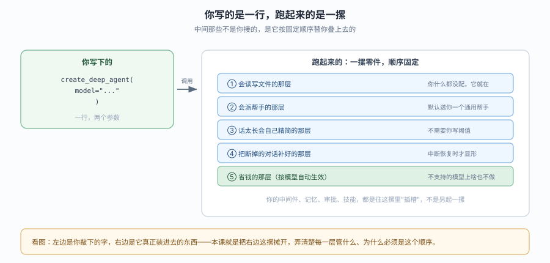
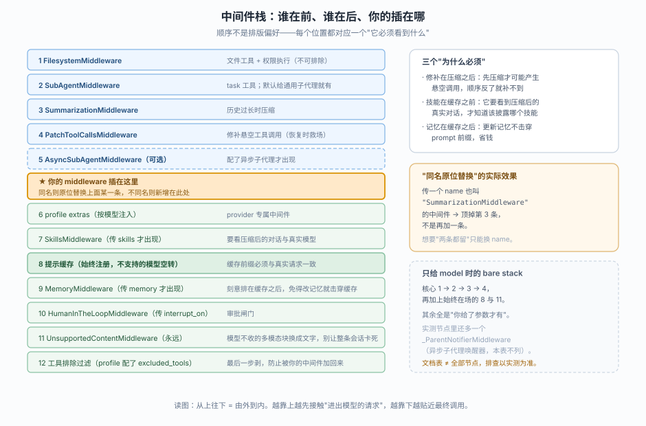
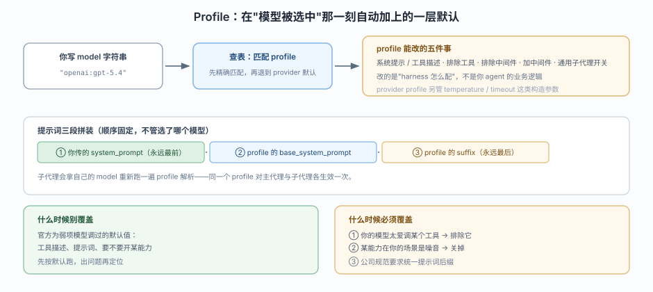
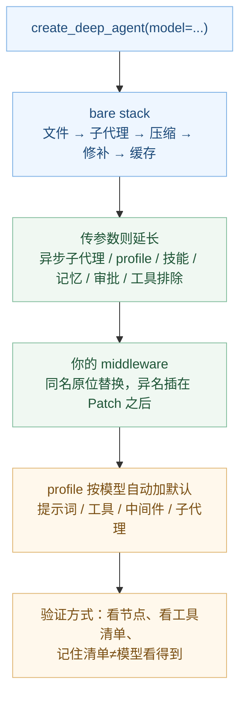

# 课 3：第一个 deep agent 与它的默认装配

> 所属阶段：阶段 1《定位与起跑》｜ 水平：进阶 ｜ 本课知识点：最小可运行（签名与模型写法）、默认中间件栈全序、Profiles 与模型默认
> 故事情节：主角写出第一行 `create_deep_agent(model=...)`，agent 跑起来了——但它到底被塞进了什么？不知道这个，后面所有"为什么它自己会读文件"都答不上
> 📖 结论已按官方文档核对（核对于 2026-10 ｜ 来源：docs.langchain.com/oss/python/deepagents/quickstart、customization#middleware、profiles、models；TS 侧：docs.langchain.com/oss/javascript/deepagents/quickstart、customization、models）
> ✅ 代码结论实测于 2026-10-20 ｜ `deepagents 0.7.28`
> ✅ TypeScript 侧实测于 2026-10-21 ｜ `deepagents 1.15.1` ｜ Node 22.22.2
> 本课配**应用实战**（见 `../../../应用实战/03-第一个DeepAgent与它的默认装配.md`）与**源码解析**（见 `../../../源码解析/03-第一个DeepAgent与它的默认装配.md`）

## 🎯 本课目标

- 写出最小可运行的 deep agent（两种模型指定方式）
- 按序说出 `create_deep_agent` 只给 model 时自动装上的中间件（bare stack 五层）
- 说清 full stack 的插入规则，以及 Profiles 何时带来额外中间件

---

## 第一幕：起源与场景引入

上一课你确认了它是"装好附件的车"。现在你要真的开一次。

你敲下这几行，跑起来了：

::: code-group

```python [Python]
from deepagents import create_deep_agent

agent = create_deep_agent(
    model="openai:gpt-5.4",
    system_prompt="你是一个严谨的助手。",
)
agent.invoke({"messages": [{"role": "user", "content": "把这份 csv 的列名整理成一个 md 表格"}]})
```

```typescript [TypeScript]
import { createDeepAgent } from "deepagents";

const agent = await createDeepAgent({
  model: "openai:gpt-5.4",
  systemPrompt: "你是一个严谨的助手。",
});
await agent.invoke({
  messages: [{ role: "user", content: "把这份 csv 的列名整理成一个 md 表格" }],
});
```

:::

> 📌 注意 `system_prompt` / `systemPrompt` 的驼峰差异，这是两侧最常见的照抄翻车点。

然后你注意到几件怪事：

- 你**没定义任何文件工具**，它却自己在读写文件。
- 你**没写压缩逻辑**，跑到第 30 轮它还在正常说话。
- 你**没配子代理**，它却在回答里说"我让一个子任务去查了"。
- 你**只写了 6 行**，但它显然不止做了 6 行的事。

> 🎬 **场景**：代码跑通了，可你手上的"代码地图"和它实际的行为对不上——因为中间隔着一层你没写的装配。

> 📌 **一句话本质**：把"一行调用"和"它实际装进去的一摞东西"对上号，从此知道每个行为是谁给的。
>
> ⚖️ **处境对照**：不知道装配，每个异常都要靠猜——"它为什么自己读文件"、"它为什么突然不提子代理了"、"我加的中间件为什么没生效"。知道装配，这三类问题各有一个确定的查法：看工具清单、看栈里还有没有那条、看插入位置。实测代价很低：一次 `create_deep_agent` 调用 + 两行读图结构的打印，就能把 5 个节点、9 个工具全部摊在眼前。

---

## 第二幕：认知冲突

矛盾在这里：**你写的东西和行为之间，不是一对一。**

你写的是 `model` + `system_prompt`。但你看到的行为清单是：读写文件、派子代理、自动压缩、断点修补、提示缓存。**多出来的这五件事，你一件都没写。**

有两种可能的解释，而它们导向完全不同的调试方式：

- **解释 A：模型自己会。** 某些模型确实有内置的文件/搜索工具——但这解释不了"断点修补"和"提示缓存"，那两件不是模型能做的事。
- **解释 B：有一层你没看过的装配。** 那么问题就变成：装了什么？按什么顺序？我加的能不能插进去？

> ❓ **问题**：一个只传了 `model` 的调用，究竟被塞进了哪几层？顺序能不能改？我加的东西是"追加"还是"替换"？

---

## 第三幕：层层揭示

### 一眼全局图（进入细节前先看一眼）



> 看图：左边是你敲下的两行参数，右边是它真正装进去的一摞零件——从上到下顺序固定，你的东西是往里"插槽"，不是另起一摞。

### 本课地图（分几步走）

| 步 | 这一步要解决什么（人话） | 对应知识点 |
|:--:|------------------------|-----------|
| 1 | 先把最小能跑的那一行写对，知道模型有哪两种写法 | 知识点 1：最小可运行——签名与模型写法 |
| 2 | 再把这一行背后的那一摞摊开，看清顺序和插入点 | 知识点 2：默认中间件栈全序 |
| 3 | 最后明白"哪些默认是按模型自动加的"，以及什么时候该改它 | 知识点 3：Profiles 与模型默认 |

---

### 知识点 1：最小可运行——签名与模型写法

> 🧭 第 1/3 步｜承接：第二幕发现"多出来的行为没有对应代码" → 本步：先确认最小调用长什么样，把变量收窄到一个参数
> 本知识点关键点：关键参数面、模型两种写法、默认就有文件工具

#### 一句话定义

最小可用调用只需要**一个参数**：`model`。其余全可选，不传就走默认。

#### 直觉建立（类比）

新手机开机。你不设置壁纸、不装 App、不连 Wi-Fi，它也能打电话——因为这些是"出厂默认就配好的"。`create_deep_agent` 也是这样：`model` 是那张 SIM 卡，插上就能用；其余的默认值它已经替你选过了。

> 💡 **类比的边界**：手机默认设置改起来无所谓；harness 的默认值会实打实影响 token 花费与行为（比如摘要阈值、缓存策略），所以"能跑"之后还得知道默认是什么——这正是后两个知识点。

#### 核心原理

**参数面分三类**，按"你要不要操心"排序：

| 类别 | 参数 | 什么时候用 |
|------|------|-----------|
| 必给 | `model` | 永远。0.7 已标记不传将废弃，1.0 起必填 |
| 常用 | `system_prompt`、`tools`、`subagents`、`middleware`、`backend`、`permissions`、`interrupt_on` | 按任务需要（后面各课逐个展开） |
| 少用 | `memory`、`skills`、`response_format`、`checkpointer`、`store`、`state_schema`、`context_schema`、`debug`、`name`、`cache` | 特定场景（课 7、8、11、13 才碰） |

**模型的两种写法**：

::: code-group

```python [Python]
# 写法一：字符串 "provider:model" —— 前缀决定用哪个 LangChain 集成
agent_a = create_deep_agent(model="openai:gpt-5.4", tools=[])

# 写法二：已初始化的模型对象 —— 参数、超时、base_url 全自己控
from langchain_openai import ChatOpenAI
agent_b = create_deep_agent(model=ChatOpenAI(model="gpt-5.4", timeout=60), tools=[])
```

```typescript [TypeScript]
import { createDeepAgent } from "deepagents";
import { ChatOpenAI } from "@langchain/openai";

// 写法一：字符串 "provider:model" —— 前缀决定用哪个集成包
const agentA = await createDeepAgent({ model: "openai:gpt-5.4", tools: [] });

// 写法二：已初始化的模型对象 —— 参数、超时、baseURL 全自己控
const agentB = await createDeepAgent({
  model: new ChatOpenAI({ model: "gpt-5.4", timeout: 60 }),
  tools: [],
});
```

:::

两种写法**在 harness 侧等价**（实测两者的图结构、工具清单完全一致），差别只在模型构造：

- 字符串写法：由框架按 `provider` 找集成、按 profile 填默认参数（temperature、timeout 等 provider profile 只在这条路径生效）。
- 对象写法：构造参数你自己定，profile 的 harness 部分照常生效，provider profile **不生效**。

> ⚠️ 前缀写错是高频坑：`openai:...` 与 `openai-chat:...` 指向不同集成；写成裸模型名（`"gpt-5.4"`）会走默认 provider 解析，容易得到一个你没想到的模型。
>
> TS 侧还有一处构造差异：`ChatOpenAI` 的 `baseURL` 要放进 `configuration` 里（`configuration: { baseURL: ... }`），不像 Python 那样是顶层参数。

**默认就有文件工具**——这点最容易让人误判"我是不是配了什么"：

::: code-group

```python [Python]
from deepagents import create_deep_agent

agent = create_deep_agent(model="openai:gpt-5.4", tools=[])   # 注意 tools 是空列表
print(sorted(agent.nodes["tools"].bound.tools_by_name))
```

```typescript [TypeScript]
import { createDeepAgent } from "deepagents";

const agent = await createDeepAgent({ model: "openai:gpt-5.4", tools: [] });
// TS 侧没有 nodes["tools"] 入口，需从各中间件的 tools 字段汇总
const names: string[] = [];
for (const mw of agent.options.middleware ?? []) {
  const t = (mw as { tools?: unknown }).tools;
  if (!t) continue;
  const arr = typeof t === "function" ? (t as () => unknown[])() : (t as unknown[]);
  for (const x of arr ?? []) {
    const n = (x as { name?: string }).name;
    if (n) names.push(n);
  }
}
console.log([...new Set(names)].sort());
```

:::

实测输出（两侧一致）：

```
['delete', 'edit_file', 'execute', 'glob', 'grep', 'ls', 'read_file', 'task', 'write_file']
```

`tools=[]` 传的是空列表，但你拿到 9 个工具。**它们不来自 `tools` 参数，来自中间件**——这就是下一节要摊开的东西。

#### 示例演示

一次跑通"两种写法 + 工具清单"，验证它们确实等价：

::: code-group

```python [Python]
from deepagents import create_deep_agent
from langchain_openai import ChatOpenAI

a = create_deep_agent(model="openai:gpt-5.4", tools=[])
b = create_deep_agent(model=ChatOpenAI(model="gpt-5.4"), tools=[])

for tag, agent in (("string", a), ("object", b)):
    print(tag, "nodes:", list(agent.nodes))
    print(tag, "tools:", sorted(agent.nodes["tools"].bound.tools_by_name))
```

```typescript [TypeScript]
import { createDeepAgent } from "deepagents";
import { ChatOpenAI } from "@langchain/openai";

const a = await createDeepAgent({ model: "openai:gpt-5.4", tools: [] });
const b = await createDeepAgent({ model: new ChatOpenAI({ model: "gpt-5.4" }), tools: [] });

for (const [tag, agent] of [["string", a], ["object", b]] as const) {
  console.log(tag, "stack:", (agent.options.middleware ?? []).length);
  console.log(tag, "tools:", toolsOf(agent)); // toolsOf 见课 1 脚本
}
```

:::

实测输出：

::: code-group

```text [Python]
string nodes: ['__start__', 'model', 'tools', '_ParentNotifierMiddleware.after_agent', 'PatchToolCallsMiddleware.before_agent']
string tools: ['delete', 'edit_file', 'execute', 'glob', 'grep', 'ls', 'read_file', 'task', 'write_file']
object nodes: ['__start__', 'model', 'tools', '_ParentNotifierMiddleware.after_agent', 'PatchToolCallsMiddleware.before_agent']
object tools: ['delete', 'edit_file', 'execute', 'glob', 'grep', 'ls', 'read_file', 'task', 'write_file']
```

```text [TypeScript]
string stack: 5
string tools: ['delete', 'edit_file', 'execute', 'glob', 'grep', 'ls', 'read_file', 'task', 'write_file']
object stack: 5
object tools: ['delete', 'edit_file', 'execute', 'glob', 'grep', 'ls', 'read_file', 'task', 'write_file']
```

:::

> 提示：Python 这段需要一个能构造的模型对象，所以要有 provider 包；不需要真 key（构造时不发请求），`OPENAI_API_KEY=sk-placeholder` 即可。TS 侧传字符串即可，无需假 key。

#### 常见误区

1. **误区：`tools=[]` 就是"不给工具"。**
   错。它只是"不加自定义工具"。内置文件工具由 `FilesystemMiddleware` 注入，跟 `tools` 参数是两条路。

2. **误区：不传 `model` 也能跑，所以它是可选参数。**
   实测确实能跑，但会收到 `LangChainDeprecationWarning`：`Passing model=None to create_deep_agent is deprecated and will be removed in deepagents==1.0.0`。别依赖它。

3. **误区：字符串写法更"轻"，对象写法更"重"。**
   两者构造出的图完全一致；差别只在模型构造参数谁说了算。

#### 一句话记住

**`model` 是唯一必给的；`tools=[]` 拦不住内置文件工具，因为工具是中间件注入的。**

#### 🗣️ 行话对照

- **Model string（模型字符串）**：`provider:model` 格式的写法，前缀选集成、冒号后原样传给 provider——就是本课说的"写法一"；在哪遇到：官方 models 页的"Supported models"、`init_chat_model` 的 `model_provider` 参数
- **Chat model instance（模型实例）**：已经构造好的模型对象——就是本课说的"写法二"；在哪遇到：`ChatOpenAI(...)` / `ChatAnthropic(...)` 的构造代码、`models#configure-model-parameters`
- **Tool injection（工具注入）**：工具不是靠参数传入，而是中间件在装配时塞进工具表——就是本课说的"9 个工具不来自 tools"；在哪遇到：`FilesystemMiddleware` 的 `tools` 参数、`excluded_tools` 配置

#### 官方文档

- Quickstart：https://docs.langchain.com/oss/python/deepagents/quickstart
- Models：https://docs.langchain.com/oss/python/deepagents/models

---

### 知识点 2：默认中间件栈全序

> 🧭 第 2/3 步｜承接：上一步发现"工具不是从 tools 来的"，但没说它们从哪来 → 本步：把整摞摊开，标出顺序与插入点
> 本知识点关键点：bare stack 五层；full stack 的插入规则与同名原位替换；三处"顺序不能乱"的理由

#### 一句话定义

`create_deep_agent` 按**固定顺序**装配一条中间件栈；只给 `model` 时得到 **bare stack**（核心 4 条 + 2 条恒在场），给全参数时得到 **full stack**（最多 13 个槽位），你的中间件从中间某个固定位置插入。

#### 直觉建立（类比）

机场安检流水线。先查证件、再扫行李、最后登机——**顺序不能换**：先登机就没法安检。而且加一道新工序，是往流水线的某个固定工位插，不是在旁边另开一条线。

> 💡 **类比的边界**：安检顺序错了会被拦下报错；中间件顺序错了通常**不报错、只是行为怪**（比如缓存不命中、技能看不到压缩后的对话）。这是本课最费时间的一类 bug。

#### 核心原理



> 看图：从上往下是由外到内；橙色那条是"你的中间件"的固定插入点，绿色是尾栈（能改配置才出现的东西），蓝色是默认就在的核心栈。

**bare stack（只给 model，实测 5 个图节点 / 7 条中间件）**：

先看文档口径的核心栈：

| # | 中间件 | 它给什么 |
|---|--------|---------|
| 1 | `FilesystemMiddleware` | 8 个文件工具 + 权限执行；**不可排除**（protected scaffolding） |
| 2 | `SubAgentMiddleware` | `task` 工具；因为默认自动加了一个通用子代理 |
| 3 | `SummarizationMiddleware` | 历史过长时压缩（由 `create_summarization_middleware` 造） |
| 4 | `PatchToolCallsMiddleware` | 修补悬空/畸形的工具调用，恢复执行时救场 |
| 5 | 提示缓存中间件 | 始终注册；对不支持的模型 no-op |

再看实测——**拦 `create_agent` 捕获到的真实 7 条**（这是唯一可靠口径）：

::: code-group

```text [Python]
1. FilesystemMiddleware                 (name=FilesystemMiddleware)
2. SubAgentMiddleware                   (name=SubAgentMiddleware)
3. _ParentNotifierMiddleware            (name=_ParentNotifierMiddleware)
4. _DeepAgentsSummarizationMiddleware   (name=SummarizationMiddleware)
5. PatchToolCallsMiddleware             (name=PatchToolCallsMiddleware)
6. AnthropicPromptCachingMiddleware     (name=AnthropicPromptCachingMiddleware)
7. UnsupportedContentMiddleware         (name=UnsupportedContentMiddleware)
```

```text [TypeScript]
1. FilesystemMiddleware
2. subAgentMiddleware
3. SummarizationMiddleware
4. patchToolCallsMiddleware
5. UnsupportedContentMiddleware
```

:::

**三个必须记住的结论**：

1. **图节点数 ≠ 中间件条数**。Python 图节点只有 5 个（`__start__` / `model` / `tools` / `_ParentNotifierMiddleware.after_agent` / `PatchToolCallsMiddleware.before_agent`），但中间件有 7 条。差的那两条：`_ParentNotifierMiddleware` 挂着 `after_agent` 但另外几条也在 model 节点内部包裹，不单独成节点；`AnthropicPromptCachingMiddleware` 完全在 model 调用内部生效，节点名里看不到。**排查时以中间件列表为准，不要拿节点名当完整清单。**
2. **两侧成员差 2 条**。TS 默认栈 5 条，**没有** `_ParentNotifierMiddleware`（异步子代理唤醒父代理用）与提示缓存中间件。所以 TS 版默认**不带**提示缓存——需要的话自己挂 `anthropicPromptCachingMiddleware()`（从 `langchain` 导入）。
3. **`_ParentNotifierMiddleware` 文档不列**。源码 `middleware/_parent_notifier.py` 的 docstring 写得很清楚：`create_deep_agent` 给每个 deep agent 都挂上它，"除非这次 run 带着父引用，否则什么都不做，嵌套 run 直接跳过"。它服务的是异步子代理跑完后唤醒父代理。文档列的是"会影响你使用的槽位"，不等于全部成员。

> 🔍 TS 侧要读完整清单，只能看 `agent.options.middleware` 的 `name` 字段，没有别的入口：
>
> ```typescript
> const stack = (agent.options.middleware ?? []).map((m) => (m as { name?: string }).name);
> console.log(stack.length, stack);
> ```

**full stack（完整装配：核心栈 + 可选槽位 + 两个恒在场项）**，官方文档的完整顺序，加上源码写出的插入点：

| # | 中间件 | 出现条件 | 位置理由 |
|---|--------|---------|---------|
| 1 | `FilesystemMiddleware` | 永远 | 权限要在最外层评估每一个工具调用 |
| 2 | `SubAgentMiddleware` | 至少有 1 个同步子代理（默认有通用子代理） | 决定 `task` 工具是否存在 |
| 3 | `SummarizationMiddleware` | 永远 | 压缩在最内层的核心能力 |
| 4 | `PatchToolCallsMiddleware` | 永远 | **必须在压缩之后**（见下方理由 ①） |
| 5 | `AsyncSubAgentMiddleware` | 配了异步子代理 | 异步调度 |
| 6 | **你的 `middleware`** | 你传了 | 插入点在此；**同名则原位替换** |
| 7 | profile `extra_middleware` | profile 配了 | provider 专属补丁 |
| 8 | `SkillsMiddleware` | 传了 `skills` | **必须在缓存之前**（理由 ②） |
| 9 | 提示缓存（Anthropic / Bedrock / Fireworks） | 永远注册 | **必须贴近真实请求**（理由 ③） |
| 10 | `MemoryMiddleware` | 传了 `memory` | **排在缓存之后**（理由 ③） |
| 11 | `HumanInTheLoopMiddleware` | 传了 `interrupt_on` | 最靠近执行，拦得住 |
| 12 | `UnsupportedContentMiddleware` | 永远 | 把模型不接受的多模态块换成文字提示，避免整条 thread 永久报错 |
| 13 | 工具排除过滤（`_ToolExclusionMiddleware`） | profile 有 `excluded_tools` | 最后一个剥，防被别处 `wrap_model_call` 加回来 |

> 表里编到 13 是因为"提示缓存"实际可能是多条（Anthropic / Bedrock / Fireworks 各一条，取决于装了哪个集成包）；官方文档按"逻辑槽位"列，源码 `create_deep_agent` 的 docstring 是逐条列名的。

**三个"顺序不能乱"的真实理由**（这是本知识点的重点，也是最容易被教程略过的部分）：

1. **修补在压缩之后。** 压缩会把一段历史替换成摘要，这个过程本身可能让某个工具调用的结果"落单"；修补器紧跟其后，才能把落单的调用补掉。顺序反了，压缩产生的悬空调用就没人管了。
2. **技能在缓存之前。** `SkillsMiddleware` 要在 `before_agent` / `before_model` 看到**压缩后的真实对话**和**实际被调用的模型**（可能经过 fallback / routing），才能决定披露哪个技能。官方文档明确写了：传给 `middleware=` 的中间件因此**看不到**刚加载的 `skills_metadata`。
3. **记忆在缓存之后。** `MemoryMiddleware` 会改系统提示词；它如果排在缓存前面，每次记忆更新都会让缓存前缀失效。源码注释里也写了这一点（"so that memory updates don't invalidate the Anthropic prompt cache prefix"）。

**同名原位替换**——本知识点第二个实操要点：

官方原文：*"Each instance is merged into the Deep Agents stack by matching its `.name` against built-in entries already in the stack: a match replaces that instance in place, and anything that does not match is inserted after `PatchToolCallsMiddleware`."*

意思是：你传 `middleware=[X()]`，
- 若 `X.name` 与栈里某条相同 → **顶掉那一条**，位置不变；
- 若不同 → 追加在 `PatchToolCallsMiddleware` 之后。

源码里的合并逻辑（`_apply_custom_middleware`，节选）：

::: code-group

```python [Python]
for m in custom:
    if m.name in current_names:
        replacements[m.name] = m      # 同名 → 记下替换
    else:
        to_append.append(m)            # 不同名 → 稍后插入
...
if to_append and core_names is not None:
    # 插在最后一个核心成员之后、尾栈之前
    pos = max((i for i, m in enumerate(result) if m.name in core_names), default=len(result) - 1) + 1
    result[pos:pos] = to_append
```

```typescript [TypeScript]
// TS 侧同样的语义，但实现分散在 agent 工厂里：
// 传入的 middleware 数组按 name 与默认栈逐条比对，
// 同名项原位替换，不同名项追加在默认栈之后。
const agent = createDeepAgent({
  middleware: [new MyMiddleware()],   // 同名（如 "filesystem"）→ 顶掉默认那条
});
```

:::

> 🇹🇸 **TS 没有 `_apply_custom_middleware` 这个可读入口**：同名替换的规则一样成立，但你无法从公开 API 里看到合并过程；要确认结果只能读 `agent.options.middleware`。

这就是"想覆盖默认行为"的正确姿势：**不用删，用同名替换**。反过来，如果你想"两条都留"，就不能用同名。

#### 示例演示

实测三件事：默认栈、加了自定义中间件、同名替换。

::: code-group

```python [Python]
from deepagents import create_deep_agent
from langchain.agents.middleware import AgentMiddleware

class Probe(AgentMiddleware):
    name = "ProbeMiddleware"                  # 故意取一个不重名的
    def before_agent(self, state, runtime): ...

class MyPatch(AgentMiddleware):
    name = "PatchToolCallsMiddleware"         # 与默认那条同名

base = create_deep_agent(model="openai:gpt-5.4", tools=[])
added = create_deep_agent(model="openai:gpt-5.4", tools=[], middleware=[Probe()])
replaced = create_deep_agent(model="openai:gpt-5.4", tools=[], middleware=[MyPatch()])

for tag, a in (("base", base), ("added", added), ("replaced", replaced)):
    print(tag, list(a.nodes))
```

```typescript [TypeScript]
import { createDeepAgent } from "deepagents";
import { createMiddleware } from "langchain";

const probe = createMiddleware({ name: "ProbeMiddleware", tools: [] });
const myPatch = createMiddleware({ name: "patchToolCallsMiddleware", tools: [] });

const base = await createDeepAgent({ model: "openai:gpt-4o-mini", tools: [] });
const added = await createDeepAgent({
  model: "openai:gpt-4o-mini", tools: [], middleware: [probe],
});
const replaced = await createDeepAgent({
  model: "openai:gpt-4o-mini", tools: [], middleware: [myPatch],
});

const stack = (a: { options: { middleware?: readonly unknown[] } }) =>
  (a.options.middleware ?? []).map((m) => (m as { name?: string }).name);
for (const [tag, a] of [["base", base], ["added", added], ["replaced", replaced]] as const) {
  console.log(tag, stack(a));
}
```

:::

实测输出：

::: code-group

```text [Python]
base     : ['__start__', 'model', 'tools', '_ParentNotifierMiddleware.after_agent', 'PatchToolCallsMiddleware.before_agent']
added    : ['__start__', 'model', 'tools', '_ParentNotifierMiddleware.after_agent', 'PatchToolCallsMiddleware.before_agent', 'ProbeMiddleware.before_agent']
replaced : ['__start__', 'model', 'tools', '_ParentNotifierMiddleware.after_agent', 'PatchToolCallsMiddleware.before_agent']
```

```text [TypeScript]
base     : FilesystemMiddleware → subAgentMiddleware → SummarizationMiddleware → patchToolCallsMiddleware → UnsupportedContentMiddleware
added    : FilesystemMiddleware → subAgentMiddleware → SummarizationMiddleware → patchToolCallsMiddleware → ProbeMiddleware → UnsupportedContentMiddleware
replaced : FilesystemMiddleware → subAgentMiddleware → SummarizationMiddleware → patchToolCallsMiddleware → UnsupportedContentMiddleware
```

:::

读法：

- `added` 比 `base` 多了一条 `ProbeMiddleware`，位置**紧跟在 `patchToolCallsMiddleware` 之后**（Python 侧表现为新增 `ProbeMiddleware.before_agent` 节点；TS 侧名字直接插在栈里）→ 不同名**新增**。
- `replaced` 与 `base` 完全一致 → 同名**原位替换**（Python 侧因节点名来自类名而看不出替换，改看 `.name` 属性；TS 侧直接看栈里的名字，位置没变就是替换成功）。

> 想让替换"看得见"，把自定义类的 `name` 设成 `"PatchToolCallsMiddleware"` 但**类名不同**，节点名就会变成你的类名。

再补一组"参数带来尾栈"的实测：

::: code-group

```python [Python]
from deepagents import create_deep_agent

print("base     :", list(create_deep_agent(model="openai:gpt-5.4", tools=[]).nodes))
print("interrupt:", list(create_deep_agent(model="openai:gpt-5.4", tools=[], interrupt_on={"write_file": True}).nodes))
print("memory   :", list(create_deep_agent(model="openai:gpt-5.4", tools=[], memory=["/AGENTS.md"]).nodes))
```

```typescript [TypeScript]
import { createDeepAgent } from "deepagents";

const nodesOf = (a: { options: { middleware?: readonly unknown[] } }) =>
  (a.options.middleware ?? []).map((m) => (m as { name?: string }).name);

const base = await createDeepAgent({ model: "openai:gpt-4o-mini", tools: [] });
const hitl = await createDeepAgent({
  model: "openai:gpt-4o-mini", tools: [], interruptOn: { write_file: true },
});
const mem = await createDeepAgent({
  model: "openai:gpt-4o-mini", tools: [], memory: ["/AGENTS.md"],
});
console.log("base     :", nodesOf(base));
console.log("interrupt:", nodesOf(hitl));
console.log("memory   :", nodesOf(mem));
```

:::

实测输出：

::: code-group

```text [Python]
base     : ['__start__', 'model', 'tools', '_ParentNotifierMiddleware.after_agent', 'PatchToolCallsMiddleware.before_agent']
interrupt: [... , 'HumanInTheLoopMiddleware.after_model']
memory   : [... , 'MemoryMiddleware.before_agent']
```

```text [TypeScript]
base     : FilesystemMiddleware → subAgentMiddleware → SummarizationMiddleware → patchToolCallsMiddleware → UnsupportedContentMiddleware
interrupt: FilesystemMiddleware → subAgentMiddleware → SummarizationMiddleware → patchToolCallsMiddleware → HumanInTheLoopMiddleware → UnsupportedContentMiddleware
memory   : FilesystemMiddleware → subAgentMiddleware → SummarizationMiddleware → patchToolCallsMiddleware → MemoryMiddleware → UnsupportedContentMiddleware
```

:::

这些"多出来的成员"就是尾栈：给 `interrupt_on`/`interruptOn` 才有审批，给 `memory` 才有记忆。

注意两侧插入位置的差别：

- Python 侧 `MemoryMiddleware` 在缓存之后、`HumanInTheLoopMiddleware` 更靠后（贴近执行端拦得住）。
- TS 侧两者都插在 `patchToolCallsMiddleware` 之后、`UnsupportedContentMiddleware` **之前**，且没有提示缓存层。

**所以"我的中间件排在谁前面"这类问题，两侧要分别实测，不能按另一侧的顺序推。**

#### 常见误区

1. **误区：中间件是"越靠前越先执行"。**
   一半对。栈的位置决定的是**包裹顺序**：靠前的在外层，`before_*` 先跑、`after_*` 后跑。所以"靠前"在进入时更早、在退出时更晚。搞混这一点会写出"我的 after_model 为什么比内置的晚"。

2. **误区：我传的中间件会追加在最后。**
   不。它插在 `PatchToolCallsMiddleware` 之后、尾栈（profile / skills / 缓存 / memory / HITL）之前。所以你的中间件**看不到** `skills_metadata`，也不该去改技能那一段提示词。

3. **误区：不想要某个中间件，传个 `excluded_middleware` 就行。**
   `FilesystemMiddleware` 与 `SubAgentMiddleware` 是 protected scaffolding，列进排除会**抛 `ValueError`**。想隐藏它们的工具，用 `excluded_tools`；想彻底不要子代理，用 `general_purpose_subagent=GeneralPurposeSubagentProfile(enabled=False)`。

#### 一句话记住

**栈是固定的：文件 → 子代理 → 压缩 → 修补 →（你的）→ 技能 → 缓存 → 记忆 → 审批；同名替换，不同名插在修补之后。**

#### 🗣️ 行话对照

- **Bare stack / Full stack**：只给 model 的最小装配 / 含全部可选槽位的完整装配——就是本课说的"最小那摞"和"完整那摞"；在哪遇到：`customization#bare-stack` 与 `#full-stack`
- **Protected scaffolding（受保护的脚手架）**：不允许排除的核心中间件（`FilesystemMiddleware` / `SubAgentMiddleware`）——就是本课说的"不可排除"；在哪遇到：`profiles` 页的 Warning 段、`excluded_middleware` 的报错
- **No-op middleware（空转中间件）**：注册了但在当前模型上什么都不做——就是本课说的"不支持的模型上啥也不干"；在哪遇到：提示缓存中间件的 `unsupported_model_behavior="ignore"`

#### 官方文档

- Customize › Middleware › Deep Agents stack：https://docs.langchain.com/oss/python/deepagents/customization#middleware
- Override a default middleware instance：https://docs.langchain.com/oss/python/deepagents/customization#override-a-default-middleware-instance

---

### 知识点 3：Profiles 与模型默认

> 🧭 第 3/3 步｜承接：上一步的栈是"代码写死的顺序"，但栈里可能还有一层你没配过的东西 → 本步：profile 这层按模型自动加的默认
> 本知识点关键点：profile 是什么、它能带来什么、什么时候该覆盖

#### 一句话定义

Harness profile 是**按 provider / 模型打包的一组默认**：选定模型时自动应用，改的是"harness 怎么配"，不是你的业务逻辑。

#### 直觉建立（类比）

同一款 App 在不同手机上会自动切不同的省电策略——因为厂商知道自己这颗芯片的脾气。profile 就是 harness 给不同模型准备的"省电策略"：某些模型对工具描述更敏感、某些模型需要额外中间件、某些模型根本不该看到某个工具。

> 💡 **类比的边界**：手机省电策略你改不了；profile 你能注册自己的，而且**注册后对之后创建的 agent 全局生效**——这一点很容易在实验时误伤别的代码。

#### 核心原理



> 看图：从"你写模型字符串"到"查表匹配"，再到"五件事可改"；下半部分是提示词三段拼装顺序。

**profile 能改的五件事**（官方 `HarnessProfile` 字段）：

| 字段 | 作用 |
|------|------|
| `base_system_prompt` | 该 profile 的基础指令（主代理里排在你传的 `system_prompt` 之后） |
| `system_prompt_suffix` | 追加在**最后**的指令（永远在末尾） |
| `tool_description_overrides` | 按工具名覆盖描述 |
| `excluded_tools` | 从模型视野里移除工具（后置过滤，能删掉中间件注入的工具） |
| `excluded_middleware` | 从栈里剥离中间件（类或 `.name` 字符串；受保护项会报错） |
| `extra_middleware` | 往每个受此 profile 影响的栈里追加中间件 |
| `general_purpose_subagent` | 关掉 / 改名 / 改提示词的通用子代理 |

**匹配顺序**（传模型对象时）：精确 `provider:identifier` → 仅 identifier（仅当 identifier 自身含 `:`）→ provider 默认 → identifier 前缀默认。

**两类 profile 别混**：

- **Harness profile**：影响 harness 行为（上面那张表）。
- **Provider profile**：只影响**模型构造**（temperature、timeout 等），不碰 harness。官方明确说"大多数调用者不需要 provider profile"。

**提示词三段拼装**：调用方 `system_prompt`（最前）→ profile `base_system_prompt` → profile `system_prompt_suffix`（最后）。顺序与你选哪个模型无关。

#### 示例演示

实测 `excluded_tools` 的效果与它的**真实作用层**：

::: code-group

```python [Python]
from deepagents import create_deep_agent, HarnessProfile, register_harness_profile

register_harness_profile("openai:gpt-5.4", HarnessProfile(excluded_tools={"execute"}))
a = create_deep_agent(model="openai:gpt-5.4", tools=[])
print("nodes:", list(a.nodes))
print("静态工具清单:", sorted(a.nodes["tools"].bound.tools_by_name))
```

```typescript [TypeScript]
import { createDeepAgent, createHarnessProfile, registerHarnessProfile } from "deepagents";

registerHarnessProfile(
  "openai:gpt-4.1-mini",
  createHarnessProfile({ excludedTools: new Set(["execute"]) }),
);
const a = await createDeepAgent({ model: "openai:gpt-4.1-mini", tools: [] });
console.log("静态工具清单:", toolsOf(a));
```

:::

实测输出：

::: code-group

```text [Python]
nodes: ['__start__', 'model', 'tools', '_ParentNotifierMiddleware.after_agent', 'PatchToolCallsMiddleware.before_agent']
静态工具清单: ['delete', 'edit_file', 'execute', 'glob', 'grep', 'ls', 'read_file', 'task', 'write_file']
```

```text [TypeScript]
静态工具清单: ['delete', 'edit_file', 'glob', 'grep', 'ls', 'read_file', 'task', 'write_file']
```

:::

**这里是两侧最实质的一处行为差异**：

- **Python 侧**：`execute` 仍在静态清单里、图节点也没多出任何东西。因为 `excluded_tools` 是靠 `_ToolExclusionMiddleware.wrap_model_call` 在**请求发给模型前**过滤的。
- **TypeScript 侧**：`execute` 直接从中间件的 `tools` 列表里消失了——说明 TS 在**装配期**就把工具摘掉了。

> ⚠️ 这条对排查极其重要：**"工具在清单里" ≠ "模型看得到它"**。Python 侧必须看"模型收到的请求"；TS 侧看清单就够了。反过来也成立——`delete` / `execute` 在清单里，但后端不支持时也会被裁掉（课 4、课 6）。

::: code-group

```python [Python]
# 节选 deepagents/middleware/_tool_exclusion.py
def wrap_model_call(self, request, handler):
    if self._excluded:
        filtered = [t for t in request.tools if _tool_name(t) not in self._excluded]
```

```typescript [TypeScript]
// TS 侧没有等价的请求期过滤钩子——
// excludedTools 在装配期直接决定 middleware.tools 里放哪些工具
const agent = createDeepAgent({ excludedTools: ["execute"] });
const tools = (agent.options.middleware ?? [])
  .flatMap((m: any) => m.tools ?? [])
  .map((t: any) => t.name);
// tools 里已经没有 "execute"
```

:::

> 🇹🇸 **这条差异直接影响排查方法**：Python 侧工具还在清单里、只是请求期被过滤掉，所以你查 `middleware.tools` 会误判成"能用"；TS 侧装配期就摘掉了，查清单就够。同一个问题，两侧要查的位置不同。

#### 常见误区

1. **误区：profile 是"给某个模型推荐的一组最佳实践"，应该主动挑着用。**
   官方定位是**默认值**，`register_harness_profile` 注册后全局生效。你要做的通常是"知道它存在"，而不是"每次都自己注册一个"。

2. **误区：`register_harness_profile` 只影响下一次调用。**
   它对**之后创建的所有**匹配该模型的 agent 生效。做实验时记得它是有状态的，跑完换进程或用不同 model 隔离。

3. **误区：`excluded_tools` 等于"这个工具不存在"。**
   Python 侧它只在请求期过滤；执行端仍然注册着（源码注释明确说"executor still has them registered"），所以**不是安全边界**。TS 侧虽然在装配期就从清单里摘掉了，同样不等于安全边界（配置层过滤不是权限）。要拦危险操作，用权限（课 5）或审批（课 11）。

#### 一句话记住

**profile 是"按模型自动加的默认"，能改提示词、工具、中间件、子代理；它管配置，不管安全。**

#### 🗣️ 行话对照

- **Harness profile**：按 provider / 模型打包的一组 harness 默认值（提示词、工具、中间件、子代理）——就是本课说的"省电策略"；在哪遇到：`HarnessProfile` 类、`register_harness_profile()`（`create_deep_agent` **没有** `profile=` 参数，profile 只能注册后按模型匹配生效）
- **Provider profile**：只管模型构造参数（temperature / timeout 等）的那一层默认——就是本课说的"别混的那一类"；在哪遇到：`provider_profiles` 页、`init_chat_model` 的默认参数说明
- **Tool exclusion（工具排除）**：在请求发给模型前把工具从请求体里滤掉的后置过滤——就是本课说的"清单里有 ≠ 模型看得到"；在哪遇到：`excluded_tools` 字段、`_ToolExclusionMiddleware`
- **Prompt assembly（提示词拼装）**：调用方 prompt → profile base → profile suffix 的三段拼接——就是本课说的"三段拼装"；在哪遇到：`base_system_prompt` / `system_prompt_suffix` 的注释、profiles 页的"Prompt composition"段

#### 官方文档

- Profiles：https://docs.langchain.com/oss/python/deepagents/profiles
- Customize › Middleware › Deep Agents stack：https://docs.langchain.com/oss/python/deepagents/customization#middleware

---

## 第四幕：实操验证

### 4.1 机制验证

> ✅ 实测于 2026-10-20 ｜ `deepagents 0.7.28` / `langchain 1.4.6` ｜ 全程离线构造，不发请求、不需要真 key
> ✅ TypeScript 侧实测于 2026-10-21 ｜ `deepagents 1.15.1` ｜ Node 22.22.2

一次脚本把三个知识点串起来验证：

::: code-group

```python [Python]
# stack_probe.py
import deepagents
from deepagents import create_deep_agent
from langchain.agents.middleware import AgentMiddleware, TodoListMiddleware

def tools_of(a):
    return sorted(a.nodes["tools"].bound.tools_by_name)

print("version:", deepagents.__version__)

base = create_deep_agent(model="openai:gpt-5.4", tools=[])
print("1) 只给 model → 节点:", list(base.nodes))
print("   工具:", tools_of(base))

class Probe(AgentMiddleware):
    name = "ProbeMiddleware"

added = create_deep_agent(model="openai:gpt-5.4", tools=[], middleware=[Probe()])
print("2) 加自定义中间件 → 节点:", list(added.nodes))

todo = create_deep_agent(model="openai:gpt-5.4", tools=[], middleware=[TodoListMiddleware()])
print("3) 加 TodoList → 新增工具:", sorted(set(tools_of(todo)) - set(tools_of(base))))

hitl = create_deep_agent(model="openai:gpt-5.4", tools=[], interrupt_on={"write_file": True})
print("4) 传 interrupt_on → 多出节点:", sorted(set(hitl.nodes) - set(base.nodes)))

mem = create_deep_agent(model="openai:gpt-5.4", tools=[], memory=["/AGENTS.md"])
print("5) 传 memory → 多出节点:", sorted(set(mem.nodes) - set(base.nodes)))
```

```typescript [TypeScript]
// 完整版见 playground-ts/l03-first-agent.ts
import { createDeepAgent } from "deepagents";
import { createMiddleware, todoListMiddleware } from "langchain";

const stackOf = (a) => (a.options.middleware ?? []).map((m) => m.name);
const toolsOf = (a) => { /* 见课 1 脚本，汇总各中间件的 tools */ };

const base = await createDeepAgent({ model: "openai:gpt-4o-mini", tools: [] });
console.log("1) 默认栈:", stackOf(base).join(" → "));
console.log("   工具:", toolsOf(base));

const added = await createDeepAgent({
  model: "openai:gpt-4o-mini", tools: [],
  middleware: [createMiddleware({ name: "ProbeMiddleware", tools: [] })],
});
console.log("2) 加自定义中间件 →", stackOf(added).join(" → "));

const todo = await createDeepAgent({
  model: "openai:gpt-4o-mini", tools: [], middleware: [todoListMiddleware()],
});
console.log("3) 新增工具:", toolsOf(todo).filter((t) => !toolsOf(base).includes(t)));

const hitl = await createDeepAgent({
  model: "openai:gpt-4o-mini", tools: [], interruptOn: { write_file: true },
});
console.log("4) interruptOn →", stackOf(hitl).join(" → "));

const mem = await createDeepAgent({
  model: "openai:gpt-4o-mini", tools: [], memory: ["/AGENTS.md"],
});
console.log("5) memory →", stackOf(mem).join(" → "));
```

:::

实测输出：

::: code-group

```text [Python]
version: 0.7.28
1) 只给 model → 节点: ['__start__', 'model', 'tools', '_ParentNotifierMiddleware.after_agent', 'PatchToolCallsMiddleware.before_agent']
   工具: ['delete', 'edit_file', 'execute', 'glob', 'grep', 'ls', 'read_file', 'task', 'write_file']
2) 加自定义中间件 → 节点: ['__start__', 'model', 'tools', '_ParentNotifierMiddleware.after_agent', 'PatchToolCallsMiddleware.before_agent', 'ProbeMiddleware.before_agent']
3) 加 TodoList → 新增工具: ['write_todos']
4) 传 interrupt_on → 多出节点: ['HumanInTheLoopMiddleware.after_model']
5) 传 memory → 多出节点: ['MemoryMiddleware.before_agent']
```

```text [TypeScript]
deepagents: 1.15.1
1) 默认栈: FilesystemMiddleware → subAgentMiddleware → SummarizationMiddleware → patchToolCallsMiddleware → UnsupportedContentMiddleware
   工具: ['delete', 'edit_file', 'execute', 'glob', 'grep', 'ls', 'read_file', 'task', 'write_file']
2) 加自定义中间件 → FilesystemMiddleware → subAgentMiddleware → SummarizationMiddleware → patchToolCallsMiddleware → ProbeMiddleware → UnsupportedContentMiddleware
3) 新增工具: ['write_todos']
4) interruptOn → FilesystemMiddleware → subAgentMiddleware → SummarizationMiddleware → patchToolCallsMiddleware → HumanInTheLoopMiddleware → UnsupportedContentMiddleware
5) memory → FilesystemMiddleware → subAgentMiddleware → SummarizationMiddleware → patchToolCallsMiddleware → MemoryMiddleware → UnsupportedContentMiddleware
```

:::

> ✅ **回扣场景**：第一幕的四个"怪事"全部有了出处——文件工具来自 `FilesystemMiddleware`（工具清单里 8 个文件工具）；子代理来自 `SubAgentMiddleware`（`task` 工具）；压缩来自 `SummarizationMiddleware`（不在节点名里，因为它在 model 节点内部包裹，不单独成节点）；断点修补就是那个 `PatchToolCallsMiddleware.before_agent` 节点。**"我什么都没配"是错觉。**

> ⚠️ 读 `agent.nodes` / `.bound`（Python）与 `agent.options.middleware`（TS）属内部结构，只用于自检与教学；业务代码别依赖。

### 4.2 应用实战：代码库答疑助手（入口）

> 🎯 **本课应用实战独立成篇**（配套实战册）：[第 3 课实战 · 代码库答疑助手](../../../应用实战/03-第一个DeepAgent与它的默认装配.md)
> 含**分步设计图**（每步一张：这一版长什么样、比上一版改了什么）与"基础 → 综合"的完整演进与代码；通览全部：📚 [应用实战索引](../../../应用实战/INDEX.md)
> **课内不重复实战正文**。

---

## 第五幕：体系收束

> 📍 **全局定位**：你已经把"一行调用"拆成了"一摞零件"。这摞零件就是后面所有课的坐标系——课 4 讲第 1 条里的工具、课 5 讲第 1 条依赖的后端与权限、课 6 讲第 1 条之外的代码执行、课 7/8 讲第 8/10 条那两个槽位、课 9 讲第 3/9/10 条（压缩与缓存）、课 11 讲第 11 条。**每次遇到"某个能力没生效"，先回到本课这张栈图定位它在第几条。**
>
> 🔗 **下一步**：课 4《工具与虚拟文件系统》。为什么是它？因为栈里第 1 条就给了你 8 个文件工具，而你还不知道它们各自的边界——`write_file` 会覆盖、`edit_file` 要精确匹配、`delete` 是递归的。这些差别决定了 agent 会不会"悄悄毁掉你的文件"。

---

## 🐞 常见误区

1. **以为不传 `tools` 就没工具。** 内置文件工具由中间件注入，与 `tools` 参数无关。
2. **以为自己的中间件追加在栈尾。** 它插在 `PatchToolCallsMiddleware` 之后、尾栈之前；同名则原位替换。
3. **用 `excluded_tools` 当安全措施。** 它只是请求期过滤，执行端仍注册着；安全靠权限与审批。
4. **以为提示缓存"只有 Anthropic 有"。** 中间件始终注册，Anthropic / Bedrock / Fireworks 各有实现，其它模型上 no-op。

### ⏳ 与过时说法对照

| 旧说法（网上过时教程 / 训练知识里的说法） | 官方文档现状 | 来源 |
|---|---|---|
| "`create_deep_agent` 默认带任务规划，栈里有 TodoListMiddleware" | 0.7 起默认不含；需 `middleware=[TodoListMiddleware()]` | [CHANGELOG 0.7.0](https://github.com/langchain-ai/deepagents/blob/main/libs/deepagents/CHANGELOG.md) |
| "中间件按传入顺序追加到末尾" | 按 `.name` 合并：同名原位替换，不同名插在 Patch 之后 | [customization#middleware](https://docs.langchain.com/oss/python/deepagents/customization#middleware) |
| "可以用 `excluded_middleware` 去掉 FilesystemMiddleware" | 它是 protected scaffolding，排除会抛 `ValueError`；应改用 `excluded_tools` | [profiles](https://docs.langchain.com/oss/python/deepagents/profiles) |

## 一图总结



> 读图指引：竖着读是"从最小装配逐步加东西"的顺序；最后一步是提醒——**验证要看模型实际收到什么，不要只看静态清单**。

## 课后小测

**Q1**：只调用 `create_deep_agent(model="openai:gpt-5.4", tools=[])`，你会得到几个工具？为什么？
- A. 0 个，因为 `tools=[]`
- B. 1 个，只有 `task`
- C. 9 个，内置文件工具与 `task` 都由中间件注入
- D. 取决于模型，不同 provider 数量不同

<details><summary>答案与解析</summary>

**答案：C**。实测 9 个：`delete` / `edit_file` / `execute` / `glob` / `grep` / `ls` / `read_file` / `task` / `write_file`。`tools=[]` 只表示"不加自定义工具"，内置工具来自 `FilesystemMiddleware` 与 `SubAgentMiddleware`。

</details>

**Q2**：你传了一个 `.name = "SummarizationMiddleware"` 的自定义中间件，会发生什么？
- A. 栈里出现两条压缩中间件
- B. 原位替换掉默认那条，位置不变
- C. 报错，因为名字冲突
- D. 被忽略

<details><summary>答案与解析</summary>

**答案：B**。合并逻辑按 `.name` 匹配：命中则替换该位置，不命中才插到 `PatchToolCallsMiddleware` 之后。这也是"覆盖默认行为"的推荐做法——不用删，用同名替换。

</details>

**Q3**：为什么 `MemoryMiddleware` 排在提示缓存**之后**？
- A. 因为它更耗资源，放后面省算力
- B. 因为它会改系统提示词，排在缓存前会让缓存前缀频繁失效
- C. 因为它是可选能力，位置无所谓
- D. 因为 LangGraph 要求如此

<details><summary>答案与解析</summary>

**答案：B**。官方与源码注释都写明这个顺序是为了避免"记忆更新导致缓存前缀失效"。同理，`SkillsMiddleware` 排在缓存**之前**，是为了看到压缩后的真实对话与实际调用的模型。

</details>

**Q4**：`HarnessProfile(excluded_tools={"execute"})` 生效后，`agent.nodes["tools"].bound.tools_by_name` 里还有 `execute` 吗？
- A. 没有，已被移除
- B. 有，因为它是在请求期由中间件过滤的
- C. 有，但会报错
- D. 取决于后端

<details><summary>答案与解析</summary>

**答案：B**。实测静态清单仍含 `execute`，图节点也没变化——过滤发生在 `_ToolExclusionMiddleware.wrap_model_call`，即"发给模型前"。所以验证不能靠看清单，且它不构成安全边界。

</details>

## 🚀 下一批接力提示词

> 学完本课后，**复制下面这段文字发给 AI**，即可进入下一课（无需重新描述上下文）：

```
继续学 Deep Agents。我的学习档案在 langchain/deepagents/00-学习档案.md，
刚学完阶段 1《定位与起跑》的课 3《第一个 deep agent 与它的默认装配》全部 3 个知识点
（签名与模型写法 / 默认中间件栈全序 / Profiles 与模型默认），并做完了应用实战与源码解析。
请按大纲继续讲阶段 2《执行环境》的课 4《工具与虚拟文件系统》。
```

> 🎉 **阶段 1 完成**。阶段 2 会把栈里第 1 条（`FilesystemMiddleware`）彻底拆开。

## 🧭 课程导航

🎯 **练一练（本课应用实战）**：[第 3 课实战 · 代码库答疑助手](../../../应用实战/03-第一个DeepAgent与它的默认装配.md)

🔬 **源码解析**：[第 3 课解析 · `create_deep_agent` 的中间件栈装配](../../../源码解析/03-第一个DeepAgent与它的默认装配.md)

⬅️ **上一课**：[课 2：Deep Agents 是什么](./02-DeepAgents是什么.md)

➡️ **下一课**：[课 4：工具与虚拟文件系统](../../2-执行环境/lessons/04-工具与虚拟文件系统.md)

📚 **返回目录**：[课程目录](../../../02-课程目录.md)
