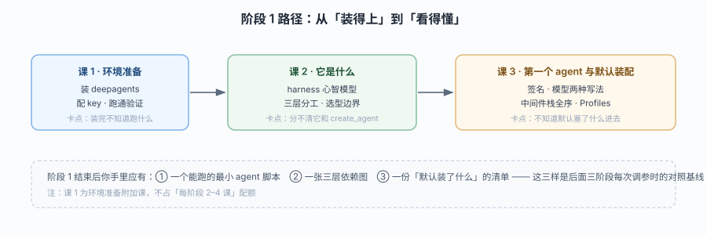

# 阶段 1：定位与起跑

> 所属课程：Deep Agents ｜ 故事章节：接单——「它到底能替我做多少」 ｜ 上一阶段：无（起始阶段）

## 🎯 本阶段目标

- 能一句话说清 Deep Agents 是什么、不是什么（不是新框架，是预装好的 agent harness）
- 能画出 `deepagents` → LangChain → LangGraph 的三层依赖，并说清每层各管什么
- 能自己装包、配好模型、写出第一个带文件工具的 deep agent 并跑通

## 📍 学习重点

- **harness 心智模型**：核心仍是 tool calling loop，Deep Agents 的价值是"把常用能力预先组装好"——这个认知决定你后面遇到问题时"该调参数还是该拆回 LangChain"
- **默认装配顺序**：`create_deep_agent` 只给 model 时会自动装 5–6 层中间件，顺序是固定的；顺序错了（如 Memory 在 prompt caching 之前）会毁掉缓存命中
- **版本演进**：v0.7 把任务规划改为 opt-in、新增 `delete` 工具——网上大量教程写的是旧行为

## ✅ 必须掌握的知识点

| 知识点 | 所属课 | 学完应能 |
|--------|--------|----------|
| 环境准备 | 课 1 | 自己装好 `deepagents`、配好 provider key、跑通最小验证脚本 |
| harness 心智模型 | 课 2 | 说清"它和 create_agent 的关系"而不是"它是个新框架" |
| 三层分工 | 课 2 | 画出 deepagents / LangChain / LangGraph 三层依赖，指出各自负责什么 |
| 选型边界与版本演进 | 课 2 | 判断一个需求该用 `create_agent` 还是 `create_deep_agent`；说出 v0.7 的两处破坏性变更 |
| create_deep_agent 签名 | 课 3 | 写出两种模型指定方式（`provider:model` 字符串 / 已初始化模型） |
| 默认中间件栈全序 | 课 3 | 背出 bare stack 五层，并按序说出 full stack 的插入规则 |
| Profiles 与模型默认 | 课 3 | 说清 profile 何时生效、它能带来哪些 provider 专属中间件 |

## 🗺️ 本阶段路径图

> 看图：三个方框是递进关系——先把环境跑通（左），再建立心智模型（中），最后看清默认装配的细节（右）；右侧的灰色小字是每课"卡住时最常问的问题"，可作为自查点。

## 本阶段产出

- [x] `lessons/01-环境准备.md`
- [x] `lessons/02-DeepAgents是什么.md`
- [x] `lessons/03-第一个DeepAgent与它的默认装配.md`
