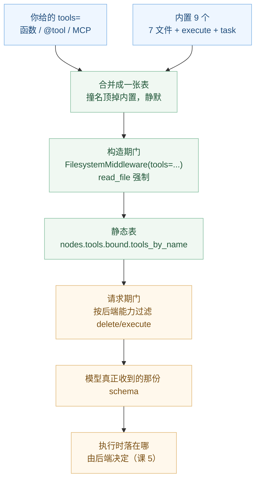

# 课 4：工具与虚拟文件系统

> 所属阶段：阶段 2《执行环境》｜ 水平：进阶 ｜ 本课知识点：tools 参数与 MCP 接入、内置文件工具清单、多模态读取与 delete 的可见性
> 故事情节：主角发现 agent 已经有了文件工具，于是想"那我自己写工具该怎么塞进去"——顺手也把内部文档站接上
> 📖 结论已按官方文档核对（核对于 2026-10 ｜ 来源：docs.langchain.com/oss/python/deepagents/tools、overview、multimodal）
> ✅ 代码结论实测于 2026-10-20 ｜ `deepagents 0.7.28` / `langchain 1.4.6` ｜ 隔离环境 `/tmp/da-probe`
> 本课配**应用实战**（见 `../../../应用实战/04-工具与虚拟文件系统.md`）
> ⚠️ 去重约定：本课只讲 harness 侧"怎么把工具塞进去"与内置工具的差异；`@tool` 装饰器规范、工具返回值类型、错误处理回扣 [LangChain 课 4《Tools 工具》](../../../../langchain/stages/2-Agent核心/lessons/04-Tools工具.md)

## 🎯 本课目标

- 把自定义函数、LangChain 工具、MCP 服务三种来源一起塞进 `tools=`，并预判同名时的结果
- 列出 7 个纯文件工具（`ls` / `read_file` / `write_file` / `edit_file` / `delete` / `glob` / `grep`）+ 沙箱专用的 `execute` + `task`，说出各自最容易被误用的地方
- 说清 `read_file` 何时返回多模态内容块、`delete` 何时从模型视野里消失

---

## 第一幕：起源与场景引入

上一课你摊开了那摞中间件，结论里有一句让你停了半拍：**`tools=[]` 的时候，你依然拿到 9 个工具。**

既然工具不是从 `tools` 来的，那 `tools=` 到底是干什么的？你试了一下：

```python
from deepagents import create_deep_agent

def search_docs(query: str, limit: int = 3) -> str:
    """在内部文档里检索。"""
    return "..."

agent = create_deep_agent(model="openai:gpt-5.4", tools=[search_docs])
```

跑通了，agent 会调 `search_docs`。但紧接着三件事对不上：

- 你把工具清单打印出来，是 **10 个**——不是 1 个，也不是 9 个。你自己那个是"加上去的"，内置的没被顶掉。
- 你顺手给一个工具起名叫 `read_file`，想"覆盖一下试试"。**没报错，没警告**，工具总数还是 10 个——但行为已经悄悄换成你的了。
- 你听说内部文档站有 MCP 服务，想接进来。文档给了几行 `async with` 代码，你却在想：**为什么它必须写在 `async with` 里？工具拿到手了不就完了吗？**

> 🎬 **场景**：你已经有了一个"能读文件"的 agent，现在要让它"读你的东西"。而这两件事的接法完全不同：后者是往工具表里加，前者是那张表本来就有、你只是之前没细看。

> 📌 **一句话本质**：`tools=` 只做加法（和同名覆盖），从不做减法；你以为你在配工具表，其实你只配了它的一小段。
>
> ⚖️ **处境对照**：不知道这张表的来路，你会反复踩三个坑——以为 `tools=[]` 能收紧权限（不能）、以为同名会报冲突（不会，静默覆盖）、以为打印出来的清单就是模型看到的（不是）。反过来，知道三段来路，这三个坑各有一句确定的排查话术：看 `tools_by_name` 的键数、看 description 是谁写的、看后端支不支持。

---

## 第二幕：认知冲突

矛盾在这里：**工具表是"别人先摆好、你再往上加"的，而加法有两种。**

你写下 `tools=[search_docs]`。这两种解释都能"跑通"，但结论完全相反：

- **解释 A：`tools=` 就是这张表。** 那你传一个，就该只有一个。可你明明打印出 10 个。
- **解释 B：`tools=` 是往一张已有的表上追加。** 那就要回答三个新问题：已有的那些是谁摆的？撞名了怎么办？我能不能把已有的拿掉？

还有一层更隐蔽的：**"表里有"和"模型看得到"不是一回事。** 官方文档里 `delete` 标着"需要 `deepagents>=0.7`"，而源码里它还会因为"后端不支持删除"而消失。你在 `agent.nodes["tools"].bound.tools_by_name` 里 `print` 得到的东西，和模型真正收到的那份 schema，可能不是同一份。

> ❓ **问题**：`tools=` 的三类来源各自怎么进表？撞名时谁赢、会不会报错？内置的那 8 个工具边界在哪？以及最要紧的——**我怎么知道模型此刻到底看得到哪些工具？**

---

## 第三幕：层层揭示

### 一眼全局图（进入细节前先看一眼）


> 看图：左上是你加的（可混用三类来源），左中是它自带的（固定 8 个 + `task`），两者合并成一张表；橙色那条是"撞名"的处理规则，蓝色那条是"构造期裁剪"；最下方橙色框是真正的坑——**模型收到的那张表可能比静态清单更短**；最底部是底座：同样是 `write_file`，落在内存还是落在磁盘由后端决定（课 5）。

### 本课地图（分几步走）

| 步 | 这一步要解决什么（人话） | 对应知识点 |
|:--:|------------------------|-----------|
| 1 | 先搞清"我加的工具怎么进去"，包括撞名和 MCP 这种外部来源 | 知识点 1：tools 参数与 MCP 接入 |
| 2 | 再把自带的 8 个工具逐个摸清边界，尤其是会毁数据的那几个 | 知识点 2：内置文件工具清单 |
| 3 | 最后解决"表里有 ≠ 模型看得到"，以及非文本文件怎么读 | 知识点 3：多模态读取与 delete 的可见性 |

---

### 知识点 1：tools 参数与 MCP 接入

> 🧭 第 1/3 步｜承接：第二幕发现"传 1 个却得到 10 个" → 本步：搞清这张表的加法规则与三类来源
> 本知识点关键点：三类来源可混用、schema 靠签名与 docstring 推断、撞名静默覆盖、MCP 用 `async with` 是因为工具绑着连接

#### 一句话定义

`tools=` 是一个**只做加法的列表**：接受普通函数、LangChain 工具、MCP 服务暴露的工具三类来源，与内置的 9 个合并成一张表；**同名则顶掉内置那条，不报错**。

#### 直觉建立（类比）

给台式机加扩展卡。主板自带集成显卡和网卡——你不需要"配置"它们，它们本来就在。你能做的是往 PCIe 插槽里插一张独显：**这是加法**。插上去之后，如果这张卡和集显抢同一个输出口，系统默认走你插的那张（撞名覆盖），而不是弹出"冲突，无法启动"。

> 💡 **类比的边界**：硬件冲突通常会让你开不了机；工具撞名**完全静默**——不报错、不警告、数量也不变。你会以为"覆盖没生效"，直到某天发现 `read_file` 读出来的东西格式不对，才想起自己三个月前写过同名工具。这个"静默"是本知识点唯一需要背下来的行为。

#### 核心原理

**三类来源，一个列表**：

| 来源 | 形态 | 实测是否进表 |
|------|------|-------------|
| 普通函数 | `def search_docs(query: str, limit: int = 3) -> str:` + docstring | ✅ 进 |
| LangChain 工具 | `@tool` 装饰过的函数，或 `StructuredTool.from_function(...)` | ✅ 进 |
| MCP 工具 | `await MCPAdapter(config).list_tools()` 返回的工具对象列表 | ✅ 进 |

实测把三类一起塞进去：

```python
from deepagents import create_deep_agent
from langchain_core.tools import tool, StructuredTool


def plain_fn(city: str, days: int = 1) -> str:
    """查天气。"""
    return f"{city}:{days}"


@tool
def decorated_tool(x: int) -> int:
    """官方 @tool 写法。"""
    return x * 2


def dict_tool_impl(q: str) -> str:
    return q.upper()


dict_tool = StructuredTool.from_function(
    func=dict_tool_impl, name="dict_tool", description="以字典形式声明的工具"
)

base = create_deep_agent(model="openai:gpt-5.4", tools=[])
mixed = create_deep_agent(model="openai:gpt-5.4", tools=[plain_fn, decorated_tool, dict_tool])

for tag, a in (("base", base), ("mixed", mixed)):
    print(tag, sorted(a.nodes["tools"].bound.tools_by_name))
```

实测输出：

```
base  ['delete', 'edit_file', 'execute', 'glob', 'grep', 'ls', 'read_file', 'task', 'write_file']
mixed ['decorated_tool', 'delete', 'dict_tool', 'edit_file', 'execute', 'glob',
       'grep', 'ls', 'plain_fn', 'read_file', 'task', 'write_file']
```

9 → 12，**纯加法，一个内置的都没被顶掉**（因为三个名字都不撞）。

**schema 从哪来**：官方原文是 *"Deep Agents infers the tool schema from the function signature and docstring, so you don't need to define a separate schema in most cases."* 也就是说 `query: str` 变成 `{"query": {"type": "string"}}`，默认值变成非必填，`Literal[...]` 变成 enum，docstring 变成 description。**这也解释了为什么"工具名和描述"比实现更重要**——模型只能看见名字、描述和参数，看不见你的函数体。

**撞名规则：静默覆盖**。实测三个位置：

```python
from langchain_core.tools import tool

@tool("read_file")
def my_read(file_path: str) -> str:
    """我的 read_file。"""
    return "MINE"

a = create_deep_agent(model="openai:gpt-5.4", tools=[my_read])
t = a.nodes["tools"].bound.tools_by_name["read_file"]
print("参数:", list((t.args or {}).keys()))
print("描述:", (t.description or "").splitlines()[0])
print("工具总数:", len(a.nodes["tools"].bound.tools_by_name))
```

实测输出：

```
参数: ['file_path']
描述: 我的 read_file。
工具总数: 9
```

三件事同时发生：参数表变成了我的（原版有 `file_path` / `offset` / `limit` 三个参数，我的只有一个）、描述变成了我的、**总数还是 9**。这就是"顶掉"而不是"追加"的铁证。

同一个名字出现两次（都是自定义）呢？实测是**后者胜**：

```python
@tool("dup")
def dup_a(x: str) -> str:
    """A 版。"""
    return "A"

@tool("dup")
def dup_b(x: str) -> str:
    """B 版。"""
    return "B"

create_deep_agent(model="openai:gpt-5.4", tools=[dup_a, dup_b]).nodes["tools"].bound.tools_by_name["dup"].description
create_deep_agent(model="openai:gpt-5.4", tools=[dup_b, dup_a]).nodes["tools"].bound.tools_by_name["dup"].description
```

实测输出：

```
'B 版。'      # 传 [dup_a, dup_b] → B 赢
'A 版。'      # 反序传 [dup_b, dup_a] → A 赢
```

规则就是"列表里靠后的那个覆盖靠前的"，**依然不报错**。想靠"传两个同名工具"来报错提醒自己，做不到。

**MCP 接入**：官方给的是这条路（`pip install "langchain[mcp]"`）：

```python
import asyncio
from deepagents import create_deep_agent
from langchain.mcp import MCPAdapter


async def main():
    config = {"mcpServers": {"my_server": {"url": "http://localhost:8000/mcp"}}}
    async with MCPAdapter(config) as adapter:
        tools = await adapter.list_tools()
        agent = create_deep_agent(model="openai:gpt-5.4", tools=tools)
        await agent.ainvoke(
            {"messages": [{"role": "user", "content": "用 MCP 服务帮我查一下"}]},
            config={"configurable": {"thread_id": "1"}},
        }
```

用本地一个 `FastMCP` 服务（两个工具：`search_docs` / `fetch_doc`）实测这条链路，输出：

```
MCP 工具数: 2
   - search_docs | args: ['query', 'limit'] | desc: 在内部 API 文档中检索。
   - fetch_doc   | args: ['path']            | desc: 按路径读取一篇文档。
接入后工具总数: 11
['delete', 'edit_file', 'execute', 'fetch_doc', 'glob', 'grep',
 'ls', 'read_file', 'search_docs', 'task', 'write_file']
MCP 工具与内置工具是否混合: True
```

> ⚠️ 三点关于 `async with` 的实情，文档没写但你一定会撞上：
> ① `langchain.mcp` 目前是 **beta**，import 时会给 `LangChainBetaWarning: langchain.mcp is in beta...`；
> ② `MCPAdapter` 只有一个位置参数 `target`（实测签名 `(self, target: MCPAdapterTarget)`），官方示例里那种 `{"mcpServers": {...}}` 字典只是它的多种合法形态之一，直接传 `FastMCP` 实例、`ClientTransport`、URL 也都可以；
> ③ 工具绑着连接生命周期——`async with` 退出后连接关了，所以**整个 `agent.ainvoke` 必须写在 `with` 块里面**。这不是风格问题，是把工具挂在活连接上的必然结果。

#### 示例演示

一次把"三类混用 + 撞名覆盖 + 总数不变"验完：

```python
from deepagents import create_deep_agent
from langchain_core.tools import tool


def plain(city: str) -> str:
    """查天气。"""
    return city


@tool("read_file")
def hijack(file_path: str) -> str:
    """我顶掉了内置的 read_file。"""
    return "Hijacked"


a = create_deep_agent(model="openai:gpt-5.4", tools=[plain])
b = create_deep_agent(model="openai:gpt-5.4", tools=[plain, hijack])

for tag, agent in (("a", a), ("b", b)):
    names = sorted(agent.nodes["tools"].bound.tools_by_name)
    print(tag, "总数:", len(names), "| 有 plain:", "plain" in names)
print("b 的 read_file 描述:", b.nodes["tools"].bound.tools_by_name["read_file"].description)
```

实测输出：

```
a 总数: 10 | 有 plain: True
b 总数: 10 | 有 plain: True
b 的 read_file 描述: 我顶掉了内置的 read_file。
```

**10 → 10**：加了 `plain`（+1），又被 `hijack` 顶掉一条内置（−1 +1）。数字不变，但内容变了——只看数量会得出"没生效"的错误结论。

> 🔍 顺带得到一条排查技巧：**判断"我的工具到底进没进"，永远看键名，不看数量。** 名字撞了就换名字，别靠数量对账。

#### 常见误区

1. **误区：`tools=[]` 就是"不给工具"。**
   错。它是"不加自定义工具"，那 9 个内置的照常在。本课上一节刚实测过。

2. **误区：自定义工具和内置重名会报错。**
   不会。实测静默顶掉，总数不变。这个"静默"是设计选择（方便覆盖默认实现），代价是没有任何提醒。

3. **误区：把 `tools=` 当作收窄权限的手段。**
   它只能加、只能覆盖同名，**删不掉内置工具**。要删得用 `FilesystemMiddleware(tools=[...])`（构造期裁剪，见知识点 2）或 profile 的 `excluded_tools`（请求期过滤，见课 3 的坑 3）。

4. **误区：MCP 工具拿到手就能随便用。**
   生命周期绑在连接上。`async with` 一退出，工具就成了悬空引用。

#### 一句话记住

**`tools=` 只做加法，撞名则顶掉内置，且全程静默；MCP 的工具活在 `async with` 里。**

#### 🗣️ 行话对照

- **Tool schema inference（工具 schema 推断）**：从函数签名和 docstring 自动生成给模型看的参数 JSON Schema，不用手写——就是本课说的"schema 从哪来"；在哪遇到：`create_deep_agent` 的 `tools=` 文档、`@tool` 的 `args_schema` 可选参数
- **Tool shadowing（工具遮蔽）**：自定义工具与内置同名时把内置那条顶掉——就是本课说的"静默覆盖"；在哪遇到：没有任何报错的地方，只在 `tools_by_name` 里能看出来
- **MCPAdapter**：LangChain 侧把 MCP 服务转成 LangChain 工具的适配器，只有 `list_tools()` 和 `client` 两个公开成员——就是本课说的"MCP 入口"；在哪遇到：`langchain[mcp]` extra、`langchain.mcp.adapter`
- **MCP server config（MCP 服务配置）**：`{"mcpServers": {"名字": {...}}}` 这种 Claude Desktop 风格的字典，描述怎么连服务——就是本课 `config` 那个变量；在哪遇到：官方 MCP 指南的 stdio / OAuth / 会话配置小节

#### 官方文档

- Tools：https://docs.langchain.com/oss/python/deepagents/tools
- MCP（完整配置：stdio / OAuth / 工具过滤 / 有状态会话）：https://docs.langchain.com/oss/python/langchain/mcp

---

### 知识点 2：内置文件工具清单

> 🧭 第 2/3 步｜承接：上一步只关心"我加的工具进没进表"，但表里原本那 8 个你还没看 → 本步：逐个摸边界，重点在会毁数据的那两个
> 本知识点关键点：按"改不改东西"分三层；`write_file` 覆盖、`edit_file` 精确替换的失败形态；`grep` 是字面匹配不是正则；`glob` 的点文件与 `*.yml` 宽度陷阱

#### 一句话定义

harness 自带 **8 个文件工具**（`ls` / `read_file` / `write_file` / `edit_file` / `delete` / `glob` / `grep`，加上仅有沙箱才有的 `execute`）+ `task`；它们的边界差异集中在**"会不会让已有内容变没"**这一条轴上。

> 📐 关于"7 个还是 8 个"的口径：官方表格列 9 项（含 `task`），其中文件类能力是 8 项——7 个纯文件工具 + `execute`（沙箱专用）。本教程统一说"8 个文件工具（含 `execute`）+ `task` = 9 个工具"。`execute` 之所以算进文件工具，是因为它挂在同一个 `FilesystemMiddleware` 上、且直接操作文件系统；但它只在沙箱后端存在，所以前 7 个才是"人人都有"的。

#### 直觉建立（类比）

厨房里的工具按"破坏性"排：筷子、勺子、夹子（只读，怎么用都不会毁菜）→ 削皮刀、搅拌机（会改变形态但不会让东西变少）→ 垃圾桶（内容真的没了，而且**一次可以倒掉整层抽屉**）。

没人会把垃圾桶和夹子归成一类"餐具"。但工具表里它们长得一模一样：都是一个名字加一段描述。**这就是为什么必须先按破坏性分类，而不是按字母序去背。**

> 💡 **类比的边界**：厨房里你能看见垃圾桶长什么样；工具表里 `delete` 和 `ls` 的形态完全对称，模型（和你）只能靠名字判断。所以危险工具的防线不在"认得它"，而在两道外部约束：**权限规则**（课 5）和**人工审批**（课 11）。

#### 核心原理


> 看图：左绿是只读（问什么都不会变），中黄是改写（内容变，但不会变少），右红是删除（真的没了，且递归）；下面两条带子是本课最花时间的三个细节和两个"不算文件工具"的例外。

**逐个边界**（全部实测于 `deepagents 0.7.28`）：

| 工具 | 参数 | 关键边界（实测） |
|------|------|-----------------|
| `ls` | `path` | 目录不存在返回 `Path '/nope': path_not_found`；目录项以 `/` 结尾区分 |
| `read_file` | `file_path` `offset` `limit` | 分页返回 `total_lines` 与 `next_offset`；不存在返回 `File '/nope.txt' not found` |
| `write_file` | `file_path` `content` | **整文件覆盖**，同名旧内容全没；**自动建父目录** |
| `edit_file` | `file_path` `old_string` `new_string` | **精确字符串替换**；不匹配返回 `Error: String not found in file: '...'`，且不改文件 |
| `delete` | `file_path` | **递归**：删目录连内容一起删；需 `>=0.7`；后端不支持时消失 |
| `glob` | `pattern` `path` | 返回 `matches` 列表；无匹配返回 `[]`（不是错误） |
| `grep` | `pattern` `path` `glob` `output_mode` `max_count` | **字面匹配，非正则**；默认 `output_mode=files_with_matches` |
| `execute` | `command` `timeout` | 仅沙箱后端；详见课 6 |

**`write_file` 的覆盖是彻底的**：

```python
print(backend.write("/a/b/f.txt", "OLD"))
print(backend.write("/a/b/f.txt", "NEW"))
print(backend.read("/a/b/f.txt").file_data["content"])
```

实测输出：

```
WriteResult(error=None, path='/a/b/f.txt')
WriteResult(error=None, path='/a/b/f.txt')
NEW
```

两次都返回 `error=None`——**没有"文件已存在，是否覆盖"的确认**。而且父目录 `a/b` 是自动建出来的（`os.path.isdir` 为 `True`）。这意味着模型把路径写成 `/src/util.py` 还是 `/src/utils.py`，都不会报错，只会多出一个文件或覆盖掉另一个。**这是"悄悄毁文件"的第一号来源，靠工具本身防不住。**

**`edit_file` 是"要么全对，要么不动"**：

```python
backend.edit("/a/b/f.txt", "NEW", "NEWER")          # → error=None, occurrences=1
backend.edit("/a/b/f.txt", "不存在的内容", "x")       # → error="Error: String not found in file: '不存在的内容'"
backend.write("/m.txt", "aa aa aa")
backend.edit("/m.txt", "aa", "bb", replace_all=True)  # → occurrences=3
```

实测输出：

```
edit: None | occurrences: 1
读回: NEWER
error: Error: String not found in file: '不存在的内容'
replace_all: None | occurrences: 3 | 内容: bb bb bb
```

三点值得记住：① 不匹配时 `path=None`、`occurrences=None`，文件**一个字节都没动**；② 默认 `replace_all=False`，只换第一处——想让三处都换必须显式传；③ `occurrences` 是"换了几处"的回报，可以用来核对意图。

**`grep` 是字面匹配，不是正则**——这是本知识点最值得单独记一条的地方。工具描述原文（源码 `_GREP_TOOL_DESCRIPTION_TEMPLATE`）：

```
Search for a LITERAL text pattern across files (NOT regex).

The pattern is matched verbatim: regex metacharacters are ordinary characters, not
operators. To match any of several strings, run a separate grep for each;
`grep(pattern="foo|bar")` searches for the literal text "foo|bar", and `.*` or `\.`
match those characters literally.
```

实测 `grep("a.*a")` 返回 `[]`，`grep("alpha")` 命中 `/src/a.txt` 第 1 行和第 4 行。**"搜不到"的最常见原因不是文件里没有，而是你写了个正则。**

更妙的是源码里有个叫 `regex_literal_hint` 的兜底：**只在无命中时**检查 pattern 有没有正则信号，有就追加一行提示：

```
Note: grep matches literal text, not regex, so characters like `|`, `.*`, and `\.`
are searched verbatim. Search for the literal text you need instead; for `|`
alternation, run a separate search per alternative.
```

信号判定用的正则只认四种形态：`|`（或）、`.*`、`.+`、以及转义过的元字符。所以 `grep("a.b")`、`grep("C++")` 不会触发提示——它们看起来不像正则，实际也不是（`.` 在字面匹配里就是点）。

**真正需要正则时，官方给的路是用 `execute` 跑 `rg '<regex>'`。** 但这里有个容易混淆的分层，实测与源码对照后可以确定：

- **无命中提示（`regex_literal_hint`）与 `execute` 无关**，任何后端上都会在"无命中且 pattern 像正则"时追加；
- **工具描述里那句"用 `execute` 跑 `rg`"** 才是跟着能力走的：`GREP_TOOL_DESCRIPTION`（含该句）只在 `execute` 可用时用，否则换成 `_GREP_TOOL_DESCRIPTION_WITHOUT_EXECUTE`（不含该句）。

所以无沙箱环境下，模型会看到"grep 不是正则"的提醒，但**看不到"那该用什么"的出路**——这正是"只读环境里 grep 搜不到正则就真的没招"的原因。

**`glob` 的两个宽度陷阱**（实测，`FilesystemBackend(root_dir=..., virtual_mode=True)`，仓库里有 `.github/workflows/ci.yml`、`.env`、`src/a.yml`）：

```
*.yml             -> ['/.github/workflows/ci.yml', '/src/a.yml']
**/*.yml          -> ['/src/a.yml']
.env              -> ['/.env']
.github/**/*.yml  -> ['/.github/workflows/ci.yml']
```

反直觉的两点：① `*.yml` **比** `**/*.yml` **更宽**——因为"不含 `/` 的 pattern 匹配任意深度的文件名"，而 `**` 不下降进点目录，所以 `**/*.yml` 反而漏掉了 `.github/`；② 想匹配点开头的要用点开头的 pattern（`.env`、`.github/**/*.yml`）。源码注释里写得很直白："the bare form `*.yml` is *broader* than `**/*.yml` and is usually what you want."

**`grep` 的三种 `output_mode`**（实测，同一个 `alpha` 在 `/src/a.py` 第 1、4 行）：

```
files_with_matches  ->  /src/a.py
content             ->  /src/a.py:
                          1: alpha
                          4: alpha
count               ->  /src/a.py: 2
```

默认是 `files_with_matches`——只给文件名。模型要具体行号还得再花一轮 `read_file`，这就是"默认值让你多花一次调用"的典型。让它直接带行号，就在提示词里明确要求 `output_mode="content"`。

#### 示例演示

一次跑完"七个纯文件工具的典型返回与边界"：

```python
import os, tempfile
from deepagents.backends import FilesystemBackend

root = tempfile.mkdtemp()
backend = FilesystemBackend(root_dir=root, virtual_mode=True)

print(backend.write("/a/b/f.txt", "OLD"))            # 自动建 a/b
print(backend.write("/a/b/f.txt", "NEW"))            # 覆盖
print("读回:", backend.read("/a/b/f.txt").file_data["content"])

backend.write("/p.txt", "alpha\nbeta\ngamma\ndelta\n")
r = backend.read("/p.txt", offset=1, limit=2)
print("分页:", repr(r.file_data["content"]), "| total_lines:", r.total_lines, "| next_offset:", r.next_offset)

os.makedirs(f"{root}/dir/sub", exist_ok=True)
open(f"{root}/dir/sub/x.txt", "w").write("x")
print("删除前:", os.path.exists(f"{root}/dir/sub/x.txt"))
print(backend.delete("/dir"))
print("删除后:", os.path.exists(f"{root}/dir"))
print("无匹配 glob:", backend.glob("*.nothing").matches)
```

实测输出：

```
WriteResult(error=None, path='/a/b/f.txt')
WriteResult(error=None, path='/a/b/f.txt')
读回: NEW
分页: 'beta\ngamma\n' | total_lines: 4 | next_offset: 3
删除前: True
DeleteResult(error=None, path='/dir')
删除后: False
无匹配 glob: []
```

读法：`offset=1` 是**跳过前 1 行的 0 基偏移**（不是"从第 1 行开始"），`limit=2` 取 2 行，所以拿到第 2、3 行 `beta` / `gamma`；`next_offset=3` 是下一段该用的偏移（对应第 4 行 `delta`），`total_lines=4` 让你知道还剩多少。**这三个字段是分页的三件套**，缺一个模型就得靠猜。

> ⚠️ 这里有个真实的踩坑点：`offset` 是"跳过多少行"而不是"从第几行开始"。想要第 1 行就传 `offset=0`。传 `offset=1` 会静默跳过第一行——不报错，只是内容少了一行。


> 🔍 一个只有实测才看得出来的细节：`delete` 的返回是 `DeleteResult(error=None, path='/dir')`，路径是**你传的那个目录**，不是被删的文件列表。所以从返回值你无法知道"到底删掉了几个文件"——想核对得在删之前先 `glob` 一次。这是 `delete` 最难审计的一点：**它成功时的回报比失败时还少**。

#### 常见误区

1. **误区：`write_file` 遇到已存在的文件会先问一句。**
   不会。实测两次连续写都返回 `error=None`，第二次直接覆盖。要"只在不存在时创建"，得在提示词层约束，或自己写工具包一层。

2. **误区：`edit_file` 匹配不上会"尽力改一点"。**
   不会。实测不匹配时文件一个字节没动，返回 `path=None`。这是它的优点（原子性），也是它的坑（模型会以为改成功了，尤其在只看最后消息时）。

3. **误区：`grep` 支持正则，所以 `a.*a` 能匹配 `alpha`。**
   实测返回 `[]`。它是字面匹配。要正则得走 `execute` + `rg`。

4. **误区：`**/*.yml` 是"递归找所有 yml"，所以比 `*.yml` 全。**
   实测相反：`**/*.yml` 漏掉 `.github/`。不含 `/` 的 pattern 才是最宽的那个。

5. **误区：`glob` 没匹配到是出错了。**
   返回 `[]`，`error=None`。同理 `grep` 无命中也是 `[]`。**空结果不是错误**，这直接影响你怎么写重试逻辑。

#### 一句话记住

**`write_file` 覆盖、`edit_file` 精确匹配且失败不动、`delete` 递归且删完不告诉你删了几个、`grep` 只认字面。**

#### 🗣️ 行话对照

- **Literal match（字面匹配）**：把 pattern 当成普通字符串逐字符找，元字符不生效——就是本课说的"`grep` 不是正则"；在哪遇到：`grep` 工具描述首句、`regex_literal_hint` 的提示文案
- **Output mode（输出模式）**：`grep` 决定"给文件名 / 给带行号的内容 / 给计数"的开关——就是本课那三种返回形态；在哪遇到：`grep` 的 `output_mode` 参数、`format_grep_matches`
- **Virtual mode（虚拟模式）**：`FilesystemBackend(root_dir=..., virtual_mode=True)` 把真实目录映射成 agent 眼中的 `/`，越界路径被拒——就是本课示例里让 `/src/a.py` 落进临时目录的那个开关；在哪遇到：`FilesystemBackend` 构造参数（课 5 详解）
- **Atomic edit（原子替换）**：要么整段匹配成功并替换，要么完全不动——就是本课说的 `edit_file` 失败形态；在哪遇到：`EditResult.error` / `occurrences` 字段

#### 官方文档

- Tools · Built-in harness tools（9 项表格）：https://docs.langchain.com/oss/python/deepagents/tools#built-in-harness-tools
- Overview · Execution environment（各工具的一句话说明）：https://docs.langchain.com/oss/python/deepagents/overview#execution-environment

---

### 知识点 3：多模态读取与 delete 的可见性

> 🧭 第 3/3 步｜承接：上一步知道了 8 个工具各自边界，但"表里有"和"模型能看到"还是两件事 → 本步：把请求期那道门和 `read_file` 的非文本行为一起说清
> 本知识点关键点：`read_file` 按扩展名决定返回内容块还是文本；三道门让工具"静默消失"；`delete` 的能力判定只看类有没有重写

#### 一句话定义

`read_file` 按**扩展名**决定返回纯文本还是标准内容块（图片/音视频/PDF）；而 `delete` / `execute` 是否出现在模型视野里，由**三道门**决定——构造期 `tools=` 白名单、静态工具表、请求期按后端能力过滤。

#### 直觉建立（类比）

公司门禁。你办了卡（工具造出来了），也进了系统名单（静态表里有），但**今天这栋楼没装那扇门的读卡器**（后端没这个能力）——你走到门口，门根本不在墙上。没人会跟你说"你权限不够"，因为**门不存在**这件事本身不需要解释。

`delete` 的消失就是这样：不是"被拒绝"，是"这一项压根没出现"。模型不会收到任何"你没有删除权限"的提示，它只是看不到这个选项。

> 💡 **类比的边界**：门禁至少还有个"此处无门"的物理事实；工具消失是完全无声的——你的代码里 `FilesystemMiddleware` 依然构造成功、`self.tools` 里依然列着 `delete`，只有真正发请求那一刻它被摘掉。**这是本课最需要"知道去哪看"的一处。**

#### 核心原理


> 看图：三条横带是三道门，从上到下依次收窄；下面两个方框是"能力怎么判定"和"实测两种后端的差别"；红色底带是后果——消失时不报错。

**第一道门：构造期白名单（`tools=`）**

`FilesystemMiddleware(tools=[...])` 是**真的裁剪**，不是"藏起来"。源码注释原话：*"Excluded tools are omitted here entirely, not just hidden from the model's schema, so a tool name outside `tools=` never reaches the dispatchable tool node."*

实测：

```python
from deepagents.middleware.filesystem import FilesystemMiddleware

mw = FilesystemMiddleware(tools=["ls", "read_file", "glob", "grep"])
print(sorted(t.name for t in mw.tools))
```

```
['glob', 'grep', 'ls', 'read_file']
```

四个，其余四个连 `self.tools` 都不在里面。**注意 `read_file` 是强制的**：

```python
FilesystemMiddleware(tools=["ls", "grep"])
```

```
ValueError: read_file must be included in tools; it is required by FilesystemMiddleware
```

为什么强制？因为整个中间件的大量逻辑（卸载大结果、压缩前回读、`_prepare_read_window`）都建立在"能读回文件"这个前提上。**去掉 `read_file` 会让卸载机制变成单向黑洞**，所以库直接拒绝。

**第二道门：静态工具表**

`agent.nodes["tools"].bound.tools_by_name` 里能看到的东西。到这里为止，`delete` 和 `execute` **都还在**（哪怕后端根本不支持）：

```python
from deepagents.backends.protocol import BackendProtocol
from deepagents.middleware.filesystem import FilesystemMiddleware

class BareBackend(BackendProtocol):
    def ls(self, path): ...
    def read(self, file_path, offset=0, limit=2000): ...
    def write(self, file_path, content): ...
    def edit(self, file_path, old_string, new_string, replace_all=False): ...
    def glob(self, pattern, path="/"): ...
    def grep(self, pattern, path=None, glob=None): ...
    def upload_files(self, files): ...
    def download_files(self, paths): ...

mw = FilesystemMiddleware(backend=BareBackend())
names = {t.name for t in mw.tools}
print(sorted(names))
print("unsupported:", mw._unsupported_tools_and_execution_state(names)[0])
```

实测输出：

```
['delete', 'edit_file', 'execute', 'glob', 'grep', 'ls', 'read_file', 'write_file']
unsupported: {'execute', 'delete'}
```

**静态表 8 项一个不少，但 unsupported 里已经有两项了。** 这就是为什么"看清单对比后端"永远看不出问题——清单长得一模一样。

**第三道门：请求期过滤**

`_filter_unsupported_tools_and_apply_prompt` 在每次 `wrap_model_call` 里跑：把 `unsupported` 里的名字从 `request.tools` 摘掉，并且顺带把 `grep` 描述里"需要正则就用 `execute` 跑 `rg`"那句一起删（因为没 `execute` 了，这句提示会误导模型）。

实测两种后端的差别：

| 后端 | `_supports_delete` | `unsupported` | 模型实际看到（中间件这 8 项里） |
|------|-------------------|---------------|-------------|
| `StateBackend` | True（重写过 `delete`） | `{'execute'}` | 7 项，无 `execute` |
| `BareBackend`（未重写 `delete`） | False | `{'delete', 'execute'}` | 6 项，无 `delete` 无 `execute` |

（`task` 由另一个中间件提供，不在这 8 项里，也不受这套过滤影响。）

**能力判定只看类有没有重写**（源码 `backends/protocol.py:985`）：

```python
def _supports_delete(backend: BackendProtocol) -> bool:
    return type(backend).delete is not BackendProtocol.delete
```

一行。不看实例属性、不看运行时报错、不做 try/except 探测。所以"给实例动态挂一个 `delete` 方法"是不会被认出来的——它比的是**类型上的属性归属**。

> ⚠️ 一个容易看错的实测现象：`FilesystemMiddleware(tools=["read_file", "ls", "execute", "delete"])` 在 `StateBackend` 上，`self.tools` 确实是 4 项（`delete` / `execute` / `ls` / `read_file`），但 `unsupported` 是 `{'execute'}`，所以**模型实际只看到 3 项**。也就是说**白名单里列了后端不支持的能力不是报错，是 no-op**——源码 docstring 原话："listing them when the backend does not support them is a no-op"。你以为你在声明"我要这四个"，其实 `execute` 只活在静态表里，发请求时就被拿掉了。

**`read_file` 的多模态行为**

按扩展名分五类（源码 `backends/utils.py:198` 的 `_EXTENSION_TO_FILE_TYPE`）：

| 类型 | 扩展名 |
|------|--------|
| image | `.png` `.jpg` `.jpeg` `.gif` `.webp` `.heic` `.heif` |
| video | `.mp4` `.mpeg` `.mov` `.avi` `.flv` `.mpg` `.webm` `.wmv` `.3gpp`（装了 `[video]` extra 还支持 `.mkv`） |
| audio | `.wav` `.mp3` `.aiff` `.aac` `.ogg` `.flac` |
| file | `.pdf` `.ppt` `.pptx` |
| text | 其余全部（默认） |

返回形态完全不同：文本走"带行号的分页字符串"，非文本走**一个内容块**（`middleware/filesystem.py:2215`）：

```python
return ToolMessage(
    content_blocks=cast("list[ContentBlock]", [{"type": block_type, "base64": content, "mime_type": mime_type}]),
    name="read_file",
    tool_call_id=tool_call_id,
    ...
)
```

实测读一张 1x1 的 png，**在 backend 层**拿到的是 `{'content': '<base64>', 'encoding': 'base64'}`，到了工具层才被包成 `{"type": "image", "base64": ..., "mime_type": "image/png"}`。这个分层很关键：**后端只负责"这是二进制、给你 base64"，是不是多模态由中间件按扩展名决定**。

> 🔍 只有实测才看得到的一条：`_get_file_type` 对未知扩展名默认返回 `"text"`，但只要后端标了 `encoding="base64"`，中间件就走二进制分支、把 `block_type` 兜底成 `"file"`（源码 2212 行：`block_type = file_type if file_type != "text" else "file"`）。意思是**你读一个扩展名不认识的二进制文件，不会炸，会得到一个 `file` 块**。这对"让 agent 看一眼某个私有格式"很有用，但也意味着"读到了但模型看不懂"不会报错。

**多模态在压缩里的两个已知损耗**（官方 multimodal 页明说，本课只点出，细节在课 9）：

- **卸载（offloading）只算文本 token**：一条"只有图"的消息不会因为图大而被卸载，图片块原样保留在替换消息里。
- **摘要（summarization）会把媒体块压成文字**：一段历史被摘要后，其中的图片/音频/视频/文件块**不会带过去**，模型只能看到摘要器写的那几句描述。

所以官方建议很实际：大媒体存后端、传路径或 URL；图片密集的活交给子代理，主代理只收文本结论。

#### 示例演示

一次把三道门跑通，并观察同一份代码在两种后端上的差别：

```python
from deepagents.backends import StateBackend
from deepagents.backends.protocol import BackendProtocol
from deepagents.middleware.filesystem import FilesystemMiddleware


class BareBackend(BackendProtocol):
    def ls(self, path): ...
    def read(self, file_path, offset=0, limit=2000): ...
    def write(self, file_path, content): ...
    def edit(self, file_path, old_string, new_string, replace_all=False): ...
    def glob(self, pattern, path="/"): ...
    def grep(self, pattern, path=None, glob=None): ...
    def upload_files(self, files): ...
    def download_files(self, paths): ...


for name, backend in (("State", StateBackend()), ("Bare", BareBackend())):
    mw = FilesystemMiddleware(backend=backend)
    names = {t.name for t in mw.tools}
    unsupported, exec_active, _ = mw._unsupported_tools_and_execution_state(names)
    print(f"{name}: 静态 {len(names)} 项 | unsupported={sorted(unsupported)} | execute_active={exec_active}")

# 构造期白名单
print("裁剪后:", sorted(t.name for t in FilesystemMiddleware(tools=["ls", "read_file", "glob", "grep"]).tools))
try:
    FilesystemMiddleware(tools=["ls", "grep"])
except ValueError as e:
    print("漏 read_file:", e)
```

实测输出：

```
State: 静态 8 项 | unsupported=['execute'] | execute_active=False
Bare:  静态 8 项 | unsupported=['delete', 'execute'] | execute_active=False
裁剪后: ['glob', 'grep', 'ls', 'read_file']
漏 read_file: read_file must be included in tools; it is required by FilesystemMiddleware
```

**静态都是 8 项，unsupported 一个两项一个一项**——这就是"清单看不出差别"的实证。

> ⚠️ `_unsupported_tools_and_execution_state` 是私有方法，仅供教学与自检；业务代码里判断"模型能看到什么"，可靠的办法是看实际请求（或用回调抓 `request.tools`）。

#### 常见误区

1. **误区：`delete` 消失会报错，所以我一定会发现。**
   不会。它是被 `request.override(tools=visible_tools)` 摘掉的，模型侧完全无感。要发现，得查后端类型。

2. **误区：`FilesystemMiddleware(tools=[...])` 里不列 `delete`，就等于"禁用了删除"。**
   对，但要连带想到：`tools=` 里不列 `write_file` / `edit_file` 才是真正把写能力摘掉的方式；而 `excluded_tools`（profile）是请求期过滤，两者层次不同（课 3 已讲）。

3. **误区：`read_file` 读图片会返回一句"这是图片"的文字。**
   它返回 `content_blocks` 里的 image 块，含 base64 与 mime_type。**模型支不支持这个模态，是模型的事**；不支持时由 `UnsupportedContentMiddleware` 兜底换成文字提示（课 3 第 12 条）。

4. **误区：多模态内容会被完整保留到摘要之后。**
   不会。摘要只留文字描述。图片密集的任务要么调摘要阈值，要么把媒体留在后端传路径。

5. **误区：给后端实例动态加 `delete` 方法就能"启用删除"。**
   `_supports_delete` 比的是 `type(backend).delete`，实例级挂载无效。要支持就在类上重写。

#### 一句话记住

**工具要过三道门才到模型眼前；`delete` 的消失是静默的，判定只看类有没有重写。**

#### 🗣️ 行话对照

- **Capability gating（能力门控）**：按后端有没有某能力决定要不要把对应工具暴露给模型——就是本课说的"请求期过滤"；在哪遇到：`_unsupported_tools_and_execution_state`、`supports_execution`
- **Content block（内容块）**：LangChain 统一的多模态消息片段，形如 `{"type": "image", "base64": ..., "mime_type": ...}`——就是本课 `read_file` 读图时的返回；在哪遇到：`langchain_core.messages.content` 的 `ContentBlock` 类型、`ToolMessage.content_blocks`
- **Offloading（卸载）**：把超大的工具结果挪到虚拟文件系统、只在消息里留个路径和预览——就是本课说的"只算文本 token"的那个机制；在哪遇到：`/large_tool_results/`、课 9 的四段流
- **Allowlist（白名单）**：`tools=` 只保留列出的项、其余彻底不进构造——就是本课第一道门；在哪遇到：`FsToolName` 类型、`FilesystemMiddleware.__init__` 的 `tools` 文档

#### 官方文档

- Multimodal（扩展名表 + 压缩损耗的完整说明）：https://docs.langchain.com/oss/python/deepagents/multimodal
- Context compression（卸载与摘要的触发条件）：https://docs.langchain.com/oss/python/deepagents/context-engineering#context-compression

---

## 第四幕：实操验证

### 4.1 机制验证

> ✅ 实测于 2026-10-20 ｜ `deepagents 0.7.28` / `langchain 1.4.6` ｜ 隔离环境 `/tmp/da-probe`，全程离线构造，不发请求

一段脚本把本课三个知识点串起来：

```python
# tools_fs_probe.py
import deepagents, tempfile
from deepagents import create_deep_agent
from deepagents.backends import FilesystemBackend, StateBackend
from deepagents.backends.protocol import BackendProtocol
from deepagents.middleware.filesystem import FilesystemMiddleware
from langchain_core.tools import tool


def tools_of(a):
    return sorted(a.nodes["tools"].bound.tools_by_name)


print("version:", deepagents.__version__)


def plain(city: str) -> str:
    """查天气。"""
    return city


@tool("read_file")
def hijack(file_path: str) -> str:
    """我顶掉了内置的 read_file。"""
    return "Hijacked"


base = create_deep_agent(model="openai:gpt-5.4", tools=[])
one = create_deep_agent(model="openai:gpt-5.4", tools=[plain])
clash = create_deep_agent(model="openai:gpt-5.4", tools=[plain, hijack])
print("1) base:", len(tools_of(base)), "| +plain:", len(tools_of(one)), "| +plain+撞名:", len(tools_of(clash)))
print("   clash 的 read_file 描述:", clash.nodes["tools"].bound.tools_by_name["read_file"].description)

mw = FilesystemMiddleware(tools=["ls", "read_file", "glob", "grep"])
print("2) 构造期裁剪:", sorted(t.name for t in mw.tools))
try:
    FilesystemMiddleware(tools=["ls", "grep"])
except ValueError as e:
    print("   漏 read_file ->", e)


class Bare(BackendProtocol):
    def ls(self, path): ...
    def read(self, file_path, offset=0, limit=2000): ...
    def write(self, file_path, content): ...
    def edit(self, file_path, old_string, new_string, replace_all=False): ...
    def glob(self, pattern, path="/"): ...
    def grep(self, pattern, path=None, glob=None): ...
    def upload_files(self, files): ...
    def download_files(self, paths): ...


for name, be in (("State", StateBackend()), ("Bare", Bare())):
    m = FilesystemMiddleware(backend=be)
    names = {t.name for t in m.tools}
    un, act, _ = m._unsupported_tools_and_execution_state(names)
    print(f"3) {name}: 静态 {len(names)} | unsupported={sorted(un)} | exec_active={act}")


root = tempfile.mkdtemp()
be = FilesystemBackend(root_dir=root, virtual_mode=True)
be.write("/a/b/f.txt", "OLD"); be.write("/a/b/f.txt", "NEW")
print("4) 覆盖后:", be.read("/a/b/f.txt").file_data["content"])
print("   edit 不匹配:", be.edit("/a/b/f.txt", "没有这句", "x").error)
print("   grep 正则:", be.grep("a.*a").matches)
print("   glob 无匹配:", be.glob("*.nothing").matches)
```

实测输出：

```
version: 0.7.28
1) base: 9 | +plain: 10 | +plain+撞名: 10
   clash 的 read_file 描述: 我顶掉了内置的 read_file。
2) 构造期裁剪: ['glob', 'grep', 'ls', 'read_file']
   漏 read_file -> read_file must be included in tools; it is required by FilesystemMiddleware
3) State: 静态 8 | unsupported=['execute'] | exec_active=False
   Bare: 静态 8 | unsupported=['delete', 'execute'] | exec_active=False
4) 覆盖后: NEW
   edit 不匹配: Error: String not found in file: '没有这句'
   grep 正则: []
   glob 无匹配: []
```

> ✅ **回扣第一幕的三个困惑**：① 传 1 个得 10 个 → 加法，`+plain` 那行是证据；② 同名没报错、数量不变 → `+plain+撞名` 仍是 10，描述已换成我的；③ MCP 必须写在 `async with` 里 → 工具绑着连接生命周期（见知识点 1：一个暴露 2 个工具的 FastMCP 服务，接进来后总数从 9 变 11）。

> ⚠️ `agent.nodes[...]` / `.bound` / `_unsupported_tools_and_execution_state` 都是内部结构，只用于自检与教学。

### 4.2 应用实战：内部 API 文档站知识源（入口）

> 🎯 **本课应用实战独立成篇**（配套实战册）：[第 4 课实战 · 内部 API 文档站知识源](../../../应用实战/04-工具与虚拟文件系统.md)
> 含**分步设计图**（每步一张：这一版长什么样、比上一版改了什么）与"基础 → 综合"的完整演进；通览全部：📚 [应用实战索引](../../../应用实战/INDEX.md)
> **课内不重复实战正文**。

---

## 第五幕：体系收束

> 📍 **全局定位**：本课拆的是阶段 2 的第一层——**工具**。回到课 3 那张栈图，这是第 1 条 `FilesystemMiddleware` 的前半截（它给你的 8 个工具）加上第 2 条 `SubAgentMiddleware` 的 `task`。你已经知道工具"怎么进表"和"进来后长什么样"，但还有一半问题没答：**这些工具写下去的东西，到底落在哪？** 同一个 `write_file`，在 `StateBackend` 是内存、在 `StoreBackend` 跨线程、在 `FilesystemBackend` 是真磁盘——那是完整后端这一层的事，下一课。
>
> 🔗 **下一步**：课 5《Backends 后端与 Permissions 权限》。为什么是它？因为本课你已经看到两处"后端决定行为"的痕迹：`delete` 会不会出现取决于后端，`read_file` 拿到的是 base64 还是文本也取决于后端。而当你把后端换成真磁盘之后，紧接着的问题就是——**怎么挡住 `.env`**。那就是权限。

---

## 🐞 常见误区

1. **以为 `tools=` 能删工具。** 它只能加和覆盖同名，删不掉内置的；裁剪要用 `FilesystemMiddleware(tools=[...])`。
2. **以为同名冲突会报错。** 实测静默顶掉，总数不变。判断"进没进"看键名，别看数量。
3. **以为 `grep` 支持正则。** 字面匹配；无命中且 pattern 像正则时才会有提示。真需要正则走 `execute` + `rg`。
4. **以为 `**/*.yml` 比 `*.yml` 全。** 相反：`**` 不进点目录，`*.yml` 才匹配任意深度。
5. **以为打印出的工具清单就是模型看到的。** 请求期还会按后端能力过滤一次，`delete` / `execute` 可能被悄悄摘掉。

### ⏳ 与过时说法对照

| 旧说法（网上过时教程 / 训练知识里的说法） | 官方文档与实测现状 | 来源 |
|---|---|---|
| "`tools=[]` 就是不给 agent 任何工具" | 仍得 9 个内置工具，来自中间件而非 `tools` | [tools](https://docs.langchain.com/oss/python/deepagents/tools) + 本课实测 |
| "自定义工具与内置同名会冲突/报错" | 静默覆盖，总数不变；两个自定义同名则后者胜 | 本课实测（0.7.28） |
| "`grep` 支持正则表达式" | 明确是 LITERAL match，非正则；正则需 `execute` + `rg` | 源码 `_GREP_TOOL_DESCRIPTION_TEMPLATE` |
| "`delete` 只要 `deepagents>=0.7` 就一定有" | 还需后端重写 `delete`，否则请求期被摘 | 源码 `_supports_delete` @ `protocol.py:985` |
| "`FilesystemMiddleware` 的 `tools=` 只是隐藏 schema" | 是构造期彻底剔除，连可调度工具节点都进不去 | 源码 `__init__` 注释 |

## 一图总结



> 读图指引：从上往下是"工具从哪来 → 过几道门 → 到模型眼前 → 执行时落在哪"。**最容易漏的是第三道门**（请求期），它决定了你打印的清单和模型看到的东西可能不是同一份。

## 课后小测

**Q1**：你写了一个工具叫 `write_file`，传进 `tools=[my_write_file]`。下面哪个描述最准确？
- A. 报错，因为与内置工具重名
- B. 表里出现两条 `write_file`，模型自己挑
- C. 内置那条被顶掉，总数不变，且没有任何警告
- D. 你的被忽略，内置的生效

<details><summary>答案与解析</summary>

**答案：C**。实测总数仍是 9，`write_file` 的参数与描述都变成自定义版本。这是"覆盖默认实现"的官方推荐方式，代价是静默。

</details>

**Q2**：`grep(pattern="a.*a")` 在含 `alpha`、`banana` 的文件里返回 `[]`。最可能的原因？
- A. 文件路径传错了
- B. `grep` 是字面匹配，`a.*a` 被当成这五个字符去找
- C. 需要设置 `output_mode="content"`
- D. 需要先 `read_file` 建立索引

<details><summary>答案与解析</summary>

**答案：B**。工具描述首句就是 "Search for a LITERAL text pattern across files (NOT regex)"。想用正则走 `execute` + `rg`。顺带澄清一个容易混的点：**无命中时的"grep 不是正则"提示在任何后端都会出现**，而工具描述里"该用 `rg`"那句才随 `execute` 能力增减——所以在只读环境里，模型知道"这里不支持正则"，却看不到替代出路。

</details>

**Q3**：`FilesystemMiddleware(tools=["ls", "read_file", "glob", "grep"])` 之后，`write_file` 在哪里？
- A. 还在 `self.tools` 里，只是模型看不到
- B. 完全不存在，连可调度工具节点都进不去
- C. 只在请求期被过滤
- D. 会报错

<details><summary>答案与解析</summary>

**答案：B**。源码注释：*"Excluded tools are omitted here entirely, not just hidden from the model's schema"*。这和 profile 的 `excluded_tools`（请求期过滤、静态表仍在）是两回事。

</details>

**Q4**：`StateBackend` 上跑一个 deep agent，模型的工具表里有 `delete` 吗？有 `execute` 吗？
- A. 都有
- B. 有 `delete`，没有 `execute`
- C. 都没有
- D. 取决于模型

<details><summary>答案与解析</summary>

**答案：B**。`StateBackend` 重写了 `delete`（`_supports_delete` 为 True），但没有执行能力（`supports_execution` 为 False）。实测 `unsupported={'execute'}`。注意：静态表里 `execute` 仍在——它是请求期才被摘掉的。

</details>

**Q5**：为什么 `FilesystemMiddleware(tools=[...])` 里必须包含 `read_file`？
- A. 因为它是权限检查的入口
- B. 因为卸载/回读等大量逻辑以"能读回文件"为前提，去掉会让卸载变成单向黑洞
- C. 因为 LangGraph 要求
- D. 因为类型检查

<details><summary>答案与解析</summary>

**答案：B**。构造时直接 `ValueError`。这也是一条设计提示：**当某个工具是其他机制的地基时，库会用硬约束保护它**（和课 3 的 protected scaffolding 是同一个思路）。

</details>

## 🚀 下一批接力提示词

> 学完本课后，**复制下面这段文字发给 AI**，即可进入下一课（无需重新描述上下文）：

```
继续学 Deep Agents。我的学习档案在 langchain/deepagents/00-学习档案.md，
刚学完阶段 2《执行环境》的课 4《工具与虚拟文件系统》全部 3 个知识点
（tools 参数与 MCP 接入 / 内置文件工具清单 / 多模态读取与 delete 的可见性），并做完了应用实战。
请按大纲继续讲阶段 2《执行环境》的课 5《Backends 后端与 Permissions 权限》。
```

## 🧭 课程导航

🎯 **练一练（本课应用实战）**：[第 4 课实战 · 内部 API 文档站知识源](../../../应用实战/04-工具与虚拟文件系统.md)

⬅️ **上一课**：[课 3：第一个 deep agent 与它的默认装配](../../1-定位与起跑/lessons/03-第一个DeepAgent与它的默认装配.md)

➡️ **下一课**：[课 5：Backends 后端与 Permissions 权限](./05-Backends后端与Permissions权限.md)

📚 **返回目录**：[课程目录](../../../02-课程目录.md)


