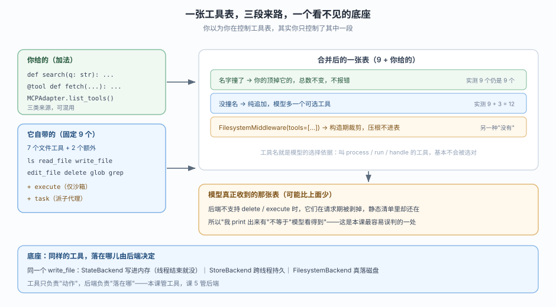
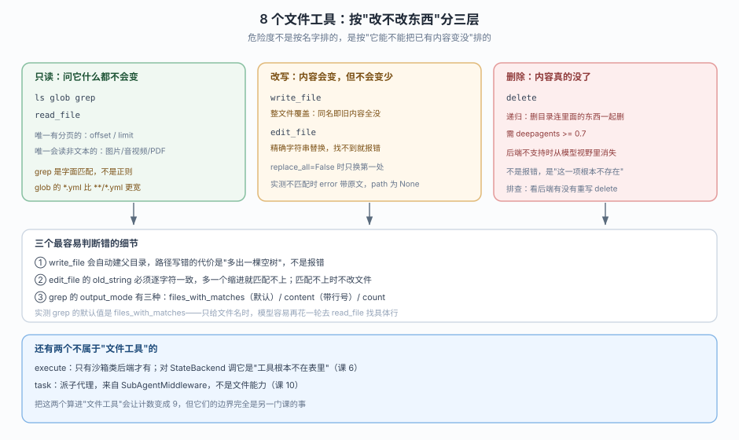
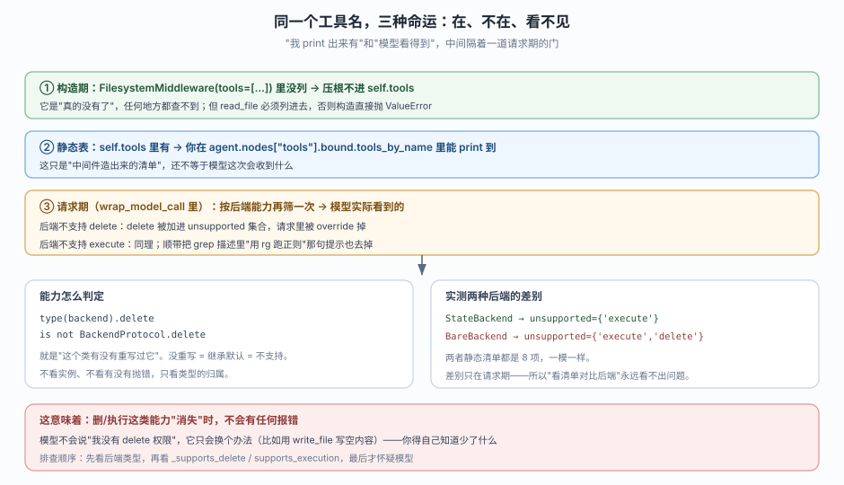
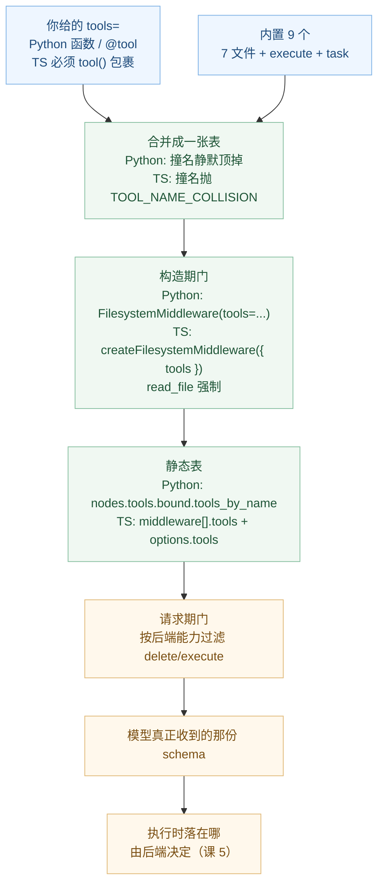

# 课 4：工具与虚拟文件系统

> 所属阶段：阶段 2《执行环境》｜ 水平：进阶 ｜ 本课知识点：tools 参数与 MCP 接入、内置文件工具清单、多模态读取与 delete 的可见性
> 故事情节：主角发现 agent 已经有了文件工具，于是想"那我自己写工具该怎么塞进去"——顺手也把内部文档站接上
> 📖 结论已按官方文档核对（核对于 2026-10 ｜ 来源：docs.langchain.com/oss/python/deepagents/tools、overview、multimodal）
> ✅ 代码结论实测于 2026-10-20 ｜ `deepagents 0.7.28` / `langchain 1.4.6` ｜ 隔离环境 `/tmp/da-probe`
> ✅ TypeScript 侧实测于 2026-10-21 ｜ `deepagents 1.15.1` / `@langchain/core 1.2.20` / Node 22.22.2 ｜ `playground-ts/`
> 🧭 只学一种语言也可以：每组代码给 `[Python]` 与 `[TypeScript]` 两个标签，挑你要的那份读，结论段落两侧通用（差异处会单独标注）
> 本课配**应用实战**（见 `../../../应用实战/04-工具与虚拟文件系统.md`）
> ⚠️ 去重约定：本课只讲 harness 侧"怎么把工具塞进去"与内置工具的差异；`@tool` 装饰器规范、工具返回值类型、错误处理回扣 [LangChain 课 4《Tools 工具》](../../../../langchain/stages/2-Agent核心/lessons/04-Tools工具.md)

## 🎯 本课目标

- 把自定义函数、LangChain 工具、MCP 服务三种来源一起塞进 `tools=`，并预判同名时的结果
- 列出 7 个纯文件工具（`ls` / `read_file` / `write_file` / `edit_file` / `delete` / `glob` / `grep`）+ 沙箱专用的 `execute` + `task`，说出各自最容易被误用的地方
- 说清 `read_file` 何时返回多模态内容块、`delete` 何时从模型视野里消失

---

## 第一幕：起源与场景引入

上一课你摊开了那摞中间件，结论里有一句让你停了半拍：**`tools=[]` 的时候，你依然拿到 9 个工具。**

既然工具不是从 `tools` 来的，那 `tools=` 到底是干什么的？你试了一下：

::: code-group

```python [Python]
from deepagents import create_deep_agent

def search_docs(query: str, limit: int = 3) -> str:
    """在内部文档里检索。"""
    return "..."

agent = create_deep_agent(model="openai:gpt-5.4", tools=[search_docs])
```

```typescript [TypeScript]
import { createDeepAgent } from "deepagents";
import { tool } from "langchain";
import { z } from "zod";

// TS 侧没有 docstring 可推断，name / description / schema 都要显式给
const searchDocs = tool(
  async ({ query, limit = 3 }: { query: string; limit?: number }) => {
    return "...";
  },
  {
    name: "search_docs",
    description: "在内部文档里检索。",
    schema: z.object({
      query: z.string(),
      limit: z.number().optional().default(3),
    }),
  },
);

const agent = await createDeepAgent({
  model: "openai:gpt-5.4",
  tools: [searchDocs],
});
```

:::

跑通了，agent 会调 `search_docs`。但紧接着三件事对不上：

- 你把工具清单打印出来，是 **10 个**——不是 1 个，也不是 9 个。你自己那个是"加上去的"，内置的没被顶掉。
- 你顺手给一个工具起名叫 `read_file`，想"覆盖一下试试"。**没报错，没警告**，工具总数还是 10 个——但行为已经悄悄换成你的了。
- 你听说内部文档站有 MCP 服务，想接进来。文档给了几行 `async with` 代码，你却在想：**为什么它必须写在 `async with` 里？工具拿到手了不就完了吗？**

> 🇹🇸 **上面这段是 Python 视角，TypeScript 侧第 2 条正好相反**：`tools: [myReadFile]` 里只要有一个工具叫 `read_file`，`createDeepAgent` **直接抛 `ConfigurationError`（code = `TOOL_NAME_COLLISION`）**，连 agent 都构造不出来。所以同一句"撞名会怎样"，两侧答案是反的：
>
> | 撞名场景 | Python（0.7.28） | TypeScript（1.15.1） |
> |---|---|---|
> | 自定义撞内置（`read_file` / `ls` / `execute` / `task` …） | 静默顶掉，总数不变 | 构造期抛 `TOOL_NAME_COLLISION` |
> | 两个自定义同名（`dup` + `dup`） | 后者胜，只剩一条 | 两条并存，不去重（模型收到两个同名工具） |
>
> 本课后续所有"撞名"段落都会分别给出两侧结论，别把一侧的结论套到另一侧。

> 🎬 **场景**：你已经有了一个"能读文件"的 agent，现在要让它"读你的东西"。而这两件事的接法完全不同：后者是往工具表里加，前者是那张表本来就有、你只是之前没细看。

> 📌 **一句话本质**：`tools=` 只做加法（和同名覆盖），从不做减法；你以为你在配工具表，其实你只配了它的一小段。
>
> ⚖️ **处境对照**：不知道这张表的来路，你会反复踩三个坑——以为 `tools=[]` 能收紧权限（不能）、以为同名会报冲突（Python 不报，TS 一定报）、以为打印出来的清单就是模型看到的（不是）。反过来，知道三段来路，这三个坑各有一句确定的排查话术：看 `tools_by_name` 的键数、看 description 是谁写的、看后端支不支持。

---

## 第二幕：认知冲突

矛盾在这里：**工具表是"别人先摆好、你再往上加"的，而加法有两种。**

你写下 `tools=[search_docs]`。这两种解释都能"跑通"，但结论完全相反：

- **解释 A：`tools=` 就是这张表。** 那你传一个，就该只有一个。可你明明打印出 10 个。
- **解释 B：`tools=` 是往一张已有的表上追加。** 那就要回答三个新问题：已有的那些是谁摆的？撞名了怎么办？我能不能把已有的拿掉？

还有一层更隐蔽的：**"表里有"和"模型看得到"不是一回事。** 官方文档里 `delete` 标着"需要 `deepagents>=0.7`"，而源码里它还会因为"后端不支持删除"而消失。你在 `agent.nodes["tools"].bound.tools_by_name` 里 `print` 得到的东西，和模型真正收到的那份 schema，可能不是同一份。

> ❓ **问题**：`tools=` 的三类来源各自怎么进表？撞名时谁赢、会不会报错？内置的那 8 个工具边界在哪？以及最要紧的——**我怎么知道模型此刻到底看得到哪些工具？**

---

## 第三幕：层层揭示

### 一眼全局图（进入细节前先看一眼）



> 看图：左上是你加的（可混用三类来源），左中是它自带的（固定 8 个 + `task`），两者合并成一张表；橙色那条是"撞名"的处理规则，蓝色那条是"构造期裁剪"；最下方橙色框是真正的坑——**模型收到的那张表可能比静态清单更短**；最底部是底座：同样是 `write_file`，落在内存还是落在磁盘由后端决定（课 5）。

### 本课地图（分几步走）

| 步 | 这一步要解决什么（人话） | 对应知识点 |
|:--:|------------------------|-----------|
| 1 | 先搞清"我加的工具怎么进去"，包括撞名和 MCP 这种外部来源 | 知识点 1：tools 参数与 MCP 接入 |
| 2 | 再把自带的 8 个工具逐个摸清边界，尤其是会毁数据的那几个 | 知识点 2：内置文件工具清单 |
| 3 | 最后解决"表里有 ≠ 模型看得到"，以及非文本文件怎么读 | 知识点 3：多模态读取与 delete 的可见性 |

---

### 知识点 1：tools 参数与 MCP 接入

> 🧭 第 1/3 步｜承接：第二幕发现"传 1 个却得到 10 个" → 本步：搞清这张表的加法规则与三类来源
> 本知识点关键点：三类来源可混用、schema 靠签名与 docstring 推断、撞名静默覆盖、MCP 用 `async with` 是因为工具绑着连接

#### 一句话定义

`tools=` 是一个**只做加法的列表**：接受普通函数、LangChain 工具、MCP 服务暴露的工具三类来源，与内置的 9 个合并成一张表。

至于撞名，两侧答案不同——**Python 是"同名顶掉内置那条，不报错"；TypeScript 是"同名直接抛 `ConfigurationError`，agent 构造不出来"**。这一段是本课第一处必须分侧记忆的地方。

#### 直觉建立（类比）

给台式机加扩展卡。主板自带集成显卡和网卡——你不需要"配置"它们，它们本来就在。你能做的是往 PCIe 插槽里插一张独显：**这是加法**。插上去之后，如果这张卡和集显抢同一个输出口，Python 侧是"系统默认走你插的那张"，TypeScript 侧是"主板直接报警，整机不启动"。

> 💡 **类比的边界**：硬件冲突至少还会报警；Python 侧的工具撞名**完全静默**——不报错、不警告、数量也不变。你会以为"覆盖没生效"，直到某天发现 `read_file` 读出来的东西格式不对，才想起自己三个月前写过同名工具。所以本知识点要记两句话：Python 侧"静默覆盖"，TS 侧"装配期硬失败"。

#### 核心原理

**三类来源，一个列表**：

| 来源 | Python 形态 | TypeScript 形态 | 实测是否进表 |
|------|------|------|-------------|
| 普通函数 | `def search_docs(query: str, limit: int = 3) -> str:` + docstring | **裸函数 TS 不接受**，必须 `tool(fn, { name, description, schema })` | ✅ 进 |
| LangChain 工具 | `@tool` 装饰过的函数，或 `StructuredTool.from_function(...)` | `tool(fn, {...})` 的返回值（即 `StructuredTool`） | ✅ 进 |
| MCP 工具 | `await MCPAdapter(config).list_tools()` 返回的工具对象列表 | `await client.getTools()`（`@langchain/mcp-adapters`） | ✅ 进 |

> ⚠️ TS 侧那张表的第一行是最容易翻车的地方：Python 能直接把裸函数（靠 `def` 签名 + docstring 推断 schema）塞进 `tools=`，**TS 侧没有任何运行时可推断的信息**（类型在编译后被擦掉、函数也带不了 docstring），所以必须用 `tool()` 显式给出 `name` / `description` / `schema`。文档那句 "infers the tool schema from the function signature and docstring" 是 Python 侧的说法。

实测把三类一起塞进去：

::: code-group

```python [Python]
from deepagents import create_deep_agent
from langchain_core.tools import tool, StructuredTool


def plain_fn(city: str, days: int = 1) -> str:
    """查天气。"""
    return f"{city}:{days}"


@tool
def decorated_tool(x: int) -> int:
    """官方 @tool 写法。"""
    return x * 2


def dict_tool_impl(q: str) -> str:
    return q.upper()


dict_tool = StructuredTool.from_function(
    func=dict_tool_impl, name="dict_tool", description="以字典形式声明的工具"
)

base = create_deep_agent(model="openai:gpt-5.4", tools=[])
mixed = create_deep_agent(model="openai:gpt-5.4", tools=[plain_fn, decorated_tool, dict_tool])

for tag, a in (("base", base), ("mixed", mixed)):
    print(tag, sorted(a.nodes["tools"].bound.tools_by_name))
```

```typescript [TypeScript]
import { createDeepAgent } from "deepagents";
import { tool } from "langchain";
import { z } from "zod";

// ① 普通函数：必须用 tool() 包一层，把 name/description/schema 显式写出
const plainFn = tool(
  async ({ city, days = 1 }: { city: string; days?: number }) => `${city}:${days}`,
  {
    name: "plain_fn",
    description: "查天气。",
    schema: z.object({ city: z.string(), days: z.number().optional().default(1) }),
  },
);

// ② 官方 tool() 写法（等价于 Python 的 @tool）
const decoratedTool = tool(async ({ x }: { x: number }) => x * 2, {
  name: "decorated_tool",
  description: "官方 tool() 写法。",
  schema: z.object({ x: z.number() }),
});

// ③ 以配置对象声明的工具（等价于 StructuredTool.from_function）
const objectTool = tool(async ({ q }: { q: string }) => q.toUpperCase(), {
  name: "dict_tool",
  description: "以对象形式声明的工具",
  schema: z.object({ q: z.string() }),
});

const base = await createDeepAgent({ model: "openai:gpt-5.4", tools: [] });
const mixed = await createDeepAgent({
  model: "openai:gpt-5.4",
  tools: [plainFn, decoratedTool, objectTool],
});

// TS 侧没有 nodes["tools"].bound，内置工具要从各中间件的 tools 字段汇总
const builtin = (a: typeof base) =>
  [...new Set(
    (a.options.middleware ?? []).flatMap((mw) => {
      const t = (mw as { tools?: unknown }).tools;
      const arr = typeof t === "function" ? (t as () => unknown[])() : ((t as unknown[]) ?? []);
      return arr.map((x) => (x as { name?: string }).name ?? "");
    }),
  )].filter(Boolean).sort();

for (const [tag, a] of [["base", base], ["mixed", mixed]] as const) {
  const inner = builtin(a);
  const mine = (a.options.tools ?? []).map((t) => (t as { name?: string }).name);
  console.log(tag, "内置:", inner);
  console.log(tag, "合计:", inner.length + mine.length, "| 用户工具:", mine);
}
```

:::

实测输出：

::: code-group

```text [Python]
base  ['delete', 'edit_file', 'execute', 'glob', 'grep', 'ls', 'read_file', 'task', 'write_file']
mixed ['decorated_tool', 'delete', 'dict_tool', 'edit_file', 'execute', 'glob',
       'grep', 'ls', 'plain_fn', 'read_file', 'task', 'write_file']
```

```text [TypeScript]
base  内置: 9 | 用户: 0
   delete, edit_file, execute, glob, grep, ls, read_file, task, write_file
mixed 内置: 9 | 用户: decorated_tool, dict_tool, plain_fn
合计: 9 → 12
内置一个没被顶掉: true
```

:::

两侧都是 9 → 12，**纯加法，一个内置的都没被顶掉**（因为三个名字都不撞）。

**schema 从哪来**：官方原文是 *"Deep Agents infers the tool schema from the function signature and docstring, so you don't need to define a separate schema in most cases."* 也就是说 `query: str` 变成 `{"query": {"type": "string"}}`，默认值变成非必填，`Literal[...]` 变成 enum，docstring 变成 description。**这也解释了为什么"工具名和描述"比实现更重要**——模型只能看见名字、描述和参数，看不见你的函数体。

> 🇹🇸 TS 侧的对应事实：这句"自动推断"只适用于 Python。TS 侧 schema 来自你传给 `tool()` 的 `z.object({...})`，`description` 来自 `options.description`（不是注释、也不是 `.describe()` 之外的任何东西——`.describe()` 补的是**单个参数**的说明）。漏写 `description` 不会报错，但模型会收到一个空描述的工具，选它的概率断崖式下降。

**撞名规则：两侧相反**。这是本课第一个需要分别记忆的行为。

先看 Python 侧（静默覆盖），实测三个位置：

::: code-group

```python [Python]
from langchain_core.tools import tool

@tool("read_file")
def my_read(file_path: str) -> str:
    """我的 read_file。"""
    return "MINE"

a = create_deep_agent(model="openai:gpt-5.4", tools=[my_read])
t = a.nodes["tools"].bound.tools_by_name["read_file"]
print("参数:", list((t.args or {}).keys()))
print("描述:", (t.description or "").splitlines()[0])
print("工具总数:", len(a.nodes["tools"].bound.tools_by_name))
```

```typescript [TypeScript]
import { createDeepAgent } from "deepagents";
import { tool } from "langchain";
import { z } from "zod";

const myRead = tool(
  async ({ file_path }: { file_path: string }) => "MINE",
  {
    name: "read_file",              // 与内置同名
    description: "我的 read_file。",
    schema: z.object({ file_path: z.string() }),
  },
);

// TS 侧不会走到这里：createDeepAgent 在装配期就抛错了
await createDeepAgent({ model: "openai:gpt-5.4", tools: [myRead] });
```

:::

实测输出：

::: code-group

```text [Python]
参数: ['file_path']
描述: 我的 read_file。
工具总数: 9
```

```text [TypeScript]
抛错: ConfigurationError | code: TOOL_NAME_COLLISION
消息: Tool name(s) [read_file] conflict with built-in tools. Rename your custom tools to avoid this.
```

:::

Python 侧三件事同时发生：参数表变成了我的（原版有 `file_path` / `offset` / `limit` 三个参数，我的只有一个）、描述变成了我的、**总数还是 9**。这就是"顶掉"而不是"追加"的铁证。

TS 侧一行都跑不到——`createDeepAgent` 里有一句 `tools.map(t => t.name).filter(n => BUILTIN_TOOL_NAMES.has(n))`，命中即抛。实测覆盖到的内置名包括 `read_file`、`ls`、`execute`、`task`；而 `write_todos` 不在这张表里（它由 `todoListMiddleware` 动态提供，不是 harness 内置），所以可以正常加。

> 🇹🇸 这条差异的实践含义：Python 侧可以"故意撞名来覆盖默认实现"（官方也把它当推荐用法），**TS 侧这条路被彻底关掉**。TS 想改内置工具行为，只有两条路：`createFilesystemMiddleware({ customToolDescriptions })` 改描述，或自己写一个不同名的工具再在提示词里要求优先用它。

同一个名字出现两次（都是自定义）呢？Python 侧是**后者胜**：

::: code-group

```python [Python]
@tool("dup")
def dup_a(x: str) -> str:
    """A 版。"""
    return "A"

@tool("dup")
def dup_b(x: str) -> str:
    """B 版。"""
    return "B"

create_deep_agent(model="openai:gpt-5.4", tools=[dup_a, dup_b]).nodes["tools"].bound.tools_by_name["dup"].description
create_deep_agent(model="openai:gpt-5.4", tools=[dup_b, dup_a]).nodes["tools"].bound.tools_by_name["dup"].description
```

```typescript [TypeScript]
import { createDeepAgent } from "deepagents";
import { tool } from "langchain";
import { z } from "zod";

const mkDup = (desc: string) =>
  tool(async ({ x }: { x: string }) => desc, {
    name: "dup",
    description: desc,
    schema: z.object({ x: z.string() }),
  });

for (const [tag, arr] of [
  ["[A,B]", [mkDup("A 版"), mkDup("B 版")]],
  ["[B,A]", [mkDup("B 版"), mkDup("A 版")]],
] as const) {
  const ag = await createDeepAgent({ model: "openai:gpt-5.4", tools: [...arr] });
  // TS 不做去重：两条都留在 options.tools 里，顺序与传入一致
  console.log(tag, "条数:", ag.options.tools?.length, "描述:", ag.options.tools?.map((t) => t.description));
}
```

:::

实测输出：

::: code-group

```text [Python]
'B 版。'      # 传 [dup_a, dup_b] → B 赢
'A 版。'      # 反序传 [dup_b, dup_a] → A 赢
```

```text [TypeScript]
两个自定义同名 [A,B] -> ok | 条数: 2 | 描述: A 版 / B 版
两个自定义同名 [B,A] -> ok | 条数: 2 | 描述: B 版 / A 版
```

:::

Python 规则是"列表里靠后的那个覆盖靠前的"，**依然不报错**。想靠"传两个同名工具"来报错提醒自己，做不到。

TS 侧更麻烦：它**不去重**，两条同名工具会一起进模型请求。模型看到两个 `dup`，选哪个取决于服务端如何解析重名 function，你可能拿到 A 也可能拿到 B——**这是一个比 Python 更隐蔽的坑**，因为 Python 至少结果是确定的（后者胜），TS 侧结果不由你控制。所以 TS 侧的自检应该写死为"工具名集合大小 == 工具数组长度"。

**MCP 接入**：两侧机制完全不同——Python 是 `async with` 上下文管理器，TS 是 `MultiServerMCPClient` 对象。

::: code-group

```python [Python]
import asyncio
from deepagents import create_deep_agent
from langchain.mcp import MCPAdapter


async def main():
    config = {"mcpServers": {"my_server": {"url": "http://localhost:8000/mcp"}}}
    async with MCPAdapter(config) as adapter:
        tools = await adapter.list_tools()
        agent = create_deep_agent(model="openai:gpt-5.4", tools=tools)
        await agent.ainvoke(
            {"messages": [{"role": "user", "content": "用 MCP 服务帮我查一下"}]},
            config={"configurable": {"thread_id": "1"}},
        )
```

```typescript [TypeScript]
import { createDeepAgent } from "deepagents";

// 需先 npm install @langchain/mcp-adapters
const { MultiServerMCPClient } = await import("@langchain/mcp-adapters");

const client = new MultiServerMCPClient({
  my_server: { transport: "http", url: "http://localhost:8000/mcp" },
});

const tools = await client.getTools();
const agent = await createDeepAgent({ model: "openai:gpt-5.4", tools });

await agent.invoke({
  messages: [{ role: "user", content: "用 MCP 服务帮我查一下" }],
});
```

:::

Python 侧用一个本地 `FastMCP` 服务（两个工具：`search_docs` / `fetch_doc`）实测这条链路，输出：

```
MCP 工具数: 2
   - search_docs | args: ['query', 'limit'] | desc: 在内部 API 文档中检索。
   - fetch_doc   | args: ['path']            | desc: 按路径读取一篇文档。
接入后工具总数: 11
['delete', 'edit_file', 'execute', 'fetch_doc', 'glob', 'grep',
 'ls', 'read_file', 'search_docs', 'task', 'write_file']
MCP 工具与内置工具是否混合: True
```

> ⚠️ 三点关于 Python 侧 `async with` 的实情，文档没写但你一定会撞上：
> ① `langchain.mcp` 目前是 **beta**，import 时会给 `LangChainBetaWarning: langchain.mcp is in beta...`；
> ② `MCPAdapter` 只有一个位置参数 `target`（实测签名 `(self, target: MCPAdapterTarget)`），官方示例里那种 `{"mcpServers": {...}}` 字典只是它的多种合法形态之一，直接传 `FastMCP` 实例、`ClientTransport`、URL 也都可以；
> ③ 工具绑着连接生命周期——`async with` 退出后连接关了，所以**整个 `agent.ainvoke` 必须写在 `with` 块里面**。这不是风格问题，是把工具挂在活连接上的必然结果。
>
> 🇹🇸 **TS 侧没有 `async with`，但"生命周期"这件事一样存在**：`getTools()` 拿到的工具绑在 `client` 上，所以 `client` 不能提前结束（用 `await client.close()` 收尾）。另外 `MultiServerMCPClient` 的配置是"服务名直接作 key"的平铺结构（`{ my_server: {...} }`），**不是** Python 那种 `{ mcpServers: { ... } }` 再套一层——照抄 Python 配置会得到一个名为 `mcpServers` 的服务定义，然后连不上。

#### 示例演示

一次把"三类混用 + 撞名 + 总数"验完——注意两侧的 `b` 段会走到不同结局：

::: code-group

```python [Python]
from deepagents import create_deep_agent
from langchain_core.tools import tool


def plain(city: str) -> str:
    """查天气。"""
    return city


@tool("read_file")
def hijack(file_path: str) -> str:
    """我顶掉了内置的 read_file。"""
    return "Hijacked"


a = create_deep_agent(model="openai:gpt-5.4", tools=[plain])
b = create_deep_agent(model="openai:gpt-5.4", tools=[plain, hijack])

for tag, agent in (("a", a), ("b", b)):
    names = sorted(agent.nodes["tools"].bound.tools_by_name)
    print(tag, "总数:", len(names), "| 有 plain:", "plain" in names)
print("b 的 read_file 描述:", b.nodes["tools"].bound.tools_by_name["read_file"].description)
```

```typescript [TypeScript]
import { createDeepAgent } from "deepagents";
import { tool } from "langchain";
import { z } from "zod";

const plain = tool(async ({ city }: { city: string }) => city, {
  name: "plain",
  description: "查天气。",
  schema: z.object({ city: z.string() }),
});

const hijack = tool(async ({ file_path }: { file_path: string }) => "Hijacked", {
  name: "read_file",
  description: "我顶掉了内置的 read_file。",
  schema: z.object({ file_path: z.string() }),
});

const a = await createDeepAgent({ model: "openai:gpt-5.4", tools: [plain] });
console.log("a 用户工具:", a.options.tools?.map((t) => t.name));

// b 段在 TS 侧构造不出来：装配期就抛 TOOL_NAME_COLLISION
try {
  await createDeepAgent({ model: "openai:gpt-5.4", tools: [plain, hijack] });
} catch (e) {
  const err = e as { code?: string; message: string };
  console.log("b 抛错:", err.code, "|", err.message);
}
```

:::

实测输出：

::: code-group

```text [Python]
a 总数: 10 | 有 plain: True
b 总数: 10 | 有 plain: True
b 的 read_file 描述: 我顶掉了内置的 read_file。
```

```text [TypeScript]
a 用户工具: [ 'plain' ]
b 抛错: TOOL_NAME_COLLISION | Tool name(s) [read_file] conflict with built-in tools. Rename your custom tools to avoid this.
```

:::

Python 侧 **10 → 10**：加了 `plain`（+1），又被 `hijack` 顶掉一条内置（−1 +1）。数字不变，但内容变了——只看数量会得出"没生效"的错误结论。TS 侧 `b` 根本构造不出来，所以连"数量对账"这一步都不存在。

> 🔍 顺带得到两条排查技巧：
> ① **判断"我的工具到底进没进"，永远看键名，不看数量。**（Python 侧尤其重要）
> ② **TS 侧要额外查重**：`new Set(tools.map(t => t.name)).size === tools.length`，否则两个同名自定义工具会一起进请求，模型选哪个不由你决定。

#### 常见误区

1. **误区：`tools=[]` 就是"不给工具"。**
   错。它是"不加自定义工具"，那 9 个内置的照常在。本课上一节刚实测过。

2. **误区：自定义工具和内置重名会报错（或一定不会报错）。**
   两侧相反：Python 不会报错，静默顶掉、总数不变；TS 一定报错，`TOOL_NAME_COLLISION`。Python 的"静默"是设计选择（方便覆盖默认实现），代价是没有任何提醒。

3. **误区：把 `tools=` 当作收窄权限的手段。**
   它只能加、只能覆盖同名，**删不掉内置工具**。要删得用 `FilesystemMiddleware(tools=[...])`（构造期裁剪，见知识点 2）或 profile 的 `excluded_tools`（请求期过滤，见课 3 的坑 3）。

4. **误区：MCP 工具拿到手就能随便用。**
   生命周期绑在连接上。Python 侧 `async with` 一退出，工具就成了悬空引用；TS 侧 `client` 提前关闭同理。

5. **误区（TS 专属）：把裸函数塞进 `tools` 也行。**
   Python 能靠签名 + docstring 推断 schema，TS **不能**：没有运行时类型、没有 docstring。必须 `tool(fn, { name, description, schema })`，否则你拿到的工具名/描述/参数全都不可控。

#### 一句话记住

**`tools=` 只做加法；撞名时 Python 静默顶掉、TS 直接抛错；MCP 的工具活在连接里。**

#### 🗣️ 行话对照

- **Tool schema inference（工具 schema 推断）**：从函数签名和 docstring 自动生成给模型看的参数 JSON Schema，不用手写——就是本课说的"schema 从哪来"；在哪遇到：`create_deep_agent` 的 `tools=` 文档、`@tool` 的 `args_schema` 可选参数。**TS 侧无此能力**，schema 全部来自 `tool()` 的 `z.object({...})`
- **Tool shadowing（工具遮蔽）**：自定义工具与内置同名时把内置那条顶掉——就是本课说的"静默覆盖"；在哪遇到：没有任何报错的地方，只在 `tools_by_name` 里能看出来。**TS 侧不存在这个概念**，同名会变成 `TOOL_NAME_COLLISION`
- **MCPAdapter**：Python 侧把 MCP 服务转成 LangChain 工具的适配器，只有 `list_tools()` 和 `client` 两个公开成员——就是本课说的"MCP 入口"；在哪遇到：`langchain[mcp]` extra、`langchain.mcp.adapter`
- **MCP server config（MCP 服务配置）**：Python 侧是 `{"mcpServers": {"名字": {...}}}` 这种 Claude Desktop 风格的字典；**TS 侧是 `{ 名字: { transport, url } }` 平铺**，少一层嵌套——就是本课两段代码的 `config` / `client` 参数；在哪遇到：官方 MCP 指南的 stdio / OAuth / 会话配置小节

#### 官方文档

- Tools（Python）：https://docs.langchain.com/oss/python/deepagents/tools
- Tools（TypeScript）：https://docs.langchain.com/oss/javascript/deepagents/tools
- MCP · Python（完整配置：stdio / OAuth / 工具过滤 / 有状态会话）：https://docs.langchain.com/oss/python/langchain/mcp
- MCP · TypeScript：https://docs.langchain.com/oss/javascript/langchain/mcp

---

### 知识点 2：内置文件工具清单

> 🧭 第 2/3 步｜承接：上一步只关心"我加的工具进没进表"，但表里原本那 8 个你还没看 → 本步：逐个摸边界，重点在会毁数据的那两个
> 本知识点关键点：按"改不改东西"分三层；`write_file` 覆盖、`edit_file` 精确替换的失败形态；`grep` 是字面匹配不是正则；`glob` 的点文件与 `*.yml` 宽度陷阱

#### 一句话定义

harness 自带 **8 个文件工具**（`ls` / `read_file` / `write_file` / `edit_file` / `delete` / `glob` / `grep`，加上仅有沙箱才有的 `execute`）+ `task`；它们的边界差异集中在**"会不会让已有内容变没"**这一条轴上。

> 📐 关于"7 个还是 8 个"的口径：官方表格列 9 项（含 `task`），其中文件类能力是 8 项——7 个纯文件工具 + `execute`（沙箱专用）。本教程统一说"8 个文件工具（含 `execute`）+ `task` = 9 个工具"。`execute` 之所以算进文件工具，是因为它挂在同一个 `FilesystemMiddleware` 上、且直接操作文件系统；但它只在沙箱后端存在，所以前 7 个才是"人人都有"的。

#### 直觉建立（类比）

厨房里的工具按"破坏性"排：筷子、勺子、夹子（只读，怎么用都不会毁菜）→ 削皮刀、搅拌机（会改变形态但不会让东西变少）→ 垃圾桶（内容真的没了，而且**一次可以倒掉整层抽屉**）。

没人会把垃圾桶和夹子归成一类"餐具"。但工具表里它们长得一模一样：都是一个名字加一段描述。**这就是为什么必须先按破坏性分类，而不是按字母序去背。**

> 💡 **类比的边界**：厨房里你能看见垃圾桶长什么样；工具表里 `delete` 和 `ls` 的形态完全对称，模型（和你）只能靠名字判断。所以危险工具的防线不在"认得它"，而在两道外部约束：**权限规则**（课 5）和**人工审批**（课 11）。

#### 核心原理



> 看图：左绿是只读（问什么都不会变），中黄是改写（内容变，但不会变少），右红是删除（真的没了，且递归）；下面两条带子是本课最花时间的三个细节和两个"不算文件工具"的例外。

**逐个边界**（Python 侧实测于 `deepagents 0.7.28`，TypeScript 侧实测于 `1.15.1`）：

| 工具 | 参数（Python） | 参数（TypeScript） | 关键边界（实测） |
|------|------|------|-----------------|
| `ls` | `path` | `path` | Python：目录不存在返回 `Path '/nope': path_not_found`；TS：返回 `{files: []}`（**不报错**） |
| `read_file` | `file_path` `offset` `limit` | `file_path` `offset` `limit` | 分页字段两侧都全，但**键名不同**：Python `total_lines` / `next_offset`，TS `totalLines` / `nextOffset` / `startLine` / `endLine` |
| `write_file` | `file_path` `content` | `file_path` `content` | **整文件覆盖**，同名旧内容全没；**自动建父目录**（两侧一致） |
| `edit_file` | `file_path` `old_string` `new_string` | `file_path` `old_string` `new_string` | **精确字符串替换**；不匹配返回 `Error: String not found in file: '...'`，且不改文件（两侧一致） |
| `delete` | `file_path` | `file_path` | **递归**：删目录连内容一起删；后端不支持时消失（判定方式两侧不同，见知识点 3） |
| `glob` | `pattern` `path` | `pattern` `path` | TS 返回 `{files:[...]}`，Python 返回 `matches` 列表；无匹配都是空列表（不是错误） |
| `grep` | `pattern` `path` `glob` `output_mode` `max_count` | `pattern` `path` `glob` `output_mode` `max_count` | **字面匹配，非正则**；默认 `output_mode=files_with_matches`（两侧一致） |
| `execute` | `command` `timeout` | `command` | 仅沙箱后端；TS 侧无 `timeout` 参数，详见课 6 |

> 🇹🇸 一句话概括这张表：**参数名两侧完全一致（连下划线划线的 `max_count` / `output_mode` / `file_path` 都一样，没有驼峰化），差异只在"返回结果的字段名"和"边界行为"上**。这条挺反直觉——TS 生态通常会把 `output_mode` 改成 `outputMode`，但内置工具的参数没有驼峰化。

**`write_file` 的覆盖是彻底的**：

::: code-group

```python [Python]
print(backend.write("/a/b/f.txt", "OLD"))
print(backend.write("/a/b/f.txt", "NEW"))
print(backend.read("/a/b/f.txt").file_data["content"])
```

```typescript [TypeScript]
import { FilesystemBackend } from "deepagents";

const backend = new FilesystemBackend({ rootDir, virtualMode: true });

console.log(await backend.write("/a/b/f.txt", "OLD"));
console.log(await backend.write("/a/b/f.txt", "NEW"));
console.log((await backend.read("/a/b/f.txt")).content);
```

:::

实测输出：

::: code-group

```text [Python]
WriteResult(error=None, path='/a/b/f.txt')
WriteResult(error=None, path='/a/b/f.txt')
NEW
```

```text [TypeScript]
{"path":"/a/b/f.txt","filesUpdate":null}
{"path":"/a/b/f.txt","filesUpdate":null}
读回: NEW | a/b 目录项: 1
```

:::

两侧都不给"文件已存在，是否覆盖"的确认——Python 返回 `error=None`，TS 干脆没有 `error` 字段（成功时不出现该键，失败才出现）。而且父目录 `a/b` 是自动建出来的。这意味着模型把路径写成 `/src/util.py` 还是 `/src/utils.py`，都不会报错，只会多出一个文件或覆盖掉另一个。**这是"悄悄毁文件"的第一号来源，靠工具本身防不住。**

**`edit_file` 是"要么全对，要么不动"**：

::: code-group

```python [Python]
backend.edit("/a/b/f.txt", "NEW", "NEWER")          # → error=None, occurrences=1
backend.edit("/a/b/f.txt", "不存在的内容", "x")       # → error="Error: String not found in file: '不存在的内容'"
backend.write("/m.txt", "aa aa aa")
backend.edit("/m.txt", "aa", "bb", replace_all=True)  # → occurrences=3
```

```typescript [TypeScript]
await backend.edit("/a/b/f.txt", "NEW", "NEWER");      // → {occurrences: 1}
await backend.edit("/a/b/f.txt", "不存在的内容", "x");  // → {error: "..."}
await backend.write("/m.txt", "aa aa aa");
await backend.edit("/m.txt", "aa", "bb", true);        // 第四参数是布尔 replaceAll
```

:::

实测输出：

::: code-group

```text [Python]
edit: None | occurrences: 1
读回: NEWER
error: Error: String not found in file: '不存在的内容'
replace_all: None | occurrences: 3 | 内容: bb bb bb
```

```text [TypeScript]
edit 命中: {"path":"/a/b/f.txt","filesUpdate":null,"occurrences":1}
edit 未命中: {"error":"Error: String not found in file: '不存在的内容'"}
replaceAll: {"path":"/m.txt","filesUpdate":null,"occurrences":3}
```

:::

| 记住这三点 | Python | TypeScript |
|---|---|---|
| 不匹配时文件不动 | `path=None`、`occurrences=None` | 结果里只有 `{error}`，无 `path` / `occurrences` |
| 默认只换第一处 | `replace_all=False` | 第四参数 `replaceAll` 省略即 `false` |
| `occurrences` 可核对意图 | ✅ | ✅ |

> ⚠️ TS 侧有个签名陷阱：`edit(filePath, oldString, newString, replaceAll?: boolean)` 的第四参数是**裸布尔**，不是 Python 那种关键字 `replace_all=True`。写成 `{ replaceAll: true }` 会静默失效（对象被当成 truthy，虽然这次结果对，但类型检查会报错 `not assignable to parameter of type 'boolean'`）。

**`grep` 是字面匹配，不是正则**——这是本知识点最值得单独记一条的地方。工具描述原文（Python 源码 `_GREP_TOOL_DESCRIPTION_TEMPLATE`，TS 侧 `grep` 的 `description` 首句一字不差）：

```
Search for a LITERAL text pattern across files (NOT regex).

The pattern is matched verbatim: regex metacharacters are ordinary characters, not
operators. To match any of several strings, run a separate grep for each;
`grep(pattern="foo|bar")` searches for the literal text "foo|bar", and `.*` or `\.`
match those characters literally.
```

实测两侧 `grep("a.*a")` 都不命中，`grep("alpha")` 都能命中。**"搜不到"的最常见原因不是文件里没有，而是你写了个正则。**

Python 侧源码里有个叫 `regex_literal_hint` 的兜底：**只在无命中时**检查 pattern 有没有正则信号，有就追加一行提示：

```
Note: grep matches literal text, not regex, so characters like `|`, `.*`, and `\.`
are searched verbatim. Search for the literal text you need instead; for `|`
alternation, run a separate search per alternative.
```

信号判定用的正则只认四种形态：`|`（或）、`.*`、`.+`、以及转义过的元字符。所以 `grep("a.b")`、`grep("C++")` 不会触发提示——它们看起来不像正则，实际也不是（`.` 在字面匹配里就是点）。

> 🇹🇸 **TS 侧没有这个提示**。实测 `grep("a.*a")` 只返回一句 `No matches found for pattern 'a.*a'`，不会告诉你"这是字面匹配、不是正则"——源码里搜不到 `regex_literal_hint` 对应的实现。所以 TS 侧踩这个坑时，模型和你都得不到任何线索，只能靠自己记住这条。

**真正需要正则时，官方给的路是用 `execute` 跑 `rg '<regex>'`。** 但这里有个容易混淆的分层，Python 侧实测与源码对照后可以确定：

- **无命中提示（`regex_literal_hint`）与 `execute` 无关**，任何后端上都会在"无命中且 pattern 像正则"时追加；
- **工具描述里那句"用 `execute` 跑 `rg`"** 才是跟着能力走的：`GREP_TOOL_DESCRIPTION`（含该句）只在 `execute` 可用时用，否则换成 `_GREP_TOOL_DESCRIPTION_WITHOUT_EXECUTE`（不含该句）。

所以无沙箱环境下，模型会看到"grep 不是正则"的提醒，但**看不到"那该用什么"的出路**——这正是"只读环境里 grep 搜不到正则就真的没招"的原因。

**`glob` 的宽度陷阱：两侧语义相反**——这是本课第二处必须分侧记忆的行为。同样是这几个文件（`.github/workflows/ci.yml`、`.env`、`src/a.yml`、`top.yml`）：

::: code-group

```text [Python（FilesystemBackend virtual_mode=True）]
*.yml             -> ['/.github/workflows/ci.yml', '/src/a.yml']
**/*.yml          -> ['/src/a.yml']
.env              -> ['/.env']
.github/**/*.yml  -> ['/.github/workflows/ci.yml']
```

```text [TypeScript（FilesystemBackend virtualMode: true）]
*.yml             -> ["/top.yml"]
**/*.yml          -> ["/.github/workflows/ci.yml","/src/a.yml","/top.yml"]
.env              -> ["/.env"]
.github/**/*.yml  -> ["/.github/workflows/ci.yml"]
```

:::

两侧完全反着来：

| 问题 | Python | TypeScript |
|---|---|---|
| 谁更宽？ | `*.yml` 更宽（匹配任意深度文件名，含 `.github/`） | `**/*.yml` 更宽（递归到底，含点目录） |
| `*.yml` 能匹配 `src/a.yml` 吗 | ✅ | ❌（只匹配根目录一层） |
| `**/*.yml` 能匹配 `.github/...` 吗 | ❌（`**` 不下降进点目录） | ✅ |
| 能否匹配点开头文件 | 需要点开头的 pattern（`.env`） | 同左（`**/*` 能扫到 `/.env`，`*` 也能扫到） |

Python 侧源码注释写得很直白："the bare form `*.yml` is *broader* than `**/*.yml` and is usually what you want."；而 TS 侧用的是标准的 glob 语义（`*` 不跨 `/`，`**` 跨任意层）。**同一句"用 glob 找所有 yml"，两侧要写不同的 pattern，照抄一定漏文件。**

**`grep` 的三种 `output_mode`**（Python 侧实测，同一个 `alpha` 在 `/src/a.py` 第 1、4 行）：

```
files_with_matches  ->  /src/a.py
content             ->  /src/a.py:
                          1: alpha
                          4: alpha
count               ->  /src/a.py: 2
```

默认是 `files_with_matches`——只给文件名。模型要具体行号还得再花一轮 `read_file`，这就是"默认值让你多花一次调用"的典型。让它直接带行号，就在提示词里明确要求 `output_mode="content"`。

TS 侧参数名与默认值完全一致（`output_mode` 未驼峰化），`content` 模式的返回格式也一致：

```
grep(pattern:"alpha", output_mode:"content") -> "/a.py:\n  1: alpha\n  4: alpha"
```

#### 示例演示

一次跑完"七个纯文件工具的典型返回与边界"：

::: code-group

```python [Python]
import os, tempfile
from deepagents.backends import FilesystemBackend

root = tempfile.mkdtemp()
backend = FilesystemBackend(root_dir=root, virtual_mode=True)

print(backend.write("/a/b/f.txt", "OLD"))            # 自动建 a/b
print(backend.write("/a/b/f.txt", "NEW"))            # 覆盖
print("读回:", backend.read("/a/b/f.txt").file_data["content"])

backend.write("/p.txt", "alpha\nbeta\ngamma\ndelta\n")
r = backend.read("/p.txt", offset=1, limit=2)
print("分页:", repr(r.file_data["content"]), "| total_lines:", r.total_lines, "| next_offset:", r.next_offset)

os.makedirs(f"{root}/dir/sub", exist_ok=True)
open(f"{root}/dir/sub/x.txt", "w").write("x")
print("删除前:", os.path.exists(f"{root}/dir/sub/x.txt"))
print(backend.delete("/dir"))
print("删除后:", os.path.exists(f"{root}/dir"))
print("无匹配 glob:", backend.glob("*.nothing").matches)
```

```typescript [TypeScript]
import { mkdirSync, mkdtempSync, writeFileSync } from "node:fs";
import { tmpdir } from "node:os";
import { join } from "node:path";
import { FilesystemBackend } from "deepagents";

const root = mkdtempSync(join(tmpdir(), "da-l04-"));
const backend = new FilesystemBackend({ rootDir: root, virtualMode: true });

console.log(await backend.write("/a/b/f.txt", "OLD"));   // 自动建 a/b
console.log(await backend.write("/a/b/f.txt", "NEW"));   // 覆盖
console.log("读回:", (await backend.read("/a/b/f.txt")).content);

await backend.write("/p.txt", "alpha\nbeta\ngamma\ndelta");
const r = await backend.read("/p.txt", 1, 2);            // 位置参数，不是对象
console.log("分页:", JSON.stringify(r.content), "| totalLines:", r.totalLines, "| nextOffset:", r.nextOffset);

mkdirSync(join(root, "dir/sub"), { recursive: true });
writeFileSync(join(root, "dir/sub/x.txt"), "x");
console.log("删除前:", existsSync(join(root, "dir/sub/x.txt")));
console.log(await backend.delete("/dir"));
console.log("删除后:", existsSync(join(root, "dir")));
console.log("无匹配 glob:", (await backend.glob("*.nothing")).files);
```

:::

实测输出：

::: code-group

```text [Python]
WriteResult(error=None, path='/a/b/f.txt')
WriteResult(error=None, path='/a/b/f.txt')
读回: NEW
分页: 'beta\ngamma\n' | total_lines: 4 | next_offset: 3
删除前: True
DeleteResult(error=None, path='/dir')
删除后: False
无匹配 glob: []
```

```text [TypeScript]
{"path":"/a/b/f.txt","filesUpdate":null}
{"path":"/a/b/f.txt","filesUpdate":null}
读回: NEW | a/b 目录项: 1
{"path":"/a/b/f.txt","filesUpdate":null,"occurrences":1}
{"error":"Error: String not found in file: '不存在的内容'"}
{"path":"/m.txt","filesUpdate":null,"occurrences":3}
{"matches":[]}
{"matches":[{"path":"/p.txt","line":1,"text":"alpha"}]}
{"files":[]}
{"files":[]}
```

:::

两侧结论一致：`write` 不确认覆盖、`edit` 不匹配时一个字节都不动、`grep` 不认正则、`glob`/`ls` 空结果是 `[]` 而不是错误。差异只在返回结构的字段名（`total_lines` vs `totalLines`、`matches` vs `files`）。

读法：`offset=1` 是**跳过前 1 行的 0 基偏移**（不是"从第 1 行开始"），`limit=2` 取 2 行，所以拿到第 2、3 行 `beta` / `gamma`；`next_offset=3` 是下一段该用的偏移（对应第 4 行 `delta`），`total_lines=4` 让你知道还剩多少。**这三个字段是分页的三件套**，缺一个模型就得靠猜。

TS 侧的分页实测（同一个 `/p.txt`，四个窗口）：

| 调用 | `content` | `totalLines` | `startLine` | `endLine` | `nextOffset` |
|---|---|---|---|---|---|
| `read(p, 0, 2)` | `"alpha\nbeta"` | 4 | 1 | 2 | 2 |
| `read(p, 1, 2)` | `"beta\ngamma"` | 4 | 2 | 3 | 3 |
| `read(p, 2, 2)` | `"gamma\ndelta"` | 4 | 3 | 4 | 无（到 EOF） |
| `read(p, 3, 2)` | `"delta"` | 4 | 4 | 4 | 无（到 EOF） |

`offset` 语义两侧一致（都是 0 基"跳过多少行"），但返回字段更全：TS 多给了 `startLine` / `endLine` 这对 1 基的行号区间，且**到 EOF 时直接省略 `nextOffset`**，而不是给一个越界值。

> ⚠️ 这里有个真实的踩坑点：`offset` 是"跳过多少行"而不是"从第几行开始"。想要第 1 行就传 `offset=0`。传 `offset=1` 会静默跳过第一行——不报错，只是内容少了一行。

> ⚠️ TS 侧的第二个签名陷阱：`read(filePath, offset?, limit?)` 是**位置参数**。写成 `read("/p.txt", { offset: 1, limit: 2 })` 时对象会被当成 `offset`，`limit` 拿到 `undefined`，结果是"从第 1 个对象开始读一大段"——不报错、内容还看着像对的，只是窗口不对。

> 🔍 一个只有实测才看得出来的细节：Python 侧 `delete` 的返回是 `DeleteResult(error=None, path='/dir')`，路径是**你传的那个目录**，不是被删的文件列表。所以从返回值你无法知道"到底删掉了几个文件"——想核对得在删之前先 `glob` 一次。这是 `delete` 最难审计的一点：**它成功时的回报比失败时还少**。TS 侧同样是 `{path: "/d", filesUpdate: null}`，同样不告诉你删了几个。

#### 常见误区

1. **误区：`write_file` 遇到已存在的文件会先问一句。**
   不会。实测两次连续写都返回 `error=None`，第二次直接覆盖。要"只在不存在时创建"，得在提示词层约束，或自己写工具包一层。

2. **误区：`edit_file` 匹配不上会"尽力改一点"。**
   不会。实测不匹配时文件一个字节没动，返回 `path=None`。这是它的优点（原子性），也是它的坑（模型会以为改成功了，尤其在只看最后消息时）。

3. **误区：`grep` 支持正则，所以 `a.*a` 能匹配 `alpha`。**
   实测返回 `[]`。它是字面匹配。要正则得走 `execute` + `rg`。

4. **误区：`**/*.yml` 是"递归找所有 yml"，所以比 `*.yml` 全。**
   实测相反：`**/*.yml` 漏掉 `.github/`。不含 `/` 的 pattern 才是最宽的那个。

5. **误区：`glob` 没匹配到是出错了。**
   返回 `[]`，`error=None`。同理 `grep` 无命中也是 `[]`。**空结果不是错误**，这直接影响你怎么写重试逻辑。

#### 一句话记住

**`write_file` 覆盖、`edit_file` 精确匹配且失败不动、`delete` 递归且删完不告诉你删了几个、`grep` 只认字面。**

#### 🗣️ 行话对照

- **Literal match（字面匹配）**：把 pattern 当成普通字符串逐字符找，元字符不生效——就是本课说的"`grep` 不是正则"；在哪遇到：`grep` 工具描述首句、`regex_literal_hint` 的提示文案
- **Output mode（输出模式）**：`grep` 决定"给文件名 / 给带行号的内容 / 给计数"的开关——就是本课那三种返回形态；在哪遇到：`grep` 的 `output_mode` 参数、`format_grep_matches`
- **Virtual mode（虚拟模式）**：`FilesystemBackend(root_dir=..., virtual_mode=True)` 把真实目录映射成 agent 眼中的 `/`，越界路径被拒——就是本课示例里让 `/src/a.py` 落进临时目录的那个开关；在哪遇到：`FilesystemBackend` 构造参数（课 5 详解）
- **Atomic edit（原子替换）**：要么整段匹配成功并替换，要么完全不动——就是本课说的 `edit_file` 失败形态；在哪遇到：`EditResult.error` / `occurrences` 字段

#### 官方文档

- Tools · Built-in harness tools（9 项表格）：https://docs.langchain.com/oss/python/deepagents/tools#built-in-harness-tools
- Overview · Execution environment（各工具的一句话说明）：https://docs.langchain.com/oss/python/deepagents/overview#execution-environment

---

### 知识点 3：多模态读取与 delete 的可见性

> 🧭 第 3/3 步｜承接：上一步知道了 8 个工具各自边界，但"表里有"和"模型能看到"还是两件事 → 本步：把请求期那道门和 `read_file` 的非文本行为一起说清
> 本知识点关键点：`read_file` 按扩展名决定返回内容块还是文本；三道门让工具"静默消失"；`delete` 的能力判定只看类有没有重写

#### 一句话定义

`read_file` 按**扩展名**决定返回纯文本还是标准内容块（图片/音视频/PDF）；而 `delete` / `execute` 是否出现在模型视野里，由**三道门**决定——构造期 `tools=` 白名单、静态工具表、请求期按后端能力过滤。

#### 直觉建立（类比）

公司门禁。你办了卡（工具造出来了），也进了系统名单（静态表里有），但**今天这栋楼没装那扇门的读卡器**（后端没这个能力）——你走到门口，门根本不在墙上。没人会跟你说"你权限不够"，因为**门不存在**这件事本身不需要解释。

`delete` 的消失就是这样：不是"被拒绝"，是"这一项压根没出现"。模型不会收到任何"你没有删除权限"的提示，它只是看不到这个选项。

> 💡 **类比的边界**：门禁至少还有个"此处无门"的物理事实；工具消失是完全无声的——你的代码里 `FilesystemMiddleware` 依然构造成功、`self.tools` 里依然列着 `delete`，只有真正发请求那一刻它被摘掉。**这是本课最需要"知道去哪看"的一处。**

#### 核心原理



> 看图：三条横带是三道门，从上到下依次收窄；下面两个方框是"能力怎么判定"和"实测两种后端的差别"；红色底带是后果——消失时不报错。

**第一道门：构造期白名单（`tools=`）**

`FilesystemMiddleware(tools=[...])` / `createFilesystemMiddleware({ tools: [...] })` 是**真的裁剪**，不是"藏起来"。Python 源码注释原话：*"Excluded tools are omitted here entirely, not just hidden from the model's schema, so a tool name outside `tools=` never reaches the dispatchable tool node."* TS 侧的类型文档也是同一个口径：*"Passing an array restricts the middleware to only those tool names."*

实测：

::: code-group

```python [Python]
from deepagents.middleware.filesystem import FilesystemMiddleware

mw = FilesystemMiddleware(tools=["ls", "read_file", "glob", "grep"])
print(sorted(t.name for t in mw.tools))
```

```typescript [TypeScript]
import { createFilesystemMiddleware } from "deepagents";

const mw = createFilesystemMiddleware({ tools: ["ls", "read_file", "glob", "grep"] });
console.log(mw.tools.map((t) => t.name).sort());
// 注意：TS 是工厂函数 createFilesystemMiddleware({...})，
// 不是 Python 那个类 FilesystemMiddleware(tools=[...])
```

:::

```
['glob', 'grep', 'ls', 'read_file']
```

四个，其余四个连构造产出的工具列表都不在里面。**注意 `read_file` 是强制的**：

::: code-group

```python [Python]
FilesystemMiddleware(tools=["ls", "grep"])
```

```typescript [TypeScript]
createFilesystemMiddleware({ tools: ["ls", "grep"] });
```

:::

两侧抛出的是**同一句错误文案**：

```
read_file must be included in tools; it is required by FilesystemMiddleware
```

（Python 抛 `ValueError`，TS 抛普通 `Error`——错误类型不同，文案一字不差。）

为什么强制？因为整个中间件的大量逻辑（卸载大结果、压缩前回读、`_prepare_read_window`）都建立在"能读回文件"这个前提上。**去掉 `read_file` 会让卸载机制变成单向黑洞**，所以库直接拒绝。

> 🇹🇸 TS 侧还有一个白名单的补充参数：`"all"` 与 `null` 都表示"全给"。Python 侧没有这个哨兵值，省略即全给。

**第二道门：静态工具表**

Python 侧看得见的是 `agent.nodes["tools"].bound.tools_by_name`；TS 侧没有这个入口，只能从各中间件的 `tools` 字段汇总（`createDeepAgent` 的返回值只暴露 `options.middleware` 与 `options.tools`）。到这里为止，`delete` 和 `execute` **都还在**（哪怕后端根本不支持）：

::: code-group

```python [Python]
from deepagents.backends.protocol import BackendProtocol
from deepagents.middleware.filesystem import FilesystemMiddleware

class BareBackend(BackendProtocol):
    def ls(self, path): ...
    def read(self, file_path, offset=0, limit=2000): ...
    def write(self, file_path, content): ...
    def edit(self, file_path, old_string, new_string, replace_all=False): ...
    def glob(self, pattern, path="/"): ...
    def grep(self, pattern, path=None, glob=None): ...
    def upload_files(self, files): ...
    def download_files(self, paths): ...

mw = FilesystemMiddleware(backend=BareBackend())
names = {t.name for t in mw.tools}
print(sorted(names))
print("unsupported:", mw._unsupported_tools_and_execution_state(names)[0])
```

```typescript [TypeScript]
import { createFilesystemMiddleware } from "deepagents";

// TS 没有 BackendProtocol 抽象基类可继承，鸭子类型即可：少写 delete 就不是可删后端
class BareBackend {
  async ls(_p: string) { return { files: [] }; }
  async read(_f: string, _o?: number, _l?: number) { return { content: "" }; }
  async write(p: string, _c: string) { return { path: p }; }
  async edit(p: string, _a: string, _b: string, _o?: boolean) { return { path: p, occurrences: 1 }; }
  async glob(_pat: string, _p?: string) { return { files: [] }; }
  async grep(_pat: string, _p?: string, _g?: string) { return { matches: [] }; }
  async uploadFiles(_f: unknown) { return []; }
  async downloadFiles(_p: string[]) { return []; }
}

const mw = createFilesystemMiddleware({ backend: new BareBackend() as never });
// 静态表：8 项，delete 与 execute 都还在
console.log(mw.tools.map((t) => t.name).sort());
```

:::

实测输出：

```
['delete', 'edit_file', 'execute', 'glob', 'grep', 'ls', 'read_file', 'write_file']
unsupported: {'execute', 'delete'}
```

**静态表 8 项一个不少，但 unsupported 里已经有两项了。** 这就是为什么"看清单对比后端"永远看不出问题——清单长得一模一样。

> 🇹🇸 **TS 侧这里有个关键差别：没有 `_unsupported_tools_and_execution_state` 这个私有方法可以调。** Python 能一行打印出 `unsupported`,TS 只能靠实际拦截 `wrapModelCall` 看请求里剩了什么。下面的实测就是这么做的。

**第三道门：请求期过滤**

Python 侧 `_filter_unsupported_tools_and_apply_prompt` 在每次 `wrap_model_call` 里跑：把 `unsupported` 里的名字从 `request.tools` 摘掉，并且顺带把 `grep` 描述里"需要正则就用 `execute` 跑 `rg`"那句一起删（因为没 `execute` 了，这句提示会误导模型）。

TS 侧同一道门是一行 filter（源码 `tools.filter((t) => (supportsExecution || t.name !== "execute") && (backendSupportsDelete || t !== builtInDeleteTool))`），注意后半段是**对象身份比较**（`t !== builtInDeleteTool`），不是按名字比较——所以你自己造一个同名的 `delete` 工具对象是过滤不掉的（而撞名本身会在装配期被拦下）。

实测四种后端的差别：

| 后端 | Python `unsupported` | TS 请求期被摘 | 模型实际看到（中间件这 8 项里） |
|------|---|---|---|
| `StateBackend` | `{'execute'}` | `execute` | 7 项 |
| 自定义后端（无 `delete`） | `{'delete', 'execute'}` | `delete, execute` | 6 项 |
| 自定义后端（实例挂了 `delete`） | — | `execute` | 7 项 |
| `LocalShellBackend`（沙箱） | — | 无 | 8 项 |

TS 侧实测输出：

```
StateBackend       静态 8 | 请求期 7 | 被摘: execute
Bare(无 delete)    静态 8 | 请求期 6 | 被摘: delete,execute
Bare(挂 delete)    静态 8 | 请求期 7 | 被摘: execute
LocalShell(沙箱)   静态 8 | 请求期 8 | 被摘: (无)
```

（`task` 由另一个中间件提供，不在这 8 项里，也不受这套过滤影响。）

**能力判定：Python 看类，TS 看实例** —— 这是本课第三处必须分侧记忆的行为。

::: code-group

```python [Python]
# 源码 backends/protocol.py:985
def _supports_delete(backend: BackendProtocol) -> bool:
    return type(backend).delete is not BackendProtocol.delete
```

```typescript [TypeScript]
// 源码：BackendProtocol 是 TS 的 interface（类型层不存在运行时基类），只能看实例
function supportsDelete(backend) {
  return typeof backend.delete === "function";
}
```

:::

Python 一行，比的是**类型上的属性归属**：不看实例属性、不看运行时报错、不做 try/except 探测。所以"给实例动态挂一个 `delete` 方法"**不会**被认出来。

TS 侧正好相反，`typeof backend.delete === "function"` 看的就是**实例**。实测：给 `BareBackend` 的实例挂上 `delete` 后，`delete` 立刻出现在请求期工具表里（`被摘: execute`，不再是 `delete,execute`）。

> ⚠️ 这条差异有实际后果：**Python 侧想支持删除必须写子类并重写方法；TS 侧随手 `be.delete = async () => ...` 就够了。** 反过来，Python 侧"给实例打补丁"会静默无效，而 TS 侧有效——照抄另一侧的做法，一侧白写、一侧白查。

> ⚠️ 一个容易看错的实测现象（Python）：`FilesystemMiddleware(tools=["read_file", "ls", "execute", "delete"])` 在 `StateBackend` 上，构造产出的工具确实是 4 项（`delete` / `execute` / `ls` / `read_file`），但 `unsupported` 是 `{'execute'}`，所以**模型实际只看到 3 项**。也就是说**白名单里列了后端不支持的能力不是报错，是 no-op**——TS 侧类型文档也写着同一句：*"`execute` is removed when the resolved backend does not support command execution, even if it appears in this allowlist"*。你以为你在声明"我要这四个"，其实 `execute` 只活在静态表里，发请求时就被拿掉了。

**`read_file` 的多模态行为**

按扩展名分五类（源码 `backends/utils.py:198` 的 `_EXTENSION_TO_FILE_TYPE`）：

| 类型 | 扩展名 |
|------|--------|
| image | `.png` `.jpg` `.jpeg` `.gif` `.webp` `.heic` `.heif` |
| video | `.mp4` `.mpeg` `.mov` `.avi` `.flv` `.mpg` `.webm` `.wmv` `.3gpp`（装了 `[video]` extra 还支持 `.mkv`） |
| audio | `.wav` `.mp3` `.aiff` `.aac` `.ogg` `.flac` |
| file | `.pdf` `.ppt` `.pptx` |
| text | 其余全部（默认） |

返回形态完全不同：文本走"带行号的分页字符串"，非文本走**一个内容块**（Python `middleware/filesystem.py:2215`）：

::: code-group

```python [Python]
return ToolMessage(
    content_blocks=cast("list[ContentBlock]", [{"type": block_type, "base64": content, "mime_type": mime_type}]),
    name="read_file",
    tool_call_id=tool_call_id,
    ...
)
```

```typescript [TypeScript]
return new ToolMessage({
  contentBlocks: [{ type: blockType, base64: content, mimeType }],
  name: "read_file",
  toolCallId,
});
```

:::

> 🇹🇸 **三处硬差异**：① 是 `new ToolMessage({...})` 而非 `ToolMessage(...)`；② 字段全驼峰——`contentBlocks`、`mimeType`（Python 是 `mime_type`）；③ Python 需要 `cast(...)` 骗过类型检查，TS 的 `contentBlocks` 本来就有联合类型，不用强转。

实测读一张 1x1 的 png，两侧的**分层逻辑一致、键名不同**：

| 层次 | Python | TypeScript |
|---|---|---|
| 后端层 | `{'content': '<base64>', 'encoding': 'base64'}` | `{content: Uint8Array, mimeType: "image/png"}` |
| 工具层 | `{"type": "image", "base64": ..., "mime_type": "image/png"}` | `{"type": "image", "data": ..., "mimeType": "image/png"}` |

这个分层很关键：**后端只负责"这是二进制、给你原始字节"，是不是多模态由中间件按扩展名决定**。TS 侧后端给的是 `Uint8Array`（不是 base64 字符串），转 base64 发生在工具层；Python 侧后端直接给 base64。

> 🇹🇸 字段名差异清单：`file_data.content` → `content`、`base64` → `data`、`mime_type` → `mimeType`。**如果你在写跨语言的工具封装，这三个键名是最容易搞错的地方**，且搞错时类型检查不报错（都是对象取值），只在运行时拿到 `undefined`。

> 🔍 只有实测才看得到的一条：`_get_file_type` 对未知扩展名默认返回 `"text"`，但只要后端标了 `encoding="base64"`，中间件就走二进制分支、把 `block_type` 兜底成 `"file"`（源码 2212 行：`block_type = file_type if file_type != "text" else "file"`）。意思是**你读一个扩展名不认识的二进制文件，不会炸，会得到一个 `file` 块**。这对"让 agent 看一眼某个私有格式"很有用，但也意味着"读到了但模型看不懂"不会报错。

**多模态在压缩里的两个已知损耗**（官方 multimodal 页明说，本课只点出，细节在课 9）：

- **卸载（offloading）只算文本 token**：一条"只有图"的消息不会因为图大而被卸载，图片块原样保留在替换消息里。
- **摘要（summarization）会把媒体块压成文字**：一段历史被摘要后，其中的图片/音频/视频/文件块**不会带过去**，模型只能看到摘要器写的那几句描述。

所以官方建议很实际：大媒体存后端、传路径或 URL；图片密集的活交给子代理，主代理只收文本结论。

#### 示例演示

一次把三道门跑通，并观察同一份代码在不同后端上的差别：

::: code-group

```python [Python]
from deepagents.backends import StateBackend
from deepagents.backends.protocol import BackendProtocol
from deepagents.middleware.filesystem import FilesystemMiddleware


class BareBackend(BackendProtocol):
    def ls(self, path): ...
    def read(self, file_path, offset=0, limit=2000): ...
    def write(self, file_path, content): ...
    def edit(self, file_path, old_string, new_string, replace_all=False): ...
    def glob(self, pattern, path="/"): ...
    def grep(self, pattern, path=None, glob=None): ...
    def upload_files(self, files): ...
    def download_files(self, paths): ...


for name, backend in (("State", StateBackend()), ("Bare", BareBackend())):
    mw = FilesystemMiddleware(backend=backend)
    names = {t.name for t in mw.tools}
    unsupported, exec_active, _ = mw._unsupported_tools_and_execution_state(names)
    print(f"{name}: 静态 {len(names)} 项 | unsupported={sorted(unsupported)} | execute_active={exec_active}")

# 构造期白名单
print("裁剪后:", sorted(t.name for t in FilesystemMiddleware(tools=["ls", "read_file", "glob", "grep"]).tools))
try:
    FilesystemMiddleware(tools=["ls", "grep"])
except ValueError as e:
    print("漏 read_file:", e)
```

```typescript [TypeScript]
import {
  createFilesystemMiddleware,
  LocalShellBackend,
  StateBackend,
} from "deepagents";

class Bare {
  async ls(_p: string) { return { files: [] }; }
  async read(_f: string, _o?: number, _l?: number) { return { content: "" }; }
  async write(p: string, _c: string) { return { path: p }; }
  async edit(p: string, _a: string, _b: string, _o?: boolean) { return { path: p, occurrences: 1 }; }
  async glob(_pat: string, _p?: string) { return { files: [] }; }
  async grep(_pat: string, _p?: string, _g?: string) { return { matches: [] }; }
  async uploadFiles(_f: unknown) { return []; }
  async downloadFiles(_p: string[]) { return []; }
}

// TS 没有 _unsupported_tools_and_execution_state，只能拦 wrapModelCall 看真实请求
const requestTime = async (mw: any) => {
  const seen: string[] = [];
  await mw.wrapModelCall({ tools: mw.tools }, async (r: any) => {
    seen.push(...r.tools.map((t: any) => t.name));
    return { content: "ok" };
  });
  return seen.sort();
};

const withDelete = new Bare() as Bare & { delete: (p: string) => Promise<{ path: string }> };
withDelete.delete = async (p: string) => ({ path: p });

const cases: Array<[string, unknown]> = [
  ["State", new StateBackend()],
  ["Bare(无 delete)", new Bare()],
  ["Bare(挂 delete)", withDelete],
  ["LocalShell", new LocalShellBackend({ rootDir: "/tmp" })],
];

for (const [name, backend] of cases) {
  const mw = createFilesystemMiddleware({ backend: backend as never });
  const statics = mw.tools.map((t) => t.name).sort();
  const visible = await requestTime(mw);
  const hidden = statics.filter((n) => !visible.includes(n));
  console.log(`${name}: 静态 ${statics.length} | 请求期 ${visible.length} | 被摘 ${hidden.join(",") || "无"}`);
}

console.log("裁剪后:", createFilesystemMiddleware({ tools: ["ls", "read_file", "glob", "grep"] }).tools.map((t) => t.name).sort());
try {
  createFilesystemMiddleware({ tools: ["ls", "grep"] });
} catch (e) {
  console.log("漏 read_file:", (e as Error).message);
}
```

:::

实测输出：

::: code-group

```text [Python]
State: 静态 8 项 | unsupported=['execute'] | execute_active=False
Bare:  静态 8 项 | unsupported=['delete', 'execute'] | execute_active=False
裁剪后: ['glob', 'grep', 'ls', 'read_file']
漏 read_file: read_file must be included in tools; it is required by FilesystemMiddleware
```

```text [TypeScript]
State: 静态 8 | 请求期 7 | 被摘 execute
Bare(无 delete): 静态 8 | 请求期 6 | 被摘 delete,execute
Bare(挂 delete): 静态 8 | 请求期 7 | 被摘 execute
LocalShell: 静态 8 | 请求期 8 | 被摘 无
裁剪后: [ 'glob', 'grep', 'ls', 'read_file' ]
漏 read_file: read_file must be included in tools; it is required by FilesystemMiddleware
```

:::

**静态都是 8 项，请求期 6 到 8 项不等**——这就是"清单看不出差别"的实证。注意 TS 侧多出来的那行 `Bare(挂 delete)`：同一份代码，只是给实例挂了个方法，`delete` 就活过来了（Python 侧同样操作**不会**生效）。

> ⚠️ `_unsupported_tools_and_execution_state` 是 Python 私有方法，仅供教学与自检；业务代码里判断"模型能看到什么"，可靠的办法是看实际请求（或用回调抓 `request.tools`）。TS 侧根本没有这个入口，只能走拦请求这条路。

#### 常见误区

1. **误区：`delete` 消失会报错，所以我一定会发现。**
   不会。Python 侧它是被 `request.override(tools=visible_tools)` 摘掉的，TS 侧是 `tools.filter(...)`，模型侧完全无感。要发现，得查后端能力。

2. **误区：`FilesystemMiddleware(tools=[...])` 里不列 `delete`，就等于"禁用了删除"。**
   对，但要连带想到：`tools=` 里不列 `write_file` / `edit_file` 才是真正把写能力摘掉的方式；而 `excluded_tools`（profile）是请求期过滤，两者层次不同（课 3 已讲）。

3. **误区：`read_file` 读图片会返回一句"这是图片"的文字。**
   它返回内容块里的 image 块（Python `base64` / `mime_type`，TS `data` / `mimeType`）。**模型支不支持这个模态，是模型的事**；不支持时由 `UnsupportedContentMiddleware` 兜底换成文字提示（课 3 第 12 条）。

4. **误区：多模态内容会被完整保留到摘要之后。**
   不会。摘要只留文字描述。图片密集的任务要么调摘要阈值，要么把媒体留在后端传路径。

5. **误区：给后端实例动态加 `delete` 方法就能"启用删除"（或反之，以为给它没用）。**
   **这一条两侧相反**：Python 的 `_supports_delete` 比的是 `type(backend).delete`，实例级挂载无效，必须写子类重写方法；TS 的 `supportsDelete` 比的是 `typeof backend.delete === "function"`，实例级挂载立即生效。照抄另一侧的做法，一侧白写、一侧白查。

6. **误区（TS 专属）：把 `delete` 当"名字对就行"。**
   TS 侧的过滤是 `t !== builtInDeleteTool`（对象身份），不是按名字。但你也造不出同名工具——装配期就 `TOOL_NAME_COLLISION` 了。所以 TS 侧只能通过"后端有没有 `delete` 方法"来控制它，没有第二条路。

#### 一句话记住

**工具要过三道门才到模型眼前；`delete` 的消失是静默的，判定方式 Python 看类、TS 看实例。**

#### 🗣️ 行话对照

- **Capability gating（能力门控）**：按后端有没有某能力决定要不要把对应工具暴露给模型——就是本课说的"请求期过滤"；在哪遇到：Python `_unsupported_tools_and_execution_state`、`supports_execution`；TS `supportsDelete`、`isSandboxBackend`
- **Content block（内容块）**：LangChain 统一的多模态消息片段，形如 Python `{"type": "image", "base64": ..., "mime_type": ...}` / TS `{type: "image", data: ..., mimeType: ...}`——就是本课 `read_file` 读图时的返回；在哪遇到：`ContentBlock` 类型、`ToolMessage.content_blocks`
- **Offloading（卸载）**：把超大的工具结果挪到虚拟文件系统、只在消息里留个路径和预览——就是本课说的"只算文本 token"的那个机制；在哪遇到：`/large_tool_results/`、课 9 的四段流
- **Allowlist（白名单）**：`tools=` 只保留列出的项、其余彻底不进构造——就是本课第一道门；在哪遇到：Python `FsToolName` 类型 / `FilesystemMiddleware.__init__`，TS `FilesystemMiddlewareOptions.tools`（含 `"all"` / `null` 哨兵）

#### 官方文档

- Multimodal（Python）：https://docs.langchain.com/oss/python/deepagents/multimodal
- Multimodal（TypeScript）：https://docs.langchain.com/oss/javascript/deepagents/multimodal
- Context compression（卸载与摘要的触发条件）：https://docs.langchain.com/oss/python/deepagents/context-engineering#context-compression

---

## 第四幕：实操验证

### 4.1 机制验证

> ✅ 实测于 2026-10-20（Python）/ 2026-10-21（TypeScript）｜ Python `deepagents 0.7.28` / `langchain 1.4.6`；TypeScript `deepagents 1.15.1` / `@langchain/core 1.2.20` / Node 22.22.2 ｜ 全程离线构造，不发请求

一段脚本把本课三个知识点串起来。**两侧"看表"的方式不同**，这是照抄会踩的第一个坑：

- Python 能直接从 `agent.nodes["tools"].bound.tools_by_name` 读出合并后的调度表——一张表看全。
- TS 没这个结构：`agent.options.middleware[].tools` 是内置那批（9 个），`agent.options.tools` 是你传的，两处拼起来才是全貌；而"请求期真正下发的那份"只能拦 `wrapModelCall` 偷看。

::: code-group

```python [Python]
# tools_fs_probe.py
import deepagents, tempfile
from deepagents import create_deep_agent
from deepagents.backends import FilesystemBackend, StateBackend
from deepagents.backends.protocol import BackendProtocol
from deepagents.middleware.filesystem import FilesystemMiddleware
from langchain_core.tools import tool


def tools_of(a):
    return sorted(a.nodes["tools"].bound.tools_by_name)


print("version:", deepagents.__version__)


def plain(city: str) -> str:
    """查天气。"""
    return city


@tool("read_file")
def hijack(file_path: str) -> str:
    """我顶掉了内置的 read_file。"""
    return "Hijacked"


base = create_deep_agent(model="openai:gpt-5.4", tools=[])
one = create_deep_agent(model="openai:gpt-5.4", tools=[plain])
clash = create_deep_agent(model="openai:gpt-5.4", tools=[plain, hijack])
print("1) base:", len(tools_of(base)), "| +plain:", len(tools_of(one)), "| +plain+撞名:", len(tools_of(clash)))
print("   clash 的 read_file 描述:", clash.nodes["tools"].bound.tools_by_name["read_file"].description)

mw = FilesystemMiddleware(tools=["ls", "read_file", "glob", "grep"])
print("2) 构造期裁剪:", sorted(t.name for t in mw.tools))
try:
    FilesystemMiddleware(tools=["ls", "grep"])
except ValueError as e:
    print("   漏 read_file ->", e)


class Bare(BackendProtocol):
    def ls(self, path): ...
    def read(self, file_path, offset=0, limit=2000): ...
    def write(self, file_path, content): ...
    def edit(self, file_path, old_string, new_string, replace_all=False): ...
    def glob(self, pattern, path="/"): ...
    def grep(self, pattern, path=None, glob=None): ...
    def upload_files(self, files): ...
    def download_files(self, paths): ...


for name, be in (("State", StateBackend()), ("Bare", Bare())):
    m = FilesystemMiddleware(backend=be)
    names = {t.name for t in m.tools}
    un, act, _ = m._unsupported_tools_and_execution_state(names)
    print(f"3) {name}: 静态 {len(names)} | unsupported={sorted(un)} | exec_active={act}")


root = tempfile.mkdtemp()
be = FilesystemBackend(root_dir=root, virtual_mode=True)
be.write("/a/b/f.txt", "OLD"); be.write("/a/b/f.txt", "NEW")
print("4) 覆盖后:", be.read("/a/b/f.txt").file_data["content"])
print("   edit 不匹配:", be.edit("/a/b/f.txt", "没有这句", "x").error)
print("   grep 正则:", be.grep("a.*a").matches)
print("   glob 无匹配:", be.glob("*.nothing").matches)
```

```typescript [TypeScript]
// tools-fs-probe.ts（完整版见 playground-ts/l04-tools-vfs.ts）
import {
  createDeepAgent, createFilesystemMiddleware,
  FilesystemBackend, StateBackend,
} from "deepagents";
import { tool } from "langchain";
import { z } from "zod";
import { mkdtempSync, writeFileSync } from "node:fs";
import { tmpdir } from "node:os";
import { join } from "node:path";
import { createRequire } from "node:module";

const require = createRequire(import.meta.url);
console.log("version:", require("deepagents/package.json").version);

/** 内置工具从中间件里汇总，没有 nodes[...].bound 这种结构。 */
const builtin = (mwList: readonly unknown[]): string[] => {
  const out: string[] = [];
  for (const mw of mwList as Array<{ tools?: unknown }>) {
    const arr = typeof mw.tools === "function" ? mw.tools() : mw.tools;
    for (const t of (arr as Array<{ name?: string }>) ?? []) {
      if (t.name) out.push(t.name);
    }
  }
  return [...new Set(out)].sort();
};

/** 请求期真实下发的工具：拦 wrapModelCall，不发网络请求。 */
const requestTime = async (mw: { tools?: unknown; wrapModelCall?: unknown }) => {
  const tools = (mw.tools as Array<{ name: string }>) ?? [];
  // 必须传真实工具对象：TS 侧 delete 按对象身份过滤（t !== builtInDeleteTool）
  const box: { seen?: Array<{ name: string }> } = {};
  const handler = async (r: unknown) => {
    box.seen = (r as { tools?: Array<{ name: string }> }).tools;
    return { content: "ok" };
  };
  await (mw.wrapModelCall as (a: unknown, b: unknown) => Promise<unknown>)({ tools }, handler);
  return (box.seen ?? []).map((t) => t.name).sort();
};

const plain = tool(async ({ city }: { city: string }) => city, {
  name: "plain_fn", description: "查天气", schema: z.object({ city: z.string() }),
});

const base = await createDeepAgent({ model: "openai:gpt-4o-mini", tools: [] });
const one = await createDeepAgent({ model: "openai:gpt-4o-mini", tools: [plain] });
console.log(
  "1) base:", builtin(base.options.middleware ?? []).length, "+ 用户", (base.options.tools ?? []).length,
  "| +plain:", builtin(one.options.middleware ?? []).length + (one.options.tools ?? []).length,
);

// 撞名：TS 在构造期直接抛，拿不到 agent
const hijack = tool(async () => "Hijacked", {
  name: "read_file", description: "我顶掉了内置的 read_file",
  schema: z.object({ file_path: z.string() }),
});
try {
  await createDeepAgent({ model: "openai:gpt-4o-mini", tools: [hijack] });
} catch (e) {
  const err = e as { constructor: { name: string }; code?: string };
  console.log("2) 撞名 ->", err.constructor.name, err.code);
}

const narrowed = createFilesystemMiddleware({ tools: ["ls", "read_file", "glob", "grep"] });
console.log("3) 构造期裁剪:", ((narrowed.tools as Array<{ name: string }>) ?? []).map((t) => t.name).sort());

class Bare {  // 没有 delete 方法
  async ls() { return { files: [] }; }
  async read() { return { content: "" }; }
  async write(p: string) { return { path: p }; }
  async edit(p: string) { return { path: p, occurrences: 1 }; }
  async glob() { return { files: [] }; }
  async grep() { return { matches: [] }; }
  async uploadFiles() { return []; }
  async downloadFiles() { return []; }
}
const bare = new Bare() as Bare & { delete?: (p: string) => Promise<{ path: string }> };
bare.delete = async (p: string) => ({ path: p });   // 实例挂载

for (const [name, be] of [
  ["State", new StateBackend()],
  ["Bare", bare],
] as Array<[string, unknown]>) {
  const m = createFilesystemMiddleware({ backend: be as never });
  const statics = ((m.tools as Array<{ name: string }>) ?? []).map((t) => t.name).sort();
  const visible = await requestTime(m);
  console.log(`4) ${name}: 静态 ${statics.length} | 请求期 ${visible.length} | 被摘:`,
    statics.filter((n) => !visible.includes(n)));
}

const root = mkdtempSync(join(tmpdir(), "da-l04-"));
const fsBe = new FilesystemBackend({ rootDir: root, virtualMode: true });
await fsBe.write("/a/b/f.txt", "OLD");
await fsBe.write("/a/b/f.txt", "NEW");
console.log("5) 覆盖后:", (await fsBe.read("/a/b/f.txt")).content);
console.log("   edit 不匹配:", JSON.stringify(await fsBe.edit("/a/b/f.txt", "没有这句", "x")));

await fsBe.write("/p.txt", "alpha\nbeta\ngamma\ndelta");
console.log("   grep 正则:", JSON.stringify(await fsBe.grep("a.*a")));
console.log("   glob 无匹配:", JSON.stringify(await fsBe.glob("*.nothing")));

writeFileSync(join(root, ".env"), "x");
console.log("6) glob '*.yml':", JSON.stringify((await fsBe.glob("*.yml")).files));
console.log("   glob '.env':", JSON.stringify((await fsBe.glob(".env")).files));

// 去掉实例级 delete，看请求期会摘掉什么
const bareNoDelete = new Bare();
const m2 = createFilesystemMiddleware({ backend: bareNoDelete as never });
const s2 = ((m2.tools as Array<{ name: string }>) ?? []).map((t) => t.name).sort();
const v2 = await requestTime(m2);
console.log("7) Bare(无 delete): 静态", s2.length, "| 请求期", v2.length,
  "| 被摘:", s2.filter((n) => !v2.includes(n)));

try {
  createFilesystemMiddleware({ tools: ["ls", "grep"] as never });
} catch (e) {
  console.log("8) 漏 read_file ->", (e as Error).message);
}
```

:::

实测输出（同一组观察点，两侧口径对照）：

::: code-group

```text [Python]
version: 0.7.28
1) base: 9 | +plain: 10 | +plain+撞名: 10
   clash 的 read_file 描述: 我顶掉了内置的 read_file。
2) 构造期裁剪: ['glob', 'grep', 'ls', 'read_file']
   漏 read_file -> read_file must be included in tools; it is required by FilesystemMiddleware
3) State: 静态 8 | unsupported=['execute'] | exec_active=False
   Bare: 静态 8 | unsupported=['delete', 'execute'] | exec_active=False
4) 覆盖后: NEW
   edit 不匹配: Error: String not found in file: '没有这句'
   grep 正则: []
   glob 无匹配: []
```

```text [TypeScript]
version: 1.15.1
1) base: 9 + 用户 0 | +plain: 10
2) 撞名 -> ConfigurationError TOOL_NAME_COLLISION
3) 构造期裁剪: [ 'glob', 'grep', 'ls', 'read_file' ]
4) State: 静态 8 | 请求期 7 | 被摘: [ 'execute' ]
4) Bare: 静态 8 | 请求期 7 | 被摘: [ 'execute' ]
5) 覆盖后: NEW
   edit 不匹配: {"error":"Error: String not found in file: '没有这句'"}
   grep 正则: {"matches":[]}
   glob 无匹配: {"files":[]}
6) glob '*.yml': []
   glob '.env': [{"path":"/.env","is_dir":false,"size":1,"modified_at":"..."}]
7) Bare(无 delete): 静态 8 | 请求期 6 | 被摘: [ 'delete', 'execute' ]
8) 漏 read_file -> read_file must be included in tools; it is required by FilesystemMiddleware
```

:::

> ⚠️ 第 2 行的差异最值得看：**同一个"故意撞名"的探针，Python 走完全程并打印出被顶掉的描述，TS 在装配期就中断了**。所以 TS 那段代码里 `createDeepAgent` 之后不可能再有一行"读取 read_file 描述"——不是省略，是执行不到。
>
> ⚠️ 第 4 行与第 7 行必须连起来看：`Bare` 挂了实例级 `delete` 时请求期 7 项，删掉那一行挂载就掉到 6 项。Python 侧做不到这个切换——它比的是 `type(backend).delete`，实例上挂不出效果，必须写子类重写方法。这就是"Python 看类、TS 看实例"的实证（见知识点 3）。
>
> ⚠️ 第 6 行 `glob '*.yml'` 返回空数组，是因为这段临时目录里没写 `.yml` 文件；要复现课文里的 glob 宽度对照，需按 `l04-tools-vfs.ts` 第 5 段创建 `.github/workflows/ci.yml`、`src/a.yml`、`top.yml` 三个文件。`glob '.env'` 能命中，说明 TS 的 glob 不回避点开头文件——这与 `**` 在 Python 侧"不进点目录"的行为正好相反。

> ✅ **回扣第一幕的三个困惑（Python 侧，TS 侧见括注）**：① 传 1 个得 10 个 → 加法，`+plain` 那行是证据（TS 同样 9 → 10）；② 同名没报错、数量不变 → `+plain+撞名` 仍是 10，描述已换成我的（**TS 侧不成立**：构造期直接抛 `TOOL_NAME_COLLISION`，没有"撞完还能跑"这个状态）；③ MCP 必须写在 `async with` 里 → 工具绑着连接生命周期（TS 侧是客户端对象，要自己管关闭）。

> ⚠️ 内部结构警告，两侧都得小心：
> - Python：`agent.nodes[...]` / `.bound` / `_unsupported_tools_and_execution_state` 都是内部结构，只用于自检与教学。
> - TS：`agent.options.middleware[].tools` 与 `agent.options.tools` 同样是内部字段；`wrapModelCall` 偷看请求也属于非公开用法。对外稳定契约只有"传进去的 `tools` + 内置工具清单"这一层。

### 4.2 应用实战：内部 API 文档站知识源（入口）

> 🎯 **本课应用实战独立成篇**（配套实战册）：[第 4 课实战 · 内部 API 文档站知识源](../../../应用实战/04-工具与虚拟文件系统.md)
> 含**分步设计图**（每步一张：这一版长什么样、比上一版改了什么）与"基础 → 综合"的完整演进；通览全部：📚 [应用实战索引](../../../应用实战/INDEX.md)
> **课内不重复实战正文**。

---

## 第五幕：体系收束

> 📍 **全局定位**：本课拆的是阶段 2 的第一层——**工具**。回到课 3 那张栈图，这是第 1 条 `FilesystemMiddleware` 的前半截（它给你的 8 个工具）加上第 2 条 `SubAgentMiddleware` 的 `task`。你已经知道工具"怎么进表"和"进来后长什么样"，但还有一半问题没答：**这些工具写下去的东西，到底落在哪？** 同一个 `write_file`，在 `StateBackend` 是内存、在 `StoreBackend` 跨线程、在 `FilesystemBackend` 是真磁盘——那是完整后端这一层的事，下一课。
>
> 🔗 **下一步**：课 5《Backends 后端与 Permissions 权限》。为什么是它？因为本课你已经看到两处"后端决定行为"的痕迹：`delete` 会不会出现取决于后端，`read_file` 拿到的是 base64 还是文本也取决于后端。而当你把后端换成真磁盘之后，紧接着的问题就是——**怎么挡住 `.env`**。那就是权限。

---

## 🐞 常见误区

1. **以为 `tools=` 能删工具。** 它只能加和覆盖同名，删不掉内置的；裁剪要用 `FilesystemMiddleware tools=`（Python）/ `createFilesystemMiddleware({ tools })`（TS）。
2. **以为同名冲突会报错（或以为它一定不报错）。** 这一条两侧相反：Python 静默顶掉、总数不变，判断"进没进"看键名别看数量；TS 在装配期就抛 `ConfigurationError`（`code: TOOL_NAME_COLLISION`），根本拿不到 agent。照另一侧的印象写代码，一侧是白担心、一侧是白写。
3. **以为 `grep` 支持正则。** 字面匹配；Python 在无命中且 pattern 像正则时会有提示，TS 侧没有这条提示（源码里搜不到对应实现）。真需要正则走 `execute` + `rg`。
4. **以为 `**/*.yml` 比 `*.yml` 全。** 这一条也两侧相反：Python 的 `**` 不进点目录，`*.yml` 反而匹配任意深度；TS 走标准 glob 语义，`*` 不跨 `/`、`**` 递归且含点目录，所以 `**/*.yml` 才更全。
5. **以为打印出的工具清单就是模型看到的。** 请求期还会按后端能力过滤一次，`delete` / `execute` 可能被悄悄摘掉。
6. **以为给后端实例动态加 `delete` 方法就能"启用删除"（或反之，以为给它没用）。** 两侧相反：Python 比 `type(backend).delete`，实例挂载无效；TS 比 `typeof backend.delete === "function"`，实例挂载立即生效。
7. **（TS 专属）把裸函数塞进 `tools`。** TS 不接受裸函数，必须是 `tool(fn, { name, description, schema })` 的产物；Python 能靠 docstring 和类型注解自动推断，TS 没有这层推断，`name` / `description` / `schema` 都要显式给。
8. **（TS 专属）以为可以靠"同名自定义工具"覆盖内置实现。** 那是 Python 的用法。TS 想改内置工具行为，只能改后端实现或换中间件，没有覆盖这条路径。

### ⏳ 与过时说法对照

| 旧说法（网上过时教程 / 训练知识里的说法） | 官方文档与实测现状 | 来源 |
|---|---|---|
| "`tools=[]` 就是不给 agent 任何工具" | 仍得 9 个内置工具，来自中间件而非 `tools`（两侧一致） | [tools](https://docs.langchain.com/oss/python/deepagents/tools) + 本课实测 |
| "自定义工具与内置同名会冲突/报错" | **Python 不成立**：静默覆盖，总数不变，两个自定义同名则后者胜 | 本课实测（0.7.28） |
| "自定义工具与内置同名会冲突/报错" | **TS 成立**：装配期抛 `ConfigurationError`（`TOOL_NAME_COLLISION`）；但两个自定义同名不报错，两条并存不去重 | 本课实测（1.15.1）+ 源码撞名检查 |
| "`grep` 支持正则表达式" | 明确是 LITERAL match，非正则；正则需 `execute` + `rg`（两侧一致） | 源码 `_GREP_TOOL_DESCRIPTION_TEMPLATE` |
| "无命中时会给一句'grep 不是正则'的提示" | 仅 Python 有此提示；TS 只返回 `No matches found for pattern '...'` | 本课实测（1.15.1） |
| "`delete` 只要 `deepagents>=0.7` 就一定有" | 还需后端自己有 `delete`，否则请求期被摘；判定方式 Python 看类、TS 看实例 | 源码 `_supports_delete` @ `protocol.py:985`；TS `supportsDelete` |
| "`**/*.yml` 是更宽的通配" | 仅 TS 成立（标准 glob）。Python 侧 `**` 不进点目录，`*.yml` 反而更宽 | 本课实测（两侧） |
| "`FilesystemMiddleware` 的 `tools=` 只是隐藏 schema" | 是构造期彻底剔除，连可调度工具节点都进不去（两侧一致） | 源码 `__init__` 注释 |
| "read_file 读图返回 `base64` / `mime_type`" | 仅 Python。TS 的 image 块键名是 `data` / `mimeType` | 本课实测（1.15.1） |

## 一图总结



> 读图指引：从上往下是"工具从哪来 → 过几道门 → 到模型眼前 → 执行时落在哪"。**最容易漏的是第三道门**（请求期），它决定了你打印的清单和模型看到的东西可能不是同一份。

## 课后小测

**Q1**：你写了一个工具叫 `write_file`，传进 `tools=[my_write_file]`。下面哪个描述最准确？
- A. 报错，因为与内置工具重名
- B. 表里出现两条 `write_file`，模型自己挑
- C. 内置那条被顶掉，总数不变，且没有任何警告
- D. 你的被忽略，内置的生效

<details><summary>答案与解析</summary>

**Python 答案：C**。实测总数仍是 9，`write_file` 的参数与描述都变成自定义版本。这是"覆盖默认实现"的官方推荐方式，代价是静默。

**TypeScript 答案：A**。装配期直接抛 `ConfigurationError`，`code` 是 `TOOL_NAME_COLLISION`，消息写明 `Tool name(s) [write_file] conflict with built-in tools`。所以这道题本身就是个双语陷阱：同一段代码两侧行为完全相反，选 C 还是选 A，取决于你在哪个生态里。

</details>

**Q2**：`grep(pattern="a.*a")` 在含 `alpha`、`banana` 的文件里返回 `[]`。最可能的原因？
- A. 文件路径传错了
- B. `grep` 是字面匹配，`a.*a` 被当成这五个字符去找
- C. 需要设置 `output_mode="content"`
- D. 需要先 `read_file` 建立索引

<details><summary>答案与解析</summary>

**答案：B（两侧一致）**。工具描述首句就是 "Search for a LITERAL text pattern across files (NOT regex)"。想用正则走 `execute` + `rg`。

顺带澄清一个容易混的点：**无命中时的"grep 不是正则"提示只在 Python 侧出现**。Python 后端在任何能力组合下都会给这句提示，而工具描述里"该用 `rg`"那句才随 `execute` 能力增减——所以在只读环境里，模型知道"这里不支持正则"，却看不到替代出路。TS 侧没有这条 hint，只回 `No matches found for pattern 'a.*a'`，模型更容易误以为"文件里真没有"。

</details>

**Q3**：`FilesystemMiddleware(tools=["ls", "read_file", "glob", "grep"])` 之后，`write_file` 在哪里？
- A. 还在 `self.tools` 里，只是模型看不到
- B. 完全不存在，连可调度工具节点都进不去
- C. 只在请求期被过滤
- D. 会报错

<details><summary>答案与解析</summary>

**答案：B（两侧一致）**。源码注释：*"Excluded tools are omitted here entirely, not just hidden from the model's schema"*。TS 侧同一形态写 `createFilesystemMiddleware({ tools: [...] })`，结果同样是 4 项，`write_file` 直接不在 `mw.tools` 里。这和 profile 的 `excluded_tools`（请求期过滤、静态表仍在）是两回事。

</details>

**Q4**：`StateBackend` 上跑一个 deep agent，模型的工具表里有 `delete` 吗？有 `execute` 吗？
- A. 都有
- B. 有 `delete`，没有 `execute`
- C. 都没有
- D. 取决于模型

<details><summary>答案与解析</summary>

**答案：B（两侧一致，但判定方式不同）**。`StateBackend` 有自己的 `delete`，但没有执行能力。Python 实测 `unsupported={'execute'}`；TS 实测"静态 8 | 请求期 7 | 被摘 `execute`"。

差异在"怎么算有 `delete`"：Python 比 `type(backend).delete is not BackendProtocol.delete`（类级），TS 比 `typeof backend.delete === "function"`（实例级）。所以一个鸭子类型的后端对象，在 Python 里必须写子类才算"有删除"，在 TS 里运行时挂个方法就立刻生效——`Bare(挂 delete)` 请求期 7 项、`Bare(无 delete)` 6 项，这个差别就是证据。

还要记住：静态表里 `execute` 仍在——它是请求期才被摘掉的。

</details>

**Q5**：为什么 `FilesystemMiddleware(tools=[...])` 里必须包含 `read_file`？
- A. 因为它是权限检查的入口
- B. 因为卸载/回读等大量逻辑以"能读回文件"为前提，去掉会让卸载变成单向黑洞
- C. 因为 LangGraph 要求
- D. 因为类型检查

<details><summary>答案与解析</summary>

**答案：B（两侧一致）**。构造时直接抛错，而且两侧的错误文案一模一样：`read_file must be included in tools; it is required by FilesystemMiddleware`（Python `ValueError`，TS `Error`）。这也是一条设计提示：**当某个工具是其他机制的地基时，库会用硬约束保护它**（和课 3 的 protected scaffolding 是同一个思路）。

</details>

## 🚀 下一批接力提示词

> 学完本课后，**复制下面这段文字发给 AI**，即可进入下一课（无需重新描述上下文）：

```
继续学 Deep Agents。我的学习档案在 langchain/deepagents/00-学习档案.md，
刚学完阶段 2《执行环境》的课 4《工具与虚拟文件系统》全部 3 个知识点
（tools 参数与 MCP 接入 / 内置文件工具清单 / 多模态读取与 delete 的可见性），并做完了应用实战。
请按大纲继续讲阶段 2《执行环境》的课 5《Backends 后端与 Permissions 权限》。
```

## 🧭 课程导航

🎯 **练一练（本课应用实战）**：[第 4 课实战 · 内部 API 文档站知识源](../../../应用实战/04-工具与虚拟文件系统.md)

⬅️ **上一课**：[课 3：第一个 deep agent 与它的默认装配](../../1-定位与起跑/lessons/03-第一个DeepAgent与它的默认装配.md)

➡️ **下一课**：[课 5：Backends 后端与 Permissions 权限](./05-Backends后端与Permissions权限.md)

📚 **返回目录**：[课程目录](../../../02-课程目录.md)


