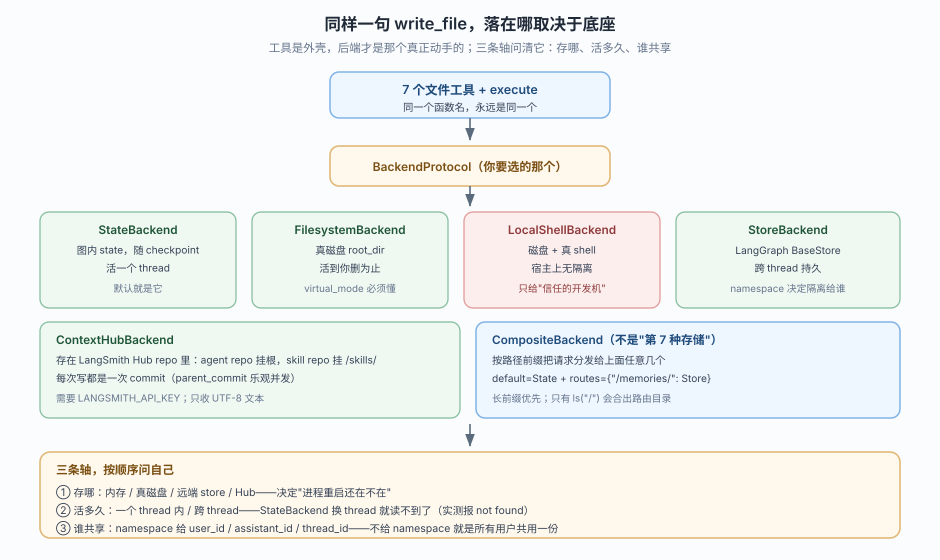
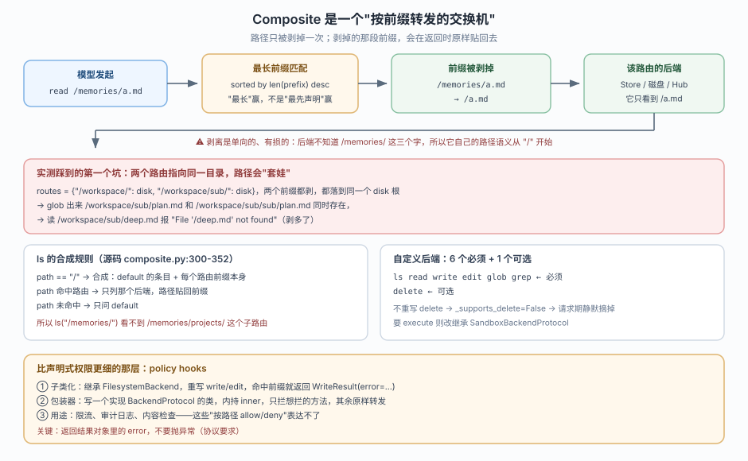
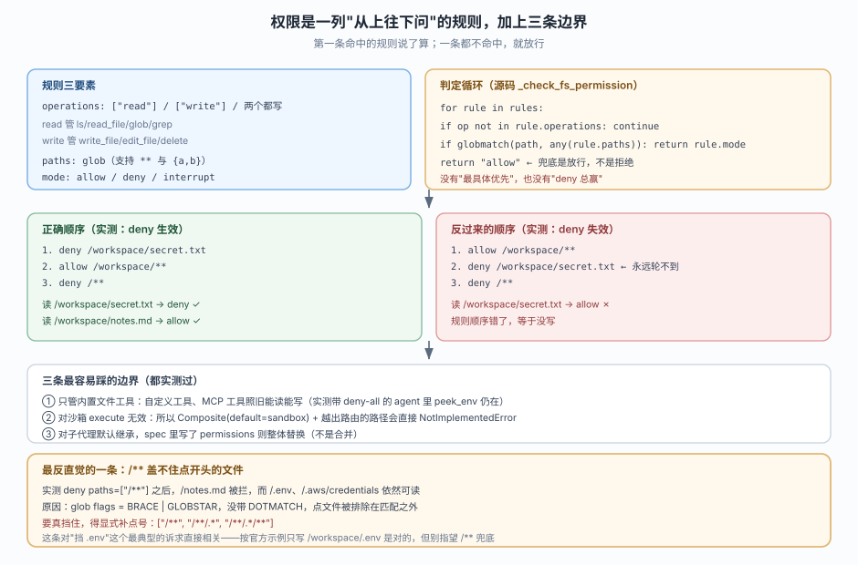
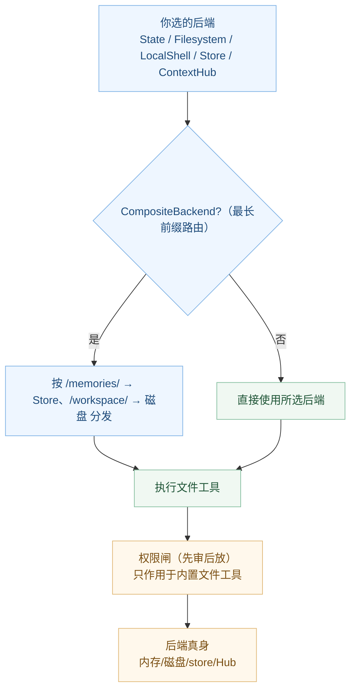

# 课 5：Backends 后端与 Permissions 权限

> 所属阶段：阶段 2《执行环境》｜ 水平：进阶 ｜ 本课知识点：内置后端六种、CompositeBackend 路由与自定义后端协议、permissions 声明式规则与边界
> 故事情节：主角发现 agent 写的笔记一换会话就没了——原来"文件"只是个虚拟概念；接着又想挡住它读 `.env`，结果发现规则没生效
> 📖 结论已按官方文档核对（核对于 2026-10 ｜ 来源：docs.langchain.com/oss/python/deepagents/backends、permissions、overview）
> ✅ 代码结论实测于 2026-10-20 ｜ `deepagents 0.7.28` / `langchain 1.4.6` ｜ 隔离环境 `/tmp/da-probe`
> 本课配**应用实战**与**源码解析**（后端协议与可选能力）

## 🎯 本课目标

- 按"存哪 / 活多久 / 谁共享"三条轴，为任务选出后端或后端组合
- 写出 `CompositeBackend` 路由规则，并实现一个最小自定义后端的七个方法
- 写出禁止读 `.env` 的权限规则，并指出它对沙箱无效

---

## 第一幕：起源与场景引入

你在课 4 末尾看到一句"执行时落在哪，由后端决定"，当时没多想。直到今天你跑了个小项目笔记 agent——它兴致勃勃地写下一份 `/notes/roadmap.md`，你也亲眼看到它回了一条 **`Updated file /notes/roadmap.md`**。一切正常。

第二天早上，你换个会话问它："昨天那份 roadmap 呢？"它愣了半天，最后回：

```
Error: File '/notes/roadmap.md' not found
```

你没重启进程、没删文件、没改代码。**它就这样"失忆"了。**

> 🎬 **场景**：你以为 agent 会写"文件"，其实它写进的是某个"虚拟文件系统"——而那个虚拟文件系统默认建在**会话内存**里，跟着 checkpoint 走，一个 thread 一份，换 thread 就蒸发。

你翻了翻文档，首页一张表把这件事讲得很直白：默认的 `StateBackend` 是 *Thread-scoped*——"files persist across turns within a thread (via your checkpoint) and are not shared across threads"。**"persist within a thread"、"not shared across threads"**，两句话正好解释你昨晚的鬼故事。

那怎么办？文档给了七种选择：默认、真磁盘、跨线程 store、Context Hub、沙箱、本机 shell、以及能把前面任意几个拼起来的 **Composite**。你第一次意识到：

> **工具（`read_file`、`write_file`、`delete`…）从头到尾只有一套固定名字；真正决定"写进去之后在哪、能活多久、谁还能看到"的，是它脚下那个可插拔的后端。**

而这只是今天的第一桩。第二桩更让你拍案：

你给这个 agent 加了权限，想挡住它读 `.env`：

```python
permissions=[
    FilesystemPermission(operations=["read", "write"], paths=["/**"], mode="deny"),
]
```

"凡是文件都别碰"——够狠了吧？结果它依然把 `.env` 的内容读了出来。**用最宽的 deny 规则，都没能拦住点开头的文件。** 你陷入了更深的困惑……

> 📌 **一句话本质**：工具是协议，后端是协议的一种实现；权限是加在工具与后端之间的一层"先审后放"的闸。三者各司其职，但也各有边界——而边界里藏着你会栽的坑。
>
> ⚖️ **处境对照**：掌握三条轴（存哪/活多久/谁共享），你能在 30 秒内决定"这个 agent 该用哪种后端"；掌握权限的顺序语义与三条边界，你能解释"为什么我 deny 了它还读得到"。这两件事本课各用一到两个知识点讲透。

---

## 第二幕：认知冲突

矛盾有两处，都很扎手。

**第一处：选型没有绝对"最好"，只有"换掉默认后你要付什么代价"。**

- `FilesystemBackend`（真磁盘）能解决"换会话还在"，但它会让 agent 直接读写你的真实文件——面向公网的 agent 用它就是把密钥裸奔在 `.env` 里。
- `StoreBackend`（跨线程持久）很稳，但它把"文件"变成 store 里的一条条记录，你得给它配一个 `namespace` 决定"隔离给谁"——不配，**所有用户共用一份**。
- `LocalShellBackend` 最强（磁盘 + 真 shell），但官方警告它"provides no security"，只适合你完全信任的本地开发机。
- 而 `CompositeBackend` 能拼——但你马上会看到，**拼的时候前缀怎么剥、剥进去之后怎么贴回来**，有一个非常容易踩的套娃坑。

**第二处：你以为"deny 最宽"就最安全，其实 `/**` 连点文件都盖不住。**

权限规则是"第一条命中的说了算"（first-match-wins），`/**` 又恰好不匹配点开头的路径（glob 默认不带 DOTMATCH）。于是"无 .. 的绝对路径 + 不是点开头" 才落到 deny——而 `.env`、`.aws/credentials` 恰恰是点开头。

> ❓ **问题**：六种后端谁真、谁虚、谁隔离、谁隔离不了？`CompositeBackend` 把请求剥皮转给谁、返回时怎么还原？以及——**为什么我写了 deny 规则，它却仿佛不存在？**

---

## 第三幕：层层揭示

### 一眼全局图（进入细节前先看一眼）



> 看图：中间是那张唯一的协议（`BackendProtocol`）；下面是六种实现，个个都有"存哪 / 活多久 / 谁共享"三行小字；`CompositeBackend` 不是第七种存储，而是把请求"按前缀转发"给前面任意几个的交换机；最底部三条轴，是你选型时按顺序问自己的问题。

### 本课地图（分几步走）

| 步 | 这一步要解决什么（人话） | 对应知识点 |
|:--:|------------------------|-----------|
| 1 | 认识六个后端，学会按三轴选型，知道默认为什么"失忆" | 知识点 1：内置后端六种 |
| 2 | 学会用 `CompositeBackend` 把"虚的 / 实的 / 跨线程的"拼到一张表，并写一个最小自定义后端 | 知识点 2：Composite 路由与自定义后端协议 |
| 3 | 学会写权限规则，并避开顺序、隐藏文件、沙箱三条坑 | 知识点 3：permissions 声明式规则与边界 |

---

### 知识点 1：内置后端六种

> 🧭 第 1/3 步｜承接：第二幕"换会话文件没了" → 本步：搞清六种后端的定位、三轴与默认行为
> 本知识点关键点：三条取舍轴、StoreBackend 三档作用域、二进制卸载（offload）

#### 一句话定义

后端是"文件工具"脚下的实现者：同样的 `write_file`，交给 `StateBackend` 就写进会话状态、交给 `FilesystemBackend` 就写进磁盘、交给 `StoreBackend` 就写进跨线程的 store。**工具这一层永远只有一套固定名字，换后端不换工具。**

#### 直觉建立（类比）

把 `read_file` / `write_file` 这套工具想成银行柜台上的同一张存取款表单，后端则是柜员身后的那个保险库系统。

- `StateBackend`——**抽屉**：你开完这个会话抽屉合上，别人（另一个 thread）打开自己的抽屉，当然看不到你刚存的那张纸。
- `FilesystemBackend`——**楼下的公共档案柜**：放进去就一直在，谁开哪个柜子由 `root_dir` 定，谁都可能翻到 `.env`。
- `StoreBackend`——**云端数据库**：能跨房间，但每个用户该看哪一层由 `namespace` 这把钥匙决定。
- `ContextHubBackend`——**发布在公网的带版本仓库**：每次写都是一次 commit。
- `LocalShellBackend`——**档案柜 + 管理员总钥匙**：能读文件还能直接跑 shell。
- `CompositeBackend`——**前台引导员**：同样一张表单，按"填的是 `/memories/` 还是 `/workspace/`"分发给不同保险库系统。

> 💡 **类比的边界**：`CompositeBackend` 不是会变身的保险库，它只是把请求"按前缀拆开再分发"。所以 `ls` 这类"聚合"操作会取每个仓库各列一轮再拼起来，而像 `read` 这种"精确命中"的操作，就只落在一个仓库身上。

#### 核心原理

**完整能力矩阵（实测 2026-10-20）**：同样是 8 个静态工具（7 文件 + `execute`），不同后端在"请求期"会摘掉不同的工具：

| 后端 | `delete` | `execute` | 跨线程 | 存储位置 |
|------|:---:|:---:|:---:|---------|
| `StateBackend`（默认） | ✅ | ❌ | 否 | 图内 state，随 checkpoint |
| `FilesystemBackend` | ✅ | ❌ | 否 | 真磁盘 root_dir |
| `LocalShellBackend` | ✅ | ✅ | 否 | 磁盘 + 宿主 shell |
| `StoreBackend` | ✅ | ❌ | 是 | LangGraph BaseStore |
| `ContextHubBackend` | ✅ | ❌ | 是 | LangSmith Hub repo |
| `CompositeBackend` | ✅* | 依赖 default | 依赖子后端 | 按前缀分发 |

> *`CompositeBackend` 的 `delete` 永远在（它把删除转给命中的子后端）；`execute` 则看 `default` 是不是一个 `SandboxBackendProtocol`。

**三条轴怎么问（按顺序）：**

1. **存哪**：内存（`StateBackend`）／真磁盘（`FilesystemBackend`）／远端 store（`StoreBackend`）／Hub（`ContextHubBackend`）——决定"进程重启之后还在不在"。
2. **活多久**：一个 thread 里（默认）还是跨 thread——`StateBackend` 换 thread 就读不到（实测 `Error: File '/note.md' not found`）；`StoreBackend` 换 thread 依然读得到。
3. **谁共享**：`StoreBackend` 的 `namespace` 三档：
   - `lambda rt: (rt.server_info.user.identity,)` → **per-user**，每个用户隔离
   - `lambda rt: (rt.server_info.assistant_id,)` → **per-assistant**，同助手所有用户共享
   - `lambda rt: (rt.execution_info.thread_id,)` → **per-thread**，退化成单会话
   - 不提供 `namespace` 时，所有用户共用一份（旧默认），多用户生产环境务必显式配。

**为什么默认会"失忆"**：`StateBackend` 的文件放在 LangGraph 的 agent state 的 `files` 键里，而 state 靠 checkpointer 在「同一个 thread」的多次 turn 之间持久；跨 thread 两个 state 各自独立，自然读不到对方。

**@staticmethod TOKEN（客观证据）**：实测 `StateBackend` 写 `/note.md` 后，同一 thread 再读正常；换另一个 thread 读直接 `not found`。而 `StoreBackend(namespace=lambda rt: ("shared",))` 换 thread 仍读得到 `C 的笔记`。

#### 示例演示

```python
from deepagents import create_deep_agent
from deepagents.backends import StateBackend, StoreBackend, FilesystemBackend

# 默认（如果你不传 backend=，就是 StateBackend）
agent_default = create_deep_agent(model="openai:gpt-5.4")

# 显式写：同一个效果
agent_state = create_deep_agent(model="openai:gpt-5.4", backend=StateBackend())

# 跨线程持久：多人共用，必须配 namespace 隔离
# 见应用实战 05
```

#### 常见误区

- ❌ 「`store=` 参数就是后端配置」——`store` 是传给 `create_deep_agent` 的 LangGraph store 实例，只有 `StoreBackend` 才消费它；其余后端不依赖它。
- ❌ 「换 `backend=` 会改变工具清单」——静态工具表固定 8 项，变的只是「请求期模型能看到的工具」。
- ❌ 「`offload_binary_content=True` 是配置文件的路径」——它是「是否把媒体块从消息历史卸到 `/blobs/`」，默认关；当 blob 路径落到 `StateBackend` 时会直接报 UserWarning 说"没有效果"。

#### 一句话记住

> 工具是同一张表单，后端是背后的保险库——三轴问完（存哪 / 活多久 / 谁共享），你就知道为什么换会话会"失忆"。

#### 🗣️ 行话对照

| 说你听到的 | 意思 |
|-----------|------|
| "thread-scoped" | 文件只在一个 thread（会话）内有效 |
| "filesystem middleware" | 加载 `read_file` 等工具的中间件，是权限的执行者 |
| "BaseStore" | 一个通用的键值存储接口，`StoreBackend` 依赖它 |
| "指的是 store 参数吗" | 不是：`store=` 是 LangGraph 的 store 实例，与后端无关 |

#### 官方文档

- [Backends（docs.langchain.com）](https://docs.langchain.com/oss/python/deepagents/backends) —— Quickstart 表格 + Built-in backends
- [Memory（长时记忆）](https://docs.langchain.com/oss/python/deepagents/memory) —— 文件系统承载的长时记忆

---

### 知识点 2：CompositeBackend 路由与自定义后端协议

> 🧭 第 2/3 步｜承接：已能区分六种后端 → 本步：学会把多种后端"拼"到一张表，并写最小自定义后端
> 本知识点关键点：路由前缀剥/贴语义、长前缀优先、delete 可选方法、后端工厂迁移、policy hooks

#### 一句话定义

`CompositeBackend` 是一个"按路径前缀把请求分发给不同后端"的转发器；当你需要自定义存储（数据库、对象存储、远程文件系统），就实现 `BackendProtocol` 的 6 个必须方法（`ls` / `read` / `write` / `edit` / `glob` / `grep`），`delete` 可选。

#### 直觉建立（类比）



> 看图：一条 `/memories/agent.md` 的读请求，先被最长前缀匹配命中 `/memories/` 路由，剥掉前缀变成 `/agent.md` 转给对应后端，返回时再把前缀贴回去。红框是你最容易踩的坑：两个前缀指向同一目录会造成"套娃"。

`CompositeBackend` 就像一个快递分拣中心。快递上的地址写着 `/workspace/plan.md`，分拣员看"最长前缀"——是 `/workspace/` 就丢给磁盘柜，是 `/memories/` 就交给跨线程仓库。

每次转发前，他会把那个前缀剥掉：`/workspace/plan.md` 变成 `plan.md` 丢给磁盘柜。磁盘柜不知道"/workspace/"这几个字，只知道自己根目录下的 `plan.md`。等到返回结果时，再把这个前缀贴回去，`plan.md` 又变成 `/workspace/plan.md`——这样模型看到的是同一个地址。

> 💡 **类比的边界**：剥前缀是无损的，但"哪个目录对应哪个子路径"要你自己算清楚。如果把两条不同前缀（`/workspace/` 和 `/workspace/sub/`）都指向同一个磁盘目录，就会出现"套娃"——同一份文件被剥两次、贴两次。

#### 核心原理

**1. 路由规则（源码 `composite.py:110` 起）**

- 路由表按前缀长度降序排（`sorted_routes = sorted(routes.items(), key=lambda x: len(x[0]), reverse=True)`），匹配时逐个试，**最长前缀胜出**。
- `default` 处理所有不匹配的路径。
- 只有 `ls("/")` 会"合成"：列出 default 的条目 + 每个路由前缀本身；`ls("/memories/")` 只列那个子后端，**不会**列出再往下的路由目录。
- 其余操作（`read`/`write`/`edit`/`delete`/`glob`/`grep`）都是"精确命中"：只落到一个后端。

**2. 自定义后端（实测）**

```python
from deepagents.backends.protocol import BackendProtocol, LsResult, ReadResult, WriteResult, ...

class MyBackend(BackendProtocol):  # 不实现 delete
    def ls(self, path): ...
    def read(self, file_path, offset=0, limit=2000): ...
    def write(self, file_path, content): ...
    def edit(self, file_path, old_string, new_string, replace_all=False): ...
    def glob(self, pattern, path=None): ...
    def grep(self, pattern, path=None, glob=None): ...
```

不实现 `delete` 时，`_supports_delete` 返回 `False`，`delete` 工具会在**请求期**被静默摘掉（课 4 讲过的"静默降级"）。要支持 `execute`，改继承 `SandboxBackendProtocol`（多一个 `execute` 方法）。

**3. 从"后端工厂"迁移（`deepagents>=0.5.0` 起改直接传实例）**

| 之前（已弃用） | 现在 |
|---------------|------|
| `backend=lambda rt: StateBackend(rt)` | `backend=StateBackend()` |
| `backend=lambda rt: StoreBackend(rt, namespace=...)` | `backend=StoreBackend(namespace=...)` |
| `backend=lambda rt: CompositeBackend(default=StateBackend(rt), ...)` | `backend=CompositeBackend(default=StateBackend(), ...)` |

工厂模式仍可用，但会发弃用警告，未来移除。

**4. policy hooks（比声明式权限更细的那层）**

声明式权限只能表达"路径 × 操作 → allow/deny/interrupt"。要限流、审计、内容检查时，就用策略钩子：

- **子类化**：继承 `FilesystemBackend`，重写 `write` / `edit`，命中 `deny_prefixes` 就返回 `WriteResult(error=...)`。
- **包装器**：写一个实现 `BackendProtocol` 的类，内持 `inner`，只拦想拦的方法，其余原样转发。
- 约定：**返回结果对象里的 error，不要抛异常**（协议要求）。

#### 示例演示

```python
from deepagents import create_deep_agent
from deepagents.backends import CompositeBackend, StateBackend, FilesystemBackend, StoreBackend

agent = create_deep_agent(
    model="openai:gpt-5.4",
    backend=CompositeBackend(
        default=StateBackend(),                      # 临时的东西全部留在会话内
        routes={
            "/workspace/": FilesystemBackend(root_dir="/path/to/project", virtual_mode=True),
            "/memories/": StoreBackend(namespace=lambda rt: (rt.server_info.user.identity,),),
        },
    ),
)
```

#### 常见误区

- ❌ 「两条前缀可以指向同一个目录」——会套娃，`glob` 里出现 `/workspace/sub/sub/plan.md`。
- ❌ 「`delete` 是必实现的」——可选；不实现，工具在请求期静默消失。
❌ 「改写 `delete` 靠 `hasattr`」——`_supports_delete` 只看**类型**是否重写（`type(backend).delete is not BackendProtocol.delete`），实例级挂载无效。

#### 一句话记住

> 转发器按"最长前缀"分拣，剥前缀转发、贴前缀返回；自定义后端只有 `delete` 是可选橡皮筋——不实现它，模型就看不到那件工具。

#### 🗣️ 行话对照

| 说你听到的 | 意思 |
|-----------|------|
| "route" | 一条"前缀 → 后端"的映射 |
| "virtual_mode" | 把路径锚定到 root_dir 内、禁 `..`/`~` 的沙箱模式 |
| "policy hook" | 在声明式权限之外的、可编程的访问检查 |
| "父代理" | 创建子代理的代理（见课 X） |

#### 官方文档

- [Route to different backends](https://docs.langchain.com/oss/python/deepagents/backends#route-to-different-backends)
- [Add policy hooks](https://docs.langchain.com/oss/python/deepagents/backends#add-policy-hooks)
- [Protocol reference](https://docs.langchain.com/oss/python/deepagents/backends#protocol-reference)

---

### 知识点 3：permissions 声明式规则与边界

> 🧭 第 3/3 步｜承接：后端已选好 → 本步：写权限规则并理解它挡不住什么
> 本知识点关键点：三要素、first-match-wins、三条边界（只管内置工具 / 对沙箱无效 / 子代理继承）

#### 一句话定义

`permissions` 是一列 `FilesystemPermission` 规则，按**声明顺序**自上而下匹配，**第一条命中**的规则决定了这次访问的结局；一条都不命中就放行。它只施加在**内置文件工具**上，不覆盖自定义工具、MCP 工具，也不覆盖沙箱的 `execute`。

#### 直觉建立（类比）



> 看图：左栏是规则三要素；中栏是"第一条命中"的判定循环与兜底放行；右上栏是两种规则顺序的对比（正确 deny 生效 / 反了 deny 失效）；右下栏是三条边界；底部是 `/**` 挡不住点文件这条反直觉结论。

像公司前台的访客登记表，一页就是一条规则，保安**从头往下**扫：

- 看到 `deny  /workspace/.env`——凡是来读 `.env` 的直接打发走；
- 看到 `allow /workspace/**`——其余 workspace 放行；
- 看到 `deny  /**`——不是 workspace 的一律不放行。

关键在"从上往下，第一条命中"。你把 `allow /workspace/**` 放在最前，那 `.env` 也属于 workspace，**第二条 deny 永远轮不到**——顺序错了，等于没写。

> 💡 **类比的边界**：保安只查"登记表上列的那些工具"。你如果自带一台能读文件的设备（自定义工具），它根本不过保安这道闸；如果能通过 shell 直接看文件（沙箱 `execute`），连"路径"这个维度都管不住。

#### 核心原理

**规则三要素（源码 `filesystem.py:367` 起）：**

| 字段 | 取值 | 说明 |
|------|------|------|
| `operations` | `["read"]` / `["write"]` / 两者 | `read` 管 `ls`/`read_file`/`glob`/`grep`；`write` 管 `write_file`/`edit_file`/`delete` |
| `paths` | glob 数组 | 支持 `**` 递归与 `{a,b}` 交替；必须以 `/` 开头、不能含 `..` / `~` |
| `mode` | `"allow"`（默认） / `"deny"` / `"interrupt"` | deny 返回错误；interrupt 暂停等人审批（`>=0.6.8`） |

**判定循环（源码 `_check_fs_permission`）：**

```python
for rule in rules:
    if operation not in rule.operations:
        continue
    if any(wcglob.globmatch(path, pattern, flags=_FS_WCMATCH_FLAGS) for pattern in rule.paths):
        return rule.mode
return "allow"   # 兜底是放行，不是拒绝
```

**三条边界（都实测过）：**

1. **只管内置文件工具**——自定义工具、MCP 工具照旧能读能写。实测：给一个带 `deny-all` 的 agent 传自定义工具 `peek_env`，它在工具表里依然存在并可被调用。
2. **对沙箱 `execute` 无效** ——如果你给 `Composite(default=sandbox)` 配了一条覆盖到 `execute` 的权限，构造期直接 `NotImplementedError`：`"Tool-level permissions for the execute tool are not implemented"`。所以权限路径必须全部落在已知的路由前缀内。
3. **子代理默认继承父代理权限**；子代理 spec 里写了 `permissions`，则**整体替换**父代理的（不是合并）。

**最反直觉的一条：`/**` 盖不住点开头的文件。**

实测：

```python
permissions=[FilesystemPermission(operations=["read", "write"], paths=["/**"], mode="deny")]
```

- `/notes.md` → 拦截 ✓
- `/.env` → 放行 ✗（`@@ lines 1-1 of 1 @@`）
- `/.aws/credentials` → 放行 ✗

原因：`_FS_WCMATCH_FLAGS = wcglob.BRACE | wcglob.GLOBSTAR`，**没带 `DOTMATCH`**，点开头的路径被排除在匹配之外。要真挡住，得显式补上点号：

```python
paths=["/**", "/**/.*", "/**/.*/**"]
```

**`delete` 的保守规则**：删目录是"all-or-nothing"——只要目标或其任意子孙命中 deny，整棵树拒绝；删单个文件走 first-match-wins，前面更窄的 `allow` 可以救回。

#### 示例演示

```python
from deepagents import FilesystemPermission, create_deep_agent

# 只读 agent：拒绝一切写
read_only = [
    FilesystemPermission(operations=["write"], paths=["/**"], mode="deny"),
]

# 正确顺序：先 deny .env，再 allow workspace，最后 deny 其余
protect_env = [
    FilesystemPermission(operations=["read", "write"], paths=["/workspace/.env"], mode="deny"),
    FilesystemPermission(operations=["read", "write"], paths=["/workspace/**"], mode="allow"),
    FilesystemPermission(operations=["read", "write"], paths=["/**"], mode="deny"),
]
```

#### 常见误区

- ❌ 「`deny /**` 最安全」——挡不住点开头文件，且只挡内置工具。
- ❌ 「deny 总优先」——没有这回事，只有"第一条命中"。
- ❌ 「子代理可以额外叠加权限」——不是叠加，是替换。
- ❌ 「沙箱里配 `deny /secrets/**` 能防住 shell」——不能，shell 有任意路径读写的口子。

#### 一句话记住

> 规则从上往下问，第一条命中说了算；它只审内置文件工具，不审自定义工具，更不审沙箱的 shell——所以"规则写得再宽，也拦不住它用别的门进去"。

#### 🗣️ 行话对照

| 说你听到的 | 意思 |
|-----------|------|
| first-match-wins | 第一条命中规则的 mode 生效，之后不再看 |
| interrupt mode | 命中时暂停工具执行，等人批准/改写/拒绝 |
| 子代理权限替换 | 子代理的 `permissions` 字段整体替掉继承来的规则 |

#### 官方文档

- [Permissions（docs.langchain.com）](https://docs.langchain.com/oss/python/deepagents/permissions) —— Basic usage / Rule ordering / Subagent permissions

---

## 第四幕：实操验证（复现与验证）

### 4.1 机制验证：三组探针带你亲手走一遍

> 以下输出均为隔离环境 `/tmp/da-probe` 实测所得，你可直接复制运行。

**探针 1：六种后端的能力矩阵**

```python
from deepagents.backends.protocol import BackendProtocol
from deepagents.middleware import filesystem as fsmod
from deepagents.middleware.filesystem import FilesystemMiddleware, supports_execution
class NoDelete(BackendProtocol):
    def ls(self, path): return LsResult(entries=[])
    def read(self, file_path, offset=0, limit=2000): return ReadResult(error="x")
    def write(self, file_path, content): return WriteResult(error="x")
    def edit(self, file_path, old_string, new_string, replace_all=False): return EditResult(error="x")
    def glob(self, pattern, path=None): return GlobResult(matches=[])
    def grep(self, pattern, path=None, glob=None): return GrepResult(matches=[])
```

实测输出：

```
StateBackend              delete=True  exec=False 可见7 摘掉=['execute']
FilesystemBackend         delete=True  exec=False 可见7 摘掉=['execute']
LocalShellBackend         delete=True  exec=True  可见8 摘掉=[]
StoreBackend              delete=True  exec=False 可见7 摘掉=['execute']
Composite(default=State)  delete=True  exec=False 可见7 摘掉=['execute']
自定义(无 delete)            delete=False exec=False 可见6 摘掉=['delete', 'execute']
```

**探针 2：跨线程"失忆" vs 持久**

```python
# StateBackend：thread A 写，thread B 读
#   实测：B 读 → "Error: File '/note.md' not found"
# StoreBackend：thread C 写，thread D 读
#   实测：D 读 → "@@ lines 1-1 of 1 @@\nC 的笔记"
```

**探针 3：权限守卫的真实行为**

```python
permissions=[FilesystemPermission(operations=["read"], paths=["/**"], mode="deny")]
# read /notes.md → Error: permission denied for read on /notes.md
# read /.env     → '@@ lines 1-1 ...'  （没被挡住！）

# 补点号后再试：
# paths=["/**", "/**/.*", "/**/.*/**"]  → /.env 也被拦
```

这几行输出值得你亲手跑一遍——尤其是"deny-all 没挡住 .env"这条，**它和你以为的"安全"直接相关**。

### 4.2 应用实战：临时草稿 + 跨会话项目笔记 + 挡住 `.env`（入口）

本课实战要解决"笔记一换会话就没了"的问题。完整代码、运行步骤与自检清单见：

📄 **[应用实战 05：Backends 后端与 Permissions 权限](../../../应用实战/05-Backends后端与Permissions权限.md)**

一句话预告：你会用 `CompositeBackend(default=StateBackend(), routes={"/workspace/": FilesystemBackend(...), "/memories/": StoreBackend(...)})`，再配一层"挡住 `.env`"的权限，最后用两个不同的 `thread_id` 验证跨会话读取。

🔬 **配套源码解析**：[源码解析 05：后端协议与可选能力](../../../源码解析/05-Backends后端与Permissions权限.md)——回答"`delete` 为什么可以不实现"、"前缀在哪一行被剥掉"、"`deny /**` 挡不住点文件是哪一行决定的"。

## 第五幕：体系收束

三种能力在本课的因果链：

- **选后端**（知识点 1）回答"写进去之后在哪"——`StateBackend` 让"失忆"，`StoreBackend` / `FilesystemBackend` 让它跨会话活着。
- **拼后端 / 写后端**（知识点 2）回答"一张表怎么同时容纳虚与实"——`CompositeBackend` 是最常用的形态，自定义后端则把范围扩展到任意存储。
- **权限**（知识点 3）回答"谁能碰"——它是工具与后端之间的一层闸，但**只审内置文件工具**。

一句话收束整课：**先定"写在哪儿、活多久、谁共享"，再用 Composite 拼起来，最后用权限把你不希望它碰到的路径挡在门外——但记住权限挡不住 shell 与自定义工具。**

## 🐞 常见误区（本课专属）

| 误以为 | 实际 | 怎么排查 |
|--------|------|---------|
| "`StateBackend` 就是内存，重启就没了" | 它跟着 checkpoint 走：同 thread 跨 turn 保留，跨 thread 不共享 | 换一个 `thread_id` 试读 |
| "`/**` deny 最安全" | 挡不住点开头文件，且只管内置工具 | 用 `.env`、`.aws/credentials` 实测 |
| "权限对自定义/MCP 工具也管用" | 只作用于内置文件工具 | 给带 deny-all 的 agent 挂自定义工具验证 |
| "沙箱里 deny `/secrets/**` 能防 shell" | `execute` 不做路径检查，构造期直接报 NotImplementedError | 看构造错误文案 |
| "子代理权限可以叠加" | spec 里写了 `permissions` 就是整体替换 | 直接打印子代理工具表 |

### ⏳ 与过时说法对照

| 过时的说法 | 现在该怎么说 |
|-----------|-------------|
| "后端是 `backend=lambda rt: StateBackend(rt)`" | 直接 `backend=StateBackend()`（工厂已弃用，`>=0.5.0`） |
| "`FilesystemBackend` 的 `virtual_mode` 默认关闭" | 当前签名默认 `True`；设为 `False` 就等于把文件系统的大门完全打开 |

## 一图总结



> 读图指引：从左到右是"选后端 → 可能被 Composite 拆 → 过权限闸 → 落在真身"。**最容易漏的是权限闸只作用于内置文件工具**——自定义/MCP 工具、沙箱 shell 都不过这道闸。

## 课后小测

**Q1**：你换了个 `thread_id` 后，`StateBackend` 上写过的文件读不到了。最准确的原因？
- A. 进程重启了
- B. `StateBackend` 的文件存在 agent 的 state 里，state 靠 checkpoint 只在一个 thread 内持久
- C. 需要传 `store=` 才能跨线程
- D. 文件被自动清理了

<details><summary>答案与解析</summary>

**答案：B**。`StateBackend` 的文件在 LangGraph state 里，checkpoint 让它在同一 thread 的多次 turn 之间持久；跨 thread 是各自独立的 state。`store=` 参数是给 `StoreBackend` 的，不改变 `StateBackend` 的语义。

</details>

**Q2**：`CompositeBackend(default=StateBackend(), routes={"/memories/": StoreBackend(...)})` 里，读取 `/memories/projects/plan.md` 会怎样？
- A. 直接报错，因为最外层路由也不认识
- B. 被 `/memories/` 路由匹配，剥掉前缀后按 `/projects/plan.md` 去 store 读
- C. 被 `default` 处理
- D. 由 `StoreBackend` 的 namespace 自己决定

<details><summary>答案与解析</summary>

**答案：B**。`/memories/projects/plan.md` 以 `/memories/` 开头，匹配该路由；剥掉前缀后变成 `/projects/plan.md` 发给 `StoreBackend`。注意：**len 更长的前缀优先**（比如若还有 `/memories/projects/` 这条路由，就轮到它）。

</details>

**Q3**：一个自定义后端没有实现 `delete` 方法。模型能不能调用 `delete` 工具？
- A. 能，只是每次都会报错
- B. 不能，工具在请求期被静默摘掉
- C. 能，但只在静态清单里，模型其实看不到
- D. 取决于模型是否支持 tool calling

<details><summary>答案与解析</summary>

**答案：B**。`_supports_delete` 只看类型是否重写（`type(backend).delete is not BackendProtocol.delete`）。静态表里仍可能有，但请求期会被移除——这就是课 4 说的"静默降级"。

</details>

**Q4**：以下哪个配置能让 agent **完全无法**读取 `/workspace/.env`？
- A. `permissions=[FilesystemPermission(operations=["read"], paths=["/**"], mode="deny")]`
- B. `permissions=[FilesystemPermission(operations=["read"], paths=["/workspace/.env"], mode="deny")]`
- C. `permissions=[FilesystemPermission(operations=["read"], paths=["/workspace/**"], mode="deny")]`
- D. A 与 B 都可以

<details><summary>答案与解析</summary>

**答案：C**。`/**` 不匹配点开头文件（A 挡不住 `.env`）；B 只挡住了 `.env` 这一个文件；C 覆盖整个 `/workspace/` 下的任意路径。若你要隔离的只是 `.env` 本身，B 也够用。

</details>

**Q5**：`CompositeBackend(default=sandbox, routes={"/memories/": ...})` 上配一条 `paths=["/**"]` 的权限会怎样？
- A. 正常运行，所有路径都被拦截
- B. 构造期抛 `NotImplementedError`
- C. 只有 `/workspace/**` 的路径被拦
- D. 权限对沙箱无效，静默忽略

<details><summary>答案与解析</summary>

**答案：B**。`_all_paths_scoped_to_routes` 要求每条权限路径都落在路由前缀之内；`/**` 覆盖到默认沙箱，而沙箱提供 `execute`，工具级权限不适用于它，于是直接 `NotImplementedError`。

</details>

---

## 🚀 下一批接力提示词

> 学完本课后，**复制下面这段文字发给 AI**，即可进入下一课（无需重新描述上下文）：

```
继续学 Deep Agents。我的学习档案在 langchain/deepagents/00-学习档案.md，
刚学完阶段 2《执行环境》的课 5《Backends 后端与 Permissions 权限》全部 3 个知识点
（内置后端六种 / CompositeBackend 路由与自定义后端协议 / permissions 声明式规则与边界），并做完了应用实战。
请按大纲继续讲阶段 2《执行环境》的课 6《代码执行 Sandboxes 与 Interpreters》。
```

## 🧭 课程导航

🎯 **练一练（本课应用实战）**：[第 5 课实战 · 临时草稿 + 跨会话笔记 + 挡住 .env](../../../应用实战/05-Backends后端与Permissions权限.md)

🔬 **本课源码解析**：[后端协议与可选能力](../../../源码解析/05-Backends后端与Permissions权限.md)

⬅️ **上一课**：[课 4：工具与虚拟文件系统](./04-工具与虚拟文件系统.md)

➡️ **下一课**：[课 6：代码执行 Sandboxes 与 Interpreters](./06-代码执行Sandboxes与Interpreters.md)

📚 **返回目录**：[课程目录](../../../02-课程目录.md)
