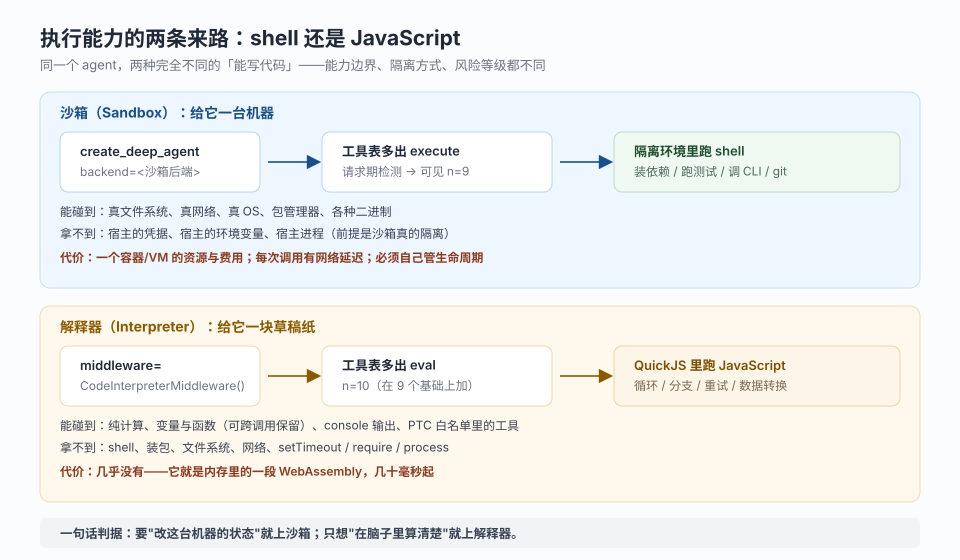
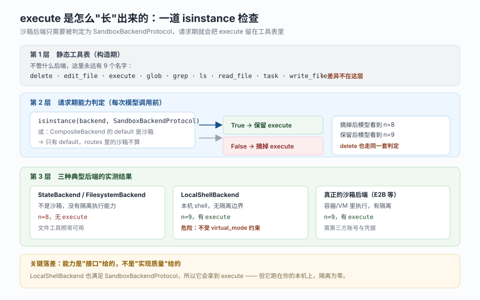
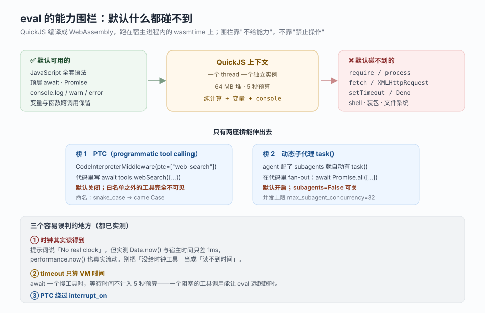
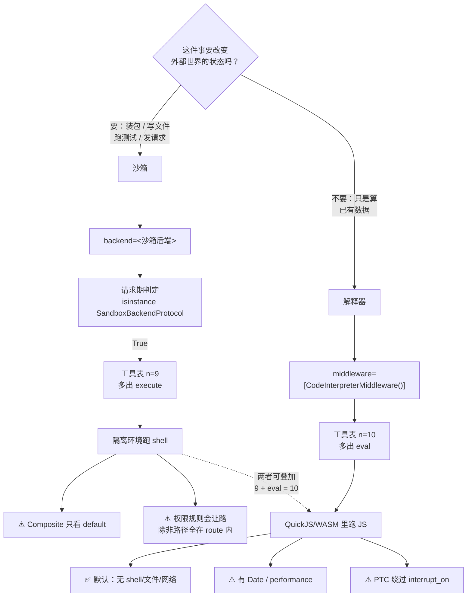

# 课 6：代码执行：Sandboxes 与 Interpreters

> 所属阶段：阶段 2《执行环境》｜ 水平：进阶 ｜ 本课知识点：Sandbox 后端与 execute、Interpreters 与 eval、两者选择边界
> 故事情节：主角想让 agent 自己跑测试、自己装依赖，甚至自己写个小脚本批量处理 80 个文件——但这两件事的风险等级完全不同
> 📖 结论已按官方文档核对（核对于 2026-10 ｜ 来源：docs.langchain.com/oss/python/deepagents/sandboxes、interpreters、overview）
> ✅ 代码结论实测于 2026-10-20 ｜ `deepagents 0.7.28` / `langchain 1.4.6` / `langchain-quickjs 0.3.9` ｜ 隔离环境 `/tmp/da-probe`
> 本课配**应用实战**与**源码解析**（沙箱协议与 execute 派生）

## 🎯 本课目标

- 判断什么任务需要真 shell（装依赖 / 跑测试 / 调 CLI），并为它选对沙箱后端
- 判断什么任务只需要轻量可编程层（循环 / 批处理 / 结构化转换），并说清 `eval` 的能力围栏在哪
- 用三条判据（要不要装包 / 要不要碰文件网络 / 要不要 OS 环境）在两者之间做出选择

---

## 第一幕：起源与场景引入

你的 agent 现在能读文件、能写文件、能在 `CompositeBackend` 里把笔记分门别类地存好。它看上去已经很能干了。

于是你交给它一个真活儿：仓库里有个单测挂了，去修。

它干得挺漂亮——`grep` 找到报错位置，`read_file` 读了三个相关文件，`edit_file` 改了两行。然后它停下来，回你一句：

```
我已经修复了 src/parser.py 中的边界判断。请运行 pytest 确认。
```

**"请运行 pytest 确认。"** 你盯着这句话看了五秒。它改完了，但它不知道自己改对没改对——因为它**没有手**。它只有"纸和笔"（文件工具），没有"操作台"（执行环境）。

你手动跑了测试，红了，把报错贴回去。它再改，你再跑。第三轮的时候你烦了：**为什么它不能自己跑？**

于是你去翻文档，找到 `sandboxes` 那一页，第一段就把话说死了：

> Sandboxes give agents a safe place to run code, install dependencies, and test their work.

好，就是它。你回到代码，把后端换成一个沙箱：

```python
from deepagents import create_deep_agent
from langchain_e2b import E2BSandbox

agent = create_deep_agent(model="openai:gpt-5.5", backend=E2BSandbox(sandbox=e2b_sandbox))
```

这次它跑起来了。它自己 `pip install -e .`、自己 `pytest -x`、自己看红绿、自己改到全绿。**那一刻它从"会写字"变成了"会动手"。**

> 🎬 **场景**：你以为"加个 `execute` 工具"就是加一行配置，其实你换掉的是整个执行环境——从"文件系统"换成了"一台机器"。

第二桩事来得更快。你手上有一份 200 条工单的导出，要按团队分组算加权分、找出 top 10、再生成一段摘要。你把数据塞进提示词，让它算。

它算得很认真，一条一条地算，算到第 37 条的时候开始出错，算到第 90 条的时候忘了自己在算什么。你让它"再检查一遍"，它换了个答案重新错。

这不是它笨，是**这件事本来就不该由语言模型逐条做**。你需要的是一个循环、一个 `reduce`、一次 `sort`。你在代码里三行就能写完，它却要用"想"的方式模拟三行代码。

于是你翻到另一页文档，`interpreters`：

> Interpreters give agents a programmable, **in-memory** workspace inside the agent loop. The agent writes code to complete a task, and the runtime executes it and returns only the relevant results. **Intermediate results do not become part of the model context.**

你装上试了试。它写了一段 JS，`eval` 一跑，输出一行 `alpha: 29 / beta: 13`。**那 200 条工单的中间过程，一条都没进上下文。**

> 📌 **一句话本质**：沙箱给 agent 一台**能改世界的机器**，解释器给 agent 一张**能算数据的草稿纸**。名字都叫"执行代码"，但一个动的是环境，一个动的是信息。
>
> ⚖️ **处境对照**：搞不清这一层，你会犯两个方向的错——该上沙箱的时候只给了 `eval`（于是它连 `pip` 都跑不了，卡在原地），该用解释器的时候上了沙箱（于是每次算个数都要开一台机器、装一遍依赖、烧一遍钱）。本课三个知识点，就是把这层分工钉死。

---

## 第二幕：认知冲突

矛盾有三处，一处比一处扎手。

**第一处：静态工具表里明明列着 `execute`，模型却说它没有这个工具。**

你去翻课 4 的表，`execute` 就在那 9 个里。你甚至打印过它：

```
['delete', 'edit_file', 'execute', 'glob', 'grep', 'ls', 'read_file', 'task', 'write_file']
```

可模型实际看到的是 8 个，`execute` 不见了。更迷惑的是：你把沙箱塞进 `CompositeBackend` 的 `routes` 里，它依然看不见；你把它设成 `default`，它才出现。

于是你意识到一件反直觉的事：**"有没有这个能力"不是由你配了什么决定的，是由框架对你那个后端做的 `isinstance` 判定决定的。** 而那个判定，对 `CompositeBackend` 只看 `default`，不看 `routes`。

**第二处：文档说"provider 只需实现 `execute()`"，你照着实现了，`TypeError`。**

文档原话是：

> Sandbox backends have a simple architecture: the only method a provider must implement is `execute()`

你写了个类，只实现 `execute()` 和 `id`，继承 `BaseSandbox`，然后：

```
TypeError: Can't instantiate abstract class LocalExecSandbox without an implementation
for abstract methods 'download_files', 'upload_files'
```

**文档没错，但你读错了。** 那句话的主语是"provider"、说的是"协议"。`SandboxBackendProtocol` 确实只要求 `execute` + `id`；但 `BaseSandbox` 这个**基类**额外把 `upload_files` / `download_files` 标成了抽象方法——因为它要用这两个方法实现"应用平面"的文件传输。

**第三处：`write` 说成功了，`read` 说文件不存在。**

你写了：

```python
backend.write("/notes/a.txt", "hello")   # -> WriteResult(path="/notes/a.txt")
backend.read("/notes/a.txt")             # -> ReadResult(error="file_not_found")
```

同一个路径，一次成功一次失败。你差点以为是 bug，直到你看懂那两张平面：`write` 走的是**宿主侧的 `upload_files`**（真的把内容传进了 `/tmp/da-probe/mini-shell/notes/a.txt`），`read` 走的是**沙箱内的 `execute("cat /notes/a.txt")`**（真的去读那台机器上的 `/notes/`）。**两条路，两个世界。**

> ❓ **问题**：`execute` 到底在什么条件下才对模型可见？一个"沙箱后端"最少要实现什么？那七个文件工具到底是怎么落到 `execute` 上的？以及——**`eval` 里到底能碰什么、碰不到什么？**

---

## 第三幕：层层揭示

### 一眼全局图（进入细节前先看一眼）



> 看图：上半是沙箱这条路——从 `backend=` 传进去，经过请求期判定，工具表变成 9 个，然后在**隔离环境**里跑 shell；下半是解释器这条路——从 `middleware=` 插进去，工具表变成 10 个，然后在 **QuickJS 里跑 JS**。两条路的入口参数不一样、加的工具不一样、碰得到的东西也不一样。底部那条判据条，就是你以后每次做选择时该看的那一行。

### 本课地图（分几步走）

| 步 | 这一步要解决什么（人话） | 对应知识点 |
|:--:|------------------------|-----------|
| 1 | 搞清 `execute` 为什么时有时无，一个沙箱后端最少要实现什么，七个文件工具怎么落到 `execute` 上 | 知识点 1：Sandbox 后端与 execute |
| 2 | 搞清解释器是什么形态、`eval` 里能碰什么、两座桥怎么搭、状态怎么留 | 知识点 2：Interpreters 与 eval |
| 3 | 拿到三条判据，能在"装包跑测试"和"算一批数据"之间一次选对，并知道两者能叠加 | 知识点 3：两者选择边界 |

---

### 知识点 1：Sandbox 后端与 execute

> 🧭 第 1/3 步｜承接：第二幕"工具表里明明有 execute，模型却看不见" → 本步：搞清可见性判定、最小实现门槛、七个文件工具的派生关系
> 本知识点关键点：三道门与 isinstance 判定、Composite 只看 default、BaseSandbox 三方法门槛、两个平面、LocalShellBackend 不是沙箱

#### 一句话定义

沙箱后端就是"实现了 `SandboxBackendProtocol` 的后端"——它唯一多出来的能力是 `execute(command)`：把一条 shell 命令丢进一个隔离环境跑，回给你 `output` / `exit_code` / `truncated`。**它不是一个新工具，它是一种让 `execute` 这个既有工具能被保留的后端资格。**

#### 直觉建立（类比）

把这一层想成"你去外包公司借一台机器"。

- `StateBackend` 是你的**笔记本内页**：能写字（`write_file`）、能翻回去看（`read_file`），但你没法在纸上跑 `pytest`。
- `FilesystemBackend` 是**你本机的硬盘**：文件真落盘了，可你依然没有"执行"这个动作——它只是把纸换成了真纸。
- 沙箱后端是**借来的一台一次性云主机**：你在上面 `pip install`、`pytest`、`git clone`、`docker build`，随便折腾。折腾完（或者说 TTL 到了）整台机器连同里面的一切消失。
- `execute` 就是**递给那台机器的一行命令**，你拿到的是它的屏幕输出 + 退出码。

关键在最后一句：**你借的是一台机器，不是一个函数。** 机器有文件系统、有 shell、有网络（默认通常有）、有环境变量——所以"能执行"这件事的破坏半径，比"能写文件"大一个数量级。

> 💡 **类比的边界**：借来的机器只保护"你"（宿主）不被它伤到，**不保护"它自己"**。文档把这句写得很直白：沙箱挡住了 agent 读你的本地文件、读你的环境变量、干扰你的进程；但挡不住"有人在你的输入里下毒，让 agent 自己在沙箱里把数据发出去"。

#### 核心原理

**（1）三道门：`execute` 在哪一步被摘掉**



> 看图：最上层是构造期的静态工具表（永远 9 个，跟你传什么后端无关）；中间层是请求期的 `isinstance` 判定，注意 `CompositeBackend` 那个分叉只走向 `default`；最下层是三种后端各自的实测结果——`State` / `Filesystem` 8 个、自建 `MiniSandbox` 9 个、`Composite` 里沙箱放 `routes` 时又退回 8 个。底部那句话是本知识点的全部结论：**能力是接口给的，不是实现质量给的。**

判定代码只有一道 `isinstance`（`middleware/filesystem.py:1705`）：

```python
def supports_execution(backend: BackendProtocol) -> bool:
    if isinstance(backend, CompositeBackend):
        return isinstance(backend.default, SandboxBackendProtocol)
    return isinstance(backend, SandboxBackendProtocol)
```

四行代码，两个结论：

- **不看你的实现质量**：只要你 `class X(StateBackend, SandboxBackendProtocol)` 并且实现了 `execute`，哪怕 `execute` 只是 `return "ran: xxx"`，`execute` 工具照样对模型可见。**这是一个类型判定，不是一个能力探测。**
- **`CompositeBackend` 只看 `default`**：`routes` 里的沙箱不算数。所以"默认放内存、`/sandbox/` 走 E2B"这种配法，模型**看不到** `execute`。

实测六行矩阵（同一个 `SpyModel` 只记录 `bind_tools` 收到了什么）：

```
  StateBackend               n= 8  execute=no
  FilesystemBackend          n= 8  execute=no
  MiniSandbox（自建）            n= 9  execute=YES
  LocalShellBackend          n= 9  execute=YES
  Composite default=沙箱       n= 9  execute=YES
  Composite route=沙箱         n= 8  execute=no
```

> 🎯 这六行是本课最值钱的证据。前两行说明"没有 `execute` 不是配错了"；后两行说明"Composite 只看 `default`"。

工具被摘掉的时机是请求期，`_filter_unsupported_tools_and_apply_prompt`（`filesystem.py:3333`）在每次模型调用前按后端能力裁剪工具表，并把"为什么少了工具"写进提示词（`_unsupported_tools_and_execution_state`，`filesystem.py:3027`）。所以模型不只是"看不见"，它还会被告知"你现在没有执行能力"——这是它不该硬编 shell 命令的原因。

**（2）门槛不是"一个方法"，是"三个方法"**

文档说 provider 只需实现 `execute()`。这话对**协议**成立，对**基类**不成立。两条路分开看：

| 你继承的是 | 必须实现 | 结果 |
|-----------|---------|------|
| `SandboxBackendProtocol`（协议） | `execute()` + `id` | 能构造，`execute` 可见；文件工具要么另写，要么借 `StateBackend` |
| `BaseSandbox`（基类） | `execute()` + `upload_files()` + `download_files()` | 能构造，七个文件工具**免费获得**（都由 `execute` / `upload_files` 派生） |

实测报错原文：

```
TypeError: Can't instantiate abstract class LocalExecSandbox without an implementation
for abstract methods 'download_files', 'upload_files'
```

所以选型其实是一句话：**想省事就继承 `BaseSandbox`，但要交三个方法；只想让 `execute` 出现就继承协议，但文件工具得自己想办法。**

**（3）七个文件工具怎么落到 `execute` 上**

这是"沙箱后端很便宜"的真正原因：你只写 `execute`，其余七个全由基类拼 shell 脚本代劳。实测（`inspect.getsource` 逐方法扫描，`deepagents/backends/sandbox.py`）：

| 方法 | 实际走哪条路 | 源码位置 |
|------|-------------|---------|
| `ls` | `execute`（`ls -la` 类脚本） | `sandbox.py:1703` |
| `read` | `execute`（`sed -n` 截取行段） | `sandbox.py:1713` |
| `write` | **`upload_files`**（完全不碰 shell） | `sandbox.py:1784` |
| `edit` | **双路径**：`old+new` ≤ 50000 字节走 `execute`；超过则先 `upload_files` 传临时文件再 `execute` | `sandbox.py:1827`（`_edit_inline:1889` / `_edit_via_upload:1911`） |
| `delete` | `execute`（`rm`） | `sandbox.py:2021` |
| `grep` | `execute`（`grep -n`） | `sandbox.py:2063` |
| `glob` | `execute`（`find` / `os.walk` 类脚本） | `sandbox.py:2120` |

那个 50000 的阈值有名字：`_EDIT_INLINE_MAX_BYTES = 50_000`（`sandbox.py:580`）。为什么 `write` 不走 shell？因为把任意内容拼进 shell 命令要处理转义、编码、长度上限，太容易出事；厂商的原生传输 API 更稳。**这条设计直接导致了下面这个坑。**

**（4）两个平面：`write` 和 `read` 不在同一个世界里**

官方把文件进出沙箱分成两条"平面"：

- **agent 平面**：`read_file` / `write_file` / `edit_file` / `delete` / `ls` / `glob` / `grep` / `execute`——模型在任务中调用，走 `execute()` 或 `upload_files` 落到沙箱内。
- **应用平面**：`upload_files()` / `download_files()`——**你的应用代码**调用，走厂商原生传输 API，用于"跑之前把代码/数据灌进去"和"跑完把产物取出来"。

实测踩坑现场（自建 `MiniSandbox`，借 `StateBackend` 的文件方法，`execute` 只是个假实现）：

```
write("/notes/a.txt") -> WriteResult(path="/notes/a.txt")   # 走 upload_files，写进宿主 /tmp/da-probe/mini-shell/notes/a.txt
read("/notes/a.txt")  -> ReadResult(error="file_not_found")  # 走 execute("cat /notes/a.txt")，读的是沙箱里的 /notes/
```

这不是 bug。它精确地说明：**同一个路径字符串，在两条平面上指向两个存储。** 你自己写的后端如果两条路没打通，就会出现"写进去读不出来"；而官方厂商 SDK 的 `upload_files` 和 `execute` 落在同一个容器里，所以没这个问题。

> 这条也解释了为什么"灌种子数据"要用 `upload_files` 而不是让模型 `write_file`：前者是你的应用在动手（可控、可批量、可校验），后者要花模型的 token 和 turn。

**（5）生命周期与作用域：机器不是白开的**

文档给了两种主流形态：

- **thread-scoped（默认思路）**：一个会话一台机器。首轮创建，同 thread 后续 turn 复用。会话结束或 TTL 到期，环境消失。要用 `sandbox_name = f"thread-{thread_id}"` 这类方式把映射存下来，否则下一轮又开一台。
- **assistant-scoped**：同一个 assistant 下所有 thread 共用一台。省资源，但**沙箱内的状态会一直累积**——文档专门提醒要配 TTL、定期用快照重置、或者自己写清理逻辑，否则磁盘和内存会无界增长。

还有一句常被忽略的：**沙箱只要没关，就一直在花钱。** 不是"用完自动没"，是"你要么让它 TTL，要么自己 `close`"。

**（6）隔离边界：它挡住什么，挡不住什么**

挡住的：

- agent 读不到你本机的文件
- agent 读不到你机器上的环境变量
- agent 干扰不了你本机的其他进程

挡不住的（文档点名两条）：

- **上下文注入**：攻击者控制了你输入的一部分，就能指挥 agent 在沙箱里跑任意命令。沙箱是隔离的，但 agent 在沙箱**里面**是皇帝。
- **网络外泄**：除非你把网络封了，被注入的 agent 可以通过 HTTP 或 DNS 把数据送出去。部分厂商支持封网（如 Modal 的 `blockNetwork: true`）。

由此推出本课最硬的一条安全规则：

> **密钥绝对不能进沙箱。** API key、token、数据库口令，通过环境变量、挂载文件、`secrets` 选项塞进去的，都可能被一个"被说服了的" agent 读出来发走——**哪怕是短期凭证也一样，因为 agent 能拿到，攻击者就能拿到。**

正确做法两条（文档推荐）：

1. **把密钥留在沙箱外面的工具里**：定义一个在宿主环境跑的工具，认证在工具内部完成。agent 只按名字调用，永远看不到凭证。
2. **用网络代理注入凭证**：沙箱发出的 HTTP 请求经过代理，代理自己贴 `Authorization` 头。agent 只发普通请求，看不到 secret。缺点是目前厂商支持面不广。

**（7）`LocalShellBackend` 不是沙箱**

这是课 5 埋下、本课必须收口的一条。`LocalShellBackend` 有 `execute`，也对模型可见，但它的 MRO 是：

```
LocalShellBackend -> FilesystemBackend -> SandboxBackendProtocol
```

**它不是 `BaseSandbox` 的子类**，所以它没有 `execute_with_offload`（大输出落盘那套）。更关键的是它的隔离性：`virtual_mode=True` 只约束**文件工具**的路径穿越，对 `execute` 毫无约束。实测五条：

```
  write 穿越          -> ValueError: Path traversal not allowed      # 文件工具守住了
  read 穿越           -> ValueError: Path traversal not allowed      # 文件工具守住了
  execute 读 /etc     -> exit=0 output='VWYPGWU-PC5'                 # shell 能读主机名
  execute 写 root 外  -> exit=0 文件存在=True                         # shell 能往 root_dir 外写
  execute 的 cwd      -> /tmp/da-probe/lsflow                        # virtual_mode 的唯一作用：设 cwd
```

所以它的定位是：**本机开发时的"顺手执行器"，不是安全边界。** 官方文档对它的措辞也很直接——只适合你完全信任的本地开发环境。

#### 示例演示

**A. 用官方厂商后端（E2B）**

```python
from e2b_code_interpreter import Sandbox
from langchain_e2b import E2BSandbox
from deepagents import create_deep_agent

e2b_sandbox = Sandbox.create()
backend = E2BSandbox(sandbox=e2b_sandbox)

agent = create_deep_agent(model="openai:gpt-5.5", backend=backend)
```

其他厂商同构：`langchain_daytona.DaytonaSandbox`、`langchain_modal.ModalSandbox`、`langchain_runloop.RunloopSandbox`、`deepagents.backends.langsmith.LangSmithSandbox`、`langchain_agentcore_codeinterpreter.AgentCoreSandbox`。**换厂商只换这一个类，agent 代码一行不改。**

**B. 自建最小沙箱（只为了让 `execute` 出现）**

```python
from deepagents.backends import StateBackend
from deepagents.backends.protocol import SandboxBackendProtocol, ExecuteResponse


class MiniSandbox(StateBackend, SandboxBackendProtocol):
    @property
    def id(self) -> str:
        return "mini-1"

    def execute(self, command: str, *, timeout: int | None = None) -> ExecuteResponse:
        return ExecuteResponse(output=f"ran: {command}", exit_code=0, truncated=False)
```

`create_deep_agent(backend=MiniSandbox())` 之后，模型看到的工具从 8 变 9。**这就是"资格"的含义：文件能力借 `StateBackend`，执行资格借协议。**

**C. 应用平面灌种子数据、取产物**

```python
backend.upload_files([("/workspace/repo/main.py", source_bytes)])   # 跑之前灌进去
result = backend.execute("cd /workspace/repo && pytest -q")        # 让它跑
artifact = backend.download_files(["/workspace/repo/report.xml"])   # 跑完取出来
```

#### 常见误区

- ❌ 「静态工具表里有 `execute` 就等于能用」——静态表永远 9 个，可见性在请求期按后端类型裁剪。
- ❌ 「`CompositeBackend` 的 `routes` 里放沙箱就能执行」——判定只看 `default`。
- ❌ 「继承 `BaseSandbox` 只需实现 `execute`」——还要 `upload_files` 和 `download_files`，否则实例化就 `TypeError`。
- ❌ 「沙箱的七个文件工具全走 shell」——`write` 走 `upload_files`，`edit` 大载荷也先传文件。
- ❌ 「`write` 成功就代表沙箱里有了」——取决于你那个后端的两条平面有没有打通。
- ❌ 「`LocalShellBackend` 是安全沙箱」——它跑在你本机，`virtual_mode` 只管文件工具。
- ❌ 「沙箱能防住提示注入」——它只隔离机器，不隔离"agent 被说服"。
- ❌ 「把密钥放进沙箱最方便」——文档明确禁止，短期凭证也不行。

#### 一句话记住

> 沙箱不是新工具，是一种"让 `execute` 留下来的资格"；资格由 `isinstance` 判定、`Composite` 只看 `default`，而你要交的门票是三个方法。

#### 🗣️ 行话对照

| 说你听到的 | 意思 |
|-----------|------|
| "sandbox provider" | 提供隔离运行环境的厂商（E2B / Modal / Daytona / Runloop / LangSmith…） |
| "`SandboxBackendProtocol`" | 只要 `execute` + `id` 的协议，`isinstance` 判定就看它 |
| "`BaseSandbox`" | 帮你把七个文件工具派生到 `execute` 上的基类，要三个方法 |
| "seed / seeding" | 用 `upload_files` 在 agent 跑之前把文件灌进沙箱 |
| "artifact" | agent 跑完产出的文件，用 `download_files` 取回宿主 |
| "TTL" | 沙箱空闲多久自动销毁；不配就一直烧钱 |

#### 官方文档

- [Sandboxes（docs.langchain.com）](https://docs.langchain.com/oss/python/deepagents/sandboxes) —— Why / Basic usage / Lifecycle and scoping / How sandboxes work / Security considerations
- [The `execute` method](https://docs.langchain.com/oss/python/deepagents/sandboxes#the-execute-method) —— 派生关系与两张平面的原文
- [Sandbox integrations](https://docs.langchain.com/oss/python/integrations/sandboxes) —— 各厂商接入与认证

---
### 知识点 2：Interpreters 与 eval

> 🧭 第 2/3 步｜承接：懂了沙箱这根"机器" → 本步：认识解释器这根"草稿纸"，看它碰不到什么、靠什么搭桥、状态怎么留
> 本知识点关键点：中间件形态、能力围栏、两座桥（PTC / task）、持久化三档、timeout 与 memory 的语义

#### 一句话定义

解释器是一个 `middleware=` 中间件，给 agent 加一个 `eval` 工具：agent 写一段 JavaScript，它在 **QuickJS** 里跑，只把"最后一句表达式的结果"和 `console.*` 的输出返回给你；**运行中的中间值、局部变量、没打印的东西，一律不进模型上下文。**

#### 直觉建立（类比）



> 看图：中间是 QuickJS 这台小机器；左边画的是它**默认能碰到的**四个东西（算、存、`console`、`Promise`/异步），右边画的是它**默认碰不到的**四个（文件系统、网络、shell、包管理器）；下面两条桥通向它之外的世界——一条是 PTC（`ptc=[...]` 白名单），一条是动态子代理 `task()`。底部三条是你最容易判错的地方。

把解释器想成**发给 agent 的一张白纸（外加一支笔）**。

- 你可以在纸上算数、列清单、写循环，然后**只把最后一行答案**撕下来交给模型；前面那些草稿过程，模型看都不看——这正是它比"让模型逐条想"省钱的地方。
- 但这张纸**没有抽屉、没有电话、也没有菜刀**：它不能打开你本机的文件（文件系统）、不能上网（网络）、不能敲命令（shell）、不能装软件（包管理器）。
- 要让它碰外面，得**显式搭桥**。桥有两种：一种是把某个工具"借"给它（PTC），一种是派一个子代理去干活（`task()`）。桥不搭，它就永远困在纸面上。

> 💡 **类比的边界**：白纸是**内存里的**，不是磁盘上的。它"记住"东西是因为那份 JS 内存快照还在，而不是因为写了文件。所以"状态"跟 agent 的会话绑定，跟你的硬盘无关——这也是为什么它天然不碰你本机。

#### 核心原理

**（1）安装与形态**

```bash
pip install -U "deepagents[quickjs]"
```

装完包（`langchain-quickjs`，要求 Python ≥ 3.11，且解释器整体处于 **beta**），以中间件身份挂上：

```python
from deepagents import create_deep_agent
from langchain_quickjs import CodeInterpreterMiddleware

agent = create_deep_agent(
    model="openai:gpt-5.5",
    middleware=[CodeInterpreterMiddleware()],
)
```

中间件做了什么？在既有 9 个工具（含 `execute`）之上，再加一个 `eval`，于是工具表从 9 变 10。**注意它和沙箱不冲突**——你想的话可以 `backend=sandbox` + `middleware=[CodeInterpreterMiddleware()]`，此时三条路并存：文件工具、`execute`、`eval`。这正是应用实战 06 里的最终形态。

它捕获 `console.log` / `console.warn` / `console.error`，并返回**最后一个表达式**的结果。

**（2）能力围栏：默认能碰 vs 碰不到**

文档这句是标准答案：

> Interpreter code has no access to the host filesystem, network, shell, package manager, or clock.

"时钟"也在碰不到清单里——但这条要注意，见下方实测。用 `typeof` 实测八个名字：

```
    typeof require      -> undefined
    typeof process      -> undefined
    typeof fetch        -> undefined
    typeof Deno         -> undefined
    typeof setTimeout   -> undefined
    typeof crypto       -> undefined
    typeof Date         -> function
    typeof performance  -> object
```

前六个 `undefined`，是围栏本体：shell（`process`）、模块系统（`require`）、网络（`fetch`、`Deno`）、时间相关的桩（`setTimeout`、`crypto`）都不在。

后两个 `function` / `object` 是**缝**——也是文档说"clock 碰不到"与实测打架的地方：

```
  JS 间隔 402 ms / Python 间隔 401 ms / 绝对偏差 1 ms
```

`Date.now()` 的读数跟宿主只差约 1 毫秒，`performance.now()` 也在真实流动。这说明它不是"桩"，而是直接读了宿主时钟。**别拿它做严格计时或安全随机**，但要知道"它读得到时间"。

**（3）两座桥：PTC 与动态子代理**

解释器默认只会在纸面上自嗨。要碰到外面，只有两条显式通道：

- **PTC（Programmatic Tool Calling）**，默认关。`ptc=[...]` 给一个白名单，白名单里的工具会以 `tools` 命名空间暴露成异步函数，工具名转成 camelCase（`web_search` → `tools.webSearch`），**入参对象仍按原来的 schema**：

  ```python
  middleware=[CodeInterpreterMiddleware(ptc=["read_file", "web_search"])]
  ```

  ```js
  const rows = await Promise.all(
    items.map(i => tools.webSearch(q(i)))
  );
  return rows.length;   // 只把"几条"交回上下文，中间搜索结果不进
  ```

  两个必须知道的语义（都实测/查源码确认）：
  1. **PTC 调用绕过 `interrupt_on`**。文档原话：PTC 走的是解释器桥，不经过正常工具调用路径，所以"按 PTC 调用的工具不强制走 `interrupt_on` 审批"。PTC 白名单本身就是权限边界——把不该碰的工具放进 `ptc=` 就等于放行。
  2. **PTC 有调用预算** `max_ptc_calls`（默认 256）。超限不是静默截断，而是抛错并中止整个 `eval`：

     ```
     PTC call budget exceeded (limit=3, attempted=4, function=tools.echo)
     ```

     实测第 4 次调用就被拦下，整个表达式作废。

- **动态子代理 `task()`**：只要 agent 配了 subagents，这个全局就**默认开启**（`subagents=False` 可关）。它是 fan-out / 验证 / 递归这类活儿的通道，属于课 10 的主场，本课只认"这座桥存在"。

  > 🎯 PTC 开与不开、subagents 有没有，是两把不同的锁：PTC 默认关、subagents 有子代理时默认开。别把"配了子代理所以 subagents 也自动开"当成"PTC 也开了"——那是两个独立开关。

**（4）持久化三档**

`mode` 决定 JS 状态（全局变量、局部变量、函数、import 进来的模块)在多次 `eval` 之间怎么活：

| mode | 行为 |
|------|------|
| `"thread"`（默认） | 状态跨 `eval` 调用、跨 agent turn 都存在。每轮 turn 结束把快照写进 graph state，下一轮从那份快照恢复，而不是从零起。 |
| `"turn"` | 一次 turn 内的多个 `eval` 共享一个 live context；下一 turn 重置。 |
| `"call"` | 每次 `eval` 都是干净环境，无状态。 |

快照是**JS 内存的序列化副本**，只保留可序列化的东西。实测的一个边界：**函数在新快照里可能恢复成 artifact，再调用会抛错**——所以别依赖"跨轮把 function 存下来再用"。另外空 REPL 的快照已达约 1.3 MB，长会话里状态会累积，在"能省则省"和"别把上下文撑爆"之间要自己权衡。

> 📌 snapshot 保存的是"解释器的内存"，不是"外面的副作用"。如果 JS 通过 PTC 调了工具产生了副作用，恢复旧快照并不会撤销那次工具调用——它只恢复记录/处理了结果的变量。

**（5）`timeout` 与 `memory_limit` 的语义（两个最容易误判的点）**

- **`timeout` 只算 VM 时间**。`CodeInterpreterMiddleware(timeout=5.0)`：源码 docstring 写得很直白——"measures QuickJS VM execution time, not Python wall-clock time"。实测死循环在 5.00 秒被切断（`err_type=Timeout`），但事后 `1+1` 还能算出 `2`（context 没废，不是"一次性"）。而 `await` 一个慢工具时，等待时间**不计入** timeout。
- **`memory_limit` 是硬边界**。默认 64 MB。撑爆它不像超时那样温和返回：底层会抛 `QuickJSError: out-of-range guest read ptr=...`，**那个 REPL 之后就废了**（同一 context 后续调用都报错）。所以内存限制是"炸了就不是这个 REPL 能不能用回去"的问题——实测撑爆后连 `'x'.repeat(100)` 都救不回来。

#### 示例演示

```python
from deepagents import create_deep_agent
from langchain_quickjs import CodeInterpreterMiddleware

# 只算数：不碰任何外部世界
pure = create_deep_agent(
    model="openai:gpt-5.5",
    middleware=[CodeInterpreterMiddleware()],
)

# 算数 + 借读文件 + 借搜网：把中间结果挡在上下文之外
hybrid = create_deep_agent(
    model="openai:gpt-5.5",
    middleware=[CodeInterpreterMiddleware(ptc=["read_file", "web_search"], max_ptc_calls=120)],
)
```

#### 常见误区

- ❌ 「`eval` 能像 Python 一样读文件」——`require` / `process` 都是 `undefined`，读不了。
- ❌ 「提示词说没时钟就真没时钟」——实测 `Date` 是 `function`、`performance` 是 `object`，与宿主同步。
- ❌ 「`timeout=5.0` 兜住总耗时」——只算 VM 时间，`await` 慢工具不计时。
- ❌ 「超时/内存爆了就重开一个就行」——超时能恢复（context 还在），内存爆了那个 REPL 就废了。
- ❌ 「配了子代理，PTC 就也开了」——`subagents` 默认开、`ptc` 默认关，两把独立的锁。
- ❌ 「PTC 调用会走 `interrupt_on` 审批」——不走，PTC 白名单就是权限边界。
- ❌ 「快照能跨轮存函数再用」——函数恢复后可能变 artifact，再调会抛错。

#### 一句话记住

> 解释器是发给 agent 的一张只算不碰的白纸：默认够不着文件、网络、shell，要碰就显式搭桥——PTC 白名单或 `task()` 子代理，而桥上的每笔账（预算、审批、状态）都得自己心里有数。

#### 🗣️ 行话对照

| 说你听到的 | 意思 |
|-----------|------|
| "`eval` 工具" | 中间件加的、跑一段 JS 并返回最后表达式结果的工具 |
| "QuickJS" | 一个轻量 JS 运行时，解释器代码跑在它里面 |
| "PTC（Programmatic Tool Calling）" | 在 JS 里以 `tools.xxx` 调用白名单工具的通道 |
| "dynamic subagents / task()" | 从 JS 里派子代理去干活的通道 |
| "snapshot" | 解释器 JS 内存的序列化副本，决定状态跨 turn 怎么活 |

#### 官方文档

- [Interpreters（docs.langchain.com）](https://docs.langchain.com/oss/python/deepagents/interpreters) —— Why use interpreters / Choose a pattern / Quickstart / Programmatic tool calling / Persistence
- [Dynamic subagents](https://docs.langchain.com/oss/python/deepagents/dynamic-subagents) —— 从代码派子代理

---

### 知识点 3：两者选择边界

> 🧭 第 3/3 步｜承接：两条路都认识了 → 本步：拿到判据，一次选对，并知道能叠加
> 本知识点关键点：三条判据、官方对照表、两者的关系不是"二选一"而是"叠加"

#### 一句话定义

沙箱和解释器不是同一件事的两种实现，而是两个互补的维度：**沙箱回答"要不要一台能改世界的机器"，解释器回答"要不要一张能算数据的纸"**。两者可以同时配；选错的唯一后果，是卡在半路或白白烧钱。

#### 直觉建立（类比）

选型口诀一句话：**看这件事要不要"离开当前环境"。**

- 数据已经在手上、只要算一算（分组、排序、汇总、计数、校验、生成结构）→ **白纸（解释器）**，甚至是普通工具调用就够了。
- 要装包、要跑 shell、要改真实文件、要调 CLI、要 clone 仓库 → **机器（沙箱）**，白纸做不到。

| 你要做的事（人话） | 该用谁 |
|-------------------|--------|
| 给 200 条工单按团队算加权分 | 解释器（或普通工具调用） |
| 把 80 个文件的某行都改掉，且要知道有没有改漏 | 沙箱（`grep` 找齐 + `edit` 批量 + `execute` 校验） |
| `pip install -e .` 然后 `pytest -x` | 沙箱 |
| 读 50 个文件、过滤、汇总成一段话，不想把中间过程给模型 | 解释器 + PTC（`read_file` 走桥） |
| 拆 5 个竞品资料，让主 agent 不等着 | 解释器 + `task()`（动态子代理） |

#### 核心原理

**官方对照表（verbatim 摘录）**：文档在 "Choose a pattern" 里给了下表，前四行是解释器的适用面，最后一行是沙箱：

| Need | Use |
|------|-----|
| One or two simple external calls | Normal tool calling |
| Pure in-memory JavaScript: loops, branches, retries, data transforms (no external tools) | Interpreter |
| Many external tool calls orchestrated from code (requires PTC) | Interpreter with PTC |
| Many independent units of work / multiple perspectives / recursive analysis over large inputs | Interpreter with dynamic subagents |
| Shell commands, package installs, tests, OS filesystem access | Sandboxes |

注意它把"评估"层也排进去了：**连解释器都未必需要**——一两次简单外部调用，普通工具调用就够了。别一上来就加执行层。

**三条判据（本课要带走的三连问）：**

1. **要不要装包？** 要 `pip` / `npm` / `apt` 装依赖 → 只能沙箱。
2. **要不要碰文件或网络或 OS 环境？** 要读磁盘、要 HTTP、要环境变量 → 沙箱；纯内存计算 → 解释器。
3. **要不要 OS 级环境（shell、进程、Docker）？** 要 → 沙箱；否则解释器够。

三条全否 → 解释器够；任一为真且要落在外头 → 沙箱。

**两者的关系是"叠加"不是"争吵"。**

工具表在你这套配置里是这样的演化（都实测）：

```
无执行层            -> 静态 9 个，请求期挂 E2B 你看 9 个（含 execute）
只加解释器          -> 静态 10 个（9 + eval）
沙箱 + 解释器        -> 静态 10 个（9 + eval），且 execute 与 eval 并存
```

所以"我该用哪个"这句问法本身带误导。更好的问法是：**"这次给它一台机器，还是给它一张纸，还是机器+纸都要？"** 应用实战 06 走的就是"只要纸 → 不够 → 纸+机器"这条演化线。

**权限 × 执行能力的精确冲突（收口课 5 那句"权限管不到沙箱"）：**

课 5 说"权限对沙箱无效"，本课把它说精确——那不是一个"运行时装死"，而是一个**构造期就抛错**的硬冲突。源码 `filesystem.py:1976`：

```python
if _permissions and supports_execution(self.backend) and not _all_paths_scoped_to_routes(_permissions, self.backend):
    raise NotImplementedError(
        "FilesystemMiddleware does not yet support permissions with backends that "
        "provide command execution (SandboxBackendProtocol). Tool-level permissions "
        "for the execute tool are not implemented. Either remove permissions or use "
        "a backend without execution support."
    )
```

翻译成人话：**有权限规则 + 有执行能力 + 路径没全落在 Composite 路由前缀内 → 直接报错，连构造都不让你构。** 实测六种组合：

| 组合 | 结果 |
|------|------|
| `State` + `deny /**` | 构造成功（State 无执行能力） |
| `LocalShell` + `deny /**` | `NotImplementedError`（有执行能力 + 非 Composite） |
| 自建 `MiniSandbox` + `deny /**` | `NotImplementedError` |
| `Composite(default=沙箱)` + `deny /m/**` | 构造成功（路径全在 route `/m/` 内） |
| `Composite(default=沙箱)` + `deny /other/**` | `NotImplementedError`（路径不在路由内） |
| `Composite(default=State, route=沙箱)` + `deny /**` | 构造成功（default 无执行能力，判定 False） |

为什么会这样：`_all_paths_scoped_to_routes`（`filesystem.py:738`）对非 `CompositeBackend` 直接返回 `False`；而对 `Composite`，则要求每条权限路径都 `startswith` 某个路由前缀。所以你若要"沙箱 + 权限"共存，唯一的合法姿势是：**把沙箱设为 `default`，把你想保护的路径放进 `routes`，权限规则全落在这些路由前缀内**，或者干脆别用声明式权限、改走 policy hooks（课 5 讲过）。

**（安全收口）这本该把"执行"当回事**：前五课每加一层能力，最坏是"写错文件"；这一层一旦配上，最坏是"把机器搞坏、把数据发出去"。所以执行能力要么不配，配了就要同时想清楚三件事：谁在沙箱里（网络要不要封）、谁能借桥（PTC 白名单）、以及提醒词里那份"你是可信执行者"的定位。

#### 示例演示

```python
from deepagents import create_deep_agent
from deepagents.backends import CompositeBackend, StoreBackend
from langchain_e2b import E2BSandbox
from langchain_quickjs import CodeInterpreterMiddleware

# 最终形态：机器 + 纸，各干各的
agent = create_deep_agent(
    model="openai:gpt-5.5",
    backend=CompositeBackend(
        default=E2BSandbox(sandbox=e2b_sandbox),          # 真 shell：装包 / 跑测试
        routes={"/notes/": StoreBackend(namespace=lambda rt: (rt.server_info.user.identity,))},
    ),
    middleware=[CodeInterpreterMiddleware(ptc=["read_file"])],  # 纸：批量统计，中间不进上下文
)
```

#### 常见误区

- ❌ 「执行力越强越好，一律上沙箱」——纯计算开沙箱是烧钱，解释器甚至普通工具就够。
- ❌ 「沙箱和解释器二选一」——可以叠加，工具表各加各的。
- ❌ 「权限能拦沙箱的 `execute`」——配不好（非 Composite / 路径越界）直接构造报错，不是运行时保护。
- ❌ 「执行能力是配置项，随时能摘」——它是后端类型判定，换后端才摘得掉。

#### 一句话记住

> 装包/跑测试/碰真文件 → 机器（沙箱）；只在手上数据里算 → 纸（解释器）；两个都干 → 两个都配，别在中间纠结半天。

#### 🗣️ 行话对照

| 说你听到的 | 意思 |
|-----------|------|
| "environment acting" | 对运行环境动手（shell、安装、文件编辑）——沙箱的活 |
| "state preservation" | 在运行状态里保存/传递值——解释器的活 |
| "token-efficient" | 只把相关结果交回上下文，省 token——解释器的主打卖点 |
| "offload" | 把大输出落盘到文件而非塞爆上下文（下一课的主场） |

#### 官方文档

- [Sandboxes（docs.langchain.com）](https://docs.langchain.com/oss/python/deepagents/sandboxes) —— How sandboxes work / Security considerations
- [Interpreters（docs.langchain.com）](https://docs.langchain.com/oss/python/deepagents/interpreters) —— Choose a pattern 对照表
- [Permissions（docs.langchain.com）](https://docs.langchain.com/oss/python/deepagents/permissions) —— 与执行能力的关系

---

## 第四幕：实操验证（复现与验证）

### 4.1 机制验证：四组探针带你亲手走一遍

完整脚本（与实测输出逐字一致）：

```python
"""课 6 · 4.1 机制验证：四组探针一次跑完。

环境：deepagents 0.7.28 / langchain 1.4.6 / langchain-quickjs 0.3.9
      隔离 venv + OPENAI_API_KEY=sk-placeholder（只构造图，不发真实请求）
"""
import warnings
warnings.filterwarnings("ignore")

import os
import time

from langchain_core.language_models.chat_models import BaseChatModel
from langchain_core.messages import AIMessage
from langchain_core.outputs import ChatGeneration, ChatResult
from langchain_core.tools import tool

from deepagents import create_deep_agent
from deepagents.backends import (
    StateBackend, FilesystemBackend, CompositeBackend, StoreBackend, LocalShellBackend,
)
from deepagents.backends.protocol import SandboxBackendProtocol, ExecuteResponse


class SpyModel(BaseChatModel):
    """假模型：记录每次 bind_tools 收到的工具名，不发网络请求。"""

    @property
    def _llm_type(self) -> str:
        return "spy"

    def bind_tools(self, tools, **kwargs):
        SEEN.append(sorted(t.name if hasattr(t, "name") else str(t) for t in tools))
        return self

    def _generate(self, messages, stop=None, run_manager=None, **kwargs):
        return ChatResult(generations=[ChatGeneration(message=AIMessage(content="ok"))])


SEEN: list[list[str]] = []


class MiniSandbox(StateBackend, SandboxBackendProtocol):
    """最小沙箱：借 StateBackend 的文件实现，只额外提供 execute + id。"""

    @property
    def id(self) -> str:
        return "mini-1"

    def execute(self, command: str, *, timeout: int | None = None) -> ExecuteResponse:
        return ExecuteResponse(output=f"ran: {command}", exit_code=0, truncated=False)


def store():
    return StoreBackend(namespace=lambda rt: ("demo",))


def visible(backend, label):
    SEEN.clear()
    agent = create_deep_agent(model=SpyModel(), backend=backend)
    agent.invoke({"messages": [{"role": "user", "content": "hi"}]})
    got = SEEN[-1] if SEEN else []
    print(f"  {label:26s} n={len(got):2d}  execute={'YES' if 'execute' in got else 'no '}")
    return got
```

**探针 1：`execute` 在不在，由后端决定**

```python
print("  静态表（构造期，与后端无关）：")
static = sorted(create_deep_agent(
    model="openai:gpt-5.4", backend=StateBackend()
).nodes["tools"].bound.tools_by_name.keys())
print(f"    {static}")

print("  模型实际看到（请求期过滤后）：")
visible(StateBackend(), "StateBackend")
visible(FilesystemBackend(root_dir="/tmp/da-probe/fsx"), "FilesystemBackend")
visible(MiniSandbox(), "MiniSandbox（自建）")
visible(LocalShellBackend(root_dir="/tmp/da-probe/lsflow", virtual_mode=True), "LocalShellBackend")
visible(CompositeBackend(default=MiniSandbox(), routes={"/m/": store()}), "Composite default=沙箱")
visible(CompositeBackend(default=StateBackend(), routes={"/sbx/": MiniSandbox()}), "Composite route=沙箱")
```

实测输出：

```
  静态表（构造期，与后端无关）：
    ['delete', 'edit_file', 'execute', 'glob', 'grep', 'ls', 'read_file', 'task', 'write_file']

  模型实际看到（请求期过滤后）：
  StateBackend               n= 8  execute=no
  FilesystemBackend          n= 8  execute=no
  MiniSandbox（自建）            n= 9  execute=YES
  LocalShellBackend          n= 9  execute=YES
  Composite default=沙箱       n= 9  execute=YES
  Composite route=沙箱         n= 8  execute=no
```

> 🎯 这六行是本课最值钱的证据。前两行说明"没有 `execute` 不是配错了"；后两行说明"Composite 只看 `default`"。

**探针 2：`LocalShellBackend` 的 `virtual_mode` 只管文件工具**

```python
ls = LocalShellBackend(root_dir="/tmp/da-probe/lsflow", virtual_mode=True)
os.makedirs("/tmp/da-probe/lsflow", exist_ok=True)

try:
    ls.write("/../../etc/probe_escape.txt", "escaped")
    print("  write 穿越          -> 竟然成功（不应发生）")
except ValueError as e:
    print(f"  write 穿越          -> ValueError: {e}")

try:
    ls.read("/../../etc/hostname", 0, 5)
    print("  read 穿越           -> 竟然成功（不应发生）")
except ValueError as e:
    print(f"  read 穿越           -> ValueError: {e}")

r = ls.execute("cat /etc/hostname")
print(f"  execute 读 /etc     -> exit={r.exit_code} output={r.output.strip()[:20]!r}")

r2 = ls.execute("touch /tmp/da-probe/OUTSIDE.txt && echo done")
print(f"  execute 写 root 外  -> exit={r2.exit_code} 文件存在={os.path.exists('/tmp/da-probe/OUTSIDE.txt')}")

r3 = ls.execute("pwd")
print(f"  execute 的 cwd      -> {r3.output.strip()}")
```

实测输出：

```
  write 穿越          -> ValueError: Path traversal not allowed
  read 穿越           -> ValueError: Path traversal not allowed
  execute 读 /etc     -> exit=0 output='VWYPGWU-PC5'
  execute 写 root 外  -> exit=0 文件存在=True
  execute 的 cwd      -> /tmp/da-probe/lsflow
```

> 🎯 四条线：文件工具守住了，shell 完全没守。`virtual_mode` 的全部作用就是把 cwd 设到 `root_dir`。

**探针 3：`eval` 的真实围栏**

```python
from langchain_quickjs._repl import _Registry

reg = _Registry(memory_limit=64 * 1024 * 1024, timeout=5.0, capture_console=True,
                max_stdout_chars=8000, max_ptc_calls=256, subagents_enabled=False)
r = reg.get("probe")

print("  环境探测：")
for name in ["require", "process", "fetch", "Deno", "setTimeout", "crypto", "Date", "performance"]:
    got = r.eval_sync(f"typeof {name}").result
    print(f"    typeof {name:12s} -> {got}")

print("  时钟是否真实：")
o1 = r.eval_sync("Date.now()")
t1 = time.time() * 1000
time.sleep(0.4)
o2 = r.eval_sync("Date.now()")
t2 = time.time() * 1000
print(f"    JS 间隔 {int(o2.result) - int(o1.result)} ms / Python 间隔 {int(t2 - t1)} ms"
      f" / 绝对偏差 {abs(int(o1.result) - int(t1))} ms")
```

实测输出：

```
  环境探测：
    typeof require      -> undefined
    typeof process      -> undefined
    typeof fetch        -> undefined
    typeof Deno         -> undefined
    typeof setTimeout   -> undefined
    typeof crypto       -> undefined
    typeof Date         -> function
    typeof performance  -> object

  时钟是否真实：
    JS 间隔 402 ms / Python 间隔 401 ms / 绝对偏差 1 ms
```

> 🎯 前六个 `undefined` 是围栏，后两个 `function`/`object` 是缝。偏差 1 毫秒说明它读的就是宿主时钟，不是桩。

**探针 4：`BaseSandbox` 的派生关系**

```python
import inspect
from deepagents.backends import sandbox as SB

for m in ["ls", "read", "write", "edit", "delete", "grep", "glob"]:
    src = inspect.getsource(getattr(SB.BaseSandbox, m))
    if "upload_files" in src or "download_files" in src:
        via = "upload_files"
    elif "self.execute" in src or "self.aexecute" in src:
        via = "execute"
    else:
        via = "?"
    print(f"  BaseSandbox.{m:7s} -> {via}")
```

实测输出：

```
  BaseSandbox.ls      -> execute
  BaseSandbox.read    -> execute
  BaseSandbox.write   -> upload_files
  BaseSandbox.edit    -> 	?
  BaseSandbox.delete  -> execute
  BaseSandbox.grep    -> execute
  BaseSandbox.glob    -> execute
```

`edit` 显示 `?` 是因为它在**方法内部**分了两条路：小载荷调 `self._edit_inline(...)`，超过 50000 字节调 `self._edit_via_upload(...)`，字符串层面既看不到 `execute` 也看不到 `upload_files`。读源码确认：前者最终 `execute`，后者先 `upload_files` 传临时文件再 `execute`。

### 4.2 应用实战：沙箱与解释器怎么分工（入口）

➡️ 见 [应用实战 06：给 agent 装一个"能跑代码"的工作台](../../../应用实战/06-沙箱与解释器分工.md)

那一篇解决一个具体问题：**同一个 agent 既要能跑测试、又要能批量统计，还得挡住不该碰的东西**。它会做三件事：

1. 先只用解释器实现"批量统计"，看清它在哪一步卡住
2. 换成沙箱 + 解释器的组合，把两类活儿分给两条路
3. 用 PTC 把"读 50 个文件再汇总"的中间结果挡在上下文之外

---

## 第五幕：体系收束

回到开头那三个念头，现在你能给它们各自一个明确的答案。

**跑测试**、**批量改 80 个文件**——要真 shell、要装包、要碰真文件系统。上沙箱。但要记住三件事：`Composite` 的 `routes` 里放沙箱不算数（只看 `default`）；`LocalShellBackend` 有 `execute` 但没隔离；密钥绝对不能进沙箱。

**算 200 条工单**——纯计算，数据已经在手上。上解释器。它给你循环、分支、重试、`Promise.all` 并行，而且中间结果不进上下文。但它碰不到文件、网络、shell；要碰就得开 PTC 白名单，而 PTC 又绕过了 `interrupt_on`。

**两件事都要**——两个一起配。工具表会从 9 变 10（多出 `eval`），三条路并存：文件工具、`execute`、`eval`。

然后是这层楼里最该带走的一条认知：

> 前五课你一直在给 agent **加能力**（工具 → 文件系统 → 后端 → 权限 → 执行）。每加一层，能力就大一圈，风险也大一圈。而执行的代价是**不可逆**：前四层最坏是写错文件，这一层最坏是把机器搞坏、把数据发出去。

所以从这一课往后，课程的重心从"怎么让它做到"转向"**怎么让它做到但不越界**"。下一课讲的就是最根本的那个约束——**它能记住多少**。因为一个记不住上下文的 agent，会反复重试、反复读同一个文件、把同一段推理重跑五遍，那些"重复动作"本身就是风险。

---

## ⚠️ 常见误区汇总

1. **以为静态工具表里有 `execute` 就是能用。** 静态表永远 9 个，能不能看见由请求期的后端判定决定。
2. **以为 `CompositeBackend` 的 `routes` 里有沙箱就能执行。** 只看 `default`。
3. **以为 `LocalShellBackend` 是安全沙箱。** 它跑在本机，`virtual_mode` 只管文件工具路径，`execute` 能读 `/etc/hostname`、能往 `root_dir` 外写。
4. **以为 `BaseSandbox` 只需实现 `execute`。** 还要 `upload_files` 和 `download_files`，否则实例化就报 `TypeError`。
5. **以为沙箱能防住上下文注入。** 它只隔离机器，不隔离"agent 被说服去读密钥再发出去"。
6. **以为 `eval` 能读文件/装包/起 shell。** 全是 `undefined`。
7. **以为提示词说没时钟就真没时钟。** 实测 `Date.now()` 与宿主差 1ms，`performance.now()` 也真实。
8. **以为 `timeout=5.0` 能兜住总耗时。** 只算 VM 时间，`await` 慢工具时不计时。
9. **以为 PTC 会走 `interrupt_on` 审批。** 不走。PTC 白名单本身就是权限边界。
10. **以为配了沙箱还能随便用声明式权限。** 权限路径不在 Composite 路由前缀内会直接抛 `NotImplementedError`。

---

## 🔄 五条过时说法对照

| 你可能看到的旧说法 | 现在（0.7.28）的实际 |
|------------------|---------------------|
| "实现 `execute()` 就够了" | `BaseSandbox` 还要求 `upload_files` / `download_files` |
| "沙箱的七个文件工具全走 execute" | `write` 走 `upload_files`；`edit` 大载荷也先传文件 |
| "`SandboxBackendProtocolV2`" | 实际类名是 `SandboxBackendProtocol`，没有 V2 后缀 |
| "`mode` 默认是 `\"thread\"`" | 签名里默认值是 `None`，行为等效 thread |
| "解释器没有时钟" | 有 `Date` 和 `performance`，与宿主同步 |

---

## 🧭 一图总结



> 看图：上面那条路是"给机器"，下面那条是"给草稿纸"。两条路上的橙色警告，都是本课实测出来的坑。

---

## 📝 课后小测

**Q1.** 你写了个后端类，实现了 `execute()` 但没实现 `upload_files()`，然后 `create_deep_agent(backend=MyBackend())`。会发生什么？

A. 正常创建，只是 `write_file` 不可用
B. 正常创建，`execute` 可用
C. 实例化时抛 `TypeError`，因为 `BaseSandbox` 把这两个方法标为抽象方法
D. 创建成功但 `execute` 被静默移除

<details>
<summary>答案与解析</summary>

**C。** 实测报错：`TypeError: Can't instantiate abstract class ... without an implementation for abstract methods 'download_files', 'upload_files'`。

这题的关键是"继承 `BaseSandbox`"和"只继承 `SandboxBackendProtocol`"是两条不同的路。前者要三个方法，后者只要求 `execute` + `id`（文件操作可以另写）。文档说"只需实现 execute"是针对协议而言，不是针对 `BaseSandbox` 而言。

</details>

**Q2.** `CompositeBackend(default=StateBackend(), routes={"/sbx/": E2BSandbox(...)})`，模型能看到的工具里有 `execute` 吗？

A. 有，因为 routes 里有沙箱
B. 没有，因为判定只看 `default`
C. 有，但只在写 `/sbx/` 路径时可用
D. 取决于 `E2BSandbox` 的版本

<details>
<summary>答案与解析</summary>

**B。** 实测 `n=8`，`execute` 不在。

源码判定：`return isinstance(backend.default, SandboxBackendProtocol)`。`default` 是 `StateBackend`，所以 `False`，`execute` 在请求期被摘掉。`routes` 里的后端只影响文件读写落在哪，不影响"能不能执行"。

要让 `execute` 出现，得把沙箱设成 `default`：`CompositeBackend(default=E2BSandbox(...), routes={"/memories/": StoreBackend(...)})`。

</details>

**Q3.** 你让 agent 在 `eval` 里跑这段代码，会发生什么？

```js
const fs = require('fs');
const data = fs.readFileSync('/data.json');
```

A. 正常读取，因为 QuickJS 支持 CommonJS
B. 抛 `ReferenceError: require is not defined`
C. 返回 `undefined`
D. 读到文件但内容是 base64

<details>
<summary>答案与解析</summary>

**B。** 实测 `typeof require === 'undefined'`，所以 `require('fs')` 会抛 `ReferenceError`。

要读文件有两条路：`ptc=["read_file"]` 然后在 JS 里 `await tools.readFile({file_path: '/data.json'})`；或者干脆改用沙箱后端，在那里面 `execute("cat /data.json")`。

注意：即使开了 PTC，`tools.readFile` 也是异步的，必须 `await`。

</details>

**Q4.** 关于 `eval` 的超时，下面哪句是对的？

A. `timeout=5.0` 保证整个 `eval` 不超过 5 秒
B. `timeout=5.0` 只限制 VM 计算时间，`await` 外部工具的时间不计入
C. 超时后 context 就废了，必须重建
D. 超时会导致整个 agent 崩溃

<details>
<summary>答案与解析</summary>

**B。** 源码 docstring 明确写了这点。实测死循环在 5.00 秒被切断（`err_type=Timeout`，`msg=interrupted`），而且事后 `1+1` 还能算出 `2`——所以 C 也错。

D 也错：超时是单次 `eval` 的错误返回，不影响 agent 继续跑。

真正会毁掉 context 的是**内存超限**：实测撑爆 64 MB 后底层抛 `QuickJSError: out-of-range guest read ptr=...`，那个 REPL 就不能用了。

</details>

**Q5.** 你给一个用 `LocalShellBackend(root_dir="/work", virtual_mode=True)` 的 agent 配了 `FilesystemPermission(paths=["/work/**"], mode="deny")`。会怎样？

A. 完全禁止读文件，但 `execute` 仍可执行
B. 构造时抛 `NotImplementedError`
C. 权限生效，`execute` 也被限制
D. 只在读文件时生效

<details>
<summary>答案与解析</summary>

**B。** `LocalShellBackend` 实现了 `SandboxBackendProtocol`，所以 `supports_execution()` 返回 `True`。此时只要权限路径不满足"全部落在 Composite 路由前缀内"，构造就直接抛：

```
NotImplementedError: FilesystemMiddleware does not yet support permissions with
backends that provide command execution (SandboxBackendProtocol). Tool-level
permissions for the execute tool are not implemented. Either remove permissions
or use a backend without execution support.
```

注意 `LocalShellBackend` 不是 `CompositeBackend`，`_all_paths_scoped_to_routes` 对它直接返回 `False`，所以**任何**权限规则都会触发这个错误。

要挡东西，得靠 `virtual_mode` 的路径约束 + 别给 `execute`，或者用 `Composite(default=State, routes={...})` 这种无执行能力的组合。

</details>

---

## 🔗 接力提示词（下一课用）

```
进入课 7《Skills 技能》。
本课已确立：agent 现在能写文件、能换后端、能挡权限、能跑 shell 和 JS。
下一课要回到"它怎么被组织、怎么按需加载能力"这条线上——Skills 标准与渐进式披露，讲的是把团队 SOP 变成 agent 能按需取用的技能包。
（注：真正讲"哪些中间结果该留、哪些该压缩/卸载"，落在课 9《上下文工程》。）
需要用到的前置结论：
- 静态工具表 9 个、加 eval 变 10 个（本课探针 1）
- offload 机制只在有真实文件系统的后端上生效
- 请求期过滤（_filter_unsupported_tools_and_apply_prompt）是"模型看到什么"的闸门
```

---

## 📚 课程导航

- ⬅️ **上一课**：[课 5：Backends 后端与 Permissions 权限](./05-Backends后端与Permissions权限.md)
- ➡️ **下一课**：[课 7：Skills 技能](../../3-上下文管理/lessons/07-Skills技能.md)
- 🏠 **阶段总览**：[阶段 2：执行环境](../overview.md)
- 📋 **课程目录**：[Deep Agents 课程目录](../../../02-课程目录.md)
- 🧪 **配套实战**：[应用实战 06：沙箱与解释器分工](../../../应用实战/06-沙箱与解释器分工.md)
- 🔬 **配套源码解析**：[源码解析 06：沙箱协议与 execute 派生](../../../源码解析/06-沙箱协议与execute派生.md)
