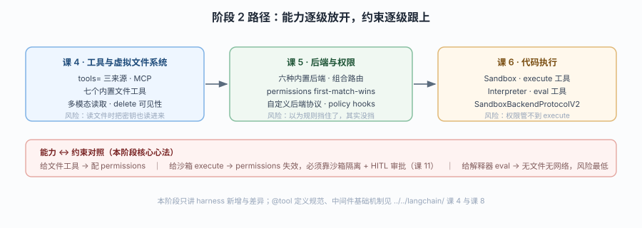

# 阶段 2：执行环境

> 所属课程：Deep Agents ｜ 故事章节：动手——「它能碰到什么，碰不到什么」 ｜ 上一阶段：[阶段 1](../1-定位与起跑/overview.md)

## 🎯 本阶段目标

- 能说清 agent 的"执行环境"由哪四层组成（工具 / 虚拟文件系统 / 权限 / 代码执行）
- 能为一个真实任务选对后端组合，并写出能挡住 `.env` 的权限规则
- 能判断"这件事该给沙箱的 `execute` 还是解释器的 `eval`"

## 📍 学习重点

- **8 个内置文件工具的边界差异**：`write_file` 覆盖写、`edit_file` 精确替换、`delete` 需 0.7 且可能被隐藏、`grep` 只做字面匹配——这些差别决定了 agent 会不会"悄悄毁文件"
- **后端决定"文件到底存在哪"**：同一个 `write_file` 调在 `StateBackend` 是内存（线程结束就没）、在 `StoreBackend` 是跨线程持久、在 `FilesystemBackend` 是真落磁盘
- **权限管不到沙箱**：这是最容易被误判的安全边界；沙箱暴露 `execute` 后 agent 可任意执行命令，声明式权限规则对它无效
- **不重复 LangChain 内容**：本阶段只讲 harness 新增或与 LangChain 有差异的部分；`@tool` 定义规范、中间件基础机制回扣 [`../../../langchain/`](../../../langchain/02-课程目录.md) 课 4 与课 8

## ✅ 必须掌握的知识点

| 知识点 | 所属课 | 学完应能 |
|--------|--------|----------|
| tools 参数与 MCP 接入 | 课 4 | 把自定义函数 / LangChain 工具 / MCP 服务三种来源一起塞进 `tools=` |
| 内置文件工具清单 | 课 4 | 列出 8 个文件工具（含 `execute`）+ `task`，说出各自最容易被误用的地方 |
| 多模态读取与 delete 的可见性 | 课 4 | 说清 `read_file` 什么时候返回内容块、`delete` 什么时候从模型视野里消失 |
| 内置后端六种 | 课 5 | 按"存哪 / 活多久 / 谁共享"三条轴为任务选后端 |
| CompositeBackend 路由 | 课 5 | 写出"默认放内存、`/memories/` 走 Store"这类组合及自定义后端协议 |
| permissions 规则与边界 | 课 5 | 写出 forbid 规则并指出它对沙箱无效 |
| Sandbox 与 execute | 课 6 | 判断什么任务需要真 shell（装依赖 / 跑测试 / 调 CLI） |
| Interpreters 与 eval | 课 6 | 判断什么任务只需要轻量可编程层（循环 / 批处理 / 结构化转换） |
| 两者选择边界 | 课 6 | 用三条判据（要不要装包 / 要不要碰文件网络 / 要不要 OS 环境）区分 |

## 🗺️ 本阶段路径图

> 看图：三个方框从"给它工具"（课 4）到"决定东西存哪、谁能碰"（课 5）再到"允许它真的执行代码"（课 6），风险逐级上升；底部灰色条是每加一层能力就该同步加的一道约束。

## 本阶段产出

- [x] `lessons/04-工具与虚拟文件系统.md`
- [x] `lessons/05-Backends后端与Permissions权限.md`
- [x] `lessons/06-代码执行Sandboxes与Interpreters.md`
