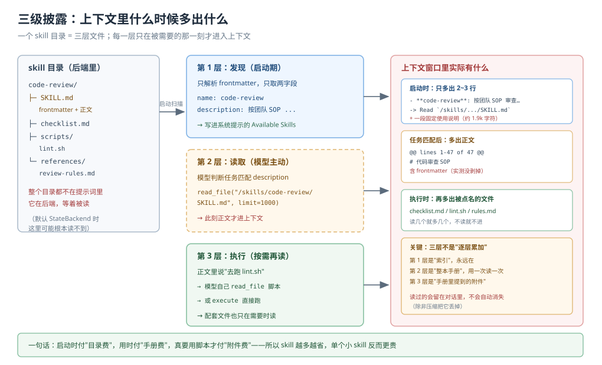
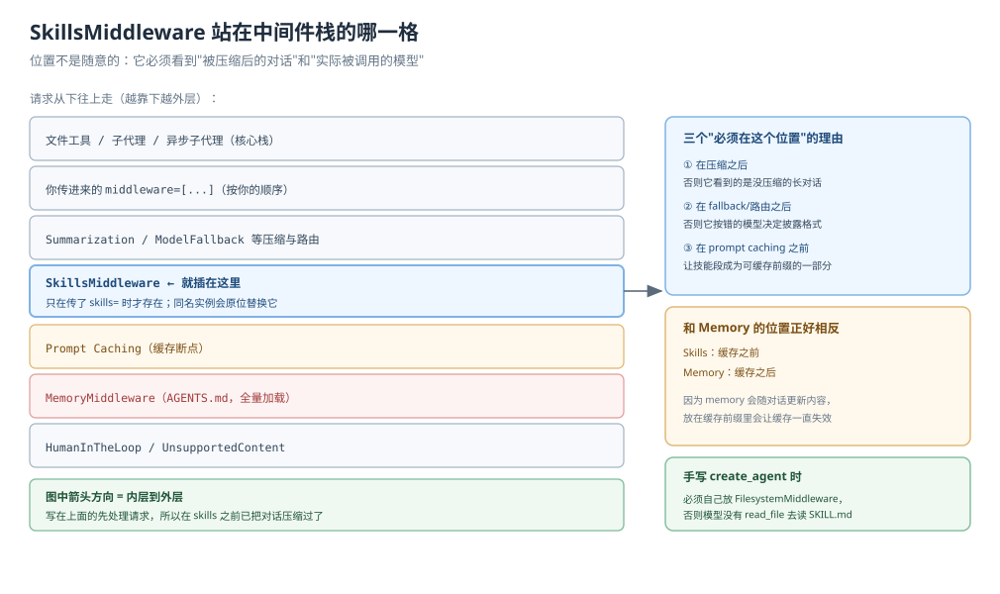
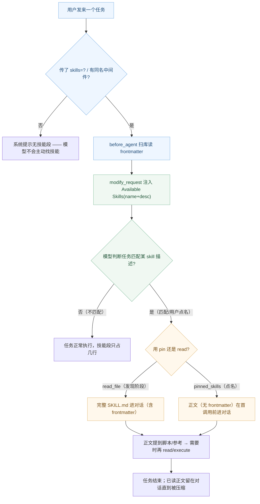

# 课 7：Skills 技能

> 所属阶段：阶段 3《上下文管理》｜ 水平：进阶 ｜ 本课知识点：Agent Skills 标准与 SKILL.md、渐进式披露、SkillsMiddleware 的插入位置
> 故事情节：主角想把团队的代码审查 SOP 教给 agent，但直接写进系统提示词会把每一次请求都撑胖——于是有了"用时再翻手册"的做法
> 📖 结论已按官方文档核对（核对于 2026-10 ｜ 来源：docs.langchain.com/oss/python/deepagents/skills、customization#skills）
> ✅ 代码结论实测于 2026-10-20 ｜ `deepagents 0.7.28` / `langchain 1.4.6` ｜ 隔离环境 `/tmp/da-probe`
> 本课配**应用实战**与**源码解析**（SkillsMiddleware 与披露链路）

## 🎯 本课目标

- 按 Agent Skills 标准写出一个 skill 目录（含 `SKILL.md` frontmatter 与配套文件）
- 说清"启动时读什么、任务需要时才读什么"——并据实测判断"什么时候该用 skills、什么时候不该用"
- 说清 `SkillsMiddleware` 为什么排在"你的中间件之后、提示缓存之前"，以及 `skills=` 与同名实例替换的关系

---

## 第一幕：起源与场景引入

你的团队有一份代码审查 SOP：怎么跑测试、先看哪几处 diff、按哪五类问题打标、输出什么格式。它已经改了三版，是被大家一起踩出来的。

你想把它教给 agent——但你有两怕：

- **直接写进系统提示词**：每一次请求都会把这几十行一并带上去。哪怕用户只是问一句"今天天气如何"，系统提示里也躺着你那份 SOP。几十行不算多，但这样的依托还有十几份（部署规范、SQL 风格、日志规范……），叠起来就是一次次被浪费的上下文。
- **不写嘛**：它每次做 review 都只会"凭感觉"，你永远不知道它这次有没有按最新版来。

主角遇到了和上一课完全对偶的问题：上一课（课 6）问"代码放哪跑"，这一课问"规矩放哪记"。

> 🎬 **场景**：你打开文档，看到一句话——"Skills 使用渐进式披露：启动时只看到 name 和 description，调用时才读完整指令。" 这正是你想要的：平时只付"目录费"，真正做 review 时才付"手册费"。


> 📌 **一句话本质**：技能是"按需加载的指令集"——它是一份普通 Markdown + 一个目录，但用"启动时给索引、用时给正文"的两段式披露，把"知识"和"为每次请求付费"解耦。
>
> ⚖️ **处境对照**：掌握 skills，你能在"这个规矩值得做成 skill 吗？"时给出量化答案（后面你会看到一组真实数字）；不掌握，你只会无脑把规则堆进系统提示词，然后看着上下文一天天胖下去。

---

## 第二幕：认知冲突

矛盾有两处。

**第一处：你说"渐进式披露"，可它到底省了什么？**

直觉上，skill 目录里那几十行正文，不读就不进上下文——看起来天经地义。但你马上会撞上三件反直觉的事：

- **单个小 skill 反而更贵**。因为启动时要带一段固定的英文使用说明（实测约 1.9k 字符），它不随 skill 数变化。你只挂一个三行的小 skill，成本几乎是纯负的。
- **读一次就把正文留在对话里**，之后每次 turn 都带着它，直到压缩把它丢掉。你以为的"用时才读"其实会变成"用过就一直带着"。
- **读到的正文含完整 frontmatter**（实测 `read_file` 返回 `@@ lines 1-47 of 47 @@` 时，`name:` 也在里面）——不是文档宣传的"只读正文部分"。

**第二处：`skills` 里的路径，根本不是你操作系统上的路径。**

你写 `skills=["./my_skills"]`，满心期待它去读当前目录，结果控制台静默地飘过一行日志，提示词里写着 **"No skills available yet"**。你没报错、没崩溃——它就这样"假装没有技能"。

因为 `skills` 的路径是**交给后端去解析的**：默认 `StateBackend` 根本不读磁盘，它只认识 state 里 `files=` 塞进去的东西；而 `FilesystemBackend(root_dir=...)` 会把 `/skills/` 当作它自己虚拟根下的一个目录。

> ❓ **问题**：渐进式披露到底省了什么、什么时候不省？`skills=["/skills/"]` 和 `skills=["./skills"]` 分别会怎样？`SkillsMiddleware` 为什么非要排在缓存前面？

---

## 第三幕：层层揭示

### 一眼全局图（进入细节前先看一眼）



> 看图：左边是整个 skill 目录（后端里）；中间是三级披露各自触发的时刻；右边是上下文窗口里"现在到底多了什么"。注意底部那句话——省不省，取决于 skill 的数量和体积。

### 本课地图（分几步走）

| 步 | 这一步要解决什么（人话） | 对应知识点 |
|:--:|------------------------|-----------|
| 1 | 认识 Agent Skills 标准，写出一个合法的 skill 目录 | 知识点 1：Agent Skills 标准与 SKILL.md |
| 2 | 搞清三级披露每级的触发时机与真实代价 | 知识点 2：渐进式披露 |
| 3 | 搞清 `SkillsMiddleware` 的位置、存在条件与替换规则 | 知识点 3：SkillsMiddleware 的插入位置 |

---

### 知识点 1：Agent Skills 标准与 SKILL.md

> 🧭 第 1/3 步｜承接：第一幕"规矩放哪" → 本步：写出第一份合法 skill
> 本知识点关键点：外部标准、目录结构、frontmatter 作用、四字段校验差异

#### 一句话定义

skill 是一个目录，里面至少有一个 `SKILL.md`，由 YAML frontmatter（元数据）和 Markdown 正文（指令）组成。这个格式遵循外部标准 **Agent Skills 规范**（agentskills.io），不是 Deep Agents 自创的。

#### 直觉建立（类比）

把 skill 想成一本"团队手册"：

- 封面（frontmatter）——只写着书名和一句话简介，贴在书架上给人挑。
- 正文（Markdown）——真正的操作步骤。平时压箱底，被挑中才翻开。
- 配套文件（`scripts/`、`references/`）——正文里说"跑这个脚本"时才去拿。

关键在：**书架只摆封面**。一百本书躺在仓库里，书架上永远只有一百行书名——这就是可扩展的关键（后面你会看到真实数字）。

> 💡 **类比的边界**：技能是"文档驱动"的，不是"代码驱动"的。它本质是给模型读的说明，不是给程序调用的函数。所以一个 skill 的"正确性"取决于说明书写得多好，不是它能否 import。

#### 核心原理

**目录结构**（规范要求的最低形态）：

```
code-review/
├── SKILL.md          # 必需的 frontmatter + 正文
├── checklist.md      # 配套参考（可选）
└── scripts/          # 可执行脚本（可选）
    └── lint.sh
```

**frontmatter 的四大字段**（实测校验行为，差异很关键）：

| 字段 | 必填 | 校验失败后的行为 |
|------|:---:|-----------------|
| `name` | ✅ | 名字不合规（如大写、超 64、与目录名不符）→ **只告警、仍加载**；缺失 → 丢弃 |
| `description` | ✅ | 缺失/为空 → **直接丢弃**（最关键） |
| `license` | ❌ | 仅存进元数据，并在技能列表里显示 |
| `compatibility` | ❌ | 同 license |

实测的几条规则：

```
name: MySkill（大写）      -> 告警 "must be lowercase alphanumeric..." 仍加载
name: a--b（连续连字符）     -> 告警，仍加载
name: other（与目录不符）    -> 告警 "must match directory name"，仍加载
缺 description              -> 丢弃（Skipping ...: missing required 'name' or 'description'）
没有 frontmatter            -> 丢弃（no valid YAML frontmatter found）
frontmatter 非法 YAML       -> 丢弃（Invalid YAML in ...）
description 超 1024        -> 截断到 1024，只影响模型"决定要不要用"时看到的信息
```

> 关键差别记住：**名字写歪了没事（只告警），`description` 写错了或者干脆不写，整个 skill 直接消失。** `description` 是唯一让模型在发现阶段"选中"你的机会，所以它比正文还重要。

#### 示例演示

```markdown
---
name: code-review
description: 按团队 SOP 审查代码 diff，输出分级问题清单。当用户要求 review、审查代码、检查一段改动时使用。
---

# 代码审查 SOP

## 步骤
1. 先看 git diff --stat，确认改动范围
2. 逐文件读 diff，按五类问题打标
3. 按严重度排序，输出到表格

## 五类必查项
- 语义一致性 / 空值与边界 / 异常处理 / 资源泄露 / 测试覆盖
```

#### 常见误区

- ❌ 「`name` 写错会加载失败」——不会，只告警仍加载；真正让它消失的是 `description` 缺失。
- ❌ 「skill 是某种高级代码单元」——它只是一个目录 + 一份 Markdown。模型靠读文档来"执行"它。
- ❌ 「frontmatter 可以省略」——没有 frontmatter 或格式非法，整个 skill 被静默跳过。

#### 一句话记住

> skill 是一本"封面在外、正文压箱"的手册：`name` 歪了只是告警，`description` 丢了整个消失——写好封面，才有人翻开你。

#### 🗣️ 行话对照

| 说你听到的 | 意思 |
|-----------|------|
| "Agent Skills 标准" | agentskills.io 的开放规范，Deep Agents 遵循它 |
| "frontmatter" | SKILL.md 开头的 `---` 段，存元数据 |
| "skill 库" | 存放多个 skill 目录的根目录，即 `sources` |
| "source" | 一个 skill 库路径；同名技能靠前的会被靠后的覆盖 |

#### 官方文档

- [Skills（docs.langchain.com）](https://docs.langchain.com/oss/python/deepagents/skills) —— 标准结构 / 三级披露 / 编写建议
- [Agent Skills 规范](https://agentskills.io/specification) —— 开放标准本身

---

### 知识点 2：渐进式披露

> 🧭 第 2/3 步｜承接：已会写合法 skill → 本步：搞清它到底省了什么、什么时候省
> 本知识点关键点：三级时机、固定成本、对话残留、与 Memory 相反

#### 一句话定义

渐进式披露把一个 skill 的加载拆成三级：启动时只向系统提示注入 frontmatter 里的 `name` 与 `description`（索引层）；任务匹配后由模型主动 `read_file` 读正文（指令层）；正文里提到的脚本/参考资料则在需要时才读（资源层）。上下文只增长"当前任务需要的量"。

#### 直觉建立（类比）

回到"书架"：**书架这一层**（发现）——所有书的名字和简介都在，占一行一本；**翻开书**（读取）——被挑中的那本才摊开；**翻开书里的附录**（执行）——真正要抄公式时才翻到附录页。

**但书架本身是要花钱的**——这是文档往往不强调、而你实测会撞上的事。

> 💡 **类比的边界**："渐进"不是"免费"：第一级有一个固定的、不随 skill 数量变化的开销（那段英文使用说明），所以"省不省"不是二值，是数量问题。

#### 核心原理

**三级触发时机（源码 `skills.py` 的 `before_agent` / `before_model` / `modify_request` 实测）：**

| 级 | 谁触发 | 上下文里多了什么 | 实测 |
|----|--------|----------------|------|
| 1 发现 | 启动时（`before_agent` 扫库） | `name` + `description` + 一段固定说明 | "No skills..." 或技能表 |
| 2 读取 | 模型主动 `read_file` | 完整 SKILL.md（**含 frontmatter**） | `@@ lines 1-47 of 47 @@` |
| 3 执行 | 模型读正文里点名的脚本 | 那些文件 | 按需 |

**一个必须算清的数字：`description` 是唯一的"选中钩子"。** 源码在 `_parse_skill_metadata` 里会对超长 description 告警并截断到 1024 字符——但注意它只说"决定是否使用时的信息被裁掉"，正文该怎么读还怎么读。

**Write 高优先级（这是个人偏见——以你团队考核为准）：** 同一份技能清单里，靠前的描述决定模型选不选它，靠后的躺在目录里。

**实测省多少（关键数字，务实建议）**：

- 每个 skill 启动期只增加 `name` + `description` 两行（约几十字符）
- 但固定说明文字约 **1900 字符**，不随 skill 数变化
- 单测数据：

```
 skills   正文总量    启动期增量     占比
    1        500      1942        388%   ← 小 skill 更贵！
    1       2000      1942         97%
    3       6000      2126         35%
   10      20000      2770         14%
   10      80000      2770        3.5%   ← 规模越大越省
```

> 结论：**skill 越"多而厚"越划算；一两个三行小 skill 会让固定成本白白烧掉。** 换句话说——别为了"看起来规范"把一个三句话的规则做成 skill，把它写进 `AGENTS.md`（课 8）或直接留意它并入一个已存在的技能里可能更好。

**读正文留下的"尾巴"**：模型 `read_file` 后，正文进的是**对话**（不是系统提示），它会一直留在上下文里直到被压缩。所以"用时才读"的真实语义是"不读就不进、读过就带着"——这两者差的正是长会话里那几轮消耗。

#### 示例演示

```python
from deepagents import create_deep_agent
from deepagents.backends import FilesystemBackend

agent = create_deep_agent(
    model="openai:gpt-5.4",
    backend=FilesystemBackend(root_dir="/path", virtual_mode=True),
    skills=["/skills/"],   # 注意：是给后端看的虚拟路径
)
# 启动：系统提示出现 Available Skills 列表
# 用户说"帮我把这个 PR 过一遍规范" → 模型 read_file("/skills/code-review/SKILL.md")
```

#### 常见误区

- ❌ 「skills 永远省 token」——单个/小 skill 不省，甚至更贵（上面的数字）。
- ❌ 「读到的是纯正文」——实测 `read_file` 返回了完整 frontmatter（`name:` 也在）。
- ❌ 「用过就没了」——读过会留在对话里，压缩才把它丢。
- ❌ 「只给 `skills` 传绝对路径即可」——路径由后端解析，默认 StateBackend 不认识磁盘路径。

#### 一句话记住

> 启动只付目录费，用时才付手册费；但"目录"本身也要租金——个数越少越贵、字数越多越划算。

#### 🗣️ 行话对照

| 说你听到的 | 意思 |
|-----------|------|
| "progressive disclosure" | 分层披露：索引 → 手册 → 附件 |
| "1 级 / 2 级 / 3 级" | 发现 / 读取 / 执行 |
| "发现阶段" | 启动时扫描 frontmatter 阶段 |

#### 官方文档

- [How skills work](https://docs.langchain.com/oss/python/deepagents/skills#how-skills-work) —— 三级披露图示
- [编写有效的技能](https://docs.langchain.com/oss/python/deepagents/skills#writing-effective-skills) —— 正文 5,000 token 内、description 具体的建议

---

### 知识点 3：SkillsMiddleware 的插入位置

> 🧭 第 3/3 步｜承接：已会写、已会省 → 本步：搞清它接在哪、什么时候在、怎么替换
> 本知识点关键点：存在条件、缓存前缀前、模型视角、原位替换、fork 继承

#### 一句话定义

`SkillsMiddleware` 是这段披露链路的"主编"：它负责在启动时扫库写索引（`before_agent`），在每次模型调用前写入索引段（`modify_request` → `wrap_model_call`），在模型读完某技能后披露其绑定的工具。它被排在**你的中间件之后、提示缓存之前**，并且**只在传了 `skills=` 时才存在**。

#### 直觉建立（类比）

把它想成编辑部里的审稿主编。它必须：

- 在**所有编辑改完稿之后**（压缩 / fallback 之后）才决定这一期放哪些技能，这样它看到的是"定稿"而非草稿。
- 在**排版之前**（缓存断点之前）把技能目录段塞进稿纸，这样这段就能和前面的内容一起进缓存、下次直接命中。
- 它只在"这份报纸有技能栏目"（传了 `skills=`）时才会被招进编辑部。

> 💡 **类比的边界**：位置是"顺序"问题，不是"安全"问题。排在缓存前是为了让技能段可缓存；但这不影响"模型能不能读到任何 SKILL.md"——那是个安全边界，课件 6 讲过怎么挡。

#### 核心原理

**1. 存在条件（源码 `graph.py`）：**

```python
if skills is not None:
    deepagent_middleware.append(SkillsMiddleware(backend=backend, sources=skills))
```

只有这一行。不看 `middleware` 里有没有别人传同名的——除非传入的 `middleware` 里有一个 `name == "SkillsMiddleware"` 的实例，它会被拿去**原位替换**默认的：

```python
# graph.py `_passed_skills_sources`：从你传的 middleware 里找同名实例的 sources
if skills is None:
    skills = _passed_skills_sources(middleware or ())
```

所以两种写法的效果完全等价——只要保证那个实例叫 `SkillsMiddleware`：

```python
# 写法一：传 skills=
agent = create_deep_agent(model=m, skills=["/skills/"])

# 写法二：传同名实例（原位替换默认槽位）
mw = SkillsMiddleware(backend=fsb, sources=["/skills/"])
agent = create_deep_agent(model=m, middleware=[mw])
```

实测：写法二不传 `skills=` 也生效（`Available Skills` 照常出现）。

**2. 位置顺序，配一张图就够了：**



> 看图：`SkillsMiddleware` 在 Summarization / ModelFallback 之后（所以能看到压缩后的对话和实际被调的模型），在 Prompt Caching 之前（所以技能段能进缓存前缀）。它与 `MemoryMiddleware` 刻意一前一后——memory 会随对话变，放缓存前缀里会让缓存一直失效。

**3. fork 子代理继承（`graph.py:712`）**：子代理默认继承父代理的 `skills`，且子代理 spec **不能**自己定义 `skills`——它只能被注入或继承。

**4. 披露链路的三个动作**：

- `before_agent`：扫配置的 `sources`，解析每个 SKILL.md 的 frontmatter，把 `name` + `description` 汇总进 `skills_metadata` state（顺带收集加载错误）。
- `modify_request`：把技能表渲染进系统提示的 `Available Skills` 段。
- `wrap_tool_call` + 披露：模型读到某个技能后，若其 frontmatter 含 `metadata.include_tools`，则把其中列出的工具在后续模型调用时披露（见下方进阶）。

**进阶：`pinned_skills` 与 `include_tools`**（这是课程骨架未提到、但你会在官方文档撞见的能力）：

- **`pinned_skills`**：用户点名要用某技能时（如 `/write-tests`），把它的正文在**首次模型调用前**就塞进对话（无 `read_file` 往返）。实测：传 `pinned_skills=["write-tests"]` 后，第一次模型调用就收到带 `lc_source=pinned_skill` 的 HumanMessage，正文已在其中，**且不含 frontmatter**（这里是剥掉的，和 `read_file` 的路径不同）。
- **`metadata.include_tools`**：技能在 frontmatter 里列出它要用到的工具；这些工具默认不进上下文，直到模型**读过该技能**才披露。实测 8 → 9 个工具在后一轮出现。这是"工具 schema 与说明书一起进上下文"的机制。

#### 示例演示

```python
# 用户直接点名技能：正文进上下文，省掉 read_file 往返
agent.invoke(
    {"messages": [{"role": "user", "content": "/write-tests 帮我补测试"}],
     "pinned_skills": ["write-tests"]},
    config,
)
```

#### 常见误区

- ❌ 「只要传了 middleware 就自动有 skills」——只有传 `skills=` 或传 `name="SkillsMiddleware"` 的实例，才装配它。
- ❌ 「skills 与 memory 都走缓存前缀」——skills 在缓存前，memory 在缓存后，刻意错开。
- ❌ 「子代理可以自己配技能」——继承，不能自配。
- ❌ 「改了磁盘上的 skill 会自动热加载」——不会；需 `skills_metadata=None` 触发重载。

#### 一句话记住

> 它是在"定稿之后、排版之前"被招进来的技能栏目主编——只在你点名要技能栏目时在位，且你的同名编辑会顶掉默认的它。

#### 🗣️ 行话对照

| 说你听到的 | 意思 |
|-----------|------|
| "原位替换" | 同名（`SkillsMiddleware`）实例替换默认槽位 |
| "cache prefix" | 提示词的前缀部分，只能从头累加、不能改 |
| "fork 子代理" | 继承技能的子代理；不能自配技能 |

#### 官方文档

- [Customization: skills](https://docs.langchain.com/oss/python/deepagents/customization#skills) —— 中间件装配说明
- [SkillsMiddleware（reference）](https://docs.langchain.com/oss/python/deepagents/middleware/skills) —— 构造参数 / 方法列表

---

## 第四幕：实操验证（复现与验证）

### 4.1 机制验证：四组探针带你亲手走一遍

**探针 1：不传 `skills=` 与传了的系统提示差异**

```python
from deepagents import create_deep_agent
agent_a = create_deep_agent(model="openai:gpt-5.4")          # 无技能段
agent_b = create_deep_agent(model="openai:gpt-5.4",
                            backend=FilesystemBackend(root_dir="/p", virtual_mode=True),
                            skills=["/skills/"])             # 有 Available Skills
```

含义：不传则系统提示根本不渲染技能段；传了才出现 `**Available Skills:**`。

**探针 2：路径由后端解析（最容易踩的坑）**

```python
from deepagents import create_deep_agent
from deepagents.backends import FilesystemBackend, StateBackend

# StateBackend + 磁盘绝对路径 -> 空态（No skills available yet）
agent1 = create_deep_agent(model="openai:gpt-5.4", skills=["/tmp/.../skills"])

# FilesystemBackend(virtual_mode=True) + 磁盘绝对路径 -> 也空态（该路径被当作虚拟路径）
agent2 = create_deep_agent(model="openai:gpt-5.4",
                           backend=FilesystemBackend(root_dir="/p", virtual_mode=True),
                           skills=["/tmp/.../skills"])

# FilesystemBackend + 虚拟路径 -> 生效
agent3 = create_deep_agent(model="openai:gpt-5.4",
                           backend=FilesystemBackend(root_dir="/p", virtual_mode=True),
                           skills=["/skills/"])
```

实测对照（同一个 `root_dir` 目录）：

```
StateBackend    + 磁盘绝对路径   → No skills available yet
Filesystem(vm)  + 磁盘绝对路径   → No skills available yet
Filesystem(vm)  + /skills/      → Available Skills 里列出了 name+desc
StateBackend    + files= 预置    → 生效（值需 {content, encoding}）
```

**探针 3：全身发现正确的提示段长什么样**

```
**Available Skills:**

- **code-review**: 按团队 SOP 审查代码 diff，输出分级问题清单。当用户要求 review 时使用。
  -> Read `/skills/code-review/SKILL.md` for full instructions

**How to Use Skills (Progressive Disclosure):**
...
```

`description` 是模型"选中"你的唯一钩子；`Read .../SKILL.md` 是它"翻开手册"的入口。

**探针 4：读全文会拿到完整 frontmatter**

```
@@ lines 1-47 of 47 @@
---
name: code-review
description: ...
---
# 代码审查 SOP   <- 正文
```

> 和 `pinned_skills` 对比：pinned 的正文**剥掉**了 frontmatter（`<skill ...>` 包裹的纯正文）；`read_file` 读的是完整文件。两条路径行为不一致，别想当然。

### 4.2 应用实战：把团队代码审查 SOP 做成按需加载的技能包（入口）

本课实战要解决"规矩放进系统提示词太胖、不写又守不住版本"的问题。完整代码、运行步骤与自检清单见：

📄 **[应用实战 07：代码审查 SOP 技能包](../../../应用实战/07-Skills技能.md)**

一句话预告：你会先徒手写一个合法 skill 目录，再在真实 agent 图上验证三级披露的触发；然后测量"技能数量 × 正文体积"的启动成本曲线，回答"它到底省了多少"；最后把 SOP、脚本、参考文档拆进 `scripts/` 与 `references/`，并用 `pinned_skills` 让用户点名时正文直接进上下文。

🔬 **配套源码解析**：[源码解析 07：SkillsMiddleware 与披露链路](../../../源码解析/07-SkillsMiddleware与披露链路.md)——回答"`skills=` 不是路径而是后端视角的键"、"披露发生在哪一个 hook"、"`include_tools` 的工具为什么读之前看不到"。

## 第五幕：体系收束

三个知识点在本课的因果链：

- **写**（知识点 1）回答"规矩怎么放"——一个目录 + 一份带 frontmatter 的 SKILL.md，`description` 决定它会不会被选中。
- **读**（知识点 2）回答"什么时候进上下文"——启动只付目录费，用时付手册费；但固定成本和残留尾巴意味着它只在"多而厚"时划算。
- **装**（知识点 3）回答"这套机制在哪跑"——一个只在 `skills=` 时存在的中间件，夹在定稿与排版之间。

一句话收束整课：**技能是"按需披露"的知识——平时一行目录、用时整本手册；但别为一个小规矩付整本目录的租金，那笔账课 8 的 `AGENTS.md` 更会算。**

## 🐞 常见误区（本课专属）

| 误以为 | 实际 | 怎么排查 |
|--------|------|---------|
| "`skills` 传磁盘路径就行" | 路径由后端解析，默认 StateBackend 不认识磁盘 | 看日志有无 `Cannot load skills from` |
| "skills 永远省 token" | 单个小技能被固定说明（约 1.9k 字符）拖累，反而更贵 | 按"数量×体积"算启动增量 |
| "`name` 写错会加载失败" | 只告警仍加载；`description` 缺失才丢弃 | 看日志 `must match directory name` |
| "用过就少了" | `read_file` 会把正文留进对话，压缩才丢 | 长会话后看 turn 长度 |
| "磁盘改了技能会自动生效" | 每 thread 只加载一次，需 `skills_metadata=None` 重载 | 重载后再查 Available Skills |

### ⏳ 与过时说法对照

| 过时的说法 | 现在该怎么说 |
|-----------|-------------|
| "skills 是 Deep Agents 特有的" | 遵循 agentskills.io 开放标准，其它 agent 系统也可复用 |
| "`read_file` 拿到的是纯正文" | 实测拿到完整 frontmatter + 正文（`name:` 也在） |
| "skill 正文越详细越好" | 官方建议正文 ≤ 5,000 token，启动只读 frontmatter 才撑得起大规模 |

## 一图总结



> 读图指引：先判断"技能栏目在不在"（左），再判断"任务匹不匹配"（中），最后走两条并行的取正文路径（右）——`read_file` 拿完整文件、`pinned` 拿剥掉 frontmatter 的正文。两条路径的输入行为不相同，别混。

## 课后小测

**Q1**：你传了 `skills=["./my_skills"]`，但看到提示词写 "No skills available yet" 且日志里有 `path_not_found`。最可能的原因？
- A. `my_skills` 目录下没有合法的 `SKILL.md`
- B. 路径被当成给后端看的键，默认 `StateBackend` 不读进程磁盘
- C. 需要传 `checkpointer=True` 才能扫描
- D. skill 正文超过了 5,000 token

<details><summary>答案与解析</summary>

**答案：B**。`skills` 里的路径是给后端解析的，不是操作系统路径。`./my_skills` 在默认 `StateBackend` 的虚拟文件系统里不存在，于是 `path_not_found`、提示词渲染成空态。改正法是用 `FilesystemBackend(root_dir=...)` + 虚拟路径（如 `/skills/`），或用 `files=` 预置进 state。

</details>

**Q2**：一个 skill 的 `SKILL.md` 里 `name` 与父目录名不一致。会发生什么？
- A. 整个 skill 被丢弃
- B. 加载成功，只打一条"建议改名"的告警
- C. 抛 `ValueError` 中断启动
- D. 自动改成目录名

<details><summary>答案与解析</summary>

**答案：B**。`_validate_skill_name` 对名字校验失败只 `logger.warning` 并继续加载（"warn but continue loading for backwards compatibility"）。真正让 skill 消失的是 `description` 缺失或 frontmatter 非法。

</details>

**Q3**：关于渐进式披露，以下哪个说法正确？
- A. skill 一定是越加越省 token
- B. 单个很小的 skill 可能因固定说明文字而更费
- C. `read_file` 只读正文、不读 frontmatter
- D. 读过技能后正文会立即从上下文移除

<details><summary>答案与解析</summary>

**答案：B**。固定说明约 1.9k 字符不随 skill 数变化，一两个几行的技能反而更贵（实测 1 个 500 字符的技能占比 388%）；`read_file` 会返回含 frontmatter 的完整内容；读过会留进对话直到压缩。

</details>

**Q4**：你想让用户输入 `/write-tests` 时，该技能的正文在第一次模型调用前就进入上下文。应该怎么做？
- A. 传 `skills_metadata=None`
- B. 传 `pinned_skills=["write-tests"]`
- C. 传 `permissions=[...]`
- D. 只需把 SKILL.md 放到错误目录

<details><summary>答案与解析</summary>

**答案：B**。`pinned_skills` 会在下一次模型调用前把对应 SKILL.md 正文（剥掉 frontmatter）作为一条 `lc_source=pinned_skill` 的 HumanMessage 塞进对话，省掉 `read_file` 往返。`skills_metadata=None` 是重载技能，与"点名进上下文"无关。

</details>

**Q5**：某技能在 frontmatter 里写了 `metadata.include_tools: create_ticket`。模型什么时候能看到 `create_ticket` 工具？
- A. agent 一启动就看到
- B. 只有它用 `read_file` 读过该技能后
- C. 只要传了 `tools=[create_ticket]` 就能看到
- D. 永远看不到

<details><summary>答案与解析</summary>

**答案：B**。`include_tools` 是"读到才披露"——实测首轮模型可见工具 8 个（无 create_ticket），读过 skill 后变为 9 个。工具 schema 在技能被读之前不进上下文；直接调用它会报 unknown-tool。

</details>

---

## 🚀 下一批接力提示词

> 学完本课后，**复制下面这段文字发给 AI**，即可进入下一课（无需重新描述上下文）：

```
继续学 Deep Agents。我的学习档案在 langchain/deepagents/00-学习档案.md，
刚学完阶段 3《上下文管理》的课 7《Skills 技能》全部 3 个知识点
（Agent Skills 标准与 SKILL.md / 渐进式披露 / SkillsMiddleware 的插入位置），并做完了应用实战与源码解析。
请按大纲继续讲阶段 3《上下文管理》的课 8《Memory 记忆》。
```

## 🧭 课程导航

🎯 **练一练（本课应用实战）**：[第 7 课实战 · 代码审查 SOP 技能包](../../../应用实战/07-Skills技能.md)

🔬 **本课源码解析**：[SkillsMiddleware 与披露链路](../../../源码解析/07-SkillsMiddleware与披露链路.md)

⬅️ **上一课**：[课 6：代码执行 Sandboxes 与 Interpreters](../../2-执行环境/lessons/06-代码执行Sandboxes与Interpreters.md)

➡️ **下一课（预告：Memory 记忆，"必须常驻"的另一半）**：[课 8：Memory 记忆](./08-Memory记忆.md)

📚 **返回目录**：[课程目录](../../../02-课程目录.md)
