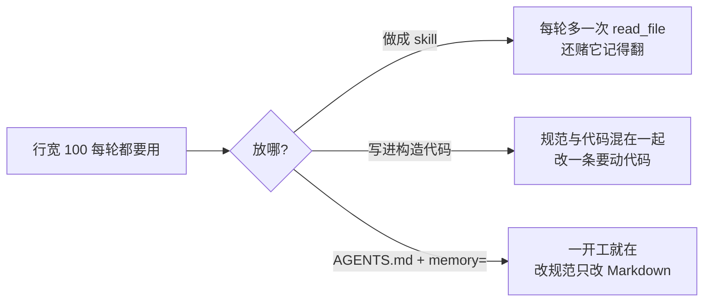
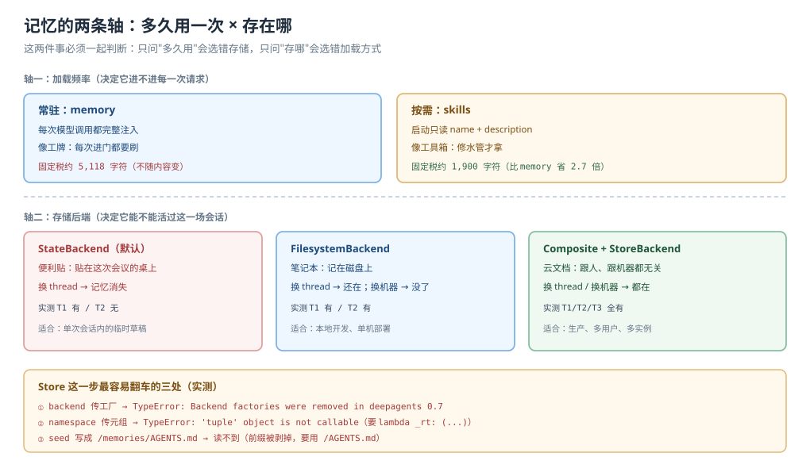
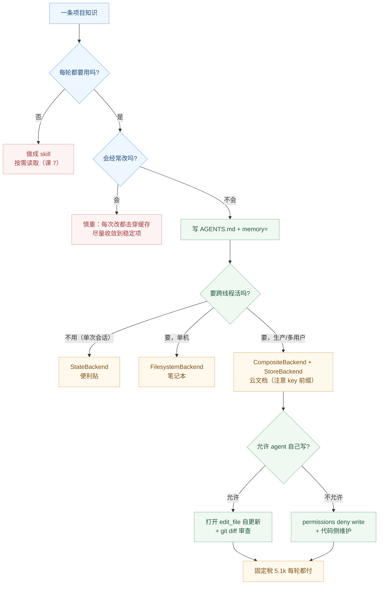

# 课 8：Memory 记忆

> 所属阶段：阶段 3《上下文管理》｜ 水平：进阶 ｜ 本课知识点：AGENTS.md 与 memory 参数、全量加载 vs 按需加载、后端落点与 agent 自更新
> 故事情节：主角把"我们项目用 ruff、行宽 100、禁止裸 except"写进技能，结果 agent 每次都要先翻一遍；换成记忆后终于"一开工就知道"
> 📖 结论已按官方文档核对（核对于 2026-10 ｜ 来源：docs.langchain.com/oss/python/deepagents/memory、overview、going-to-production）
> ✅ Python 侧实测于 2026-10-21 ｜ `deepagents 0.7.28` / `langchain 1.4.6` ｜ 隔离环境 `/tmp/da-probe`
> ✅ TypeScript 侧实测于 2026-10-22 ｜ `deepagents 1.15.1` / `@langchain/core 1.2.20` / Node 22.22.2 ｜ `playground-ts/l08-memory.ts`
> 本课配**应用实战**与**源码解析**（MemoryMiddleware 与缓存断点）
>
> 🧭 **只学一种语言也可以**：每个代码块都是 `::: code-group`，左标签 Python、右标签 TypeScript。两侧结论不同的地方用 `🇹🇸` 单独标出；没有标记的结论两侧通用。

## 🎯 本课目标

- 用 `memory=` 挂上 `AGENTS.md`，让 agent 一开工就带上项目规范
- 用"长度预算 + 变化频率"两个维度，判断一条知识该放 skills 还是 memory
- 说清记忆内容存在哪、agent 怎么自己更新它，以及**写错了怎么收拾**

---

## 第一幕：起源与场景引入

上一课你把团队代码审查 SOP 做成了 skill。它工作得很好——但今天你发现了一个新的别扭。

每次让 agent 写代码，它都要先 `read_file` 去翻一遍 `code-style/SKILL.md` 才知道"用 ruff、行宽 100"。这件事它**每轮都在做**，因为行宽 100 是它每次写代码都要用的常识，而不是"只在审查时才需要的流程"。

你把"我该按什么风格写"这种**每次都要用**的知识做成了"用时才翻"的手册。方向反了。

- **做成 skill**：每轮多一次 `read_file` 往返，还要祈祷它这次记得去翻。
- **写进系统提示词（手写）**：能解决，但你把"规范"和"代码"混在同一处维护，改一条规范要动 agent 的构造代码。

> 🎬 **场景**：你在文档里看到另一半答案——"与 skills 不同，记忆文件**总是被加载**"。`AGENTS.md` 是 agents.md 这个外部约定，一份放在仓库里、人和 agent 都能读的 Markdown。`memory=` 参数指向它，`MemoryMiddleware` 负责在每次请求前把它塞进系统提示。



> 📌 **一句话本质**：记忆是"常驻的作业须知"——它不是知识库，是**每次开工都必须摆在桌上的那一页**。它用"每次请求都付固定税"换"永远不用提醒"。
>
> ⚖️ **处境对照**：掌握 memory，你会明白"什么该常驻、什么该按需"是阶段 3 的核心判断，也能算清这笔固定税到底多贵；不掌握，你要么把整本手册塞进常驻区（上下文天天胖），要么把该常驻的常识做成 skill（每轮多绕一圈）。

---

## 第二幕：认知冲突

**第一处：你说"只加一页须知"，可这页须知的税很重。**

直觉上，`AGENTS.md` 写多长就付多少。实测不是——**即使 AGENTS.md 是空文件，你也付 5118 字符**。那是 `MemoryMiddleware` 自带的一大段 `memory_guidelines`（讲什么时候该记、什么时候不该记、怎么记），它不随你的内容变化。

::: code-group

```text [Python]
AGENTS.md 正文   提示总长   固定税占比
        0        5124      100.0%
      500        5618       91.1%
     2000        7118       71.9%
    20000       25118       20.4%
```

```text [TypeScript]
AGENTS.md 正文   提示总长   增量
        0        4470        0
      500        4963      +493
     2000        6463     +1993
```

:::

也就是说：**"把 AGENTS.md 写短"能省的钱，远小于"这段固定说明"本身**。这直接影响判断——如果你只是想加三条规则，付 5k 级字符的固定税是否值得？（对比课 7：skills 的固定税约 1900 字符，更便宜。）

> 🇹🇸 两侧数字不同但量级一致：Python 固定税 5118 字符，TS 4470 字符（少约 13%）。这不是谁"更省"，而是两侧 `memory_guidelines` 的文案长度略有出入——**固定税这个机制本身两侧完全相同**，正文仍然是线性叠加（TS 实测：+493 字符的正文带来 +493 的增量，一分不多一分不少）。判断逻辑不受这个差异影响：仍然是"每轮都要用才值得付"。

**第二处：默认情况下，记忆连线程都活不过去。**

你兴致勃勃让 agent 记住"用户偏好中文"，切到下一个对话，它忘得一干二净。因为默认 `StateBackend` 把文件存在 **当前 thread 的 state** 里——换 thread 就是新 state，记忆不存在。

要跨线程，必须换后端。而换后端时还有一个官方文档示例都没讲清的坑：**`StoreBackend` 的 key 是剥掉路由前缀之后的路径**。

**第三处：它能自己写记忆，写错了也会一直错下去。**

`memory_guidelines` 明确鼓励它"发现偏好就及时写"。这很有用，但也意味着：它可能把"用户这次随口一说"记成"永久偏好"，然后此后每个会话都读到这条错误认知。而纠正方式只有一条——改那个文件。

> ❓ **问题**：`AGENTS.md` 到底该写多长？记忆该放哪个后端？它自己写错了怎么办？

---

## 第三幕：层层揭示

### 一眼全局图（进入细节前先看一眼）



> 看图：左边是"加载频率"轴——memory 常驻、skills 按需；右边是"存在哪"轴——State（活不过线程）、Filesystem（活过线程、活不过机器）、Store（真持久）。中间那条横线是"这段内容到底该放哪"的判断。**两个维度必须一起看**：只问"多久用一次"会选错存储，只问"存哪"会选错加载方式。

### 本课地图（分几步走）

| 步 | 这一步要解决什么（人话） | 对应知识点 |
|:--:|------------------------|-----------|
| 1 | 认识 AGENTS.md 与 `memory=`，把规范挂上去 | 知识点 1：AGENTS.md 与 memory 参数 |
| 2 | 算清"常驻税"，学会判断什么该常驻 | 知识点 2：全量加载 vs 按需加载 |
| 3 | 选对后端让记忆活下来，管住 agent 的自更新 | 知识点 3：后端落点与 agent 自更新 |

---

### 知识点 1：AGENTS.md 与 memory 参数

> 🧭 第 1/3 步｜承接：第一幕"规范放哪" → 本步：把规范挂上去，看到它长什么样
> 本知识点关键点：外部约定（agents.md）、`memory=` 参数、`MemoryMiddleware` 的存在条件、HTML 注释剥离

#### 一句话定义

`AGENTS.md` 是 [agents.md](https://agents.md/) 这个外部约定的一份 Markdown 文件，用来放"给 AI 看的工作须知"。Deep Agents 通过 `memory=[...]` 参数把这些文件在启动时全量读进来，由 `MemoryMiddleware` 注入系统提示。

#### 直觉建立（类比）

把 `AGENTS.md` 想成贴在工位隔板上的**作业须知**：

- 它不解释"怎么做代码审查"（那是手册，放技能库）
- 它只写"本工位规矩"：用什么工具、什么风格、什么不许做
- 它每天开工都在眼前，所以你**不会忘**，但也**天天占着那块板**

> 💡 **类比的边界**：隔板上的须知是给"在这个工位干活的人"看的；`AGENTS.md` 的内容会进入**每一次请求**的系统提示，包括用户只是问"今天几号"的那一次。它不是"贴一次省一辈子"，是"贴一次每次都要念一遍"。

#### 核心原理

**注入形态**（实测，`memory=["/AGENTS.md"]`）：

```
<agent_memory>
/AGENTS.md

# 项目规范

## 代码风格
- 用 ruff，行宽 100
- 禁止裸 except

</agent_memory>

<memory_guidelines>
    The above <agent_memory> was loaded in from files in your filesystem...
    **Trust and verification:** ...
    **When to update memories:** ...
    **When to NOT update memories:** ...
</memory_guidelines>
```

三件事值得注意：

1. **路径会作为标题出现在内容里**（`/AGENTS.md` 那一行）。多个源时，模型能分辨"这条规矩来自哪个文件"。
2. **`<memory_guidelines>` 是固定的**，约 5,118 字符。它是"该不该记"的行为准则，不是你的内容。
3. **HTML 注释的处理，两侧相反** —— 这是本课双语差异里最容易踩的一处，见下。

> 🇹🇸 **HTML 注释：Python 剥离、TS 保留**
>
> ::: code-group
>
> ```text [Python]
> 原文：# 规范\n- 用 ruff\n<!-- 内部备注：不应出现 -->
> 提示词含 "内部备注" → false   （已被剥离）
> ```
>
> ```text [TypeScript]
> 原文：# 规范\n- 用 ruff\n<!-- 内部备注：不应出现 -->
> 提示词含 "内部备注" → true    （未被剥离，原样进入系统提示）
> ```
>
> :::
>
> 后果很直接：Python 侧可以把 HTML 注释当成"只给人看、不占模型上下文"的维护说明；**TS 侧这么做会让注释白占 token**（连 `@platform-team 维护` 这种话也会被模型读到，甚至可能被它当作指令）。
>
> TS 侧的替代做法是把维护说明放在 `AGENTS.md` 之外的独立文件（如 `CONTRIBUTING.md`），或者接受这部分开销。TS 源码里搜不到任何注释剥离逻辑，这是**能力缺失**而不是开关没打开。

**多源按序拼接，不是覆盖**（与 skills 的同名覆盖正好相反）：

::: code-group

```text [Python]
memory=["/user/AGENTS.md", "/proj/AGENTS.md"]
→ 两段都在；用户级在前，项目级在后
```

```text [TypeScript]
memory: ["/user/AGENTS.md", "/proj/AGENTS.md"]
→ 两段都在；用户级在前，项目级在后（实测 iUser < iProj 为 true）
```

:::

这个顺序有意义：**后面的内容在提示里更靠后，模型的注意力通常更偏向靠后的指令**。所以"更具体、优先级更高"的规则放后面（项目级覆盖用户级的口径）。

**`MemoryMiddleware` 的存在条件**：`memory` 非 `None`（TS 侧非 `undefined`）才装配。与 `SkillsMiddleware` 不同的是，源码里没有"同名实例替换槽位"的机制——它是一个纯粹的"传了就有"。

**`file_not_found` 是静默的**（这是坑）：路径写错不会抛异常，而是渲染成 `(No memory loaded)`，同时那 5k 字符的 guidelines 照付。实测：传一个不存在的路径，Python 侧提示词长度 5124、TS 侧 4470，且 `(No memory loaded)` 都出现。

#### 示例演示

`AGENTS.md` 本身是纯 Markdown，与语言无关：

```markdown
<!-- 维护说明：本文件由 @platform-team 维护，改动请走 PR -->

# 项目规范

## 代码风格
- 用 ruff，行宽 100
- 禁止裸 except，必须写明捕获的异常类型

## 测试
- pytest；新增分支必须有测试
```

> 🇹🇸 如果你用 TypeScript，第一行那条 HTML 注释**会原样进入系统提示**（Python 侧会被剥离）。想让维护说明不占上下文，就把它挪到别的文件。

挂载这一份记忆：

::: code-group

```python [Python]
from deepagents import create_deep_agent
from deepagents.backends import FilesystemBackend

agent = create_deep_agent(
    model="openai:gpt-5.4",
    backend=FilesystemBackend(root_dir="/repo", virtual_mode=True),
    memory=["/AGENTS.md"],
)
```

```typescript [TypeScript]
import { createDeepAgent, FilesystemBackend } from "deepagents";

const agent = createDeepAgent({
  model: "openai:gpt-4.1-mini",
  backend: new FilesystemBackend({ rootDir: "/repo", virtualMode: true }),
  memory: ["/AGENTS.md"],
});
```

:::

🇹🇸 参数名两侧都叫 `memory`，值都是路径字符串数组，语义一致。唯一要注意的还是 `virtualMode` ——与课 7 的 skills 是同一个坑：默认 `false` 时 `"/AGENTS.md"` 会被当成真实绝对路径。

#### 常见误区

- ❌ 「路径写错会报错」——不会。`file_not_found` 被静默跳过，只渲染 `(No memory loaded)`，而固定税照付。
- ❌ 「多个源后面的覆盖前面的」——不覆盖，是**按序拼接**（skills 才是同名覆盖）。
- ❌ 「HTML 注释也会进提示词」——会被剥离，可以用来写"只给人看"的维护说明。
- ❌ 「不传 memory 也能有记忆」——`MemoryMiddleware` 只在 `memory` 非 `None` 时装配。

#### 一句话记住

> `AGENTS.md` 是贴在工位上的作业须知：一次写清、每次开工都念一遍；多份拼接不覆盖，注释给人看、不进模型眼。

#### 🗣️ 行话对照

| 说你听到的 | 意思 |
|-----------|------|
| "AGENTS.md" | agents.md 约定的 Markdown 文件，放常驻须知 |
| "memory source" | `memory=[...]` 里的一个路径 |
| "guidelines" | 中间件自带的"该不该记"行为准则（约 5.1k 字符固定开销） |
| "作业须知" | 本课对 memory 的类比叫法 |

#### 官方文档

- [Memory（docs.langchain.com）](https://docs.langchain.com/oss/python/deepagents/memory) —— 记忆类型 / 作用域 / 后端
- [agents.md 规范](https://agents.md/) —— 外部约定本身

---

### 知识点 2：全量加载 vs 按需加载

> 🧭 第 2/3 步｜承接：已把规范挂上 → 本步：算清这笔税，学会判断什么该常驻
> 本知识点关键点：全量加载、固定税、判断口诀、与缓存的关系

#### 一句话定义

**全量加载**指记忆文件的内容在每次模型调用前都被完整注入系统提示；**按需加载**指只在任务匹配时才读（skills 的做法）。两者不是"好/坏"，而是对应两类知识：**每轮都要用的** vs **只在特定任务用的**。

#### 直觉建立（类比）

- **常驻记忆** = 你的**工牌**：每天进门都要刷，所以随身带着（每次请求都付）。
- **按需技能** = 你的**工具箱**：修水管才拿，平时放仓库（用时才付）。

把工具箱当工牌天天挂身上，很累；把工牌锁仓库，每天要跑一趟。判断标准是**频率**，不是"重要性"。

> 💡 **类比的边界**：这两者的成本结构不同——工牌的成本是"每次进场都查验一次"（每次请求的 token），工具箱的成本是"取一次"（一次 `read_file` 往返）加上"取出来就一直放桌上"（读过的正文留在对话里）。所以"一天只取一次工具箱"和"一天刷十次工牌"未必谁更贵，要算。

#### 核心原理

**记忆的固定税（实测，这是本课最重要的数字）**：

| AGENTS.md 正文 | Python 提示总长 | 固定税 | 固定税占比 | TS 提示总长 |
|---------------:|---------:|-------:|-----------:|---------:|
| 0 | 5,124 | 5,118 | 100.0% | 4,470 |
| 500 | 5,618 | 5,118 | 91.1% | 4,963 |
| 2,000 | 7,118 | 5,118 | 71.9% | 6,463 |
| 5,000 | 10,118 | 5,118 | 50.6% | — |
| 20,000 | 25,118 | 5,118 | 20.4% | — |

对比课 7 的 skills：固定税约 1,900 字符。**memory 的固定税是 skills 的约 2.7 倍**（Python 口径；TS 口径是 4470 vs 2110，约 2.1 倍）。

三个推论：

1. **只有一两条规则时，memory 的性价比很差**（付 5k 换 100 字符）。
2. **AGENTS.md 写得越厚，固定税越"摊薄"**——但这不是鼓励你写厚，因为正文本身也要每轮付。
3. **真正的判断标准不是"省不省"，而是"这条知识是不是每轮都要"**。如果是，再贵也得付；如果不是，付了就是纯浪费。

**判断口诀（两个维度，缺一不可）**：

| | 每轮都要用 | 只在特定任务用 |
|---|---|---|
| **变化少** | ✅ memory（工牌） | ✅ skills（工具箱里不常动的） |
| **变化多** | ⚠️ 别常驻（每次改都击穿缓存） | ✅ skills（改动只影响那次读） |

**为什么 memory 排在提示缓存之后**（源码 `graph.py:941-948` / `agent.js`）：

::: code-group

```python [Python]
append_prompt_caching_middleware(deepagent_middleware)      # 缓存中间件
if memory is not None:
    deepagent_middleware.append(MemoryMiddleware(...))      # memory 在缓存之后
```

```typescript [TypeScript]
// 顺序同样是：skills → 缓存 → memory
mergeMiddlewareStack(base, custom, [
  ...resolveMiddleware(profile.extraMiddleware),
  ...skillsMiddleware,      // skills 在缓存之前
  ...cacheMiddleware,       // 缓存
  ...(memory?.length ? [createMemoryMiddleware({ backend, sources: memory, addCacheControl: anthropicModel })] : []),
]);
```

:::

而 `SkillsMiddleware` 是在 `append_prompt_caching_middleware` **之前**追加的。刻意反着排，原因是：**memory 会随对话更新内容**。如果它进缓存前缀，agent 每次自动更新记忆都会让前缀失效、缓存全废。放在缓存之后，它就成为"可变的尾部"，前面那段静态提示仍能命中缓存。TS 侧的顺序完全照搬了这套设计。

**它自己也知道这件事**：`MemoryMiddleware` 有个 `add_cache_control=True` 参数（`create_deep_agent` 装配时默认开启），作用是**在 memory 块的末尾额外打一个缓存断点**——让"静态提示 + memory"这段整体可缓存，而不是只有 memory 之前的部分。实测（用真实 `ChatAnthropic` 子类）：有 memory 时系统消息 1 个 block 且带 `cache_control: {"type": "ephemeral"}`；无 memory 时该 block 没有 `cache_control`。

> 🇹🇸 **TS 侧这一项有两个要点**：
>
> 1. **走 `createDeepAgent` 时两侧一致**：TS 侧源码里写的是 `addCacheControl: anthropicModel`，也就是"当前模型是不是 Anthropic"决定开关，与 Python 同口径。
> 2. **单独构造中间件时默认值不同**：`createMemoryMiddleware({...})` 的 `addCacheControl` 默认是 **`false`**（Python 的构造函数默认 `True`）。所以你自己 new 一个中间件塞进 `middleware` 时，缓存断点不会自动打开，要显式写 `addCacheControl: true`。
>
> 还有一层：TS 的断点只在 `isAnthropicModel(request.model)` 为真时才写。用 OpenAI 模型实测 `addCacheControl: true` 也**没有**断点——这是**按 provider 能力决定**，不是 bug。两侧都只在 Anthropic 上真正生效。

#### 示例演示

::: code-group

```python [Python]
# ✅ 适合 memory：每轮都用的项目规范
memory=["/AGENTS.md"]        # "用 ruff、行宽 100、禁止裸 except"

# ✅ 适合 skills：只在特定任务用的流程
skills=["/skills/"]          # "怎么做代码审查"（课 7）
```

```typescript [TypeScript]
// ✅ 适合 memory：每轮都用的项目规范
memory: ["/AGENTS.md"]       // "用 ruff、行宽 100、禁止裸 except"

// ✅ 适合 skills：只在特定任务用的流程
skills: ["/skills/"]         // "怎么做代码审查"（课 7）
```

:::

#### 常见误区

- ❌ 「memory 越多越好」——正文每轮都付，且会挤占对话预算。
- ❌ 「小内容放 memory 更简单」——付 5.1k 固定税换 100 字符，实测占比 98%。
- ❌ 「memory 和 skills 都在缓存前缀里」——刻意一后一前：memory 之后（内容会变），skills 之前（内容稳定）。
- ❌ 「开了 prompt caching 就不用管顺序」——顺序决定"哪段能缓存"，不是"能不能缓存"。

#### 一句话记住

> 记忆是工牌、技能是工具箱：工牌每次进门都要刷（固定税 5.1k），所以只挂"每次都要用、而且不常改"的东西。

#### 🗣️ 行话对照

| 说你听到的 | 意思 |
|-----------|------|
| "全量加载" | 内容进每一次请求的系统提示 |
| "固定税" | 中间件自带 guidelines 的开销，与你的内容无关 |
| "缓存击穿" | 前缀变化导致缓存失效、全量重算 |
| "cache_control 断点" | 显式标记"到这为止可缓存" |

#### 官方文档

- [Memory: How memory works](https://docs.langchain.com/oss/python/deepagents/memory#how-memory-works) —— 加载/注入/更新三步
- [Context engineering: 记忆四段流](https://docs.langchain.com/oss/python/deepagents/context-engineering) —— 输入上下文的位置
- [Context Engineering: How Deep Agents Remember](https://www.langchain.com/blog/context-engineering-deep-agents-remember) —— 官方博客，含"know-how should load on demand"

---

### 知识点 3：后端落点与 agent 自更新

> 🧭 第 3/3 步｜承接：已算清税、已会判断 → 本步：让记忆活下来，并管住它自己动手
> 本知识点关键点：三种后端、跨线程判据、Store 的 key 陷阱、自更新与审查回滚

#### 一句话定义

记忆文件存在你配置的**后端**里。后端决定三件事：**能不能跨线程活、能不能跨进程活、谁能读写**。`agent` 通过内置 `edit_file` 工具更新记忆，因此"写权限"和"写入质量"都需要你管。

#### 直觉建立（类比）

三种后端像三种"记事本存放位置"：

- `StateBackend` = **便利贴**：贴在这一场会议的桌上。会散了（换 thread）就没了。
- `FilesystemBackend` = **笔记本**：记在磁盘上，换个会议室（thread）也能带过去；但换台电脑就没了。
- `StoreBackend` = **公司云文档**：跟人、跟机器都无关，谁打开都是同一份。

> 💡 **类比的边界**：便利贴不是"劣质"，它在"单次会话内的草稿"场景里最合适（快、隔离、不污染磁盘）。选错的代价不是"不好用"，而是"你以为记住了，其实没记住"。

#### 核心原理

**三种后端的跨线程行为（实测）**：

| 后端 | T1 写的记忆 | T2 能读到？ | 适用 |
|------|:---:|:---:|------|
| `StateBackend`（默认） | ✅ | ❌ **丢失** | 单次会话内的临时草稿 |
| `FilesystemBackend` | ✅ | ✅ 共享 | 本地开发、单机部署 |
| `StoreBackend` + `CompositeBackend` | ✅ | ✅ **持久** | 生产、多用户、多实例 |

**Store 方案的标准写法（0.7 / 1.15 的正确形态）**：

::: code-group

```python [Python]
from langgraph.store.memory import InMemoryStore
from deepagents import create_deep_agent
from deepagents.backends import CompositeBackend, StateBackend, StoreBackend

store = InMemoryStore()
store.put(
    ("my-agent",),
    "/AGENTS.md",                     # ← 注意：不是 "/memories/AGENTS.md"
    {"content": "# 记忆\n- 用户偏好中文\n", "encoding": "utf-8"},
)

backend = CompositeBackend(
    default=StateBackend(),
    routes={
        "/memories/": StoreBackend(
            store=store,
            namespace=lambda _rt: ("my-agent",),   # ← 必须是可调用，不能传元组
        )
    },
)

agent = create_deep_agent(
    model="openai:gpt-5.4",
    backend=backend,
    memory=["/memories/AGENTS.md"],
    store=store,
)
```

```typescript [TypeScript]
import { CompositeBackend, StateBackend, StoreBackend, createDeepAgent } from "deepagents";

// ⚠️ TS 的 Store value 结构叫 FileData，字段与 Python 完全不同：
//    必填 content + created_at + modified_at（v2 还要求 mimeType）
//    没有 encoding 字段——照抄 Python 的 { content, encoding } 会被静默忽略
const now = new Date().toISOString();
await store.put(["my-agent"], "/AGENTS.md", {
  content: "# 记忆\n- 用户偏好中文\n",
  mimeType: "text/markdown",
  created_at: now,
  modified_at: now,
});

// 注意：CompositeBackend 是位置参数 (default, routes)
const backend = new CompositeBackend(new StateBackend(), {
  "/memories/": new StoreBackend({
    store,
    namespace: () => ["my-agent"],     // 数组或函数都能收，推荐函数
  }),
});

const agent = await createDeepAgent({
  model: "openai:gpt-4.1-mini",
  backend,
  memory: ["/memories/AGENTS.md"],
});
```

:::

这段代码有**三个会咬人的细节**，全是实测撞出来的：

1. **`backend` 必须是实例，不能是工厂函数**。Python 0.7 起已移除 backend 工厂，传 `lambda rt: CompositeBackend(...)` 会直接 `TypeError: backend must be an initialized backend instance. Backend factories were removed in deepagents 0.7`。
   > 🇹🇸 TS 侧则相反：`FilesystemBackend` / `StoreBackend` / `CompositeBackend` 都是 `new` 出来的实例；只有 `StateBackend` 因为需要 runtime 的 state，在中间件内部允许传工厂函数（`MemoryMiddlewareOptions.backend` 的类型里就写着 `BackendFactory`）。**结论：TS 侧不要无脑照搬"必须实例"这条，它只对文件类后端成立。**
2. **`namespace` 必须是可调用对象**（Python 侧）。传元组 `("my-agent",)` 会报 `TypeError: 'tuple' object is not callable`；要写 `lambda _rt: ("my-agent",)`。
   > 🇹🇸 TS 侧宽容一些：实测**数组和函数都能构造成功**（`new StoreBackend({ namespace: ["my-agent"] })` 与 `namespace: () => ["my-agent"]` 都不报错）。但推荐用函数形式，与 Python 的语义对齐、也方便将来按 runtime 动态取名。
3. **store 的 key 是剥掉路由前缀后的路径**。`CompositeBackend` 遇到 `/memories/AGENTS.md`，会剥掉 `/memories/` 再把 `/AGENTS.md` 交给 `StoreBackend`。所以 seed 数据要写到 `/AGENTS.md`，写 `/memories/AGENTS.md` 会读不到（Python 实测：前者命中、后者落空）。
   > 🇹🇸 TS 侧行为完全一致。探针实测 `getBackendAndKey("/memories/AGENTS.md")` → `"/AGENTS.md"`，前缀确实被剥掉。

> 🇹🇸 **还有第 4 个坑，只在 TS 侧存在**：store 里存的 value 必须是 `FileData` 结构（`content` + `created_at` + `modified_at`，v2 还要 `mimeType`），**没有 `encoding` 字段**。照抄 Python 的 `{ content, encoding }` 不会报错，而是**静默读成空**，提示词里变成 `(No memory loaded)`——你还以为记忆文件没写进去：
>
> ```text [TypeScript]
> 用 { content, encoding }         → 提示长 4470｜含正文="用 ruff" false｜含 "(No memory loaded)" true
> 用 { content, created_at… }      → 提示长 4488｜含正文="用 ruff" true ｜含 "(No memory loaded)" false
> ```
>
> 反过来，Python 的 `FileData` 里 `encoding` 是**必填**（`"utf-8"` / `"base64"`），但 `created_at` / `modified_at` 是可选。**两侧的必填项刚好互换了。**

**自更新：它真的会改文件**（实测）：

```
用户："以后都用中文"
→ 模型调用 edit_file(file_path="/AGENTS.md", old_string="- 第一条",
                     new_string="- 第一条\n- 用户偏好用中文回答")
→ 工具返回：Successfully replaced 1 instance(s) of the string in '/AGENTS.md'
→ 磁盘文件确实变了
```

这是"记忆会自己长大"的来源，也是**风险**的来源：

- **它会过度记录**：把一次性的"帮我把这段翻译成英文"记成"用户偏好英文"。
- **它会记错**：把"行宽 72"记成团队约定，此后每个 thread 都读到这个错误值（实测：改完文件后新 thread 立刻吃到错误内容）。
- **它不会自我纠正**：除非有新的反馈覆盖，否则错误会一直注入。

**三种管控手段**：

1. **写权限约束**（实测有效）：用 `FilesystemPermission(operations=["write"], paths=["/memories/**"], mode="deny")`，agent 的写入会被拒：`Error: permission denied for write on /memories/AGENTS.md`。适合"组织策略只读、只有 app 代码能改"的场景。
2. **`system_prompt=None`**：关掉注入，但仍加载进 `state["memory_contents"]`，也仍可打缓存断点。适合"我要自己决定怎么用这份记忆"。
3. **人工审查**：记忆是纯 Markdown，`git diff` 就能看。把它纳入代码评审流程是最朴素也最有效的办法。

::: code-group

```python [Python]
from deepagents import FilesystemPermission

# 让 agent 只能读记忆、不能写（组织策略只读）
permissions = [
    FilesystemPermission(operations=["write"], paths=["/memories/**"], mode="deny"),
    FilesystemPermission(operations=["read", "write"], paths=["/workspace/**"]),
]
```

```typescript [TypeScript]
// TS 侧 permission 是普通对象，mode 只有 "allow" / "deny"（没有 "interrupt"）
permissions: [
  { operations: ["write"], paths: ["/memories/**"], mode: "deny" },
  { operations: ["read", "write"], paths: ["/workspace/**"] },
]
```

:::

> 🇹🇸 **权限规则的两侧差异**（与课 5 一致，这里再点名一次）：
> - Python 的 `FilesystemPermission` 是 dataclass，`mode` 有三个值（`allow` / `deny` / `interrupt`）；TS 是普通对象，`mode` 只有 `allow` / `deny`——**没有 `interrupt`**，需要人工审批的场景在 TS 侧只能靠 `interruptOn` 那一层。
> - 点开头文件的行为也相反：Python 的 `/**` 拦不住 `.env`（要额外写 `/**/.*`），TS 的 `/**` 因为 `dot: true` 能拦住。

**作用域**（生产必读）：记忆是共享的可写状态，**是提示注入的媒介**。官方建议按 `user_id` 命名（每人一份），而不是所有用户共用一份——否则一个用户的恶意写入会影响所有人的对话。

#### 示例演示

三种后端的选型，用一段配置就能表达完整：

::: code-group

```python [Python]
from deepagents.backends import CompositeBackend, StateBackend, StoreBackend

# 单次会话：默认就好
backend_single = StateBackend()

# 单机：落磁盘
backend_local = FilesystemBackend(root_dir="/repo", virtual_mode=True)

# 生产：默认走 state，只有 /memories/ 路由到 store
backend_prod = CompositeBackend(
    default=StateBackend(),
    routes={"/memories/": StoreBackend(store=store, namespace=lambda _rt: ("my-agent",))},
)
```

```typescript [TypeScript]
// 单次会话：默认就好
const backendSingle = new StateBackend();

// 单机：落磁盘（记得 virtualMode）
const backendLocal = new FilesystemBackend({ rootDir: "/repo", virtualMode: true });

// 生产：位置参数 (default, routes)
const backendProd = new CompositeBackend(new StateBackend(), {
  "/memories/": new StoreBackend({ store, namespace: () => ["my-agent"] }),
});
```

:::

#### 常见误区

- ❌ 「默认就能跨会话记住」——`StateBackend` 活不过 thread。
- ❌ 「`StoreBackend(namespace=("x",))` 这样写」——必须传可调用对象。
- ❌ 「seed 数据写到 `/memories/AGENTS.md`」——前缀会被剥掉，要写 `/AGENTS.md`。
- ❌ 「agent 自己写记忆很省心」——省心是真的，写错会一直错下去也是真的。
- ❌ 「所有用户共用一份记忆」——这是提示注入的经典入口。

#### 一句话记住

> 便利贴活不过会议、笔记本活不过换机、云文档才真持久；而它自己会动笔，所以你必须管住笔，或者管住纸。

#### 🗣️ 行话对照

| 说你听到的 | 意思 |
|-----------|------|
| "scoped memory" | 按 namespace 隔离的记忆（按用户/助手/组织） |
| "seed memory" | 预置初始记忆内容（store.put） |
| "read-only vs writable" | 谁能写记忆（开发者定义 vs agent 自更新） |
| "consolidation" | 后台整理记忆（跨对话时合并） |

#### 官方文档

- [Memory: scoped memory](https://docs.langchain.com/oss/python/deepagents/memory#scoped-memory) —— agent / user 两种作用域
- [Going to production: 记忆作用域](https://docs.langchain.com/oss/python/deepagents/going-to-production) —— 提示注入风险与只读策略
- [StoreBackend](https://docs.langchain.com/oss/python/deepagents/backends) —— 后端能力矩阵

---

## 第四幕：实操验证（复现与验证）

### 4.1 机制验证：五组探针带你亲手走一遍

**探针 1：固定税的体量**

::: code-group

```python [Python]
# 空 AGENTS.md 也会付出 5124 字符
SEEN.clear()
ag = create_deep_agent(model=Spy(), backend=fsb, memory=["/AGENTS.md"])
ag.invoke({"messages": [{"role": "user", "content": "go"}]})
print(len(sys_of(SEEN[0])))    # 5124，其中正文 0 字符
```

```typescript [TypeScript]
// 空 AGENTS.md → 4470 字符（正文 0）
const mwEmpty = createMemoryMiddleware({ backend: emptyFsb, sources: ["/AGENTS.md"] });
const sysEmpty = await captureSystemPrompt(mwEmpty);
console.log(sysEmpty.length);   // 4470
```

:::

含义：这几千字符全来自 `memory_guidelines`。判断"该不该用 memory"必须把这一项算进去。

实测对照：

::: code-group

```text [Python]
AGENTS.md 正文   提示总长
        0        5124
      500        5618
     2000        7118
```

```text [TypeScript]
正文     0 → 总长   4470（增量 0）
正文   500 → 总长   4963（增量 493）
正文  2000 → 总长   6463（增量 1993）
```

:::

两侧的**增量**部分完全一致（正文多少字符就加多少），差异只在固定税本身（5118 vs 4470）。

**探针 2：HTML 注释的处理（本课最值得记的一处两侧差异）**

::: code-group

```python [Python]
(root / "AGENTS.md").write_text(
    "# 规范\n- 用 ruff\n<!-- 内部备注：不应出现 -->\n", encoding="utf-8"
)
# 提示词里能找到 "用 ruff"，找不到 "内部备注"
```

```typescript [TypeScript]
writeFileSync(join(root, "AGENTS.md"), "# 规范\n- 用 ruff\n<!-- 内部备注：不应出现 -->\n", "utf-8");
const sys = await captureSystemPrompt(createMemoryMiddleware({ backend: fsb, sources: ["/AGENTS.md"] }));
console.log(sys.includes("用 ruff"));      // true
console.log(sys.includes("内部备注"));     // true ← 未被剥离
```

:::

实测结论：

::: code-group

```text [Python]
含 "用 ruff":  true
含 "内部备注": false   ← 被剥离
```

```text [TypeScript]
含 "用 ruff":  true
含 "内部备注": true    ← 未被剥离
```

:::

**两侧相反**。TS 源码里搜不到任何注释剥离逻辑，属于能力缺失而非开关。实践后果：Python 侧可以放心用 HTML 注释写"只给人看"的维护说明；TS 侧那样写等于把维护说明也塞给模型（还多付 token），要换成外部文件承载。

**探针 3：多源拼接顺序**

```text [Python]
memory=["/user/AGENTS.md", "/proj/AGENTS.md"]
→ 两段都在，用户级在前、项目级在后（靠后的指令注意力更集中）
```

```text [TypeScript]
两段都在: true
用户级在前: true
```

两侧一致。

**探针 4：缓存断点落在 memory 块上**

::: code-group

```python [Python]
# 用真实 ChatAnthropic 子类（isinstance 通过），观察 block 结构
bl = blocks_of(SEEN[0])
# 有 memory：block[0].cache_control = {"type": "ephemeral"}
# 无 memory：block[0].cache_control = None
```

```typescript [TypeScript]
// TS 侧判定条件：addCacheControl && isAnthropicModel(request.model)
// 用 OpenAI 模型 + addCacheControl:true 实测 → 仍然没有断点
console.log(`不传 addCacheControl  → 无 cache_control`);
console.log(`addCacheControl: true → 无 cache_control（当前模型不是 Anthropic）`);
```

:::

两侧一致：断点只在 Anthropic 模型上真正写入。差别在默认值——`createDeepAgent` 装配时两侧都按"是否 Anthropic"决定；但**单独 `new` 中间件时 Python 默认 `True`、TS 默认 `false`**。

**探针 5：Store 的三个咬人细节**

::: code-group

```python [Python]
# ❌ 工厂函数 -> TypeError: Backend factories were removed in deepagents 0.7
backend=lambda rt: CompositeBackend(StateBackend(rt), {...})

# ❌ namespace 传元组 -> TypeError: 'tuple' object is not callable
StoreBackend(store=store, namespace=("my-agent",))

# ❌ seed 到带前缀的 key -> 读不到（前缀被 CompositeBackend 剥掉）
store.put(("my-agent",), "/memories/AGENTS.md", {...})

# ✅ 正确
StoreBackend(store=store, namespace=lambda _rt: ("my-agent",))
store.put(("my-agent",), "/AGENTS.md", {...})
```

```typescript [TypeScript]
// ❌ 三个坑里，TS 侧只有第三个（key 前缀）真的成立
//    namespace 传数组不报错 → new StoreBackend({ store, namespace: ["my-agent"] }) ✅
//    namespace 传函数也不报错 → namespace: () => ["my-agent"] ✅
//    backend 传实例即可（StateBackend 例外，中间件内部允许工厂）

// ❌ 仍然成立：seed 到带前缀的 key 读不到
await store.put(["my-agent"], "/memories/AGENTS.md", {...});

// ✅ 正确：写到剥掉前缀后的 key
await store.put(["my-agent"], "/AGENTS.md", {...});

// 验证前缀确实被剥：CompositeBackend.getBackendAndKey("/memories/AGENTS.md")[:,1] === "/AGENTS.md"
```

:::

实测对照：

```text [TypeScript]
namespace 传数组 → 构造成功? true
namespace 传函数 → 构造成功? true
CompositeBackend 位置参数构造成功: true
"/memories/AGENTS.md" 剥前缀后 → "/AGENTS.md"
```

🇹🇸 **三个坑里 TS 只中了第三个**：`namespace` 在 TS 侧接受数组（不强制可调用），`backend` 也允许工厂函数（`MemoryMiddlewareOptions.backend` 的类型里明确写了 `BackendFactory`）。所以从 Python 迁过来时，"必须可调用"和"必须实例"这两条**不要照搬**——照搬会写出多余的 lambda，虽然能用但不是 TS 的必需形态。唯一必须照搬的是 key 前缀那条。

### 4.2 应用实战：给项目配一份"会自己长大"的记忆（入口）

本课实战要解决"规范每次都忘、告诉它一次就记住、但别记错也别乱记"的问题。完整代码、运行步骤与自检清单见：

📄 **[应用实战 08：项目记忆与自更新](../../../应用实战/08-Memory记忆.md)**

一句话预告：你会先写一份带维护注释的 `AGENTS.md` 挂上去，量出固定税；再把它挪到 `StoreBackend` 让记忆跨线程活下来，并踩到 key 前缀那个坑；最后打开自更新，让 agent 自己记偏好，再用权限约束和 `git diff` 把它的笔管起来。

🔬 **配套源码解析**：[源码解析 08：MemoryMiddleware 与缓存断点](../../../源码解析/08-MemoryMiddleware与缓存断点.md)——回答"固定税为什么是 5.1k"、"加载为什么要进 state"、"缓存断点为什么打在 memory 块末尾"。

## 第五幕：体系收束

三个知识点在本课的因果链：

- **挂**（知识点 1）回答"规矩怎么写"——一份 `AGENTS.md`，多源拼接、注释剥离、路径静默失败。
- **算**（知识点 2）回答"这笔记事值不值"——固定税 5.1k，判断标准是"是不是每轮都要"。
- **存**（知识点 3）回答"记在哪、谁能改"——三种后端的持久性差异、Store 的 key 陷阱、自更新的风险与管控。

一句话收束整课：**记忆是"每次开工都要摆在桌上的那一页"——它用固定税换"永远不用提醒"，所以只放每轮都要用且不常改的东西；而它自己会动笔，你的责任是把笔和纸都管好。**

## 🐞 常见误区（本课专属）

| 误以为 | 实际 | 怎么排查 |
|--------|------|---------|
| "路径写错会报错" | `file_not_found` 静默跳过，渲染 `(No memory loaded)` | 看提示词里有没有这个占位 |
| "多个源后面的覆盖前面的" | 按序拼接，全都在 | 搜两个源各自的独特字样 |
| "默认能跨会话记住" | `StateBackend` 活不过 thread | 换 thread 复测 |
| "`namespace` 可以传元组" | Python 必须可调用；TS 数组和函数都能收 | `TypeError: 'tuple' object is not callable`（仅 Python） |
| "store 里 key 用带前缀的路径" | 前缀会被剥掉，两侧都一样 | seed 成 `/AGENTS.md` |
| "记忆越全越好" | 正文每轮都付 | 量 `len(system_prompt)` |
| 🇹🇸 "HTML 注释不会进提示词" | Python 会剥离、**TS 不会** | TS 侧搜提示里有不有注释原文 |
| 🇹🇸 "`addCacheControl` 默认就开着" | `createDeepAgent` 装配时自动判断；单独 `createMemoryMiddleware` 默认 `false` | 显式写 `addCacheControl: true` |

### 🇹🇸 本课双语差异速查

| 维度 | Python（0.7.28） | TypeScript（1.15.1） |
|---|---|---|
| 入口 | `create_deep_agent(memory=[...])` | `createDeepAgent({ memory: [...] })` |
| 固定税 | 5,118 字符 | 4,470 字符（少约 13%，机制相同） |
| HTML 注释 | **剥离** | **保留**（能力缺失，无开关） |
| 多源拼接 | 按序拼接不覆盖 | 完全相同 |
| 路径写错 | `(No memory loaded)` 静默 + 税照付 | 完全相同 |
| `addCacheControl` | 构造默认 `True`，装配按模型判断 | 构造默认 `false`，装配按模型判断 |
| `namespace` | 必须可调用对象 | 数组或函数都可 |
| `backend` | 必须是实例（0.7 起禁用工厂） | 实例或工厂均可（`StateBackend` 需要工厂） |
| `CompositeBackend` | `CompositeBackend(default=, routes=)` | `new CompositeBackend(default, routes)` 位置参数 |
| state 键 | `memory_contents` | `memoryContents` |
| permissions `mode` | `allow` / `deny` / `interrupt` | `allow` / `deny` |
| 点开头文件 | `/**` 拦不住，要 `/**/.*` | `/**` 因 `dot:true` 能拦住 |

### ⏳ 与过时说法对照

| 过时的说法 | 现在该怎么说 |
|-----------|-------------|
| "记忆就是向量库检索" | Deep Agents 的记忆是**注入式 Markdown**，不是检索；检索另有 `retrieval` 模块（课 9） |
| "backend 可以传工厂函数" | Python 0.7 起已移除，必须传实例；**TS 侧仍接受工厂** |
| "记忆放在缓存前缀里更好" | 刻意放缓存之后 + 额外断点，避免自更新击穿前缀（两侧同） |
| "agent 自己写记忆很省心" | 会过度记录、会记错、不会自纠，必须管 |
| "HTML 注释不会进提示词" | 只有 Python 成立；**TS 侧会原样进提示词** |

## 一图总结



> 读图指引：从"每轮都要用吗"开始分流——**不是就别做 memory，交给 skills**；是的话再问"会常改吗"（常改的东西常驻会击穿缓存）；确定要做，才进"存在哪"的后端选择。最后无论选哪条路，那笔 5.1k 固定税都要付。

## 课后小测

**Q1**：你传了 `memory=["/AGENTS.md"]`，但路径拼错了。运行后会怎样？
- A. 启动时抛 `FileNotFoundError`
- B. 静默跳过，提示词渲染 `(No memory loaded)`，固定税照付
- C. 自动创建空文件
- D. 回退到默认的 `./AGENTS.md`

<details><summary>答案与解析</summary>

**答案：B**。源码里 `file_not_found` 被 `continue` 跳过，不抛异常；`_format_agent_memory` 在无内容时返回 `(No memory loaded)`。而 `memory_guidelines` 仍然注入，所以 5k 级固定税照付（实测提示词 5124 字符）。

> 🇹🇸 **TS 侧同样是 B**。实测：不抛异常、含 `(No memory loaded)`、提示总长 4470 字符（固定税照付）。唯一差别是固定税的具体字数（4470 vs 5124）。

</details>

**Q2**：`memory=["/user/AGENTS.md", "/proj/AGENTS.md"]` 两个文件都有内容，结果是什么？
- A. 只有 `/proj/AGENTS.md` 生效
- B. 只有 `/user/AGENTS.md` 生效
- C. 两段按序拼接，`/proj` 那段在后面
- D. 抛异常（多个源冲突）

<details><summary>答案与解析</summary>

**答案：C**。源码 `_format_agent_memory` 遍历 `self.sources` 顺序拼接成 `sections`，全部保留。这与 skills 的"同名后者覆盖前者"正好相反。顺序有意义：靠后内容通常注意力权重更高。

</details>

**Q3**：关于固定税，以下哪项正确？
- A. AGENTS.md 为空时没有额外开销
- B. 固定税约 5.1k 字符，不随正文长度变化
- C. 固定税可以被关掉
- D. skills 的固定税比 memory 更高

<details><summary>答案与解析</summary>

**答案：B**。实测空文件也付出 5,124 字符；正文从 0 到 20,000 字符，固定税稳定在 5,118。对比课 7：skills 固定税约 1,900 字符，memory 约为其 2.7 倍。它可以用 `system_prompt=None` 关掉注入（但记忆仍加载），只是那样就没意义了。

</details>

**Q4**：你要让记忆跨线程持久，用了 `StoreBackend`。以下哪个写法是对的？
- A. `StoreBackend(store=store, namespace=("my-agent",))`
- B. `StoreBackend(store=store, namespace=lambda _rt: ("my-agent",))`
- C. `StoreBackend(namespace=("my-agent",))`
- D. `backend=lambda rt: CompositeBackend(...)`

<details><summary>答案与解析</summary>

**答案：B**。`namespace` 会被当作函数调用（`self._namespace(runtime)`），传元组报 `TypeError: 'tuple' object is not callable`。D 也错：0.7 已移除 backend 工厂，必须传实例。另外 seed 数据时要写到剥掉路由前缀后的 key（`/AGENTS.md`），不是 `/memories/AGENTS.md`。

> 🇹🇸 **TS 侧的答案不一样，注意别照搬**：`namespace` 传**数组也能工作**（实测 `new StoreBackend({ store, namespace: ["my-agent"] })` 构造成功），传函数也可以。所以 A 和 B 在 TS 侧都不报错——但推荐 B（函数形式），语义与 Python 对齐、也便于按 runtime 动态取名。D 在 TS 侧**也不报错**（`BackendFactory` 是显式允许的类型），这条限制只在 Python 成立。TS 侧唯一必须照搬的是"seed 写到剥掉前缀的 key"。

</details>

**Q5**：为什么 `MemoryMiddleware` 排在 prompt caching 中间件之后，而 `SkillsMiddleware` 在它之前？
- A. 纯历史遗留，无实际原因
- B. memory 内容会随对话更新，放缓存前缀会击穿缓存；skills 内容稳定，适合进前缀
- C. memory 比 skills 更重要，所以要排在后面
- D. 为了减少工具数量

<details><summary>答案与解析</summary>

**答案：B**。`graph.py` 中 `append_prompt_caching_middleware` 在 skills 之后、memory 之前。memory 会因 agent 自更新而变化，放进缓存前缀会导致每次更新都前缀失效；它还用 `add_cache_control=True` 在 memory 块末尾额外打一个断点，让"静态提示 + memory"整体可缓存。

</details>

---

## 🚀 下一批接力提示词

> 学完本课后，**复制下面这段文字发给 AI**，即可进入下一课（无需重新描述上下文）：

```
继续学 Deep Agents。我的学习档案在 langchain/deepagents/00-学习档案.md，
刚学完阶段 3《上下文管理》的课 8《Memory 记忆》全部 3 个知识点
（AGENTS.md 与 memory 参数 / 全量加载 vs 按需加载 / 后端落点与 agent 自更新），并做完了应用实战与源码解析。
请按大纲继续讲阶段 3《上下文管理》的课 9《上下文工程》。
```

## 🧭 课程导航

🎯 **练一练（本课应用实战）**：[第 8 课实战 · 项目记忆与自更新](../../../应用实战/08-Memory记忆.md)

🔬 **本课源码解析**：[MemoryMiddleware 与缓存断点](../../../源码解析/08-MemoryMiddleware与缓存断点.md)

⬅️ **上一课**：[课 7：Skills 技能](./07-Skills技能.md)

➡️ **下一课（预告：上下文工程，把四段流串起来）**：[课 9：上下文工程](./09-上下文工程.md)

📚 **返回目录**：[课程目录](../../../02-课程目录.md)
