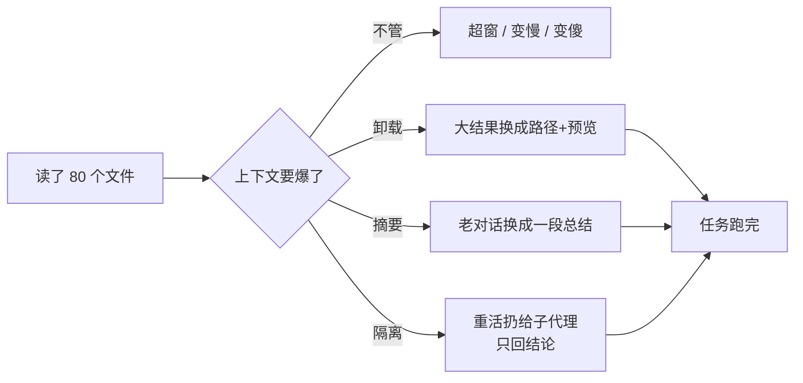
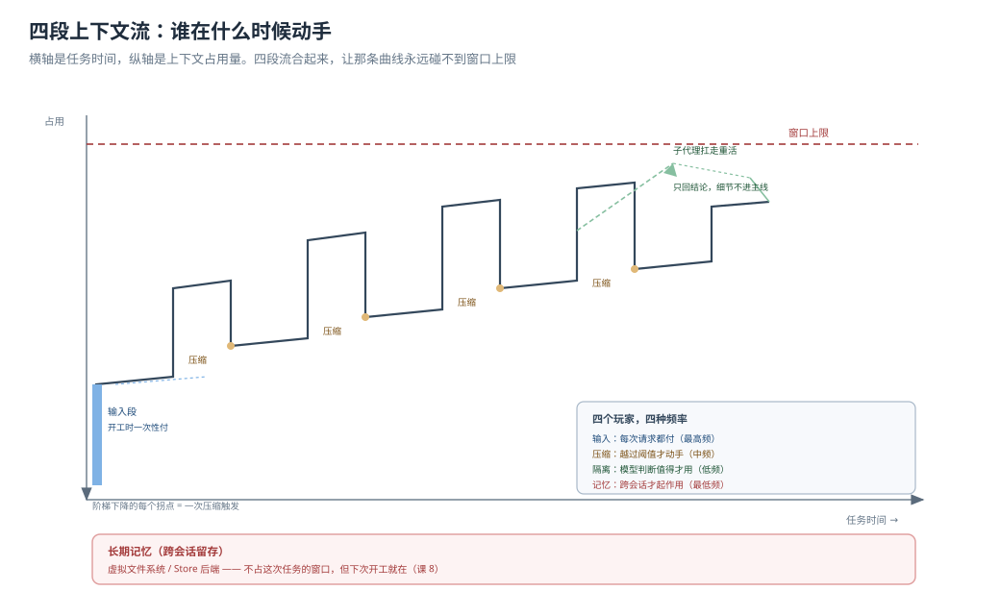
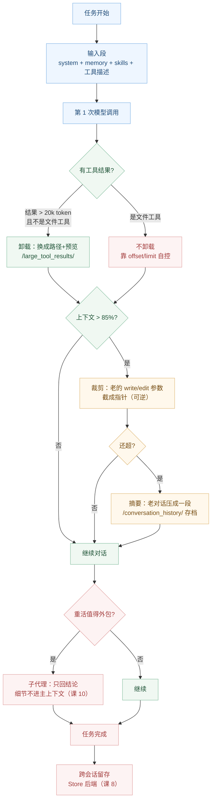

# 课 9：上下文工程

> 所属阶段：阶段 3《上下文管理》｜ 水平：进阶 ｜ 本课知识点：四段上下文流、摘要与卸载、提示缓存的真实触发条件
> 故事情节：主角的 agent 跑了一个三小时的研究任务，读了 80 个文件——按道理上下文早就该被撑满了，可它始终没有超出限制。为什么？
> 📖 结论已按官方文档核对（核对于 2026-10 ｜ 来源：docs.langchain.com/oss/python/deepagents/context-engineering、overview、harness）
> ✅ 代码结论实测于 2026-10-21 ｜ `deepagents 0.7.28` / `langchain 1.4.6` ｜ 隔离环境 `/tmp/da-probe`
> 本课配**应用实战**

## 🎯 本课目标

- 画出四段上下文流，并指出每一段由哪个机制承担
- 分清"卸载"和"摘要"各治什么：一个是**替换**，一个是**压缩**
- 说清提示缓存只在哪些模型上默认生效，以及缓存前缀为什么必须保持稳定

---

## 第一幕：起源与场景引入

课 7 你学会了做技能，课 8 你学会了写记忆，课 5 你学会了配后端。三样东西各自都好用，但把它们放在一起，一个疑问就浮出来了：

那个跑三小时的 agent，读了 80 个文件。每次 `read_file` 的结果都进了对话历史。按理说，上下文窗口早该被撑满、任务早该崩溃了。可它跑完了。

> 🎬 **场景**：你翻着日志，看到 agent 在第 40 个文件之后做了一件事——它把前面读过的内容"收起来"了，只留了一句话，但那句话里带着一个路径。后来它需要细节时，又顺着那个路径读回来。
>
> 那一刻你意识到：上下文管理不是"记得更多"，而是"记得更巧"。

你之前理解的所有机制，在这一课里其实都只是一个更大机制里的组件：

- 课 7 的按需加载，管的是一段流程里的"**开工时手里有什么**"
- 课 8 的常驻记忆，同样管"开工时手里有什么"，但更贵也更可靠
- 课 5 的文件后端，是"**收起来的东西存在哪**"

三段流的共同点是：**它们都在减少"当下必须放在上下文里的东西"**。



> 📌 **一句话本质**：上下文工程不是"把窗口做大"，而是**让每一条信息在需要的那一刻才出现在窗口里**——不需要的收进文件系统，太老的压成摘要，太重的交给别人干。
>
> ⚖️ **处境对照**：掌握上下文工程，你能在"任务变长就崩"时准确判断该调哪个旋钮（卸载阈值 / 摘要阈值 / 隔离），并知道成本花在哪；不掌握，你只会做一件本能的事——把窗口换大，然后发现该崩的还是崩。

---

## 第二幕：认知冲突

**第一处：卸载和摘要不是同一件事，很多人混着说。**

直觉上，"压缩上下文"就是一个动作。实测下来是**三个不同频率、不同机制**的动作，而且它们的可逆性完全不同：

- **卸载**（offload）：把大块内容**换成**一个路径 + 预览。原文还在磁盘上，可逆。
- **裁剪**（truncate）：把老的 `write_file` 参数**截短**成指针。原文早已在磁盘上，可逆。
- **摘要**（summarize）：把老对话**压成**一段总结文本。原文虽然也存档了，但模型看到的是"别人转述的"，不是原文。

**第二处：`read_file` 居然不在卸载名单里。**

实测 `TOOLS_EXCLUDED_FROM_EVICTION = ('ls', 'glob', 'grep', 'read_file', 'edit_file', 'write_file', 'delete')`——文件工具**全部排除**在卸载之外。

这看着很反直觉：读大文件不正是最该卸载的场景吗？

答案在第二层：`read_file` **自己有分页协议**（`offset` + `limit`），它不靠"事后卸载"来控制大小，而是从一开始就只返回一小段。实测：一个 600,015 字节的文件，`read_file` 只交给模型 **455 字符**——它压根没机会变得很大。

**第三处：提示缓存不是"开了就快"。**

官方文档写"Anthropic 与 Amazon Bedrock 默认开启"。但代码里实际注册了**三家**（还有 Fireworks，装了 `langchain-fireworks` 才注册）。而在 OpenAI / DeepSeek 上，那个中间件依然被装配，但它**什么也不做**（`unsupported_model_behavior="ignore"`）。

也就是说：你为缓存做的一切设计（顺序、稳定性），在非 Claude 模型上**收益为零**。

> ❓ **问题**：这四段流具体怎么串？三个压缩动作各在什么阈值触发？缓存的钱到底怎么省的？

---

## 第三幕：层层揭示

### 一眼全局图（进入细节前先看一眼）



> 看图：横轴是"一次任务从开始到结束"，纵轴是"上下文里有多少东西"。四个色块对应四段流——**输入**在最左边（开工时一次性付），**压缩**贯穿全程（阈值触发），**隔离**是中段的分叉（重活走岔路），**长期记忆**横跨在最下面（跨会话）。特别注意：压缩不是一条平线，它是**阶梯式**的，每触发一次就往下掉一截。而那条虚线是窗口上限——四段流合起来的作用，就是让这条线永远碰不到它。

### 本课地图（分几步走）

| 步 | 这一步要解决什么（人话） | 对应知识点 |
|:--:|------------------------|-----------|
| 1 | 看清四段流各管哪一段、谁在什么时候动手 | 知识点 1：四段上下文流 |
| 2 | 分清卸载/裁剪/摘要三种动作，各自的可逆性 | 知识点 2：摘要与卸载 |
| 3 | 算清缓存这笔账，知道在哪失效 | 知识点 3：提示缓存的真实触发条件 |

---

### 知识点 1：四段上下文流

> 🧭 第 1/3 步｜承接：第一幕"它为什么不爆" → 本步：先看清全景，知道有几个玩家
> 本知识点关键点：输入上下文、压缩、隔离、长期记忆、四段合起来才解释"能超出单窗口跑"

#### 一句话定义

四段上下文流是 Deep Agents 处理"任务比窗口长"这件事的**分工方案**：**输入**决定开工时手里有什么，**压缩**决定跑久了怎么瘦，**隔离**决定重活不进主上下文，**长期记忆**决定关了窗口还能留下什么。

#### 直觉建立（类比）

把 agent 的一次长任务想成**一个人做一场持续三天的调研**：

- **输入上下文** = 出发前装进包里的东西：任务书、项目规范、工具说明。
- **压缩** = 路上不断整理笔记：大段原始材料塞进文件袋（卸载），早期记录浓缩成要点（摘要）。
- **隔离** = 派同事去跑腿：他跑完只回来汇报一句结论，路上的细节不进你的笔记本。
- **长期记忆** = 你把结论写进共享文档：下次别人接手，不用重跑一遍。

> 💡 **类比的边界**：人整理笔记会自然遗忘；agent 不会——它必须**显式地**把东西搬出去。所以这套机制不是"帮它记性好"，而是"帮它主动忘得有章法"。另外，人被派去跑腿会带回很多口头细节，子代理不会：它只返回一份报告，这是刻意的信息损失。

#### 核心原理

**四段流的分工表**（含实测/源码证据）：

| 段 | 管什么 | 谁在干 | 触发时机 | 可逆性 |
|---|---|---|---|---|
| **输入** | 开工时手里有什么 | 系统提示 + `MemoryMiddleware` + `SkillsMiddleware` + 工具描述 | 每次请求 | 天然 |
| **压缩** | 跑久了怎么瘦 | `SummarizationMiddleware` + 工具结果卸载 | 阈值 / 每次工具调用 | **可逆**（原文在磁盘） |
| **隔离** | 重活不进主上下文 | `SubAgentMiddleware`（`task` 工具） | 模型决定委派时 | 单向（只回结论） |
| **长期记忆** | 跨线程留东西 | 后端（`State` / `Filesystem` / `Store`） | 持续 | 持久 |

**关键认识：这四段不是四个开关，而是四个"频率"。**

- 输入：**每次请求**都付（最高频）
- 压缩：**越过阈值**才动手（中频）
- 隔离：**模型判断值得**才用（低频）
- 长期记忆：**跨会话**才起作用（最低频）

所以调优的顺序也应该是这个顺序：先问"输入这段能不能不付"（课 7、课 8 的判断题），再问"阈值设得对不对"，最后才考虑"要不要拆子代理"。

**顺序即正确性**（源码 `graph.py:914-948`，实测确认的装配序列）：

```
… 用户中间件 …
→ SkillsMiddleware          ← 在缓存之前（内容稳定，可进前缀）
→ append_prompt_caching_middleware()   ← 打缓存断点
→ MemoryMiddleware          ← 在缓存之后（内容会变，不能进前缀）
```

`graph.py` 的注释写得很直白：memory 放在缓存之后，是为了"memory updates (which change the system prompt) don't invalidate the Anthropic prompt cache prefix"。**这不是代码整洁问题，是钱的问题。**

#### 示例演示

```python
from deepagents import create_deep_agent

agent = create_deep_agent(
    model="anthropic:claude-sonnet-4-5-20250929",
    memory=["/AGENTS.md"],        # 输入段（常驻，每次付）
    skills=["/skills/"],          # 输入段（按需，启动只付索引）
    subagents=[...],              # 隔离段（重活外包）
    backend=store_backend,        # 长期记忆段（跨线程）
)
# 压缩段是自动装配的，不需要你传：
#   SummarizationMiddleware（模型感知阈值）
#   PatchToolCallsMiddleware（修补悬空调用）
#   工具结果卸载（FilesystemMiddleware 内置，20k token）
```

#### 常见误区

- ❌ 「四段流是四个可选功能」——前两段（输入、压缩）是默认装配的，后两段（隔离、长期记忆）才需要你配置。
- ❌ 「压缩就是摘要」——卸载/裁剪/摘要是三个不同机制，只有摘要是"转述"。
- ❌ 「调优从换大窗口开始」——先看输入段能不能瘦，那是每次请求都在付的钱。
- ❌ 「memory 和 skills 的中间件顺序无所谓」——顺序决定缓存命中，直接影响成本。

#### 一句话记住

> 四段流是四个频率：输入每次都付、压缩越线才动、隔离按需外包、记忆跨会话留存——调优要从最高频的那段开始。

#### 🗣️ 行话对照

| 说你听到的 | 意思 |
|-----------|------|
| "input context" | 开工时进系统提示的那部分（prompt / memory / skills / 工具描述） |
| "compression" | 卸载 + 裁剪 + 摘要三件事的统称 |
| "isolation" | 用子代理把重活挪出主上下文 |
| "offload" | 把内容搬到文件系统，上下文里留路径 |

#### 官方文档

- [Context engineering（docs.langchain.com）](https://docs.langchain.com/oss/python/deepagents/context-engineering) —— 四类上下文的官方定义
- [Deep Agents overview](https://docs.langchain.com/oss/python/deepagents/overview) —— 四段流原文
- [Context Management for Deep Agents（官方博客）](https://blog.langchain.com/context-management-for-deepagents) —— 三种压缩技术的频率差异

---

### 知识点 2：摘要与卸载

> 🧭 第 2/3 步｜承接：已知有四个玩家 → 本步：拆开最复杂的那个（压缩），看清三种动作
> 本知识点关键点：`SummarizationMiddleware`、大工具结果卸载、`PatchToolCallsMiddleware`、阈值怎么定

#### 一句话定义

压缩由**三个频率不同、可逆性不同**的动作组成：**卸载**（把大块内容换成路径，每次工具调用都检查）、**裁剪**（把老的写文件参数截短，约 85% 才动手）、**摘要**（把老对话压成一段，约 85% 且无更多可卸载时才动手）。

#### 直觉建立（类比）

三种动作像整理一个越堆越满的书桌：

- **卸载** = 把厚书放回书架，桌上留一张纸条写着"第 3 排第 2 本"。**随时可做，随时可取回。**
- **裁剪** = 把草稿纸上已经誊清的部分剪掉，只留"见正式稿第 5 页"。**东西早就在别处了，剪了不心疼。**
- **摘要** = 把前几天的会议记录浓缩成半页纪要。**原文归档了，但你以后只能看纪要。**

> 💡 **类比的边界**：真人的纪要会失真，agent 的摘要也会——但它**存档了原文**，所以理论上能找回。区别在于：模型得先意识到"我需要原文"，才会去 `read_file`。如果它不觉得需要，那部分信息就等于丢了。这是摘要真正的风险，不是"丢数据"，而是"丢掉了想起来的机会"。

#### 核心原理

**动作一：大工具结果卸载（阈值 20,000 token）**

```python
TOOL_RESULT_TOKEN_LIMIT = 20000   # backends/utils.py
NUM_CHARS_PER_TOKEN = 4           # middleware/filesystem.py
# → 实际按字符算：20,000 × 4 = 80,000 字符
```

实测：一个返回 400,000 字符的自定义工具，交给模型时只剩 **1,588 字符**：

```
Tool result too large, the result of this tool call call_1 was saved in the
filesystem at this path: /large_tool_results/call_1

You can read the result from the filesystem by using the read_file tool, but
make sure to only read part of the result at a time.
...
Here is a preview of the result (...):
1  XXXXXXXXXXXXXXXX...
```

三件事同时发生：**原文写到 `/large_tool_results/{tool_call_id}`**、**上下文里换成提示 + 首尾预览**、**预览明确教模型怎么用 `offset`/`limit` 读回来**。

**但文件工具被排除在外**（这是本课最反直觉的发现）：

```python
TOOLS_EXCLUDED_FROM_EVICTION = (
    "ls", "glob", "grep", "read_file", "edit_file", "write_file", "delete",
)
```

实测 `read_file` 读一个 600,015 字节的文件，交给模型只有 **455 字符**，`large_tool_results` 目录根本没被创建。

原因：**`read_file` 有自己的分页协议**。它从一开始就只返回一段，不给自己变大的机会。所以"卸载"是为了救那些**无法自控大小**的工具（MCP 工具、shell 输出、第三方 API）。

这个设计有实际含义：**如果你自己写工具，最好让它支持分页**，而不是依赖事后卸载。

**动作二：工具输入裁剪（约 85% 触发）**

`write_file` / `edit_file` 的参数里带着完整文件内容，而这些内容**早就写到磁盘了**。对话历史里那份是纯冗余。

实测：历史里一条 180,000 字符的 `write_file` 调用，越过阈值后，送给模型的参数被截成 **43 字符**：

```
'x = 1\nx = 1\nx = 1\nx ...(argument truncated)'
```

而 `state` 里的原始消息仍是完整的 180,000 字符，磁盘文件也完整。**这是最"无痛"的压缩**——模型本来就不需要重看它写过什么，需要时 `read_file` 就行。

**动作三：摘要（约 85%，且无可卸载时才做）**

实测（强设 `trigger=("tokens", 200)`）：16 条消息压缩成 4 条送入模型：

```
0. [system] ''
1. [human] 'You are in the middle of a conversation that has been summarized...'
2. [human] '第 7 轮：请读一下 src/module_7.py...'   ← 最近 2 条原文保留
3. [ai]    '第 7 轮回答：module_7 主要负责处理数据流...'
```

同时，被换掉的消息全部写入 `/conversation_history/session_<uuid>.md`，按 XML 格式存档：

```markdown
## Summarized at 2026-10-21T02:17:53.667656+00:00

<message type="human">第 0 轮：请读一下 src/module_0.py ...</message>
<message type="ai">第 0 轮回答：module_0 主要负责处理数据流...</message>
```

**一个容易忽略的设计：摘要不修改 `state["messages"]`。**

实测：输入 16 条，`invoke` 返回的 state 里是 **17 条**（原文全在）。压缩发生在 `wrap_model_call` 里，只影响"这一次送给模型什么"，用一个私有字段 `_summarization_event` 记录。这样做的好处是：**原始日志可回放、可评测**，而且 `compact_conversation` 工具（手动压缩）能共享同一套状态。

**默认阈值怎么来的**（实测两个分支）：

```python
# 模型有 profile（暴露 max_input_tokens）
trigger=("fraction", 0.85), keep=("fraction", 0.10)
# 实测：ChatAnthropic 200000 → 触发于 170,000；ChatOpenAI 1050000 → 触发于 892,500

# 模型没有 profile
trigger=("tokens", 170000), keep=("messages", 6)
```

注意一个巧合：有 profile 时 `200000 × 0.85 = 170000`，和无 profile 的固定值撞上了。这不是设计，是巧合——但意味着在 200k 窗口的 Claude 上，两条分支的行为一致。

**动作四（修补）：`PatchToolCallsMiddleware`**

这个不压缩，但和压缩是一对。中断/取消会让 AI 发出工具调用却没有结果，形成"悬空调用"——大多数 provider 会直接报错。

实测修补效果：

```
原消息数: 3 → 修补后: 4

[tool] id=c2 status=error
  'Tool call read_file with id c2 did not complete - no result was recorded.
   It may have been cancelled or interrupted.'
```

它还区分两种情况：

```
无效调用 → 'Tool call write_file with id c3 could not be executed
            - arguments were malformed or truncated.'
```

**为什么这条重要**：它让"中断后继续"成为可能。没有它，一次 Ctrl+C 就可能让整个 thread 再也无法继续。

#### 示例演示

```python
from deepagents.middleware.summarization import SummarizationMiddleware

# 想手动控制阈值（比如任务短、希望压缩更晚发生）
summ = SummarizationMiddleware(
    model=model,
    backend=backend,
    trigger=("fraction", 0.90),   # 更晚触发，留更多原文
    keep=("fraction", 0.15),      # 保留更多近期消息
)
agent = create_deep_agent(model=model, backend=backend, middleware=[summ])
```

```python
# 想调工具结果卸载阈值（默认 20000 token）
from deepagents.middleware.filesystem import FilesystemMiddleware

fs = FilesystemMiddleware(backend=backend, tool_token_limit_before_evict=50_000)
```

#### 常见误区

- ❌ 「所有大工具结果都会被卸载」——文件工具（`ls`/`glob`/`grep`/`read_file`/`edit_file`/`write_file`/`delete`）被明确排除。
- ❌ 「`read_file` 读大文件要靠卸载兜底」——它有 `offset`/`limit` 分页，实测 600KB 只返回 455 字符。
- ❌ 「摘要会修改历史」——不改，`state["messages"]` 保留原文，压缩只影响本次送给模型的内容。
- ❌ 「阈值可以随便调小来"测试"」——调小会让摘要频繁触发，成本飙升且质量下降（官方博客明确提到这点）。
- ❌ 「中断了就废了」——`PatchToolCallsMiddleware` 会补上带 `status="error"` 的结果，thread 可以继续。

#### 一句话记住

> 卸载是"搬到书架留张纸条"、裁剪是"剪掉已誊清的草稿"、摘要是"把旧会议浓缩成纪要"——前两个可逆，第三个丢的是"想起来的机会"。

#### 🗣️ 行话对照

| 说你听到的 | 意思 |
|-----------|------|
| "offload" | 大结果搬到文件系统，上下文留路径 + 预览 |
| "truncate args" | 把老的 write/edit 参数截短 |
| "summarization event" | 记录这次压缩动作的私有状态字段 |
| "dangling tool call" | 有调用没结果的悬空调用 |
| "context rot" | 上下文太长导致模型变笨（不是超窗） |

#### 官方文档

- [Summarization 源码级说明](https://docs.langchain.com/oss/python/langchain/middleware/built-in#summarization) —— LangChain 层的触发语义
- [Context Management for Deep Agents](https://blog.langchain.com/context-management-for-deepagents) —— 三种压缩技术的阈值与实测建议

---

### 知识点 3：提示缓存的真实触发条件

> 🧭 第 3/3 步｜承接：已理解压缩 → 本步：算清"前面那些设计到底省了什么钱"
> 本知识点关键点：默认开启范围、no-op 行为、缓存前缀稳定性、失效原因清单

#### 一句话定义

提示缓存让 provider 把**重复出现的前缀**缓存起来，后续请求跳过重算。Deep Agents 在 `create_deep_agent` 里自动装配缓存中间件，但**真正生效的只有 Anthropic、Amazon Bedrock（Claude/Nova），以及装了包的 Fireworks**；其它 provider 上它存在但什么也不做。

#### 直觉建立（类比）

缓存像**快递柜**：

- 你每次寄的东西，前 90% 都一样（系统提示 + 记忆 + 技能表）——这部分放柜子里，不用每次重新打包。
- 只有最后 10%（这轮对话）需要现场装。
- 但**只要你改了前面那 90% 里的一个字**，整个包裹都得重打——柜子里的作废。

> 💡 **类比的边界**：快递柜是按"格"存的，缓存是按"前缀 token 序列"存的。区别在于：快递柜你能指定放哪一格，缓存不能——它是**从头开始连续匹配**的。这就是为什么"顺序"如此重要：任何一处变化都会让它之后的所有内容失效。

#### 核心原理

**到底注册了哪些**（实测 `append_prompt_caching_middleware`）：

```
AnthropicPromptCachingMiddleware    unsupported_model_behavior=ignore
```

只有这一个被注册，因为环境里只装了 `langchain-anthropic`。读源码 `_prompt_caching.py` 可知完整逻辑：

```python
middleware.append(AnthropicPromptCachingMiddleware(unsupported_model_behavior="ignore"))
# Bedrock：按需 import langchain_aws，装了才 append
# Fireworks：按需 import langchain_fireworks，装了才 append
```

**所以官方文档写的"两家"是不完整的**：实际支持三家，只是 Bedrock 与 Fireworks 需要额外安装。官方 overview 页也提到"Anthropic 与 Bedrock 默认开启"，没提 Fireworks——这属于文档滞后。

**no-op 是真的 no-op**（实测）：

```
非 Anthropic 模型上：
  系统消息类型: SystemMessage
  content 是 block 列表，长度 1
    {'type': 'text', 'text': '<agent_memory>\n/AGENTS.md\n\n# 规范\n- 用 ruff'}
  ← 没有 cache_control 字段
```

注意这里有个细节：`content` 仍然是 block 列表（因为 `append_to_system_message` 会转格式），但**没有 `cache_control` 键**。也就是说：格式变了，但断点没打。

这与课 8 的实测形成完整对照：

| 模型 | 系统消息 block 数 | `cache_control` |
|---|---|---|
| `ChatAnthropic` + memory | 1 | `{'type': 'ephemeral'}` |
| 非 Anthropic + memory | 1 | 无 |

**为什么用 `ignore` 而不是报错**：同一套 agent 代码要能跨 provider 复用。如果非 Claude 模型直接 raise，你就得为每个 provider 写分支——那才是真的麻烦。

**缓存失效的常见原因清单**：

1. **改了系统提示**（包括改 `AGENTS.md` —— 这是课 8 说"memory 排在缓存之后"的原因）
2. **改了技能表**（技能增删会改变启动期的索引）
3. **在系统提示最前面插了动态内容**（时间戳、随机 ID、用户名——这是最常见的自伤）
4. **换了模型**（不同模型的缓存不共享）
5. **provider 侧缓存过期**（Anthropic 默认 5 分钟，需显式延长）
6. **顺序变了**（中间的中间件调换位置，前缀就不同了）

#### 示例演示

```python
# ❌ 自伤写法：把时间戳塞进系统提示最前面
system_prompt = f"当前时间：{datetime.now()}\n\n你是..."

# ✅ 正确：动态信息放用户消息里，系统提示保持稳定
system_prompt = "你是..."
messages = [{"role": "user", "content": f"[当前时间 {now}] 帮我..."}]
```

#### 常见误区

- ❌ 「所有 provider 都自动缓存」——只有 Anthropic / Bedrock / Fireworks（后者需装包）。
- ❌ 「缓存中间件没生效会报错」——`unsupported_model_behavior="ignore"`，静默跳过。
- ❌ 「系统提示里放时间戳没关系」——那会让前缀每次都变，缓存收益归零。
- ❌ 「缓存能省一切」——只有静态前缀能省；这轮对话的内容每次都新。
- ❌ 「文档说两家就是两家」——代码里是三家，文档滞后。

#### 一句话记住

> 缓存只认"从头开始连续相同"：所以系统提示越稳定越省，任何一处动态内容都会让后面全部作废。

#### 🗣️ 行话对照

| 说你听到的 | 意思 |
|-----------|------|
| "cache breakpoint" | 显式标记"到这为止可缓存" |
| "ephemeral" | Anthropic 的短期缓存类型（默认 5 分钟） |
| "cache hit / miss" | 前缀是否命中已有缓存 |
| "no-op" | 装配了但什么也不做 |

#### 官方文档

- [Prompt caching（overview）](https://docs.langchain.com/oss/python/deepagents/overview) —— 官方声明默认开启范围
- [Middleware integrations](https://docs.langchain.com/oss/python/langchain/middleware) —— 各家 provider 的缓存中间件

---

## 第四幕：实操验证（复现与验证）

### 4.1 机制验证：六组探针带你亲手走一遍

**探针 1：压缩默认阈值随模型变**

```python
from deepagents.middleware.summarization import compute_summarization_defaults

compute_summarization_defaults(Spy())                    # 无 profile
# trigger=('tokens', 170000)  keep=('messages', 6)

compute_summarization_defaults(ChatAnthropic(...))       # 200k 窗口
# trigger=('fraction', 0.85)  keep=('fraction', 0.1)   → 170,000

compute_summarization_defaults(ChatOpenAI(...))          # 1.05M 窗口
# trigger=('fraction', 0.85)  keep=('fraction', 0.1)   → 892,500
```

含义：同一个 agent 代码，换个模型压缩点就变了。你以为的"稳定行为"其实依赖 profile。

**探针 2：强制压缩看全链路**

```python
summ = SummarizationMiddleware(model=SummaryModel(), backend=fsb,
                               trigger=("tokens", 200), keep=("messages", 2))
# 16 条消息 → 4 条送模型；state 仍是 17 条（原文保留）
# /conversation_history/session_<uuid>.md 生成 2,061 字符存档
```

**探针 3：工具结果卸载的边界**

```python
# 自定义大工具：400,000 字符 → 1,588 字符（卸载）
# read_file 读 600KB 文件：→ 455 字符（未卸载，靠分页）
# TOOLS_EXCLUDED_FROM_EVICTION = ('ls','glob','grep','read_file',
#                                  'edit_file','write_file','delete')
```

**探针 4：工具输入裁剪**

```python
# 老 write_file 的 180,000 字符 content 参数 → 43 字符
# 'x = 1\nx = 1\nx = 1\nx ...(argument truncated)'
# state 里原文仍是 180,000；磁盘文件也完整
```

**探针 5：悬空调用修补**

```python
# 两个 tool_call，只回了一个 → 补上 status='error' 的 ToolMessage
# 干净历史 → before_agent 返回 None（不打扰）
```

**探针 6：缓存中间件的 no-op**

```python
# ChatAnthropic + memory → block 带 cache_control: {'type': 'ephemeral'}
# 非 Anthropic + memory → block 无 cache_control
```

### 4.2 应用实战：给长任务配一套上下文预算（入口）

本课实战要解决"任务一长就崩、或者不崩但变慢变贵"的问题。完整代码、运行步骤与自检清单见：

📄 **[应用实战 09：上下文预算与压缩调优](../../../应用实战/09-上下文工程.md)**

一句话预告：你会先量出自己 agent 的"输入段固定开销"，再故意制造三种膨胀（大工具结果、大写入参数、超长对话），观察三种压缩动作分别怎么救场；最后把缓存断点验证清楚，并踩到"系统提示里塞时间戳"这个坑。

## 第五幕：体系收束

三个知识点构成一条完整的因果链：

- **全景**（知识点 1）回答"有哪几个玩家"——四段流，四个频率。
- **机制**（知识点 2）回答"压缩具体怎么做"——卸载/裁剪/摘要三种动作，可逆性递减。
- **成本**（知识点 3）回答"前面的设计省了什么钱"——缓存只对稳定前缀生效，且只在少数 provider 上存在。

这三课串起来，是阶段 3 的完整答案：

| 课 | 问题 | 答案 |
|---|---|---|
| 课 7 | 知识很多，怎么不全塞进去？ | 渐进式披露（按需） |
| 课 8 | 有些知识每次都要，怎么办？ | 常驻记忆（全量） |
| 课 9 | 还是会满，怎么办？ | 卸载 / 裁剪 / 摘要 / 隔离 |

一句话收束整课：**上下文工程不是让 agent 记住更多，而是让它在正确的那一刻只看见该看的东西——多出来的收进文件，太旧的压成摘要，太重的交给别人。**

## 🐞 常见误区（本课专属）

| 误以为 | 实际 | 怎么排查 |
|--------|------|---------|
| "所有大工具结果都卸载" | 7 个文件工具被排除 | 看 `TOOLS_EXCLUDED_FROM_EVICTION` |
| "read_file 读大文件会爆" | 有 offset/limit 分页 | 量返回字符数 |
| "摘要会删历史" | state 保留原文，只改送给模型的 | 数 `len(out["messages"])` |
| "压缩阈值是固定的" | 随模型 profile 变化 | 调 `compute_summarization_defaults` |
| "所有模型都自动缓存" | 只有 Anthropic/Bedrock/Fireworks | 看 block 有没有 `cache_control` |
| "系统提示里放时间没问题" | 前缀失效，缓存归零 | 对比两次请求的 block |
| "中断后 thread 废了" | Patch 补 `status="error"` 结果 | 看修补后的 ToolMessage |

### ⏳ 与过时说法对照

| 过时的说法 | 现在该怎么说 |
|-----------|-------------|
| "上下文管理就是摘要" | 是卸载 + 裁剪 + 摘要三件不同频率的事 |
| "缓存默认全 provider 开启" | 只有三家，且另外两家要装包 |
| "把窗口换大就行" | 换大只推迟问题，上下文腐化（context rot）与窗口无关 |
| "卸载是丢弃" | 是可逆的搬迁，原文在磁盘上 |

## 一图总结



> 读图指引：从上往下是"一次任务的时间线"。三个菱形是三个判断点，按**频率从高到低**排列：先每次工具调用都问"要不要卸载"，再问"是否越过 85%"，越过了先裁剪再摘要。注意左右两条岔路——**文件工具走右边自控，其它工具走左边卸载**。最下面的子代理是"换个思路"：与其压缩，不如一开始就不让这些内容进来。

## 课后小测

**Q1**：你的 agent 调了一个第三方 API 工具，返回了 300,000 字符的 JSON。会发生什么？
- A. 全部进上下文，可能撑爆
- B. 被卸载到 `/large_tool_results/`，上下文里只留提示 + 首尾预览
- C. 直接报错
- D. 自动分页返回

<details><summary>答案与解析</summary>

**答案：B**。阈值 20,000 token（约 80,000 字符），超出即卸载。实测 400,000 字符 → 1,588 字符。但要注意：如果这个工具是自己写的，更该做的是让它支持分页（像 `read_file` 的 `offset`/`limit`），而不是依赖事后卸载。

</details>

**Q2**：你用 `read_file` 读一个 600KB 的文件，会触发卸载吗？
- A. 会，超过 20k token
- B. 不会，文件工具被排除在卸载名单外，且 `read_file` 有自己的分页协议
- C. 会，但只在 Claude 上
- D. 取决于后端

<details><summary>答案与解析</summary>

**答案：B**。`TOOLS_EXCLUDED_FROM_EVICTION` 包含 `ls`/`glob`/`grep`/`read_file`/`edit_file`/`write_file`/`delete`。实测 600,015 字节文件只返回 455 字符，`large_tool_results` 目录都没创建。

</details>

**Q3**：摘要发生后，`state["messages"]` 会怎样？
- A. 被替换成一条摘要消息
- B. 保留完整原文，压缩只影响本次送给模型的内容
- C. 被清空
- D. 只保留最近 6 条

<details><summary>答案与解析</summary>

**答案：B**。实测：输入 16 条，返回 state 里 17 条（原文全在 + 1 条）。压缩发生在 `wrap_model_call`，用私有字段 `_summarization_event` 记录，原始日志保留以便回放和评测。

</details>

**Q4**：以下哪种情况会让提示缓存收益归零？
- A. 在系统提示最前面插入 `当前时间：2026-10-21 14:32`
- B. 在用户消息里写当前时间
- C. 改了 `AGENTS.md` 内容
- D. A 和 C 都会

<details><summary>答案与解析</summary>

**答案：D**。缓存按"从头连续相同"匹配，系统提示任何位置的变化都会让之后全部失效。A 把每次都变的内容放在最前面，最伤；C 改 `AGENTS.md` 也改变前缀（这正是 memory 排在缓存之后的原因）。B 在用户消息里，不进前缀。

</details>

**Q5**：一个 thread 在工具执行到一半时被用户中断，再次调用会怎样？
- A. 报错，thread 报废
- B. `PatchToolCallsMiddleware` 补上 `status="error"` 的 ToolMessage，可以继续
- C. 自动重试原来那个工具
- D. 静默跳过那个调用

<details><summary>答案与解析</summary>

**答案：B**。`before_agent` 会找出所有"有调用无结果"的 id，补一条带说明的 error 结果。实测还会区分"未完成"和"参数畸形"两种情况。这是"中断后可恢复"的基础。

</details>

---

## 🚀 下一批接力提示词

> 学完本课后，**复制下面这段文字发给 AI**，即可进入阶段 4（无需重新描述上下文）：

```
继续学 Deep Agents。我的学习档案在 langchain/deepagents/00-学习档案.md，
刚学完阶段 3《上下文管理》的课 9《上下文工程》全部 3 个知识点
（四段上下文流 / 摘要与卸载 / 提示缓存的真实触发条件），并做完了应用实战。
阶段 3 已完结。请开始阶段 4《委派与上线》，从课 10《任务规划与子代理》讲起。
```

## 🧭 课程导航

🎯 **练一练（本课应用实战）**：[第 9 课实战 · 上下文预算与压缩调优](../../../应用实战/09-上下文工程.md)

⬅️ **上一课**：[课 8：Memory 记忆](./08-Memory记忆.md)

➡️ **下一课（进入阶段 4）**：[课 10：任务规划与子代理](../../4-委派与上线/lessons/10-任务规划与子代理.md)

📚 **返回目录**：[课程目录](../../../02-课程目录.md)
