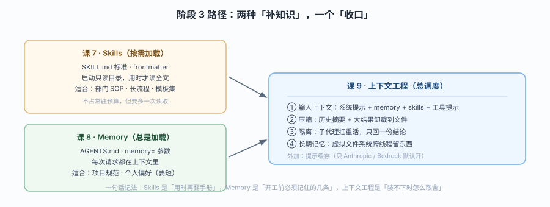

# 阶段 3：上下文管理

> 所属课程：Deep Agents ｜ 故事章节：记住——「怎么让它越干越懂你，又不被撑爆」 ｜ 上一阶段：[阶段 2](../2-执行环境/overview.md)

## 🎯 本阶段目标

- 能区分"技能"和"记忆"这两种看起来都在"给 agent 补知识"的机制，并说清它们加载时机的根本差异
- 能设计一套"什么放 skills、什么放 AGENTS.md"的划分规则
- 能解释长任务为什么不爆上下文，并指出提示缓存在哪些模型上默认不生效

## 📍 学习重点

- **加载时机相反**：Skills 启动时只读 `SKILL.md` 的 frontmatter，用时才读全文（渐进式披露）；Memory 的 `AGENTS.md` **总是全量加载**——这决定了它们各自适合放什么
- **上下文四段流**：输入（prompt / memory / skills / 工具提示）→ 压缩（卸载 + 摘要）→ 隔离（子代理）→ 长期记忆（虚拟文件系统）——四个环节各解决"哪一段爆掉"
- **顺序即正确性**：`MemoryMiddleware` 被刻意放在 prompt caching **之后**，就是为了不破坏缓存前缀；`SkillsMiddleware` 放在你的中间件之后、缓存之前。改顺序等于丢掉缓存收益
- **缓存不是全局默认**：只有 Anthropic 与 Amazon Bedrock 默认开启，其它 provider 需另配中间件

## ✅ 必须掌握的知识点

| 知识点 | 所属课 | 学完应能 |
|--------|--------|----------|
| Agent Skills 标准与 SKILL.md | 课 7 | 按标准目录结构写出一个 skill（含 frontmatter 与配套文件） |
| 渐进式披露 | 课 7 | 说清启动时读到什么、任务需要时才读什么 |
| SkillsMiddleware 的插入位置 | 课 7 | 说清它为什么排在"你的中间件之后、prompt caching 之前" |
| AGENTS.md 与 memory 参数 | 课 8 | 用 `memory=` 挂上 `AGENTS.md` 让 agent 带上项目规范 |
| 全量加载 vs 按需加载 | 课 8 | 说清为什么"项目规范"适合常驻、"部门 SOP"更适合 skills |
| 后端落点与 agent 自更新 | 课 8 | 说清记忆内容存在哪、agent 怎么自己改它 |
| 四段上下文流 | 课 9 | 画出四段流并指出每段对应哪个机制 |
| 摘要与卸载 | 课 9 | 说清长对话与长工具结果分别被怎么处理 |
| 提示缓存的真实触发条件 | 课 9 | 指出只对 Anthropic / Bedrock 默认生效，以及失效的常见原因 |

## 🗺️ 本阶段路径图

> 看图：课 7 和课 8 是两种"往 agent 脑子里放东西"的方式，一快一慢、一按需一常驻（左侧两个并列方框）；课 9 是"放不下时怎么办"的总调度（右侧），它同时管住前两课的产物。

## 本阶段产出

- [x] `lessons/07-Skills技能.md`
- [x] `lessons/08-Memory记忆.md`
- [x] `lessons/09-上下文工程.md`
