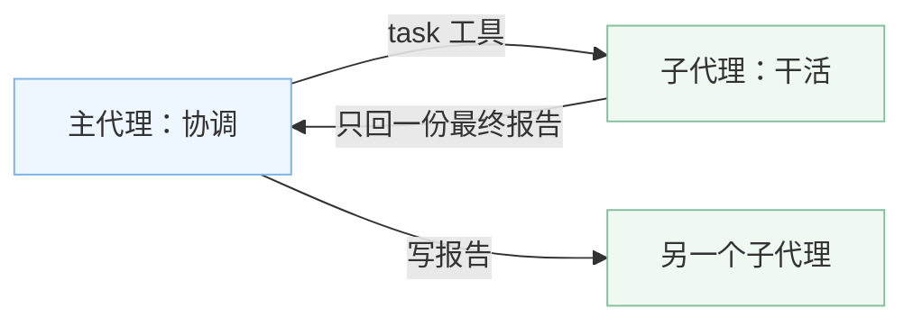
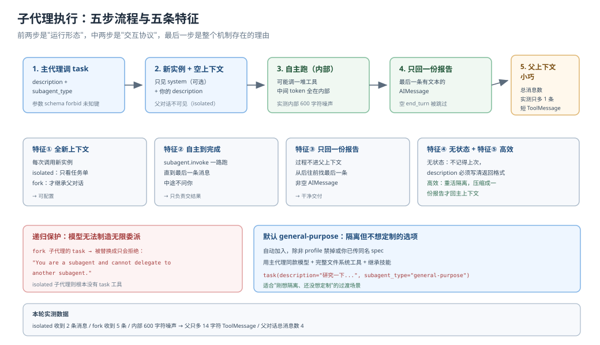
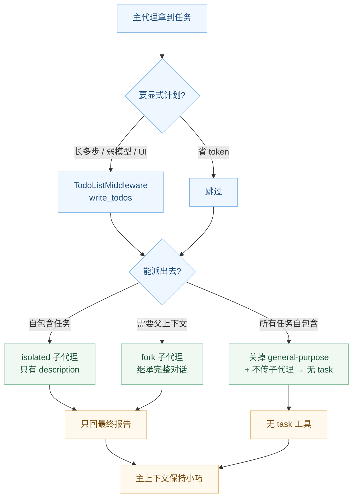

# 课 10：任务规划与子代理

> 所属阶段：阶段 4《委派与上线》｜ 水平：进阶 ｜ 本课知识点：write_todos 与 v0.7 的 opt-in 变更、task 工具与子代理五特征、isolated vs fork、自定义子代理与关掉子代理
> 故事情节：主角升级到 0.7 后发现 agent 不再写待办了——代码一行没改，行为却变了；接着他想把"查资料"和"写报告"分给两个专家
> 📖 结论已按官方文档核对（核对于 2026-10 ｜ 来源：docs.langchain.com/oss/python/deepagents/subagents、overview、customization#subagents、v0.7 changelog）
> ✅ 代码结论实测于 2026-10-21 ｜ `deepagents 0.7.28` / `langchain 1.4.6` ｜ 隔离环境 `/tmp/da-probe`
> 本课配**应用实战**与**源码解析**（子代理上下文创建：isolated vs fork）

## 🎯 本课目标

- 说清 v0.7 为什么让 `write_todos` 消失，以及怎么用 `TodoListMiddleware` 加回来
- 列出子代理的五个执行特征，并据此判断什么活该派出去
- 按"要不要继承父对话"选择 `isolated` 或 `fork`
- 能定义专用子代理；也能彻底去掉 `task` 工具

---

## 第一幕：起源与场景引入

课 9 你理解了"上下文最多放多少"这件事。现在的问题是：**真到了要派活的时候，怎么把活分出去？**

> 🎬 **场景**：主角某天早上升级 `deepagents` 到 0.7。他原本的 agent 每次拿到多步任务都会先写一排 `write_todos`，清清楚楚列出 5 个步骤再开始干。可升级完，指令还是那条指令，代码一行没改——`write_todos` 却再也没出现。
>
> 他以为是自己的 agent 代码写错了。查了半天，工具列表里根本没有 `write_todos`。
>
> **没有报错，没有警告，只是工具消失了。**

这是个"静默行为变更"。项目升级后最隐蔽的一种坑：不崩溃、不报红，但行为真的变了。

你之前学的所有机制，在这一课都会被"派活"这件事串起来：

- 课 7 的技能告诉子代理"开工时手里有什么"
- 课 8 的记忆告诉主代理"哪些事每次都记得"
- 课 9 的压缩告诉主代理"跑久了怎么瘦"
- **课 10 的隔离就是第三段流的落地**：把重活外包，只回结论



> 📌 **一句话本质**：任务规划是"怎么把大目标拆成可跟踪的小步"，子代理是"把其中一些步外包给别人干"。两者可以搭，也可以独立用——甚至很多 agent 一辈子不写 `write_todos`，照样靠子代理把活干完。
>
> ⚖️ **处境对照**：掌握子代理，你第一次能"把工作从长上下文里挪出去"——主代理负责协调每轮几十个 token，重活全在子代理里烧。不掌握，你只能用又大又慢的单层 agent 硬扛，还容易上下文腐化。

---

## 第二幕：认知冲突

**第一处：升级后行为变了，但代码没报错。**

你第一反应是"我哪行代码写错了"。但工具列表里没有 `write_todos`，说明问题不在你的代码，在框架本身的默认装配变了。

官方 0.7 changelog 白纸黑字：

> `create_deep_agent` no longer includes `TodoListMiddleware` by default, so the `write_todos` tool, `todos` state channel, and todo-planning prompt are absent unless restored with `middleware=[TodoListMiddleware()]`. (#4929)

实测也印证：默认 agent 工具数是 8（`ls / read_file / write_file / edit_file / delete / glob / grep / task`），没有 `write_todos`。加回 `TodoListMiddleware` 后变 9，才出现 `write_todos`。

**这叫"opt-in 变更"**：以前默认就带，现在是你要主动要求。

**第二处：文档说 `tools` 是"replaces them entirely"，但实测文件工具还在。**

这是本课最反直觉的发现。官方文档（及不少中文搬运）写：自定义子代理的 `tools` 参数"完全替换"主代理的工具。

实测：声明 `tools=[query_db]` 的子代理，可用工具实际是：

```
['ls', 'read_file', 'write_file', 'edit_file', 'delete', 'glob', 'grep', 'query_db']
```

自定义工具确实只有 `query_db`（`send_email` 没进来），但 **7 个文件工具全都在**。

原因：文件工具不是由 `tools` 参数控制，而是由 `FilesystemMiddleware` 单独装配的——每个子代理默认自带一个完整文件系统中间件。要限制它，得显式传 `FilesystemMiddleware(tools=[...])`（源码注释写得很清楚）。实测传入 `tools=['read_file','ls']` 后，子代理工具降为 2 个。

**这也是"理解机制 vs 背文档"的一次分野**：文档说的"replaces"只对自定义工具成立。

**第三处：子代理是不是"mini 主代理"？它能不能再派子代理？**

直觉上，子代理既然也是 agent，那就是个完整的代理，能再派活。但实测在 fork 模式下，`task` 工具被一个特殊中间件替换成"只会拒绝"的版本：

> "You are a subagent and cannot delegate to another subagent. Complete this task yourself instead of calling this tool again."

这个设计是刻意的（防止子代理无限递归把自己烧进去），但它有几个可推导的后果：Fork 子代理不能继续委派；isolated 子代理则根本没有 `task` 工具（因为 `ForkTaskToolMiddleware` 只在 fork 时装配）。

> ❓ **问题**：这四件事——规划、隔离、继承、禁用——到底在代码里是怎么被组织起来的？五特征里哪几条能实测、哪几条是语义？

---

## 第三幕：层层揭示

### 一眼全局图（进入细节前先看一眼）



> 看图：横轴从左到右是任务从主代理手里交出去的五步；纵轴指示每一步的特点。五个色块分别对应五条特征，前两条（空上下文、到完成）是"运行形态"，中间（单份报告、无状态）是"交互协议"，最后一条（隔离换效率）是整个机制的存在理由。注意图中下部标出的那条岔路——Fork 子代理的 `task` 被替换成"只会拒绝"，这是递归保护的落点。

### 本课地图（分几步走）

| 步 | 这一步要解决什么（人话） | 对应知识点 |
|:--:|------------------------|-----------|
| 1 | 为什么工具会突然消失，怎么找回来 | 知识点 1：write_todos 与 v0.7 opt-in |
| 2 | 子代理到底怎么跑，五条特征各自多硬 | 知识点 2：task 工具与五特征 |
| 3 | 该不该让子代理看父对话 | 知识点 3：isolated vs fork |
| 4 | 怎么造专用子代理、怎么彻底关掉 | 知识点 4：自定义与关掉 |

---

### 知识点 1：write_todos 与 v0.7 的 opt-in 变更

> 🧭 第 1/4 步｜承接：开场"工具消失但没报错" → 本步：拆开这个静默变更的来龙去脉
> 本知识点关键点：v0.7 的 opt-in、`write_todos` 三态、加回方式、什么时候值得开、怎么发现

#### 一句话定义

v0.7 起，`write_todos` 任务规划工具**不再是默认装配**——它变成 opt-in，要用一行 `middleware=[TodoListMiddleware()]` 显式加回来。这个变更是静默的（不报错、只是工具不在），所以升级后最容易踩空。

#### 直觉建立（类比）

像公司里以前人人桌上都有一块白板写待办，后来发现多数人不写也干得好，就把白板收起来了。想用的人自己去领一块，不用的人省下桌面空间。

> 💡 **类比的边界**：公司收白板是"省桌面"，v0.7 收 `write_todos` 是"省 token"——每轮都要把规划提示和工具 schema 带进上下文，官方实测默认轮次从 ~6000 token 降到 ~2000，降幅 65%。白板不占运行成本，但规划工具每个循环都占。

#### 核心原理

**加回方式（唯一正解）**：

```python
from langchain.agents.middleware import TodoListMiddleware
from deepagents import create_deep_agent

agent = create_deep_agent(
    model=model, backend=backend,
    middleware=[TodoListMiddleware()],
)
```

**`write_todos` 的三态与持久化**（官方资料确认）：

- 工具内部维护一个任务列表，每项状态是 `pending` / `in_progress` / `completed`
- 状态持久化在 **agent state** 里（`todos` channel），跨调用可见
- 它是给 agent 的"轻量规划层"，不是中断机制——agent 想写就写

**它值不值得开**（官方 0.7 release notes 原话，三条）：

1. **长多步任务**：需要显式计划跨很多轮保持不跑偏
2. **能力较弱的模型**：需要更多脚手架，避免漏步骤、忘记线程
3. **UI 面向的用例**：可见的计划和进度，和底层执行同样重要

官方自己承认：在三类模型、三类基准上的实测里，关闭 todos 反而奖励略高、成本略低。所以它现在不是默认——**默认值是"省"，按需才开**。

**怎么发现（关键生存技能）**：

```
工具列表里没有 write_todos ──┬─ 你从没写，那没事（省 token）
                             └─ 你以前写过现在没了 ──► 先数工具数
                                     │  8 个（默认）→ 再确认是否是升级导致
                                     └─ 其实提示词里直接写"先列计划"也能让模型规划
```

**一个更稳的替代**：即使不开 `write_todos`，你仍然可以在系统提示里要求"先列计划"，模型的"通用规划能力"不依赖这个工具。`write_todos` 的价值在于它**结构化 + 持久化 + 可被工具更新**，不是"让模型想做计划"。

#### 235 词内的关键代码路径

默认 agent 的工具数实测为 8，加回后为 9——多出的正是 `write_todos`。同时注意：v0.7 还顺带把默认系统提示从"带通用指导语"改成"空"，这也是为什么升级后实测系统提示是 0 字符。**升级后行为变化往往不止一处，先数工具、再测系统提示，是排查静默变更的第一步。**

#### 常见误区

- ❌「是我代码写错了」——没报错、工具不在列表，先查版本，再查装配
- ❌「默认就应该带」——v0.7 起默认不带，官方实测关了更好
- ❌「`write_todos` 是唯一做计划的方式」——它有结构化和持久化优势，但通用模型也自带计划能力
- ❌「所有模型都受益于 todos」——官方实测多数模型关闭反而更好，只有弱模型和 UI 场景需要

#### 一句话记住

> v0.7 把规划从默认收进抽屉：要写待办，主动开 `TodoListMiddleware`；官方实测多数场景关了更好，弱模型和 UI 例外。

#### 🗣️ 行话对照

| 说你听到的 | 意思 |
|-----------|------|
| "planning todos" | 就是 `write_todos` 这一整套 |
| "opt-in" | 默认关，要主动开 |
| "todos state channel" | 存任务列表的 agent 状态字段 |
| "base input tokens" | 系统提示 + 工具 + 中间件带来的固定开销 |

#### 官方文档

- [v0.7 changelog（breaking changes）](https://docs.langchain.com/oss/python/releases/changelog) —— 原话 #4929
- [Deep Agents overview](https://docs.langchain.com/oss/python/deepagents/overview) —— 三态与持久化
- [Context Management for Deep Agents（官方博客）](https://blog.langchain.com/context-management-for-deepagents) —— 65% token 降幅的完整数据

---

### 知识点 2：task 工具与子代理执行五特征

> 🧭 第 2/4 步｜承接：已理解规划 → 本步：拆开子代理这个执行单元，看它到底怎么跑
> 本知识点关键点：内建 task、五特征、默认 general-purpose

#### 一句话定义

主代理通过内建 `task` 工具创建临时子代理；子代理有五条执行特征——**全新上下文（可选）、自主到完成、单份报告、无状态、上下文高效**。这五条决定"什么活该派出去、什么活不该派"。

#### 直觉建立（类比）

子代理是**外包的合同工**：

- 你给他一句活，他干了半天，最后交一份报告（不是一堆过程文件）。
- 你不关心他中途查了多少资料——只要报告符合要求。
- 下次你再找他，他又从零开始，不记得上次说过什么。

> 💡 **类比的边界**：合同工是有记忆的，子代理没有（默认）。这一点是子代理设计里的"信息损失"，也是它省 token 的来源——你为了效率主动接受"丢过程"。

#### 核心原理

**`task` 工具怎么来**（源码确认）：

`create_deep_agent` 里只要 `inline_subagents` 非空，就装配 `SubAgentMiddleware`，主代理就拿到 `task`。参数只有两个：

```python
task(description="...", subagent_type="...")
```

**一个防呆细节**：`task` 的 schema 专门 `forbid` 未定义键。为什么？模型偶尔会把真正的指令塞进它自己编造的键（比如 `prompt`），只留 `description` 里一个标签——这样派出去的子代理只拿到标签、干了个寂寞，却还"成功"了。所以凡是 `description` 之外出现任何键，直接报错打回。

**五特征逐条拆**（带实测证据）：

| # | 特征 | 性质 | 实测/源码证据 |
|---|------|------|--------------|
| 1 | 全新上下文（默认）| 运行形态 | 子代理只收到 2 条消息：system + 你的 `description`；测试父对话里的“小明/Alpha”完全看不到 |
| 2 | 自主执行到完成 | 运行形态 | `subagent.invoke(state, config)` 一直跑到最后一条消息 |
| 3 | 只回一份最终报告 | 交互协议 | 工具内部跑 2 轮（含工具调用 + 600 字符噪声），父代理只拿到 14 字符"最终报告：找到 3 条要点。"；父对话总共只多 1 条短 ToolMessage |
| 4 | 无状态，不能多次回话 | 交互协议 | 每次 task 都是新实例；`description` 里必须写清"最终要返回什么" |
| 5 | 隔离换高效 | 存在理由 | 重活的所有中间 token 都在子代理内部消耗，压缩成一份报告才回到主上下文 |

**特征 3 的实现细节**（`_return_command_with_state_update`）：子代理返回前，会**从后往前找最后一条有文本的 AIMessage** 作为报告。为什么这么做？因为 Anthropic 偶尔在成功结尾后又发一条空的 `end_turn` 消息——如果直接转发空的，父代理就拿到一条啥也没有的 ToolMessage。

**默认 general-purpose**（源码确认）:

```python
GENERAL_PURPOSE_SUBAGENT = {
    "name": "general-purpose",
    "description": "General-purpose agent for researching complex questions, searching for files ...",
    ...
}
```

它自动加进来，除非 profile 禁掉或你已传同名。它用主代理同款模型、自带完整文件系统工具、继承主代理技能。**它存在的理由**：你想隔离但不想定制——"查资料"这种活直接丢给它，不用专门造一个。

#### 示例演示

```python
from deepagents import create_deep_agent

agent = create_deep_agent(
    model=model, backend=backend,
    subagents=[
        {"name": "researcher", "description": "负责全仓库检索资料", "model": model},
    ],
)
# 主代理拿到 task 后这样派活：
# task(description="去查 deepagents 的 subagents 文档，返回要点列表", subagent_type="researcher")
```

#### 常见误区

- ❌「子代理能记住上次的话」——无状态，每次新实例
- ❌「中间过程会进父上下文」——只有最后一条 AIMessage 回来
- ❌「每个子代理都是 mini 主代理」——它甚至默认没有 `task`，无法再派活
- ❌「`description` 漏了输出格式没关系」——漏了它可能给你一堆无关细节，因为报告就是"最后一条消息"

#### 一句话记住

> 子代理 = 每次全新上下文 + 自主跑到完 + 只交一份报告 + 无状态；它省 token 的本质，是主动接受"过程不回来"。

#### 🗣️ 行话对照

| 说你听到的 | 意思 |
|-----------|------|
| "fresh context" | 每次调用新实例，只见你的 description |
| "single handoff" | 只回一份最终报告 |
| "stateless" | 不记得上次调用 |
| "context firewall" | 子代理隔离的本质：外面看不见里面的过程 |

#### 官方文档

- [Subagents（docs.langchain.com）](https://docs.langchain.com/oss/python/deepagents/subagents) —— 五特征官方定义
- [Deep Agents overview](https://docs.langchain.com/oss/python/deepagents/overview) —— 默认 general-purpose

---

### 知识点 3：isolated vs fork

> 🧭 第 3/4 步｜承接：已理解子代理执行形态 → 本步：加一个维度——它要不要继承父对话
> 本知识点关键点：默认 isolated、fork 继承、取舍、何时必须 fork

#### 一句话定义

`mode` 决定子代理能否看到父对话：**isolated**（默认）只看到你给的 `description`；**fork** 继承父代理完整对话历史，像"接着刚才的话继续说"。取舍是：fork 省重复说明，但吃 token，还会把父上下文里的噪声一起带进去。

#### 直觉建立（类比）

- **isolated**：给外包商一张任务单，他只看这张单。
- **fork**：把整个会议室搬给他——所有历史记录、你刚才跟别人说的话、甚至跑题的内容，他全看得见。

> 💡 **类比的边界**：fork 的"继承"不是复制粘贴，而是把父对话注入成一条带前缀说明的消息（`[The messages above are a prior conversation you are continuing as the subagent...]`）。它带着"我知道这是继承上下文"的元信息。

#### 核心原理

**isolated 的实测**（探针 2-A）：

```
子代理收到的消息: 2 条
  0. [system] '你是检索专家。'
  1. [human]  '去查一下 deepagents 的 subagents 文档'
父对话里的 "小明" / "Alpha"：完全看不到
```

**fork 的实测**（探针 2-B）：

```
子代理收到的消息: 5 条
  0. [system] ''
  1. [human]  '请帮我调研一下子代理机制'
  2. [ai]     '好的，我派个人去查。'
  3. [human]  '顺便说下我叫小明，项目叫 Alpha'
  4. [human]  '[The messages above are a prior conversation you are continuing...'
含 "小明": True；含 "Alpha": True
```

两者的差别在最后一条：fork 注入了完整的父对话 + 一段"你现在是子代理、接着上面的话说"的前缀（源码注释 `_FORKED_SUBAGENT_TOOL_NOTE` 说这段前缀"承重"——没有它，模型会看到"不可变"字样而拒绝委托给需要继承上下文的子代理）。

**取舍表**：

| 维度 | isolated | fork |
|------|----------|------|
| 看到什么 | 只有 `description` | 完整父对话 |
| token | 少 | 多（父对话全部带进去）|
| 噪声 | 无 | 父上下文里的跑题话也进来 |
| 何时用 | 任务自包含 | 任务需要父对话里的具体细节 |
| 能否递归 | 无 task | 有 task 但被拒绝 |

**一个被忽略的交互**：fork 还继承主代理的自定义中间件列表（`middleware` 字段注明：fork 继承父代理中间件，同名替换、异名追加）。所以 fork 不只是"继承对话"，是"继承整个装配"。

**什么时候必须 fork**：当子代理需要父对话里"只有父代理才知道"的细节时——比如父代理刚跟用户确认过某个偏好，子代理要基于那个偏好写代码。

#### 示例演示

```python
from deepagents import create_deep_agent

agent = create_deep_agent(
    model=model, backend=backend,
    subagents=[
        {"name": "writer", "description": "接着用户的偏好写报告",
         "mode": "fork"},   # 继承父对话
    ],
)
```

#### 常见误区

- ❌「fork 不消耗额外 token」——它把父对话整个带进去
- ❌「只用 fork，省得重复说明」——省说明但吃 token，还带噪声
- ❌「fork 是稳定 API」——源码注释明确标注 experimental，可能在未来版本变化
- ❌「子代理能再派子代理」——fork 的 task 被替换成拒绝版本，递归是显式禁止的

#### 一句话记住

> isolated 只见任务单、省 token、无噪声；fork 继承整个父对话和中间件，用 token 换省事，还可能带进噪声——只有任务真需要父上下文时才值得。

#### 🗣️ 行话对照

| 说你听到的 | 意思 |
|-----------|------|
| "forked subagent" | 继承父对话的子代理（experimental）|
| "handoff" | isolated 的旧别名，行为一致 |
| "frozen context" | 父对话注入时的前缀说明 |

#### 官方文档

- [Subagents](https://docs.langchain.com/oss/python/deepagents/subagents) —— mode 字段
- [Customization: subagents](https://docs.langchain.com/oss/python/deepagents/customization#subagents) —— fork 与 isolated 对比

---

### 知识点 4：自定义子代理与关掉子代理

> 🧭 第 4/4 步｜承接：已会选模式 → 本步：造专用子代理、以及彻底不要子代理
> 本知识点关键点：声明方式、SubAgentMiddleware 存续条件、关掉 task、递归风险

#### 一句话定义

自定义子代理用声明式字典定义（name / description / prompt / tools 等）；`task` 工具的存在条件是「至少一个同步子代理」。**要彻底去掉** `task`，必须同时做到「profile 关掉默认子代理」加「不传任何同步子代理」，而且不能用 `excluded_middleware`。

#### 直觉建立（类比）

像给外包公司列供应商名录：每个供应商（子代理）有名字、擅长的活、给它的工具。你（主代理）照着名录分派。
而"彻底关掉"像把整个外包目录删掉——删掉后你手里就没有 `task` 这个按钮了。

> 💡 **类比的边界**：真实的供应商你能打电话再找回来；关掉后 `task` 工具从工具列表消失，主代理想派也派不了。除非改代码。

#### 核心原理

**声明方式**（核心字段）：

| 字段 | 必填? | 说明 |
|------|------|------|
| `name` | ✅ | 主代理在 `task` 里用的名字 |
| `description` | ✅ | 主代理靠它决定何时派——要具体、动作导向 |
| `system_prompt` | 建议 | **不继承**主代理的；工具用法和输出格式放这里 |
| `tools` | 可选 | 继承主代理工具；设置后**只替换自定义部分**，文件工具仍全量（除非显式传 FilesystemMiddleware 限制）|
| `model` | 可选 | 默认主代理同款；可传更强/更省钱的 |
| `skills` | 可选 | **自定义子代理不继承**主代理技能，要显式传路径 |
| `interrupt_on` | 可选 | 子代理级审批（课 11 展开）|
| `response_format` | 可选 | 结构化输出，父代理直接拿 JSON |

**一个实测修正文档的点**：`tools` 不是"完全替换"——文件工具由 `FilesystemMiddleware` 单独装配。要限制文件工具，得传 `middleware=[FilesystemMiddleware(backend=..., tools=[...])]`。实测传入 `tools=['read_file','ls']` 后，子代理工具从 8 个降到 2 个。

**`task` 的存续条件**（源码确认）：

```
if inline_subagents:  → 装配 SubAgentMiddleware → 才有 task
```

所以「只要还有任何一个同步子代理，task 就在」。默认那个 general-purpose「通常」就是它存在的理由——除非 profile 把它禁了。

**彻底关掉 `task` 的官方路径**（源码 graph.py:827 + 文档双重确认）：

```python
from deepagents.profiles import (
    HarnessProfile, GeneralPurposeSubagentProfile, register_harness_profile,
)
register_harness_profile(
    "openai",
    HarnessProfile(general_purpose_subagent=GeneralPurposeSubagentProfile(enabled=False)),
)
```

需要**两个条件同时成立**（实测 5e 验证）：
1. profile 里 `general_purpose_subagent.enabled is False`
2. `subagents=` 里没有任何同步子代理

实测效果：工具从 8 → 7，`task` 消失。一旦再传入任何一个同步子代理，`task` 立刻回来。

**一个必经的坑**：别想用 `excluded_middleware` 移除 `SubAgentMiddleware`——文档明确说这是**故意拒绝**的（它是核心脚手架）。唯一官方路径是上面的 profile 方式。

**递归风险**：isolated 子代理没有 task，fork 子代理有但被拒绝（`_FORK_RECURSION_REFUSAL`）。所以 DAG 式的多层委派，只会发生在你自己声明"子代理的子代理"时——模型天然无法制造无限递归。

#### 示例演示

```python
from deepagents import create_deep_agent
from langchain_core.tools import tool

@tool
def query_db(sql: str) -> str:
    """查询数据库（只读）。"""
    return "3 rows"

agent = create_deep_agent(
    model=model, backend=backend,
    tools=[query_db, send_email],
    subagents=[{
        "name": "dba",
        "description": "只读数据库的专家，别让它发邮件",
        "system_prompt": "你只能查询，不能发邮件。",
        "tools": [query_db],   # 自定义工具替换；文件工具仍全量
    }],
)
```

#### 常见误区

- ❌「`tools` 会清掉文件工具」——文件工具独立装配，要看 `FilesystemMiddleware`
- ❌「自定义子代理继承主代理技能」——不继承（general-purpose 才继承）
- ❌「`excluded_middleware` 能去掉 task」——被故意拒绝，只有 profile 方式
- ❌「子代理可以无限嵌套」——模型无法，fork 被拒、isolated 没工具

#### 一句话记住

> 造子代理看字段，关掉子代理看条件：profile 禁默认 + 不传同步，task 就消失；文件工具独立于 tools，要限制得找 FilesystemMiddleware。

#### 🗣️ 行话对照

| 说你听到的 | 意思 |
|-----------|------|
| "SubAgent spec" | 声明式子代理字典 |
| "harness profile" | 按 provider/model 的配置包（能关默认子代理）|
| "excluded_middleware" | 想裁默认中间件的入口（对本主角被拒）|

#### 官方文档

- [Customization: subagents](https://docs.langchain.com/oss/python/deepagents/customization#subagents) —— 声明方式
- [Subagents](https://docs.langchain.com/oss/python/deepagents/subagents) —— 禁用路径说明

---

## 第四幕：实操验证（复现与验证）

### 4.1 机制验证：探针带你亲手走一遍

**探针 1：`write_todos` 的 opt-in**

```python
# 默认
tools = ['ls','read_file','write_file','edit_file','delete','glob','grep','task']   # 8 个，无 write_todos
# 加 TodoListMiddleware
tools = [...8 个..., 'write_todos']                                                  # 9 个
```

并且发现：v0.7 默认系统提示是 **0 字符**（原来的通用指导语被移除）。

**探针 2：isolated vs fork**

```python
# isolated
子代理收到 2 条：system + description；父对话的"小明/Alpha" 看不到
# fork
子代理收到 5 条：system + 完整父对话（含"小明/Alpha"）+ 注入的承重前缀说明
```

**探针 3：只回最后一条 AIMessage**

```python
# 子代理内部 2 轮（第 1 轮工具调用返回 600 字符噪声）
# 父代理只拿到 14 字符 "最终报告：找到 3 条要点。"
# 父对话消息总数：4
```

**探针 4：递归与未知类型**

```python
# fork 子代理的 task → "You are a subagent and cannot delegate to another subagent..."
# 非法 mode "bogus" → ValueError: SubAgent 'a' has invalid mode
# "handoff" → 合法别名，等同 isolated
```

**探针 5：彻底关掉 task**

```python
# 注册 provider profile，general_purpose_subagent.enabled=False
# 且不传同步子代理
# → 工具从 8 → 7，task 消失
# 传入任一同步子代理 → task 立刻回来
```

### 4.2 应用实战：给"查资料 + 写报告"配两个专家（入口）

本课实战要解决"我想把活派出去，但不知道派给谁、怎么派才不会被上下文污染"。完整代码、运行步骤与自检清单见：

📄 **[应用实战 10：任务规划与子代理](../../../应用实战/10-任务规划与子代理.md)**

一句话预告：你会先建两个专用子代理（research 只读检索、writer 只写报告），验证隔离真的有效（子代理看不到父对话里的敏感信息）；然后试 fork 模式体会 token 代价；最后踩一遍"想把 task 关掉却发现工具还在"的坑。

## 第五幕：体系收束

四个知识点走完一条完整的"派活"链路：

- **调度**（知识点 1）回答"要不要先做计划"——v0.7 默认不写，需要才开
- **执行单元**（知识点 2）回答"派出去的活怎么跑"——五特征决定什么适合外包
- **上下文边界**（知识点 3）回答"子代理要不要看父对话"——isolated 换效率，fork 换省事
- **装配**（知识点 4）回答"怎么造和怎么关"——声明式 + 存续条件

这一课十五条特征和四个开关，串出阶段 4 的完整答案：

| 课 | 问题 | 答案 |
|---|---|---|
| 课 10 | 活怎么分出去 | 计划 + 子代理（隔离）|
| 课 11 | 关键操作要交给人吗 | 审批闸门（interrupt）|
| 课 12 | 活能并行/中途改吗 | 异步 + 动态 |
| 课 13 | 敢上线吗 | 开关清单 + 容错 + 流式 |

一句话收束整课：**任务规划把大目标拆成可跟踪的小步，子代理把其中一些步外包出去——外包的本质，是主动接受"过程不回来"，换来主上下文永远保持小巧干净。**

## 🐞 常见误区（本课专属）

| 误以为 | 实际 | 怎么排查 |
|--------|------|---------|
| "升级后代码写错了" | v0.7 静默移除了默认装配 | 先数工具数、再测系统提示 |
| "`tools` 会清掉文件工具" | 文件工具独立装配 | 看工具列表，传 FilesystemMiddleware 限制 |
| "子代理是 mini 主代理" | 默认无 task，不能递归 | 看子代理工具列表 |
| "fork 不额外吃 token" | 完整父对话带进去 | 数子代理收到的消息数 |
| "`excluded_middleware` 能关子代理" | 被故意拒绝 | 用 profile 方式 |
| "自定义子代理继承技能" | 只有 general-purpose 继承 | 显式传 skills |

### ⏳ 与过时说法对照

| 过时的说法 | 现在该怎么说 |
|-----------|-------------|
| "agent 默认会列计划" | v0.7 起 opt-in，要主动开 |
| "子代理能记住上次的话" | 无状态，每次新实例 |
| "派活=写一堆子代理" | 先看任务是否自包含，能隔离才值得派 |
| "tools 是完全替换" | 只换自定义工具，文件工具另算 |

## 一图总结



> 读图指引：最上面先回答"要不要计划"（B 分支），再回答"能不能派出去"（E 分支）。注意右边 G 之后没有"递归"出口——fork 子代理拿到的是被拒的 task。最下面 H 是真正关死的路径，一旦走了它，K 的主上下文不再有任何子代理产生的痕迹。

## 课后小测

**Q1**：你升级 deepagents 到 0.7 后，发现 agent 不再写 `write_todos` 了。最可能的原因是？
- A. 你的代码写错了某个参数
- B. v0.7 把 `TodoListMiddleware` 改成默认关闭（opt-in）
- C. 模型不支持规划工具
- D. 工具的 schema 变了

<details><summary>答案与解析</summary>

**答案：B**。v0.7 changelog #4929：`create_deep_agent` 不再默认包含 `TodoListMiddleware`。这是静默变更——不报错只是工具不在。加回：`middleware=[TodoListMiddleware()]`。

</details>

**Q2**：子代理 `tools=[query_db]`，它能用 `read_file` 吗？
- A. 不能，`tools` 完全替换
- B. 能，文件工具由 `FilesystemMiddleware` 单独装配
- C. 取决于模型
- D. 不能，但能读缓存

<details><summary>答案与解析</summary>

**答案：B**。实测 `tools=[query_db]` 后子代理工具是 8 个（7 文件工具 + query_db）。文档说 "replaces them entirely" 只对自定义工具成立。要限制文件工具得传 `FilesystemMiddleware(tools=[...])`。

</details>

**Q3**：fork 子代理和 isolated 子代理的核心区别是？
- A. fork 更快
- B. fork 继承父对话完整历史，isolated 只有 description
- C. fork 能递归，isolated 不能
- D. fork 不需要 description

<details><summary>答案与解析</summary>

**答案：B**。实测 fork 收到 5 条消息（含父对话全部内容 + 承重前缀），isolated 只有 2 条。两者都不能递归（fork 的 task 被拒，isolated 没 task）。

</details>

**Q4**：为什么子代理的中间过程不会污染主上下文？
- A. 它直接不产生中间过程
- B. 只回最后一条有文本的 AIMessage，中间全部丢弃
- C. 中间过程被压缩成摘要
- D. 主代理内存够大

<details><summary>答案与解析</summary>

**答案：B**。`_return_command_with_state_update` 从后往前找最后一条非空 AIMessage 作为报告。Anthropic 尾部偶发空 `end_turn` 消息会被跳过。实测内部 600 字符噪声，父上下文只多一条 14 字符 ToolMessage。

</details>

**Q5**：想彻底去掉 `task` 工具，正确做法是？
- A. `excluded_middleware` 移除 `SubAgentMiddleware`
- B. profile 关掉 general-purpose 且不传任何同步子代理
- C. 只关掉 general-purpose
- D. 不传 `subagents` 参数

<details><summary>答案与解析</summary>

**答案：B**。两个条件同时成立：`GeneralPurposeSubagentProfile(enabled=False)` + `subagents=[]`。A 被文档明确拒绝；C/D 单独都不够（默认 general-purpose 会自动加，除非 profile 禁）。

</details>

---

## 🚀 下一批接力提示词

> 学完本课后，**复制下面这段文字发给 AI**，即可进入课 11（无需重新描述上下文）：

```
继续学 Deep Agents。我的学习档案在 langchain/deepagents/00-学习档案.md，
刚学完阶段 4《委派与上线》的课 10《任务规划与子代理》全部 4 个知识点
（write_todos 与 v0.7 opt-in / task 五特征 / isolated vs fork / 自定义与关掉），
并做完了应用实战。请开始课 11《人在环中》。
```

## 🧭 课程导航

🎯 **练一练（本课应用实战）**：[第 10 课实战 · 任务规划与子代理](../../../应用实战/10-任务规划与子代理.md)

🔬 **挖一挖（本课源码解析）**：[第 10 课源码解析 · 子代理上下文创建](../../../源码解析/10-任务规划与子代理源码解析.md)

⬅️ **上一课**：[课 9：上下文工程](../../3-上下文管理/lessons/09-上下文工程.md)

➡️ **下一课**：[课 11：人在环中](./11-人在环中.md)

📚 **返回目录**：[课程目录](../../../02-课程目录.md)
