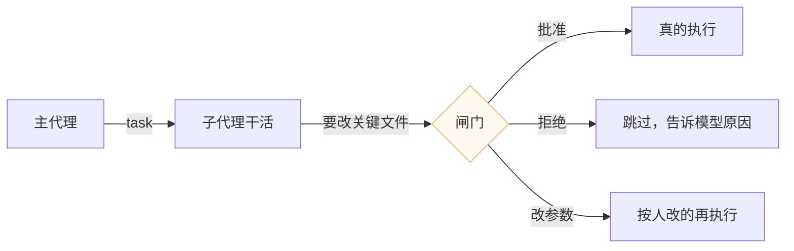
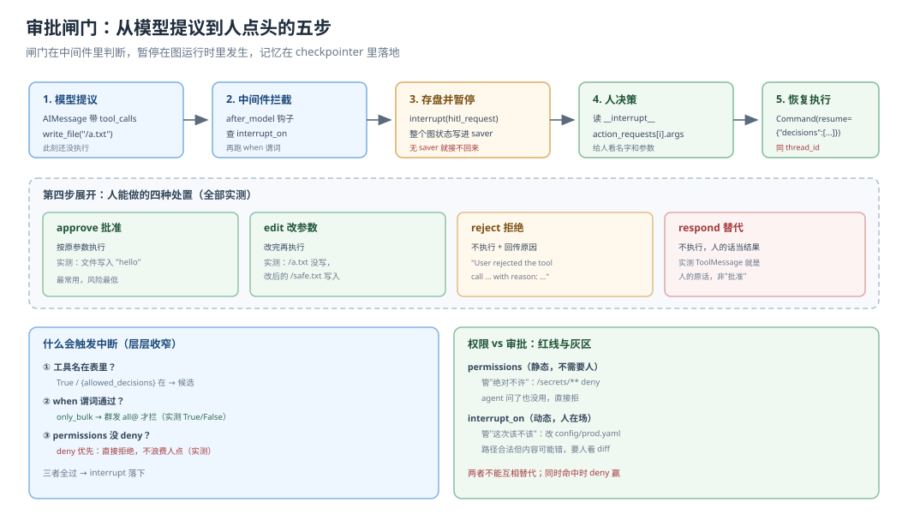
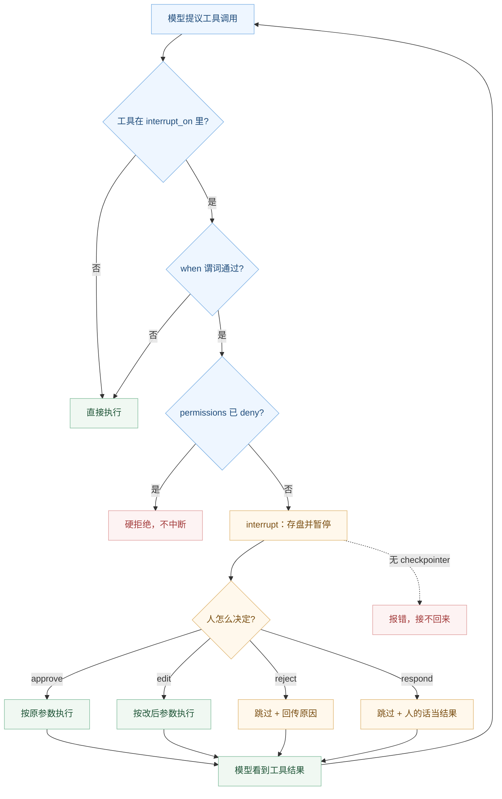

# 课 11：人在环中

> 所属阶段：阶段 4《委派与上线》｜ 水平：进阶 ｜ 本课知识点：interrupt_on 映射、与 LangGraph interrupt 的关系、权限 vs 审批的分工
> 故事情节：主角让 agent 自己重构代码，第一次跑就把不该动的文件改了——他需要一道"动手前问一句"的闸
> 📖 结论已按官方文档核对（核对于 2026-10 ｜ 来源：docs.langchain.com/oss/python/deepagents/human-in-the-loop、customization#human-in-the-loop、overview#steering）
> ✅ 代码结论实测于 2026-10-21 ｜ `deepagents 0.7.28` / `langchain 1.4.6` ｜ 隔离环境 `/tmp/da-probe`
> ✅ TypeScript 侧实测于 2026-10-22 ｜ `deepagents 1.15.1` / `@langchain/core 1.2.20` / `langchain 1.4.x` / Node 22.22.2 ｜ `playground-ts/l11-hitl.ts`
> 本课配**应用实战**

> 🧭 **本课怎么读双语块**：每个 `::: code-group` 里左 `[Python]` 右 `[TypeScript]`，点标签切换；纯输出块用 `[Python]` / `[TypeScript]` 标在 `text` 后面。
>
> ⚠️ **本课 TS 侧是"看起来一样、行为不一样"的重灾区**：四种决策的配置写法几乎逐字对应，但 `permissions` 少了 `interrupt` 这个 mode、`deny` 不再优先、批量审批混用决策时被批准的调用会被**整条丢掉**。如果你是 TS 用户，别照着 Python 的排查口径对字段名，先看第四幕 4.1 的七处硬差异。

## 🎯 本课目标

- 用 `interrupt_on` 配出"改文件前必须批准"，并说清四种决策的差别
- 说清审批底层靠 LangGraph interrupt 实现，以及为什么没 checkpointer 就接不回来
- 用两个真实决策区分"该用权限还是该用审批"，并知道两者叠加时谁优先

---

## 第一幕：起源与场景引入

课 10 你学会了把活派出去。但派出去之后有个新问题：**派出去的活，你敢让它直接干吗？**

> 🎬 **场景**：主角让 agent 自己重构代码。第一轮跑完，他打开 git diff——除了该改的三个文件，`config/prod.yaml` 也被改了，还有一个迁移脚本被删了。
>
> agent 的理由很合理：它"顺手清理了无用的配置"。
>
> 主角意识到问题不在于 agent 笨，而在于**它压根没被问过**。

这就是"人在环中"（Human-in-the-Loop，简称 HITL）要解决的事：**动手前先问一句**。

课 10 学的是"把活分出去"，这一课学的是"分出去的活，在关键处停一下"。两课合起来才是完整的"放权"：



> 📌 **一句话本质**：`interrupt_on` 是"按工具名划一条线，线内的调用必须等人点头"。它的底层不是 agent 自己的逻辑，而是 LangGraph 的图级暂停机制——所以它需要 checkpointer 才能记住"停在哪"。

> ⚖️ **处境对照**：装上这道闸，你第一次能在"agent 全自动"和"每步手动"之间找到一个可用的中间态。不装，你要么全信它、要么盯着它每条命令——两种都不实用。

---

## 第二幕：认知冲突

**第一处：配了 `interrupt_on` 却什么都没发生。**

很多人第一次配 HITL 会遇到这个：

::: code-group

```python [Python]
agent = create_deep_agent(
    model=model, backend=backend,
    interrupt_on={"write_file": True},   # 配了
)
out = agent.invoke({"messages": [...]})  # 结果直接跑完了，没停
```

```typescript [TypeScript]
const agent = createDeepAgent({
	model,
	interruptOn: { write_file: true }, // 配了（驼峰）
});
const out = await agent.invoke({ messages: [...] }); // 不是"没停"，是直接抛错
```

:::

实测的真相：**中断能产生，但没有 checkpointer 就接不回来**。

::: code-group

```text [Python]
无 checkpointer 时：
  输出含 __interrupt__: True      ← 暂停确实发生了
  但恢复时 → RuntimeError: Cannot use Command(resume=...) without checkpointer
```

```text [TypeScript]
无 checkpointer 时：
  第一次 invoke 就抛 → GraphValueError: No checkpointer set
  ← TS 更"早死"：不是暂停后接不回来，是压根不给你暂停
```

:::

> 🇹🇸 **这条差异很实用**：Python 的症状是"agent 突然不动了、结果里多了个 `__interrupt__`"；TS 的症状是"第一次跑就崩，报 `No checkpointer set`"。同一个配置错误，两种表现。TS 这个反而更好排查——至少它直接告诉你了。官方文档那句 `Checkpointer is REQUIRED for human-in-the-loop` 在两侧都成立，只是 TS 把它做成了启动期硬校验。

**第二处：更隐蔽——中断确实有，但你看不到它。**

::: code-group

```python [Python]
out = ...  # 有 checkpointer 也会暂停
out["messages"]  # ← 只有 2 条：human + ai
```

```typescript [TypeScript]
const out = await agent.invoke(...); // 有 checkpointer 也会暂停
out.messages; // ← 同样只有 2 条：human + ai
```

:::

中断信息**不在 `messages` 里**，而在一个独立的 `__interrupt__` 键上：

::: code-group

```python [Python]
out.keys()  # ['__interrupt__', 'messages']
out["__interrupt__"][0].value  # {'action_requests': [...], 'review_configs': [...]}
```

```typescript [TypeScript]
Object.keys(out); // ['messages', 'files', '__interrupt__']
out.__interrupt__[0].value; // { actionRequests: [...], reviewConfigs: [...] }
```

:::

> 🇹🇸 **注意字段名是驼峰，而且多了一个 `files` 键**：`action_requests` → `actionRequests`、`review_configs` → `reviewConfigs`。另外 TS 侧 `Object.keys(out)` 的顺序里 `files` 排在 `__interrupt__` 之前，别用 `keys[0]` 硬取。如果你只读 `messages`，两边的症状一样：觉得"agent 怎么突然就不动了"。

**第三处：骨架说"粒度只能按工具名，不能按参数内容条件触发"，这是错的。**

骨架的关键点 4 写：

> 粒度——只能按工具名，不能按参数内容条件触发（这是个真实限制）

实测反例（探针 6-A）：

::: code-group

```python [Python]
def only_bulk(req):
    to = (req.tool_call.get("args") or {}).get("to", "")
    return isinstance(to, str) and to.startswith("all@")

agent = create_deep_agent(
    tools=[send_email],
    interrupt_on={"send_email": {"allowed_decisions": ["approve", "reject"],
                                  "when": only_bulk}},
)
# 群发 all@corp.com → 中断 True
# 单发 one@corp.com → 中断 False
```

```typescript [TypeScript]
const onlyBulk = (req: { toolCall: { args: Record<string, unknown> } }) => {
	const to = String(req.toolCall.args?.to ?? "");
	return to.startsWith("all@");
};

const agent = createDeepAgent({
	tools: [sendEmail],
	interruptOn: {
		send_email: { allowedDecisions: ["approve", "reject"], when: onlyBulk },
	},
});
// 群发 all@corp.com → 中断
// 单发 one@corp.com   → 不中断
```

:::

`InterruptOnConfig` 有 `when` 字段，接收一个 `Callable[[ToolCallRequest], bool]`（TS 侧是 `(request) => boolean | Promise<boolean>`）；`permissions` 的 `mode="interrupt"` 更是内建了按路径触发的谓词。所以准确说法是：**默认按工具名整体拦，但可以加 `when` 谓词做到按参数条件拦**。

> 🇹🇸 **谓词参数形态不同**：Python 从 `req.tool_call["args"]` 取（snake_case 的 `tool_call`），TS 从 `req.toolCall.args` 取（`toolCall`）。而且 TS 侧的 `when` 允许返回 Promise——可以做异步判断（比如查一下当前环境是不是 prod）。注意 JSDoc 里那句警告：**恢复时谓词会再跑一次**，句柄相同的调用必须返回相同结果，否则人的决定会被跳过、工具直接执行。
>
> 🇹🇸 **另一处关键差异**：TS 的 `PermissionMode` 只有 `"allow" | "deny"`，**没有 `"interrupt"`**。写 `mode: "interrupt"` 不报错（Zod strip 掉了），被当 `"allow"`，文件直接写进去。所以 TS 侧"按路径触发审批"只能靠 `when` 谓词自己判 `file_path`——见知识点 3 和探针 4-C。

> ❓ **问题**：这道闸到底是怎么落下的？为什么"暂停"这种能力不需要 agent 自己实现？`permissions` 和 `interrupt_on` 又该怎么分工？

---

## 第三幕：层层揭示

### 一眼全局图（进入细节前先看一眼）



> 看图：横轴是"模型提议 → 中间件拦截 → 暂停存盘 → 人决策 → 恢复执行"五步；纵轴标出每步的关键对象。中间那个停顿点是整条链路的核心——它不在 agent 的逻辑里，而在图运行时里。注意图右下角的四条决策出口，`respond` 那条不真的执行工具，而是把人的话直接当成工具结果还给模型，这是"替代"而不是"批准"。

### 本课地图（分几步走）

| 步 | 这一步要解决什么（人话） | 对应知识点 |
|:--:|------------------------|-----------|
| 1 | 怎么配、配了之后人能做什么选择 | 知识点 1：interrupt_on 映射 |
| 2 | 这道闸为什么能暂停，为什么必须存盘 | 知识点 2：与 LangGraph interrupt 的关系 |
| 3 | 该用权限还是该用审批，两者打架谁赢 | 知识点 3：权限 vs 审批的分工 |

---

### 知识点 1：interrupt_on 映射

> 🧭 第 1/3 步｜承接：开场"它压根没被问过" → 本步：把闸门装上，看清人能做的四个选择
> 本知识点关键点：三种配置形态、四种决策、按参数条件触发、值得配的工具

#### 一句话定义

`interrupt_on` 是 `{工具名: 配置}` 的映射：配置可以是 `True`（全开四种决策）、`False`（放行）、或 `{"allowed_decisions": [...], "when": 谓词}`（精细控制）。闸门落下后，人能对每个待批调用做四种处置之一。

#### 直觉建立（类比）

像公司的付款审批：

- 小额自动放行（`False`）
- 大额要签字（`True`）
- 超大额必须两个人签、且不许改金额（`allowed_decisions`）

> 💡 **类比的边界**：付款审批是"事前定规则"，人不需要理解业务；而 agent 审批里人会看到具体参数（改哪个文件、发给谁、多少钱），所以能做出比"签不签"更细的判断——这就是 `edit` 决策存在的意义。

#### 核心原理

**三种配置形态**：

::: code-group

```python [Python]
interrupt_on={
    "delete_file": True,                                    # 全开：approve/edit/reject/respond
    "read_file":   False,                                   # 放行，不打扰
    "send_email":  {"allowed_decisions": ["approve", "reject"]},  # 只能批准/拒绝，不许人编内容
}
```

```typescript [TypeScript]
interruptOn: {
	delete_file: true, // 全开：approve/edit/reject/respond
	read_file: false, // 放行，不打扰
	send_email: { allowedDecisions: ["approve", "reject"] }, // 只能批准/拒绝
}
```

:::

**四种决策**（两侧实测全部验证）：

| 决策 | 做什么 | Python 实测结果 | TS 实测结果 |
|------|--------|---------|---------|
| `approve` | 按原参数执行 | 文件被写入，内容 `'hello'` | 同：`files={"/a.txt":"x"}` |
| `edit` | 改参数后执行 | 原 `/a.txt` 不存在，改后的 `/safe.txt` 写入 `'改过的内容'` | 同：`files={"/safe.txt":"改过的内容"}` |
| `reject` | 不执行，回传原因 | ToolMessage = `"User rejected the tool call for \`write_file\` with reason: 不许写这个文件"` | **只有人的原话** `"不许写这个文件"` |
| `respond` | 不执行，把人的话当工具结果 | ToolMessage = 人的原话 `"我来处理"` | 同：`"我来处理这封邮件"` |

> 🇹🇸 **`reject` 的文案两侧不同，这是本课第一处会直接影响你日志 grep 的差异**：Python 会包一层 `User rejected the tool call for ... with reason: ...`，TS 直接把人的 `message` 原样当 ToolMessage。更麻烦的是**不传 `message` 时**：Python 给一段完整解释（`... with id w1. The tool was not executed. Do not retry this tool call unless the user explicitly requests it.`），TS 只给 `User rejected the tool call for \`write_file\` with id w1`，**没有那句"别重试"**。模型可能就此反复重试同一个调用。要在 TS 侧拿到等价提示，得自己在 `message` 里写全。

**`respond` 容易被误解**：它不是"批准"，是"替代执行"。适合"这个工具本来就该问人"的场景（比如 `ask_user` 类工具）——模型提问，人回答，模型拿回答继续。

> 🇹🇸 补一个状态位差异：`respond` 在 TS 侧的 ToolMessage `status` 是 `"success"`，`reject` 是 `"error"`。Python 侧 `respond` 不带 status、`reject` 带 `"error"`。如果你的下游按 `status` 分类统计"被拒了多少次"，两侧口径要分开写。

**按参数条件触发（关键能力）**：

::: code-group

```python [Python]
def only_bulk(req) -> bool:
    to = (req.tool_call.get("args") or {}).get("to", "")
    return isinstance(to, str) and to.startswith("all@")

interrupt_on={"send_email": {"allowed_decisions": ["approve", "reject"],
                              "when": only_bulk}}
```

```typescript [TypeScript]
const onlyBulk = (req: { toolCall: { args: Record<string, unknown> } }) =>
	String(req.toolCall.args?.to ?? "").startsWith("all@");

interruptOn: {
	send_email: { allowedDecisions: ["approve", "reject"], when: onlyBulk },
}
```

:::

实测：群发 `all@corp.com` → 中断；单发 `one@corp.com` → 不中断。

`permissions` 的 `mode="interrupt"` 更进一步——它自动为每个文件工具生成带路径谓词的配置：

::: code-group

```python [Python]
from deepagents.middleware.filesystem import FilesystemPermission

permissions = [FilesystemPermission(operations=["write"], paths=["/secrets/**"],
                                     mode="interrupt")]
# 实测：写 /secrets/key.txt → 中断；写 /public/ok.txt → 不中断
```

```typescript [TypeScript]
// TS 没有 mode:"interrupt"，只能自己用 when 谓词复刻
const agent = createDeepAgent({
	permissions: [{ operations: ["write"], paths: ["/secrets/**"], mode: "deny" }], // 红线还在
	interruptOn: {
		write_file: {
			allowedDecisions: ["approve", "reject"],
			when: (req) => String(req.toolCall.args?.file_path ?? "").startsWith("/secrets/"),
		},
	},
});
// 实测：写 /secrets/key.txt → 中断；写 /public/ok.txt → 不中断
```

:::

> 🇹🇸 **这是本课最关键的一条替代方案**：Python 的 `mode="interrupt"` 把"路径匹配 + 触发审批"做成了一个声明式配置；TS 没有这个 mode，你必须用 `when` 谓词手写路径判断。两者效果等价，但 TS 版有三点要注意：① 路径 glob 要自己实现（`**` 的通配语义不在谓词里）；② 谓词对每个 `write_file` 调用都会跑，别在里面做重 IO；③ `permissions` 的 `deny` 仍然建议保留，做兜底红线。

**一个实测的坑**：`when` 谓词抛异常不会被吞掉，会直接把整个 run 炸出来（`RuntimeError: 谓词炸了`）。所以谓词里要写防御性代码——参数缺失、类型不对都要能安全返回 `False`。

> 🇹🇸 两侧这一点一致：TS 也是直接抛（`Error: 谓词炸了`），不会当成 `false`。所以"谓词写崩了"这个失误在两侧都是硬失败，不是静默放行。

**什么工具值得配**：

- 破坏性操作：`delete`、`write_file`/`edit_file`（尤其指向配置和迁移脚本）
- 外部副作用：发邮件、调付费 API、发消息
- 不可逆动作：部署、退款、删数据

**什么不该配**：`read_file`、`ls`、`glob`、`grep`、`task`。全拦会把审批变成"盲点确认"，训练人无脑点同意——这比不装闸更危险。

#### 常见误区

- ❌「`interrupt_on={"write_file": True}` 就够了」——还要 checkpointer + 同 thread_id
- ❌「`respond` 等于批准」——它不执行工具，把人的话当结果
- ❌「只能按工具名拦」——`when` 谓词能按参数拦（骨架此条有误，已实测纠正）
- ❌「`allowed_decisions` 只是 UI 提示」——实测传其他决策会 `ValueError: Unexpected human decision`
- ❌「所有工具都拦最安全」——会把审批退化成橡皮章
- 🇹🇸 ❌「TS 的 `permissions` 也能写 `mode: "interrupt"`」——**静默失效**，被当 `allow`，文件直接写进去，连报错都没有
- 🇹🇸 ❌「`reject` 不传 message 语义一样」——TS 少了 Python 那句 `Do not retry this tool call`，模型可能反复重试
- 🇹🇸 ❌「`when` 谓词里能拿到 `request.tool`」——`batched` 模式下 `tool` 是 `undefined`（只有 `per_call` 模式下 `wrapToolCall` 里才有）

#### 一句话记住

> `interrupt_on` 三种形态、四种决策；默认按工具名拦，`when` 谓词能按参数拦；只拦真危险的那几个，其余放行。

#### 🗣️ 行话对照

| 说你听到的 | 意思 |
|-----------|------|
| "HITL" | 人在环中，就是这套审批 |
| "gate" / "闸门" | 一个 `interrupt_on` 条目 |
| "action request" | 待批的那次工具调用 |
| "review config" | 这次审批允许哪些决策 |
| "steering" | 官方对"中途干预"这一整类能力的叫法 |

#### 官方文档

- [Human-in-the-loop](https://docs.langchain.com/oss/python/deepagents/human-in-the-loop) —— 四种决策与配置形态
- [Customization: human-in-the-loop](https://docs.langchain.com/oss/python/deepagents/customization#human-in-the-loop) —— checkpointer 必需的原话

---

### 知识点 2：与 LangGraph interrupt 的关系

> 🧭 第 2/3 步｜承接：会配了 → 本步：搞清"暂停"这个能力从哪来，为什么必须存盘
> 本知识点关键点：底层机制、装配位置、checkpointer 必需、悬空调用修补

#### 一句话定义

`HumanInTheLoopMiddleware` 只是"决定什么时候该停"，真正的"停"由 LangGraph 的 `interrupt()` 完成——它把整个图状态存进 checkpointer 然后抛出中断。所以：闸门在中间件，暂停在运行时，记忆在 checkpointer。

#### 直觉建立（类比）

像视频通话里的"暂停"：你能按暂停，是因为软件把当前帧存下来了；不存，暂停之后就没法接着播。

> 💡 **类比的边界**：视频暂停存的是画面，agent 暂停存的是**整个图状态**——包括消息历史、待执行的工具调用、todo 列表、文件内容。所以恢复的时候不是"重播"，是"从那一帧继续"。

#### 核心原理

**装配位置**（源码 `graph.py` 确认）：

::: code-group

```python [Python]
deepagent_middleware.append(MemoryMiddleware(...))          # 记忆
main_interrupt_on = _merge_fs_interrupt_on(                 # 权限→中断的转换
    _build_interrupt_on_from_permissions(permissions or [], backend),
    interrupt_on,
)
if main_interrupt_on is not None:
    deepagent_middleware.append(HumanInTheLoopMiddleware(interrupt_on=main_interrupt_on))
deepagent_middleware.append(UnsupportedContentMiddleware())
```

```text [TypeScript]
// 实测 createDeepAgent 后的 middleware 名单（配了 interruptOn）
FilesystemMiddleware
  → subAgentMiddleware
  → SummarizationMiddleware
  → patchToolCallsMiddleware
  → HumanInTheLoopMiddleware      ← 就是这里插进来的
  → UnsupportedContentMiddleware

// 不配 interruptOn 时是 5 条，这一条整个不装
```

:::

三个要点：

1. **只在有配置时才加入栈**——`main_interrupt_on is None` 就不装这个中间件，零开销（TS 实测：5 条 → 6 条）
2. **位置在 Memory 之后**——记忆改变系统提示，闸门要在提示定稿之后才判断
3. **`permissions` 的 interrupt 规则会先转成 `interrupt_on`，再与用户配置合并**（用户项优先）

> 🇹🇸 **TS 侧第 3 点不存在**：`PermissionMode` 只有 `allow` / `deny`，没有 `interrupt`，所以 TS 根本没有"权限转中断"这一步，也就没有 `_merge_fs_interrupt_on` 那套合并逻辑。TS 的 `HumanInTheLoopMiddleware` 只吃你显式传的 `interruptOn`。这意味着：**你在 TS 里配 `permissions` 只影响硬拒绝，永远不会自动产生审批**。

**中断发生的时刻**：`after_model` 钩子里。模型刚吐出工具调用、还没执行时：

::: code-group

```python [Python]
# langchain/agents/middleware/human_in_the_loop.py:815
decisions = interrupt(hitl_request)["decisions"]
```

```typescript [TypeScript]
// langchain/dist/agents/middleware/hitl.js（batched 模式，afterModel）
const decisions = interrupt(hitlRequest).decisions;
```

:::

注意这句：`interrupt(...)` 返回的是**人给的回复**，而它的结构是 `{"decisions": [...]}`。所以恢复时必须这样传：

::: code-group

```python [Python]
agent.invoke(Command(resume={"decisions": [{"type": "approve"}]}), config=cfg)
```

```typescript [TypeScript]
await agent.invoke(
	new Command({ resume: { decisions: [{ type: "approve" }] } }),
	cfg,
);
```

:::

传 `Command(resume=[{"type": "approve"}])`（少一层字典）会报 `TypeError: list indices must be integers`（Python）——这是实测踩到的坑。

> 🇹🇸 **TS 少一层字典的报错不一样**：TS 里 `resume` 直接传数组的话，报的是 `TypeError: Cannot read properties of undefined (reading 'decisions')` 之类。**但两侧有一个完全一致的校验**：决策条数必须和待批调用数对齐，否则报 `Number of human decisions (0) does not match number of hanging tool calls (2).`（这句在 TS 侧实测逐字如此）。这条其实比"少一层字典"更值得记——它是你按条数拆分决策时最容易撞的错。

**checkpointer 为什么必需**：中断时 state 里只有一个**悬空调用**：

::: code-group

```text [Python]
中断那一刻的消息：
  0. [human] '写'
  1. [ai]    content='' tool_calls=1    ← 有调用，没有对应的 ToolMessage
```

```text [TypeScript]
中断那一刻的消息（实测同样是 2 条）：
  0. [human] '写'
  1. [ai]    content='' tool_calls=1    ← 同样悬空
```

:::

这个"有请求没结果"的中间态必须存下来才能续跑。没 checkpointer 时：Python 中断照样产生（`__interrupt__` 在输出里），但 `Command(resume=...)` 直接报错；TS 则在第一次 `invoke` 就抛 `GraphValueError: No checkpointer set`。

**`PatchToolCallsMiddleware` 是干什么的**：它修的就是这种悬空调用。实测一个非典型场景——用户中断后不批准，直接问别的事：

::: code-group

```text [Python]
恢复前（中断态）：human '写' → ai tool_calls=1（悬空）

用户插入新消息 '算了别写了' 后，实际执行的消息流：
  0. [human] '写'
  1. [ai]    tc=1
  2. [tool]  'Tool call write_file with id w1 did not complete - no result was recorded.
              It may have been cancelled or interrupted.'      ← 自动补的
  3. [human] '算了别写了'
  4. [ai]    'done'
```

```text [TypeScript]
中断态：human '写' → ai tool_calls=1（悬空）

插入 '算了别写了' 后（实测 5 条）：
  0. [human] '写'
  1. [ai]    tc=1
  2. [tool]  'Tool call write_file with id w1 was cancelled - another message came in
              before it could be completed.'                    ← 自动补的（文案不同）
  3. [human] '算了别写了'
  4. [ai]    '好'
```

:::

`PatchToolCallsMiddleware` 在 `before_agent` 阶段扫一遍历史，发现「有 tool_call 但没有对应 tool_call_id 的 ToolMessage」，就补一条 `status="error"` 的 ToolMessage。这样模型不会看到"我调了工具但没人理我"的畸形对话。

> 🇹🇸 **修补文案两套，按 grep 分家**：Python 是 `did not complete - no result was recorded. It may have been cancelled or interrupted.`；TS 是 `was cancelled - another message came in before it could be completed.`。如果你的运维告警拿这段文案做匹配，两侧必须写两套正则。另外 TS 侧还会**删掉孤立的 ToolMessage**（没有对应 tool_calls 的那种），Python 不做这件事——所以同一段历史两侧修补后的消息条数可能不同。

**这个机制的实际价值**：任何中断（审批、崩溃、用户放弃）都会留下悬空调用。有这层修补，agent 能在"残缺的历史"上继续正常工作，而不是卡死或产生幻觉。

#### 示例演示

::: code-group

```python [Python]
from langgraph.checkpoint.memory import InMemorySaver
from langgraph.types import Command

agent = create_deep_agent(
    model=model, backend=backend,
    interrupt_on={"write_file": True},
    checkpointer=InMemorySaver(),      # 必需
)

cfg = {"configurable": {"thread_id": "task-42"}}   # 必需，且两次调用要用同一个

out = agent.invoke({"messages": [{"role": "user", "content": "重构代码"}]}, config=cfg)
if "__interrupt__" in out:
    pending = out["__interrupt__"][0].value
    action = pending["action_requests"][0]
    print(action["name"], action["args"])       # 给人看的内容

    out = agent.invoke(
        Command(resume={"decisions": [{"type": "approve"}]}),
        config=cfg,                              # 同一个 thread_id
    )
```

```typescript [TypeScript]
import { createDeepAgent } from "deepagents";
import { MemorySaver, Command } from "@langchain/langgraph";
import type { HITLRequest, Interrupt } from "langchain";

const agent = createDeepAgent({
	model,
	interruptOn: { write_file: true },
	checkpointer: new MemorySaver(), // 必需
});

const cfg = { configurable: { thread_id: "task-42" } }; // 两次调用必须同一个

const out = await agent.invoke(
	{ messages: [{ role: "user", content: "重构代码" }] },
	cfg,
);
if (out.__interrupt__) {
	const pending = (out.__interrupt__[0] as Interrupt<HITLRequest>).value;
	const action = pending.actionRequests[0];
	console.log(action.name, action.args); // 给人看的内容

	await agent.invoke(
		new Command({ resume: { decisions: [{ type: "approve" }] } }),
		cfg, // 同一个 thread_id
	);
}
```

:::

> 🇹🇸 **`Command` 的构造方式不同**：Python 是 `Command(resume=...)` 关键字参数，TS 是 `new Command({ resume: ... })` 传对象。类型定义里 `HITLRequest` / `Interrupt` 都从 `langchain` 包导，不从 `deepagents` 导。另外 TS 的 `MemorySaver` 从 `@langchain/langgraph` 导（不是 `@langchain/langgraph-checkpoint`）。

#### 常见误区

- ❌「配了 `interrupt_on` 就会停」——还要 checkpointer
- ❌「恢复可以换 thread_id」——换个 id 找不到暂停状态
- ❌「恢复时直接传列表」——要 `{"decisions": [...]}`
- ❌「中断信息在 `messages` 里」——在 `__interrupt__` 键上
- ❌「`MemorySaver` 能上生产」——它只在进程内存里，重启就没了；生产用持久化 saver
- 🇹🇸 ❌「TS 没 checkpointer 也能看到 `__interrupt__`」——不会，第一次 `invoke` 就抛 `GraphValueError`
- 🇹🇸 ❌「换 thread_id 恢复会报错」——**两侧都不报错，只是静默什么都没发生**（实测 `files={}`），这个比报错更难查
- 🇹🇸 ❌「可以把 `MemorySaver` 当生产方案」——TS 的 `MemorySaver` 名字看着更"正式"，但同样只在进程内存里，重启即失

#### 一句话记住

> 闸门在中间件（`after_model`），暂停在图运行时（`interrupt`），记忆在 checkpointer；三者缺一，闸门就落不下来或者落下来收不回。

#### 🗣️ 行话对照

| 说你听到的 | 意思 |
|-----------|------|
| "durable execution" | 图状态持久化，能停几天再续 |
| "悬挂调用" / "dangling tool call" | 有 tool_call 没 ToolMessage 的中间态 |
| "thread_id" | 存盘槽位标识，恢复必须对上 |
| "checkpoint" | 某一刻的完整图状态快照 |

#### 官方文档

- [Human-in-the-loop](https://docs.langchain.com/oss/python/deepagents/human-in-the-loop) —— 完整中断恢复流程
- [LangGraph interrupts](https://docs.langchain.com/oss/python/langgraph/interrupts) —— 底层机制原文

---

### 知识点 3：权限 vs 审批的分工

> 🧭 第 3/3 步｜承接：已会装闸 → 本步：判断什么时候该用闸、什么时候该用红线
> 本知识点关键点：静态边界 vs 动态决策、互补性、叠加优先级、沙箱场景

#### 一句话定义

`permissions` 是**事先划死的红线**（能不能碰，不需要人在场）；`interrupt_on` 是**动手前的问询**（这次该不该做，人在场）。前者管"绝对不行"，后者管"看起来可以但我不确定"。

#### 直觉建立（类比）

- **permissions** = 公司的门禁卡：你的卡刷不开机房门，不管什么理由、什么时间
- **interrupt_on** = 财务审批：金额超 5000 要经理签字，签了就能付

> 💡 **类比的边界**：门禁卡是硬约束（物理上打不开），而 `permissions` 是软件约束——如果 agent 绕过文件工具（比如用 `execute` 起 shell），`permissions` 就管不到了。这正是"沙箱里权限失效"的意思。

#### 核心原理

**两者的本质差别**：

| 维度 | `permissions` | `interrupt_on` |
|------|--------------|----------------|
| 决策时机 | 配置时 | 运行时 |
| 需要人在场 | 否 | 是 |
| 判断依据 | 路径 + 操作类型 | 完整工具参数 + 上下文 |
| 能否"这次例外" | 不能 | 能（人的判断） |
| 失败模式 | 硬拒绝，agent 改路径重试 | 人不在→卡住 |
| 三种 mode | `allow` / `deny` / **`interrupt`** | 不适用 |
| TS 侧 mode | `allow` / `deny`（**无 `interrupt`**）| 不适用 |

> 🇹🇸 **TS 少了整条"灰区"通道**：Python 的 `permissions` 支持 `mode="interrupt"`，能把"某类路径写之前问一句"直接声明成权限规则。TS 只有 `allow` / `deny` 两档——要么放行、要么硬拒，中间那档必须靠 `interruptOn` + `when` 谓词自己拼。这不是"写法不同"，是**能力缺一档**：Python 一个配置项能表达的东西，TS 要两个配置项加一个谓词。

**为什么不能互相替代**（两个真实决策）：

- **场景 A：agent 要读 `.env`**。`interrupt_on={"read_file": True}` 救不了你——因为你会**批准**它（"它只是想看看配置"），然后密钥就进了上下文。这里需要的是 `permissions` 里 `mode="deny"` 把 `**/.env` 划死，让它**问都不问**。
- **场景 B：agent 要改 `config/prod.yaml` 的第 3 行**。`permissions` 救不了你——路径完全合法，规则拦不住。但这次改动内容明显错了。这里需要 `interrupt_on` 让人看到 diff（甚至用 `edit` 决策改掉）。

**叠加时的优先级**（实测）：

::: code-group

```python [Python]
permissions = [
    FilesystemPermission(operations=["write"], paths=["/secrets/**"], mode="deny"),
    FilesystemPermission(operations=["write"], paths=["/secrets/**"], mode="interrupt"),
]
# 实测：不中断，直接返回 'Error: permission denied for write on /secrets/key.txt'
```

```typescript [TypeScript]
const agent = createDeepAgent({
	permissions: [{ operations: ["write"], paths: ["/secrets/**"], mode: "deny" }],
	interruptOn: { write_file: true },
	checkpointer: new MemorySaver(),
});
// 实测：仍然中断！批准之后才返回 'Error: permission denied for write on /secrets/key.txt'
```

:::

**Python 侧 `deny` 赢**。这个设计很合理：既然注定要拒，就别浪费人去点一次。源码注释也写明了——`deny` 在前时 interrupt 不触发。

> 🇹🇸 **TS 侧结论完全相反，这是本课最反直觉的一处**：`deny` 不会压掉审批。实测拦截顺序是"HITL 先拦 → 人点了批准 → 才轮到权限判 deny → 最后仍被拒"。也就是说 **TS 会让你为一个注定失败的调用白点一次同意**。UI 上这会表现为"我批准了，但操作还是失败了"，非常难解释。TS 的正确做法是：把 `deny` 的路径从 `interruptOn` 的 `when` 谓词里排除掉，即"注定要拒的不问"。
>
> ```typescript
> const isDenied = (p: string) => p.startsWith("/secrets/");
> when: (req) => {
>   const p = String(req.toolCall.args?.file_path ?? "");
>   return p.startsWith("/secrets/") && !isDenied(p); // 注定被拒的直接跳过审批
> },
> ```

**用户配置 vs 权限生成配置**：两者合并，**用户项优先**（`_merge_fs_interrupt_on` 里 `merged.update(user_interrupt_on)`）。所以你可以用一套 `permissions` 做默认策略，再用 `interrupt_on` 对个别工具加码。

> 🇹🇸 这条只对 Python 成立：TS 没有"权限生成配置"这一层，`interruptOn` 就是你写什么是什么，不存在合并与覆盖。

**子代理的审批**（实测）：

::: code-group

```python [Python]
create_deep_agent(
    subagents=[{"name": "writer", "description": "写文件", "model": child,
                "interrupt_on": {"write_file": True}}],
    checkpointer=InMemorySaver(),
)
# 实测：子代理的 write_file 调用 → 父图暂停，待批动作 ['write_file']
```

```typescript [TypeScript]
createDeepAgent({
	subagents: [
		{ name: "writer", description: "写文件", model: child, interruptOn: { write_file: true } },
	],
	checkpointer: new MemorySaver(),
});
// 实测：父图中断，待批动作 write_file；批准后 files={"/from-child.txt":"子代理写的"}
```

:::

**审批是图级的，不是工具级的**。子代理内部的动作也能被拦住，且拦住的是**整张图**。这也解释了为什么异步子代理需要额外的处理（课 12 会讲）——它不在同一张图里跑。

> 🇹🇸 两侧这一点行为一致，只是字段名从 `interrupt_on` 变 `interruptOn`。TS 的 `SubAgent` 接口本身就有这个字段（`interruptOn?: Record<string, boolean | InterruptOnConfig>`），不需要额外中间件。

**沙箱场景下权限退化**（回扣课 6）：如果 agent 拿到 `execute` 工具能起 bash，`permissions` 对文件系统的约束可以被绕过（`cat .env` 不需要 `read_file`）。这时 `interrupt_on={"execute": True}` 成为主要防线——但代价是每条命令都要人看。

> 🇹🇸 **TS 侧这个风险更高**：TS 主代理默认就带 `execute`（9 个工具比 Python 多这一个），所以"权限被绕过"在 TS 里不是可选项而是默认状态。你如果只配了 `permissions` 没配 `interruptOn: { execute: true }`，等于默认留了个 shell 后门。

#### 示例演示

::: code-group

```python [Python]
from deepagents import create_deep_agent
from deepagents.middleware.filesystem import FilesystemPermission

agent = create_deep_agent(
    model=model, backend=backend,
    permissions=[
        # 红线：密钥目录绝对不碰，问都不问
        FilesystemPermission(operations=["read", "write"], paths=["**/.env"],
                             mode="deny"),
        # 灰区：配置目录写之前问一句
        FilesystemPermission(operations=["write"], paths=["/config/**"],
                             mode="interrupt"),
    ],
    interrupt_on={
        # 再加一层：删任何文件都问
        "delete": True,
    },
    checkpointer=InMemorySaver(),
)
```

```typescript [TypeScript]
import { createDeepAgent } from "deepagents";
import { MemorySaver } from "@langchain/langgraph";

const agent = createDeepAgent({
	permissions: [
		// 红线：密钥目录绝对不碰（TS 没有 interrupt 档，灰区得靠下面的 when）
		{ operations: ["read", "write"], paths: ["**/.env"], mode: "deny" },
	],
	interruptOn: {
		// 灰区：配置目录写之前问一句（用谓词复刻 Python 的 mode:"interrupt"）
		write_file: {
			allowedDecisions: ["approve", "edit", "reject"],
			when: (req) => {
				const p = String(req.toolCall.args?.file_path ?? "");
				// 已被 deny 的别问（TS 不会自动跳过，见知识点 3）
				if (p.includes(".env")) return false;
				return p.startsWith("/config/");
			},
		},
		// 再加一层：删任何文件都问
		delete: true,
	},
	checkpointer: new MemorySaver(),
});
```

:::

> 🇹🇸 对照着看会发现 TS 版多了一段"排除被 deny 的路径"逻辑——这正是因为 TS 不会自动跳过注定被拒的调用。这段样板代码建议封成一个 `pathGate(allow, deny)` 工具函数，本课实战里会这么做。

#### 常见误区

- ❌「有了审批就不需要权限」——审批问你时你可能点同意，权限不会给你这个机会
- ❌「有了权限就不需要审批」——权限只看路径，判断不了"这次改动对不对"
- ❌「两者冲突时会中断」——实测 `deny` 优先，直接拒
- ❌「子代理的审批不影响主流程」——审批是图级的，子代理的动作会让整张图暂停
- ❌「沙箱里权限照样管用」——有 `execute` 就能绕过
- 🇹🇸 ❌「TS 里 `deny` 也会优先」——**反了**，TS 会先问你，你批准后才告诉你被拒
- 🇹🇸 ❌「TS 的 `permissions` 能写三种 mode」——只有 `allow` / `deny` 两种，写 `interrupt` 静默变 `allow`
- 🇹🇸 ❌「TS 沙箱风险比 Python 低」——TS 主代理**默认带 `execute`**，风险更高，`interruptOn: { execute: true }` 要主动配

#### 一句话记住

> 权限划死"不许碰"，审批判断"该不该"；红线用权限（不问）、灰区用审批（问）；两者同时命中时权限赢，别浪费人去点注定被拒的事。

#### 🗣️ 行话对照

| 说你听到的 | 意思 |
|-----------|------|
| "static guardrail" | 静态护栏，就是 `permissions` |
| "dynamic gate" | 动态闸门，就是 `interrupt_on` |
| "allow / deny / interrupt" | permissions 的三种 mode |
| "rubber stamp" | 橡皮章：审批太频繁导致人无脑点同意 |

#### 官方文档

- [Permissions](https://docs.langchain.com/oss/python/deepagents/permissions) —— 三种 mode 与匹配规则
- [Human-in-the-loop](https://docs.langchain.com/oss/python/deepagents/human-in-the-loop) —— 与 permissions 的关系

---

## 第四幕：实操验证（复现与验证）

### 4.1 机制验证：探针带你亲手走一遍

> 探针脚本：`playground-ts/l11-hitl.ts`（TS 侧 8 个 section 全部可运行）+ `temp/c11_probe*.py` 与 `/tmp/da-probe/c11_extra*.py`（Python 侧对应探针）。TS 侧真实输出存档在 `playground-ts/l11-ts-output.txt`。

**探针 1：没有 checkpointer 就没有闸**

::: code-group

```text [Python]
无 checkpointer 时：
  __interrupt__ 在输出里 → True        # 暂停确实发生
  Command(resume=...) → RuntimeError: Cannot use Command(resume=...) without checkpointer
```

```text [TypeScript]
无 checkpointer 时：
  agent.invoke(...) → GraphValueError: No checkpointer set
  ← 第一次调用就抛，连"暂停真的发生了"都看不到
```

:::

> 🇹🇸 这条差异影响你的排查顺序：Python 用户会先看到"agent 不动了"再去找 checkpointer；TS 用户在第一次运行就被拦住，反而更快发现。但也意味着 **TS 无法用"有没有 `__interrupt__`"来验证闸门是否装对**——必须先有 checkpointer。

**探针 2：四种决策**

::: code-group

```text [Python]
approve → 文件写入，内容 'hello'
edit    → 原路径不存在，新路径写入 '改过的内容'
reject  → 文件不存在，ToolMessage 含 "User rejected the tool call ... with reason: 不许写这个文件"
respond → 文件不存在，ToolMessage = 人的原话 '我来处理这封邮件'
```

```text [TypeScript]
approve → files={"/a.txt":"x"}，tool="Successfully wrote to '/a.txt'"
edit    → files={"/safe.txt":"改过的内容"}
reject（带 message）  → tool="不许写这个文件"，status="error"     ← 没有"User rejected..."包装
reject（不带 message）→ tool="User rejected the tool call for `write_file` with id w1"，status="error"
respond → tool="我来处理这封邮件"，status="success"
```

:::

> 🇹🇸 **`reject` 的两侧差异要记牢**：Python 一定包一层 `User rejected the tool call for ...`，TS 只在你不给 `message` 时才自己生成一句短的。所以 TS 侧"人在拒绝理由里写了什么"和你"日志里看到什么"是同一段文本，Python 侧则是被包装过的。做审批审计时两侧的字段提取逻辑不能共用。

**探针 3：按路径条件触发**

::: code-group

```text [Python]
permissions=[FilesystemPermission(operations=["write"], paths=["/secrets/**"], mode="interrupt")]
写 /secrets/key.txt → 中断 True，待批参数 {'file_path': '/secrets/key.txt', ...}
写 /public/ok.txt   → 中断 False，文件直接写入
```

```text [TypeScript]
// TS 没有 mode:"interrupt"，改用 when 谓词
interruptOn: { write_file: { allowedDecisions: ["approve","reject"], when: onlySecrets } }
写 /public/ok.txt   → 中断 false
写 /secrets/key.txt → 中断 true，待批 write_file({"file_path":"/secrets/key.txt",...})
```

:::

**探针 4：`deny` 与 `interrupt` 的先后**

::: code-group

```text [Python]
permissions=[deny /secrets/**, interrupt /secrets/**]
写 /secrets/key.txt → 不中断
ToolMessage: 'Error: permission denied for write on /secrets/key.txt'
```

```text [TypeScript]
A) 只 deny                → 中断 false，tool="Error: permission denied for write on /secrets/key.txt"
B) deny + interruptOn     → 中断 true  ← 和 Python 相反
                            批准后 files={}，tool 仍是 "Error: permission denied..."
C) mode:"interrupt"（Python 写法）→ 创建不报错，中断 false，files={"/secrets/key.txt":"k"}
                            ← 文件真的写进去了
```

:::

> 🇹🇸 **探针 4-B 和 4-C 是本课两个必看的坑**。4-B 说明 TS 的 `deny` 不会压掉审批——你会为一个注定失败的调用白点一次同意，UI 上表现成"批准了但操作还是失败"。4-C 更危险：`mode: "interrupt"` 是合法的 JSON、Zod 会 strip 掉这个不认识的枚举值，于是权限规则退化成 `allow`，**本该被拦的密钥文件被直接写进去了，全程没有任何报错**。从 Python 迁到 TS 时这一条最容易漏——因为代码看起来完全正确。

**探针 5：悬空调用修补**

::: code-group

```text [Python]
中断态：human '写' → ai tc=1（悬空）
用户插入 '算了别写了' 后：
  [tool] 'Tool call write_file with id w1 did not complete - no result was recorded...'
  [human] '算了别写了' → [ai] 'done'
→ PatchToolCallsMiddleware 自动补了 error ToolMessage
```

```text [TypeScript]
中断态：human '写' → ai tc=1（悬空）
插入 '算了别写了' 后（共 5 条）：
  [tool] 'Tool call write_file with id w1 was cancelled - another message came in before it could be completed.'
  [human] '算了别写了' → [ai] '好'
→ 同样是 PatchToolCallsMiddleware，但文案完全不同
```

:::

**探针 6：`when` 谓词 + 决策越界**

::: code-group

```text [Python]
when=only_bulk → 群发 all@ 中断 True / 单发 one@ 中断 False
allowed_decisions=["approve","reject"] 时传 edit → ValueError: Unexpected human decision
when 谓词抛异常 → RuntimeError 直接把 run 炸了
```

```text [TypeScript]
when=onlyBulk → 群发 all@ 中断 true / 单发 one@ 中断 false
allowedDecisions=["approve","reject"] 时传 edit → Error: Unexpected human decision: {...}
    . Decision type 'edit' is not allowed for tool 'write_file'.
when 谓词抛异常 → Error: 谓词炸了（同样直接炸掉）
```

:::

**探针 7：批量审批混用决策（TS 侧会丢调用）**

这一条在 Python 侧没有对应问题，所以只给 TS 输出：

```text [TypeScript]
一次 ai 消息里两个 write_file 调用（w1 写 /a.txt、w2 写 /b.txt），一次中断打包 2 条待批。

全批准（approve + approve）
  → files={"/a.txt":"A","/b.txt":"B"}，消息 5 条 ✓

批准第一个 + 拒绝第二个（approve + reject）
  → files={}                    ← /a.txt 根本没写！
  → 消息只有 4 条
  → ai 消息里的 tool_calls 只剩 w2（w1 被整条删掉了）
  → 被批准的调用连 ToolMessage 都没有，凭空消失
```

> 🇹🇸 **这是本课最危险的一处行为差异，必须记牢**：TS 的 batched 模式在**同批决策里只要出现一条 `reject`**，其余被 `approve` 的调用就会被**连同 tool_call 一起从历史里删掉**——不是"执行失败"，是"根本没执行，也没有任何痕迹"。`reject + approve`、`reject + reject` 的组合下被批准的同样消失（后者本来就没批准）。
>
> 从源码看根因在 `hitl.js:667`：`hasRejectedToolCalls` 一旦为真，就只有 `reject` / `respond` 的调用会被保留，`approve` 的调用直接从 `revisedToolCalls` 里被过滤掉。Python 侧没有这个分支，被批准的调用照常执行。
>
> **规避方式**：需要混合决策时改用 `interruptMode: "per_call"`。实测同样的场景（拒 w2、批 w1）在 `per_call` 下 `files={"/a.txt":"A"}`，调用正常执行。如果你暂时不想改模式，也可以把"批量拒绝"拆成两次独立调用——但那就等于放弃批量审批的便利。

**探针 8：`per_call` 模式（TS 侧正解）**

::: code-group

```python [Python]
from langchain.agents.middleware.human_in_the_loop import HumanInTheLoopMiddleware

agent = create_deep_agent(
    model=model,
    middleware=[HumanInTheLoopMiddleware(
        interrupt_on={"write_file": True},
        interrupt_mode="per_call",
    )],
    checkpointer=InMemorySaver(),
)
# 实测：两个待批调用 → 中断数 2（batched 只有 1）
# 第一条 value: {'type': 'tool_approval', 'tool_call_id': 'w1', 'name': 'write_file', ...}
```

```typescript [TypeScript]
import { humanInTheLoopMiddleware } from "langchain";

const agent = createDeepAgent({
	model,
	middleware: [
		humanInTheLoopMiddleware({
			interruptOn: { write_file: true },
			interruptMode: "per_call",
		}),
	],
	checkpointer: new MemorySaver(),
});
// 实测：中断 2 个（batched 只有 1 个）
//   id=049921ca… type=tool_approval tool_call_id=w1
//   id=8628ac60… type=tool_approval tool_call_id=w2
// 回复时按中断 id 作 key：
//   new Command({ resume: { [id]: { type: "approve" } } })
```

:::

> 🇹🇸 **`per_call` 是 TS 侧唯一能安全混用决策的模式**，建议作为默认选择。三个附带差异要记住：
>
> 第一，**回复结构完全不同**——`batched` 是 `{ decisions: [...] }` 一个数组对应所有待批调用，`per_call` 是 `{ [中断id]: 决策 }` 按 id 逐个回。传错结构不会报"结构不对"，而是报类型校验错或让调用卡住。
>
> 第二，**`editNotice` 只在 `per_call` 生效**。实测 `batched` 模式下 `edit` 决策的 ToolMessage 就是纯工具结果（`"Successfully wrote to '/safe.txt'"`），模型完全不知道人改过参数；`per_call` 下会加上前缀（默认 `Note: a human reviewer replaced this tool call...`，可自定义），变成 `"【人改过了】 Executed instead: write_file with arguments {...}"`。**这一点很重要**：`batched` 模式下人偷偷改了参数，模型会以为是自己写对了，后续推理全建立在错误前提上。
>
> 第三，**`when` 谓词能拿到 `request.tool`**。`batched` 模式在 `afterModel` 阶段跑谓词，那时 `tool` 是 `undefined`；`per_call` 在 `wrapToolCall` 里跑，才能拿到真实的工具实例。

### 4.2 应用实战：给"改配置"装一道闸（入口）

本课实战要解决"agent 改配置的时候我怎么能看到并拦住"。完整代码、运行步骤与自检清单见：

📄 **[应用实战 11：人在环中](../../../应用实战/11-人在环中.md)**

一句话预告：你会先配一个"改配置前必须批准"的最小闸门，踩一次"没 checkpointer 所以什么都没停"的坑；然后实现一个可交互的审批循环，把四种决策都走一遍；最后用 `permissions` + `when` 谓词把闸门收窄到"只有 prod 配置和群发要问"。

> 🇹🇸 TS 侧实战会多两件事：① 用 `interruptMode: "per_call"` 起步（`batched` 的混合决策缺陷会吃掉你批准的调用）；② 手写一个 `pathGate(allow, deny)` 谓词工厂，替代 Python 的 `mode: "interrupt"`。如果你只做 Python 版，这两步可以跳过。

## 第五幕：体系收束

三个知识点走完一条完整的"放权但可控"链路：

- **怎么配**（知识点 1）回答"闸门装在哪、人能做什么"——三种形态、四种决策、可按参数收窄
- **为什么能停**（知识点 2）回答"暂停这个能力从哪来"——中间件判断、图运行时暂停、checkpointer 记忆
- **和权限怎么配合**（知识点 3）回答"红线与灰区怎么分"——权限不问、审批要问、冲突时权限赢

> 🇹🇸 **三条里只有前两条的"结论"跨语言成立，第 3 条的结论在 TS 侧是反的**。前两条：配置形态逐字对应（只是驼峰）、暂停机制完全一样（都是 LangGraph 的 `interrupt()`）。第 3 条则三处都不同——TS 没有 `interrupt` 这一档权限、`deny` 不优先、`permissions` 不会自动转审批。所以本课通用的是"红线用静态规则、灰区用动态审批"这个思路，不是"冲突时权限赢"这个具体结论。

放在阶段 4 的整体里看：

| 课 | 问题 | 答案 | 本课新增的约束 |
|---|---|---|---|
| 课 10 | 活怎么分出去 | 计划 + 子代理隔离 | 子代理也能配审批 |
| 课 11 | 关键操作要交给人吗 | 审批闸门 + 权限红线 | 必须 checkpointer + 同 thread |
| 课 12 | 活能并行/中途改吗 | 异步 + 动态 | 异步子代理的审批要另外处理 |
| 课 13 | 敢上线吗 | 开关清单 + 容错 + 流式 | 审批 UI 是上线必备件 |

一句话收束整课：**审批不是"让 agent 变慢"，而是把"不可逆的少数决定"从 agent 手里拿回到人手里——代价是必须持久化状态，收益是敢让它跑更长的活。**

## 🐞 常见误区（本课专属）

| 误以为 | 实际 | 怎么排查 |
|--------|------|---------|
| "配了就一定会停" | 没 checkpointer 接不回来 | 先查 `checkpointer=` 有没有传 |
| "停了我能看到" | 信息在 `__interrupt__` 不在 `messages` | 打印 `out.keys()` |
| "恢复随便填" | 要 `{"decisions": [...]}` + 同 thread_id | 看 ValueError/RuntimeError |
| "只能按工具名拦" | `when` 谓词能按参数拦 | 用 `only_bulk` 这类谓词 |
| "deny 和 interrupt 冲突会问" | Python：deny 赢，直接拒 | 看 ToolMessage 是否 permission denied |
| "审批只拦主代理" | 子代理的动作也进父图审批 | 给子代理配 `interrupt_on` |
| 🇹🇸 "TS 没 checkpointer 也能看到中断" | 第一次 `invoke` 就抛 `GraphValueError` | 看报错是不是 `No checkpointer set` |
| 🇹🇸 "`mode: "interrupt"` 在 TS 也能用" | 静默变 `allow`，文件直接写进去 | 检查 `PermissionMode` 类型只有两档 |
| 🇹🇸 "TS 的 deny 也会优先于审批" | 反了：先问人，批准后才拒 | 看 `files` 是否为空 + 是否中断过 |
| 🇹🇸 "批量审批可以混着批和拒" | `batched` 下 approve 的调用整条消失 | 看消息里 `tool_calls` 是否少了一条 |
| 🇹🇸 "`edit` 之后模型知道被改过" | `batched` 模式下不加提示，`per_call` 才加 | 看 ToolMessage 有没有 `Note:` 或自定义前缀 |
| 🇹🇸 "换 thread_id 恢复会报错" | 不报错，静默什么都没发生 | 看 `files` 是不是空的 |

### ⏳ 与过时说法对照

| 过时的说法 | 现在该怎么说 |
|-----------|-------------|
| "中断粒度只能到工具名" | 可用 `when` 谓词按参数触发（需 langchain>=1.3.3）|
| "恢复用 `Command(resume=True)`" | 用 `Command(resume={"decisions": [...]})` |
| "MemorySaver 够用" | 只在进程内，重启丢失；生产用持久化 saver |
| "所有写操作都要审批" | 只拦危险的；全拦会把审批训练成橡皮章 |
| "权限有三种 mode，两侧通用" | 分语言：Python 三档（含 `interrupt`）/ TS 两档（`allow`、`deny`）|
| "deny 和审批同时命中时 deny 赢" | 分语言：Python 是 / TS 不是（先问再拒）|
| "批量审批就是一次收一个数组" | 分语言：Python batched 混用决策正常 / TS batched 会丢 approve 的调用 |

## 一图总结



> 读图指引：注意右边那条虚线通向 N——闸门能落下，但如果没存盘，就永远回不到 H。这是本课最容易踩的坑，也是为什么官方把 checkpointer 写成 "REQUIRED"。另外注意 E 分支在 D 之后：先判断要不要问，再看是不是已经注定被拒，避免"问了也白问"。

> 🇹🇸 **TS 读者看这张图要改三处**：① 最左边如果没 checkpointer，图根本走不到 G，直接在 A 之前就抛错；② E 分支（"permissions 已 deny?"）**不存在**——TS 会先走 D → G 问人，人批准后才在工具内部被 deny 拒绝，也就是"问了也白问"这件事在 TS 侧必然发生；③ `respond` / `edit` 在 `batched` 模式下有额外副作用（前者正常、后者丢提示），混合决策时更会丢调用，所以实际走 H 之后请不要按图上的"四条出口"理解——TS 的 `batched` 出口实际只有"全批准"和"含拒绝"两种结局。

## 课后小测

**Q1**：配了 `interrupt_on={"write_file": True}` 之后 agent 直接跑完没停，最可能的原因？
- A. `write_file` 不是有效工具名
- B. 没传 checkpointer
- C. 模型不支持中断
- D. 需要同时配 `permissions`

<details><summary>答案与解析</summary>

**答案：B**。实测：无 checkpointer 时中断能产生（`__interrupt__` 存在），但恢复会报 `Cannot use Command(resume=...) without checkpointer`。官方文档写 "Checkpointer is REQUIRED for human-in-the-loop"。

> 🇹🇸 **TS 侧同样选 B，但症状是"跑不起来"而不是"停不下来"**：第一次 `invoke` 就抛 `GraphValueError: No checkpointer set`。所以 TS 用户遇到"配了 interruptOn 但 agent 直接跑完没停"这种情况，几乎不可能是缺 checkpointer——缺了会直接崩。真跑完了说明 `interruptOn` 的键名或 `when` 谓词有问题。

</details>

**Q2**：想在"只有群发邮件时才中断"，正确做法是？
- A. 做不到，只能按工具名
- B. 用 `when` 谓词判断 `args["to"]`
- C. 写两个不同名字的工具
- D. 用 `permissions` 的 deny

<details><summary>答案与解析</summary>

**答案：B**。`InterruptOnConfig` 支持 `when: Callable[[ToolCallRequest], bool]`。实测群发 `all@corp.com` 中断、单发 `one@corp.com` 不中断。注意谓词抛异常会直接炸掉 run，要写防御性代码。

> 🇹🇸 **TS 侧同样选 B，取参数路径不同**：从 `req.toolCall.args` 取（Python 是 `req.tool_call["args"]`）。另外 TS 的 `when` 可以返回 Promise，能做异步判断；但要注意 JSDoc 的警告——**恢复时谓词会再跑一次**，同一个调用必须返回相同结果，否则人的决定会被跳过、工具直接执行。

</details>

**Q3**：`respond` 决策和 `approve` 的本质区别？
- A. `respond` 更快
- B. `respond` 不执行工具，把人的话当工具结果
- C. `respond` 会跳过整个对话
- D. 没有区别

<details><summary>答案与解析</summary>

**答案：B**。实测 `respond` 后文件不存在，ToolMessage 是人的原话。它适合"这个工具本来就该问人"的场景（`ask_user` 类），模型拿到人的回答继续推理。

> 🇹🇸 **TS 侧同样选 B**，行为一致。唯一差别在 `status` 字段：TS 的 `respond` 结果是 `status: "success"`、`reject` 是 `"error"`；Python 的 `respond` 不带 `status`。按状态统计审批结果时要分开写。

</details>

**Q4**：`permissions` 里同一路径既 `deny` 又 `interrupt`，会发生什么？
- A. 先中断问人，人说行就执行
- B. 直接拒绝，不中断
- C. 报配置冲突错误
- D. 随机一种

<details><summary>答案与解析</summary>

**答案：B**。实测：不中断，ToolMessage = `'Error: permission denied for write on /secrets/key.txt'`。设计意图是"既然注定被拒，别浪费人去点"。

> 🇹🇸 **TS 侧这题的答案要改成 A 的前半段加 B 的后半段**：TS 里 `deny` 和 `interruptOn` 叠加时**仍然会中断**，人选了 `approve` 之后才返回 `Error: permission denied`。也就是"先问人，人说行也不行"。实测 `files={}`、`tool="Error: permission denied for write on /secrets/key.txt"`。这等于让人为注定失败的调用白点一次，UI 设计上要考虑提前过滤（在 `when` 里排除 deny 路径）。

</details>

**Q5**：中断后用户不批准、直接问别的事，悬空的工具调用怎么处理？
- A. 报错终止
- B. 模型自动重试
- C. `PatchToolCallsMiddleware` 补一条 error ToolMessage
- D. 被静默忽略

<details><summary>答案与解析</summary>

**答案：C**。实测：`before_agent` 阶段扫出"有 tool_call 没对应 ToolMessage"的调用，补一条 `status="error"` 的消息（内容含 `did not complete - no result was recorded`），然后继续处理新消息。

> 🇹🇸 **TS 侧同样选 C，但补的文案不同**：TS 补的是 `Tool call write_file with id w1 was cancelled - another message came in before it could be completed.`。另外 TS 还会顺手删掉孤立的 `ToolMessage`（没有对应 tool_calls 的那种），Python 不做。所以两侧修补后的消息条数可能不同，别拿同一套断言跑两边。

</details>

---

## 🇹🇸 本课双语差异速查

| 差异点 | Python | TypeScript |
|---|---|---|
| 参数名 | `interrupt_on` | `interruptOn` |
| 配置键 | `allowed_decisions` / `when` | `allowedDecisions` / `when` |
| interrupt 值字段 | `action_requests` / `review_configs` | `actionRequests` / `reviewConfigs` |
| 无 checkpointer 时 | 中断能产生，`Command(resume=...)` 才报错 | **第一次 `invoke` 就抛 `GraphValueError`** |
| `permissions` 的 mode | `allow` / `deny` / **`interrupt`** | `allow` / `deny`（**无 `interrupt`**）|
| 写 `mode: "interrupt"` | 合法，按路径触发审批 | **静默变 `allow`**，无任何报错 |
| `permissions` 转审批 | 自动转成 `interrupt_on` 再合并 | **不做转换**，`interruptOn` 写什么是什么 |
| `deny` + 审批叠加 | `deny` 优先，不中断 | **仍然中断**，批准后才拒 |
| `reject` 带 message | 包一层 `User rejected the tool call ... with reason:` | **原样返回人的 message** |
| `reject` 不带 message | 完整解释含 `Do not retry this tool call` | 只有 `... with id w1`，无"别重试"提示 |
| `respond` 的 status | 不带 status | `"success"` |
| `batched` 模式 `edit` | ToolMessage 带 `Note: a human reviewer replaced...` 前缀 | **不加前缀**，模型不知情 |
| `editNotice` 配置 | `edit_notice`，两种模式都生效 | `editNotice`，**只在 `per_call` 生效** |
| 批量审批混用决策 | 正常：被批准的照常执行 | **`batched` 下 `approve` 的调用整条消失** |
| `when` 谓词拿 `request.tool` | batched 下也没有 | `batched` 下 `undefined`，`per_call` 下才有 |
| 悬空调用修补文案 | `did not complete - no result was recorded` | `was cancelled - another message came in` |
| 孤立 `ToolMessage` | 不删 | **会删** |
| `Command` 构造 | `Command(resume=...)` | `new Command({ resume: ... })` |
| checkpointer 导入 | `langgraph.checkpoint.memory.InMemorySaver` | `@langchain/langgraph` 的 `MemorySaver` |
| `per_call` 模式 | `interrupt_mode="per_call"` | `interruptMode: "per_call"` |
| `per_call` 回复结构 | 按中断 id 逐个回 | 同（`{ [id]: decision }`）|

> 这张表里最该记住的是三行：**TS 没有 `mode: "interrupt"`**（写错静默放行）、**TS 的 `deny` 不优先**（白点一次同意）、**TS 的 `batched` 混用决策会丢调用**（批准的调用凭空消失）。这三条都不是"写法差异"，是会让你在生产里丢数据或漏拦的差异。

## 🚀 下一批接力提示词

> 学完本课后，**复制下面这段文字发给 AI**，即可进入课 12（无需重新描述上下文）：

```
继续学 Deep Agents。我的学习档案在 langchain/deepagents/00-学习档案.md，
刚学完阶段 4《委派与上线》的课 11《人在环中》全部 3 个知识点
（interrupt_on 四种决策与 when 谓词 / 与 LangGraph interrupt 及 checkpointer 的关系 / 权限 vs 审批分工），
并做完了应用实战。请开始课 12《异步与动态子代理》。
```

## 🧭 课程导航

🎯 **练一练（本课应用实战）**：[第 11 课实战 · 人在环中](../../../应用实战/11-人在环中.md)

⬅️ **上一课**：[课 10：任务规划与子代理](./10-任务规划与子代理.md)

➡️ **下一课**：[课 12：异步与动态子代理](./12-异步与动态子代理.md)

📚 **返回目录**：[课程目录](../../../02-课程目录.md)
