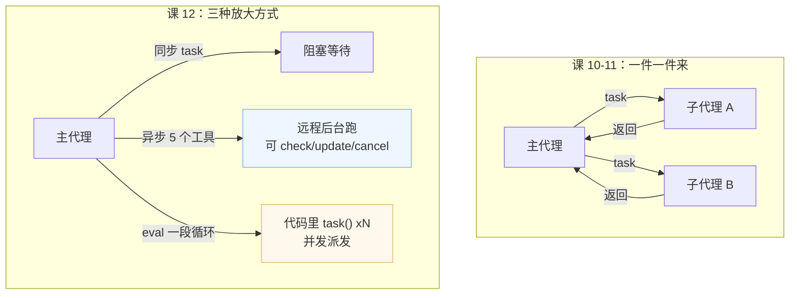
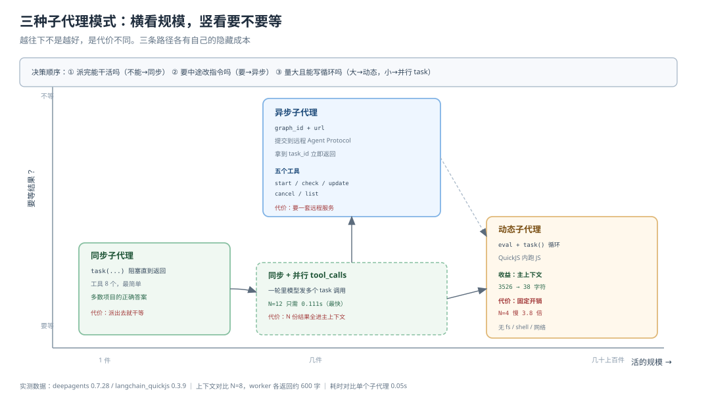
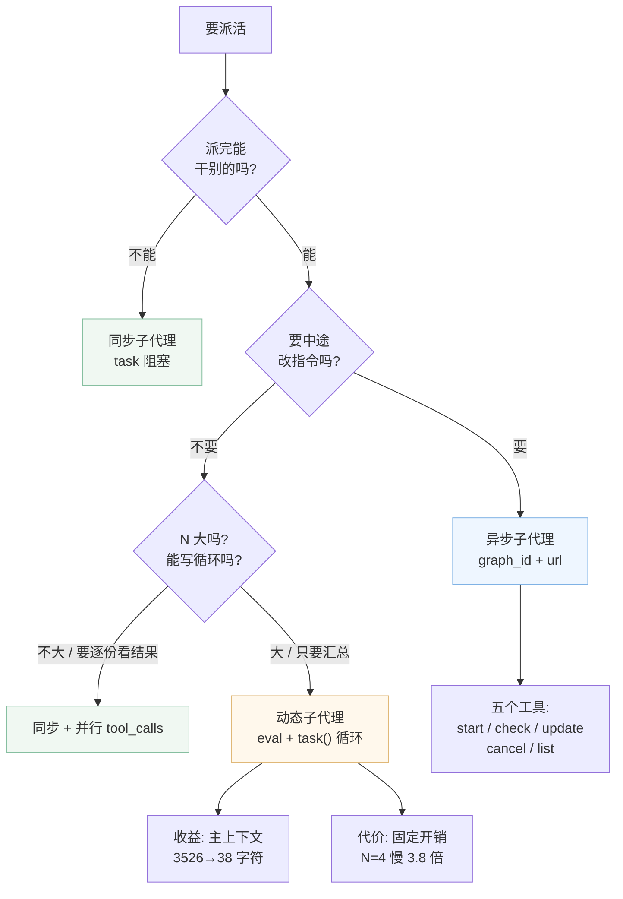

# 课 12：异步与动态子代理

> 所属阶段：阶段 4《委派与上线》｜ 水平：进阶 ｜ 本课知识点：异步子代理的控制工具、动态子代理、选型（同步 / 异步 / 动态）
> 故事情节：主角要同时查 5 个竞品，等一个回来再发下一个太慢了；而且查到一半发现方向错了，得能喊停
> 📖 结论已按官方文档核对（核对于 2026-10 ｜ 来源：docs.langchain.com/oss/python/deepagents/async-subagents、programmatic-subagents、subagents）
> ✅ 代码结论实测于 2026-10-21 ｜ `deepagents 0.7.28` / `langchain_quickjs 0.3.9` ｜ 隔离环境 `/tmp/da-probe`
> 本课配**应用实战**

## 🎯 本课目标

- 说清异步子代理跑在**哪儿**，以及为什么它天生跨进程
- 用一条循环脚本派发 N 个子代理，并说清这样做的真实收益（不是速度）
- 用三条判据在同步 / 异步 / 动态之间选型，不被"看起来高级"带偏

---

## 第一幕：起源与场景引入

课 10 学会了派活，课 11 学会了装闸。但这两课都有一个隐含前提：**活是一件一件派的，而且派出去就等着**。

> 🎬 **场景**：主角要同时调研 5 个竞品。他让 agent 去查，结果 agent 规规矩矩地：查完 A 等回来，再查 B，再等……5 个竞品耗了 15 分钟，其中 12 分钟在等。
>
> 更糟的是第二个问题：查到第 4 个时，主角发现方向搞错了——这 5 个根本不是同一类产品。他想喊停，但 agent 已经把第 5 个也查完了。

两件事要解决：

- **同时派**：5 个竞品应该一起查，不是排队
- **中途改**：查到一半能喊停、能改指令

这一课就是这两件事，加上一个更隐蔽的第三件事：**当活有 300 件时，"一件一件派"这个模式本身会崩**。



> 📌 **一句话本质**：异步子代理把"派活"从**函数调用**变成**提交任务**（拿到 task_id 就走）；动态子代理把"派活"从**模型逐个决策**变成**代码批量循环**。两者解决的是不同的瓶颈——前者解决"等"，后者解决"数量和覆盖"。

> ⚖️ **处境对照**：装上这两种能力，你能处理"5 个竞品同时查"和"300 个文件全审"。但代价是：异步需要一套远程服务，动态需要解释器，两者都比写一个 `task` 复杂得多。所以本课最后一定讲"什么时候不该用"。

---

## 第二幕：认知冲突

**第一处：异步子代理不是"进程内并发"，它压根不在你的进程里。**

很多人以为异步子代理就是把同步子代理放到 `asyncio.gather` 里：

```python
# ❌ 这是想当然
await asyncio.gather(*[task(desc) for desc in tasks])
```

实测真相：异步子代理必须配 `graph_id`，而且它是**通过 LangGraph SDK 在远程 Agent Protocol 服务器上创建 thread + 启动 run**：

```python
subagents=[{
    "name": "researcher",
    "description": "远程研究",
    "graph_id": "research_agent",        # ← 远程图的名字
    "url": "https://my-deployment.langsmith.dev",   # ← 远程服务地址
}]
```

`graph_id` 是**唯一的分流判据**（源码 `graph.py:691-694`）：

```python
for spec in subagents or []:
    if "graph_id" in spec:
        async_subagents.append(cast("AsyncSubAgent", spec))
        continue
```

实测验证：

| 规格 | 走异步？ |
|------|---------|
| `{"name":"a", "graph_id":"g"}` | ✅ 是 |
| `{"name":"b", "url":"http://x"}` | ❌ 否（只写 url 不算） |
| `{"name":"c"}` | ❌ 否（普通同步子代理） |

所以"异步"在这里的含义是：**提交到远端后台跑，主代理拿到 task_id 立刻继续**。跨进程、跨机器、跨部署。

**第二处：不是四个工具，是五个。**

骨架知识点 1 的关键点 2 写：`launch` / `check` / `update` / `cancel`。

实测模型看到的工具清单（探针 4-B）是五个，而且名字也不是 `launch`：

```
start_async_task     ← 骨架叫 "launch"
check_async_task
update_async_task
cancel_async_task
list_async_tasks     ← 骨架漏了这个
```

`list_async_tasks` 不是可有可无的辅助工具。当主代理忘了自己派过几个、或者需要按状态筛"还在跑的"时，它是唯一入口——而且它还能顺便刷新所有任务的实时状态。

**第三处：动态子代理的收益不是"更快"，而是"上下文小 93 倍"。**

这是本课最反直觉的一点。实测（探针 7，N=8，每个子代理返回约 600 字）：

| 方式 | 主模型调用 | 主上下文消息数 | 主上下文总字符 |
|------|-----------|--------------|--------------|
| 并行 `task` tool_calls | 2 次 | 11 条 | 3526 字符 |
| 动态 `eval` + `Promise.all` | 2 次 | 4 条 | **38 字符** |

速度上动态反而更慢（探针 6）：

```
N=4    并行 0.087s  vs  动态 0.329s
N=12   并行 0.111s  vs  动态 0.225s
N=30   并行 0.196s  vs  动态 0.317s
```

原因很实在：动态多了一次解释器启动 + 一次序列化往返，这个开销是**固定成本**，不随 N 增长而摊薄（因为子代理本身极快时，固定成本占大头）。

那它的价值在哪？**每个子代理的返回结果留在解释器变量里，不进主上下文**。主代理只看到最后一行代码的值（`38 字符`），而不是 8 份完整报告（`3526 字符`）。

> ❓ **问题**：既然异步要远程服务、动态要解释器且更慢，那到底什么时候该用哪个？三种模式的边界在哪？

---

## 第三幕：层层揭示

### 一眼全局图（进入细节前先看一眼）



> 看图：横轴是"活的规模"（1 件 → 5 件 → 300 件），纵轴是"主代理要不要等结果"。左下角是同步（小规模、要结果），中上是异步（中等规模、可并发可干预），右下是动态（大规模、结果留在解释器）。注意图中标注的三个代价：同步阻塞、异步需远程服务、动态需解释器且小规模更慢——没有一种模式是"更高级"，只有"更合适"。

### 本课地图（分几步走）

| 步 | 这一步要解决什么（人话） | 对应知识点 |
|:--:|------------------------|-----------|
| 1 | 5 个竞品一起查，还能中途改指令 | 知识点 1：异步子代理的控制工具 |
| 2 | 300 个文件要全审，一个个派会崩 | 知识点 2：动态子代理 |
| 3 | 到底该用哪个，别为了好看上复杂方案 | 知识点 3：选型 |

---

### 知识点 1：异步子代理的控制工具

> 🧭 第 1/3 步｜承接：开场"5 个竞品排队查太慢" → 本步：把"派活"变成"提交任务"，并且能查、能改、能停
> 本知识点关键点：五个工具、状态机、装配位置、审批的处理方式、并发与成本

#### 一句话定义

异步子代理是"把任务提交到远程 Agent Protocol 服务器，立刻拿回 task_id"的模式。主代理不等待，用五个工具管理这批后台任务的整个生命周期。

#### 直觉建立（类比）

像点外卖而不是自己做饭：

- **同步子代理** = 自己做饭：动手、等着、做好了吃
- **异步子代理** = 点外卖：下单拿到订单号就走，回头用订单号查进度、改地址、取消

> 💡 **类比的边界**：外卖你只能"取消"或"改地址"，不能改菜谱；而异步子代理的 `update_async_task` 会**中断当前 run 并在同一 thread 上开新 run**，子代理能看到完整历史加上你的新指令。它比改地址强，相当于"让厨师按新要求重做，但他还记得前面做到哪了"。

#### 核心原理

**五个工具各自的真实行为**（源码 `async_subagents.py` + 探针 4-B）：

| 工具 | 做什么 | 关键实现细节 |
|------|--------|-------------|
| `start_async_task` | 建 thread + 起 run，返回 task_id | task_id **就是** thread_id |
| `check_async_task` | 查状态，完成则带回结果 | 状态可能是 `running`/`success`/`error`/`waiting`/`cancelled` |
| `update_async_task` | 中途改指令 | `multitask_strategy="interrupt"`：中断旧 run、同 thread 开新 run，**task_id 不变** |
| `cancel_async_task` | 取消 | 若任务在 `waiting` 状态**不会**调远程 cancel（没有活跃 run 可取消），只标本地状态 |
| `list_async_tasks` | 列出所有任务 + 实时状态 | 先按**缓存状态**筛选，再对筛出的拉实时状态 |

**`waiting` 是个容易被忽略的状态**：子代理自己也能配 `interrupt_on`。它暂停等人审批时，任务状态是 `waiting` 而不是 `running` 或 `success`。源码注释写得很清楚：

```
A run that hits `interrupt()` ends as `success`; only its thread shows the pause.
```

也就是说，光看 run 状态会误判"成功了"，必须再查 thread 才知道它在等人。而且**这个审批只能由用户在那个子代理自己的 thread 上回答，主代理不能代批**（`_WAITING_NOTE`）。这正好接上课 11 的结论：审批是图级的，异步子代理在另一张图里，所以只能人自己过去点。

**装配位置**（源码 `graph.py:923-926`）：

```python
if async_subagents:
    # Async here means that we run these subagents in a non-blocking manner.
    # Currently this supports agents deployed via LangSmith deployments.
    deepagent_middleware.append(AsyncSubAgentMiddleware(async_subagents=async_subagents))
```

两个要点：

1. **只在配了异步子代理时才入栈**——`if async_subagents` 是判空，没有就是零开销
2. **位置在 `PatchToolCallsMiddleware` 之后**（课 11 讲过 Patch 在 `before_agent` 修悬空调用），与骨架描述一致

**同步路径的限制**（源码 `_ClientCache.get_sync`）：

```python
if spec.get("url") is None:
    raise ValueError(
        f"Async subagent '{name}' has no url configured. "
        "ASGI transport (url=None) requires async invocation."
    )
```

不写 `url` 时可以走**进程内 ASGI 传输**，但**只能用 `ainvoke`**。

这里有个比"报错"更阴的地方：实测用同步 `invoke` 调 `start_async_task` 时，这个 `ValueError` **被 `start_async_task` 自己 catch 住了**，变成一条普通的工具返回值（探针 8-B）：

```
ToolMessage: Failed to launch async subagent 'r': Async subagent 'r' has no url
configured. ASGI transport (url=None) requires async invocation.
```

也就是**流程不中断**，报错字符串作为工具结果交给模型。模型很可能把它当成"启动失败但可以重试"，然后反复重试或编一个合理化的解释。排查时得去翻 ToolMessage，光看有没有异常是发现不了的。

**主代理怎么知道任务完成了**（这是异步设计里最精妙的部分）：

不需要主代理轮询。源码在三个时机主动检查：

- `abefore_agent`：每次 agent 启动前
- `abefore_model`：每次模型调用前
- `aafter_model`：给了最终答案之后，**再查一次**；发现有新状态就 `jump_to: "model"` 让模型多说一轮

外加远程侧：子代理结束时，如果父 thread 空闲（`idle` 或 `error`），会主动起一个 run 唤醒父代理（`_awake_parent`）。源码注释解释了为什么只在这两种状态派：

```
A new run on a thread waiting for a human would cancel that approval;
`reject` covers a thread that just became busy.
```

如果父代理正等着人批审批，这时候插一条通知 run 会把审批冲掉。所以这种情况下不推，等父代理自己下次检查时捞到。

**通知消息不是用户消息**。它带一个明确的头：

```
[SYSTEM NOTIFICATION - NOT USER INPUT]
An async subagent task you started has an update. This is not a message from the user:
don't treat it as their answer to any question.
```

这是必要的防御。否则模型可能把"子代理任务完成了"误当成"用户回答了我刚才问的问题"。

**并发上限**：异步子代理没有 `max_subagent_concurrency` 这类参数（那是动态子代理的）。它的并发上限取决于远程服务的承载能力和你的 API 配额——因为**每个子代理都是一条独立的调用链**，都在烧 token。

#### 常见误区

- ❌「异步子代理是进程内 `asyncio` 并发」——它是远程 thread + run，跨进程
- ❌「四个工具」——是五个，漏了 `list_async_tasks`
- ❌「不配 url 就能用 `invoke`」——ASGI 传输只支持 `ainvoke`
- ❌「`update` 会保留旧 run」——它会 `interrupt` 旧 run 并开新的，`task_id` 不变但 `run_id` 变了
- ❌「主代理能替子代理批审批」——`waiting` 状态必须用户自己在子代理 thread 上回答

#### 一句话记住

> 异步子代理 = 提交到远程服务器拿 task_id；五个工具管理生命周期；`graph_id` 是唯一开关；不写 url 就只能用 `ainvoke`。

#### 🗣️ 行话对照

| 说你听到的 | 意思 |
|-----------|------|
| "async subagent" | 远程后台子代理，不是 `async def` |
| "Agent Protocol" | 远程服务的接口规范，LangGraph Platform 实现了它 |
| "ASGI transport" | 进程内直连，不写 url 时用，只支持异步 |
| "waiting" | 子代理在等人审批，不是跑完了 |
| "multitask_strategy" | 同 thread 上新 run 和老 run 的处置策略 |
| "task_id = thread_id" | 两个是同一个值，源码里 `task_id = thread["thread_id"]` |

#### 官方文档

- [Async subagents](https://docs.langchain.com/oss/python/deepagents/async-subagents) —— 五个工具与远程部署
- [Agent Protocol](https://github.com/langchain-ai/agent-protocol) —— 远程服务接口规范

---

### 知识点 2：动态子代理

> 🧭 第 2/3 步｜承接：5 个能并发了 → 本步：300 个怎么办，以及为什么"派 300 次"这个模式本身会崩
> 本知识点关键点：机制、解释器边界、真实收益、并发控制、失败传播

#### 一句话定义

动态子代理是"让模型写一段 JS 脚本，脚本里用 `task()` 循环派发子代理，脚本在 QuickJS 解释器里执行"的模式。编排逻辑从模型的逐步决策变成代码的结构。

#### 直觉建立（类比）

像**发快递 vs 自己一趟趟送**：

- 逐轮 `task` = 你自己开车，送一件回来再取下一件。送 300 件要跑 300 趟，而且你得记住哪些送过了
- 动态派发 = 你写一张配送单交给调度系统，系统按单子一次性派完

> 💡 **类比的边界**：配送单是死的，遇错就卡；而脚本可以写 `try/catch`、可以按结果分支、可以第二遍只重跑失败的。它是**程序**，不是清单。

#### 核心原理

**机制**：装 `CodeInterpreterMiddleware` 后，解释器里多一个全局函数 `task()`。实测解释器的全局对象（探针 3-A）：

```
__console_error, __console_log, __console_warn, console, performance, task
```

就这么几个。`task` 是唯一能派活的入口。

**它怎么接到子代理的**？关键发现是：`task()` **不是重新实现**，而是桥接到外层已有的 `task` 工具（源码 `_repl.py:536-560`）：

```python
task_tool = find_subagent_task_tool(getattr(runtime, "tools", ()) or ())
if task_tool is None:
    raise RuntimeError("task tool not configured for this eval")
```

这意味着：动态子代理用的是**同一套子代理定义**，`task()` 只是换了个调用入口。所以你会看到：即使只配同步子代理，`task` 工具依然在清单里（探针 4），动态派发也能用。

**调用形式**：

```javascript
const result = await task({
  description: "审查 src/auth/login.ts 的注入风险",
  subagentType: "reviewer",
  responseSchema: {          // 可选，给了就返回结构化对象
    type: "object",
    properties: {
      severity: { type: "string", enum: ["high", "medium", "low"] },
      issues: { type: "array", items: { type: "string" } },
    },
  },
});
result.severity;   // 模型看到最后一行
```

**解释器的能力边界**（探针 3-B，这是安全设计的核心）：

| 探测项 | 结果 |
|--------|------|
| `typeof require` | `undefined` |
| `typeof process` | `undefined` |
| `typeof fetch` | `undefined` |
| `typeof Deno.readTextFile` | `ReferenceError: Deno is not defined` |

**没有文件系统、没有 shell、没有网络**。这印证了骨架知识点 2 的关键点 3。它不是"配了权限才不能读"，是**压根没有那些对象**。这是 QuickJS 沙箱的性质，不是靠 `permissions` 拦的。

**真实收益：主上下文不变大**（探针 7）。8 个子代理各返回 600 字：

```
并行 task tool_calls：主上下文 3526 字符，8 条 tool 结果
动态 eval + 循环：    主上下文   38 字符，1 条 tool 结果
```

差异来自哪里一目了然：并行模式下，8 份子代理报告**全都进了主代理的 messages**；动态模式下，它们留在解释器的 JS 变量里，只有最后一行表达式的值回到主上下文。

这才是"规模化"的真实含义——不是快，是**主上下文不会被 N 个子代理的结果撑爆**。

**并发控制**：`max_subagent_concurrency` 默认 **32**（源码 `_DEFAULT_MAX_SUBAGENT_CONCURRENCY = 32`）。实测（探针 2）：

```
默认：派 8 个，峰值并发 8，耗时 0.57s
设为 2：派 8 个，峰值并发 2，耗时 1.17s
```

信号量真的压住了并发，代价是耗时翻倍。非法值直接拒绝：

```
0    → ValueError: must be a positive integer
-1   → ValueError: must be a positive integer
1.5  → ValueError: must be a positive integer
```

注意 `1.5` 也被拒——它检查的是 `type(x) is not int`，不是 `isinstance`。

**失败传播**：子代理内部抛异常时，`task()` **不会让整个 eval 失败**，而是返回一个错误对象（探针 3-C）：

```html
<error type="RuntimeError">worker 内部炸了</error>
```

这个设计很关键：一个子代理失败不该让另外 299 个白跑。但反过来说，**你的脚本必须自己检查这个错误**，否则会把错误字符串当成正常结果往下传。

**触发方式**：官方文档给了个实用技巧——提示词里带上 "workflow" 这个词，解释器系统提示会把它当作"走代码编排"的信号。想要单次直接委派时就别用这个词。

#### 常见误区

- ❌「动态子代理能读文件」——解释器里没有 `fs`/`require`/`process`，要读文件得派个子代理去做
- ❌「动态派发比并行 `task` 快」——实测更慢（固定开销），快不是它的卖点
- ❌「`task()` 是独立实现」——它桥接到外层 `task` 工具，用同一套子代理定义
- ❌「子代理失败会让 eval 抛异常」——返回 `<error>` 对象，脚本要自己判
- ❌「并发越大越好」——默认 32，调大要考虑下游 API 限流

#### 一句话记住

> 动态子代理 = 模型写 JS 循环，`task()` 在 QuickJS 里批量派活；收益是主上下文不被 N 份结果撑爆，代价是多一层解释器和固定开销。

#### 🗣️ 行话对照

| 说你听到的 | 意思 |
|-----------|------|
| "programmatic subagents" | 动态子代理的官方名 |
| "QuickJS" | 轻量 JS 引擎，解释器就跑在里面 |
| "eval 工具" | 模型写代码的工具，默认名就叫 `eval` |
| "fan-out" | 扇出：一个循环派出 N 个 |
| "RLM" | 递归语言模型：把工作集留在解释器变量里，按需切片处理 |
| "PTC" | programmatic tool calling，代码里调 `tools.*` |

#### 官方文档

- [Dynamic subagents](https://docs.langchain.com/oss/python/deepagents/programmatic-subagents) —— 机制、`task()` 用法、编排模式
- [Interpreters](https://docs.langchain.com/oss/python/deepagents/interpreters) —— 解释器安装与边界

---

### 知识点 3：选型（同步 / 异步 / 动态）

> 🧭 第 3/3 步｜承接：三种都能用了 → 本步：判断该用哪个，以及什么时候一个都别用
> 本知识点关键点：三条判据、混合策略、上下文成本对照、常见误用

#### 一句话定义

选型看三件事：**要不要等结果**（不等就同步够）、**要不要并发且能中途干预**（要就异步）、**编排逻辑能不能事先写成代码**（能就动态）。

#### 直觉建立（类比）

- **同步** = 打电话问同事，等他答完你才继续
- **异步** = 发微信问同事，发完干别的，想起来再看
- **动态** = 给 300 个同事群发模板消息，用脚本汇总回执

> 💡 **类比的边界**：群发模板消息不需要每个人有独立判断；而动态子代理派出的每个子代理都有完整推理能力，能处理开放式任务。所以它比"群发模板"灵活得多，但也贵得多。

#### 核心原理

**三条判据（按顺序问）**：

```
① 派出去之后，主代理能不能干别的？
   ├─ 不能 → 同步子代理（最简单，别加复杂度）
   └─ 能 → ② 需要在跑的过程中改指令/喊停吗？
            ├─ 需要 → 异步子代理（远程 + 五个工具）
            └─ 不需要 → ③ 数量大吗？编排逻辑能写成代码吗？
                         ├─ 能 → 动态子代理
                         └─ 不能 → 同步子代理 + 并行 tool_calls
```

**关键：判据 ③ 之前还有一道"数量"门**。实测数据说明为什么：

```
N=4    并行 tool_calls 0.087s  vs  动态 0.329s     ← 动态慢 3.8 倍
N=12   并行 0.111s             vs  动态 0.225s     ← 动态慢 2 倍
N=30   并行 0.196s             vs  动态 0.317s     ← 动态慢 1.6 倍
```

N 小的时候动态完全是净亏。但上下文开销反过来（N=8 时 3526 vs 38 字符）。所以真正的判据是：

- **N 小（几个）+ 结果要看** → 并行 `task` tool_calls，简单直接
- **N 大（几十上百）+ 只要汇总** → 动态，主上下文省下的是数量级

**三种模式的上下文成本对照**（实测 + 源码推断）：

| 模式 | 子代理结果去哪 | 主上下文增长 | 需要什么额外设施 |
|------|--------------|-------------|----------------|
| 同步 `task` | 全部进 messages | 线性（每个一份） | 无 |
| 并行 `task` × N | 全部进 messages | 线性 × N | 无（模型一轮多发几个） |
| 异步 | 不进 messages，进 `async_tasks` 状态 | 只有你 check 的那份 | 远程 Agent Protocol 服务 |
| 动态 | 留在解释器变量 | 只有最后一行 | QuickJS 解释器 |

异步那个要特别说明：子代理结果**不自动进主上下文**，得主代理主动 `check_async_task` 才拿回来。所以它是"按需取"，不是"自动汇总"。这也是为什么 `list_async_tasks` 有用——先看谁完成了，再决定 check 哪个。

**混合策略**（实际项目里最常见）：

```python
agent = create_deep_agent(
    subagents=[
        # 同步：本地干活，要结果
        {"name": "editor", "description": "改本地代码", "model": local_model},
        # 异步：长任务，可并发可干预
        {"name": "researcher", "description": "远程深度调研",
         "graph_id": "research_agent", "url": REMOTE_URL},
    ],
    middleware=[CodeInterpreterMiddleware()],   # 动态能力
)
```

这一个 agent 同时具备三种能力。但要小心：**工具清单会膨胀**。实测对照（探针 8-A）：

```
同步子代理或无子代理：8 个工具
   delete, edit_file, glob, grep, ls, read_file, task, write_file

配了异步子代理：13 个工具
   上面 8 个 + start_async_task, check_async_task,
   update_async_task, cancel_async_task, list_async_tasks
```

工具越多，模型选错的概率越高。所以：

- 不需要异步，就别配带 `graph_id` 的子代理（`start_async_task` 等 5 个工具不会出现）
- 不需要动态，就别加 `CodeInterpreterMiddleware`（`eval` 不会出现）

**常见误用：为了"看起来高级"上异步**。

异步的隐性成本很高：

- 需要一套远程服务（LangGraph Platform 或自建的 Agent Protocol 服务）
- 需要处理 `waiting` 状态（子代理的审批要人自己去那个 thread 答）
- 需要处理通知与用户消息的混淆（虽然有 `[SYSTEM NOTIFICATION]` 头）
- 调试链路跨进程，出问题要看两个服务的日志

如果一个任务的子代理只要 3 秒，上异步是纯亏 —— 同步阻塞 3 秒，比配一套远程服务划算得多。

#### 示例演示

```python
from langchain_quickjs import CodeInterpreterMiddleware
from deepagents import create_deep_agent

# 场景：审查 40 个文件的安全问题，只要一份汇总
agent = create_deep_agent(
    model=model,
    subagents=[{
        "name": "reviewer",
        "description": "审查单个文件的安全问题，返回严重级别和问题列表",
        "system_prompt": "你是安全审查员，逐行检查注入、越权、密钥泄露。",
    }],
    middleware=[CodeInterpreterMiddleware(max_subagent_concurrency=8)],
)

# 提示词带 "workflow" 触发代码编排
result = agent.invoke({"messages": [{"role": "user", "content":
    "跑一个 workflow：审查 src/ 下所有 .py 文件，出一份按严重级别分组的汇总。"}]})
```

模型会写出类似这样的脚本：

```javascript
const files = ["a.py", "b.py", /* ... 40 个 */];
const results = await Promise.all(files.map(f =>
  task({
    description: `审查 ${f} 的安全问题`,
    subagentType: "reviewer",
    responseSchema: { type: "object", properties: {
      severity: { type: "string", enum: ["high","medium","low"] },
      issues: { type: "array", items: { type: "string" } } } },
  })
));
// 只把高严重级的带回主上下文
results.filter(r => r.severity === "high");
```

最后一行是关键：如果最后一行是 `results`，40 份结果全进主上下文；如果是 `results.filter(...)`，只有高严重级的那几条进来。

#### 常见误区

- ❌「异步一定比同步好」——3 秒的任务上异步是纯亏
- ❌「动态一定比并行 `task` 好」——N 小的时候慢 3.8 倍
- ❌「三种都配上最灵活」——工具从 8 个涨到 13 个，模型选错概率上升
- ❌「异步结果会自动汇总」——要主动 `check_async_task`
- ❌「动态脚本最后一行随便写」——最后一行决定多少内容回主上下文

#### 一句话记住

> 先问"要不要等"（不等才同步），再问"要不要中途改"（要才异步），再问"量大不大、能不能写成循环"（量大才动态）；三种都配会撑爆工具清单。

#### 🗣️ 行话对照

| 说你听到的 | 意思 |
|-----------|------|
| "blocking subagent" | 同步子代理，`task` 会等 |
| "fire and forget" | 异步：发起就不等 |
| "steering" | 中途干预（`update`/`cancel` 属这类） |
| "context amplification" | 子代理结果把主上下文撑大 |

#### 官方文档

- [Subagents](https://docs.langchain.com/oss/python/deepagents/subagents) —— 三种模式的对照与选型
- [Async subagents](https://docs.langchain.com/oss/python/deepagents/async-subagents) / [Dynamic subagents](https://docs.langchain.com/oss/python/deepagents/programmatic-subagents)

---

## 第四幕：实操验证（复现与验证）

### 4.1 机制验证：探针带你亲手走一遍

**探针 1：动态派发真能派出子代理**

```javascript
const results = await Promise.all(
  ["A", "B", "C"].map(item => task({ description: `处理 ${item}`, subagentType: "worker" }))
);
results.join("|");
```

```
子代理被派活次数: 3
  - 处理 A
  - 处理 B
  - 处理 C
eval 返回: <result>worker 完成: 处理 A|worker 完成: 处理 B|worker 完成: 处理 C</result>
```

**探针 2：并发信号量真的生效**

```
默认：派 8 个，峰值并发 8，耗时 0.57s
max_subagent_concurrency=2：派 8 个，峰值并发 2，耗时 1.17s
```

**探针 3：解释器边界 + 失败传播**

```
全局对象只有：console, performance, task
require → undefined    process → undefined    fetch → undefined
Deno.readTextFile → ReferenceError: Deno is not defined

子代理抛异常 → eval 返回 <error type="RuntimeError">worker 内部炸了</error>（不中断整个 eval）
```

**探针 4：五个异步工具 + graph_id 分流**

```
同步子代理 / 无子代理：8 个工具（含 task）
配异步子代理：       13 个工具（+ start/check/update/cancel/list_async_task）

{"graph_id":"g"} → 走异步 True
{"url":"http://x"} → 走异步 False    ← 只写 url 不算
{}                  → 走异步 False
```

**探针 8：不配 url 用同步 invoke**

```
ToolMessage: Failed to launch async subagent 'r': Async subagent 'r' has no url
configured. ASGI transport (url=None) requires async invocation.

注意：不是抛异常，是被 start_async_task catch 成工具返回值 → 流程继续，模型可能反复重试
```

**探针 5/6：速度对比**

```
4 个子代理：串行 1.25s / 并行 tool_calls 0.34s / 动态 0.58s
N=4  并行 0.087s vs 动态 0.329s
N=30 并行 0.196s vs 动态 0.317s
```

**探针 7：上下文体积（本课关键证据）**

```
并行 task tool_calls：主上下文 3526 字符，8 条 tool 结果，11 条消息
动态 eval + 循环：    主上下文   38 字符，1 条 tool 结果，4 条消息
```

### 4.2 应用实战：5 个竞品的并发调研与中途改方向（入口）

本课实战要解决"同时查 5 个竞品、查到一半能改指令"。完整代码、运行步骤与自检清单见：

📄 **[应用实战 12：异步与动态子代理](../../../应用实战/12-异步与动态子代理.md)**

一句话预告：你会先用动态派发把 5 个竞品一次派完，量出主上下文省了多少；然后对比并行 `task` 的耗时，发现动态在小规模下反而慢；最后用假的 Agent Protocol 客户端模拟一次"提交 → 查进度 → 改指令 → 取消"的完整异步生命周期，搞清 `waiting` 状态为什么必须用户自己去子代理 thread 上回答。

## 第五幕：体系收束

三个知识点回答三个递进的问题：

- **能并发吗**（知识点 1）：异步把"派活"变成"提交任务"，五个工具管生命周期，`graph_id` 是开关
- **能海量吗**（知识点 2）：动态把"派活"变成"代码循环"，收益是主上下文不被撑爆，不是速度
- **该用哪个**（知识点 3）：三条判据顺序问下来，多数场景答案是"同步就够"

放在阶段 4 的整体里看：

| 课 | 问题 | 答案 | 本课新增的约束 |
|---|---|---|---|
| 课 10 | 活怎么分出去 | 计划 + 子代理隔离 | 子代理定义可被三种模式复用 |
| 课 11 | 关键操作要交给人吗 | 审批闸门 + 权限红线 | 异步子代理的审批是 `waiting`，人得自己去那个 thread |
| 课 12 | 能并发 / 能海量吗 | 异步五工具 + 动态代码派发 | 工具清单会膨胀，别三种都配 |
| 课 13 | 敢上线吗 | 开关清单 + 容错 + 流式 | 异步任务的监控与容错是上线必备 |

一句话收束整课：**并发不是免费的速度，海量不是免费的能力——异步买到的是"等待期间能干活"，动态买到的是"主上下文不被撑爆"，两者都要付出基础设施和复杂度的代价。**

## 🐞 常见误区（本课专属）

| 误以为 | 实际 | 怎么排查 |
|--------|------|---------|
| "异步是进程内并发" | 远程 thread + run，跨进程 | 看子代理规格里有没有 `graph_id` |
| "四个异步工具" | 五个，漏了 `list_async_tasks` | 打印模型看到的工具清单 |
| "写了 url 就是异步" | 必须是 `graph_id` | 用 `"graph_id" in spec` 判 |
| "不配 url 也能 invoke" | 报错被吞成工具返回值，流程不中断 | 翻 ToolMessage 找 "requires async invocation" |
| "动态比并行快" | 实测更慢，固定开销 | 量 N=4 和 N=30 的耗时 |
| "动态能读文件" | 解释器无 fs/shell/网络 | `typeof require` → `undefined` |
| "子代理失败会中断 eval" | 返回 `<error>` 对象 | 脚本里要自己判 `result` 类型 |
| "异步结果自动汇总" | 要主动 `check_async_task` | 看主上下文有没有那份结果 |

### ⏳ 与过时说法对照

| 过时的说法 | 现在该怎么说 |
|-----------|-------------|
| "异步子代理用 `launch` 启动" | 工具名是 `start_async_task`（五个之一）|
| "异步只需配 `url`" | 必须配 `graph_id`，`url` 只决定走远程还是进程内 ASGI |
| "动态子代理是让模型自己调 `task`" | 是让模型**写代码**，代码里调 `task()` |
| "上异步能提速" | 提速来自"不阻塞"，不是"跑得快"；反而多一层远程调用开销 |

## 一图总结



> 读图指引：从上往下是一道决策树，不是能力阶梯——**越往下不代表越好**。左边那条"不能等 → 同步"是最常走的路，也是多数项目该走的路。右边两个分支各自挂了代价标签：异步的五工具复杂度、动态的固定开销。看到这两个代价还觉得划算，才是该用的场景。

## 课后小测

**Q1**：子代理规格里只有 `url` 没有 `graph_id`，会发生什么？
- A. 正常走异步
- B. 被当成普通同步子代理
- C. 报配置错误
- D. 走 ASGI 进程内传输

<details><summary>答案与解析</summary>

**答案：B**。源码 `graph.py` 用 `if "graph_id" in spec` 分流，实测 `{"url":"http://x"}` → 走异步 False。`url` 只决定异步子代理走远程还是进程内 ASGI，它本身不是异步开关。

</details>

**Q2**：`update_async_task` 对正在跑的任务做了什么？
- A. 排队等当前 run 结束后追加
- B. 中断当前 run，同 thread 开新 run
- C. 直接取消，不执行新指令
- D. 修改当前 run 的参数

<details><summary>答案与解析</summary>

**答案：B**。源码用 `multitask_strategy="interrupt"`，中断旧 run 并在同一 thread 上开新 run。`task_id` 不变（它等于 thread_id），但 `run_id` 会更新。子代理能看到完整历史加上新指令。

</details>

**Q3**：动态子代理 `Promise.all` 派 12 个子代理 vs 并行 `task` tool_calls 派 12 个，哪个更快？
- A. 动态更快
- B. 并行 tool_calls 更快
- C. 一样快
- D. 取决于模型

<details><summary>答案与解析</summary>

**答案：B**。实测 N=12：并行 0.111s，动态 0.225s。动态多了解释器启动 + 序列化往返的固定开销。动态的价值不在速度，在主上下文体积（N=8 时 3526 → 38 字符）。

</details>

**Q4**：异步子代理任务状态是 `waiting`，说明什么？
- A. 正在排队等资源
- B. 子代理在等人审批或回答
- C. 已经成功但结果没取
- D. 网络超时

<details><summary>答案与解析</summary>

**答案：B**。源码注释：run 碰到 `interrupt()` 时状态是 `success`，只有 thread 才显示暂停。所以 `waiting` 是靠查 thread 判断出来的。而且这个审批必须用户在那个子代理自己的 thread 上回答，主代理不能代批。

</details>

**Q5**：解释器里 `typeof require` 返回什么？
- A. `"function"`
- B. `"object"`
- C. `"undefined"`
- D. 抛 ReferenceError

<details><summary>答案与解析</summary>

**答案：C**。实测返回 `undefined`。解释器全局只有 `console`、`performance`、`task` 等少数对象。注意 `typeof Deno.readTextFile` 会抛 ReferenceError（因为访问 `Deno` 这个未声明标识符的属性），这是两者的区别——`require` 是声明过的但值为 undefined。

</details>

---

## 🚀 下一批接力提示词

> 学完本课后，**复制下面这段文字发给 AI**，即可进入课 13（无需重新描述上下文）：

```
继续学 Deep Agents。我的学习档案在 langchain/deepagents/00-学习档案.md，
刚学完阶段 4《委派与上线》的课 12《异步与动态子代理》全部 3 个知识点
（异步五工具与远程 Agent Protocol / 动态子代理的 QuickJS 与 task() 桥接 / 三模式选型判据），
并做完了应用实战。请开始课 13《生产化：容错、流式与上线》，这是阶段 4 也是全教程的最后一课。
```

## 🧭 课程导航

🎯 **练一练（本课应用实战）**：[第 12 课实战 · 异步与动态子代理](../../../应用实战/12-异步与动态子代理.md)

⬅️ **上一课**：[课 11：人在环中](./11-人在环中.md)

➡️ **下一课**：[课 13：生产化容错流式与上线](./13-生产化容错流式与上线.md)

📚 **返回目录**：[课程目录](../../../02-课程目录.md)
