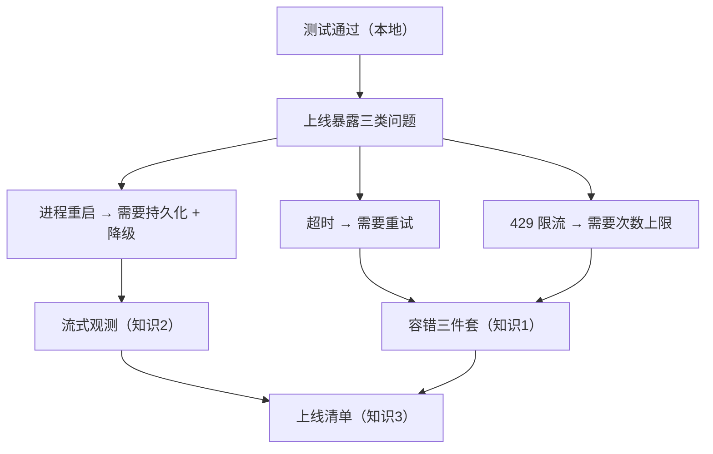
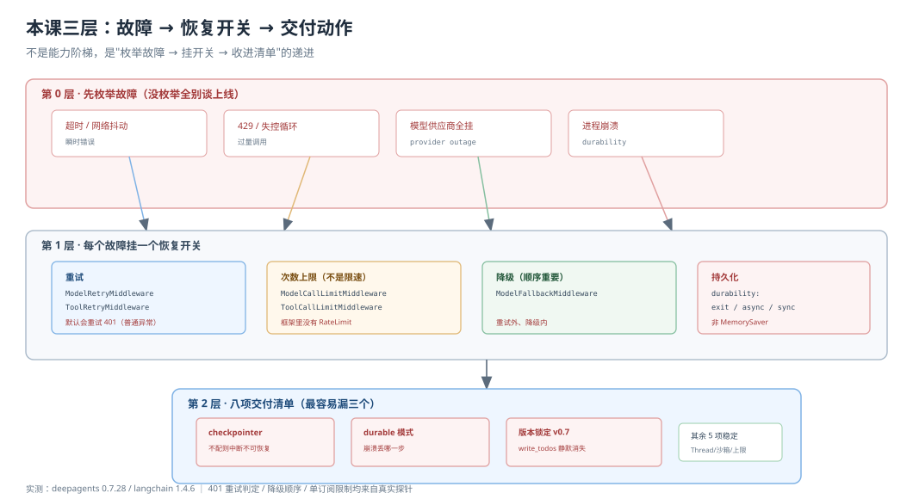
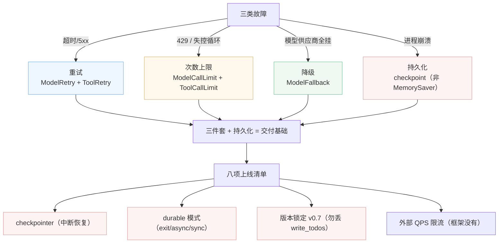

# 课 13：生产化：容错、流式与上线

> 所属阶段：阶段 4《委派与上线》｜ 水平：进阶 ｜ 本课知识点：容错三件套、流式与事件流、上线清单与部署选项
> 故事情节：主角的 agent 在测试里跑得很好，一上线就遇到超时、限流、进程重启——他需要把"能力开关"逐项确认一遍才敢交付
> 📖 容错结论已按官方文档核对（核对于 2026-10 ｜ 来源：docs.langchain.com/oss/python/deepagents/fault-tolerance、going-to-production、event-streaming）
> ✅ 容错与流式结论实测于 2026-10-21 ｜ `deepagents 0.7.28` / `langchain 1.4.6` / `langchain-core 1.6.11` ｜ 隔离环境 `/tmp/da-probe`
> 本课**不配应用实战**（能力开关 + 检查项，工程落地归 Phase 3 结课项目）

## 🎯 本课目标

- 配出重试 / 次数上限 / 降级三件套，并说清各自该拦在哪一层
- 用 `stream.subagents` 拿到每个子代理的独立流
- 按上线清单逐项确认能力开关，指出最容易漏的三项

> ⚠️ 本课三大认知纠偏（与"看起来的样子"相反）：
> 1. **"限流"不是 QPS 限速**——框架里没有速率限制中间件，只有"调用次数上限"（budget）
> 2. **"401/400 不可重试"只在异常属于 `ModelError` 家族时成立**——普通异常默认全重试（含 5xx/429/401），不重试恰恰是对 `ModelError` 子类按 `is_retryable` 分支的结果
> 3. **"动态/异步能提速"在上一课已证伪**——本课会把结论用到"该不该为上线加复杂度"的决策上

---

## 第一幕：起源与场景引入

前 12 课把一个能"想、分、审、并发"的 agent 搭起来了。但有一个残酷现实：**这些能力在本地跑得再顺，上线那一刻会遇到三个完全不讲情面的第一课**：

- **超时**：竞品调研的 agent 一期以上线，主模型调用 3 秒就超时重启
- **限流**：5 个子代理同时扇出，把 API 配额瞬间打满，后面全是 429
- **进程重启**：半夜某个节点崩了，整个线程状态全没了，第二天从零重来

主角需要的不是新能力，而是一张 **清单**：上线前逐项确认——重试开了几层？进程崩了能恢复到哪一步？模型挂了有没有备选？子代理扇出会不会打爆配额？

> 🎬 **场景引入**：交付前夜的最终检查。主角把 agent 的代码和配置摊在桌面，一项一项打勾。这一课不讲怎么造新工具，而是讲**哪些开关该开、开在哪一层、哪些最容易漏**。



> 📌 **一句话本质**：本课是把前面 12 课攒下的"能力开关"收成一张可勾选的清单，并讲清三类开关分别对应哪一类故障。不引入新机制，只做收束。

> ⚖️ **处境对照**：容错和流式是"无感知的高级感"——配好了用户感觉不到，配错了（或没配）要出事故才觉察。所以这一课的语气不是"跟着我造"，而是"逐项自查：你漏了哪个？"

---

## 第二幕：认知冲突

**第一处：框架里没有"限流"（rate limit）这个能力。** 骨架知识点 1 的关键点 1 写"限流——控制调用频率与并发"。实测 `langchain.agents.middleware` 里带 Limit 的导出只有两个：

```
ModelCallLimitMiddleware   不能控制频率，只能控制"最多调用几次"
ToolCallLimitMiddleware
```

没有任何 "RateLimit" / "Throttle" 中间件。官方的"fault-tolerance"文档把这一列叫 **"Excessive calls (runaway loops)"（防失控循环）**，而不是"限速"。它防的是**模型在一个死循环里反复调同一个工具、几分钟烧光预算**，不是"每秒 N 个请求"。

```python
from langchain.agents.middleware import ModelCallLimitMiddleware, ToolCallLimitMiddleware

agent = create_deep_agent(
    model=model,
    tools=[search_tool],
    middleware=[
        # 防失控：最多 N 次模型调用/工具执行
        ModelCallLimitMiddleware(thread_limit=50, run_limit=50, exit_behavior="end"),
        ToolCallLimitMiddleware(tool_name="search_tool", run_limit=3, exit_behavior="end"),
    ],
)
```

**第二处：401/400 到底重不重试？答案在异常家族里，不在错误码里。** 骨架说"哪些错误可重试（网络 / 429 / 5xx），哪些不可（401 / 400）"。实测的真相更精确（探针 1-A / 探针 2-A）：

```python
default_retry_on(exc):
    if isinstance(exc, ModelError):
        return exc.is_retryable      # 只看这个家族
    return True                       # 其他异常（含模拟 401 的 RuntimeError）一律重试
```

实测结果：

| 异常 | is_retryable | 默认重试? |
|------|:---:|:---:|
| `ModelAuthenticationError`（HTTP 401）| False | ❌ |
| `ModelInvalidRequestError`（HTTP 400）| False | ❌ |
| `ModelPermissionDeniedError`（HTTP 403）| False | ❌ |
| `ModelNotFoundError`（HTTP 404）| False | ❌ |
| `ModelRateLimitError`（HTTP 429）| True | ✅ |
| `ModelAPIError`（HTTP 5xx）| True | ✅ |
| 任意普通异常（含 RuntimeError("unauthorized")）| — | ✅ |

所以"401/400 不可重试"**只在异常是 ModelError 子类时才成立**。如果一个 provider 用普通异常（如 `requests.HTTPError`）报 401，`default_retry_on` 会**返回 True 去重试它**——这恰恰是你最不想重试的（重试是浪费、还可能触发更多风控）。这也是为什么官方建议 `retry_on` 要么传具体异常元组、要么传自定义 callable，而不是用默认。

**第三处：`stream.subagents` 不在 `agent.stream()` 上，在 `stream_events(version="v3")` 上。** 骨架知识点 2 的关键点 2 直接说"用 `stream.subagents`"，但我实测 `agent.stream` / `agent.astream` 上**都没有** `subagents` 属性（探针 5-C），只有 `stream_events(version="v3")` 返回的 `GraphRunStream` 上才有（探针 6-A）。而且同步/异步版本的形态还不同：

```
同步 agent.stream_events(..., version="v3")
  stream.subagents  → 可迭代的子代理句柄
  sub.output        → 普通 dict（值，直接读）
  句柄.messages     → 可迭代

异步 agent.astream_events(..., version="v3")
  先 await 拿 run
  run.subagents     → 也是句柄
  sub.output        → 是 方法，要 sub.output() 才能拿到
  可能是 AsyncIterator
```

**还有一个隐藏得很深的坑**：`stream.subagents` 返回的 StreamChannel **只能订阅一次**（探针 6-B）。两次 `for sub in stream.subagents` 会抛：

```
RuntimeError: StreamChannel already has a subscriber; use .atee(n) for fan-out.
```

需要多个消费者时必须先 `.atee(n)` 分叉。官方文档没提这个，是踩出来的。

> ❓ **问题**：既然框架没有 rate limit、重试判定又这么绕、流式入口还带坑——那第三课（上线）到底要确认哪些开关、最容易漏哪几个？

---

## 第三幕：层层揭示

### 一眼全局图（进入细节前先看一眼）



> 看图：三层结构——底层是故障（超时/限流/崩溃/模型挂），中间是响应能力（重试/次数上限/降级/持久化），顶层是交付动作（清单、流式观测、部署）。每一类故障至少对应一个能力，而"最容易漏"往往是你没把故障枚举全。

### 本课地图（分几步走）

| 步 | 这一步要解决什么（人话） | 对应知识点 |
|:--:|------------------------|-----------|
| 1 | 故障来了能不能自己恢复，恢复到哪层 | 知识点 1：容错三件套（重试 / 上限 / 降级 / 持久化）|
| 2 | 上线后怎么看见子代理在干嘛 | 知识点 2：流式与事件流（`stream_events` v3）|
| 3 | 交付前逐项打勾，别漏静默变更 | 知识点 3：上线清单与部署选项 |

---

### 知识点 1：容错三件套

> 🧭 第 1/3 步｜承接：开场三类故障（超时/限流/崩溃） → 本步：每类对应一个开关，且说清"开在哪一层"
> 本知识点关键点：重试判定、次数上限（非限速）、降级链路、中间件落点、子代理容错放大

#### 一句话定义

容错三件套是三个"故障→恢复"开关：**重试**（瞬时故障自动再试）、**次数上限**（防失控烧预算）、**降级**（主模型挂了换备选）。配上**持久化**，进程崩了能从最近一步恢复。

#### 直觉建立（类比）

- **重试** = 打电话占线自动重拨（只对占线重拨，不接的号码拨一万遍也没用）
- **次数上限** = 给电话设个"最多打 3 分钟"的闹钟，防止漫无边际聊下去
- **降级** = 打不通主叫号码就自动转语音信箱，至少有个回复
- **持久化** = 记笔记，聊到一半挂了，从笔记恢复接着聊

> 💡 **类比的边界**：电话占线重拨是"所有占线都重拨"，但框架默认对**非 ModelError 的所有异常都重试**——所以要区分"哪种占线该重拨、哪种不该"。

#### 核心原理

**官方把"故障→策略"列成了 6 行**（fault-tolerance 文档）：

| 故障类型 | 谁修 | 策略 | 中间件 |
|---------|------|------|--------|
| 瞬时（网络/限流）| 系统自动 | 指数退避重试 | `ModelRetryMiddleware` / `ToolRetryMiddleware` |
| 模型能恢复（工具输出烂/解析失败）| 模型 | 转成错误 ToolMessage 喂回去 | `ToolErrorMiddleware` |
| 用户能补（缺信息/指令不清）| 人 | 用 `interrupt()` 暂停 | Human-in-the-loop（课 11）|
| 供应商挂 | 系统自动 | 换备选模型 | `ModelFallbackMiddleware` |
| 调用过多（失控循环）| 系统自动 | 每次 run 封顶 | `ModelCallLimitMiddleware` / `ToolCallLimitMiddleware` |
| 意外错误 | 开发者 | 让它炸出来 | 不配中间件 |

**第一层：重试。** 模型调用和工具调用各有一个重试中间件，但语义分开：

```python
# 模型级：网络超时 / 限流 / 5xx 这类瞬时错误
ModelRetryMiddleware(max_retries=3, backoff_factor=2.0, initial_delay=1.0)

# 工具级：只对会打外网的特定工具重试，别对文件工具重试
ToolRetryMiddleware(max_retries=2, tools=["search", "fetch_url"],
                    retry_on=(TimeoutError, ConnectionError))
```

退化计算实测（探针 1-C，`initial_delay=0.5, backoff_factor=2.0, max_delay=8.0`）：

```
第 0 次重试前等 0.5s
第 1 次重试前等 1.0s
第 2 次重试前等 2.0s
第 3 次重试前等 4.0s
第 4 次重试前等 8.0s   ← 被 max_delay 封顶
第 5 次仍 8.0s
backoff_factor=0.0 → 恒定间隔（如每次等 2.0s）
```

**第二层：次数上限（不是限速）。** 两件事必须分清：

- `ModelCallLimitMiddleware` 默认 `exit_behavior="end"`——超限后**正常结束**本轮，消息内容是 `Model call limits exceeded: thread limit (3/3), run limit (3/3)`，不会炸
- `ToolCallLimitMiddleware` 默认 `exit_behavior="continue"`——超限后**继续**让模型跑下一轮，它还能尝试别的工具。探针 8-D 实测：限 1 次、模型想调 3 轮，工具实际只执行 1 次，但流程继续

拦截层不同会影响你观测到"上限撞没撞到"：Model 层默认 end（会结束），Tool 层默认 continue（不结束）。**上线前要按"是防失控还是防爆预算"决定要不要改成 end**。

**第三层：降级。** 中间件顺序决定降级是否真正兜底（探针 4）：

```
重试在前、降级在后：  primary → backup1
  primary 只被调 1 次（重试没料可试）就降级
降级在前、重试在后：  primary → primary → primary
  三连重试，最后报错，backup1 根本没被调用
```

```python
# 推荐：重试在外层（对主模型先重试），降级在内层（重试无效才换模型）
ModelRetryMiddleware(max_retries=2),
ModelFallbackMiddleware("gpt-5.5"),
```

**中间件栈内的落点**（源码 `graph.py` 装配顺序）：
`Filesystem` → `SubAgent` → `_ParentNotifier` → `summarization` → `PatchToolCalls` → `AsyncSubAgent`(若配) → `interrupt` → `UnsupportedContent` → `_ToolExclusion`(若配)，然后才是你传的 middleware 与默认栈：

- **你的中间件名与栈中已有重名（如 `ModelFallbackMiddleware`）** → 按名字**原位替换**，不新增
- **别的新名字** → 插在最后一个 core 之后、profile/缓存/记忆尾之前

**子代理容错：子代理模型不继承主代理的容错中间件**（探针 4-D）。实测：主模型配了 `ModelRetryMiddleware(max_retries=2)`，子代理模型内部抛 `ModelAPIError` 时——**直接被调了 1 次就抛穿**，没有重试，`task` 工具也没兜住（异常变成 ToolMessage 返回，但子代理那次调用已失败）。所以"给子代理加容错"必须显式放进子代理自己的 `model` 里，或者靠顶层的降级/重试覆盖整个扇出路径。这正是关键点 5 说的"容错放大效应"：**一个子代理失败不应让其他几百个白跑**，但也别指望主代理的中间件自动保护子代理。

#### 常见误区

- ❌「有 QPS 限流中间件」——只有调用次数上限，限速要自己在外部网关做
- ❌「401/400 一律不重试」——只有 ModelError 家族按 is_retryable 分支；普通异常默认全重试
- ❌「重试 + 降级随便排」——顺序错了降级根本不会触发（探针 4-C）
- ❌「子代理继承主代理容错」——实测不继承
- ❌「超上限会报错」——Model 层默认 end（结束），Tool 层默认 continue（继续）

#### 一句话记住

> 重试治瞬时，上限防失控（不是限速），降级保最后兜底，持久化保崩溃恢复——子代理要单独配容错，中间件顺序错了降级不触发。

#### 🗣️ 行话对照

| 说你听到的 | 意思 |
|-----------|------|
| "rate limiting" | 框架里没有；只有调用次数上限（budget）|
| "transient errors" | 瞬时错误（网络抖动/429/5xx），值得重试 |
| "excessive calls" | 失控循环，官方把它单列为"A 类故障"防烧预算 |
| "fallback model" | 降级链里的备选模型 |
| "durable execution" | 图每步自动 checkpoint，崩溃可恢复 |

#### 官方文档

- [Fault tolerance](https://docs.langchain.com/oss/python/deepagents/fault-tolerance) —— 六种故障→策略矩阵
- [Going to production](https://docs.langchain.com/oss/python/deepagents/going-to-production) —— durability 三模式（exit/async/sync）

---

### 知识点 2：流式与事件流

> 🧭 第 2/3 步｜承接：容错配好了 → 本步：上线后怎么看见子代理在干嘛，以及主流怎么"失真"
> 本知识点关键点：入口是 `stream_events` v3、`subagents` 句柄、单订阅限制、主流拍平失真

#### 一句话定义

事件流（`stream_events` v3）给每个委派的子代理一个**独立句柄**（`stream.subagents`），每个句柄能单独看它自己的消息、工具调用、嵌套子代理和最终输出。主代理的 `stream.messages` 只看得到协调器自己讲的，子代理的细节得从句柄里看。

#### 直觉建立（类比）

- **main stream** = 会议室播报的"主持人总结"，一句话概览，不逐字转述
- **stream.subagents** = 每个分会场的**独立麦克风**：只有你想听某个分会场时，才把它的麦接进来

> 💡 **类比的边界**：分会场麦克风是"接入才出声"（lazy 打开流），不是所有分会场全程录音给你转播——这正是"轻量投影"的含义。

#### 核心原理

**入口不是 `agent.stream()`，是 `agent.stream_events(..., version="v3")`**（探针 6-A）：

```python
sync_run = agent.stream_events({...}, config=cfg, version="v3")
for subagent in sync_run.subagents:
    print(subagent.name, subagent.status, subagent.path)
    for msg in subagent.messages:
        print(msg.text)
```

子代理句柄暴露的字段（官方表格）：

| 字段 | 说明 |
|------|------|
| `name` | 协调器调 `task` 时传的 `subagent_type`（你配置的名字）|
| `messages` | 该子代理自己发的消息（不是主流的）|
| `tool_calls` | 该子代理自己的工具调用 |
| `subagents` | 该子代理再嵌套的子代理 |
| `output` | 该子代理最终状态 |
| `path` | 命名空间路径 |
| `status` | `started` / `completed` / `failed` / `interrupted` |

**同步 vs 异步形态不同**（实测，官方没强调）：

```
同步 agent.stream_events(version="v3")
  stream.subagents   可迭代
  sub.output         普通 dict（直接读）
  sub.messages       可迭代

异步 agent.astream_events(version="v3")
  先 await 得到 run
  run.subagents       可迭代
  sub.output          是方法，要 sub.output()
  sub.messages        可能是 AsyncIterator
```

**主流视角为什么"失真"**：主流的 `stream.messages` 只包含协调器自己发的那几句（用户问题、模型回答、工具结果摘要）。子代理内部的推理过程、中间工具调用、再到协调器的对话，**不会逐字进入主流**。如果只挂一个 `stream.messages`，你看到的是"子代理干活 → 返回一行报告"，完全看不见它中间干了什么。要用子代理进度面板，就得连 `stream.subagents` 的句柄。

**单订阅限制**（探针 6-B，文档没提，最容易踩）：`stream.subagents` 的 StreamChannel **只能被遍历一次**。要多个消费者（一个画卡片、一个存日志），必须先分叉：

```python
# ❌ 会抛 RuntimeError
a = list(run.subagents)
b = [s.name for s in run.subagents]   # 第二次遍历 → RuntimeError

# ✅ 用 atee(n) 分叉
fork_a, fork_b = run.subagents.atee(2)
```

**只做"知道有这条路"，不上手造**（关键点 4 的定位）：子代理卡片、待办列表、沙箱 IDE 这些前端页面的具体实现，以及 ACP（Agent Client Protocol，接 IDE）和 AG-UI（给前端交互的协议）两页，本课只告诉你它们是存在的、各解决"谁能看见 agent"的哪个侧面。真做前端归 Phase 3 结课项目。

#### 常见误区

- ❌「`agent.stream().subagents` 能用」——没有，入口是 `stream_events(version="v3")`
- ❌「主流能拍平成子代理全流程」——主流只有协调器视角，子代理细节在句柄里
- ❌「subagents 能遍历多次」——StreamChannel 单订阅，要 atee 分叉
- ❌「同步异步形态一样」——output 一个是值一个是方法

#### 一句话记住

> 事件流 v3 给每个子代理一个独立麦克风（`stream.subagents`），主流只有一个主持人口径；这个麦克风只能接一次，要多路需 `atee`。

#### 🗣️ 行话对照

| 说你听到的 | 意思 |
|-----------|------|
| "event streaming" | `stream_events(version="v3")`，类型化投影 API |
| "typed projections" | 每个投影（subagents/messages/tool_calls/values）独立迭代器 |
| "subagent handle" | 单个子代理的运行句柄，`.messages` `.tool_calls` `.subagents` `.output` |
| "namespace path" | `path`，标记该事件来自哪个子图 |
| "stream.subagents" | 轻量投影：只在你访问句柄时才开对应流 |

#### 官方文档

- [Event streaming](https://docs.langchain.com/oss/python/deepagents/event-streaming) —— `stream.subagents` 权威用法
- [Streaming](https://docs.langchain.com/oss/python/deepagents/streaming) —— 传统 `stream(subgraphs=True)` 的命名空间方式

---

### 知识点 3：上线清单与部署选项

> 🧭 第 3/3 步｜承接：容错与流式都懂 → 本步：交付前逐项打勾，指出最容易漏的三项
> 本知识点关键点：checkpointer 缺失的恢复、durability 三模式、沙箱最小权限、版本锁定、八项清单

#### 一句话定义

上线清单是八项可在代码里逐条确认的能力开关，配上前四课学过的机制（memory、subagents、interrupt、async）做定位级提示。最常漏的三项都是"平时测试暴露不出来"的。

#### 直觉建立（类比）

像发车前检查单（pre-flight checklist）：不是每个开关都在每一架飞机上都重要，但漏了某个，出事时才后悔。最容易漏的往往不是"麻烦的"，而是"测试环境里根本触发不了的"。

> 💡 **类比的边界**：发车检查是飞机起飞前一次性确认；线上清单是每次发布前确认一次，不是每次请求都跑。

#### 核心原理

**最容易漏的三项（按踩坑优先级）**：

**① 不配 checkpointer，`interrupt` 就不恢复（最阴）。** 实测（探针 7）：不传 checkpoint 时配 `interrupt_on`，`invoke` **不报错、能正常触发中断**，`out["__interrupt__"]` 有值。但你要用 `Command(resume=...)` 恢复时，直接炸：

```
RuntimeError: Cannot use Command(resume=...) without checkpointer
```

也就是说——**测试时 human-in-loop 看起来"能暂停"，一到真要恢复就挂**。这是测试与上线行为差异最大的一个：本地不配 checkpoint 时模拟审批能走通（因为根本没人真去恢复），上线配了恢复才暴露。这是重复课 11 的结论，但在这里作为"上线检查项"再次强调。

**② 持久化三模式要按业务选**（going-to-production 文档）：

```
durability="exit"   只在图结束/中断时落盘 → 最快，崩溃丢中间步
durability="async"  异步落盘（默认）       → 崩溃可能丢最后一步
durability="sync"   每步同步落盘           → 最慢，最安全
```

关键点 1（持久记忆落点）重复课 8：`MemorySaver` 是内存实现，**进程重启全丢**，生产要么换持久化 checkpoint，要么接受"thread 内消息丢失"。关键点 2（沙箱最小权限）重复课 6：`permissions` 只给最小路径，别图省事给根目录。

**③ 版本锁定——v0.7 的静默行为差异必须写进约束。** 课 10 讲过：`write_todos` 从默认带变成 opt-in，升级后**直接消失、不报错**。这是最容易在生产出怪现象的：本地 0.6 开发的 agent，部署到一个 0.7 环境，待办工具没了但日志不报错。当前基线（探针 7-E）：

```
deepagents 0.7.28
依赖约束：langchain>=1.4.6,<2.0.0；langchain-core>=1.6.11,<2.0.0
extras：quickjs(>=0.3.9) / aws / video
```

写进 `pyproject.toml` / `requirements.txt` 的关键是把 `write_todos` 从"环境里有没有"收敛成代码里的显式步骤，或者锁版本到 0.6 行为。

**部署选项全景（定位级）**：

- **Managed Deep Agents**（推荐）：LangSmith 托管运行时，author 成项目文件，自带 threads/checkpointer/store，public beta
- **LangSmith Deployment**：需要自定义应用代码/路由/鉴权时直接配
- **自托管 LangGraph**：自定义 Docker、要完全掌控时，用 `langgraph.json` + `langgraph dev` 本地开发
- **前端/协议**：ACP（IDE 对接）、AG-UI（前端交互），本课只到"知道有这条路"

**上线前八项必查清单**（每项都能在代码/配置里勾）：

| # | 检查 | 对应前面哪课 | 漏了会怎样 |
|---|------|:---:|----------|
| 1 | `thread_id` 稳定 + `context` 传用户元数据 | — | 会话串扰 |
| 2 | 持久化 checkpoint（不是 MemorySaver，除非可接受重启丢）| 课 11 | 恢复失败 |
| 3 | `durability` 按业务选 exit/async/sync | 课 13 | 崩溃丢步 |
| 4 | `permissions` 最小路径 | 课 6 | 越权写文件 |
| 5 | 沙箱只装必要依赖 | 课 6 | 暴露面过大 |
| 6 | 版本约束锁 v0.7（含 write_todos opt-in）| 课 10 | 静默丢工具 |
| 7 | 外部做 QPS 限流（框架没有）+ 内部次数上限 | 课 13 | 撞 429 / 烧预算 |
| 8 | 子代理单独配容错（不继承主代理）| 课 13 | 一个子代理带崩整体 |

#### 示例演示

```python
# 一份"可交付"的最小配置骨架
from langgraph.checkpoint.memory import MemorySaver  # 演示用；生产换持久实现
from deepagents import create_deep_agent
from deepagents.backends import FilesystemBackend
from langchain_quickjs import CodeInterpreterMiddleware
from langchain.agents.middleware import ModelRetryMiddleware, ModelFallbackMiddleware

agent = create_deep_agent(
    model="anthropic:claude-sonnet-4-6",
    system_prompt="...",
    subagents=[
        {"name": "editor", "description": "改本地代码", "model": editor_model},
        {"name": "researcher", "description": "远程调研",
         "graph_id": "research_agent", "url": REMOTE_URL},
    ],
    backend=FilesystemBackend(root_dir=WORKDIR, virtual_mode=False,
                              permissions={"/workspace": "rw", "/etc": "x"}),
    interrupt_on={"write_file": True},        # 需要 checkpointer 才能恢复
    middleware=[
        CodeInterpreterMiddleware(),           # 动态子代理
        ModelRetryMiddleware(max_retries=3),   # 重试在外
        ModelFallbackMiddleware("gpt-5.5"),    # 降级在内
    ],
    checkpointer=persistent_checkpointer(),   # ⚠️ 不是 MemorySaver
)
```

#### 常见误区

- ❌「MemorySaver 能用于生产」——进程重启全丢
- ❌「配了 interrupt_on 就一定能恢复」——没 checkpointer 恢复时炸（实测）
- ❌「框架自带 429 限流」——没有，QPS 限流要在网关做
- ❌「子代理容错靠主代理」——不继承，要单独配
- ❌「版本随便升」——v0.7 静默移除 write_todos

#### 一句话记住

> 上线八项开关里最容易漏三项：checkpointer（不配则中断不可恢复）、持久化 durable 模式、版本锁定（v0.7 静默丢工具）；QPS 限流框架没有要自己做。

#### 🗣️ 行话对照

| 说你听到的 | 意思 |
|-----------|------|
| "durable execution" | 图每步 checkpoint，崩溃可恢复 |
| "Managed Deep Agents" | LangSmith 托管运行时（public beta）|
| "langgraph.json" | 部署配置（dependencies / graphs / env）|
| "thread_id + context" | 生产调用必带的两参数 |

#### 官方文档

- [Going to production](https://docs.langchain.com/oss/python/deepagents/going-to-production) —— 部署选项 + durability + 八项
- [Fault tolerance](https://docs.langchain.com/oss/python/deepagents/fault-tolerance) —— 六种故障策略

---

## 第四幕：实操验证（复现与验证）

### 4.1 机制验证：探针带你亲手走一遍

**探针 1：重试真的会重试 401 吗**

```
ModelAuthenticationError(401) → 重试 False   ← 只有 ModelError 家族按 is_retryable 分支
RuntimeError("unauthorized")  → 重试 True    ← 普通异常默认全重试
ModelRateLimitError(429)      → 重试 True
ModelAPIError(5xx)            → 重试 True
```

**探针 2：中间件里数调用次数**

```
失败 2 次后成功：ModelAPIError 调 3 次、ModelRateLimitError 调 3 次 → 都成功
失败 2 次：ModelAuthenticationError 只调 1 次（不重试）
一直失败：RuntimeError 调 3 次后放弃（max_retries=2）
max_retries=0：只调 1 次（完全不重试）
```

**探针 3：没有 rate limit 中间件**

```
带 Limit/Rate/Throttle 的导出：只有 ModelCallLimitMiddleware、ToolCallLimitMiddleware
→ 是"调用次数上限"，不是 QPS 限流
```

**探针 4：重试与降级的顺序问题**

```
重试在前、降级在后：primary → backup1        ← 降级触发
降级在前、重试在后：primary → primary → primary ← 三连重试，backup1 没被调
子代理模型失败：调 1 次就抛穿主代理（不继承重试，task 也没兜住）
```

**探针 5：`stream.subagents` 入口**

```
agent.stream / agent.astream → 没有 subagents 属性
agent.stream_events(version="v3") → 有 subagents（返回 GraphRunStream 投影）
```

**探针 6：同步 vs 异步形态 + 单订阅**

```
同步 stream_events v3：
  stream.subagents 可迭代   sub.output 是 dict（直接读）   sub.messages 可迭代
异步 astream_events v3：
  先 await 拿 run           sub.output 是方法（要 call）   sub.messages 可异步迭代

StreamChannel 只能订阅一次：
  第二次 for → RuntimeError: already has a subscriber; use .atee(n) for fan-out.
  run.subagents.atee(2) → 两个独立分支都能看到完整的子代理列表
```

**探针 7：checkpointer 缺失的真实行为**

```
不配 checkpointer + interrupt_on：
  invoke 正常触发中断（__interrupt__ 有值）——测试看起来"能暂停"
  用 Command(resume=...) 恢复 → RuntimeError: Cannot use Command(resume=...) without checkpointer
  → 不配 checkpoint 时，中断只能演示，不能真正恢复
```

**探针 8：工具级重试与失败策略**

```
不配 ToolRetry：工具失败 1 次,返回 RuntimeError 错误给模型
ToolRetry(max_retries=2)：工具执行 3 次,返回 "failed after 3 attempts"
on_failure="error"：异常直接传播
on_failure="continue"：错误转成 ToolMessage 给模型继续
ToolCallLimitMiddleware 默认 continue：工具被压到 1 次执行，但流程继续跑
```

### 4.2 综合自检：我能不能把这个 agent 交付

真要被问"你这 agent 能上线吗"，按这份五步自检走：

```
① 故障枚举：会不会超时 / 429 / 崩溃 / 模型挂 / 失控循环？   → 没枚举全先别谈上线
② 恢复开关：瞬时错误重试了吗？     —— ModelRetry / ToolRetry
③ 防烧预算：上限开了吗？          —— ModelCallLimit / ToolCallLimit
④ 最后兜底：主模型挂了换谁？       —— ModelFallback + 顺序对不对
⑤ 崩溃恢复：checkpoint 配了吗？   —— 配的是持久化，不是 MemorySaver
```

再对五项每类点一个"最容易踩的坑"：重试默认会重试 401（除非用 ModelError）、上限 Model 层默认 end 而 Tool 层默认 continue、降级顺序错了不触发、子代理不继承容错、MemorySaver 重启丢。

## 第五幕：体系收束

三个知识点回答三个递进的问题：

- **故障来了能恢复吗**（知识点 1）：重试治瞬时、上限防失控、降级保兜底、checkpoint 保崩溃
- **上线后能看见吗**（知识点 2）：`stream_events` v3 给每个子代理独立句柄
- **能交付吗**（知识点 3）：八项清单逐条勾，最容易漏 checkpointer / durable / 版本锁

放在阶段 4 的整体里看：

| 课 | 问题 | 答案 | 本课新增的约束 |
|---|---|---|---|
| 课 10 | 活怎么分出去 | 计划 + 子代理隔离 | 子代理要单独配容错 |
| 课 11 | 关键操作要交给人吗 | 审批闸门 + 权限红线 | 审批要能恢复必须有 checkpointer |
| 课 12 | 能并发 / 能海量吗 | 异步五工具 + 动态代码派发 | 融进容错顺序与流式句柄 |
| 课 13 | 敢上线吗 | 开关清单 + 容错 + 流式 | 交付前逐项勾 |

放在整个教程里看（五阶段）：

- **阶段 1**：故事线（规划 → 执行 → 反思）——agent 单脑
- **阶段 2**：记忆（短期/长期/工作区）——agent 有记忆
- **阶段 3**：上下文管理（精简/回溯/沙箱/解释器）——agent 脑子不爆
- **阶段 4**：委派（计划/审批/并发/上线）——agent 会分活、敢交付
- **阶段 5**：回顾与展望 —— 反思沉淀

一句话收束整课、也收束整个阶段：**“能跑起来”和“能交付”之间，隔着一张开关清单——法律上的授权、预算上的上限、故障上的兜底，哪一个漏了，线上都会替你说出来。**

## 🐞 常见误区（本课专属）

| 误以为 | 实际 | 怎么排查 |
|--------|------|---------|
| "框架有 QPS 限流" | 只有调用次数上限 | 搜 `RateLimit` 找不到 |
| "401/400 一律不重试" | 只对 ModelError 家族成立 | 用普通异常模拟 401 看会不会重试 |
| "重试+降级随便排" | 顺序错了降级不触发 | 数 primary 被调几次 |
| "子代理继承主代理容错" | 不继承 | 给子代理模型抛错看被调几次 |
| "配了 interrupt_on 就能恢复" | 没 checkpointer 恢复时炸 | 用 Command(resume=...) 实测 |
| "MemorySaver 能生产" | 进程重启全丢 | 重启进程看状态 |
| "stream().subagents 能用" | 入口是 stream_events v3 | 打印 dir 看属性 |
| "subagents 能遍历多次" | 单订阅,要 atee 分叉 | 第二次 for 就抛错 |

### ⏳ 与过时说法对照

| 过时的说法 | 现在该怎么说 |
|-----------|-------------|
| "给 agent 加限流" | 外部网关做 QPS 限流；框架内只做调用次数上限 |
| "不可重试错误=401/400" | 不可重试只对 ModelError 家族按 is_retryable 判定 |
| "用 agent.stream() 流式子代理" | 用 `agent.stream_events(..., version="v3")` 的 `.subagents` |
| "子代理自动被主代理保护" | 子代理模型要单独配容错中间件 |
| "MemorySaver 就够上线" | 内存实现，重启即丢 |

## 一图总结



> 读图指引：这根链条不是流水线，是"枚举故障 → 挂上恢复开关 → 收进交付清单"的递进。重点看红色高亮的三项——它们不是最难的，恰恰是最容易漏的。

## 课后小测

**Q1**：`ModelRetryMiddleware(default_retry_on)` 对一个 `RuntimeError("unauthorized")`（普通异常）会怎么处理？
- A. 不重试
- B. 重试
- C. 报配置错误
- D. 视 status_code 而定

<details><summary>答案与解析</summary>

**答案：B**。`default_retry_on` 只有对 `ModelError` 家族才查 `is_retryable`，其他异常返回 `True`。所以模拟 401 的普通异常会被重试。要让 401 真不重试，要么用能抛 `ModelAuthenticationError` 的官方 SDK，要么给 `retry_on` 传自定义 callable。

</details>

**Q2**：以下哪个是框架自带的能力？
- A. QPS 限速
- B. 调用次数上限
- C. 429 自动等待重试
- D. 节流

<details><summary>答案与解析</summary>

**答案：B**。`ModelCallLimitMiddleware` / `ToolCallLimitMiddleware` 控制每次 run 的调用次数上限。框架没有 QPS 限速、也没有"429 自动等待"类中间件——429 要自己用 `retry_on=(RateLimitError,)` 配退化重试，或外部网关处理。

</details>

**Q3**：`stream.subagents` 的正确入口是什么？
- A. `agent.stream()` 的返回值
- B. `agent.stream_events(..., version="v3")` 的返回值
- C. `agent.astream(subgraphs=True)` 的命名空间
- D. A 和 C

<details><summary>答案与解析</summary>

**答案：B**。实测 `agent.stream()` 没有 `subagents` 属性（探针 5-C），入口是 `stream_events(version="v3")` 返回的 `GraphRunStream`（探针 6-A）。注意 C 的 `astream(subgraphs=True)` 是老路，给出的是 `(namespace, chunk)` 元组，不是独立句柄。

</details>

**Q4**：不配 checkpointer 时配 `interrupt_on`，会发生什么？
- A. 触发中断会报错
- B. 正常触发中断，但恢复时炸
- C. 完全不触发中断
- D. 配置无法启动

<details><summary>答案与解析</summary>

**答案：B**（实测探针 7）。`invoke` 能正常触发中断、`__interrupt__` 有值——所以测试看起来"审批能暂停"。但用 `Command(resume=...)` 恢复时炸：`RuntimeError: Cannot use Command(resume=...) without checkpointer`。这是"测试通过、上线才暴露"的一类。

</details>

**Q5**：子代理模型内部抛异常，且主模型配了 `ModelRetryMiddleware(max_retries=2)`，子代理会被重试几次？
- A. 2 次
- B. 1 次（不重试）
- C. 3 次
- D. 无限重试

<details><summary>答案与解析</summary>

**答案：B**（实测探针 4-D）。子代理模型被调 1 次就抛穿主代理，主代理的 retry 中间件**不覆盖子代理**，`task` 工具也没兜住（异常变成 ToolMessage 但那次调用已失败）。要保护子代理必须显式给它自己的模型配容错。

</details>

---

## 🚀 下一批接力提示词

课 13 是阶段 4 也是五阶段教程的最后一课，主线课程到此讲完。

**结课接力**：学完五阶段后，把线下的精彩做成作品集：

```
我刚学完 Deep Agents 全部 5 个阶段（故事线/记忆/上下文/委派/收束）。
请基于我的学习档案（langchain/deepagents/00-学习档案.md）和课程目录，
帮我启动课程的结课综合项目（Phase 3）：
把需求、清洗、落地、验证串成一次真实的端到端交付，产出可运行的项目代码与验收证据。
```

## 🧭 课程导航

⬅️ **上一课**：[课 12：异步与动态子代理](./12-异步与动态子代理.md)

📚 **返回目录**：[课程目录](../../../02-课程目录.md)

🏁 **阶段 4（也是全教程）到此完结** —— 下一步进入 Phase 3 结课项目。
