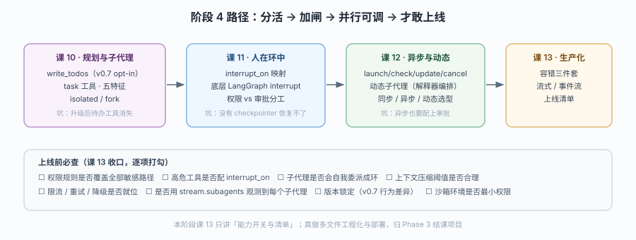

# 阶段 4：委派与上线

> 所属课程：Deep Agents ｜ 故事章节：放权——「把活分出去，还睡得着」 ｜ 上一阶段：[阶段 3](../3-上下文管理/overview.md)

## 🎯 本阶段目标

- 能配出"主代理规划 + 子代理干活"的结构，并说清 `isolated` 与 `fork` 的取舍
- 能让人在关键工具执行前插手（审批 / 加指令 / 改参数）
- 能列出上线前必须确认的能力开关清单，并指出哪几项最容易漏

## 📍 学习重点

- **v0.7 的静默变更**：任务规划从"默认带"变成"opt-in"——升级后 `write_todos` 会直接消失，且不报错。这是本阶段第一个坑
- **子代理只回一份报告**：无状态、不能多次回话、默认隔离上下文。理解这点才能判断"什么活适合派出去"
- **两种安全机制分工不同**：`permissions` 是"事先划死能不能碰"，`interrupt_on` 是"动手前问一句"。前者管静态边界，后者管动态决策
- **异步子代理的五个工具**：start / check / update / cancel / list——只有异步才支持"跑的过程中改主意"
- **课 13 只讲能力开关与清单**：真做工程化（多文件、部署、监控）归 Phase 3 结课项目，避免两者重复

## ✅ 必须掌握的知识点

| 知识点 | 所属课 | 学完应能 |
|--------|--------|----------|
| write_todos 与 v0.7 opt-in | 课 10 | 说清为什么升级后待办工具消失了，怎么加回来 |
| task 工具与子代理五特征 | 课 10 | 列出五个执行特征并据此判断什么活该派出去 |
| isolated vs fork | 课 10 | 按"要不要继承父对话"选模式 |
| 自定义子代理与关掉子代理 | 课 10 | 定义专用子代理；也能彻底去掉 `task` 工具 |
| interrupt_on 映射 | 课 11 | 写出"改文件前必须批准"的配置 |
| 与 LangGraph interrupt 的关系 | 课 11 | 说清审批底层靠什么暂停、为什么需要 checkpointer |
| 权限 vs 审批的分工 | 课 11 | 用两个真实决策区分该用哪个 |
| 异步子代理五工具 | 课 12 | 说出 start / check / update / cancel / list 各自的用途 |
| 动态子代理 | 课 12 | 说清"用解释器在代码里派发"与"模型自己调 task"的差别 |
| 同步 / 异步 / 动态选型 | 课 12 | 用三条判据选型 |
| 容错三件套 | 课 13 | 配出重试 / 次数上限 / 降级（限速需外部网关）|
| 流式与事件流 | 课 13 | 用 `stream.subagents` 拿到每个子代理的独立流 |
| 上线清单与部署选项 | 课 13 | 逐项确认上线前的能力开关 |

## 🗺️ 本阶段路径图

> 看图：课 10 把活分出去（左），课 11 在关键处装一道闸（中），课 12 让分出去的活能并行且可中途干预（右），课 13 是把前三课的能力开关逐项确认后才敢上线（底部横条）。

## 本阶段产出

- [x] `lessons/10-任务规划与子代理.md`
- [x] `lessons/11-人在环中.md`
- [x] `lessons/12-异步与动态子代理.md`
- [x] `lessons/13-生产化容错流式与上线.md`
