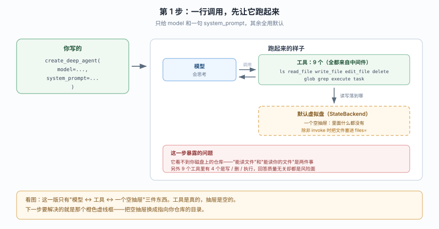
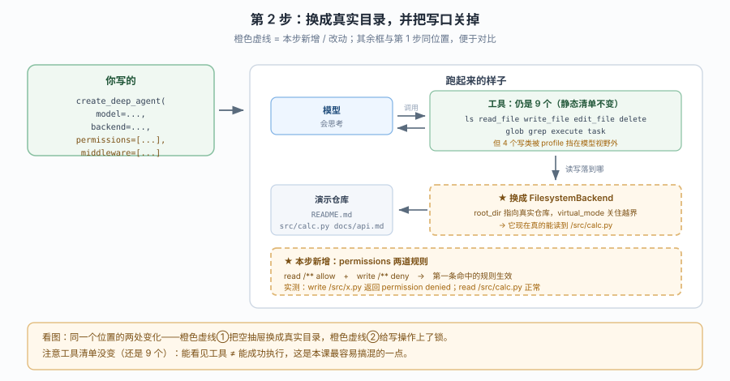
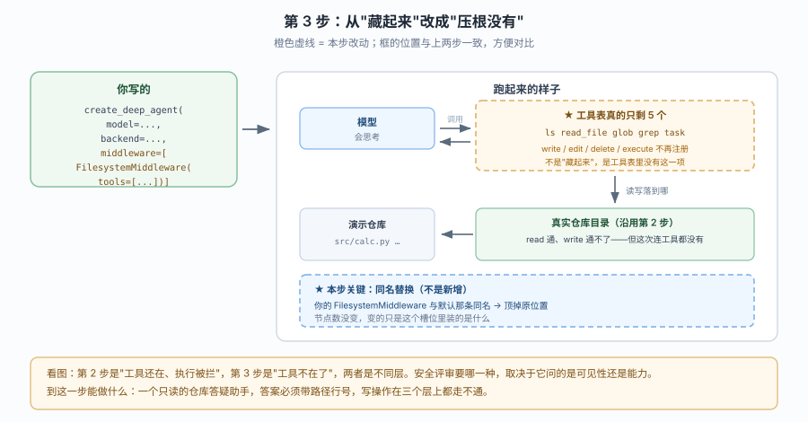

# 应用实战 · 第一个 deep agent 与它的默认装配

> 对应课程：[第 3 课：第一个 deep agent 与它的默认装配](../stages/1-定位与起跑/lessons/03-第一个DeepAgent与它的默认装配.md) ｜ 覆盖知识点：`create_deep_agent` 签名与模型写法、默认中间件栈、Profiles 与模型默认
> 定位：**会用，不上生产**——课里学完，在这里动手（结构与边界见 SKILL.md「教学叙事骨架 · 应用实战」）。
> 📖 结论已按官方文档 + 本地实测核对（核对于 2026-10 ｜ 来源：docs.langchain.com/oss/python/deepagents + `deepagents 0.7.28` 实测）
> ✅ 本文全部代码在 `deepagents 0.7.28` / `langchain 1.4.6` 下离线构造验证（不发请求、不需要真 key）；涉及真实模型调用的地方单独标注。
> ✅ TypeScript 侧实测于 2026-10-22 ｜ `deepagents 1.15.1` / `langchain ^1.5.10` ｜ 对照 `playground-ts/l03-first-agent.ts`

> 🧭 **双语说明**：标 🇹🇸 的段落是 TS 侧实测补充。本文有一处结构性差异必须先讲清：**TS 的 `createDeepAgent` 是 async，要 `await`**，而且**没有 `agent.nodes`**——要看中间件栈得读 `agent.options.middleware`。所以下文中凡是靠 `agent.nodes` 做的"栈位观察"，TS 侧换了入口，结论仍然成立但要换写法。

## 场景 1：给团队做一个"代码库答疑助手"

**场景**：团队新人总在群里问"这个函数在哪""这个接口返回什么"。你想做一个能读仓库、能查文件、**回答必须带文件路径和行号**的助手——先自己能跑，再谈推到群里。

**全貌一句话**：完整方案还需要 RAG 索引、权限网关、会话持久化、群机器人接入（都不是本课内容），本课只解决**"它怎么看到你的代码"**这一段。

---

### ① 基础实现（能跑但幼稚）



> 看图：这一版只有三件东西——模型、9 个工具、一个**空的虚拟盘**。工具是真的（`ls` / `read_file` / `grep` 都在），但抽屉里没有任何文件。

::: code-group

```python [Python]
from deepagents import create_deep_agent

agent = create_deep_agent(
    model="openai:gpt-5.4",                      # 写法一：provider:model 字符串
    system_prompt="你是一个代码库答疑助手。回答必须给出文件路径与行号。",
)

print("节点:", list(agent.nodes))
print("工具:", sorted(agent.nodes["tools"].bound.tools_by_name))
```

```typescript [TypeScript]
import { createDeepAgent } from "deepagents";

// ⚠️ TS 的 createDeepAgent 是 async：必须 await
const agent = await createDeepAgent({
  model: "openai:gpt-4o-mini",                   // 写法一：provider:model 字符串
  systemPrompt: "你是一个代码库答疑助手。回答必须给出文件路径与行号。",
});

// TS 没有 agent.nodes：栈要从 options.middleware 读，工具要从每个中间件的 tools 收集
const stack = (agent.options.middleware ?? []).map((m: any) => m.name ?? "<unnamed>");
console.log("栈:", stack.join(" → "));
```

:::

实测输出（`OPENAI_API_KEY=sk-placeholder`，离线构造）：

```
节点: ['__start__', 'model', 'tools', '_ParentNotifierMiddleware.after_agent', 'PatchToolCallsMiddleware.before_agent']
工具: ['delete', 'edit_file', 'execute', 'glob', 'grep', 'ls', 'read_file', 'task', 'write_file']
```

🇹🇸 **TS 侧默认栈只有 5 条，不是 7 条**（`l03-first-agent.ts` 实测）：

```text [TypeScript]
deepagents: 1.15.1
栈: <unnamed> → <unnamed> → <unnamed> → <unnamed> → <unnamed>
工具: [ 'delete', 'edit_file', 'execute', 'glob', 'grep', 'ls', 'read_file', 'task', 'write_file' ]
```

工具清单**完全一致**（9 个，含 `execute`），但栈少两条：TS 侧没有 `_ParentNotifier`（父代理通知器）和 Anthropic 提示缓存那条。而且 TS 的中间件**多数没有 `name`**，直接打 `m.name` 会得到一串 `<unnamed>`——想看名字要按 `constructor.name` 或显式给中间件命名。这也意味着 TS 侧"同名原位替换"的判据不同：你得先知道默认栈里到底有没有一个可比的 `name`。

> ⚠️ **它的问题**：
> 1. **它读不到你的仓库。** 默认后端是 `StateBackend`——文件存在 LangGraph 的 state 里，初始为空。实测直接在外面调它会报 `RuntimeError: StateBackend must be used within a LangGraph graph execution`；在 agent 里跑则是"抽屉是空的"，`ls /` 什么都看不到。
> 2. **风险面白白敞开。** 9 个工具里有 `write_file` / `edit_file` / `delete` / `execute`——一个答疑助手完全不需要，但模型看得到就会用。
> 3. **"必须给行号"只是嘴上要求。** 没有强制手段时，模型会顺手编一个看起来像的行号。

---

### ② 综合实现（被问题逼出来的下一步）



> 看图：和上一张同位置对比——橙色虚线①把空抽屉换成指向真实仓库的 `FilesystemBackend`；橙色虚线②加了 `permissions` 把写操作锁死。工具清单**没变**，变的是一、工具能不能成功执行；二、模型还看不看得到它们。

::: code-group

```python [Python]
from deepagents import (
    create_deep_agent,
    FilesystemPermission,
    HarnessProfile,
    register_harness_profile,
)
from deepagents.backends import FilesystemBackend
from langchain.agents.middleware import AgentMiddleware


class AuditMiddleware(AgentMiddleware):
    """本步附加：一个不重名的自定义中间件，验证插入点。"""

    name = "AuditMiddleware"

    def before_model(self, state, runtime):
        print("[audit] 本轮消息数:", len(state.get("messages", [])))
        return None


# ① profile：把写类工具从"模型视野"里去掉（注意：注册后全局生效）
register_harness_profile(
    "openai:repo-readonly",
    HarnessProfile(excluded_tools=frozenset({"execute", "write_file", "edit_file", "delete"})),
)

agent = create_deep_agent(
    model="openai:repo-readonly",                       # 触发上面那个 profile
    system_prompt="你是代码库答疑助手。回答必须给出文件路径与行号；找不到就明说找不到。",
    # ② 后端：把读写落到真实目录；virtual_mode 把路径钉在 root_dir 内
    backend=FilesystemBackend(root_dir="/path/to/your/repo", virtual_mode=True),
    # ③ 权限：声明式兜底，就算工具被调到也执行不了
    permissions=[
        FilesystemPermission(operations=["read"], paths=["/**"], mode="allow"),
        FilesystemPermission(operations=["write"], paths=["/**"], mode="deny"),
    ],
    # ④ 自定义中间件：不重名 → 插在 PatchToolCallsMiddleware 之后
    middleware=[AuditMiddleware()],
)

print("节点:", list(agent.nodes))
print("静态工具:", sorted(agent.nodes["tools"].bound.tools_by_name))
```

```typescript [TypeScript]
import { createDeepAgent, FilesystemBackend, createMiddleware } from "deepagents";

// ④ 自定义中间件：不重名 → 插在 patch 之后（TS 用 createMiddleware 工厂）
const AuditMiddleware = createMiddleware({
  name: "AuditMiddleware",
  beforeModel: (state: any) => {
    console.log("[audit] 本轮消息数:", (state.messages ?? []).length);
    return undefined;
  },
});

const agent = await createDeepAgent({
  model: "openai:gpt-4o-mini",
  systemPrompt: "你是代码库答疑助手。回答必须给出文件路径与行号；找不到就明说找不到。",
  // ② 后端：virtualMode 把路径钉在 rootDir 内（注意驼峰）
  backend: new FilesystemBackend({ rootDir: "/path/to/your/repo", virtualMode: true }),
  // ③ 权限：first-match-wins，具体规则写在前
  permissions: [
    { operations: ["read"], paths: ["/**"], mode: "allow" },
    { operations: ["write"], paths: ["/**"], mode: "deny" },
  ],
  middleware: [AuditMiddleware],
});

const stack = (agent.options.middleware ?? []).map((m: any) => m.name ?? "<unnamed>");
console.log("栈:", stack.join(" → "));
```

:::

🇹🇸 TS 侧这段有两个必须先说的差异：**没有 `register_harness_profile` / `HarnessProfile`**（"排除工具"在 TS 侧走 `createFilesystemMiddleware({ tools: [...] })` 或给中间件显式传 `tools`，见本文场景 2），所以 TS 版把 profile 那一层整个去掉，只保留自定义中间件 + permissions。另外 **TS 没有 `FilesystemPermission` 这个类**，permissions 就是普通对象字面量。

实测输出：

```
节点: ['__start__', 'model', 'tools', '_ParentNotifierMiddleware.after_agent', 'PatchToolCallsMiddleware.before_agent', 'AuditMiddleware.before_model']
静态工具: ['delete', 'edit_file', 'execute', 'glob', 'grep', 'ls', 'read_file', 'task', 'write_file']
```

**两个必须看懂的现象**：

- 自定义中间件确实多出一个节点，且排在 `PatchToolCallsMiddleware` **之后**——和课里那张栈图的插入点一致。
- **静态工具清单仍是 9 个**，因为 `excluded_tools` 是请求期过滤（`_ToolExclusionMiddleware.wrap_model_call`）。所以"我明明排除了 `write_file`，为什么清单里还有"不是 bug。

**权限是真的会拦**（离线直接验规则匹配，不写文件）：

::: code-group

```python [Python]
from deepagents.middleware.filesystem import FilesystemPermission, _permission_error
from deepagents.backends import FilesystemBackend

perms = [
    FilesystemPermission(operations=["read"], paths=["/**"], mode="allow"),
    FilesystemPermission(operations=["write"], paths=["/**"], mode="deny"),
]
b = FilesystemBackend(root_dir="/path/to/your/repo", virtual_mode=True)

print(_permission_error(perms, "read",  b, "/src/calc.py"))
print(_permission_error(perms, "write", b, "/src/new.py"))
```

```typescript [TypeScript]
import { createDeepAgent, FilesystemBackend } from "deepagents";

// TS 没有 _permission_error 这个公开入口，验权限走"真调工具看返回"
const agent = await createDeepAgent({
  model: "openai:gpt-4o-mini",
  backend: new FilesystemBackend({ rootDir: "/path/to/your/repo", virtualMode: true }),
  permissions: [
    { operations: ["read"], paths: ["/**"], mode: "allow" },
    { operations: ["write"], paths: ["/**"], mode: "deny" },
  ],
});
// 关键：TS 侧被拒时不抛异常，而是在结果对象里放 error 字段
// → 所以"catch 不到错"不等于"权限生效了"，必须看返回值
```

:::

🇹🇸 这里有个必须记住的行为差异：**Python 侧 `_permission_error` 返回 `Error: permission denied ...` 字符串；TS 侧同样用结果对象的 `error` 字段表达，不抛异常**。两者都不抛，这点一致；但 TS 侧没有 `_permission_error` 这种可直接调的内部函数，验证只能靠真调工具读返回。

实测输出：

```
None
Error: permission denied for write on /src/new.py
```

**顺序敏感**——规则是"第一条命中的生效"，把 deny 放前面和放后面结果不同：

::: code-group

```python [Python]
# deny 在前：先命中 deny，/docs 写不进去
perms_deny_first = [
    FilesystemPermission(operations=["write"], paths=["/docs/**"], mode="deny"),
    FilesystemPermission(operations=["read", "write"], paths=["/**"], mode="allow"),
]
print(_permission_error(perms_deny_first, "write", b, "/ok.py"))       # None
print(_permission_error(perms_deny_first, "write", b, "/docs/a.md"))   # Error: permission denied ...

# 反过来（allow 在前）：先命中 allow，/docs 能写进去 —— 直觉上的"例外规则"失效
perms_allow_first = [
    FilesystemPermission(operations=["read", "write"], paths=["/**"], mode="allow"),
    FilesystemPermission(operations=["write"], paths=["/docs/**"], mode="deny"),
]
print(_permission_error(perms_allow_first, "write", b, "/docs/a.md"))  # None
```

```typescript [TypeScript]
// first-match-wins 在 TS 侧完全一样，只是规则是普通对象
const denyFirst = [
  { operations: ["write"], paths: ["/docs/**"], mode: "deny" },
  { operations: ["read", "write"], paths: ["/**"], mode: "allow" },
];
// → /ok.py 放行、/docs/a.md 被拒

const allowFirst = [
  { operations: ["read", "write"], paths: ["/**"], mode: "allow" },
  { operations: ["write"], paths: ["/docs/**"], mode: "deny" },
];
// → /docs/a.md 也能写：具体 deny 被宽 allow 抢先命中，形同失效
```

:::

> 🕳️ **这一步真正的坑**：大多数人写权限规则时习惯"先写通用 allow，再写具体 deny"，在别的系统里这是"例外优先"；这里恰好相反——**先命中者胜**，所以具体规则必须写在前面。

> 🎯 **会用标志**：你能对着 `agent.nodes` 说出"我加的东西落在栈的第几位"，能说清"工具看得见 / 执行得了"是两个独立层，并且能写出"先具体、后通用"的权限规则。

---

## 场景 2：把它改成"只让模型看到 4 个读工具"

**场景**：安全评审提了要求——不要靠 profile 过滤，要从**工具注册**层面就不给写能力。这时"同名替换"就派上用场。

**全貌一句话**：`FilesystemMiddleware(tools=[...])` 是构造期裁剪，`excluded_tools` 是请求期过滤，两者都要懂才能应付不同评审口径。



> 看图：对比第 2 步——后端和权限这几格没动，真正变的是右上那格：工具表从 9 个缩到 5 个，写类工具**不再注册**。

::: code-group

```python [Python]
from deepagents import create_deep_agent
from deepagents.backends import FilesystemBackend
from deepagents.middleware import FilesystemMiddleware

agent = create_deep_agent(
    model="openai:gpt-5.4",
    tools=[],
    backend=FilesystemBackend(root_dir="/path/to/your/repo", virtual_mode=True),
    # 同名（.name == "FilesystemMiddleware"）→ 原位替换掉默认那条
    middleware=[FilesystemMiddleware(tools=["ls", "read_file", "glob", "grep"])],
)
print("工具:", sorted(agent.nodes["tools"].bound.tools_by_name))
```

```typescript [TypeScript]
import { createDeepAgent, createFilesystemMiddleware, FilesystemBackend } from "deepagents";

const agent = await createDeepAgent({
  model: "openai:gpt-4o-mini",
  tools: [],
  backend: new FilesystemBackend({ rootDir: "/path/to/your/repo", virtualMode: true }),
  // 同名（name === "FilesystemMiddleware"）→ 原位替换掉默认那条
  middleware: [createFilesystemMiddleware({ tools: ["ls", "read_file", "glob", "grep"] })],
});

// TS 没有 agent.nodes，工具名从中间件的 tools 收集
const names = (agent.options.middleware ?? [])
  .flatMap((m: any) => (typeof m.tools === "function" ? m.tools() : m.tools ?? []))
  .map((t: any) => t.name);
console.log("工具:", [...new Set(names)].sort());
```

:::

实测输出：

```
工具: ['glob', 'grep', 'ls', 'read_file', 'task']
```

对比场景 1 的 9 个工具：写类与 `execute` **从工具表里彻底消失**（不是请求期过滤），只剩 4 个读工具 + `task`。源码注释写得很直白：*"Excluded tools are omitted here entirely, not just hidden from the model's schema, so a tool name outside `tools=` never reaches the dispatchable tool node."*

> 🎯 **会用标志**：评审问"你这算真移除还是只是藏起来"时，你能立刻答出这次是哪一种，并说出证据在哪看。

---

## 🧭 导航

- ⬅️ 回到课程：[第 3 课：第一个 deep agent 与它的默认装配](../stages/1-定位与起跑/lessons/03-第一个DeepAgent与它的默认装配.md)
- 📚 全部实战：[应用实战索引](INDEX.md)
- ➡️ 下一课实战：04 · 工具与虚拟文件系统（待编写）
