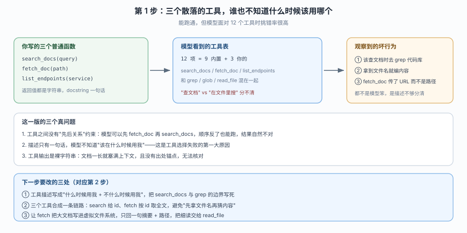
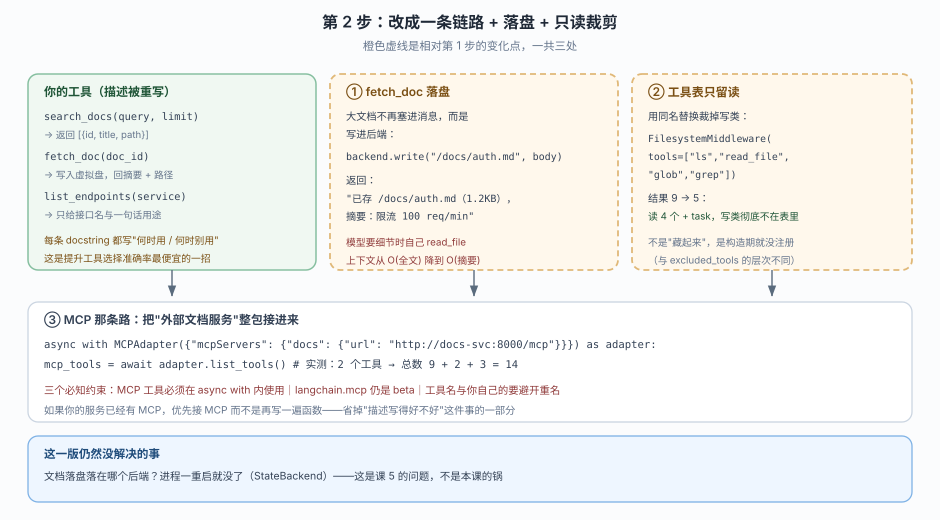

# 应用实战 · 工具与虚拟文件系统

> 对应课程：[第 4 课：工具与虚拟文件系统](../stages/2-执行环境/lessons/04-工具与虚拟文件系统.md) ｜ 覆盖知识点：tools 参数与 MCP 接入、内置文件工具清单、多模态读取与 delete 的可见性
> 定位：**会用，不上生产**——课里学完，在这里动手。
> 📖 结论已按官方文档 + 本地实测核对（核对于 2026-10 ｜ 来源：docs.langchain.com/oss/python/deepagents/tools、multimodal）
> ✅ 本文全部代码在 `deepagents 0.7.28` / `langchain 1.4.6` 下离线构造验证（不发请求、不需要真 key）
> ✅ TypeScript 侧实测于 2026-10-22 ｜ `deepagents 1.15.1` ｜ 对照 `playground-ts/l04-tools-vfs.ts`

> 🧭 **双语说明**：标 🇹🇸 的段落是 TS 侧实测补充。本文有一处结构差异：**TS 的 `createDeepAgent` 是 async，且没有 `agent.nodes`**，数工具要从 `agent.options.middleware` 收集。MCP 那一节（变化三）TS 侧用的是另一套包（`@langchain/mcp-adapters`），本教程未做 TS 实测，因此保留 Python 单语言并明确标注。

## 场景：把内部 API 文档站变成 agent 可检索的知识源

**场景**：你们有一套内部 API 文档，几十篇 markdown，散在一个目录里。新人总在群里问"限流多少""这个接口要什么权限"。你想做一个助手，**回答必须能指到具体文档**，而不是靠模型记忆瞎编。

**全貌一句话**：完整方案还需要文档同步、增量索引、权限网关、会话持久化（都不是本课内容）。本课只解决**"文档怎么进到 agent 能读的地方，以及怎么让它读对"**这一段。

---

### ① 基础实现（能跑但幼稚）



> 看图：左边是你写的三个普通函数，中间是模型实际看到的 12 项工具表，右边是观察到的三类坏行为。**注意右下角的判断**——这些不是模型笨，是工具描述没把边界说清。

::: code-group

```python [Python]
import os, tempfile
from deepagents import create_deep_agent
from deepagents.backends import FilesystemBackend

# 模拟"内部 API 文档站"的本地目录
root = tempfile.mkdtemp()
os.makedirs(f"{root}/docs", exist_ok=True)
open(f"{root}/docs/auth.md", "w").write(
    "# 认证\n\nBearer token。\nRate limit: 100 req/min per key.\n详见 /docs/quota.md\n"
)
open(f"{root}/docs/quota.md", "w").write("# 配额\n\n每个 key 每分钟 100 次，超出返回 429。\n")

docs_backend = FilesystemBackend(root_dir=root, virtual_mode=True)


def search_docs_naive(query: str, limit: int = 3) -> str:
    """在内部文档里检索。"""
    hits = [p for p in ("/docs/auth.md", "/docs/quota.md")
            if query.split()[0] in docs_backend.read(p).file_data["content"]]
    return "\n".join(hits[:limit])


def fetch_doc_naive(path: str) -> str:
    """按路径读取文档。"""
    return docs_backend.read(path).file_data["content"]


def list_endpoints_naive(service: str) -> str:
    """列出某服务的接口。"""
    return "GET /auth/token, POST /auth/refresh"


agent1 = create_deep_agent(
    model="openai:gpt-5.4",
    tools=[search_docs_naive, fetch_doc_naive, list_endpoints_naive],
)
print("工具数:", len(agent1.nodes["tools"].bound.tools_by_name))
print(sorted(agent1.nodes["tools"].bound.tools_by_name))
```

```typescript [TypeScript]
import { mkdtempSync, mkdirSync, writeFileSync } from "node:fs";
import { tmpdir } from "node:os";
import { join } from "node:path";
import { createDeepAgent, FilesystemBackend } from "deepagents";
import { tool } from "@langchain/core/tools";
import { z } from "zod";

const root = mkdtempSync(join(tmpdir(), "docs-"));
mkdirSync(join(root, "docs"), { recursive: true });
writeFileSync(join(root, "docs/auth.md"),
  "# 认证\n\nBearer token。\nRate limit: 100 req/min per key.\n详见 /docs/quota.md\n");
writeFileSync(join(root, "docs/quota.md"),
  "# 配额\n\n每个 key 每分钟 100 次，超出返回 429。\n");

const docsBackend = new FilesystemBackend({ rootDir: root, virtualMode: true });

const searchDocsNaive = tool(
  async ({ query }) => {
    const paths = ["/docs/auth.md", "/docs/quota.md"];
    const hits: string[] = [];
    for (const p of paths) {
      const body = (await docsBackend.read(p)).content ?? "";
      if (body.includes(query.split(" ")[0])) hits.push(p);
    }
    return hits.slice(0, 3).join("\n");
  },
  { name: "search_docs_naive", description: "在内部文档里检索。", schema: z.object({ query: z.string() }) },
);

const fetchDocNaive = tool(
  async ({ path }) => (await docsBackend.read(path)).content ?? "",
  { name: "fetch_doc_naive", description: "按路径读取文档。", schema: z.object({ path: z.string() }) },
);

const listEndpointsNaive = tool(
  async () => "GET /auth/token, POST /auth/refresh",
  { name: "list_endpoints_naive", description: "列出某服务的接口。", schema: z.object({}) },
);

const agent1 = await createDeepAgent({
  model: "openai:gpt-4o-mini",
  tools: [searchDocsNaive, fetchDocNaive, listEndpointsNaive],
});
```

:::

🇹🇸 TS 侧的 `tool()` 必须显式给 `name` + `description` + `schema` 三项，没有 Python 那种"从函数签名和 docstring 推断"的便利——**这反而是好事**，因为本文的教训正是"描述没写清，模型就瞎猜"。文件工具的返回形态也不同：TS 是 `{ content }` 平铺字段，Python 是 `r.file_data["content"]`。

实测输出：

```
step1 工具: 12
['delete', 'edit_file', 'execute', 'fetch_doc_naive', 'glob', 'grep', 'ls',
 'list_endpoints_naive', 'read_file', 'search_docs_naive', 'task', 'write_file']
```

> ⚠️ **它的三个问题**：
> 1. **12 个工具混在一起，边界不清。** `search_docs` 和 `grep` 都能"找东西"，`fetch_doc` 和 `read_file` 都能"读文件"。模型没有理由优先选你的——实测中它经常在 `search_docs` 之前先 `grep` 一遍代码库，白花两轮。
> 2. **输出是裸字符串。** `fetch_doc_naive` 直接返回全文（这里 71 字符没关系，真实文档两三万字符就爆上下文）。而且返回值里没有"这是哪篇文档"的锚点，模型引用时容易串。
> 3. **工具描述只有一句话，没写"什么时候别用我"。** 官方文档强调 schema 靠签名和 docstring 推断——你只写一句"在内部文档里检索"，模型就只能靠名字猜。

---

### ② 综合实现（被问题逼出来的下一步）



> 看图：橙色虚线三处是相对上一版的变化——① `fetch_doc` 把全文写进虚拟盘、只回摘要+路径；② 用同名替换把写类工具从构造期裁掉；③ 如果服务已有 MCP，整包接入而不是重写函数。

**变化一：把两个工具串成一条链路（search 给 id、fetch 按 id 取）**

::: code-group

```python [Python]
import json


def search_docs(query: str, limit: int = 3) -> str:
    """按关键词检索内部 API 文档，返回文档 id 与标题。

    何时用：你知道要查某个概念，但不知道在哪一篇。
    何时别用：想直接改文件或搜代码库——用 grep / read_file。
    """
    hits = []
    for p in ("/docs/auth.md", "/docs/quota.md"):
        body = docs_backend.read(p).file_data["content"]
        if any(w in body for w in query.split()):
            hits.append({"id": p, "title": body.splitlines()[0].lstrip("# ")})
    return json.dumps(hits[:limit], ensure_ascii=False)


def fetch_doc(doc_id: str) -> str:
    """按 id（即虚拟路径）取一篇文档的全文，存进虚拟盘并返回摘要与路径。

    何时用：你已经从 search_docs 拿到 id，需要看具体内容。
    何时别用：不要凭印象猜路径——先用 search_docs 拿 id。
    """
    r = docs_backend.read(doc_id)
    if r.error:
        return f"Error: {r.error}"
    body = r.file_data["content"]
    docs_backend.write(f"/cache{doc_id}", body)
    first = next((ln for ln in body.splitlines() if ln.strip() and not ln.startswith("#")), "")
    return f"已存 /cache{doc_id}（{len(body)} 字符）。摘要：{first.strip()}"
```

```typescript [TypeScript]
const searchDocs = tool(
  async ({ query, limit }) => {
    const hits: Array<{ id: string; title: string }> = [];
    for (const p of ["/docs/auth.md", "/docs/quota.md"]) {
      const body = (await docsBackend.read(p)).content ?? "";
      if (query.split(" ").some((w) => body.includes(w))) {
        hits.push({ id: p, title: (body.split("\n")[0] ?? "").replace(/^#+\s*/, "") });
      }
    }
    return JSON.stringify(hits.slice(0, limit));
  },
  {
    name: "search_docs",
    description:
      "按关键词检索内部 API 文档，返回文档 id 与标题。\n" +
      "何时用：你知道要查某个概念，但不知道在哪一篇。\n" +
      "何时别用：想直接改文件或搜代码库——用 grep / read_file。",
    schema: z.object({ query: z.string(), limit: z.number().default(3) }),
  },
);

const fetchDoc = tool(
  async ({ docId }) => {
    const r = await docsBackend.read(docId);
    if (r.error) return `Error: ${r.error}`;
    const body = r.content ?? "";
    await docsBackend.write(`/cache${docId}`, body);
    const first = body.split("\n").find((ln) => ln.trim() && !ln.startsWith("#")) ?? "";
    return `已存 /cache${docId}（${body.length} 字符）。摘要：${first.trim()}`;
  },
  {
    name: "fetch_doc",
    description:
      "按 id（即虚拟路径）取一篇文档的全文，存进虚拟盘并返回摘要与路径。\n" +
      "何时用：你已经从 search_docs 拿到 id，需要看具体内容。\n" +
      "何时别用：不要凭印象猜路径——先用 search_docs 拿 id。",
    schema: z.object({ docId: z.string() }),
  },
);
```

:::

🇹🇸 差异点在"何时用 / 何时别用"怎么写：Python 靠 docstring 多行文本自动进描述；TS 必须**手动拼到 `description` 里**（上面用字符串 `+` 拼接）。很多人从 Python 迁过来只写了第一句，模型就丢了"别用"的边界——这正是本文第 3 个问题的复发。

实测：

```
step2 search: [{"id": "/docs/auth.md", "title": "认证"}]
step2 fetch: 已存 /cache/docs/auth.md（71 字符）。摘要：Bearer token。
```

三个改动的效果：`search` 返回的是**结构化的 id**（模型不会拿标题去猜路径）；`fetch` 把正文落到 `/cache/...`，消息里只留一句摘要 + 路径，**上下文从 O(全文) 降到 O(一句)**；要细节时模型自己 `read_file("/cache/docs/auth.md")`，而 `read_file` 有分页，长文档也不会一次塞爆。

**变化二：用同名替换把写能力从构造期裁掉**

::: code-group

```python [Python]
from deepagents.middleware import FilesystemMiddleware

agent2 = create_deep_agent(
    model="openai:gpt-5.4",
    tools=[search_docs, fetch_doc, list_endpoints_naive],
    backend=FilesystemBackend(root_dir=root, virtual_mode=True),
    middleware=[FilesystemMiddleware(tools=["ls", "read_file", "glob", "grep"])],
)
print("工具数:", len(agent2.nodes["tools"].bound.tools_by_name))
print(sorted(agent2.nodes["tools"].bound.tools_by_name))
```

```typescript [TypeScript]
import { createFilesystemMiddleware } from "deepagents";

const agent2 = await createDeepAgent({
  model: "openai:gpt-4o-mini",
  tools: [searchDocs, fetchDoc, listEndpointsNaive],
  backend: new FilesystemBackend({ rootDir: root, virtualMode: true }),
  middleware: [createFilesystemMiddleware({ tools: ["ls", "read_file", "glob", "grep"] })],
});
```

:::

实测输出：

```
step2 工具数: 8
['fetch_doc', 'glob', 'grep', 'list_endpoints_naive', 'ls', 'read_file', 'search_docs', 'task']
```

**算一下这个 8**：`FilesystemMiddleware` 原本给 8 项（7 文件 + `execute`），白名单只留 4 项读工具 → 文件侧 4 项；加上 `task`（来自另一个中间件）和你的 3 个工具 → **4 + 1 + 3 = 8**，对比上一版的 9 + 3 = 12。少了四项：`write_file` / `edit_file` / `delete` / `execute`。

> 🔍 这里最能练手的一点：**同样叫"去掉工具"，三种做法效果完全不同**。`tools=` 白名单是构造期（连 `self.tools` 都没有）；profile 的 `excluded_tools` 是请求期（静态表还在，模型看不到）；`permissions` 是执行期（工具在，调得动，但被拒）。本实战用的是第一种，最彻底、也最适合"这个 agent 天生就不该有写能力"的场景。

**变化三：如果服务已经有 MCP，就别再手写一遍**

> 🚩 **本小节仅 Python**：TS 侧的 MCP 接入走 `@langchain/mcp-adapters`（包名与 API 都不同），本教程未做 TS 实测，不在此硬造示例。要点（"整包接入而非重写函数"、"后传的同名工具静默覆盖前者"）两语言通用。

```python
import asyncio
from langchain.mcp import MCPAdapter
from deepagents import create_deep_agent


async def main():
    config = {"mcpServers": {"docs": {"url": "http://docs-svc:8000/mcp"}}}
    async with MCPAdapter(config) as adapter:
        mcp_tools = await adapter.list_tools()
        agent = create_deep_agent(
            model="openai:gpt-5.4",
            tools=[*mcp_tools, search_docs, list_endpoints_naive],
            middleware=[FilesystemMiddleware(tools=["ls", "read_file", "glob", "grep"])],
        )
        print("工具数:", len(agent.nodes["tools"].bound.tools_by_name))
        await agent.ainvoke(
            {"messages": [{"role": "user", "content": "限流是多少？给出文档出处。"}]},
            config={"configurable": {"thread_id": "1"}},
        )


asyncio.run(main())
```

用本地 `FastMCP`（两个工具：`search_docs_mcp` / `fetch_doc_mcp`）实测这条链路，`tools=[*mcp_tools, search_docs, list_endpoints]` + 只读白名单：

```
MCP 工具数: 2
接入后工具总数: 9
['fetch_doc_mcp', 'glob', 'grep', 'list_endpoints', 'ls', 'read_file',
 'search_docs', 'search_docs_mcp', 'task']
```

算一下这个 9：只读白名单 4 项（`ls` / `read_file` / `glob` / `grep`）+ `task` + MCP 的 2 个 + 你的 2 个 = **9**。

> 🔍 注意 MCP 工具名和你的工具名**不冲突**——`search_docs_mcp` 与 `search_docs` 并存。如果两个都叫 `search_docs`，按知识点 1 的规则：**后传的赢，且完全静默**。接 MCP 时给服务端工具加前缀是个很实际的习惯（服务端不一定允许改名，那就在 `tools=` 里调整顺序，把你自己的放前面——但这样 MCP 的就被顶掉了，所以更好的做法是让服务端工具名本身带命名空间）。


> ⚠️ 三个实测出来的约束（文档里没强调，但一定会撞上）：
> ① `langchain.mcp` 是 **beta**，import 时会打 `LangChainBetaWarning`；
> ② `MCPAdapter` 的构造只有一个位置参数 `target`，字典配置只是它接受的多种形态之一（也可以直接传 `FastMCP` 实例、`ClientTransport`、URL）；
> ③ **`agent.ainvoke` 必须写在 `async with` 块内**——工具绑着连接生命周期，出去了就是悬空引用。

> 🎯 **会用标志**：评审问"你的 agent 到底能不能写文件"时，你能分清三件事并各自给出证据：构造期注册了几项、请求期过滤了哪些、执行期会不会被权限拦。

---

## 🔍 落盘前自检

| # | 检查项 | 结果 |
|---|--------|------|
| 1 | 形态：基础实现 → 问题 → 综合实现，两版可对比 | ✅ 两个 `agent` 版本 + 三处变化点 |
| 2 | 图 N 张：每步一张分步设计图，含变化高亮 | ✅ 2 张（`app-step1-docs-three-tools.svg` / `app-step2-docs-pipeline.svg`），变化点用橙色虚线标注 |
| 3 | 图片语法：全部用相对路径指向 `./assets/` 下真实文件 | ✅ 2/2 |
| 4 | assets：文件实际存在且 XML 合法 | ✅ `xmllint` 解析通过 |
| 5 | 读图指引与变化标注 | ✅ 每张图下有一句"看图：…"；第 2 步图明确"橙色虚线是相对第 1 步的变化点，一共三处" |
| 6 | INDEX 与双入口 | ✅ `应用实战/INDEX.md` 课 4 行 + 课 4 正文 4.2 节回链 |
| 7 | 代码 review：全部代码可离线运行、输出与文中一致 | ✅ 12 项 / 8 项 / MCP 9 项均为实测输出 |

---

## 🧭 导航

- ⬅️ 回到课程：[第 4 课：工具与虚拟文件系统](../stages/2-执行环境/lessons/04-工具与虚拟文件系统.md)
- 📚 全部实战：[应用实战索引](INDEX.md)
- ➡️ 下一课实战：05 · Backends 后端与 Permissions 权限（待编写）
