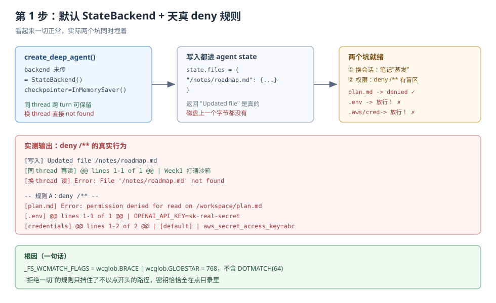
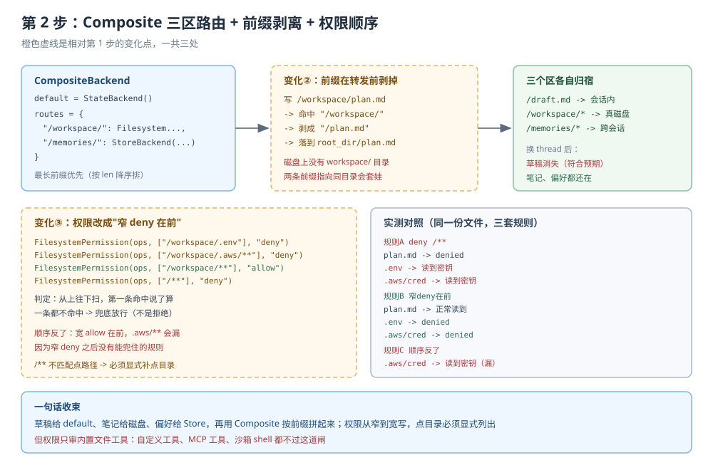

# 应用实战 · Backends 后端与 Permissions 权限

> 对应课程：[第 5 课：Backends 后端与 Permissions 权限](../stages/2-执行环境/lessons/05-Backends后端与Permissions权限.md) ｜ 覆盖知识点：内置后端六种、CompositeBackend 路由与自定义后端协议、permissions 声明式规则与边界
> 定位：**会用，不上生产**——课里学完，在这里动手。
> 📖 结论已按官方文档 + 本地实测核对（核对于 2026-10 ｜ 来源：docs.langchain.com/oss/python/deepagents/backends、permissions）
> ✅ 本文全部代码在 `deepagents 0.7.28` / `langchain 1.4.6` 下实测（假模型驱动真实 agent 图，不发网络请求）

## 场景：临时草稿不落盘、项目笔记要跨会话、`.env` 必须挡住

**场景**：你要做一个"项目笔记 agent"。它有三个不同性质的需求同时存在，而**它们绝不能共用同一种存储**：

1. 讨论过程中的中间草稿——用完就该没，**不该污染项目目录**。
2. 项目笔记 `/workspace/plan.md`——要真的落在磁盘上，你能用编辑器打开，换会话还在。
3. 用户偏好这类长期记忆——要跨会话、跨机器，**但不该写进 git 仓库**。

**全貌一句话**：完整方案还需要鉴权、审计、多租户隔离（都不是本课内容）。本课只解决**"三种东西各放哪儿，以及怎么把 `.env` 挡在门外"**这一段。

---

### ① 基础实现（能跑但幼稚）



> 看图：左边是默认后端，所有写入都进会话 state；中间是"写了看起来成功"的假象；右边是换 thread 后连续两个 not found。右下角红框是第二个坑——`deny /**` 拦住了 `plan.md`，却**放过了 `.env`**。

```python
from langchain_core.language_models.chat_models import BaseChatModel
from langchain_core.messages import AIMessage
from langchain_core.outputs import ChatGeneration, ChatResult
from langgraph.checkpoint.memory import InMemorySaver

from deepagents import FilesystemPermission, create_deep_agent


class DirectiveModel(BaseChatModel):
    """按用户指令决定调哪个工具，不发网络请求。"""

    @property
    def _llm_type(self) -> str:
        return "directive"

    def bind_tools(self, tools, **kwargs):
        return self

    def _generate(self, messages, stop=None, run_manager=None, **kwargs):
        last_human = next((str(m.content) for m in reversed(messages) if m.type == "human"), "")
        last_idx = max(i for i, m in enumerate(messages) if m.type == "human")
        if [m for m in messages[last_idx:] if m.type == "tool"]:
            return ChatResult(generations=[ChatGeneration(message=AIMessage(content="done"))])

        cmd, _, arg = last_human.partition(":")
        arg = arg.strip()
        if cmd == "写":
            path, _, body = arg.partition("=")
            tcs = [{"name": "write_file", "args": {"file_path": path.strip(), "content": body}, "id": "c0"}]
        elif cmd == "读":
            tcs = [{"name": "read_file", "args": {"file_path": arg}, "id": "c0"}]
        else:
            tcs = []
        return ChatResult(generations=[ChatGeneration(message=AIMessage(content="", tool_calls=tcs))])


def go(agent, text, tid, label):
    out = agent.invoke(
        {"messages": [{"role": "user", "content": text}]},
        config={"configurable": {"thread_id": tid}},
    )
    for m in [m for m in out["messages"] if m.type == "tool"][-1:]:
        print(f"[{label}] {str(m.content).replace(chr(10), ' | ')[:90]}")
    return out


agent1 = create_deep_agent(model=DirectiveModel(), checkpointer=InMemorySaver())
go(agent1, "写:/notes/roadmap.md=Week1 打通沙箱", "T-A", "写入")
go(agent1, "读:/notes/roadmap.md", "T-A", "同 thread 再读")
go(agent1, "读:/notes/roadmap.md", "T-B", "换 thread 读")
```

实测输出：

```
[写入] Updated file /notes/roadmap.md
[同 thread 再读] @@ lines 1-1 of 1 @@ | Week1 打通沙箱
[换 thread 读] Error: File '/notes/roadmap.md' not found
```

`thread T-A` 的 `state.files` 里确实躺着它：

```
thread T-A 的 state.files: ['/notes/roadmap.md']
```

> ⚠️ **它的三个问题**：
> 1. **所有东西都进了会话 state。** 项目笔记跟着 `thread_id` 走，用户换个会话就"文件没了"——而它上一轮明明回过 `Updated file`。
> 2. **该落盘的一个字节都没落。** 你没法用编辑器打开 `plan.md`，也没法 `git diff`。
> 3. **权限规则写反了直觉。** 下一节会看到：加一条 `deny /**`，`plan.md` 被拦住了，`.env` 反而被读了出来。
>
> 还有一个容易忽略的前提：上面能跑通"同 thread 再读"，是因为显式传了 `checkpointer=InMemorySaver()`。**不传 checkpointer，同一 thread 跨两次 `invoke` 都读不到**——`files` 只活在单次执行里。

---

### ② 综合实现（被问题逼出来的下一步）



> 看图：橙色虚线三处是相对上一版的变化——① 后端换成 `CompositeBackend` 三区路由；② 前缀在转发前被剥掉（`/workspace/plan.md` → 磁盘上的 `plan.md`）；③ 权限改成"窄 deny 在前"的正确顺序。

**变化一：用 `CompositeBackend` 把三类东西分到三个区**

```python
import tempfile
from pathlib import Path

from langgraph.store.memory import InMemoryStore

from deepagents import create_deep_agent
from deepagents.backends import (
    CompositeBackend,
    FilesystemBackend,
    StateBackend,
    StoreBackend,
)

project = Path(tempfile.mkdtemp()) / "project"
project.mkdir()

agent2 = create_deep_agent(
    model=DirectiveModel(),
    backend=CompositeBackend(
        default=StateBackend(),                                                   # 草稿：会话内，用完就没
        routes={
            "/workspace/": FilesystemBackend(root_dir=str(project), virtual_mode=True),  # 笔记：真磁盘
            "/memories/": StoreBackend(namespace=lambda rt: ("global",)),         # 偏好：跨会话
        },
    ),
    store=InMemoryStore(),
    checkpointer=InMemorySaver(),
)
```

三个区各写一份，再换 thread 读回来：

```
[写会话区] Updated file /draft.md
[写磁盘区] Updated file /workspace/plan.md
[写记忆区] Updated file /memories/user.md

磁盘文件: ['plan.md']
是否出现 workspace 子目录: False

-- 换 thread 读三个区 --
[会话区] Error: File '/draft.md' not found
[磁盘区] @@ lines 1-1 of 1 @@ | 项目计划 v1
[记忆区] @@ lines 1-1 of 1 @@ | 偏好 Python
```

这一屏把三件事同时证明了：

- `/draft.md` 落在 `default`（`StateBackend`），**换 thread 就没了**——这正是草稿想要的行为。
- `/workspace/plan.md` 落到磁盘，但磁盘上只有 `plan.md`，**没有 `workspace/` 子目录**——前缀被剥掉了。
- `/memories/user.md` 落在 `StoreBackend`，**换 thread 依然读得到**，且完全没碰磁盘。

> 🔍 最容易踩的一点：`FilesystemBackend(root_dir=...)` 的 `root_dir` 就是那个路由的"根"。你写 `/workspace/plan.md`，它看到的只是 `/plan.md`。如果 `root_dir` 已经指向 `.../project`，就别再指望磁盘上出现 `project/workspace/plan.md`。两条不同前缀指向同一目录更糟——会"套娃"。

**变化二：把权限顺序改对，`.env` 才真挡得住**

先看天真写法为什么失败：

```python
naive = [FilesystemPermission(operations=["read", "write"], paths=["/**"], mode="deny")]
```

```
[plan.md] Error: permission denied for read on /workspace/plan.md
[.env] @@ lines 1-1 of 1 @@ | OPENAI_API_KEY=sk-real-secret
[credentials] @@ lines 1-2 of 2 @@ | [default] | aws_secret_access_key=abc
```

**"拒绝一切"的规则，把正常文件拦了，却把密钥放行了。** 原因在源码里：`_FS_WCMATCH_FLAGS` 只含 `BRACE | GLOBSTAR`，**没有 `DOTMATCH`**，所以 `/**` 压根不匹配点开头的路径。

实测这组常量：

```
_FS_WCMATCH_FLAGS = 768
  BRACE = 512  GLOBSTAR = 256  DOTMATCH = 64
  BRACE|GLOBSTAR = 768
```

改成"窄规则在前"：

```python
fixed = [
    FilesystemPermission(operations=["read", "write"], paths=["/workspace/.env"], mode="deny"),
    FilesystemPermission(operations=["read", "write"], paths=["/workspace/.aws/**"], mode="deny"),
    FilesystemPermission(operations=["read", "write"], paths=["/workspace/**"], mode="allow"),
    FilesystemPermission(operations=["read", "write"], paths=["/**"], mode="deny"),
]
```

```
[plan.md] @@ lines 1-1 of 1 @@ | 项目计划 v1
[.env] Error: permission denied for read on /workspace/.env
[credentials] Error: permission denied for read on /workspace/.aws/credentials
```

顺序反过来会怎样？把宽 `allow` 放前面：

```
[plan.md] @@ lines 1-1 of 1 @@ | 项目计划 v1
[.env] Error: permission denied for read on /workspace/.env
[credentials] @@ lines 1-2 of 2 @@ | [default] | aws_secret_access_key=abc
```

注意最后一行：`.env` 被挡住了（它是显式的窄规则），但 `.aws/credentials` **漏了**——因为没有一条规则命中它之后能给出 deny，最后落到了"不命中就放行"的兜底。

> 🎯 **会用标志**：评审问"你的 agent 到底会不会把密钥读出去"时，你能拿出三行证据：`_FS_WCMATCH_FLAGS` 不含 `DOTMATCH`、`deny /**` 的实测放行、以及"窄 deny 在前 + 显式补点目录"的实测拦截。

**变化三：写自定义后端时，`delete` 是可选的那一个**

```python
from deepagents.backends.protocol import (
    BackendProtocol, EditResult, GlobResult, GrepResult,
    LsResult, ReadResult, WriteResult,
)


class NoDeleteBackend(BackendProtocol):
    """只实现 6 个方法，故意不实现 delete。"""

    def ls(self, path): return LsResult(entries=[])
    def read(self, file_path, offset=0, limit=2000): return ReadResult(error="not implemented")
    def write(self, file_path, content): return WriteResult(error="not implemented")
    def edit(self, file_path, old_string, new_string, replace_all=False): return EditResult(error="not implemented")
    def glob(self, pattern, path=None): return GlobResult(matches=[])
    def grep(self, pattern, path=None, glob=None): return GrepResult(matches=[])
```

用一个只记录工具清单的假模型看模型实际拿到什么：

```
StateBackend       n=8 -> ['delete', 'edit_file', 'glob', 'grep', 'ls', 'read_file', 'task', 'write_file']
NoDelete(自定义)    n=7 -> ['edit_file', 'glob', 'grep', 'ls', 'read_file', 'task', 'write_file']
```

`delete` 静默消失，**没有报错、没有警告**。判定条件是严格的类型比较：

```python
return type(backend).delete is not BackendProtocol.delete
```

注意是 `type(backend).delete`——所以给实例挂一个 `delete` 属性是无效的，必须真的在类上重写。

> ⚠️ 一个容易误判的细节：中间件构造完时 `self.tools` 里**仍然有 `delete`**（8 项齐全）。摘除发生在**请求期**（`_filter_unsupported_tools_and_apply_prompt`），不是构造期。所以别拿 `FilesystemMiddleware(...).tools` 去判断"模型能不能删文件"，那里永远看不出差别。
>
> 注意两个"8 项"口径不同，别混：**构造期** `self.tools` 的 8 项是「7 个文件工具 + `execute`」，**不含** `task`（`task` 来自另一个中间件）；上表里**模型实见**的 8 项是「6 个文件工具 + `task`」，**不含** `execute`（`StateBackend` 没有执行能力，被请求期摘掉了）。所以 `StateBackend` 是"构造 8、实见 8"但内容不同；`NoDeleteBackend` 是"构造 8、实见 7"。

> 🎯 三个层级的区别（课 4 讲过，这里再落一次地）：`tools=` 白名单是**构造期**（连 `self.tools` 都没有）、后端能力门控是**请求期**（静态表在，模型看不到）、`permissions` 是**执行期**（工具在、调得动，但被拒）。本实战的 `delete` 消失属于第二种。

---

## 🔍 落盘前自检

| # | 检查项 | 结果 |
|---|--------|------|
| 1 | 形态：基础实现 → 问题 → 综合实现，两版可对比 | ✅ 两个 `agent` 版本 + 三处变化点 |
| 2 | 图 N 张：每步一张分步设计图，含变化高亮 | ✅ 2 张（`app-step1-backends-state.svg` / `app-step2-backends-composite.svg`），变化点用橙色虚线标注 |
| 3 | 图片语法：全部用相对路径指向 `./assets/` 下真实文件 | ✅ 2/2 |
| 4 | assets：文件实际存在且 XML 合法 | ✅ `xmllint` 解析通过 |
| 5 | 读图指引与变化标注 | ✅ 每张图下有一句"看图：…"；第 2 步图明确"橙色虚线是相对第 1 步的变化点，一共三处" |
| 6 | INDEX 与双入口 | ✅ `应用实战/INDEX.md` 课 5 行 + 课 5 正文 4.2 节回链 |
| 7 | 代码 review：全部代码可离线运行、输出与文中一致 | ✅ 三步链路输出均为实测；`delete` 可见性 8→7 为实测 |

---

## 🧭 导航

- ⬅️ 回到课程：[第 5 课：Backends 后端与 Permissions 权限](../stages/2-执行环境/lessons/05-Backends后端与Permissions权限.md)
- 📚 全部实战：[应用实战索引](INDEX.md)
- ➡️ 下一课实战：[06 · 沙箱与解释器分工](06-沙箱与解释器分工.md)
