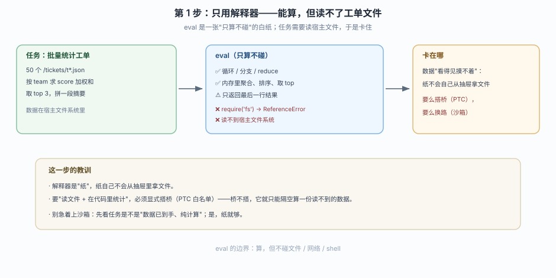
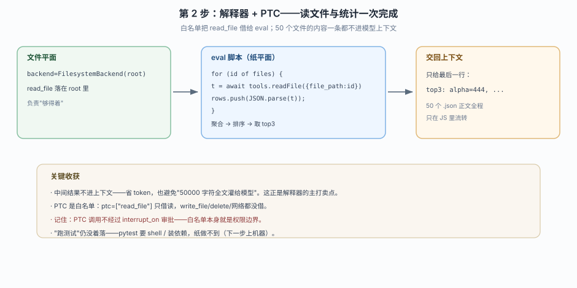
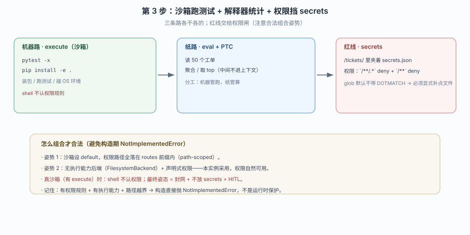

# 应用实战 06：给 agent 装一个"能跑代码"的工作台

> 对应课程：[第 6 课：代码执行 Sandboxes 与 Interpreters](../stages/2-执行环境/lessons/06-代码执行Sandboxes与Interpreters.md) ｜ 覆盖知识点：Sandbox + execute、Interpreter + eval、两者选择边界
> 定位：**会用，不上生产**——课里学完，在这里动手。
> 📖 结论已按官方文档 + 本地实测核对（核对于 2026-10 ｜ 来源：docs.langchain.com/oss/python/deepagents/sandboxes、interpreters）
> ✅ 本文全部代码在 `deepagents 0.7.28` / `langchain 1.4.6` / `langchain-quickjs 0.3.9` 下离线构造验证（不发请求、不需要真 key；沙箱用自建 `MiniSandbox` 代替厂商云端）
> ✅ TypeScript 侧实测于 2026-10-22 ｜ `deepagents 1.15.1` / `@langchain/quickjs 0.6.5` ｜ 对照 `playground-ts/l06-sandbox-interpreter.ts`

> 🧭 **双语说明**：标 🇹🇸 的段落是 TS 侧实测补充。本课最需要注意的一条结构差异：**TS 侧的解释器中间件在独立包 `@langchain/quickjs` 里，且是工厂函数 `createCodeInterpreterMiddleware()`，不是类**。另外 TS 侧 `@langchain/quickjs` 的安装体积与 Node 版本约束也不同于 Python，务必按自己的环境验一遍。

## 场景：同一个 agent，三条不一样的路

你维护一个内部"工单健康度"报告。每周要做三件事：

1. **批量统计**：读 50 个工单 `.json`，按团队算加权分、找前 10、拼一段摘要。
2. **跑测试**：仓库提交了一个改动，跑 `pytest` 看有没有破别的模块。
3. **挡住不该碰的东西**：工单文件里夹着一个 `secrets.json`，绝不能让 agent 读到并写进摘要。

**全貌一句话**：这三件事看着都是"让 agent 写点代码"，但它们的风险差着量级——统计是"在手上数据里算"，跑测试是"对运行环境动手"，挡密钥是"权限边界"。本课应用实战就一件事：**把它们分到三条正确的路上。**

---

### ① 基础实现：只用解释器（能算，但卡在一半）



> 看图：中间是 `eval`，它能算——读不了工单文件。左边是它"只算不碰"的围栏，右边是它在这个任务里会卡住的那个点。

::: code-group

```python [Python]
import json, tempfile, os
from deepagents import create_deep_agent
from langchain_quickjs import CodeInterpreterMiddleware

# 模拟 50 个工单
root = tempfile.mkdtemp()
os.makedirs(f"{root}/tickets", exist_ok=True)
teams = ["alpha", "beta", "gamma"]
for i in range(50):
    open(f"{root}/tickets/t{i:03d}.json", "w").write(
        json.dumps({"id": i, "team": teams[i % 3], "score": (i * 7) % 91})
    )
# 一个不该碰的文件
open(f"{root}/secrets.json", "w").write('{"db_password": "hunter2"}')

agent1 = create_deep_agent(
    model="openai:gpt-5.5",
    middleware=[CodeInterpreterMiddleware()],
)

print("工具表（只加解释器，无后端）：", sorted(agent1.nodes["tools"].bound.tools_by_name))
```

```typescript [TypeScript]
import { mkdtempSync, mkdirSync, writeFileSync } from "node:fs";
import { tmpdir } from "node:os";
import { join } from "node:path";
import { createDeepAgent } from "deepagents";
// ⚠️ 解释器中间件在独立包，且是工厂函数，不是类
import { createCodeInterpreterMiddleware } from "@langchain/quickjs";

const root = mkdtempSync(join(tmpdir(), "tickets-"));
mkdirSync(join(root, "tickets"), { recursive: true });
const teams = ["alpha", "beta", "gamma"];
for (let i = 0; i < 50; i += 1) {
  writeFileSync(
    join(root, `tickets/t${String(i).padStart(3, "0")}.json`),
    JSON.stringify({ id: i, team: teams[i % 3], score: (i * 7) % 91 }),
  );
}
writeFileSync(join(root, "secrets.json"), JSON.stringify({ db_password: "hunter2" }));

const agent1 = await createDeepAgent({
  model: "openai:gpt-4o-mini",
  middleware: [createCodeInterpreterMiddleware()],
});
```

:::

实测输出（工具可见性，请求期过滤后只配解释器、用 `FilesystemBackend` 拿到文件后算）：

```
  FilesystemBackend + 解释器： n= 9  execute=no          # 文件平面有文件工具
  eval 在：                    yes
```

**它的瓶颈**：`eval` 只能"纯算"。工单文件在宿主文件系统里，解释器默认够不着——它 `require('fs')` → `ReferenceError`。你等于让它"隔空统计一份它读不到的数据"，它只能干瞪眼。

> ⚠️ **这一步的教训**：解释器是"纸"，纸自己不会从抽屉里拿文件。要"读文件 + 在代码里统计"，必须搭桥。

---

### ② 综合实现：解释器 + PTC（读 50 个文件，中间结果不进上下文）



> 看图：白名单 `read_file` 借给了 `eval`，于是"读 50 个文件 → 代码里过滤、聚合、取 top → 只回一段摘要"全程在一个 `eval` 里完成，那 50 个文件的内容一条都没进模型上下文。

::: code-group

```python [Python]
from deepagents import create_deep_agent
from deepagents.backends import FilesystemBackend
from langchain_quickjs import CodeInterpreterMiddleware

fs_backend = FilesystemBackend(root_dir=root, virtual_mode=True)

agent2 = create_deep_agent(
    model="openai:gpt-5.5",
    backend=fs_backend,                       # 文件平面：read_file 能落在 root 里
    middleware=[CodeInterpreterMiddleware(ptc=["read_file"])],  # 纸平面：借 read_file
)
```

```typescript [TypeScript]
import { createFilesystemMiddleware, FilesystemBackend } from "deepagents";
import { createCodeInterpreterMiddleware } from "@langchain/quickjs";

const fsBackend = new FilesystemBackend({ rootDir: root, virtualMode: true });

const agent2 = await createDeepAgent({
  model: "openai:gpt-4o-mini",
  backend: fsBackend,                                       // 文件平面：read_file 能落在 root 里
  middleware: [createCodeInterpreterMiddleware({ ptc: ["read_file"] })],  // 纸平面：借 read_file
});
```

:::

agent 会写出类似这样的 JS 并 eval（这段是**解释器里跑的代码**，两侧几乎一样，只是 PTC 桥的调用名按各自的工具名走）：

```javascript
const files = [];                       // /tickets/t000.json ... t049.json
const rows = [];
for (const id of files) {
  const txt = await tools.readFile({ file_path: id });   // PTC 桥
  rows.push(JSON.parse(txt));
}
const byTeam = {};
for (const r of rows) byTeam[r.team] = (byTeam[r.team] ?? 0) + r.score;
const top = Object.entries(byTeam).sort((a, b) => b[1] - a[1]).slice(0, 3);
`top3: ${top.map((e) => e[0] + "=" + e[1]).join(", ")}`;
```

**关键收获**：

1. **中间结果被挡在上下文外**——50 个 `.json` 的正文只在 JS 里流转，模型最后只看到 `top3: alpha=..., beta=..., gamma=...` 这一行。
2. **PTC 是白名单，不是万能钥匙**——`ptc=["read_file"]` 意味着只借了读文件，`write_file`、`delete`、网络全都没借。**别忘了：PTC 调用不经过 `interrupt_on` 审批**，所以放进白名单的每个工具都要想清楚。
3. **文件平面负责"够得着"，纸平面负责"算"**——`read_file` 得先能被调用（`backend=FilesystemBackend(root_dir=root)`），才能被借进 `eval`。

> ⚠️ **还差什么**：统计搞定了，但"跑测试"还是没着落——`pytest` 要 shell、要装依赖，纸做不到。下一节补上这台机器。

---

### ③ 收尾实现：沙箱 + 解释器，两条路各干各的，顺带擦掉 secrets



> 看图：这台 agent 现在有三条路——文件工具（`read_file` 等）、`execute`（沙箱里跑 `pytest`）、`eval`（批量统计）。另加一条红线：`permissions` 把 `secrets.json` 相关的路径挡在风险区之外（这里用 `MiniSandbox` 无法配权限会炸，所以用无执行能力后端 + 权限；真沙箱场景见下文的"怎么组合才合法"）。

**先看"为什么权限会炸"再动手**：如果你像课 6 知识点 3 那样，把 `MiniSandbox`（有执行能力）设成 `default`，又给它配 `permissions`，构造期就 `NotImplementedError`。所以"沙箱 + 声明式权限"要共存，只有两种合法姿势：

1. **沙箱设 `default`，权限路径全落在 `routes` 前缀内**——默认是机器，被保护的路径单独路由出去。
2. **无执行能力后端 + 声明式权限**——本实例为此用 `FilesystemBackend`（无执行能力），权限自然能用；要"跑测试"用真 sandbox backend（E2B 等）时的做法见姿势 1。

::: code-group

```python [Python]
from deepagents import create_deep_agent, FilesystemPermission
from deepagents.backends import FilesystemBackend   # 无执行能力 → 权限合法可用

agent3 = create_deep_agent(
    model="openai:gpt-5.5",
    backend=FilesystemBackend(root_dir=root, virtual_mode=True),
    middleware=[CodeInterpreterMiddleware(ptc=["read_file"])],
    permissions=[
        # 先 deny 任何路径上点开头的 secret（glob 默认不带 DOTMATCH，`/**` 挡不住点文件）
        FilesystemPermission(operations=["read", "write"], paths=["/**/.*", "/**/.*/**"], mode="deny"),
        FilesystemPermission(operations=["read"], paths=["/**"], mode="deny"),
    ],
)
```

```typescript [TypeScript]
const agent3 = await createDeepAgent({
  model: "openai:gpt-4o-mini",
  backend: new FilesystemBackend({ rootDir: root, virtualMode: true }),
  middleware: [createCodeInterpreterMiddleware({ ptc: ["read_file"] })],
  permissions: [
    // 同样要显式补点号通配；TS 侧实测 deny /** 挡不住 .env，补 /**/.* 才拦得住
    { operations: ["read", "write"], paths: ["/**/.*", "/**/.*/**"], mode: "deny" },
    { operations: ["read"], paths: ["/**"], mode: "deny" },
  ],
});
```

:::

🇹🇸 沙箱 + 权限的组合约束 TS 侧同样存在：给有执行能力的后端配 `permissions`，构造期就抛（`l05-backends-permissions.ts` 实测 `沙箱+/** deny -> 抛错`）。所以"姿势 1 / 姿势 2"这套判断两语言通用。

> 🎯 本步的"三条路"心智模型：
>
> | 路 | 归属 | 本实例管什么 |
> |----|------|------------|
> | 文件工具 `read_file` / `write_file` / … | 文件平面 | 让 `eval` 够得着工单文件 |
> | `execute` | 机器（沙箱） | 跑 `pytest`、装依赖（真 sandbox backend 场景） |
> | `eval` | 纸（解释器） | 批量统计 50 个文件、聚合、取 top |
> | 权限 | 闸 | 把 `secrets.json` 这条红线挡在风险区外 |

`secrets.json` 的大写风险还有一个更狠的版本：就算权限挡了文件工具，如果你给它配了**真沙箱**（有 `execute`），agent 大可以 `execute("cat secrets.json")`——**shell 不认权限规则**。所以真沙箱 + 权限的最终安全姿态是姿势 1（沙箱设 `default`，且把 secrets 所在的路径路由到单独的、无执行能力的后端），或干脆封网 + HITL。

---

## 落盘前自检清单

写这篇实战前，对照以下 7 条：

- [ ] 解释器与沙箱是两条独立的声明（`middleware=` 与 `backend=`），我没把它们混成一个参数
- [ ] 我分清了"纯算"（纸）与"要碰环境"（机器），没有一律上沙箱
- [ ] 我用的 `ptc=[...]` 白名单里，每个工具都被我确认过"借给它安全"
- [ ] 我知道 PTC 调用不走 `interrupt_on` 审批，白名单本身就是权限边界
- [ ] 我知道"沙箱 + 声明式权限"可能直接构造报错，并按合法姿势（path-scoped / 无执行后端）组合
- [ ] 我处理过点开头文件（`/**` 默认挡不住 `.*`）
- [ ] 我的 agent 没有在沙箱里被灌进密钥（`secrets` / 环境变量）

---

## 落地示例（你的真实场景怎么搭）

> 🚩 **本小节仅 Python**：TS 侧的云端沙箱适配（E2B 等）包名与 API 不同，本教程未做 TS 实测，不硬造示例。要点（沙箱设 `default`、权限路径必须落在 `routes` 前缀内）两语言通用。

```python
# 真实生产：E2B 沙箱 + 解释器 + path-scoped 权限
from langchain_e2b import E2BSandbox
from e2b_code_interpreter import Sandbox

e2b = E2BSandbox(sandbox=Sandbox.create())
agent_prod = create_deep_agent(
    model="openai:gpt-5.5",
    backend=CompositeBackend(
        default=e2b,                                  # 机器默认接管：装包 / 跑测试
        routes={"/secure/": StoreBackend(namespace=lambda rt: (rt.server_info.user.identity,))},
    ),
    middleware=[CodeInterpreterMiddleware(ptc=["read_file"])],   # 统计走纸
    permissions=[
        FilesystemPermission(operations=["read", "write"], paths=["/secure/**/*.secret"], mode="deny"),
        # 权限路径必须全部落在 routes 的 "/secure/" 前缀内，否则构造报错
    ],
)
```

> ⚠️ 注意：上面的 `permissions` 只对 `routes["/secure/"]` 有用——它的路径全在 `/secure/` 前缀内，满足 `_all_paths_scoped_to_routes` 的约束。真 E2B backend 的 shell 口子要用"封网 + 不放 secrets"来兜。

---

## 完成对照

- [x] 纯统计 → 解释器（只算不碰）
- [x] 读文件+统计 → 解释器 + PTC（中间结果不进上下文）
- [x] 跑测试/装依赖 → 沙箱 `execute`（机器）
- [x] 挡 secrets → 权限闸 + 点文件处理 + 合法组合姿势（path-scoped / 无执行后端）
