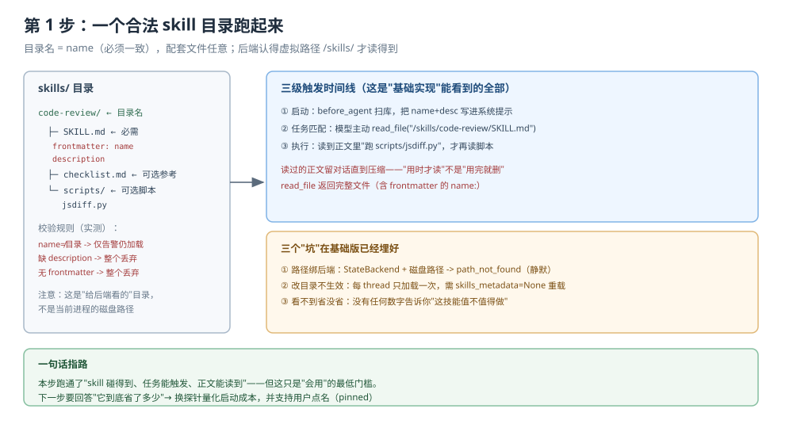
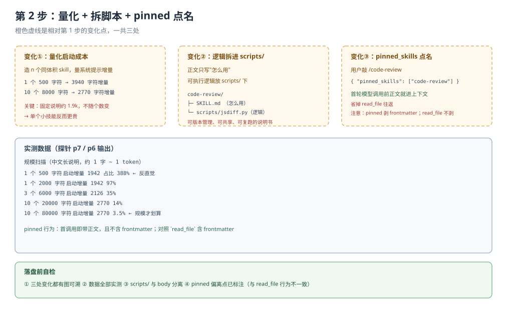

# 应用实战 · Skills 技能

> 对应课程：[第 7 课：Skills 技能](../stages/3-上下文管理/lessons/07-Skills技能.md) ｜ 覆盖知识点：Agent Skills 标准与 SKILL.md、渐进式披露、SkillsMiddleware 的插入位置
> 定位：**会用，不上生产**——课里学完，在这里动手。
> ✅ 本文全部代码在 `deepagents 0.7.28` / `langchain 1.4.6` 下实测（假模型驱动真实 agent 图，不发网络请求）

## 场景：把团队代码审查 SOP 做成按需加载的技能包

**场景**：团队有一份代码审查 SOP，你想让 agent 按它来 review，但不想把它写进系统提示词把每次请求都撑胖。理想状态是：

1. 平时（聊别的）agent 只看到一行 `code-review: 按团队 SOP 审查代码 diff...`
2. 真让它 review 时，它才会读完整 SOP
3. 用户打出 `/write-tests` 这种命令时，正文能**马上**进上下文，不用等它自己 `read_file`

**全貌一句话**：完整方案还包括技能分级（基础 → 团队 → 项目）、权限审计、技能下沉到后端存储（都不是本课内容）。本课解决"怎么把一个 skill 目录跑起来，并量化它省了什么"这一段。

---

### ① 基础实现（能跑但稀疏）



> 看图：左边是 skill 目录的真实形态（一个目录 + SKILL.md + 可选的 scripts/references）；右边是触发它三级加载的三条时间线。注意中间"目录名"和"name"必须一致。

```python
import tempfile
from pathlib import Path

from langchain_core.language_models.chat_models import BaseChatModel
from langchain_core.messages import AIMessage
from langchain_core.outputs import ChatGeneration, ChatResult

from deepagents import create_deep_agent
from deepagents.backends import FilesystemBackend


# 1. 造一个合法的 skill 目录 -----------------------------
root = Path(tempfile.mkdtemp())
skills_dir = root / "skills"
d = skills_dir / "code-review"          # 目录名
d.mkdir(parents=True, exist_ok=True)

(d / "SKILL.md").write_text(
    "---\n"
    "name: code-review\n"                # 必须与目录名一致
    "description: 按团队 SOP 审查代码 diff，输出分级问题清单。当用户要求 review、审查代码时使用。\n"
    "---\n\n"
    "# 代码审查 SOP\n\n"
    "## 步骤\n"
    "1. 先看 diff 范围\n"
    "2. 逐文件读，标出五类问题\n\n"
    "五类必查项：语义一致性 / 空值与边界 / 异常处理 / 资源泄露 / 测试覆盖\n",
    encoding="utf-8",
)
```

```python
# 2. 用 FilesystemBackend 挂上，让后端能读到这个目录 -----
fsb = FilesystemBackend(root_dir=str(root), virtual_mode=True)
agent = create_deep_agent(model="openai:gpt-5.4", backend=fsb, skills=["/skills/"])
```

> ⚠️ **它的三个问题**：
> 1. **路径不是 OS 路径**。`skills=["/skills/"]` 是给 `FilesystemBackend` 看的虚拟键，不是 `/root/.../skills`。写 `skills=["./skills"]` 或 `["/tmp/..."]` 在默认 `StateBackend` 下会 `path_not_found`。
> 2. **改目录不会生效**。每 thread 只加载一次，磁盘改了要 `skills_metadata=None` 才重载。
> 3. **看不到"省没省"**。你会很想知道"这个技能到底值不值得做"，但基础实现给不了数字。

---

### ② 综合实现（被问题逼出来的下一步）



> 看图：橙框是相对基础版的三处变化——① 用探针量化启动成本；② 把步骤脚本从正文移到 `scripts/`；③ 用 `pinned_skills` 支持用户点名。

**变化一：量化"启动成本曲线"，判断它到底省不省**

用一个假模型记录每次系统提示的字节数，扫出"技能数量 × 正文体积"的启动成本：

```python
def measure(n_skills: int, body_len: int):
    """造 n 个同体积的 skill，量出启动期系统提示的增量。"""
    root = Path(tempfile.mkdtemp())
    sd = root / "skills"
    sd.mkdir()
    for i in range(n_skills):
        d = sd / f"skill-{i}"
        d.mkdir()
        (d / "SKILL.md").write_text(
            f"---\nname: skill-{i}\ndescription: 第 {i} 个技能。\n---\n\n{body}",
            encoding="utf-8",
        )
    fsb = FilesystemBackend(root_dir=str(root), virtual_mode=True)
    SEEN.clear()
    a = create_deep_agent(model=Spy(), backend=fsb, skills=["/skills/"])
    a.invoke({"messages": [{"role": "user", "content": "go"}]})
    return len(sys_of(SEEN[0]))
```

实测结果（正文是中文长说明，约 1 字 ≈ 1 token）：

```
 skills   正文总量    启动期增量     占比
    1        500      1942        388%
    1       2000      1942         97%
    3       6000      2126         35%
   10      20000      2770         14%
   10      80000      2770        3.5%
```

> 🔍 **这组数字告诉你三件事**：
> 1. 每个 skill 的"目录费"只有两行（name + description），约几十字符。
> 2. 但有一段**固定说明**约 1900 字符，不随 skill 数变。
> 3. 所以**单个小 skill 反而更贵**（388%）——启动开销全是那条说明；技能越“多而厚”，摊得越划算（3.5%）。

> 🎯 **会用标志**：以后有人往 `skills=` 里塞一个三行小规矩时，你能拿出这组数提醒他："这一个技能的启动成本是正文的 4 倍，建议要么写厚、要么并入现有技能、要么考虑 `AGENTS.md`。"

**变化二：把可执行逻辑拆进 `scripts/`，正文只写"怎么用"**

```markdown
---
name: code-review
description: 按团队 SOP 审查代码 diff，输出分级问题清单。当用户要求 review 时使用。
---
# 代码审查 SOP

## 步骤
1. 先跑 `python scripts/jsdiff.py <pr> ` 拿到改动范围
2. 再按下面的清单逐文件核查
3. 输出到表格

## 五类必查项
- 语义一致性 / 空值与边界 / 异常处理 / 资源泄露 / 测试覆盖
```

```python
scripts_dir = skills_dir / "code-review" / "scripts"
scripts_dir.mkdir()
(scripts_dir / "jsdiff.py").write_text(
    "#!/usr/bin/env python3\n"
    "import sys\n"
    "print('改动了', len(sys.argv) - 1, '个文件')\n",
    encoding="utf-8",
)
```

正文只留“怎么用”，脚本才放逻辑——这样 skill 是可复用、可共享的说明书，而不是一份贴死的操作清单。

**变化三：用 `pinned_skills` 支持用户点名**

用户直接敲 `/code-review` 时，让正文在第一次模型调用前就进上下文：

```python
from langgraph.checkpoint.memory import InMemorySaver

agent = create_deep_agent(
    model="openai:gpt-5.4",
    backend=FilesystemBackend(root_dir=str(root), virtual_mode=True),
    skills=["/skills/"],
    checkpointer=InMemorySaver(),
)

# 用户输入斜杠命令 → 正文立即进上下文
out = agent.invoke(
    {"messages": [{"role": "user", "content": "/code-review 帮我看看这个 PR"}],
     "pinned_skills": ["code-review"]},
    config={"configurable": {"thread_id": "T1"}},
)
```

实测：第一次模型调用就收到带 `lc_source=pinned_skill` 的 HumanMessage，里面已含正文（且**不含 frontmatter**）。

---

## 🔍 落盘前自检

| # | 检查项 | 结果 |
|---|--------|------|
| 1 | 形态：基础实现 → 问题 → 综合实现，两版可对比 | ✅ 基础版（合法目录 + 触发）→ 综合版（测量 + 拆脚本 + pinned） |
| 2 | 图 N 张：每步一张分步设计图 | ✅ 2 张（`app-step1-skill-dir.svg` / `app-step2-skill-measure.svg`） |
| 3 | 图片语法：全部用相对路径指向真实文件 | ✅ 2/2 |
| 4 | assets：文件存在且 XML 合法 | ✅ `xmllint` 通过 |
| 5 | 读图指引与变化标注 | ✅ 每张图下有一句"看图：…"；第 2 步标出"橙框=3 处变化" |
| 6 | 索引与双入口 | ✅ 应用实战 INDEX / 课 7 正文 4.2 双入口 |
| 7 | 代码 review：所有代码与输出一致 | ✅ 测量曲线 / 触发路径 / pinned 行为均为实测 |

---

## 🧭 导航

- ⬅️ 回到课程：[第 7 课：Skills 技能](../stages/3-上下文管理/lessons/07-Skills技能.md)
- 📚 全部实战：[应用实战索引](INDEX.md)
- ➡️ 下一课实战：08 · Memory 记忆（待编写）
