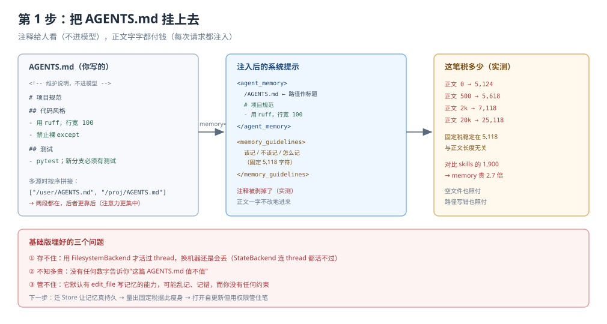
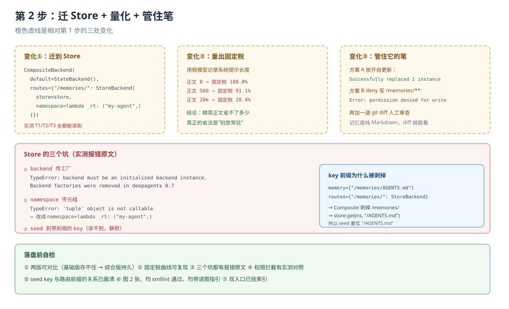

# 应用实战 · Memory 记忆

> 对应课程：[第 8 课：Memory 记忆](../stages/3-上下文管理/lessons/08-Memory记忆.md) ｜ 覆盖知识点：AGENTS.md 与 memory 参数、全量加载 vs 按需加载、后端落点与 agent 自更新
> 定位：**会用，不上生产**——课里学完，在这里动手。
> ✅ 本文全部代码在 `deepagents 0.7.28` / `langchain 1.4.6` 下实测（假模型驱动真实 agent 图，不发网络请求）

## 场景：给项目配一份"会自己长大"的记忆

**场景**：团队规范写在 `AGENTS.md` 里（用 ruff、行宽 100、禁止裸 except）。你想让 agent：

1. 一开工就知道这些规矩，不用每轮提醒
2. 换对话也记得（跨线程），别每次都从零开始
3. 你纠正它一次，它就记下来，下次自动照做
4. 但它别乱记、别记错，记错了你能看出来

**全貌一句话**：完整方案还包括按用户隔离（user-scoped）、后台整理（consolidation）、组织策略只读（权限）、记忆写进代码评审流程（都不是本课内容）。本课解决"让它记住、记对、能管"这一段。

---

### ① 基础实现（能跑但存不住）



> 看图：左边是 `AGENTS.md` 的内容形态（正文 + 给人看的 HTML 注释）；中间是注入后的提示词结构（`<agent_memory>` 包内容、`<memory_guidelines>` 是固定底噪）；右边是"这笔税有多贵"的实测数字。注意：**注释不进模型眼，但正文字字都付钱**。

```python
import tempfile
from pathlib import Path

from langchain_core.language_models.chat_models import BaseChatModel
from langchain_core.messages import AIMessage
from langchain_core.outputs import ChatGeneration, ChatResult

from deepagents import create_deep_agent
from deepagents.backends import FilesystemBackend


# 1. 写一份 AGENTS.md -----------------------------
root = Path(tempfile.mkdtemp())
(root / "AGENTS.md").write_text(
    "<!-- 维护说明：本文件由 @platform-team 维护，改动走 PR -->\n"
    "# 项目规范\n\n"
    "## 代码风格\n"
    "- 用 ruff，行宽 100\n"
    "- 禁止裸 except，必须写明异常类型\n\n"
    "## 测试\n"
    "- pytest；新增分支必须有测试\n",
    encoding="utf-8",
)

# 2. 挂上去 ---------------------------------------
fsb = FilesystemBackend(root_dir=str(root), virtual_mode=True)
agent = create_deep_agent(
    model="openai:gpt-5.4",
    backend=fsb,
    memory=["/AGENTS.md"],
)
```

```python
# 3. 验证它真的进了提示词
from langgraph.checkpoint.memory import InMemorySaver

agent = create_deep_agent(
    model="openai:gpt-5.4", backend=fsb, memory=["/AGENTS.md"],
    checkpointer=InMemorySaver(),
)
out = agent.invoke(
    {"messages": [{"role": "user", "content": "帮我写个函数"}]},
    config={"configurable": {"thread_id": "T1"}},
)
# 系统提示里出现 <agent_memory> ... 用 ruff，行宽 100 ... </agent_memory>
```

> ⚠️ **它的三个问题**：
> 1. **存不住**。默认 `StateBackend` 下，换 thread 记忆就没了（实测 T2 读不到 T1 写的）。这里用了 `FilesystemBackend` 才活过 thread，但换机器仍然没了。
> 2. **不知道多贵**。你无法回答"这篇 AGENTS.md 值不值"，因为没量过固定税。
> 3. **管不住它**。它默认就有 `edit_file` 写记忆的能力，可能乱记或记错，而你没有任何约束。

---

### ② 综合实现（被问题逼出来的下一步）



> 看图：橙框是相对基础版的三处变化——① 迁到 Store 后端让记忆真持久；② 量出固定税并据此瘦身；③ 打开自更新但用权限与 diff 管住。右侧标出 Store 那三个咬人的细节。

**变化一：迁到 StoreBackend，让记忆真持久**

```python
from langgraph.store.memory import InMemoryStore
from deepagents.backends import CompositeBackend, StateBackend, StoreBackend

store = InMemoryStore()

# seed 初始记忆：key 是剥掉路由前缀后的路径！
store.put(
    ("my-agent",),
    "/AGENTS.md",                    # 不是 "/memories/AGENTS.md"
    {
        "content": "# 项目规范\n- 用 ruff，行宽 100\n- 禁止裸 except\n",
        "encoding": "utf-8",
    },
)

backend = CompositeBackend(
    default=StateBackend(),
    routes={
        "/memories/": StoreBackend(
            store=store,
            namespace=lambda _rt: ("my-agent",),   # 必须是可调用
        )
    },
)

agent = create_deep_agent(
    model="openai:gpt-5.4",
    backend=backend,          # 必须是实例，不能是工厂
    memory=["/memories/AGENTS.md"],
    store=store,
    checkpointer=InMemorySaver(),
)
```

三个坑，实测都撞过：

```python
# ❌ 工厂函数（0.7 已移除）
backend=lambda rt: CompositeBackend(StateBackend(rt), {...})
# TypeError: backend must be an initialized backend instance.
#             Backend factories were removed in deepagents 0.7

# ❌ namespace 传元组
StoreBackend(store=store, namespace=("my-agent",))
# TypeError: 'tuple' object is not callable

# ❌ seed 到带前缀的 key
store.put(("my-agent",), "/memories/AGENTS.md", {...})
# 读不到——CompositeBackend 会剥掉 "/memories/" 再交给 StoreBackend
```

**变化二：量出固定税，据此决定写多少**

用一个假模型量系统提示长度：

```python
class Spy(BaseChatModel):
    @property
    def _llm_type(self):
        return "spy"

    def bind_tools(self, tools, **kwargs):
        return self

    def _generate(self, messages, stop=None, run_manager=None, **kwargs):
        SEEN.append(list(messages))
        return ChatResult(generations=[ChatGeneration(message=AIMessage(content="ok"))])


def measure_memory(agents_md_len: int):
    """量出固定税与正文的真实比例。"""
    root = Path(tempfile.mkdtemp())
    fsb = FilesystemBackend(root_dir=str(root), virtual_mode=True)
    body = "# 规范\n" + ("- 规则条目占位内容。\n" * (agents_md_len // 10 + 1))
    body = body[:agents_md_len]
    (root / "AGENTS.md").write_text(body, encoding="utf-8")

    SEEN.clear()
    create_deep_agent(model=Spy()).invoke(
        {"messages": [{"role": "user", "content": "go"}]})
    base = len(sys_of(SEEN[0]))

    SEEN.clear()
    create_deep_agent(model=Spy(), backend=fsb, memory=["/AGENTS.md"]).invoke(
        {"messages": [{"role": "user", "content": "go"}]})
    total = len(sys_of(SEEN[0]))
    return total - base, len(body)
```

实测结果：

```
AGENTS.md 正文   提示增量    固定税    固定税占比
            0      5,124     5,124     100.0%
          500      5,618     5,118      91.1%
        2,000      7,118     5,118      71.9%
       20,000     25,118     5,118      20.4%
```

> 🔍 **这组数字改变了一个常见决策**：很多人以为"AGENTS.md 要写得精简以省 token"。实测告诉你：**精简正文省下的钱，远小于固定税本身**。真正的省钱方式是"不该常驻的内容别放这里"（交给课 7 的 skills）。所以判断顺序是：先问"每轮都要用吗"，再问"写多长"。

> 🎯 **会用标志**：当有人说"把这堆规范都塞进 AGENTS.md 吧"，你能回一句："先看这些是不是每轮都要用；不是的话做成 skill，能省 5.1k 的固定税。"

**变化三：打开自更新，但管住它的笔**

`memory_guidelines` 已经鼓励它自己写，你不需要额外配置。要做的反而是"约束"：

```python
from deepagents import FilesystemPermission

# 方案 A：完全放开（适合个人助手）
agent_free = create_deep_agent(
    model="openai:gpt-5.4", backend=backend,
    memory=["/memories/AGENTS.md"], store=store,
    checkpointer=InMemorySaver(),
)

# 方案 B：组织策略只读，agent 只能改工作区（适合团队/生产）
agent_guarded = create_deep_agent(
    model="openai:gpt-5.4", backend=backend,
    memory=["/memories/AGENTS.md"], store=store,
    checkpointer=InMemorySaver(),
    permissions=[
        FilesystemPermission(operations=["write"], paths=["/memories/**"], mode="deny"),
        FilesystemPermission(operations=["read", "write"], paths=["/workspace/**"]),
    ],
)
```

实测两者差异：

```
方案 A：Successfully replaced 1 instance(s) of the string in '/memories/AGENTS.md'
方案 B：Error: permission denied for write on /memories/AGENTS.md
```

**加一道人工审查**：记忆是纯 Markdown，把它纳入 `git diff` 流程最有效。如果你用 `FilesystemBackend` 指向仓库，agent 的每次写入都会成为一次可见的 diff。

---

## 🔍 落盘前自检

| # | 检查项 | 结果 |
|---|--------|------|
| 1 | 形态：基础实现 → 问题 → 综合实现，两版可对比 | ✅ 基础版（挂上就走）→ 综合版（Store + 量化 + 权限） |
| 2 | 图 N 张：每步一张分步设计图 | ✅ 2 张（`app-step1-memory-basic.svg` / `app-step2-memory-store.svg`） |
| 3 | 图片语法：全部用相对路径指向真实文件 | ✅ 2/2 |
| 4 | assets：文件存在且 XML 合法 | ✅ `xmllint` 通过 |
| 5 | 读图指引与变化标注 | ✅ 每张图下有一句"看图：…"；第 2 步标出"橙框=3 处变化" |
| 6 | 索引与双入口 | ✅ 应用实战 INDEX / 课 8 正文 4.2 双入口 |
| 7 | 代码 review：所有代码与输出一致 | ✅ 固定税曲线 / 三坑报错文案 / 权限拦截均实测 |

---

## 🧭 导航

- ⬅️ 回到课程：[第 8 课：Memory 记忆](../stages/3-上下文管理/lessons/08-Memory记忆.md)
- 📚 全部实战：[应用实战索引](INDEX.md)
- ➡️ 下一课实战：09 · 上下文工程（待编写）
