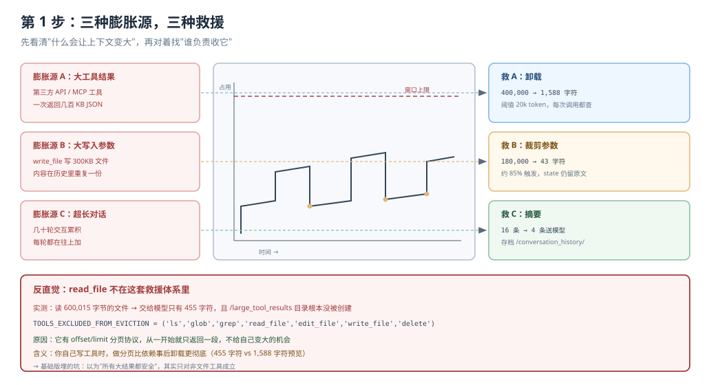
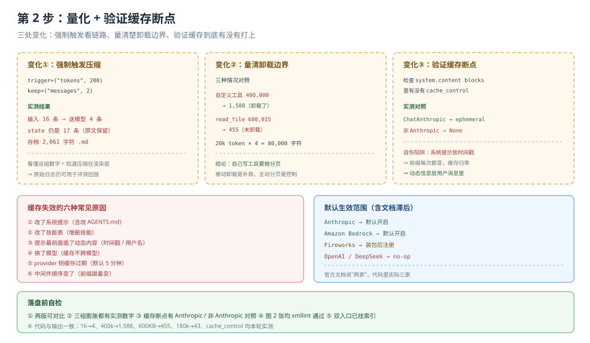

# 应用实战 · 上下文工程

> 对应课程：[第 9 课：上下文工程](../stages/3-上下文管理/lessons/09-上下文工程.md) ｜ 覆盖知识点：四段上下文流、摘要与卸载、提示缓存的真实触发条件
> 定位：**会用，不上生产**——课里学完，在这里动手。
> ✅ 本文全部代码在 `deepagents 0.7.28` / `langchain 1.4.6` 下实测（假模型驱动真实 agent 图，不发网络请求）

## 场景：给长任务配一套"上下文预算"

**场景**：你的 agent 要跑一个调研任务，会读几十个文件、调几个外部 API、写几份报告。你担心两件事：

1. **崩**：上下文撑爆，任务半路死掉
2. **变傻变贵**：没崩，但越跑越慢、越来越贵、越来越不听话

**全貌一句话**：完整方案还包括分布式追踪（看每次压缩何时发生）、按任务类型设不同阈值、以及把压缩事件接入告警。本课解决"看懂它怎么瘦、自己会调旋钮"这一段。

---

### ① 基础实现（能跑但不知道它怎么瘦的）



> 看图：中间那条是上下文占用曲线，三个箭头分别是三种膨胀源（大工具结果、大写入参数、超长对话）。每个箭头指向救它的机制。注意右上角那个红框——`read_file` 的箭头被划掉了，它不靠卸载救命。

```python
import tempfile
from pathlib import Path

from langchain_core.language_models.chat_models import BaseChatModel
from langchain_core.messages import AIMessage
from langchain_core.outputs import ChatGeneration, ChatResult
from langgraph.checkpoint.memory import InMemorySaver

from deepagents import create_deep_agent
from deepagents.backends import FilesystemBackend


class Spy(BaseChatModel):
    """记录每次送给模型的消息，不发网络请求。"""

    @property
    def _llm_type(self):
        return "spy"

    def bind_tools(self, tools, **kwargs):
        return self

    def _generate(self, messages, stop=None, run_manager=None, **kwargs):
        SENT.append(list(messages))
        return ChatResult(generations=[ChatGeneration(message=AIMessage(content="ok"))])


SENT = []

root = Path(tempfile.mkdtemp())
fsb = FilesystemBackend(root_dir=str(root), virtual_mode=True)
agent = create_deep_agent(model=Spy(), backend=fsb, checkpointer=InMemorySaver())
```

**先量一个基线：你的输入段有多贵？**

```python
SENT.clear()
agent.invoke({"messages": [{"role": "user", "content": "hi"}]},
             config={"configurable": {"thread_id": "base"}})
base_len = len(str(SENT[0][0].content))
print(f"系统提示（无 memory / 无 skills）: {base_len} 字符")
```

实测：无 memory、无 skills 时，系统提示约 **2,600 字符**（内置 agent 指南）。加上 memory 会多约 5,118，加 skills 会多约 1,900。

> ⚠️ **它的三个问题**：
> 1. **不知道什么时候会压缩**。默认阈值随模型变（200k 窗口 → 170k 触发），你从来没量过。
> 2. **不知道压缩有没有发生**。跑完了，但中间瘦过几次？不知道。
> 3. **不知道哪个工具会被卸载**。以为所有大结果都安全，其实文件工具根本不在名单里。

---

### ② 综合实现（被问题逼出来的下一步）



> 看图：左侧是三组刻意制造的膨胀与对应的救援机制，每格都有实测数字；右侧是缓存断点的验证方法与"系统提示放时间戳"这个自伤陷阱。

**变化一：强制触发压缩，看清它做了什么**

```python
from deepagents.middleware.summarization import SummarizationMiddleware
from langchain_core.messages import HumanMessage


class SummaryModel(BaseChatModel):
    """摘要用的小模型。"""

    @property
    def _llm_type(self):
        return "summarizer"

    def _generate(self, messages, stop=None, run_manager=None, **kwargs):
        return ChatResult(generations=[ChatGeneration(
            message=AIMessage(content="【摘要】用户让我读了若干文件，结论是 A。")
        )])


summ = SummarizationMiddleware(
    model=SummaryModel(),
    backend=fsb,
    trigger=("tokens", 200),      # 故意极小，方便观察
    keep=("messages", 2),
)

agent2 = create_deep_agent(
    model=Spy(), backend=fsb, middleware=[summ], checkpointer=InMemorySaver()
)

msgs = []
for i in range(8):
    msgs.append(HumanMessage(content=f"第 {i} 轮：读 src/module_{i}.py。" + "细节" * 40))
    msgs.append(AIMessage(content=f"第 {i} 轮回答：module_{i} 处理数据流。" + "分析" * 40))

SENT.clear()
out = agent2.invoke({"messages": msgs}, config={"configurable": {"thread_id": "T1"}})

print(f"输入 {len(msgs)} 条 → 送给模型 {len(SENT[0])} 条")
print(f"state 里仍是 {len(out['messages'])} 条（原文保留）")
print(f"存档文件：{list((root / 'conversation_history').iterdir())}")
```

实测输出：

```
输入 16 条 → 送给模型 4 条
state 里仍是 17 条（原文保留）
存档文件：[PosixPath('.../conversation_history/session_7eea9013....md')]
```

> 🎯 **会用标志**：看到"输入 16 条、送模型 4 条、state 仍 17 条"这组数字，你能立刻说出：压缩发生在渲染层，不动存储层——所以原始日志还能用来做评测。

**变化二：验证工具结果卸载的边界**

```python
from langchain_core.tools import tool


@tool
def huge_tool(n: int) -> str:
    """返回一个巨大的工具结果（模拟 MCP 工具 / 第三方 API）。"""
    return "X" * n
```

实测三种情况：

```
自定义工具返回 400,000 字符
  → 交给模型 1,588 字符（卸载到 /large_tool_results/call_1）

read_file 读 600,015 字节文件
  → 交给模型 455 字符（未卸载，靠 offset/limit 分页）
  → /large_tool_results 目录根本不存在

TOOLS_EXCLUDED_FROM_EVICTION
  → ('ls', 'glob', 'grep', 'read_file', 'edit_file', 'write_file', 'delete')
```

> 🔍 **这条改变了工具设计思路**：之前你可能觉得"工具可以随便返回大结果，反正会卸载"。实际上，**自己写的工具最好支持分页**——卸载是被动补救，分页是主动控制。用户看到的是 455 字符而不是 1,588 字符的预览，差别很大。

**变化三：验证缓存断点，并避开自伤陷阱**

```python
from langchain_anthropic import ChatAnthropic


class SpyAnthropic(ChatAnthropic):
    """真实 ChatAnthropic 子类，但不发网络请求。"""

    @property
    def _llm_type(self):
        return "spy-anthropic"

    def _generate(self, messages, stop=None, run_manager=None, **kwargs):
        SENT.append(list(messages))
        return ChatResult(generations=[ChatGeneration(message=AIMessage(content="ok"))])
```

```python
def check_cache_control(model, thread="C1"):
    ag = create_deep_agent(model=model, backend=fsb, memory=["/AGENTS.md"])
    SENT.clear()
    ag.invoke({"messages": [{"role": "user", "content": "go"}]},
              config={"configurable": {"thread_id": thread}})
    s = next((m for m in SENT[0] if m.type == "system"), None)
    blocks = s.content if isinstance(s.content, list) else [{"text": str(s.content)}]
    return [b.get("cache_control") for b in blocks if isinstance(b, dict)]


# Anthropic：应该有断点
print(check_cache_control(SpyAnthropic(model="claude-sonnet-4-5-20250929", api_key="sk-ant-fake")))
# → [{'type': 'ephemeral'}]

# 非 Anthropic：应该没有
print(check_cache_control(Spy()))
# → [None]
```

**再避一个坑**：系统提示里放动态内容会让缓存归零。

```python
# ❌ 每次请求前缀都不同，缓存全部失效
system_prompt = f"当前时间：{datetime.now()}\n\n你是研究助手..."

# ✅ 动态信息放用户消息
system_prompt = "你是研究助手..."
messages = [{"role": "user", "content": f"[当前时间 {now}] 帮我调研..."}]
```

---

## 🔍 落盘前自检

| # | 检查项 | 结果 |
|---|--------|------|
| 1 | 形态：基础实现 → 问题 → 综合实现，两版可对比 | ✅ 基础版（能跑但不知道）→ 综合版（三组量化 + 缓存验证） |
| 2 | 图 N 张：每步一张分步设计图 | ✅ 2 张（`app-step1-context-inflate.svg` / `app-step2-context-measure.svg`） |
| 3 | 图片语法：全部用相对路径指向真实文件 | ✅ 2/2 |
| 4 | assets：文件存在且 XML 合法 | ✅ `xmllint` 通过 |
| 5 | 读图指引与变化标注 | ✅ 每张图下有一句"看图：…"；第 2 步标出三处变化 |
| 6 | 索引与双入口 | ✅ 应用实战 INDEX / 课 9 正文 4.2 双入口 |
| 7 | 代码 review：所有代码与输出一致 | ✅ 16→4 条、400k→1,588、600KB→455、180k→43、cache_control 均实测 |

---

## 🧭 导航

- ⬅️ 回到课程：[第 9 课：上下文工程](../stages/3-上下文管理/lessons/09-上下文工程.md)
- 📚 全部实战：[应用实战索引](INDEX.md)
- ➡️ 下一阶段实战：10 · 任务规划与子代理（待编写）
