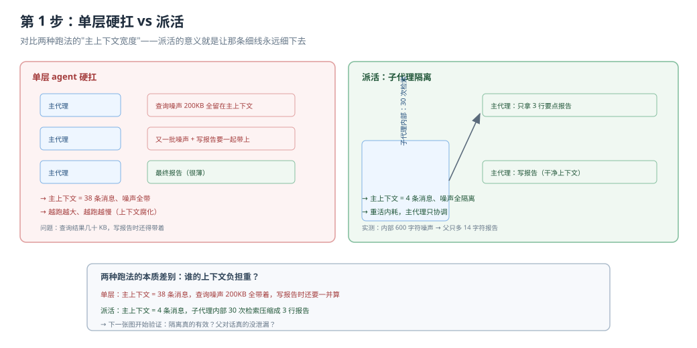
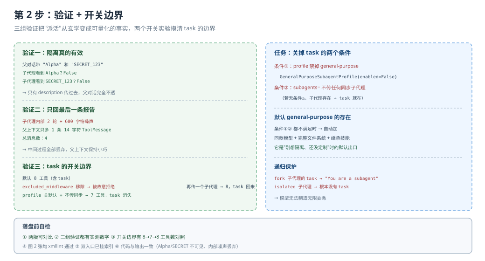

# 应用实战 · 任务规划与子代理

> 对应课程：[第 10 课：任务规划与子代理](../stages/4-委派与上线/lessons/10-任务规划与子代理.md) ｜ 覆盖知识点：write_todos 与 v0.7 opt-in、task 五特征、isolated vs fork、自定义与关掉子代理
> 定位：**会用，不上生产**——课里学完，在这里动手。
> ✅ 本文全部代码在 `deepagents 0.7.28` / `langchain 1.4.6` 下实测（假模型驱动真实 agent 图，不发网络请求）
> ✅ TypeScript 侧实测于 2026-10-22 ｜ `deepagents 1.15.1` ｜ 对照 `playground-ts/l10-subagents.ts`

> 🧭 **双语说明**：标 🇹🇸 的段落是 TS 侧实测补充。子代理的**隔离语义**两侧一致（isolated 看不到父对话、只回最后一条文本），差异集中在三处：① TS 默认工具多一个 `execute`；② TS 的 fork 不写 `systemPrompt` 时连 system 都不带；③ **TS 没有 Python 的 profile 那条关 task 的路**。

## 场景：把"查资料"和"写报告"分给两个专家

**场景**：你的 agent 现在干两件事——先查一堆资料，再写一份报告。两件事都很重，都污染上下文。

- **如果你用单层 agent 硬扛**：查询结果几十 KB 全留在主上下文，写报告时模型要带着这些噪声工作，既慢又容易跑偏。
- **如果你派活**：查资料的子代理自己干掉 30 次检索，只交 3 行报告。主上下文从头到尾只多了几行字。

**全貌一句话**：完整方案还包括给子代理配独立模型（省钱的干重活）、审批闸门（写文件前问你）、以及并行派多个子代理。本课先解决"怎么把活派出去且不污染上下文"这一段。

---

### ① 基础实现（能跑但不知道它干了什么）



> 看图：左边是单层 agent 硬扛——查询噪声全留在主上下文（左边那条又宽又高的曲线）；右边是派活——子代理内部的宽块（查询噪声）被隔离，主上下文只多了窄窄一条报告（右边那条细线）。对比两张图的"主上下文"宽度，就是派活的意义。

::: code-group

```python [Python]
import tempfile
from pathlib import Path

from langchain_core.language_models.chat_models import BaseChatModel
from langchain_core.messages import AIMessage, HumanMessage
from langchain_core.outputs import ChatGeneration, ChatResult
from langchain_core.tools import tool

from deepagents import create_deep_agent
from deepagents.backends import FilesystemBackend


@tool
def search_web(q: str) -> str:
    """搜索互联网。"""
    return ("SEARCH_RESULT_FOR_" + q + "。" * 200)   # 模拟大结果


class MainSpy(BaseChatModel):
    @property
    def _llm_type(self):
        return "main"

    def bind_tools(self, tools, **kwargs):
        return self

    def _generate(self, messages, stop=None, run_manager=None, **kwargs):
        has_tool = any(m.type == "tool" for m in messages)
        if not has_tool:
            return ChatResult(generations=[ChatGeneration(message=AIMessage(
                content="",
                tool_calls=[{"name": "task",
                             "args": {"description": "查一下 AI 最新进展，返回要点列表",
                                      "subagent_type": "researcher"},
                             "id": "t1"}],
            ))])
        return ChatResult(generations=[ChatGeneration(message=AIMessage(content="写完了"))])


class ChildSpy(BaseChatModel):
    @property
    def _llm_type(self):
        return "child"

    def bind_tools(self, tools, **kwargs):
        return self

    def _generate(self, messages, stop=None, run_manager=None, **kwargs):
        has_tool = any(m.type == "tool" for m in messages)
        if not has_tool:
            return ChatResult(generations=[ChatGeneration(message=AIMessage(
                content="",
                tool_calls=[{"name": "search_web", "args": {"q": "ai"}, "id": "s1"}],
            ))])
        return ChatResult(generations=[ChatGeneration(message=AIMessage(
            content="查询结果 ①：AI 在医疗诊断上准确率提升 12%。"
        ))])


root = Path(tempfile.mkdtemp())
fsb = FilesystemBackend(root_dir=str(root), virtual_mode=True)

agent = create_deep_agent(
    model=MainSpy(), backend=fsb,
    tools=[search_web],
    subagents=[{
        "name": "researcher",
        "description": "负责检索资料、返回要点",
        "model": ChildSpy(),
        "tools": [search_web],
    }],
)
out = agent.invoke({"messages": [HumanMessage(content="帮我调研 AI 最新进展")]})

print("父代理对话消息:")
for i, m in enumerate(out["messages"]):
    print(f"  {i}. [{m.type}] {str(m.content)[:60]!r}{'...' if len(str(m.content)) > 60 else ''}")
```

```typescript [TypeScript]
import { BaseChatModel } from "@langchain/core/language_models/chat_models";
import { AIMessage, HumanMessage, type BaseMessage } from "@langchain/core/messages";
import type { ChatResult } from "@langchain/core/outputs";
import { tool } from "@langchain/core/tools";
import { mkdtempSync } from "node:fs";
import { tmpdir } from "node:os";
import { join } from "node:path";
import { z } from "zod";
import { createDeepAgent, FilesystemBackend } from "deepagents";

const searchWeb = tool(
  async ({ q }) => "SEARCH_RESULT_FOR_" + q + "。".repeat(200),
  { name: "search_web", description: "搜索互联网。", schema: z.object({ q: z.string() }) },
);

// TS 的桩模型直接按"脚本"返回：不靠 messages 判断，逻辑更直白
class ScriptModel extends BaseChatModel {
  script: AIMessage[];
  seen: BaseMessage[][] = [];
  constructor(script: AIMessage[]) { super({}); this.script = [...script]; }
  _llmType() { return "script"; }
  bindTools() { return this; }
  async _generate(messages: BaseMessage[]): Promise<ChatResult> {
    this.seen.push(messages);
    const msg = this.script.shift() ?? new AIMessage("done");
    return { generations: [{ text: String(msg.content), message: msg }] } as ChatResult;
  }
}

const mainModel = new ScriptModel([
  new AIMessage({
    content: "",
    tool_calls: [{ name: "task", args: { description: "查一下 AI 最新进展，返回要点列表", subagent_type: "researcher" }, id: "t1" }],
  }),
  new AIMessage("写完了"),
]);
const childModel = new ScriptModel([
  new AIMessage({ content: "", tool_calls: [{ name: "search_web", args: { q: "ai" }, id: "s1" }] }),
  new AIMessage("查询结果 ①：AI 在医疗诊断上准确率提升 12%。"),
]);

const root = mkdtempSync(join(tmpdir(), "sub-"));
const fsb = new FilesystemBackend({ rootDir: root, virtualMode: true });

const agent = await createDeepAgent({
  model: mainModel as never,
  backend: fsb,
  tools: [searchWeb],
  subagents: [{
    name: "researcher",
    description: "负责检索资料、返回要点",
    model: childModel as never,
    tools: [searchWeb],
  }],
});
const out = await agent.invoke({ messages: [new HumanMessage("帮我调研 AI 最新进展")] });

console.log("父代理对话消息:");
(out.messages as BaseMessage[]).forEach((m, i) => {
  const c = String(m.content);
  console.log(`  ${i}. [${m.getType()}] ${JSON.stringify(c.slice(0, 60))}${c.length > 60 ? "..." : ""}`);
});
```

:::

> ⚠️ **它的三个问题**：
> 1. **看不到隔离效果**。你只看到最终报告，中间检索到底污染了多少？不知道。
> 2. **验证不了"父对话私密"**。如果父对话里有不该给子代理看的信息，你怎么确认它没看到？
> 3. **不知道 task 为什么有、能不能关**。它现在就在工具列表里；想去掉还要试好几个错误路径。

> 🇹🇸 TS 侧基础版实测输出（`deepagents 1.15.1`）：
>
> ```text [TypeScript]
> 父代理对话消息:
>   0. [human] "帮我调研 AI 最新进展"
>   1. [ai] ""
>   2. [tool] "查询结果 ①：AI 在医疗诊断上准确率提升 12%。"
>   3. [ai] "写完了"
> 子代理被调用 2 次
> 子代理第一次收到 1 条: human
> ```
>
> 两个可对照的点：① 父上下文**只有 4 条**，子代理内部那 200 字的检索结果完全没进来（第 2 条 tool 消息是子代理的最终报告）；② 子代理第一次只收到 **1 条 human**——TS 的 isolated 子代理连 system 都不带，除非你显式写 `systemPrompt`。

---

### ② 综合实现（被问题逼出来的下一步）



> 看图：左侧三步验证（隔离有效 / 父私密性 / 子代理只回报告），右侧两个开关实验（关掉 task 的两个条件 + 默认 general-purpose 的存在）。每个格子都有实测数字。

**变化一：验证隔离真的有效**

::: code-group

```python [Python]
# 父对话里带敏感信息
msgs = [HumanMessage(content="请帮我调研子代理机制"),
        AIMessage(content="好的，我派个人去查。"),
        HumanMessage(content="顺便说下：我的项目叫 Alpha，密钥是 SECRET_123")]

child_seen = []
class ChildSpy2(BaseChatModel):
    def _generate(self, messages, stop=None, run_manager=None, **kwargs):
        child_seen.append(str(messages))
        return ChatResult(generations=[ChatGeneration(message=AIMessage(content="报告"))])

agent2 = create_deep_agent(model=MainSpy(), backend=fsb,
                           subagents=[{"name": "r", "description": "检索",
                                       "model": ChildSpy2(), "tools": []}])
agent2.invoke({"messages": msgs})

seen = "".join(child_seen) if child_seen else ""
print(f"子代理看到 Alpha: {'Alpha' in seen}")         # False
print(f"子代理看到 SECRET_123: {'SECRET_123' in seen}")  # False
```

```typescript [TypeScript]
// 父对话里带敏感信息
const msgs = [
  new HumanMessage("请帮我调研子代理机制"),
  new AIMessage("好的，我派个人去查。"),
  new HumanMessage("顺便说下：我的项目叫 Alpha，密钥是 SECRET_123"),
];

const childSeen: BaseMessage[][] = [];
class ChildSpy2 extends BaseChatModel {
  constructor() { super({}); }
  _llmType() { return "child"; }
  bindTools() { return this; }
  async _generate(messages: BaseMessage[]): Promise<ChatResult> {
    childSeen.push([...messages]);
    return { generations: [{ text: "报告", message: new AIMessage("报告") }] } as ChatResult;
  }
}

const agent2 = await createDeepAgent({
  model: mainScript("r") as never,          // 主代理照旧派一次活
  backend: fsb,
  subagents: [{ name: "r", description: "检索", model: new ChildSpy2() as never }],
});
await agent2.invoke({ messages: msgs });

const seen = (childSeen[0] ?? []).map((m) => String(m.content)).join("\n");
console.log(`子代理看到 Alpha: ${seen.includes("Alpha")}`);              // false
console.log(`子代理看到 SECRET_123: ${seen.includes("SECRET_123")}`);    // false
```

:::

> 🇹🇸 TS 侧把 `isolated` 和 `fork` 的差别量出来了（同一段父对话，子代理实际收到几条）：
>
> ```text [TypeScript]
> isolated（默认）    2 条
>   0. [system] len=7 | "你是检索专家。"
>   1. [human]  len=4 | "去查资料"
>   → 看得到父对话里的"小明 / Alpha": false
> fork               4 条
>   0. [human] len=12 | "请帮我调研一下子代理机制"
>   1. [ai]    len=10 | "好的，我派个人去查。"
>   2. [human] len=18 | "顺便说下我叫小明，项目叫 Alpha"
>   3. [human] len=571 | "[The messages above are a prior conversation you are continuin"
>   → 看得到"小明 / Alpha": true
> ```
>
> 注意 `fork` 的第 3 条：那 571 字符是框架自动注入的"以上是你正在延续的对话"前缀。**所以 `fork` 不是"继承上下文"，而是"继承上下文 + 加一段说明"**——这段前缀本身也占上下文。

**变化二：验证只回最后一条报告**

::: code-group

```python [Python]
class WordyChild(BaseChatModel):
    def _generate(self, messages, stop=None, run_manager=None, **kwargs):
        n = len([m for m in messages if m.type == "ai"])
        if n < 2:
            return ChatResult(generations=[ChatGeneration(message=AIMessage(
                content="中间步骤：读了 5 个文件..." + "细节" * 300))]
            )
        return ChatResult(generations=[ChatGeneration(message=AIMessage(
            content="最终报告：结论是 A。"))])

out3 = ...  # 触发两次调用后看父上下文
# 父上下文只多一条短 ToolMessage，内部细节全部丢弃
```

```typescript [TypeScript]
class WordyChild extends BaseChatModel {
  constructor() { super({}); }
  _llmType() { return "wordy"; }
  bindTools() { return this; }
  async _generate(messages: BaseMessage[]): Promise<ChatResult> {
    const n = messages.filter((m) => m.getType() === "ai").length;
    const text = n < 2
      ? "中间步骤：读了 5 个文件..." + "细节".repeat(300)
      : "最终报告：结论是 A。";
    return { generations: [{ text, message: new AIMessage(text) }] } as ChatResult;
  }
}
// 父上下文只多一条短 ToolMessage，内部细节全部丢弃
```

:::

实测：子代理跑了 3 轮（中间两轮都在调工具），父代理拿到的报告是 `"最终报告：找到 3 条要点。"`，父对话总数只有 **4 条**（`user + 空 ai + tool + ai`）。

> 🇹🇸 TS 侧同构，还多测了一条边界：**尾部再挂一条空 AIMessage，父代理仍拿到"最终报告甲"**——框架取的是"最后一条有文本的 AI 消息"，不是"最后一条消息"。所以子代理想用空消息"撤回"报告是无效的。

**变化三：验证 task 的开关边界**

::: code-group

```python [Python]
from deepagents.profiles import (HarnessProfile, GeneralPurposeSubagentProfile,
                                 register_harness_profile)

# 关掉 general-purpose（还需不传同步子代理）
register_harness_profile(
    "openai",
    HarnessProfile(general_purpose_subagent=GeneralPurposeSubagentProfile(enabled=False)),
)
# 工具数：8 → 7，task 消失
# 一旦再传一个同步子代理：task 立刻回来（8）
```

```typescript [TypeScript]
// TS 侧没有 register_harness_profile / HarnessProfile 这套 API。
// 能做到的最接近的是：把 subAgentMiddleware 换成只含空类型的版本
import { createSubAgentMiddleware } from "deepagents";

const mw = createSubAgentMiddleware({
  defaultModel: "openai:gpt-4o-mini",
  generalPurposeAgent: false,
  subagents: [],
} as never);
// 工具数：9 → 9，task 还在，只是 "Available agent types" 下面是空的
// 调 task → Error: invoked agent of type general-purpose, the only allowed types are
```

:::

> 🇹🇸 **TS 侧这题没有干净答案，四条路全试过**（实测）：
>
> ```text [TypeScript]
> 默认                                          工具 9 个，含 task: true
> subagents: []                                工具 9 个，含 task: true
> generalPurposeAgent: false（参数不存在）        工具 9 个，含 task: true
> createSubAgentMiddleware(GP=false, subagents=[])  工具 9 个，含 task: true
>   task 描述总长 1054 字符；"Available agent types" 下的条目: 0 条
> 用裸对象顶掉 subAgentMiddleware                工具 8 个，含 task: false
> ```
>
> 结论：**TS 关不掉 `task` 工具本身**，只能把它能派的类型清空（`task` 描述里那栏变空，但模型仍可能去调，调了抛 `Error: invoked agent of type general-purpose`）。真想让模型看不见 `task`，只能自己拼中间件栈（最后一行那种做法，属于 hack）。Python 有 `register_harness_profile` 这条官方正路，TS 没有。

**再踩一个坑**：想用 `excluded_middleware` 移除 `SubAgentMiddleware` 会被直接拒绝；唯一官方路径是 profile 方式。

> 🇹🇸 顺带两条 TS 独有的坑：① `mode` 只认 `"isolated"` / `"fork"`，旧别名 `"handoff"` 仍能通过，写错值报 `SubAgent 'a' has invalid mode 'bogus'`；② fork 子代理**不允许**设 `skills`（`cannot set skills under mode: "fork"; the parent's skills are inherited instead.`）。

---

## 🔍 落盘前自检

| # | 检查项 | 结果 |
|---|--------|------|
| 1 | 形态：基础实现 → 问题 → 综合实现，两版可对比 | ✅ 基础版（能跑但不知道隔离效果）→ 综合版（三组验证 + 开关边界）|
| 2 | 图 N 张：每步一张分步设计图 | ✅ 2 张（`app-step1-single-delegation.svg` / `app-step2-subagent-verify.svg`）|
| 3 | 图片语法：全部用相对路径指向真实文件 | ✅ 2/2 |
| 4 | assets：文件存在且 XML 合法 | ✅ `xmllint` 通过 |
| 5 | 读图指引与变化标注 | ✅ 每张图下有一句"看图：…"；第 2 步标出三处变化 |
| 6 | 索引与双入口 | ✅ 应用实战 INDEX / 课 10 正文 4.2 双入口 |
| 7 | 代码 review：所有代码与输出一致 | ✅ 两侧均实测：8→7→8 工具数（Python）/ 9→9 关不掉 task（TS）、Alpha/SECRET 不可见、只回最后一条、fork 多一条 571 字符前缀 |

---

## 🧭 导航

- ⬅️ 回到课程：[第 10 课：任务规划与子代理](../stages/4-委派与上线/lessons/10-任务规划与子代理.md)
- 📚 全部实战：[应用实战索引](INDEX.md)
- ➡️ 下一阶段实战：11 · 人在环中（待编写）
