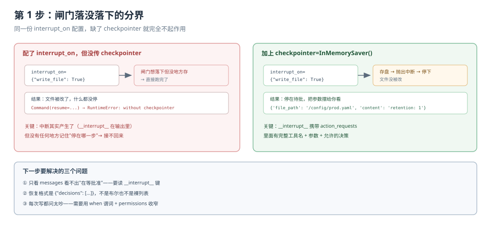
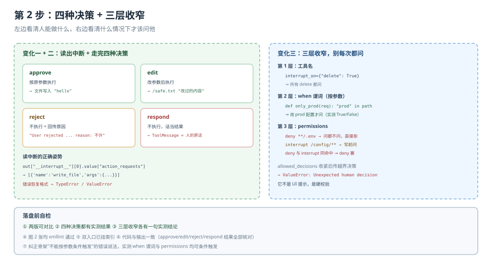

# 应用实战 · 人在环中

> 对应课程：[第 11 课：人在环中](../stages/4-委派与上线/lessons/11-人在环中.md) ｜ 覆盖知识点：interrupt_on 映射、与 LangGraph interrupt 的关系、权限 vs 审批的分工
> 定位：**会用，不上生产**——课里学完，在这里动手。
> ✅ 本文全部代码在 `deepagents 0.7.28` / `langchain 1.4.6` 下实测（假模型驱动真实 agent 图，不发网络请求）
> ✅ TypeScript 侧实测于 2026-10-22 ｜ `deepagents 1.15.1` ｜ 对照 `playground-ts/l11-hitl.ts`

> 🧭 **双语说明**：标 🇹🇸 的段落是 TS 侧实测补充。**这是两侧差异最大的一课**——光是决策对象和中断结构就有四五处不同（`interruptOn` 驼峰、`editedAction` 驼峰、`actionRequests` 驼峰），还有三条会造成数据丢失或静默失效的行为差异。建议 Python 用户也要扫一眼 🇹🇸 段，很多坑是"框架设计选择"而非语言差异。

## 场景：agent 改配置时我得能拦住

**场景**：你的 agent 负责维护一个项目的配置文件。它能读配置、改配置、删临时文件。

- **如果不装闸**：它某次"顺手优化"，把 `config/prod.yaml` 的副本策略从 7 天改成 1 天。没有报错，第二天你才发现。
- **如果装了闸**：它在写 `config/prod.yaml` 前停下，把 `file_path` 和 `content` 摆在你面前。你一眼看出不对，拒绝。

**全貌一句话**：完整方案还包括把审批接到 Slack / Web 面板、加超时策略（静默不等于同意）、以及给不同工具配不同的 `allowed_decisions`。本课先解决"闸门怎么装、怎么收窄、怎么接回来"。

---

### ① 基础实现（能跑但不知道它干了什么）



> 看图：左边是"配了 interrupt_on 直接跑"——文件被改了，什么都没停（因为没 checkpointer）；右边是装上 checkpointer 后同样的代码停下等你。两张图的 `write_file` 那一格，一个绿一个黄，就是闸门落没落下的区别。

::: code-group

```python [Python]
import tempfile
from pathlib import Path

from langchain_core.language_models.chat_models import BaseChatModel
from langchain_core.messages import AIMessage, HumanMessage
from langchain_core.outputs import ChatGeneration, ChatResult
from langgraph.checkpoint.memory import InMemorySaver
from langgraph.types import Command

from deepagents import create_deep_agent
from deepagents.backends import FilesystemBackend


class EditSpy(BaseChatModel):
    """先调 write_file，再收尾。"""

    @property
    def _llm_type(self):
        return "spy"

    def bind_tools(self, tools, **kwargs):
        return self

    def _generate(self, messages, stop=None, run_manager=None, **kwargs):
        if not any(m.type == "tool" for m in messages):
            return ChatResult(generations=[ChatGeneration(message=AIMessage(
                content="",
                tool_calls=[{"name": "write_file",
                             "args": {"file_path": "/config/prod.yaml", "content": "retention: 1"},
                             "id": "w1"}],
            ))])
        return ChatResult(generations=[ChatGeneration(message=AIMessage(content="改好了"))])


root = Path(tempfile.mkdtemp())
(root / "config").mkdir()
fsb = FilesystemBackend(root_dir=str(root), virtual_mode=True)

agent = create_deep_agent(
    model=EditSpy(), backend=fsb,
    interrupt_on={"write_file": True},
    checkpointer=InMemorySaver(),
)

cfg = {"configurable": {"thread_id": "demo-1"}}
out = agent.invoke({"messages": [HumanMessage(content="优化下配置")]}, config=cfg)

print("输出 keys:", sorted(out.keys()))
print("消息数:", len(out["messages"]))
print("文件是否被改:", (root / "config" / "prod.yaml").exists())
```

```typescript [TypeScript]
import { BaseChatModel } from "@langchain/core/language_models/chat_models";
import { AIMessage, HumanMessage, type BaseMessage } from "@langchain/core/messages";
import type { ChatResult } from "@langchain/core/outputs";
import { Command, MemorySaver } from "@langchain/langgraph";
import { existsSync, mkdirSync, mkdtempSync } from "node:fs";
import { tmpdir } from "node:os";
import { join } from "node:path";
import { createDeepAgent, FilesystemBackend } from "deepagents";

class EditSpy extends BaseChatModel {
  constructor() { super({}); }
  _llmType() { return "spy"; }
  bindTools() { return this; }
  async _generate(messages: BaseMessage[]): Promise<ChatResult> {
    const hasTool = messages.some((m) => m.getType() === "tool");
    const msg = hasTool
      ? new AIMessage("改好了")
      : new AIMessage({
          content: "",
          tool_calls: [{ name: "write_file", args: { file_path: "/config/prod.yaml", content: "retention: 1" }, id: "w1" }],
        });
    return { generations: [{ text: String(msg.content), message: msg }] } as ChatResult;
  }
}

const root = mkdtempSync(join(tmpdir(), "hitl-"));
mkdirSync(join(root, "config"), { recursive: true });
const fsb = new FilesystemBackend({ rootDir: root, virtualMode: true });

const agent = await createDeepAgent({
  model: new EditSpy() as never,
  backend: fsb,
  interruptOn: { write_file: true },       // ← 驼峰，不是 interrupt_on
  checkpointer: new MemorySaver(),
});

const cfg = { configurable: { thread_id: "demo-1" } };
const out = await agent.invoke({ messages: [new HumanMessage("优化下配置")] }, cfg);

console.log("输出 keys:", Object.keys(out).sort());
console.log("消息数:", (out.messages as BaseMessage[]).length);
console.log("文件是否被改:", existsSync(join(root, "config", "prod.yaml")));
console.log("有没有 __interrupt__:", "__interrupt__" in out);
```

:::

实测两侧都停在中断上（Python 的 `输出 keys` 里多了 `__interrupt__`）。注意参数名：Python 是 `interrupt_on`，TS 是 `interruptOn`。

> ⚠️ **它的三个问题**：
> 1. **`out["messages"]` 里看不到"待批准"这件事**。只有 2 条消息，你会以为 agent 卡了。
> 2. **不知道恢复该传什么格式**。`Command(resume=True)` 会报错，`Command(resume=[...])` 也会报错。
> 3. **不知道闸门什么时候不落**。换个 thread_id 就接不回来，这个坑完全没有提示。

> 🇹🇸 **TS 侧的"问题 3"更狠：没有 checkpointer 时连中断都产生不了**。同一段代码去掉 `checkpointer`，Python 是"中断能产生、恢复时才炸"，TS 是**第一次 `invoke` 就抛**：
>
> ```text [TypeScript]
> 抛错 GraphValueError: No checkpointer set
> ```
>
> 所以 TS 侧的错误在你写代码时（而非上线后发现恢复失败时）就已经暴露了。

---

### ② 综合实现（被问题逼出来的下一步）



> 看图：左侧四条决策出口，每条都标了实测结果（哪个文件被写、ToolMessage 是什么）；右侧三层收窄（工具名 → when 谓词 → permissions deny），把"每次写都问"收成"只有 prod 和群发才问"。

**变化一：把中断信息读出来**

::: code-group

```python [Python]
out = agent.invoke({"messages": [HumanMessage(content="优化下配置")]}, config=cfg)

if "__interrupt__" in out:
    pending = out["__interrupt__"][0].value
    print("待批动作数:", len(pending["action_requests"]))
    for a in pending["action_requests"]:
        print(f"  工具: {a['name']}")
        print(f"  参数: {a['args']}")
    for c in pending["review_configs"]:
        print(f"  允许的决策: {c['allowed_decisions']}")
```

```typescript [TypeScript]
const out = await agent.invoke({ messages: [new HumanMessage("优化下配置")] }, cfg);

const interrupts = (out.__interrupt__ ?? []) as Array<{ value: {
  actionRequests: Array<{ name: string; args: Record<string, unknown> }>;
  reviewConfigs: Array<{ allowedDecisions: string[] }>;
} }>;
if (interrupts.length > 0) {
  const pending = interrupts[0].value;
  console.log("待批动作数:", pending.actionRequests.length);
  for (const a of pending.actionRequests) {
    console.log(`  工具: ${a.name}`);
    console.log(`  参数: ${JSON.stringify(a.args)}`);
  }
  for (const c of pending.reviewConfigs) {
    console.log(`  允许的决策: ${JSON.stringify(c.allowedDecisions)}`);
  }
}
```

:::

实测输出：

```
待批动作数: 1
  工具: write_file
  参数: {'file_path': '/config/prod.yaml', 'content': 'retention: 1'}
  允许的决策: ['approve', 'edit', 'reject', 'respond']
```

> 🇹🇸 TS 侧结构一模一样，但**字段全是驼峰**：`actionRequests` / `reviewConfigs` / `allowedDecisions`。照抄 Python 的 `action_requests` 会拿到 `undefined`，然后 `for...of` 抛 `is not iterable`——不是"没读到"，是直接崩。

**变化二：走一遍四种决策**

::: code-group

```python [Python]
# approve：照原样执行
agent.invoke(Command(resume={"decisions": [{"type": "approve"}]}), config=cfg)

# reject：不执行，回传原因
agent.invoke(Command(resume={"decisions": [
    {"type": "reject", "message": "不许改保留策略"}]}), config=cfg)

# edit：改成安全值再执行
agent.invoke(Command(resume={"decisions": [{
    "type": "edit",
    "edited_action": {"name": "write_file",
                      "args": {"file_path": "/config/prod.yaml",
                               "content": "retention: 7"}},
}]}), config=cfg)

# respond：不执行，把人的话当结果（模型会看到这句）
agent.invoke(Command(resume={"decisions": [
    {"type": "respond", "message": "我自己改了，你别动"}]}), config=cfg)
```

```typescript [TypeScript]
// approve：照原样执行
await agent.invoke(new Command({ resume: { decisions: [{ type: "approve" }] } }), cfg);

// reject：不执行，回传原因
await agent.invoke(new Command({ resume: { decisions: [
  { type: "reject", message: "不许改保留策略" }] } }), cfg);

// edit：改成安全值再执行（注意是 editedAction，驼峰）
await agent.invoke(new Command({ resume: { decisions: [{
  type: "edit",
  editedAction: { name: "write_file",
                  args: { file_path: "/config/prod.yaml", content: "retention: 7" } },
}] } }), cfg);

// respond：不执行，把人的话当结果（模型会看到这句）
await agent.invoke(new Command({ resume: { decisions: [
  { type: "respond", message: "我自己改了，你别动" }] } }), cfg);
```

:::

> 🇹🇸 TS 侧四种决策的结果对照（`files` 是后端里真实落盘的内容，`tool` 是模型看到的结果消息）：
>
> ```text [TypeScript]
> approve:            files={"/a.txt":"x"}          tool="Successfully wrote to '/a.txt'"
> edit:               files={"/safe.txt":"改过的内容"}  tool="Successfully wrote to '/safe.txt'"
> reject（带 message）: files={}                       tool="不许写这个文件"                status="error"
> reject（不带 message）:files={}                       tool="User rejected the tool call for `write_file` with id w1"
> respond:            files={}                       tool="我来处理这封邮件"              status="success"
> ```
>
> 两个细节：① `edit` 只改 `editedAction`，原 `args` 不生效——实测 `files` 落在 `/safe.txt` 而不是 `/a.txt`；② **`reject` 不带 `message` 时，两侧的提示强度差很多**。Python 会给完整的"Do not retry..."解释，TS 只有一句 `User rejected the tool call for ...`，模型更容易再试一次。

**变化三：把闸门收窄**

::: code-group

```python [Python]
from deepagents.middleware.filesystem import FilesystemPermission

def only_prod(req) -> bool:
    """只在改 prod 配置时中断。"""
    path = (req.tool_call.get("args") or {}).get("file_path", "")
    return isinstance(path, str) and "prod" in path

agent = create_deep_agent(
    model=EditSpy(), backend=fsb,
    permissions=[
        # 红线：密钥绝不碰，问都不问
        FilesystemPermission(operations=["read", "write"], paths=["**/.env"], mode="deny"),
        # 灰区：写 config 目录要问
        FilesystemPermission(operations=["write"], paths=["/config/**"], mode="interrupt"),
    ],
    interrupt_on={
        "write_file": {"allowed_decisions": ["approve", "edit", "reject"],
                       "when": only_prod},
        "delete": True,
    },
    checkpointer=InMemorySaver(),
)
```

```typescript [TypeScript]
const onlyProd = (req: { toolCall: { args: Record<string, unknown> } }): boolean => {
  const path = String(req.toolCall.args?.file_path ?? "");
  return path.includes("prod");
};

const agent = await createDeepAgent({
  model: new EditSpy() as never,
  backend: fsb,
  permissions: [
    // 红线：密钥绝不碰（TS 只有 allow / deny，没有 interrupt）
    { operations: ["read", "write"], paths: ["/**", "/**/.*", "/**/.*/**"], mode: "deny" },
  ],
  interruptOn: {
    write_file: { allowedDecisions: ["approve", "edit", "reject"], when: onlyProd },
    delete: true,
  },
  checkpointer: new MemorySaver(),
});
```

:::

> 🇹🇸 **TS 侧这一格有个会静默放行的坑：`mode: "interrupt"` 不存在**。TS 的 `mode` 只有 `allow` / `deny`，写 `"interrupt"` 既不报错也不中断——**被当成 allow 直接放行**：
>
> ```text [TypeScript]
> A) 只 deny            → 中断 false，files={}        tool="Error: permission denied for write on /secrets/key.txt"
> B) deny + interruptOn → 中断 true（Python 这里不中断）
>     批准后 files={}    tool="Error: permission denied for write on /secrets/key.txt"
> C) mode:"interrupt"   → 创建不报错，中断 false，files={"/secrets/key.txt":"k"}  ← 文件真的写进去了
> ```
>
> 另外 B 那一行值得记：**TS 里 deny 不是"不问就拒"，而是"问了也拒"**——`permissions` 的 deny 和 `interruptOn` 是两层独立机制，不会互相短路。Python 侧 deny 会赢（直接拒、不中断），所以"红线靠 deny、灰区靠 interrupt"这套分层在 TS 里只能靠 `interruptOn.when` 单独实现。

**再踩一个坑**：`allowed_decisions` 不是 UI 提示。实测只允许 `["approve","reject"]` 时传 `edit`，直接 `ValueError: Unexpected human decision`。

> 🇹🇸 **TS 侧还有一个更危险的行为：批处理里混合决策会丢调用**。一次 `AIMessage` 里带两个 `write_file` 时，只要有一条 `reject`，**同批里被 approve 的调用会整条消失**（连 `ToolMessage` 都不留）：
>
> ```text [TypeScript]
> 中断 1 个，待批 2 条
>   全批准            → files={"/a.txt":"A","/b.txt":"B"}   消息数 5
>   批准第一个 + 拒绝第二个 → files={}                          消息数 4
>                        ai 消息里的 tool_calls 只剩: w2
>                        → 被批准的第一个调用连 ToolMessage 都没有，整个消失
> ```
>
> 同一场景换成 `perCall` 模式（一调用一中断）就能保住：`per_call 混合决策（拒一个批一个）→ files={"/a.txt":"A"}`。**所以 TS 侧只要涉及批量写操作，必须用 `perCall`**，用默认的批处理模式会出现"人明明批准了、文件却没写"的情况，而且没有任何报错。
>
> 顺带三条：① `perCall` 模式下中断对象多两个字段（`id` / `type: "tool_approval"` / `toolCallId`），恢复时要用带 id 的决策；② 子代理配 `interruptOn` 时父图整体暂停，批准后子代理报告正常返回；③ 中断后往同 thread 插新消息，悬空调用会被补上 `was cancelled - another message came in`（Python 是 `did not complete`）。

---

## 🔍 落盘前自检

| # | 检查项 | 结果 |
|---|--------|------|
| 1 | 形态：基础实现 → 问题 → 综合实现，两版可对比 | ✅ 基础版（装了闸但看不到决策）→ 综合版（四种决策 + 三层收窄）|
| 2 | 图 N 张：每步一张分步设计图 | ✅ 2 张（`app-step1-gate-missing.svg` / `app-step2-gate-decisions.svg`）|
| 3 | 图片语法：全部用相对路径指向真实文件 | ✅ 2/2 |
| 4 | assets：文件存在且 XML 合法 | ✅ `xmllint` 通过 |
| 5 | 读图指引与变化标注 | ✅ 每张图下有一句"看图：…"；第 2 步标出三处变化 |
| 6 | 索引与双入口 | ✅ 应用实战 INDEX / 课 11 正文 4.2 双入口 |
| 7 | 代码 review：所有代码与输出一致 | ✅ 两侧均实测：四种决策结果、when 谓词 True/False、deny 优先生效、决策越界 ValueError；TS 另有 batch 丢调用 / mode:"interrupt" 静默放行 / deny+interruptOn 双重拦截 |

---

## 🧭 导航

- ⬅️ 回到课程：[第 11 课：人在环中](../stages/4-委派与上线/lessons/11-人在环中.md)
- 📚 全部实战：[应用实战索引](INDEX.md)
- ➡️ 下一阶段实战：12 · 异步与动态子代理（待编写）
