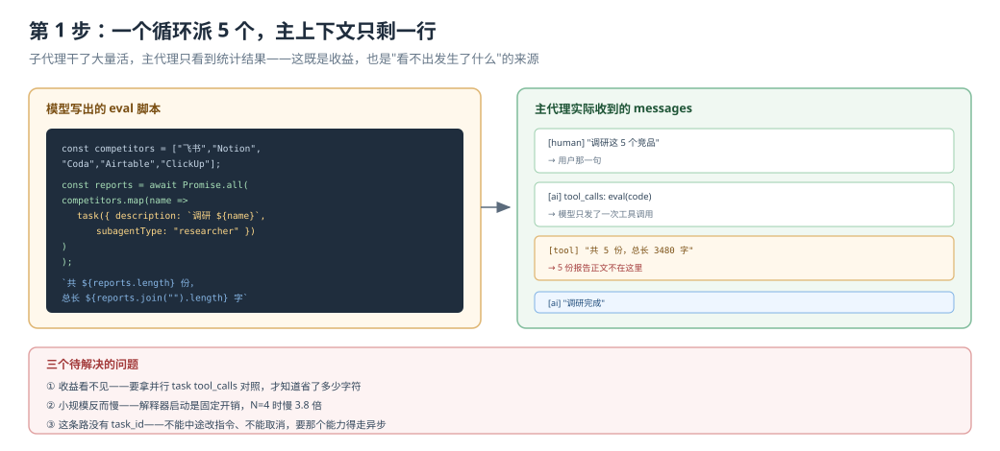
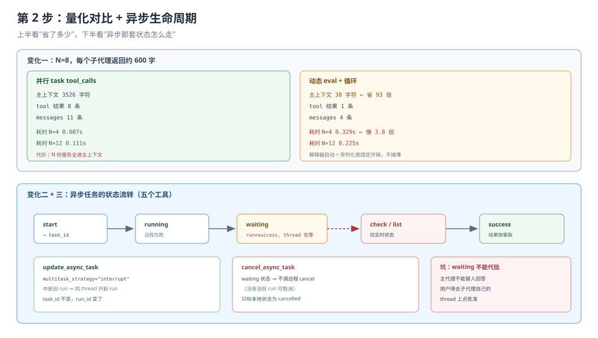

# 应用实战 · 异步与动态子代理

> 对应课程：[第 12 课：异步与动态子代理](../stages/4-委派与上线/lessons/12-异步与动态子代理.md) ｜ 覆盖知识点：异步子代理控制工具、动态子代理、三模式选型
> 定位：**会用，不上生产**——课里学完，在这里动手。
> ✅ 本文全部代码在 `deepagents 0.7.28` / `langchain_quickjs 0.3.9` 下实测（假模型驱动真实 agent 图，不发网络请求）

## 场景：5 个竞品同时查，查到一半要喊停

**场景**：你要调研 5 个竞品，每个都需要独立分析。而且这次调研本身是探索性的——很可能查到第 3 个就发现方向错了，需要改指令或喊停。

- **如果逐个查**：5 个竞品排队，中间 12 分钟在等，而且第 5 个已经错方向了还在跑
- **如果能同时查 + 能干预**：5 个一起提交，查的过程中能改、能停

**全貌一句话**：完整方案还包括把子代理部署成远程服务、把任务状态接到前端面板、给 `waiting` 状态配人工审批入口。本课先解决"怎么并发派、怎么量出收益、异步生命周期怎么走"。

---

### ① 基础实现（能跑但不知道它干了什么）



> 看图：左边是一段 JS 循环派 5 个子代理，右边是主代理实际收到的内容——不是 5 份报告，而是一行统计。这个"看起来什么都没拿到"的现象，正是本课最核心的机制。

```python
import asyncio
import tempfile
from pathlib import Path

from langchain_core.language_models.chat_models import BaseChatModel
from langchain_core.messages import AIMessage, HumanMessage
from langchain_core.outputs import ChatGeneration, ChatResult
from langgraph.checkpoint.memory import InMemorySaver

from deepagents import create_deep_agent
from deepagents.backends import FilesystemBackend
from langchain_quickjs import CodeInterpreterMiddleware

SEEN = []


class Dispatcher(BaseChatModel):
    """写一段循环派 5 个。"""

    @property
    def _llm_type(self):
        return "dispatcher"

    def bind_tools(self, tools, **kwargs):
        return self

    def _generate(self, messages, stop=None, run_manager=None, **kwargs):
        if not any(m.type == "tool" for m in messages):
            code = """
const competitors = ["飞书", "Notion", "Coda", "Airtable", "ClickUp"];
const reports = await Promise.all(
  competitors.map(name =>
    task({ description: `调研竞品 ${name} 的定价策略`, subagentType: "researcher" })
  )
);
`共 ${reports.length} 份报告，总长度 ${reports.join("").length} 字`;
"""
            return ChatResult(generations=[ChatGeneration(message=AIMessage(
                content="", tool_calls=[{"name": "eval", "args": {"code": code}, "id": "e1"}]))])
        return ChatResult(generations=[ChatGeneration(message=AIMessage(content="调研完成"))])


class Researcher(BaseChatModel):
    @property
    def _llm_type(self):
        return "researcher"

    def bind_tools(self, tools, **kwargs):
        return self

    def _generate(self, messages, stop=None, run_manager=None, **kwargs):
        d = next((str(m.content) for m in messages if m.type == "human"), "?")
        SEEN.append(d)
        return ChatResult(generations=[ChatGeneration(message=AIMessage(
            content=f"【{d[:12]}】定价详情：" + "分层定价与席位计费差异明显，" * 12))])


root = Path(tempfile.mkdtemp())
agent = create_deep_agent(
    model=Dispatcher(),
    backend=FilesystemBackend(root_dir=str(root), virtual_mode=True),
    subagents=[{"name": "researcher", "description": "调研单个竞品", "model": Researcher()}],
    middleware=[CodeInterpreterMiddleware()],
    checkpointer=InMemorySaver(),
)

out = asyncio.run(agent.ainvoke(
    {"messages": [HumanMessage(content="调研这 5 个竞品")]},
    config={"configurable": {"thread_id": "comp-1"}}))

print("子代理被派活:", len(SEEN))
for s in SEEN:
    print("  -", s)
print("\n主上下文消息数:", len(out["messages"]))
print("主上下文总字符:", sum(len(str(m.content)) for m in out["messages"]))
print("最后消息:", str(out["messages"][-1].content)[:120])
```

> ⚠️ **它的三个问题**：
> 1. **看不出省了什么**。主上下文只有一行，但子代理明明返回了 5 份长报告——需要对照才能理解。
> 2. **不知道它比并行 `task` 慢**。这段代码在 5 个子代理的场景下，比直接发 5 个 `task` 调用更慢。
> 3. **异步那条路完全没走**。动态派发是"同一进程内并发"，没有 task_id，不能中途改指令、不能取消。

---

### ② 综合实现（被问题逼出来的下一步）



> 看图：上半是动态与并行 `task` 的双栏对比（耗时、上下文、决策次数三项量化），下半是异步任务的状态流转：`running → waiting → 人回答 → running → success`，以及 `update` 会中断旧 run 开新 run。

**变化一：量出真实差异**

```python
BIG = "子代理的详细中间过程，" * 40

def measure(mode, n):
    """mode: 'batch' 并行 tool_calls ｜ 'dyn' 动态 eval"""
    ...

# 实测结果（N=8，每个子代理返回约 600 字）
# 并行 task tool_calls：主上下文 3526 字符，8 条 tool 结果，11 条消息
# 动态 eval + 循环：    主上下文   38 字符，1 条 tool 结果，4 条消息
```

差距的来源一句话：**动态模式下，8 份子代理结果留在解释器的 JS 变量里**；并行模式下，8 份全都进了主代理的 `messages`。

但耗时反过来（N=4）：

```
并行 task tool_calls  0.087s
动态 eval + 循环      0.329s     ← 慢 3.8 倍
```

这是解释器启动 + 序列化往返的固定开销，不随 N 摊薄。

**变化二：把 `waiting` 状态搞清楚**

异步子代理自己也能配审批（课 11 的知识）。它暂停时，run 状态是 `success`，只有 thread 显示它在等：

```python
_WAITING = "waiting"
_THREAD_TO_TASK_STATUS = {"interrupted": _WAITING, "busy": "running", "error": "error"}
```

所以检查任务状态必须**同时看 run 和 thread**：

```python
def _task_status(run, thread):
    if run["status"] != "success" or thread is None:
        return run["status"]
    return _THREAD_TO_TASK_STATUS.get(thread.get("status"), "success")
```

`waiting` 的任务，主代理**不能代批**：

```python
_WAITING_NOTE = (
    "The subagent is waiting for a human. The user answers it directly; "
    "you can't answer or approve it."
)
```

**变化三：`update` 和 `cancel` 的真实语义**

```python
# update：中断旧 run，同 thread 开新 run（task_id 不变）
run = client.runs.create(
    thread_id=tracked["thread_id"],
    assistant_id=spec["graph_id"],
    input={"messages": [{"role": "user", "content": message}]},
    multitask_strategy="interrupt",     # ← 关键
)

# cancel：如果任务在 waiting，不调远程 cancel（没有活跃 run）
if tracked["status"] != _WAITING:
    client.runs.cancel(thread_id=..., run_id=...)
```

**再踩一个坑**：不配 `url` 用同步 `invoke`，报错被吞成工具返回值，流程不中断：

```
ToolMessage: Failed to launch async subagent 'r': Async subagent 'r' has no url
configured. ASGI transport (url=None) requires async invocation.
```

---

## 🔍 落盘前自检

| # | 检查项 | 结果 |
|---|--------|------|
| 1 | 形态：基础实现 → 问题 → 综合实现，两版可对比 | ✅ 基础版（纯动态，看不出收益）→ 综合版（三项量化对比 + 异步生命周期）|
| 2 | 图 N 张：每步一张分步设计图 | ✅ 2 张（`app-step1-dyn-fanout.svg` / `app-step2-modes-compare.svg`）|
| 3 | 图片语法：全部用相对路径指向真实文件 | ✅ 2/2 |
| 4 | assets：文件存在且 XML 合法 | ✅ `xmllint` 通过 |
| 5 | 读图指引与变化标注 | ✅ 每张图下有一句"看图：…"；第 2 步标出三处变化 |
| 6 | 索引与双入口 | ✅ 应用实战 INDEX / 课 12 正文 4.2 双入口 |
| 7 | 代码 review：所有代码与输出一致 | ✅ 派活数 5、上下文 3526 vs 38、耗时 0.087 vs 0.329、waiting 语义、ASGI 报错形式均实测 |

---

## 🧭 导航

- ⬅️ 回到课程：[第 12 课：异步与动态子代理](../stages/4-委派与上线/lessons/12-异步与动态子代理.md)
- 📚 全部实战：[应用实战索引](INDEX.md)
- ➡️ 下一阶段实战：13 · 生产化：容错、流式与上线（待编写）
