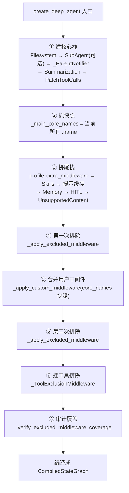

# 源码解析 03：`create_deep_agent` 的中间件栈装配

> 对应：[课 3《第一个 deep agent 与它的默认装配》](../stages/1-定位与起跑/lessons/03-第一个DeepAgent与它的默认装配.md) ｜ 覆盖知识点：默认中间件栈全序（bare stack / full stack）、Profiles 与模型默认
> 源码锚点 @ 0.7.28（`deepagents` ｜ `deepagents/graph.py`、`deepagents/_excluded_middleware.py`、`deepagents/middleware/_prompt_caching.py`）

## 为什么读它

课里那张栈图已经告诉你顺序了。但真正让人卡住的从来不是"顺序是什么"，而是这三个问题：

1. **为什么我的中间件插不到我以为是的位置？** 文档说"插在 `PatchToolCallsMiddleware` 之后"，可源码里插的是"最后一个核心成员之后"——这两个表述在什么情况下会给出不同答案？
2. **为什么给 profile 写了个打错字的名字，agent 起不来？** 大部分配置系统的做法是"匹配不上就静默忽略"，它偏要抛 `ValueError`。
3. **为什么"排除中间件"这个操作要先跑一遍、再跑一遍？** 源码里 `_apply_excluded_middleware` 在 `_apply_custom_middleware` 前后各调了一次——这不是笔误，是一段有意的顺序设计。

这三个问题的答案都在同一个函数里。

## 功能全貌



> 读图指引：注意 ② 与 ⑤ 之间的"时间差"——快照在尾栈之前抓，插入却在尾栈之后算。整个"插在哪"的谜题就在这条时间差里。

## 源码直击

### 片段一：核心栈怎么起头

```python
# deepagents/graph.py:893-921（节选，省略异步子代理分支）
# Build main agent middleware stack
deepagent_middleware: list[AgentMiddleware[Any, Any, Any]] = [
    FilesystemMiddleware(
        backend=backend,
        custom_tool_descriptions=_profile.tool_description_overrides,
        _permissions=permissions,          # 权限不是"另一层"，就装在文件系统中间件里
    ),
]
sub_agent_middleware: SubAgentMiddleware | None = None
if inline_subagents:
    sub_agent_middleware = SubAgentMiddleware(...)
    deepagent_middleware.append(sub_agent_middleware)
deepagent_middleware.extend(
    [
        _ParentNotifierMiddleware(),       # 文档栈表里没有它
        create_summarization_middleware(model, backend),
        PatchToolCallsMiddleware(),
    ]
)
```

三个值得记住的细节：

- **`_permissions` 是构造参数**，不是独立中间件。所以课里说"权限在最外层评估"——它的物理位置就是第 1 条。
- **`_ParentNotifierMiddleware` 就在核心栈里**，但官方栈表不列它。它是给异步子代理用的唤醒器（`middleware/_parent_notifier.py:30-35`），没有父引用时什么都不做。这就是为什么"看文档表"和"看 `agent.nodes`"会得到不同清单。
- **`SubAgentMiddleware` 是条件插入的**：只有存在同步子代理时才 append。默认会塞一个 `general-purpose`，所以常态是"有"。

### 片段二：快照与尾栈——插入点的真正定义

```python
# deepagents/graph.py:928-941（节选）
# Names of the core stack, captured before the tail is appended so new user
# middleware can splice in ahead of the profile/prompt-caching/memory tail.
_main_core_names = {m.name for m in deepagent_middleware}

deepagent_middleware.extend(_profile.materialize_extra_middleware())
if skills is not None:
    deepagent_middleware.append(SkillsMiddleware(backend=backend, sources=skills))
append_prompt_caching_middleware(deepagent_middleware)
```

这是整个装配里最关键的三行注释对应的代码。它解决了课里那个说法的含糊处：

- 文档说"插在 `PatchToolCallsMiddleware` 之后"——那是**默认情形下的结果**。
- 源码说"插在最后一个 `_main_core_names` 成员之后"——那是**机制**。

两者什么时候不一致？配上 `AsyncSubAgentMiddleware` 时：它在 `PatchToolCallsMiddleware` 之后 append，且在快照之前，所以它也进了 `_main_core_names`。此时你的中间件会落在**异步子代理之后**，而不是紧贴 `PatchToolCallsMiddleware`。文档那句话在此处是"近似正确"，源码才是精确答案。

`append_prompt_caching_middleware` 的实现只有 9 行，把"始终注册"解释得很干净：

```python
# deepagents/middleware/_prompt_caching.py:41-49
def append_prompt_caching_middleware(middleware: list[AgentMiddleware[Any, Any, Any]]) -> None:
    """Append provider-specific prompt caching middleware."""
    middleware.append(AnthropicPromptCachingMiddleware(unsupported_model_behavior="ignore"))
    bedrock_middleware = _create_bedrock_prompt_caching_middleware()
    if bedrock_middleware is not None:
        middleware.append(bedrock_middleware)
    fireworks_middleware = _create_fireworks_prompt_caching_middleware()
    if fireworks_middleware is not None:
        middleware.append(fireworks_middleware)
```

Anthropic 那条**无条件 append**，靠 `unsupported_model_behavior="ignore"` 在别的模型上 no-op；Bedrock / Fireworks 则按"装了没装"条件追加。所以"提示缓存是 1 条还是 3 条"取决于你的依赖——这也解释了为什么栈的总条数不是个固定数字。

### 片段三：合并逻辑——同名替换的 12 行真身

```python
# deepagents/graph.py:225-245
if not custom:
    return list(base)
current_names = {m.name for m in base}
replacements: dict[str, AgentMiddleware[Any, Any, Any]] = {}
to_append: list[AgentMiddleware[Any, Any, Any]] = []
for m in custom:
    if m.name in current_names:
        replacements[m.name] = m          # 同名 → 记进替换表
    else:
        to_append.append(m)               # 不同名 → 排队等插入
result = list(base)
for i, m in enumerate(result):
    if m.name in replacements:
        result[i] = replacements[m.name]  # 原位替换，位置不动
if to_append and core_names is not None:
    # Land new middleware after the last core entry, ahead of the tail.
    pos = max((i for i, m in enumerate(result) if m.name in core_names), default=len(result) - 1) + 1
    result[pos:pos] = to_append
else:
    result.extend(to_append)
return result
```

逐段读的话，有四个容易踩的点：

1. **`current_names` 是集合**，所以"同名"判断用的是 `.name` 而不是类。两个不同类只要 `.name` 一样就互斥——这正是课里"同名替换"能用类外的方式覆盖默认行为的原因。
2. **替换是原地替换**（`result[i] = ...`），不是先删后加。所以被替换项的**位置由原项决定**，跟你传进来的顺序无关。
3. **`pos` 用 `max(...)` 取最后一个核心成员的位置**，不是写死的索引。这让"核心栈长度可变"（有没有 `SubAgentMiddleware`）不影响插入语义。
4. **`default=len(result) - 1`**：万一 `core_names` 里一个都不在（理论上不该发生），退化成"插在倒数第一之前"，再加 1 就变成末尾。这是个防御性默认值，不是正常路径。

### 片段四：为什么排除要跑两遍

```python
# deepagents/graph.py:959-975（节选）
deepagent_middleware = _apply_excluded_middleware(
    deepagent_middleware, _profile,
    matched_classes=_main_matched_classes, matched_names=_main_matched_names,
)
deepagent_middleware = _apply_custom_middleware(deepagent_middleware, middleware or [], core_names=_main_core_names)
deepagent_middleware = _apply_excluded_middleware(
    deepagent_middleware, _profile,
    matched_classes=_main_matched_classes, matched_names=_main_matched_names,
)
# Tool exclusion runs after custom middleware so excluded tool names are
# stripped last and cannot be restored by a custom wrap_model_call.
if _profile.excluded_tools:
    deepagent_middleware.append(_ToolExclusionMiddleware(excluded=_profile.excluded_tools))
```

第一遍排掉的是**内置那些**；第二遍排掉的是**你传进来的**。为什么用户传的也要被 profile 排掉？因为 profile 是"按模型自动生效的配置约束"，它不该因为你手动传了一个同名中间件就失效——实测确认了这一点：

```python
register_harness_profile("openai:excl-probe", HarnessProfile(excluded_middleware=frozenset({"MineMiddleware"})))
a = create_deep_agent(model="openai:excl-probe", tools=[], middleware=[Mine()])
# → 节点里没有任何 MineMiddleware
```

而 `_ToolExclusionMiddleware` 放在最后，注释写明了理由：**最后剥，才不会被别处的 `wrap_model_call` 加回来**。这是"覆盖顺序即优先级"的直白体现。

## 设计权衡

**为什么插槽用"最后核心成员之后"而不是"写死索引"？**

写死索引的实现更简单（`result.insert(4, m)`），但核心栈长度会随参数变化（有没有 `SubAgentMiddleware`、有没有 `AsyncSubAgentMiddleware`）。写死索引会让"我传了异步子代理，结果我的中间件位置全乱"——这种 bug 在用户侧表现为"行为莫名其妙变了"，很难归因。用名字快照 + `max()` 定位，代价是多一次集合构造，换来的是"位置语义稳定"。

**为什么"排除没匹配到"要抛错而不是忽略？**

多数配置系统选择宽容，因为宽容不会让程序起不来。这里的取舍相反：profile 是**按模型自动生效**的，一旦打错字，得到的是一个"看起来生效、实际没生效"的配置——这种状态比崩溃更难查。实测报错文案把意图说得很清楚：

```
ValueError: HarnessProfile.excluded_middleware entries matched no middleware across any assembled stack:
'SummarizatoinMiddleware' (string). Typo or stale profile — every exclusion must correspond to
a middleware actually present at runtime. (Tip: use class-form exclusion when the class is
available to catch typos at import time.)
```

注意它连"怎么改进"都给了：用类形式（`SummarizationMiddleware`）能在 import 时就被静态检查发现拼错，字符串形式不能。这是"错误信息即文档"的范例。

**为什么要有 protected scaffolding 这个白名单？**

`_REQUIRED_MIDDLEWARE` 只有两项：

```python
# deepagents/graph.py:248-251
_REQUIRED_MIDDLEWARE: tuple[tuple[type[AgentMiddleware[Any, Any, Any]], tuple[str, ...]], ...] = (
    (FilesystemMiddleware, ()),
    (SubAgentMiddleware, ()),
)
```

源码注释解释了理由：删掉它们不是"少个能力"，而是**静默破坏核心功能**——`FilesystemMiddleware` 撑着全部内置文件工具，还负责执行 `permissions`（一条安全保证）。所以这里选择抛错而不是退化运行。实测报错：

```
ValueError: HarnessProfile.excluded_middleware is invalid:
  - required scaffolding cannot be excluded: 'FilesystemMiddleware' (string)
    (back filesystem tools, subagent dispatch, and permission enforcement —
     use excluded_tools for per-tool visibility or adjust profile settings instead of stripping scaffolding)
```

注意括号里那句建议：**想减能力就用 `excluded_tools`，别拆脚手架**。这正是课里"清单里有 ≠ 模型看得到"那条的工程出处。

## 回扣用法

- **注意**：你说"插在 `PatchToolCallsMiddleware` 之后"只在没配 `AsyncSubAgentMiddleware` 时精确成立。要看真实位置，用 `list(agent.nodes)` 或读 `_main_core_names` 的构造时机，别照抄文档措辞。
- **注意**：同名替换是按 `.name` 匹配的，不是按类。所以你可以用自己写的类顶掉任何一个内置项（除了两个 protected 的）——这是"覆盖默认行为"最省事的路径。
- **可以**：给 profile 写 `excluded_middleware` 时用**类**而不是字符串，拼错会在 import / 构造期立刻暴露，而不是等到运行时才抛"matched no middleware"。
- **可以**：`excluded_middleware` 会连你手动传的同名中间件一起排掉（实测过）。想让某个中间件在特定模型上消失，这是最省事的开关；反之，如果你"明明传了却没生效"，先查 profile。
- **别**：别指望 `excluded_tools` 提供安全边界。它在最后一步做请求期过滤，执行端仍注册着工具（源码注释："executor still has them registered"）。要真拦，用 `permissions`（构造期装进 `FilesystemMiddleware`）或 `interrupt_on`。

---

🔬 **看透标志**：能不看文档说出"我的中间件为什么落在这个位置"，能解释第一次和第二次 `_apply_excluded_middleware` 各自在挡谁，并且知道"排除没命中就抛错"是为了让静默失效变成响亮的失败。

> 回索引：[源码解析索引](./INDEX.md)
