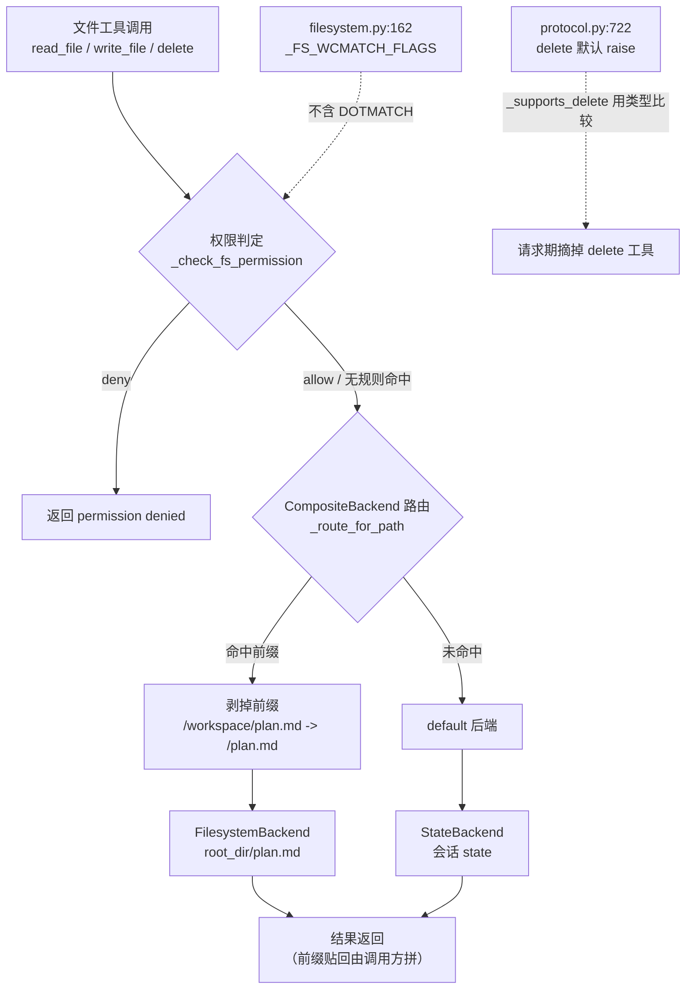

# 源码解析 05：后端协议与可选能力

> 对应：[第 5 课《Backends 后端与 Permissions 权限》](../stages/2-执行环境/lessons/05-Backends后端与Permissions权限.md) ｜ 覆盖知识点：内置后端六种、CompositeBackend 路由与自定义后端协议、permissions 声明式规则与边界
> 源码锚点 @ 0.7.28（`deepagents.backends.protocol`、`deepagents.backends.composite`、`deepagents.middleware.filesystem`）

## 为什么读它

课里已经给了三条结论：`delete` 可以不实现、`CompositeBackend` 按最长前缀剥皮转发、`deny /**` 挡不住点文件。但"为什么会这样"在文档里查不到。这一篇用源码回答三个问题：

1. **为什么 `delete` 能"可选"？** 一个方法"不存在"这件事，框架是怎么在**不调用它**的前提下检测出来的？
2. **前缀到底在哪一行被剥掉？** "剥皮转发、贴皮返回"是两条独立代码，还是一次性的？
3. **`deny /**` 挡不住 `.env`，是哪一行决定的？** 是权限逻辑写错了，还是 glob 语义本来如此？

## 功能全貌



> 读图指引：注意两处虚线。上方那条是"可选能力"的检测方式——**不调用方法，只比较类型**；下方那条是权限盲区的真正来源——**一个常量少了 64**。这两处都不是"逻辑错误"，是刻意的设计取舍。

## 源码直击

### 片段一：`delete` 的"可选"是怎么做到的

`BackendProtocol` 声明了 `delete`，但它的默认实现就是抛异常（`protocol.py:722`）：

```python
# deepagents/backends/protocol.py:722
def delete(self, file_path: str) -> DeleteResult:
    """Delete a file or directory.

    ...backends that don't need this can rely on the default,
    which raises `NotImplementedError`. Callers that need to support
    optional deletion should check support before calling...
    """
    raise NotImplementedError
```

于是"这个后端支不支持删除"就不能靠 `hasattr` 判断（方法永远存在），得靠**看类有没有重写它**（`filesystem.py` 的 `_supports_delete`）：

```python
def _supports_delete(backend: BackendProtocol) -> bool:
    return type(backend).delete is not BackendProtocol.delete
```

这一行有三个细节值得记住：

1. **`type(backend).delete`，不是 `backend.delete`**。取的是类上的方法对象。所以给实例动态挂一个 `delete` 完全无效——必须真的在类体里定义。
2. **`is not`，不是 `!=`**。比的是函数对象的身份，不是行为等价。哪怕你写一个签名完全一样、逻辑也一样的 `delete`，只要它不是你类上真实定义的那个，就判 `True`（支持）。
3. **它的意义是"避免调用"**。如果用 `try: backend.delete(...) except NotImplementedError` 来探测，就会产生副作用（万一后端真的实现了删除呢）。类型比较是纯粹的静态判断。

实测这条差异（同一个后端实例，两种视图）：

```
StateBackend   构造期 self.tools: 8 项，含 delete
NoDelete       构造期 self.tools: 8 项，含 delete   <- 一样！
```

```
StateBackend   模型实见 n=8 -> ['delete', 'edit_file', 'glob', 'grep', 'ls', 'read_file', 'task', 'write_file']
NoDelete       模型实见 n=7 -> ['edit_file', 'glob', 'grep', 'ls', 'read_file', 'task', 'write_file']
```

**构造期看不出差别，请求期才摘掉。** 这解释了为什么课里强调"别拿中间件的 `.tools` 去判断模型能不能删文件"。

摘除发生在请求期过滤函数里（`filesystem.py:3027`）：

```python
def _unsupported_tools_and_execution_state(self, tool_names):
    unsupported: set[str | None] = set()
    execution_active = False
    backend = None
    has_execute_tool = "execute" in tool_names
    has_delete_tool = "delete" in tool_names
    if not has_delete_tool and not has_execute_tool:
        return unsupported, execution_active, backend

    backend = self.backend
    if has_execute_tool and "execute" not in unsupported:
        execution_active = supports_execution(backend)
        if not execution_active:
            unsupported.add("execute")
    if has_delete_tool and "delete" not in unsupported and not _supports_delete(backend):
        unsupported.add("delete")
    return unsupported, execution_active, backend
```

注意这两条门控**并排写在同一个函数里**：`execute` 靠 `supports_execution`（`isinstance` 判定），`delete` 靠 `_supports_delete`（类型重写判定）。同一个"可选能力"机制，两种检测方式——因为 `execute` 是按协议类型分叉的（课 6 讲过），而 `delete` 是按"有没有重写"分叉的。

### 片段二：前缀在哪一行被剥掉

`CompositeBackend` 的路由不是"匹配一下就把请求发出去"，而是先算出"给子后端的路径"。核心是一个纯函数（`composite.py:195`）：

```python
# deepagents/backends/composite.py:195
def _route_for_path(*, default, sorted_routes, path) -> tuple[BackendProtocol, str, str | None]:
    for route_prefix, backend in sorted_routes:
        prefix_no_slash = route_prefix.rstrip("/")
        if path == prefix_no_slash:
            return backend, "/", route_prefix

        normalized_prefix = route_prefix if route_prefix.endswith("/") else f"{route_prefix}/"
        if path.startswith(normalized_prefix):
            suffix = path[len(normalized_prefix):]
            backend_path = f"/{suffix}" if suffix else "/"
            return backend, backend_path, route_prefix
    return default, path, None
```

三个返回值：**选中的后端、给它看的路径、命中的前缀**。第三项就是"贴回来"的依据——但注意它只是被**返回**，不是在这里贴。

再看排序（`composite.py:281`）：

```python
self.sorted_routes = sorted(routes.items(), key=lambda x: len(x[0]), reverse=True)
```

`reverse=True` 是按**字符串长度**降序。所以 `/memories/proj/` 一定排在 `/memories/` 前面，`for` 循环第一次试就是最长的那个——这就是"最长前缀优先"的全部实现。

> 一个容易忽略的边界：`route_prefix` **不要求以 `/` 结尾**。代码用 `normalized_prefix` 补了一个斜杠，所以 `"/memories"` 和 `"/memories/"` 都能匹配 `/memories/x`。但如果你写 `"/mem"`，它不会匹配 `/memories/x`——因为补斜杠后变成 `"/mem/"`，而 `"/memories/x"` 不以它开头。这就是"边界由斜杠钉住"。

至于"贴回来"，它不在这个函数里。`read` 之类的调用方拿到 `backend_path` 去问子后端，拿回结果后自己把前缀拼回展示路径。

实测这一层（写 `/workspace/plan.md`，`root_dir` 指向 `.../project`）：

```
磁盘文件: ['plan.md']
是否出现 workspace 子目录: False
```

`root_dir` 本身就是那个路由的根。子后端看到的路径是 `/plan.md`，所以磁盘上就是 `project/plan.md`——**没有** `project/workspace/plan.md`。

### 片段三：`deny /**` 为什么挡不住 `.env`

答案在一个常量里（`filesystem.py:162`）：

```python
_FS_WCMATCH_FLAGS = wcglob.BRACE | wcglob.GLOBSTAR
```

实测这三个 flag 的数值：

```
BRACE = 512   GLOBSTAR = 256   DOTMATCH = 64
_FS_WCMATCH_FLAGS = 768 = BRACE | GLOBSTAR
```

**`DOTMATCH` 没在里面。** 在 wcmatch（以及 Python 标准库 `fnmatch`、shell glob 的默认行为）里，`*` 和 `**` 默认不匹配以 `.` 开头的路径段。所以：

- `/**` 匹配 `/notes.md`，**不匹配** `/.env`、`/.aws/credentials`。
- 想让 `**` 穿过点目录，必须显式写 `/**/.*` 或 `/**/.*/**`。

判定循环本身非常短（`filesystem.py:408`）：

```python
def _check_fs_permission(rules, operation, path) -> Literal["allow", "deny", "interrupt"]:
    for rule in rules:
        if operation not in rule.operations:
            continue
        if any(wcglob.globmatch(path, pattern, flags=_FS_WCMATCH_FLAGS) for pattern in rule.paths):
            return rule.mode
    return "allow"
```

三行逻辑，三个必须记住的推论：

1. **`for` 顺序就是优先级**。没有"deny 优先"这种事，第一条命中直接 `return`。
2. **`operation not in rule.operations` 是跳过，不是拒绝**。所以一条只写 `["write"]` 的 deny 规则，对 `read` 完全不生效。
3. **最后一行 `return "allow"` 是兜底放行**。一条规则都没命中时，访问是被允许的。这是"白名单思维"的反面——**默认开**。

实测这三条推论（同一批文件、三套规则）：

```
规则A deny /**              plan.md -> denied   .env -> 读到密钥   .aws/cred -> 读到密钥
规则B 窄deny在前+显式点目录   plan.md -> 正常     .env -> denied     .aws/cred -> denied
规则C 顺序反了（宽allow在前） plan.md -> 正常     .env -> denied     .aws/cred -> 读到密钥（漏）
```

规则 C 最值得看：`.env` 被挡住了（它是显式的窄规则），但 `.aws/credentials` **漏了**。因为宽 `allow /workspace/**` 排在前面且匹配了它，第一条就命中了 allow——后面那条 `deny /workspace/.env` 根本没轮到，而 `.aws/**` 压根没写。

> 顺带说清一件事：`interrupt` 模式走的是同一条判定循环，只是因为 `_FS_WCMATCH_FLAGS` 的问题一样，点文件在 interrupt 规则下也会"漏审"——这比 deny 漏更危险，因为你会以为有人在审批。

## 三个可带走的设计教训

1. **"可选能力"用类型比较，不用 `hasattr` 也不用 `try`**：方法有默认实现时，`hasattr` 永远为真；`try` 会产生副作用。`type(x).method is not Base.method` 是唯一"零副作用且能区分重写"的判断，代价是你必须接受"动态挂载无效"这个约束。
2. **"构造期注册"和"请求期可见"是两张表**：前者是 `self.tools`（`FilesystemMiddleware` 固定 8 项：7 个文件工具 + `execute`，不含 `task`），后者是过滤后的 `visible_tools`（含 `task`、不含被摘掉的项）。两个"8 项"内容并不相同——`StateBackend` 构造期是「6 文件工具 + `delete` + `execute`」，实见是「6 文件工具 + `delete` + `task`」。任何"模型能不能用某个工具"的问题，都必须问后者。这个双表结构也解释了为什么"静默降级"要单独讲一课——它不报错、不警告，只在请求期悄悄少一项。
3. **安全默认值的方向决定了坑的形状**：权限兜底是 `allow`（默认开），glob 默认不含 `DOTMATCH`（点文件隐形）。两个"默认宽松"叠在一起，就得到"我写了最宽的 deny，密钥却读了出"这个反直觉结果。做自己的权限系统时，如果选择"默认放行"，就必须同时处理"隐藏项不会被规则覆盖"这一类旁路。
