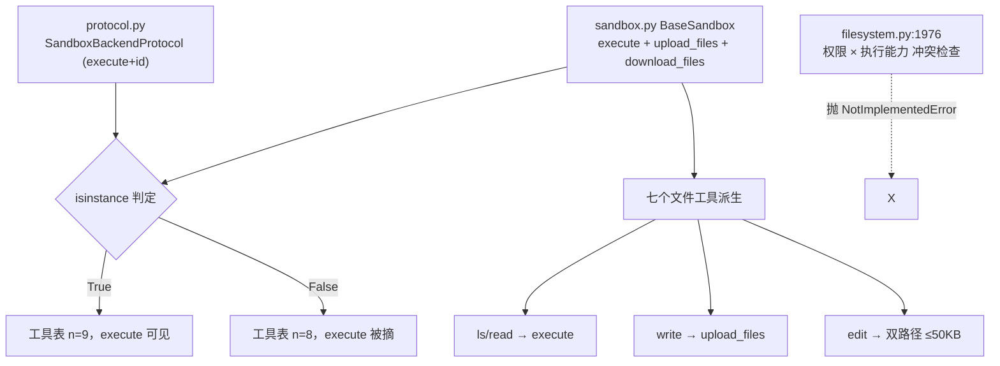

# 源码解析 06：沙箱协议与 execute 派生

> 对应：[第 6 课《代码执行：Sandboxes 与 Interpreters》](../stages/2-执行环境/lessons/06-代码执行Sandboxes与Interpreters.md) ｜ 覆盖知识点：Sandbox 后端与 execute、两者选择边界
> 源码锚点 @ 0.7.28（`deepagents.backends.protocol`、`deepagents.backends.sandbox`、`deepagents.middleware.filesystem`）

## 为什么读它

课里已经给了结论：`execute` 的可见性由 `isinstance` 判定，`CompositeBackend` 只看 `default`，`BaseSandbox` 要三个方法。但"为什么"这么设计，看文档看不到答案。这一篇直接用源码回答三个问题：

1. **为什么"能力"是一个类型判定，而不是一个方法有没有实现？** 换句话说，为什么 `supports_execution` 不看 `getattr(backend, "execute", None)`，而是 `isinstance(backend, SandboxBackendProtocol)`？
2. **为什么 `BaseSandbox` 的三个抽象方法偏偏是 `execute` / `upload_files` / `download_files`？** 七个文件工具"免费获得"是拿什么换的？
3. **为什么权限一遇上执行能力就会抛 `NotImplementedError`？** 那个 `_all_paths_scoped_to_routes` 到底在挡什么？

## 功能全貌



> 读图指引：判定在"构造期之后、请求期"发生；`execute` 可见性是"协议类型"决定的，不是"实现好坏"决定的。图最下方那条横线是权限与执行能力的硬冲突，会挡住"既想限制又想放权"的组合。

## 源码直击

### 片段一：`SandboxBackendProtocol` —— 你能给它缺什么

```python
# deepagents/backends/protocol.py:886
class SandboxBackendProtocol(BackendProtocol, Protocol):
    """Backend that supports executing shell commands."""

    @property
    @abstractmethod
    def id(self) -> str:
        """Unique identifier for the backend."""

    @abstractmethod
    def execute(self, command: str, *, timeout: int | None = None) -> ExecuteResponse:
        """Execute a shell command and return its output."""
```

两个关键点：

1. **它继承自 `BackendProtocol`**——所以"沙箱后端"仍然是一个后端，文件工具的契约照旧，只是**额外**承诺了 `execute`。
2. **只要求 `execute` + `id`，不要求 `upload_files` / `download_files`**。所以一个只实现了 `execute` 的自定义类，只要它同时是个后端（文件方法另写或用 `StateBackend` 借），`create_deep_agent` 就能构出来，`execute` 就可见。

再看判定如何在文件系统中间件里落地（`middleware/filesystem.py:1705`）：

```python
def supports_execution(backend: BackendProtocol) -> bool:
    if isinstance(backend, CompositeBackend):
        return isinstance(backend.default, SandboxBackendProtocol)
    return isinstance(backend, SandboxBackendProtocol)
```

为什么是 `isinstance` 而不是"有没有 execute 方法"？因为**这个框架把"作为后端"当作一个类型契约，而不是一堆散装方法**。`isinstance` 同时满足两层意图：

- 声明层：你的类必须**显式声明**继承 `SandboxBackendProtocol`，让框架一眼看出"这是会执行命令的后端"——这给后续所有安全判断一个可靠的分叉点。
- 校验层：`CompositeBackend` 时只看 `default`，是因为对 `Composite` 而言，真正具备"执行语义"的是那个兜底后端，`routes` 里的端口只是"文件读写落哪"。

实测结论已写进课 6 知识点 1：`State`/`Filesystem` → 8 个，自建 `MiniSandbox`/`LocalShell` → 9 个，`Composite` 沙箱放 `routes` → 退回 8 个。四行判定代码，就是整张可见性矩阵的来源。

### 片段二：`BaseSandbox` —— 三个抽象方法换七个文件工具

```python
# deepagents/backends/sandbox.py:1587
class BaseSandbox(ABC, SandboxBackendProtocol):
    @abstractmethod
    def upload_files(self, files: list[tuple[str, bytes]]) -> UploadResult:
        """Upload files to the sandbox using the provider's native API."""

    @abstractmethod
    def download_files(self, file_paths: list[str]) -> DownloadResult:
        """Download files from the sandbox using the provider's native API."""
```

`BaseSandbox` 继承自 `SandboxBackendProtocol`，所以 `execute` + `id` 已经要求了；它**额外**把 `upload_files` / `download_files` 标成抽象方法。这就是课里那条报错的出处：

```
TypeError: Can't instantiate abstract class LocalExecSandbox without an implementation
for abstract methods 'download_files', 'upload_files'
```

**为什么是这三个？** 因为七个文件工具在 `BaseSandbox` 里全靠 `execute` 或 `upload_files` 拼出来：

- `ls` / `read` / `delete` / `grep` / `glob` 走 `execute`（拼 shell 脚本）；
- `write` 走 `upload_files`（厂商原生传输，不碰 shell，避免任意内容拼进命令的转义/长度问题）；
- `edit` 双路径——小载荷 `_edit_inline`（`sandbox.py:1889`）最终 `execute`，大载荷超过 `_EDIT_INLINE_MAX_BYTES = 50_000`（`sandbox.py:580`）时走 `_edit_via_upload`（`sandbox.py:1911`）：先 `upload_files` 传临时文件，再 `execute` 替换。

所以"免费获得七个文件工具"的代价，是你交 `upload_files` / `download_files` 这两张"应用平面"的手续——**它们决定了宿主和沙箱之间的文件隧道怎么走**。这也解释了课里的坑：如果你自己写的后端两条平面没打通（`write` 走宿主、`read` 走沙箱），就会出现"写进去读不出来"；厂商 SDK 做成同一容器，所以没这个问题。

### 片段三：权限 vs 执行能力 —— 那个"非黑即白"的断言

```python
# deepagents/middleware/filesystem.py:1976
if _permissions and supports_execution(self.backend) and not _all_paths_scoped_to_routes(_permissions, self.backend):
    raise NotImplementedError(
        "FilesystemMiddleware does not yet support permissions with backends that "
        "provide command execution (SandboxBackendProtocol). Tool-level permissions "
        "for the execute tool are not implemented. Either remove permissions or use "
        "a backend without execution support."
    )
```

三个条件缺一不抛：

1. **有权限规则**（`_permissions` 不为空）；
2. **有执行能力**（`supports_execution` 判定真）；
3. **路径没全落在路由前缀内**（`_all_paths_scoped_to_routes` 为假）。

而 `_all_paths_scoped_to_routes`（`filesystem.py:738`）：

```python
def _all_paths_scoped_to_routes(rules, backend) -> bool:
    if not isinstance(backend, CompositeBackend):
        return False                      # 非 Composite 直接判 False
    route_prefixes = list(backend.routes.keys())
    if not route_prefixes:
        return False
    for rule in rules:
        for path in rule.paths:
            if not any(path.startswith(prefix) for prefix in route_prefixes):
                return False
    return True
```

翻译成人话：**要么所有权限路径都落在已知路由前缀里，要么你就不该配权限。** 这条设计背后的原因很实际：框架还没有给 `execute` 工具实现"per-tool 权限"。它宁可选择在构造期把这种不安全组合整段拦住，也不让你在运行时以为"我用权限保护了 shell"，结果 shell 根本不认。

实测六种组合（课 6 知识点 3）也印证了这条逻辑：`State` 无执行能力→放行；`LocalShell`/`MiniSandbox` 有执行能力且非 Composite→直接抛；`Composite(default=沙箱)` 且权限路径全在 route 内→放行；路径越界→抛；`Composite(default=State)` 无执行能力→放行。

## 三个可带走的设计教训

1. **类型契约比散装判断可靠**：把"会执行命令"做成一类协议，让所有安全决策有一个 `isinstance` 就能走的分叉——你在自己系统里加"高危能力"时，也优先考虑用显式接口而非 `getattr` 探测。
2. **抽象方法的取舍决定"免费"的边界**：想开箱即用就要交足契约（三个方法），想最小实现就退回到协议层自己补（文件方法另写）。"白嫖"是拿显式接口这个确定性换来的。
3. **不安全组合要"构造期就拒绝"**：与其在运行时让用户误以为受保护，不如在入口处把组合整段拦住，并给一条改配置的清晰指引——这正是 `NotImplementedError` 那条报错文本在干的事。
