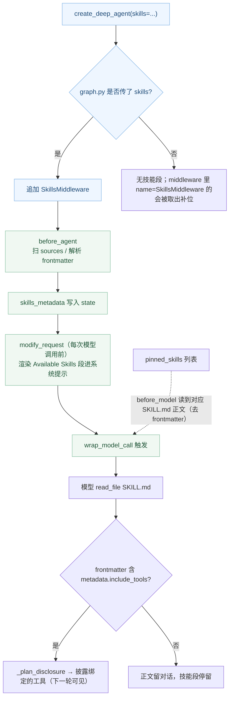

# 源码解析 07：SkillsMiddleware 与披露链路

> 对应：[第 7 课《Skills 技能》](../stages/3-上下文管理/lessons/07-Skills技能.md) ｜ 覆盖知识点：Agent Skills 标准与 SKILL.md、渐进式披露、SkillsMiddleware 的插入位置、pinned_skills / include_tools
> 源码锚点 @ 0.7.28（`deepagents.middleware.skills`、`deepagents.middleware._skill_tools`、`deepagents.graph`）

## 为什么读它

课里已经给了三条结论：skill 是"按需披露"的知识、`SkillsMiddleware` 只在传 `skills=` 时存在、`read_file` 会拿到完整 frontmatter。但"披露到底发生在哪个 hook""`include_tools` 的工具为什么读之前看不到"这类问题，在文档里查不到，源码里才有。这一篇回答三个问题：

1. **"渐进式披露"的索引层到底写在哪个 hook？** 一个请求进来，`before_agent`、`modify_request`、`wrap_model_call` 谁往系统提示写了技能表？
2. **`/skills/` 为什么不是文件系统路径？** `skills` 列表到 `download_files` 之间经历了什么？
3. **`include_tools` 的工具"读到才披露"是怎么实现的？** 它是静态白名单，还是读文件时动态算出来的？

## 功能全貌



> 读图指引：**主链路**是蓝/绿框的 ①`before_agent` 扫库 → ②`modify_request` 注入索引 → ③`wrap_model_call` 等模型读正文。**橙虚线**是 `pinned_skills` 的直达通道：不走扫描、不走 `read_file`，在 `before_model` 就直接把正文塞进对话。`include_tools` 的披露发生在模型真实 `read_file` 之后（简化为右下角）。

## 源码直击

### 片段一：`skills=` 到中间件的装配（graph.py）

`graph.py` 里对 `skills` 的消费分两处。第一处是"取默认源还是用你传的同名实例"：

```python
# graph.py:683
if skills is None:
    skills = _passed_skills_sources(middleware or ())
```

`_passed_skills_sources` 就是字面意思——从你传进 `middleware` 的列表里，找到那个 `name == "SkillsMiddleware"` 的实例，取它的 `sources` 来填"默认槽位"：

                                                                         ````
    def _passed_skills_sources(middleware: Sequence[AgentMiddleware[Any, Any, Any]]) -> list[str] | None:
        return next((m.sources for m in middleware if isinstance(m, SkillsMiddleware) and m.name == "SkillsMiddleware"), None)
                                                                         ````

注意两点：

- **按 `name` 匹配，不是按类型。** 你传一个 `SkillsMiddleware` 子类但给它改名（`name="MySkills"`），它不会被当作那个槽位；同时 `_apply_custom_middleware` 也会把同名的默认实例踢掉，换你的进来。
- **默认槽位只在 `skills=` 传了才存在。** 反过来说：你不传 `skills=`、也不传同名实例，这个中间件栈里就根本没有"技能栏目"。

第二处是装配本身（`graph.py:841` / `935` / `940`）：

```python
if skills is not None:
    gp_middleware.append(SkillsMiddleware(backend=backend, sources=subagent_skills))
# ...
if skills is not None:
    deepagent_middleware.append(SkillsMiddleware(backend=backend, sources=skills))
append_prompt_caching_middleware(deepagent_middleware)
```

`append_prompt_caching_middleware` 在 Skills 之后才追加——这就是"skills 在提示缓存之前"那句解释的代码证据。

### 片段二：披露的索引层在哪个 hook（skills.py `before_agent` / `modify_request`）

一个请求进来，三个 hook 各干一件事：

```python
def before_agent(self, state, runtime, config):
    # 启动时只扫一次：解析 frontmatter 汇总成 skills_metadata
    if state.get("skills_metadata") is not None:
        return None   # 已加载（哪怕空数组）就跳过，None 才重载
    all_skills: dict[str, SkillMetadata] = {}
    for source_path in self.sources:
        source_skills, source_error = _list_skills_with_errors(self._backend, source_path)
        # ... 同名覆盖：all_skills[skill["name"]] = skill，后者赢
    return SkillsStateUpdate(skills_metadata=..., skills_load_errors=...)
```

关键细节在 `_list_skills_with_errors`：它调用的是 `self._backend.download_files(...)`，**不是 Python 的 `os.listdir`**。所以"扫库"是按后端的虚拟文件系统来扫的——这就是"路径由后端解析"的代码根基。

```python
def modify_request(self, request: ModelRequest[ContextT]) -> ModelRequest[ContextT]:
    if self.system_prompt_template is None:
        return request
    skills_metadata = request.state.get("skills_metadata") or []
    skills_load_errors = request.state.get("skills_load_errors", [])
    skills_locations = self._format_skills_locations()
    skills_list = self._format_skills_list(skills_metadata)
    skills_load_warnings = self._format_skills_load_warnings(skills_load_errors)
    skills_section = self.system_prompt_template.format(
        skills_locations=skills_locations,
        skills_load_warnings=skills_load_warnings,
        skills_list=skills_list,
    )
    return request.override(system_message=append_to_system_message(request.system_message, skills_section))
```

所以"索引层"不是某个 `render()` 一次性函数，而是 `before_agent`（扫一次、存 state）→ `modify_request`（每次模型调用前塞进系统提示）两步。**这也解释了为什么改磁盘上的 skill 不会自动生效**：`before_agent` 只在 `skills_metadata` 为 `None` 时扫库；同一 thread 它被跑过一次后就有值（哪怕是空数组），后续都跳过。要刷新就把 `skills_metadata` 置 `None`。

### 片段三：`include_tools` 的"读到才披露"（_skill_tools.py）

技能可以把"它要用哪些工具"写进 frontmatter：

```markdown
metadata:
  include_tools: create_ticket
```

这些工具不是启动就进上下文（否则又要为每个技能背一份 schema），而是在模型**读过**该技能后披露。`_skill_tools` 模块的注释一句话就说清了本质：

```python
"""Disclose the tools a skill names once its `SKILL.md` has been read.

An include name is one entry in a skill's `metadata.include_tools`: a tool's
exact name, or a name a resolver maps to tools.
"""

_INCLUDE_TOOLS_KEY = "include_tools"
```

机制是"读到才披露"——`wrap_model_call` 里 `_find_skill_reads` 先找出对话里已有的 `SKILL.md` 读取，再 `_plan_disclosure` 计算这次该披露哪些工具，最后决定披露进**系统消息**还是**追加工具**（取决于模型是否支持对话中途加工具）：

```python
def _disclose_skill_tools(self, request, reads, resolved):
    disclosure = _plan_disclosure(reads, request.tools, resolved)
    # ...
    if build is None:
        return request.override(tools=_bind_disclosures(request.tools, disclosure)), record
    return request.override(messages=_insert_disclosures(request.messages, disclosure, build)), record
```

实测确认了这条链路：

```
第 1 次模型调用（还没读 skill）：n=8  不含 create_ticket
第 2 次模型调用（已 read_file）：n=9  含 create_ticket
```

这解释了课件里那句"调用它会 fail with unknown-tool"：工具真没进上下文，直到说明书（skill）被翻开。

**`pinned_skills` 是另一条通道**：它在 `before_model` 直接查 `skills_metadata`、下载对应 SKILL.md、剥掉 frontmatter、作为 HumanMessage 追加进对话：

```python
def before_model(self, state, runtime):
    names = state.get("pinned_skills")
    if not names:
        return None
    skills = _skills_to_pin(names, state.get("skills_metadata") or [])
    responses = self._backend.download_files([skill["path"] for skill in skills]) if skills else []
    return _pin_update(skills, responses)
```

`_pinned_skill_message` 里 `additional_kwargs["lc_source"]="pinned_skill"` 就是课件里那段 `<skill ...>` 的来源标记。**注意它与 `read_file` 的行为差异**：pinned 只给正文（剥 frontmatter），`read_file` 给完整文件（含 frontmatter）——两条路径剥不剥 frontmatter 不一致，是刻意的。

## 三个可带走的设计教训

1. **"索引"与"内容"要分两个生命周期管理。** 索引（name/description）要小而稳定、能进缓存前缀；内容（正文/脚本）要按需拉取、会过期。Deep Agents 把这两类分别挂在 `before_agent` 扫一次和 `read_file` 拉一次，而不是渲染时再一起算——这让"技能库大到几千个"也不会让每次请求都背上所有正文。
2. **路径参数的真实语义看"谁来消费"。** `skills` 数组本身不是路径解析器，它只是把字符串交给 `backend.download_files`。同一个字符串在不同后端（StateBackend vs FilesystemBackend）语义完全不同。写这类"看起来像路径"的配置前，先确认消费它的对象是谁。
3. **"按需加载"要算固定成本。** 披露机制省的是"按 skill 计"的边际成本，但任何披露框架都有不随内容量变的固定开销（这里是一段 1.9k 字的使用说明）。判断"这项知识该不该做成 skill"前，先算固定成本 / 内容量的曲线——单个小内容往往是"加载开销 > 内容"。

---

## 🧭 导航

- ⬅️ 回到课程：[第 7 课：Skills 技能](../stages/3-上下文管理/lessons/07-Skills技能.md)
- 📚 全部源码解析：[源码解析索引](INDEX.md)
- ➡️ 下一课源码解析：08 · Memory 记忆（待编写）
