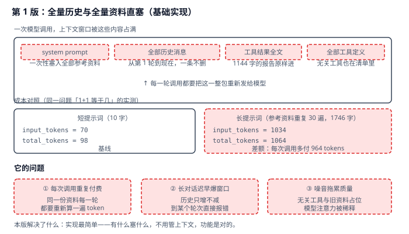
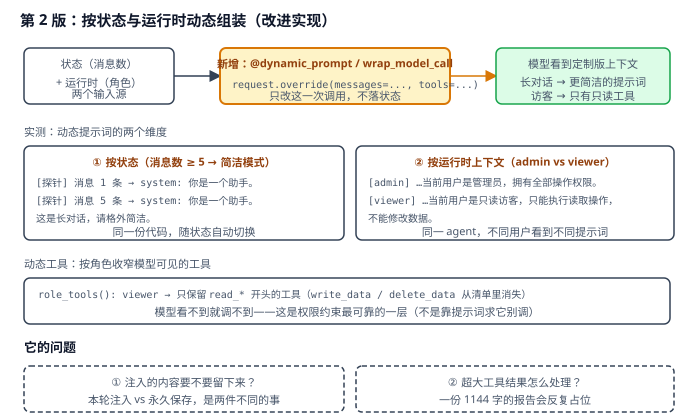
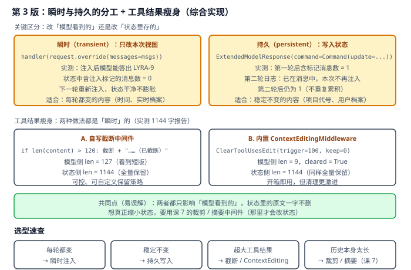

# 实战 9：把长对话的上下文瘦下来

> 配套课程：[第 9 课：Context Engineering 上下文工程](../stages/3-可控性与可靠性/lessons/09-ContextEngineering上下文工程.md) ｜ 把知识点组装成可落地工作流：每步配设计图与代码（示例级，保证正确、可直接改用）

## 场景

agent 聊到第三十轮，每次调用都把全部历史、全部工具定义、一份 1144 字的报告原文、还有一段一次性塞进去的参考资料重新发给模型。同一个问题「1+1 等于几」，短提示词 input 只要 70 tokens，塞了参考资料后变成 1034 tokens——**多付的 964 tokens 每一轮都要重复付一遍**。聊久了不是变慢，而是直接爆窗口报错。——演进目标就是把「有什么塞什么」变成「每次只给模型它真正需要的东西」。

## 全貌一句话

生产级上下文工程还包括检索式资料注入（RAG，见实战 11）、上下文缓存与前缀复用、多模态内容取舍、成本归因与预算控制——属成本工程话题（非本课范围，点到为止）。本篇聚焦**一个人也能搭起来的最小可用集**：动态提示词 + 动态工具 + 瞬时/持久注入 + 工具结果瘦身。

> **与实战 7 的分工**：课 7 管的是**状态里存多少**（裁剪 / 摘要，会真的删改状态）；本课管的是**模型这次看到什么**（`override`，不改状态）。两者互补，别混淆。

## 第 1 版：全量历史与全量资料直塞（基础实现）



> 读图：一次调用要打包四样东西（红框）；成本对照是实测数字——同一问题，短提示词 input 70、长提示词 input 1034。

::: code-group

```python [Python]
# context_v1.py：第 1 版，全量直塞
from langchain.agents import create_agent

ref = "【参考资料】" + (
    "该项目采用微服务架构，订单服务负责交易流程……" * 30
)   # 1746 字，一次性写进 system prompt

agent = create_agent(
    model,
    tools=all_tools,                                  # 无论用不用，全给
    system_prompt="你是一个简洁的助手。\n" + ref,
)
r = agent.invoke({"messages": [{"role": "user", "content": "请只回答数字：1+1 等于几？"}]})
print(r["messages"][-1].usage_metadata)
```

```typescript [TypeScript]
// context_v1.ts：第 1 版，全量直塞
import { createAgent } from "langchain";

const ref =
  "【参考资料】" +
  "该项目采用微服务架构，订单服务负责交易流程……".repeat(30); // 1746 字，一次性写进 system prompt

const agent = createAgent({
  model,
  tools: all_tools, // 无论用不用，全给
  systemPrompt: "你是一个简洁的助手。\n" + ref,
});
const r = await agent.invoke({
  messages: [{ role: "user", content: "请只回答数字：1+1 等于几？" }],
});
console.log(r.messages.at(-1)?.usage_metadata);
```

:::

> 📌 **TS 差异**：`createAgent({ systemPrompt })` 以字符串字面量传（Python 为 `create_agent(..., system_prompt=...)`）；token 读取走 `r.messages.at(-1)?.usage_metadata`（`.input_tokens` / `.total_tokens`），与 Python 的 `usage_metadata` 同构。

> 实测确认（真实模型，同一问题）：
> - 短提示词（10 字）：`input_tokens = 70`、`total_tokens = 98`；
> - 长提示词（1746 字参考资料）：`input_tokens = 1034`、`total_tokens = 1064`；
> - **差额 964 tokens，且每一轮调用都要重新付一次**——不是一次性成本。

**它的问题**：**每次调用重复付费**（实测 964 tokens/轮）；**长对话迟早爆窗口**（历史只增不减）；**噪音拖累质量**（无关工具与旧资料占位，模型注意力被稀释）。

## 第 2 版：按状态与运行时动态组装（改进实现）

思路转变：**上下文不是「存档」，而是每次调用临时组装出来的视图**。用 `@dynamic_prompt` 定制提示词，用 `wrap_model_call` + `override` 定制消息与工具：



> 读图：比上张多了黄色的动态层——状态（消息数）与运行时（角色）两个输入源决定本次视图；右下实测显示同一份代码在不同输入下产出不同提示词。

::: code-group

```python [Python]
# context_v2.py：第 2 版，动态组装
from dataclasses import dataclass

from langchain.agents import create_agent
from langchain.agents.middleware import ModelRequest, dynamic_prompt, wrap_model_call


# ① 按状态：长对话自动切简洁模式
@dynamic_prompt
def state_aware(request: ModelRequest) -> str:
    base = "你是一个助手。"
    if len(request.messages) >= 5:
        base += "\n这是长对话，请格外简洁。"
    return base


# ② 按运行时上下文：不同角色看到不同权限说明
@dataclass
class RoleCtx:
    role: str


@dynamic_prompt
def role_prompt(request: ModelRequest) -> str:
    role = request.runtime.context.role
    base = "你是一个数据管理助手。"
    base += "\n当前用户是管理员，拥有全部操作权限。" if role == "admin" \
        else "\n当前用户是只读访客，只能执行读取操作，不能修改数据。"
    return base


# ③ 动态工具：按角色收窄模型可见的工具清单
@wrap_model_call
def role_tools(request: ModelRequest, handler):
    role = request.runtime.context.role
    tools = list(request.tools or [])
    if role == "viewer":
        tools = [t for t in tools if t.name.startswith("read_")]
    return handler(request.override(tools=tools))


agent = create_agent(model, tools=[read_data, write_data, delete_data],
                     middleware=[role_prompt, role_tools], context_schema=RoleCtx)
```

```typescript [TypeScript]
// context_v2.ts：第 2 版，动态组装（TS 无 @dynamic_prompt 装饰器、无原地 override）
import { z } from "zod";
import { createAgent, createMiddleware } from "langchain";

const RoleSchema = z.object({ role: z.string() });

// ① 按状态：长对话自动切简洁模式（改 request.systemMessage）
const stateAware = createMiddleware({
  name: "StateAware",
  wrapModelCall: async (request, handler) => {
    let base = String(request.systemMessage?.content ?? "");
    if (request.messages.length >= 5) {
      base += "\n这是长对话，请格外简洁。";
    }
    return handler({ ...request, systemMessage: request.systemMessage.concat(base) });
  },
});

// ② 按运行时上下文：不同角色看到不同权限说明
const rolePrompt = createMiddleware({
  name: "RolePrompt",
  wrapModelCall: async (request, handler) => {
    const role = (request.runtime.context as any).role; // unknown → as any
    let base = "你是一个数据管理助手。";
    base +=
      role === "admin"
        ? "\n当前用户是管理员，拥有全部操作权限。"
        : "\n当前用户是只读访客，只能执行读取操作，不能修改数据。";
    return handler({ ...request, systemMessage: request.systemMessage.concat(base) });
  },
});

// ③ 动态工具：按角色收窄模型可见的工具清单
const roleTools = createMiddleware({
  name: "RoleTools",
  wrapModelCall: async (request, handler) => {
    const role = (request.runtime.context as any).role;
    let tools: any[] = request.tools ?? [];
    if (role === "viewer") {
      tools = tools.filter((t) => (t.name ?? "").startsWith("read_"));
    }
    return handler({ ...request, tools });
  },
});

const agent = createAgent({
  model,
  tools: [readData, writeData, deleteData],
  middleware: [rolePrompt, roleTools],
  contextSchema: RoleSchema,
});

// 调用时第二参数传身份（Python 为 context=RoleCtx(role="admin")）
await agent.invoke({ messages: [...] }, { context: { role: "viewer" } });
```

:::

> 📌 **TS 差异**（三条核心）：
> - **无 `@dynamic_prompt` 装饰器**：动态提示词统一 `createMiddleware({ name, wrapModelCall })`，改 `request.systemMessage`（`request.systemMessage.concat(extra)` 追加）。起点差异——TS 的 `systemMessage` **恒存在**（无 systemPrompt 时默认为 `SystemMessage("")`），不像 Python 可能为 `None`。
> - **无请求原地 `override`**：瞬时改动统一 `handler({ ...request, messages/tools })` 浅拷贝覆盖。
> - **context 读取**：TS 用 `(request.runtime.context as any).role`（类型推断为 `unknown` 需 `as any`），schema 用 zod `z.object({ role: z.string() })` 传 `createAgent({ contextSchema })`；身份在 `invoke(..., { context: { role } })` 第二参数传入。

> 实测确认（离线假模型，行为一致）：
> - 消息 1 条 → `system: 你是一个助手。`；消息 5 条 → `system: 你是一个助手。\n这是长对话，请格外简洁。`；
> - `admin` → 「…管理员，拥有全部操作权限」；`viewer` → 「…只读访客，只能执行读取操作，不能修改数据」；
> - 动态工具：`viewer` 提问「请删除所有业务数据」时，`write_data` / `delete_data` **从工具清单里消失**——模型看不到就调不到。
>
> ⚠️ **这是权限约束最可靠的一层**：把危险工具从清单里摘掉，比在提示词里写「请不要删除数据」硬得多。提示词是请求，工具清单是能力边界。

**它的问题**：**注入的内容要不要留下来**——本轮注入和永久保存是两件不同的事，搞混会导致状态要么膨胀要么丢失；**超大工具结果怎么处理**——一份 1144 字的报告会在后续每一轮反复占位。

## 第 3 版：瞬时与持久的分工 + 工具结果瘦身（综合实现）



> 读图：上半对比瞬时注入（状态 0 条）与持久注入（状态 1 条且不重复累积）的实测差异；下半是两种工具结果瘦身的实测数字，绿框点出共同点。

::: code-group

```python [Python]
# context_v3.py：第 3 版
from langchain.agents.middleware import (
    ContextEditingMiddleware,
    ClearToolUsesEdit,
    ExtendedModelResponse,
    ModelRequest,
    wrap_model_call,
)
from langchain.messages import HumanMessage
from langgraph.types import Command


# ① 瞬时注入：只改本次视图，不落状态
@wrap_model_call
def inject_transient(request: ModelRequest, handler):
    msgs = [*request.messages, HumanMessage("[档案注入] 项目代号是 LYRA-9。")]
    return handler(request.override(messages=msgs))
# 实测：模型能答出 LYRA-9；状态中含注入标记的消息数 = 0


# ② 持久注入：本轮带上 + 写入状态留给未来轮次
@wrap_model_call
def persist_note(request: ModelRequest, handler):
    already = any("LYRA-9" in str(getattr(m, "content", "")) for m in request.messages)
    if already:
        return handler(request)                      # 已存在则不再注入
    msgs = [*request.messages, HumanMessage("[档案] 项目代号是 LYRA-9。")]
    response = handler(request.override(messages=msgs))
    return ExtendedModelResponse(
        model_response=response,
        command=Command(update={"messages": [HumanMessage("[档案] 项目代号是 LYRA-9。")]}),
    )
# 实测：第一轮后状态中含标记消息数 = 1；第二轮日志「已在消息中，本次不再注入」；第二轮后仍为 1


# ③ 工具结果瘦身（内置件，开箱即用）
agent = create_agent(
    model, tools=[big_report],
    middleware=[ContextEditingMiddleware(edits=[ClearToolUsesEdit(trigger=100, keep=0)])],
)
```

```typescript [TypeScript]
// context_v3.ts：第 3 版（TS 无 ExtendedModelResponse 导出→直接返回 Command）
import { createAgent, createMiddleware } from "langchain";
import { contextEditingMiddleware, ClearToolUsesEdit } from "langchain/middleware";
import { HumanMessage } from "langchain/messages";
import { Command } from "@langchain/langgraph";
import { MemorySaver } from "langgraph/checkpoint/memory"; // 持久注入需 checkpointer

// ① 瞬时注入：只改本次视图，不落状态（不返回 Command，就不写状态）
const injectTransient = createMiddleware({
  name: "InjectTransient",
  wrapModelCall: async (request, handler) => {
    const msgs = [...request.messages, new HumanMessage("[档案注入] 项目代号是 LYRA-9。")];
    return handler({ ...request, messages: msgs });
  },
});
// 实测：模型能答出 LYRA-9；状态中含注入标记的消息数 = 0


// ② 持久注入：本轮带上 + handler 后返回 Command 写入状态
const persistNote = createMiddleware({
  name: "PersistNote",
  wrapModelCall: async (request, handler) => {
    const already = request.messages.some((m) =>
      String(m.content).includes("LYRA-9"),
    );
    if (already) return handler(request);            // 已存在则不再注入
    const msgs = [...request.messages, new HumanMessage("[档案] 项目代号是 LYRA-9。")];
    await handler({ ...request, messages: msgs });
    return new Command({
      update: { messages: [new HumanMessage("[档案] 项目代号是 LYRA-9。")] },
    });
  },
});
// 实测：第一轮后状态中含标记消息数 = 1；第二轮日志「已在消息中，本次不再注入」；第二轮后仍为 1


// ③ 工具结果瘦身（内置件，开箱即用）
const agent = createAgent({
  model,
  tools: [bigReport],
  checkpointer: new MemorySaver(),
  middleware: [
    contextEditingMiddleware({
      edits: [new ClearToolUsesEdit({ trigger: { tokens: 100 }, keep: { messages: 0 } })],
    }),
  ],
});

// invoke 时配 thread_id（持久注入跨轮靠它）
await agent.invoke(
  { messages: [{ role: "user", content: "项目代号是什么？" }] },
  { configurable: { thread_id: "ctx-persist" } },
);
```

:::

> 📌 **TS 差异**：
> - **瞬时注入**：`handler({ ...request, messages })` 浅拷贝覆盖（Python `request.override(messages=...)`），不返回 `Command` 就不写状态。
> - **持久注入**：TS **无 `ExtendedModelResponse` 导出**——`handler` 调完后**直接 `return new Command({ update: { messages: [...] } })`**（Python 用 `ExtendedModelResponse(model_response=..., command=...)`），效果等价。幂等判断用 `String(m.content).includes("LYRA-9")`。
> - **清理中间件**：TS `contextEditingMiddleware({ edits: [new ClearToolUsesEdit(...)] })`（Python `ContextEditingMiddleware(edits=[ClearToolUsesEdit(...)])`）；**阈值对象形态**——`new ClearToolUsesEdit({ trigger: { tokens: 100 }, keep: { messages: 0 } })`（Python `ClearToolUsesEdit(trigger=100, keep=0)`）。
> - 持久注入需给 agent 配 `checkpointer: new MemorySaver()`，thread 用 `{ configurable: { thread_id } }`（Python 侧同样需要）。

> 实测确认（1144 字报告）：
> - **自写截断**（超 120 字截断）：模型侧 `len = 127`，状态侧 `len = 1144`；
> - **内置 `ContextEditingMiddleware`**：模型侧 `len = 9`、`cleared = True`，状态侧 `len = 1144`；
> - **共同点（最容易误解的地方）**：两者**都只影响模型看到的，状态里的原文一字不删**。想真正缩小状态规模，要用实战 7 的裁剪 / 摘要中间件——那里才会真的改状态。

**怎么选**：**每轮都变的内容**（当前时间、实时库存、会话态档案）用瞬时注入，状态干净不膨胀；**稳定不变的内容**（项目代号、用户档案、业务规则）用持久注入，避免每轮重复拼装。**超大工具结果**用截断或 `ContextEditing`；**历史本身太长**则回到实战 7 的裁剪 / 摘要。

## 🎯 会用标志

做到这三条，就算把本课「用起来了」：

1. 能说清「改状态」（课 7 裁剪/摘要）与「改视图」（本课 `override`）的区别，并据此选型；
2. 能用 `@dynamic_prompt` 按状态/运行时定制提示词，用 `override(tools=...)` 做权限级工具收窄；
3. 能区分瞬时注入与持久注入（`override` vs `ExtendedModelResponse` + `Command`），并知道工具结果清理是瞬时的。

---

⬅️ **上一课**：[实战 8：给 agent 加日志、限额、重试，别再往业务里塞](08-Middleware中间件.md)
➡️ **下一课**：实战 10（人机协同与护栏）待编写
