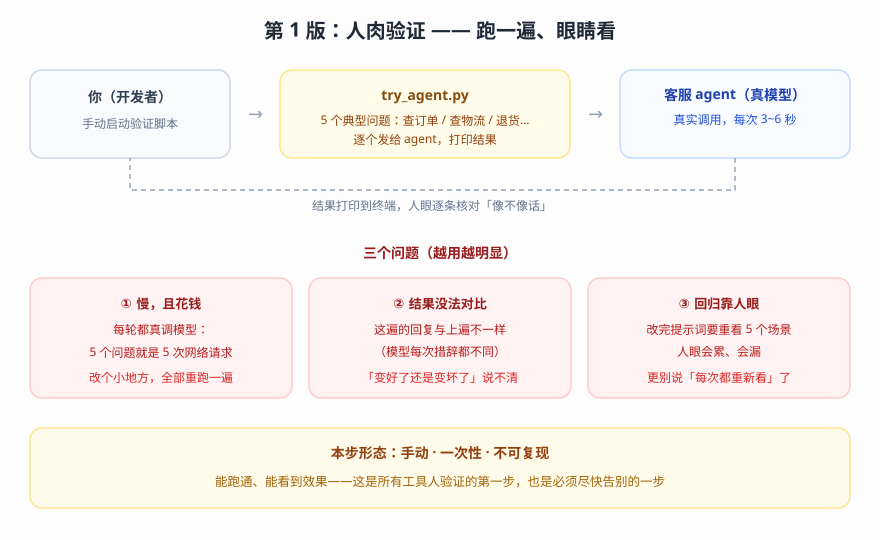
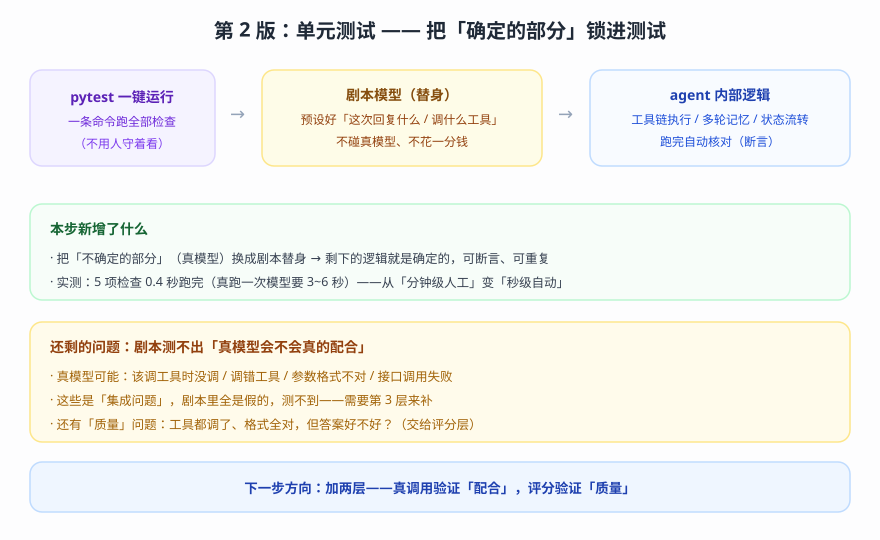
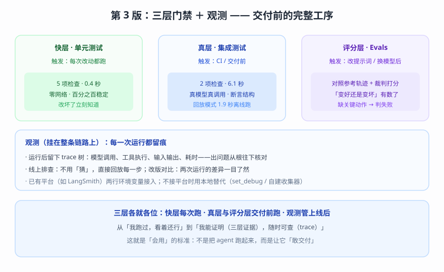

# 实战 13：给客服 agent 建一道「交付门禁」

> 配套课程：[第 13 课：Testing 与 Observability](../stages/4-组合与工程化/lessons/13-Testing与Observability.md) ｜ 把知识点组装成可落地工作流：每步配设计图与代码（示例级，保证正确、可直接改用）

## 场景

你要把练习用的客服 agent（查订单、查物流、办退货）交给团队使用。老板问：你怎么证明它可靠？改了提示词后变好还是变坏？出错了怎么查？——演进目标就是把这三个问题从「只能靠感觉」变成「有门禁、有记录」。

## 全貌一句话

完整交付体系还包括 CI 流水线集成、测试数据版本管理、线上监控告警——属工程平台话题（非本课范围，点到为止）。本篇聚焦**一个人也能搭起来的最小可用集**：三层门禁 + 观测。

## 第 1 版：人肉验证（基础实现）



> 读图：手动启动脚本，几个典型问题逐个发给真模型；结果打印到终端、人眼核对。下方三个问题框是它的短板。

::: code-group

```python [Python]
# try_agent.py：第 1 版，手动验证
import os
from dotenv import load_dotenv
from langchain.agents import create_agent
from langchain.chat_models import init_chat_model
from langchain.tools import tool

load_dotenv()

@tool
def query_order(order_id: str) -> str:
    """根据订单号查询订单状态。"""
    return f'订单 {order_id}：已发货，承运商=顺丰。'

@tool
def apply_return(order_id: str) -> str:
    """为指定订单发起退货申请。"""
    return f'已为订单 {order_id} 发起退货申请。'

model = init_chat_model('qwen3.8-flash', model_provider='openai',
                        base_url=os.environ['BAILIAN_BASE_URL'],
                        api_key=os.environ['BAILIAN_API_KEY'])
agent = create_agent(model, tools=[query_order, apply_return],
                     system_prompt='你是电商客服小助手。')

for q in ['帮我查订单 A12345 的物流',
          '这个订单 A12345 我不想要了，帮我处理一下',   # 最容易出问题的一句
          '你们几点下班？']:                            # 改一行代码，这仨就要手动重跑
    result = agent.invoke({'messages': [{'role': 'user', 'content': q}]})
    print('Q:', q, '| A:', result['messages'][-1].content[:60])
```

```typescript [TypeScript]
// try_agent.ts：第 1 版，手动验证
import "dotenv/config";
import { createAgent, initChatModel, tool } from "langchain";
import { z } from "zod";

const queryOrder = tool(
  async ({ orderId }: { orderId: string }) => `订单 ${orderId}：已发货，承运商=顺丰。`,
  {
    name: "query_order",
    description: "根据订单号查询订单状态。",
    schema: z.object({ orderId: z.string().describe("订单号") }),
  },
);

const applyReturn = tool(
  async ({ orderId }: { orderId: string }) => `已为订单 ${orderId} 发起退货申请。`,
  {
    name: "apply_return",
    description: "为指定订单发起退货申请。",
    schema: z.object({ orderId: z.string().describe("订单号") }),
  },
);

const model = await initChatModel("qwen3.8-flash", {
  modelProvider: "openai",
  apiKey: process.env.BAILIAN_API_KEY,
  configuration: { baseURL: process.env.BAILIAN_BASE_URL },
});
const agent = createAgent({
  model,
  tools: [queryOrder, applyReturn],
  systemPrompt: "你是电商客服小助手。",
});

for (const q of [
  "帮我查订单 A12345 的物流",
  "这个订单 A12345 我不想要了，帮我处理一下", // 最容易出问题的一句
  "你们几点下班？",                            // 改一行代码，这仨就要手动重跑
]) {
  const result: any = await agent.invoke({ messages: [{ role: "user", content: q }] });
  console.log("Q:", q, "| A:", String(result.messages.at(-1)?.content ?? "").slice(0, 60));
}
```

:::

> 📌 **TS 差异**：`@tool` + docstring → `tool(fn, { name, description, schema })`（zod）；`init_chat_model(...)` → `await initChatModel(...)` 且 `base_url` 走 `configuration.baseURL`；取回复用 `result.messages.at(-1)?.content`（Python `result['messages'][-1].content`）。两侧同样存在「每轮真调模型、改一行全量重跑」的问题。

**它的问题**：每轮都真调模型（每次 2~6 秒），改一行就要全部重跑；同一句「帮我处理一下」的回复每轮都不一样，好坏说不清；最危险的那类问题（回复礼貌、但事没办成）恰好最容易被眼睛放过。

## 第 2 版：单测工序（改进实现）

第 1 版有一条马上能治：**agent 里「确定的部分」不该让真模型来测**——把模型换成「剧本替身」，工具链、状态、多轮记忆就能被 100% 确定地测：



> 读图：pytest 一键运行 → 剧本模型（预设回复与工具调用）→ agent 内部逻辑 → 自动断言。新增「剧本替身 ＋ 自动断言」，换来秒级、稳定、免费；但剧本是假的，验证不了「真模型会不会配合」。

::: code-group

```python [Python]
# tests/test_unit.py：第 2 版，用剧本模型测「确定的部分」
from langchain.agents import create_agent
from langchain.messages import AIMessage, HumanMessage, ToolCall
from langchain.tools import tool
from langchain_core.language_models.fake_chat_models import GenericFakeChatModel


class ScriptedToolModel(GenericFakeChatModel):
    """剧本模型 + 工具支持（内置 fake 模型未实现 bind_tools）。"""

    def bind_tools(self, tools, *, tool_choice=None, **kwargs):
        return self


@tool
def apply_return(order_id: str) -> str:
    """为指定订单发起退货申请。"""
    return f'已为订单 {order_id} 发起退货申请。'


def test_return_task_executes_apply_return():
    """行为骨架：模型决定调工具 → agent 必须真的执行它。"""
    model = ScriptedToolModel(messages=iter([
        AIMessage(content='', tool_calls=[ToolCall(name='apply_return',
                                                   args={'order_id': 'A12345'},
                                                   id='call_1')]),
        '已为您发起退货申请。',
    ]))
    agent = create_agent(model, tools=[apply_return])
    result = agent.invoke({'messages': [HumanMessage(content='订单 A12345 我要退货')]})

    # 断言依据是「消息序列」，不是回复文本——工具被真的执行了吗
    tool_messages = [m for m in result['messages'] if m.type == 'tool']
    assert tool_messages[0].content == '已为订单 A12345 发起退货申请。'
```

```typescript [TypeScript]
// test/unit/return.test.ts：第 2 版，用剧本模型测「确定的部分」
import { describe, it, expect } from "vitest";
import { createAgent, fakeModel, tool } from "langchain";
import { AIMessage, HumanMessage } from "@langchain/core/messages";
import { z } from "zod";

const applyReturn = tool(
  async ({ orderId }: { orderId: string }) => `已为订单 ${orderId} 发起退货申请。`,
  {
    name: "apply_return",
    description: "为指定订单发起退货申请。",
    schema: z.object({ orderId: z.string().describe("订单号") }),
  },
);

describe("return task", () => {
  it("模型决定调工具时 agent 必须真的执行", async () => {
    // 📌 TS 无需 ScriptedToolModel 补丁：fakeModel 自动实现 bindTools
    const model = fakeModel()
      .respondWithTools([
        { name: "apply_return", args: { orderId: "A12345" }, id: "call_1" },
      ])
      .respond(new AIMessage("已为您发起退货申请。"));

    const agent = createAgent({ model, tools: [applyReturn] });
    const result = await agent.invoke({
      messages: [new HumanMessage("订单 A12345 我要退货")],
    });

    // 断言依据是「消息序列」，不是回复文本——工具被真的执行了吗
    const toolMessages = result.messages.filter((m) => m._getType() === "tool");
    expect((toolMessages[0] as any).content).toContain("已为订单 A12345 发起退货申请。");
  });
});
```

:::

> 📌 **TS 差异（课 13 明确实测的一点）**：
> - **无需 `ScriptedToolModel` 补丁**：Python 内置 fake 模型的 `bind_tools` 未实现，agent 挂工具会抛 `NotImplementedError`，需要三行子类补丁；**TS 的 `fakeModel()` 用 `.respondWithTools([...])` 自动注册工具绑定，可以直接挂到 agent**。
> - **剧本 API 形态**：`fakeModel().respondWithTools([{ name, args, id }]).respond(new AIMessage(...))` 链式声明，替代 Python 的 `GenericFakeChatModel(messages=iter([...]))`。
> - **消息类型判断**：TS 用 `m._getType() === "tool"`（Python `m.type == 'tool'`）。
> - **断言库**：vitest 的 `describe/it/expect`（Python pytest 的 `def test_*` + 裸 `assert`）。
> - 两侧共同的限制不变：剧本是假的，验证不了「真模型会不会配合」。

**它的问题**：剧本测得再全，也证明不了「真模型会不会配合」（该调工具时没调、调错、参数错）；「质量」维度仍是空的（工具都调对了，但答案好不好、有没有胡说）。

## 第 3 版：完整门禁（综合实现）

把三层装进同一条流水线，再加一盏「长明灯」（观测）：



> 读图：快层每次改动跑；真层 + 评分层在交付前跑；观测挂在整条链路上，上线后每次运行留痕。三层各就各位、互不替代。

工程结构（最小可用版）：

```text
quality_gate/
├── app/agent.py              # agent 本体（业务零改动接观测）
├── tests/conftest.py         # 密钥 + 缺密钥跳过 + VCR 脱敏
├── tests/test_unit.py        # 快层（每次改动跑）
├── tests/test_integration.py # 真层（交付前跑）
├── tests/test_evals.py       # 评分层（大改后跑）
└── pytest.ini                # 分流与录制
```

> 📌 **TS 侧对应结构**（fluent 分层靠目录 + vitest，无 pytest.ini；本仓库 `playground-ts/` 已按此落盘）：
> ```text
> playground-ts/
> ├── 13-testing-lab.ts               # 课 13 演示脚本（单元/轨迹/裁判/观测各层）
> ├── test/setup.ts                   # 环境变量 + 缺密钥 skipIf（对应 conftest.py 位置）
> ├── test/unit/return.test.ts       # 快层（fakeModel，零网络，每次改动跑）
> ├── test/integration/evals.test.ts # 真层 + 评分层（鉴权 skipIf，轨迹匹配/裁判）
> ├── vitest.config.ts               # 快层：include 只收 test/unit/**
> └── vitest.integration.config.ts   # 真层：include 只收 test/integration/**
> ```
> 两侧共同点：快层零网络零成本、真层要密钥、评分层跑评估器；差异在**分流机制**——Python 靠 pytest marker + `pytest.ini`，TS 靠**两份 config 白名单各自一个目录**（不是 `--dir` 叠加，实测会取交集报 "No test files found"）。VCR 录制回放（`pytest-recording`）**TS 侧无对应资产**，仅 Python。`describe.concurrent("integration")` 只是打标签的备选，本仓库用目录分流，不依赖它。

**① agent 本体**（观测「零改动」——由环境变量控制）：

::: code-group

```python [Python]
# app/agent.py
import os
from langchain.agents import create_agent
from langchain.chat_models import init_chat_model
from langchain.tools import tool

@tool
def query_order(order_id: str) -> str:
    """根据订单号查询订单状态。"""
    return f'订单 {order_id}：已发货，承运商=顺丰。'

@tool
def apply_return(order_id: str) -> str:
    """为指定订单发起退货申请。"""
    return f'已为订单 {order_id} 发起退货申请。'

def build_agent():
    model = init_chat_model('qwen3.8-flash', model_provider='openai',
                            base_url=os.environ['BAILIAN_BASE_URL'],
                            api_key=os.environ['BAILIAN_API_KEY'])
    return create_agent(
        model,
        tools=[query_order, apply_return],
        system_prompt='你是电商客服小助手。用户要退货时，先查订单，再调用 apply_return。',
    )
```

```typescript [TypeScript]
// app/agent.ts
import { createAgent, initChatModel, tool } from "langchain";
import { z } from "zod";

const queryOrder = tool(
  async ({ orderId }: { orderId: string }) => `订单 ${orderId}：已发货，承运商=顺丰。`,
  {
    name: "query_order",
    description: "根据订单号查询订单状态。",
    schema: z.object({ orderId: z.string().describe("订单号") }),
  },
);

const applyReturn = tool(
  async ({ orderId }: { orderId: string }) => `已为订单 ${orderId} 发起退货申请。`,
  {
    name: "apply_return",
    description: "为指定订单发起退货申请。",
    schema: z.object({ orderId: z.string().describe("订单号") }),
  },
);

export async function buildAgent() {
  const model = await initChatModel("qwen3.8-flash", {
    modelProvider: "openai",
    apiKey: process.env.BAILIAN_API_KEY,
    configuration: { baseURL: process.env.BAILIAN_BASE_URL },
  });
  return createAgent({
    model,
    tools: [queryOrder, applyReturn],
    systemPrompt: "你是电商客服小助手。用户要退货时，先查订单，再调用 apply_return。",
  });
}
```

:::

> 📌 **TS 差异**：`tool()` 工厂 + zod schema；`build_agent()` 同步函数 → `buildAgent()` **async 函数**（`initChatModel` 需 await，因此 agent 构建也变成异步）；`base_url` 走 `configuration.baseURL`。观测「零改动」这点两侧一致——都由环境变量控制（`LANGSMITH_TRACING` / `LANGSMITH_API_KEY`）。

**② 评分层的「回归网」**——把「该做的动作」写成参考轨迹，用 `superset` 模式盯住（缺一个必需动作就判失败）：

::: code-group

```python [Python]
# tests/test_evals.py
import pytest
from langchain.messages import AIMessage, HumanMessage, ToolMessage
from agentevals.trajectory.match import create_trajectory_match_evaluator

REFERENCE = [   # 退货的正确轨迹：查订单 → 发起退货 → 告知结果
    HumanMessage(content='订单 A12345 我要退货'),
    AIMessage(content='', tool_calls=[{'id': 'r1', 'name': 'query_order',
                                       'args': {'order_id': 'A12345'}}]),
    ToolMessage(content='订单 A12345：已发货，承运商=顺丰。', tool_call_id='r1'),
    AIMessage(content='', tool_calls=[{'id': 'r2', 'name': 'apply_return',
                                       'args': {'order_id': 'A12345'}}]),
    ToolMessage(content='已为订单 A12345 发起退货申请。', tool_call_id='r2'),
    AIMessage(content='已为您发起退货申请。'),
]

evaluator = create_trajectory_match_evaluator(trajectory_match_mode='superset')

@pytest.mark.integration
def test_return_flow_keeps_required_actions(require_api_key):
    """真跑一次退货流程：必要的 apply_return 不能缺席。

    require_api_key 定义在 tests/conftest.py（缺密钥时 skip 而非报错）。
    """
    from app.agent import build_agent       # 按项目结构调整导入路径
    agent = build_agent()
    result = agent.invoke({'messages': [HumanMessage(content='订单 A12345 我要退货')]})
    evaluation = evaluator(outputs=result['messages'], reference_outputs=REFERENCE)
    assert evaluation['score'] is True, evaluation.get('comment')
```

```typescript [TypeScript]
// test/integration/evals.test.ts
import { describe, it, expect } from "vitest";
import {
  createTrajectoryMatchEvaluator,
  type TrajectoryMatchMode,
} from "agentevals";
import { AIMessage, HumanMessage, ToolMessage } from "@langchain/core/messages";
import { buildAgent } from "../../app/agent";

// 退货的正确轨迹：查订单 → 发起退货 → 告知结果
const REFERENCE = [
  new HumanMessage("订单 A12345 我要退货"),
  new AIMessage({
    content: "",
    tool_calls: [{ id: "r1", name: "query_order", args: { orderId: "A12345" } }],
  }),
  new ToolMessage({ content: "订单 A12345：已发货，承运商=顺丰。", tool_call_id: "r1" }),
  new AIMessage({
    content: "",
    tool_calls: [{ id: "r2", name: "apply_return", args: { orderId: "A12345" } }],
  }),
  new ToolMessage({ content: "已为订单 A12345 发起退货申请。", tool_call_id: "r2" }),
  new AIMessage("已为您发起退货申请。"),
];

// 📌 四种 mode 与 Python 同名同义：strict / unordered / subset / superset
const evaluator = createTrajectoryMatchEvaluator({
  trajectoryMatchMode: "superset" as TrajectoryMatchMode,
});

describe.concurrent("integration", () => {
  it("退货流程必需动作不缺席", async () => {
    const agent = await buildAgent();
    const result = await agent.invoke({
      messages: [new HumanMessage("订单 A12345 我要退货")],
    });
    const evaluation = await evaluator({
      outputs: result.messages,
      referenceOutputs: REFERENCE,
    });
    expect(evaluation.score).toBe(true);
  }, 60_000); // 真调模型，放宽超时
});
```

:::

> 📌 **TS 差异**：
> - **评估器形态**：Python `create_trajectory_match_evaluator(trajectory_match_mode='superset')` 返回可直接调用的函数；TS `createTrajectoryMatchEvaluator({ trajectoryMatchMode: "superset" })` 返回 **async 函数**（需 `await evaluator({...})`），四种 mode（`strict`/`unordered`/`subset`/`superset`）同名同义。
> - **参数驼峰**：`reference_outputs` → `referenceOutputs`。
> - **消息构造**：Python `AIMessage(content='', tool_calls=[{'id','name','args'}])` → TS `new AIMessage({ content: "", tool_calls: [...] })`（对象入参），`ToolMessage` 同理；`args.userId` 类字段名建议与工具 schema 一致（用 `orderId`）。
> - **分流机制不同**：Python 用 pytest marker（`@pytest.mark.integration` + `addopts = -m "not integration"`）；**TS 侧 vitest 按目录/标签分流**（`describe.concurrent("integration")` + `--testNamePattern`，或 `test/unit/`、`test/integration/` 分目录）。
> - **缺密钥处理**：Python 用 `conftest.py` 的 `require_api_key` fixture（skip）；TS 侧 vitest 常用 `describe.skipIf(!process.env.X)` 或 `it.skipIf(...)`。

**③ 分流与录制（Python 用 pytest.ini，TS 用 vitest 按目录 / 标签）**：

::: code-group

```ini [Python]
[pytest]
markers =
    integration: 真调模型的测试（默认不跑）
    vcr: 录制 / 回放 HTTP
addopts = -m "not integration" --record-mode=once
```

```typescript [TypeScript]
// vitest.config.ts —— TS 侧无 pytest.ini：靠目录 include/exclude 分流
import { defineConfig } from "vitest/config";

export default defineConfig({
  test: {
    // 默认只跑快层（单元测试，无网络）
    include: ["test/unit/**/*.test.ts"],
    setupFiles: ["test/setup.ts"],
  },
});
// 交付前跑全层：用独立的集成层配置
//   npx vitest run --config vitest.integration.config.ts
// 📌 不要用 `--dir test/integration` 叠加主配置：include 已白名单为 test/unit/**，
//    两者取交集会变成"No test files found"（本机实测）——真层请用独立 config。
// 📌 VCR 录制回放（pytest-recording / cassette 脱敏）TS 侧无对应资产，仅 Python
```

:::

**④ 观测两条路（选一）**：

```bash
# 路线 A：接平台——环境变量在进程启动前配好
export LANGSMITH_TRACING=true
export LANGSMITH_API_KEY=<YOUR_API_KEY>
```

::: code-group

```python [Python]
# 路线 B：本地替代——先跑起来的最小观测
from langchain_core.globals import set_debug
set_debug(True)     # 看每一步执行细节；也可用自建 callback 收集器
```

```typescript [TypeScript]
// 路线 B：本地替代——TS 无 set_debug 等价物，用自建 callback 收集器
import { BaseCallbackHandler } from "@langchain/core/callbacks/base";

class MiniTraceHandler extends BaseCallbackHandler {
  name = "MiniTraceHandler";

  handleToolEnd(output: any) {
    console.log("[tool 输出]", typeof output === "string" ? output : JSON.stringify(output));
  }

  handleLLMEnd(output: any) {
    console.log("[模型输出]", JSON.stringify(output?.generations?.[0]?.[0]?.text ?? "").slice(0, 120));
  }
}

// 调用时挂上（📌 Python 侧是 process 级别的 set_debug(True)）
await agent.invoke(
  { messages: [{ role: "user", content: "订单 A12345 我要退货" }] },
  { callbacks: [new MiniTraceHandler()] },
);
```

:::

> 📌 **TS 差异（重要）**：**TS 侧没有 `set_debug` 等价物**（无 `langchain_core.globals` 那类进程级开关）——本课实测的做法是**自建 `BaseCallbackHandler` 子类**（覆盖 `handleToolEnd` / `handleLLMEnd` 等钩子收集细节），并**按调用粒度**通过 `invoke(..., { callbacks: [...] })` 挂上。这与 Python 的 `set_debug(True)` 是两种粒度：Python 是全局开关，TS 是每次调用显式注入。
> 若需要平台级追踪，两侧一致走环境变量 `LANGSMITH_TRACING` + `LANGSMITH_API_KEY`（观测「零改动」）；按调用粒度开关则 TS 用 `tracingContext({ enabled: true }, () => agent.invoke(...))`（自 `langchain/callbacks`），Python 用 `ls.tracing_context(enabled=True)`。

**这一版各层的日常节奏**：每次改动跑快层（秒级、零成本）→ 交付前 / CI 跑全层（约半分钟）→ 上线后用观测（出问题时回放 / 对比）。

## 🎯 会用标志

做到这三条，就算把本课「用起来了」：

1. 给你一个 agent 工程，能搭出「快层 + 真层 + 评分层」最小门禁，并说清每层该在什么时机跑；
2. 改一次提示词后，能指出「哪些检查会告诉你变好还是变坏」；
3. 接入或本地替代至少一种观测手段，并用 trace 完成过一次真实排查（指出「哪一步不对」）。

---

⬅️ **上一课**：[实战 12：一个 agent 挂 12 个工具之后](12-MultiAgent多智能体.md)
➡️ **下一课**：[结课综合实战项目：智能客服助手](../projects/智能客服助手/README.md)
