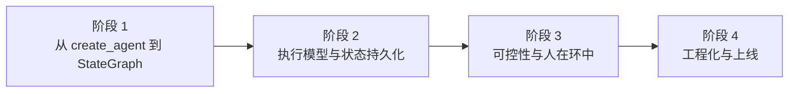

# LangGraph 学习路径总览

## 学习目标

学完本教程，你应该能够：

1. 说清 LangGraph 与 LangChain `create_agent` 的分工，知道什么时候该"下沉"到 LangGraph
2. 用 StateGraph 自己画出 agent 的控制流（状态 / 节点 / 边 / 条件边 / 循环），而不是依赖框架默认循环
3. 解释一次 `invoke` 在底层是怎么被切成超级步逐个执行的，以及 `Send` / `Command` 如何改变这个流程
4. 给图挂上持久化（checkpointer 短期记忆 + store 长期记忆），做到断点续跑与跨会话记忆
5. 用 interrupt 在关键节点卡住等人工确认，用 time-travel 回放与分叉定位问题
6. 给节点配超时 / 重试 / 错误处理，用子图拆分复杂流程
7. 组织一个可部署的 LangGraph 项目：结构、测试、向后兼容、部署与可观测

## 故事主线

> 主角：**一次运行（run）** | 冲突：**默认循环太省心，出了事你既看不见也拦不住** | 收束：**每一步都在你手里——能看见、能暂停、能回放、能重跑**

- **阶段 1「把方向盘拿回来」**：你已经会用 `create_agent` 跑通一个 agent，但它怎么循环、什么时候停，你说了不算。本阶段把控制权拿回来——用 StateGraph 自己定义状态和流转。
- **阶段 2「让它记住和说出来」**：图能跑了，但它一停就忘、跑起来是个黑盒。本阶段搞清底层执行模型，挂上持久化，再让它边跑边吐。
- **阶段 3「敢让它上生产」**：能跑能看还不够，出错怎么办、要不要人批、失败了能不能重跑。本阶段补上可控性与容错。
- **阶段 4「搬到生产环境」**：单文件脚本变成能上线、能维护、能排障的服务。

## 全阶段总览

| 阶段 | 名称 | 章节定位 | 课数 | 核心内容 |
|------|------|----------|------|----------|
| 1 | 从 create_agent 到 StateGraph | 把方向盘拿回来 | 3 | 环境准备、LangGraph 定位与心智模型、StateGraph 第一个图 |
| 2 | 执行模型与状态持久化 | 让它记住和说出来 | 4 | Pregel 执行模型、Checkpointer、Store、Streaming |
| 3 | 可控性与人在环中 | 敢让它上生产 | 4 | Interrupts、Time-travel、容错与子图、Functional API |
| 4 | 工程化与上线 | 搬到生产环境 | 2 | 项目结构与测试、部署与可观测 |

## 阶段依赖图

> 看图：四个阶段是严格串行的——阶段 2 的执行模型是理解 checkpoint、interrupt、streaming 的共同前提；阶段 3 的可控性建立在阶段 2 的持久化之上（interrupt 与 time-travel 都靠 checkpoint 存活）；阶段 4 的工程化收束前面全部阶段。

## 前置依赖

- **已完成 `../langchain/` 课程**（4 阶段 / 13 课）：本教程假设你已掌握 `create_agent`、Tools、Messages、Middleware 的语义，主线只回扣不重讲
- **建议先修 `../llm-fundamentals/`**：理解 token / 上下文窗口 / 采样随机性，看本教程的"为什么这么设计"会更通透
- **Python 环境**：见课 1 环境准备

## 范围说明

**本教程覆盖**（对照官方 `docs-langgraph` 索引 44 条）：Get started、Capabilities、Production、LangGraph APIs 四大分区的核心页全部挂课。

**已在课内带过、不单独成课**：

- `changelog-py` / LangGraph v1 发布与迁移三页 → 收进课 1 与 `09-排障速查手册.md`（Phase 5）
- `frontend/*` 三页（前端渲染 / 图执行 / 自定义流通道）→ 课 13 延伸方向
- `agentic-rag` / `sql-agent` 两篇官方教程 → 结课项目素材（Phase 3）
- checkpointer / store 集成页 → 课 5 / 课 6 的后端选型小节
- LangGraph Python SDK 参考页 → 全课 API 速查入口，不作为独立知识点

**明确范围外**：Deep Agents / Managed Deep Agents / OpenWiki / Fleet（生态内其他组件，各自独立）、LangSmith 平台的完整使用（只讲与 LangGraph 的接入点）、前端框架（React / AG-UI）的深度集成。

## 官方文档索引

> 完整路由表见 [web-index/docs-langgraph/index.md](web-index/docs-langgraph/index.md)（44 条 / 6 分区，生成于 2026-10-14）。写课与核查一律先查它的「我要…」列取 URL。
