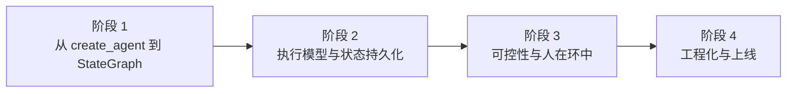

# LangGraph 系统学习 · 课程手册

> 本手册是全部 13 课的汇总（阶段总览 → 逐课精华 → 实战项目 → 索引），一册在手即可回查全课程。
> 各课正文仍是权威来源，本册只做**索引与精华摘录**——**不抄全文**，需要细节请点进原课。
> 基线：本机实测 `langgraph 1.2.11` / `langchain-core 1.4.x` / `langgraph-cli 0.4.35` / `langgraph-api 0.16.0` / `langsmith 0.12.4` / Docker 29.4.1（Python 3.12）
> 生成于 2026-10-15 ｜ 进度：**13 课 / 30 知识点全部完成**

---

## 怎么用这本手册

| 你想做什么 | 去哪一节 |
|-----------|---------|
| 回想整个课程讲了什么 | [全阶段总览](#全阶段总览) |
| 快速回忆某一课 | [逐课精华](#逐课精华)（每课含一句话本质 / 处境对照 / 一图总结 / 入口要素） |
| 找"这个坑在哪课讲过" | [知识点 → 课 速查表](#知识点--课-速查表) |
| 想动手做完整项目 | [综合实战项目](#综合实战项目) |
| 找配套实战 / 源码解析 | [应用实战](#应用实战) / [源码解析](#源码解析) |

---

## 全阶段总览

> 主角：**一次运行（run）** ｜ 冲突：**默认循环太省心，出了事你既看不见也拦不住** ｜ 收束：**每一步都在你手里——能看见、能暂停、能回放、能重跑**

| 阶段 | 名称 | 章节定位 | 课数 | 核心内容 |
|------|------|----------|------|----------|
| 1 | 从 create_agent 到 StateGraph | 把方向盘拿回来 | 3 | 环境准备、LangGraph 定位与心智模型、StateGraph 第一个图 |
| 2 | 执行模型与状态持久化 | 让它记住和说出来 | 4 | Pregel 执行模型、Checkpointer、Store、Streaming |
| 3 | 可控性与人在环中 | 敢让它上生产 | 4 | Interrupts、Time-travel、容错与子图、Functional API |
| 4 | 工程化与上线 | 搬到生产环境 | 2 | 项目结构与测试、部署与可观测 |

**阶段依赖**（严格串行）：



> 看图：阶段 2 的执行模型是理解 checkpoint、interrupt、streaming 的**共同前提**；阶段 3 的可控性建立在阶段 2 的持久化之上（interrupt 与 time-travel 都靠 checkpoint 存活）；阶段 4 收束前面全部阶段。

**学完你应该能**：说清 LangGraph 与 `create_agent` 的分工；用 StateGraph 自己画控制流；解释 `invoke` 底层怎么切成超级步；挂上持久化做到断点续跑与跨会话记忆；用 interrupt 卡住等人工、用 time-travel 回放分叉；给节点配超时/重试/兜底、用子图拆分；组织一个可部署、可测试、可观测的项目。

---

## 逐课精华

> 每课保留四件最容易在汇总时丢失的东西：**一句话本质 + 处境对照**（定性 + 动力）、**一眼全局图 + 本课地图**（全貌 + 路线）、**一图总结**（复习用）、**📖 文档核对与 📚 官方文档**（可信度标记）。

### 阶段 1：从 create_agent 到 StateGraph

---

#### 课 1 · 环境准备

- 正文：[01-环境准备.md](stages/1-从create_agent到StateGraph/lessons/01-环境准备.md)
- 📖 **文档核对**：已按官方文档核对（核对于 2026-10 ｜ 来源：LangGraph install / changelog-py / releases/langgraph-v1）
- 知识点：最小环境集 / 主路径与备选装法 / 验证命令 / 常见安装坑 / 本机环境基线

**五节速览**：最小环境集 → 主路径与备选装法（uv / Docker） → 验证命令 → 常见安装坑 → 本机环境基线（实测）。

> 已有环境可跳过。后续课需要额外环境时在该课课首补充。

---

#### 课 2 · LangGraph 是什么（定位与心智模型）

- 正文：[02-LangGraph是什么（定位与心智模型）.md](stages/1-从create_agent到StateGraph/lessons/02-LangGraph是什么（定位与心智模型）.md)
- 📖 **文档核对**：已按官方文档核对（核对于 2026-10 ｜ 来源：LangGraph overview / Thinking in LangGraph / Workflows and agents / Runtimes, frameworks, and harnesses）

> 📌 **一句话本质**：把"整件事交给它自己安排"变成"你来画路线图，它只在你指定的路口自己决定"。

> ⚖️ **处境对照**：不画这张图，你能很快拿到一个能跑的 demo，但事后追问"它为什么这么做"时**一个字都答不上来**——"依据是什么 / 为什么调了十次 / 能不能先让人看一眼"三个问题会**三个都卡住**；画了这张图，你要多写几十行代码、多花半天把流程拆开，换来的是**每一步都能单独看、单独改、单独拦**——三个问题分别对应官方的 streaming、persistence（含 time-travel）、human-in-the-loop，它们不是三个功能，而是"你画了图"之后的同一件事的三种用法。

**入口要素**：一眼全局图（第 51 行）· 本课地图（第 57 行）
**一图总结**：


> 看图：左边是三层的定位（你从 LangChain 那层往 LangGraph 这层下沉），中间是四个词——状态在中间被所有节点读写，边上决定走向，同一轮收纳互不依赖的节点，右边是 workflow / agent 这个选择。**与课首那张图的区别**：课首那张给没学过的人看（为什么需要），这张给刚学完的你复习（讲了什么）。

**知识点**：LangGraph 在生态中的位置 · 用图思考（state / node / edge / superstep） · workflow 与 agent 的分界

---

#### 课 3 · Graph API 第一个图

- 正文：[03-Graph API 第一个图.md](stages/1-从create_agent到StateGraph/lessons/03-Graph%20API%20第一个图.md)
- 📖 **文档核对**：已按官方文档核对（核对于 2026-10 ｜ 来源：LangGraph Graph API overview / Use the Graph API）
- 🎯 应用实战：[03-Graph API 第一个图.md](应用实战/03-Graph%20API%20第一个图.md)

> 📌 **一句话本质**：把"画在纸上的流程图"变成"能跑的代码"——你只要填四样东西：**本子上有哪些栏位、几个方框、箭头怎么连、岔路口谁说了算**。

> ⚖️ **处境对照**：不填这四样（继续用 `create_agent`），你写不了"不合格回退"这种带回路的流程，**质检只能放在人这一侧**；填了这四样，代价是要自己声明每个字段"新值到底替掉旧的还是叠加上去"——**声明错了会静默丢数据**（4.1 验证 A 实测：`plain` 字段从 `['第一版']` 变成 `['第二版']`，第一版凭空消失），但换来的是循环、分支、回退全都由你说了算。

**入口要素**：一眼全局图（第 57 行）· 本课地图（第 63 行）
**一图总结**：


> 看图：左边是填四样东西的顺序，中间是每样东西对应的一个"坑"（红）——这四条就是本课最该带走的；右边是下一课要接的"轮"的机制。

**知识点**：State 的定义与 reducer · 节点与边（START / END） · 条件边与循环
**实测撞坑**：`TypedDict` 没默认值 → `KeyError`；`dataclass` 有默认值 → `invoke({})` 也能跑。

---

### 阶段 2：执行模型与状态持久化

---

#### 课 4 · Pregel 执行模型

- 正文：[04-Pregel 执行模型.md](stages/2-执行模型与状态持久化/lessons/04-Pregel%20执行模型.md)
- 📖 **文档核对**：已按官方文档与本机**源码**核对（核对于 2026-10 ｜ 来源：LangGraph Graph API overview / Use the Graph API）
- 🎯 应用实战：[04-Pregel 执行模型.md](应用实战/04-Pregel%20执行模型.md) · 🔬 源码解析：[04-Pregel 执行模型.md](源码解析/04-Pregel%20执行模型.md)

> 📌 **一句话本质**：LangGraph 不是"一个节点接一个节点"地跑，而是**一批一批（superstep）地跑**——同一批的节点并排开工、看到同一份旧状态，全部跑完后改动才合到一起，然后才开下一批。

> ⚖️ **处境对照**：不知道这个模型，你会以为后跑的分支能看到先跑分支的改动（实测：**不能**，两个分支都看到空列表），从而写出依赖执行顺序的错代码，且这种 bug 时好时坏；知道了，你就能理解为什么会撞上 `InvalidUpdateError`、为什么循环上限要按"批"来算、以及 `Send` 和 `Command` 各自解决什么问题——**代价是你要接受一个反直觉的事实：同一批里，谁先跑完对结果没影响，因为它们读的是同一份快照。**

**入口要素**：一眼全局图（第 64 行）· 本课地图（第 70 行）
**一图总结**：


> 看图：左边是"批"的规则与它带来的三条结论，中间是 `Send` / `Command` 的分工，右边是课 5 要接的存档点。

**知识点**：超级步执行模型 · Send 动态扇出 · Command 与状态更新 / 跳转
**行话锚定**：`superstep`（超级步）出自 Google Pregel 论文；`recursion_limit` 数的是**批**不是节点次数。

---

#### 课 5 · Checkpointer 短期记忆

- 正文：[05-Checkpointer 短期记忆.md](stages/2-执行模型与状态持久化/lessons/05-Checkpointer%20短期记忆.md)
- 📖 **文档核对**：已按官方文档与本机**源码**核对（核对于 2026-10 ｜ 来源：LangGraph Persistence / Checkpointers）
- 🎯 应用实战：[05-Checkpointer 短期记忆.md](应用实战/05-Checkpointer%20短期记忆.md) · 🔬 源码解析：[05-Checkpointer 短期记忆.md](源码解析/05-Checkpointer%20短期记忆.md)

> 📌 **一句话本质**：**checkpointer 在每批（superstep）结束时把当时的状态拍一张快照存起来，用 `thread_id` 区分"是哪一次对话"**——有了快照就能续跑、能回放、能隔离，课 4 讲的"批"在这里变成了"存档时机"。

> ⚖️ **处境对照**：不知道这层，你的图一停就失忆，多用户会串台，崩溃只能从头再来，而且你会以为"再 `invoke` 一次是重新开始"（实测：**不是**，它是接着跑，字段会叠加）；知道了，你能用一行 `compile(checkpointer=...)` 换来断点续跑、多会话隔离，并为课 8 人在回路、课 9 时光旅行铺路——**代价是多一个必须每次传的 `thread_id`（实测：忘了传直接 `ValueError`），以及一个反直觉的叠加语义要记住。**

**入口要素**：一眼全局图（第 61 行）· 本课地图（第 67 行）
**一图总结**：


> 看图：左边是"存了什么、按什么区分"，中间是三档后端，右边是崩了怎么接与往下接什么。

**知识点**：checkpoint 与 thread_id · checkpointer 后端选型 · 断点续跑与状态恢复
**实测撞坑**：`checkpoints` 存整批快照、`writes` 存每节点记账——**两种记录别混**；`thread` 与操作系统线程无关。

---

#### 课 6 · Store 长期记忆

- 正文：[06-Store 长期记忆.md](stages/2-执行模型与状态持久化/lessons/06-Store%20长期记忆.md)
- 📖 **文档核对**：已按官方文档核对（核对于 2026-10 ｜ 来源：LangGraph Stores / Persistence / Memory 三页 + 本机 1.2.11 源码与实测）
- 🎯 应用实战：[06-Store 长期记忆.md](应用实战/06-Store%20长期记忆.md)

> 📌 **一句话本质**：**Store 是一个活在"图外面"的键值仓库，按 `namespace`（一串名字，如 `(用户, 类别)`）分格，任何 thread 都能按命名空间读写**——把记忆的归属从"这一次对话"改成"这个人"。

> ⚖️ **处境对照**：不知道这层，你会把用户偏好塞进 State（实测：换会话读到 `{}`，等于没存），或者把 `thread_id` 当命名空间第一层（实测：新会话搜到 `[]`，白做）；知道了，你能用 `compile(store=...)` 一行换来跨会话个性化——**代价是：它不会自动写**（checkpointer 每次状态更新自动存，Store 必须你显式 `put`），且**默认 `search` 只返回 10 条**（实测写 25 条只回来 10 条，漏数据还不报错）。

**入口要素**：一眼全局图（第 59 行）· 本课地图（第 65 行）
**一图总结**：


> 看图：左边是柜子本身（在哪、四个动作、不挂会怎样），中间是怎么摆（前缀匹配、默认 10 条、别用 thread_id），右边是放什么（三类记忆）。

**知识点**：Store 与命名空间 · 长期记忆落地（语义 / 情景）
**三类记忆**：语义（关于这个人的事实·一份档案反复改写）· 情景（发生过的事·一条条往里加）· 程序（做事的规矩·通常落在提示词里）

---

#### 课 7 · Streaming 流式输出

- 正文：[07-Streaming 流式输出.md](stages/2-执行模型与状态持久化/lessons/07-Streaming%20流式输出.md)
- 📖 **文档核对**：已按官方文档核对（核对于 2026-10 ｜ 来源：LangGraph Streaming / Event streaming / Custom stream channels 三页 + 本机 1.2.11 源码与实测）
- 🎯 应用实战：[07-Streaming 流式输出.md](应用实战/07-Streaming%20流式输出.md)

> 📌 **一句话本质**：**`stream` 把"一次返回全部"换成"每完成一步就吐一段"；`stream_mode` 决定吐的是什么形状**——图不用改，换个参数就从黑盒变直播。

> ⚖️ **处境对照**：不知道这层，你只能用 `invoke` 干等（实测只拿到终态 `{'q':'x','a':'流式输出的回答'}`），跑偏了要等全跑完才发现；知道了，你能用 `stream_mode="updates"` 逐节点看进度、用 `custom` 自定义进度条、用 `stream_mode="debug"` 拿到每个任务的入参和结果——**代价是：选错模式会静默出错**（实测写错模式名不报错、无输出；`custom` 不声明就丢弃数据且不报错；`messages` 在没有大模型调用时一条都不吐），而且本机源码里其实是**七种**模式，不是网上常说的四种。

**入口要素**：一眼全局图（第 56 行）· 本课地图（第 62 行）
**一图总结**：


> 看图：左边是七种"要的方式"与选型口诀，中间是事件流（`name` 无效的坑 + 正确做法），右边是子图（`subgraphs=True` 才露出）。

**知识点**：流模式（values / updates / messages / custom / debug / events / checks） · 事件流与子图事件
**选型口诀**：只想看"做到第几步" → 流模式（开销小）；要 token 级输出/工具细节 → 事件流；图里有子图想看内部 → `subgraphs=True`（返回**三元组**）。

---

### 阶段 3：可控性与人在环中

---

#### 课 8 · Interrupts 人在环中

- 正文：[08-Interrupts 人在环中.md](stages/3-可控性与人在环中/lessons/08-Interrupts%20人在环中.md)
- 📖 **文档核对**：已按官方文档核对（核对于 2026-10 ｜ 来源：LangGraph Interrupts 官方文档 + 本机 1.2.11 源码与实测）
- 🎯 应用实战：[08-Interrupts 人在环中.md](应用实战/08-Interrupts%20人在环中.md) · 🔬 源码解析：[08-Interrupts 人在环中.md](源码解析/08-Interrupts%20人在环中.md)

> 📌 **一句话本质**：**`interrupt()` 在节点内抛出一个特殊异常让图暂停，并把"卡在哪 + 当时的状态"存进 checkpoint；人回答后 `Command(resume=...)` 带着值回来，节点从头重跑、这次 `interrupt()` 返回那个值**——不是"半途续跑"，是"带着答案重跑"。

> ⚖️ **处境对照**：不知道这层，你的图只能一路跑到底（高风险动作无人把关），或者自己写一堆 `if pending: return` 的伪暂停逻辑；知道了，你能在任意节点内问人问题、把回答直接拿回代码里用——**代价是三条硬约束**：① **节点整体重跑**，`interrupt()` 之前的代码每次恢复都会再执行一遍（实测节点执行了 2 次，扣款/发短信这类副作用必须放 `interrupt()` 之后）；② **必须有 checkpointer 才能恢复**（不挂时 `get_state` 抛 `ValueError: No checkpointer set`、`resume` 抛 `RuntimeError`）；③ **`resume=None` 会撞 langgraph 自身的 bug**（`UnboundLocalError`，实测于 1.2.11）。

**入口要素**：一眼全局图（第 63 行）· 本课地图（第 69 行）
**一图总结**：


> 看图：四列——怎么停（动态 / 静态）、停在哪（快照 + 存档）、怎么接（resume 与两个真坑）、落地形态（循环 / 多节点 / 前端）。

**知识点**：interrupt 的中断机制 · 审批流落地

---

#### 课 9 · Time-travel 回放与分叉

- 正文：[09-Time-travel 回放与分叉.md](stages/3-可控性与人在环中/lessons/09-Time-travel%20回放与分叉.md)
- 📖 **文档核对**：已按官方文档核对（核对于 2026-10 ｜ 来源：LangGraph Use time-travel 官方文档 + 本机 1.2.11 源码与实测）
- 🎯 应用实战：[09-Time-travel 回放与分叉.md](应用实战/09-Time-travel%20回放与分叉.md)

> 📌 **一句话本质**：**图每执行一个超级步就自动存一张 `StateSnapshot`（`next` + `values` + `config` + `parent_config`），这些快照靠 `parent_config` 串成链；你把某张快照的 `config` 传给 `update_state` 改状态，就从这个点长出一条新分支，`invoke(None)` 只重跑它之后的节点**——不是"倒带重放"，是**"从过去某个点另起一条时间线"**。

> ⚖️ **处境对照**：不知道这层，出事了只能整条重跑（前面的工作全废、结果还可能不一致），或者自己维护一份"过程日志"再手工重建状态；知道了，你能翻回任意一步看清当时发生了什么、改一个值、只重跑后面的——**代价是三条硬约束**：① **只有挂了 checkpointer 才有历史**（不挂时 `get_state_history` / `update_state` 抛 `ValueError: No checkpointer set`）；② **同 thread 分叉会改写原历史**（实测 5 条 → 8 条，原执行记录被新分支淹没）；③ **跨 thread 分叉状态带不走**（实测新 thread 的 `values` 只剩 `{'decision':'批准'}`，`log` 丢了，`next` 回到 `('s1',)` 从头跑）。

**入口要素**：一眼全局图（第 72 行）· 本课地图（第 78 行）
**一图总结**：


> 看图：四列——怎么翻（history + 翻页参数）、翻出来什么（next/values/config/parent）、怎么改（update_state + invoke）、同 thread 还是新（取舍对照）。

**知识点**：历史回放 · 分叉重跑
**实战要诀**：要改就改**最上游的依据**（如 `amount`），改"结论"（如 `decision`）会被下游重算覆盖。

---

#### 课 10 · Fault-tolerance 与 Subgraphs

- 正文：[10-Fault-tolerance 与 Subgraphs.md](stages/3-可控性与人在环中/lessons/10-Fault-tolerance%20与%20Subgraphs.md)
- 📖 **文档核对**：已按官方文档核对（核对于 2026-10 ｜ 来源：LangGraph Fault tolerance / Subgraphs 官方文档 + 本机 1.2.11 源码与实测）
- 🎯 应用实战：[10-Fault-tolerance 与 Subgraphs.md](应用实战/10-Fault-tolerance%20与%20Subgraphs.md)

> 📌 **一句话本质**：**容错靠 `add_node` 的三个 per-node 参数：`retry_policy` 决定"失败了再试几次"、`error_handler` 决定"试完了还不行就走兜底"、`timeout` 决定"多久算不行"——三者可以按节点单独配，也可以用 `set_node_defaults` 全图默认；子图则是**把编译好的图当节点挂上去**，父子之间**只传两边 schema 都声明了的字段**。

> ⚖️ **处境对照**：不知道这层，错误会直接冒泡炸掉整跑（前面的状态白算），或者你自己写 try/except 把重试逻辑和业务逻辑混在一起；知道了，一个节点的抖动在节点内就被消化掉——**代价是三条硬约束**：① **默认 `retry_on` 把 `ValueError`/`RuntimeError`/`TypeError` 一律视为"代码 bug"不重试**（配了 `max_attempts=3` 也只跑 1 次）；② **`error_handler` 的签名是 `(state)` 单参数**，写成 `(state, error)` 直接 `TypeError`；③ **同步节点配 `timeout` 在 `compile()` 阶段就抛 `ValueError`**——只有 async 节点才支持。（TS 侧三条各有反转：不配 `retryPolicy` 一次都不重试、配了才是默认黑名单；`errorHandler` 就是三参 `(state, error, config?)` 且异常被 `NodeError` 包一层；同步节点配 `timeout` 能编译，运行期才判罚。详见课 10。）

**入口要素**：一眼全局图（第 78 行）· 本课地图（第 84 行）
**一图总结**：


> 看图：四列——重试（含 ★ 的 `retry_on` 默认行为）、兜底（含 ★ 的单参签名）、超时（含 ★ 的同步限制）、子图（含 ★ 的静默丢弃）。

**知识点**：节点级超时 / 重试 / 错误处理 · 子图与状态隔离
**★ 本课最该带走的一条**：`retry_policy` 生不生效取决于**异常类型**，不是"你有没有配"。

---

#### 课 11 · Functional API 与选型

- 正文：[11-Functional API 与选型.md](stages/3-可控性与人在环中/lessons/11-Functional API 与选型.md)
- 📖 **文档核对**：已按官方文档核对（核对于 2026-10 ｜ 来源：LangGraph Functional API / Choosing between APIs 官方文档 + 本机 1.2.11 源码与实测）
- 🎯 应用实战：[11-Functional API 与选型.md](应用实战/11-Functional API 与选型.md)

> 📌 **一句话本质**：**Functional API 用 `@entrypoint` 把整个流程包成一个可持久化的入口、用 `@task` 标注"这一步的结果要写进存档点"；控制流就是普通的 `if` / `while` / 函数调用，不需要 State、节点和边。它和 Graph API **底层是同一个 Pregel 引擎**，中断、回放、重试、流式全都一样能用。**

> ⚖️ **处境对照**：不知道这层，你只能把直流程硬拆成图（样板比业务多），或者自己写 try/except + 状态落盘（重造轮子且和生态脱节）；知道了，一个已有脚本加两个装饰器就有了 checkpoint 和人在环中——**代价是三条**：① **没有具名的中间状态**——只有 `previous`（上一次的返回值），实测历史只有 **2 条**（同样两步的 Graph API 是 **4 条**），不能像 Graph API 那样逐字段 `update_state`；② **`@task` 才进存档点**，普通函数在 resume 时**必然重跑**（实测 `plain_a` 从 1 次变 2 次）；③ **挂了 checkpointer 就必须传 `config`**，不传直接 `ValueError`（Graph API 不传也能跑）。

**入口要素**：一眼全局图（第 81 行）· 本课地图（第 87 行）
**一图总结**：


> 看图：左边是两套 API 的分工与判据，中间是 `@entrypoint` / `@task` 各自管什么，右边是"什么时候该换"的选型路标。

**知识点**：`@entrypoint` / `@task` 模型 · 两套 API 选型

---

### 阶段 4：工程化与上线

---

#### 课 12 · Application structure 与测试

- 正文：[12-Application structure 与测试.md](stages/4-工程化与上线/lessons/12-Application%20structure%20与测试.md)
- 📖 **文档核对**：已按官方文档核对（核对于 2026-10 ｜ 来源：LangGraph Application structure / Test / Backward compatibility 官方文档 + 本机 langgraph 1.2.11 / langgraph-cli 0.4.35 / langgraph-api 0.16.0 实测）
- 🎯 本课实操由**结课综合实战项目**承接，不单配应用实战

> 📌 **一句话本质**：**LangGraph 把"部署契约"外化成 `langgraph.json` 一个文件——图在哪（`graphs`）、装什么（`dependencies`）、环境变量（`env`）都写在这里；而测试与向后兼容是它的两翼：测试消除 agent 的非确定性，向后兼容保证改结构不断掉在途任务。**

> ⚖️ **处境对照**：不知道这层，你只能口头交代怎么跑、手动点一遍验证、深夜停机发布；知道了，一条命令起服务、改代码前有测试兜底、改结构能挑安全的改法——**代价是三条**：① **`langgraph.json` 写错就直接起不来**，实测缺 `dependencies` 报 `No dependencies found in config`、变量名写错报 `Could not find graph 'xxx'`；② **`graphs` 路径是相对当前工作目录（CWD）解析的**，实测换成别的目录启动就 `FileNotFoundError`；③ **`graphs` 的值不支持对象形式**（`{"path":..., "variable":...}`），实测报 `Invalid path ... Did you miss a variable name?`。

**入口要素**：一眼全局图（第 77 行）· 本课地图（第 83 行）
**一图总结**：


> 看图：左边是 `langgraph.json` 三个键与各自写错的报错，中间是测试三层（单节点 / 整图 / 韧性），右边是向后兼容的安全与危险改法。

**知识点**：项目结构与 `langgraph.json` · 单元与集成测试 · 向后兼容与灰度
**★ 测试要诀**：假模型/假服务**不能塞进 State**（实测 `KeyError`），要走 `config["configurable"]` 注入。

---

#### 课 13 · Deployment 与 Observability

- 正文：[13-Deployment 与 Observability.md](stages/4-工程化与上线/lessons/13-Deployment%20与%20Observability.md)
- 📖 **文档核对**：已按官方文档核对（核对于 2026-10 ｜ 来源：LangGraph Deployment / Studio / Agent Chat UI / LangSmith Observability 官方文档 + 本机 langgraph 1.2.11 / langgraph-cli 0.4.35 / langgraph-api 0.16.0 / Docker 29.4.1 / langsmith 0.12.4 实测）
- 🎯 本课实操由**结课综合实战项目**承接

> 📌 **一句话本质**：**部署的本质是"谁替你备那三样东西"——排队用的（Redis）、存档用的库（Postgres）、授权（License Key）；自托管要自己备（实测连撞三道门才起得来），托管平台替你备（代价是数据出机房）；而界面与 tracing 都挂在同一个东西上：服务端那套 HTTP + SSE 接口。**

> ⚖️ **处境对照**：不知道这层，你只能本地跑着给人演示、出事靠 print、临时学前端；知道了，一条命令打包成镜像、Studio 里一步步看、Chat UI 直接接上、出事翻 trace——**代价是三条**：① **`langgraph build` 成功 ≠ 能跑起来**，实测打包只校验依赖，**运行时配置（Redis/Postgres/License）一个都不校**，起容器连撞三次；② **镜像默认 Python 3.11 而不是你本机的版本**，实测基础镜像是 `langchain/langgraph-api:3.11`，装了 3.12-only 的依赖会在构建期或启动期炸；③ **自托管不是"免费自己跑"**，实测没有 `LANGGRAPH_CLOUD_LICENSE_KEY` 直接 `License verification failed`，乱填一个密钥报 `Not enough segments`（它是 JWT）。

**入口要素**：一眼全局图（第 91 行）· 本课地图（第 97 行）
**一图总结**：


> 看图：左边是四条部署路线与"谁备三样东西"，中间是自托管连撞的三道门，右边是 Studio / Chat UI / LangSmith 怎么挂在同一套 HTTP+SSE 上。

**知识点**：部署方式 · Studio 与 Agent Chat UI · observability 接入
**实测三道门**：`KeyError: "Config 'REDIS_URI' is missing"` → `AttributeError: 'NoneType' ... encode`（实为 POSTGRES_URI 没给） → `ValueError: License verification failed`。

---

## 知识点 → 课 速查表

> 30 个知识点全表，按阶段-课排列。

| # | 阶段 | 课 | 知识点 | 一句话 |
|:--:|:--:|:--:|--------|--------|
| 1 | 1 | 课 1 | 最小环境集与安装 | uv / Docker 两条路，验证命令见课 1 |
| 2 | 1 | 课 2 | LangGraph 在生态中的位置 | LangChain 之上、`create_agent` 之下的控制流层 |
| 3 | 1 | 课 2 | 用图思考（state/node/edge/superstep） | 四个词构成全部心智模型 |
| 4 | 1 | 课 2 | workflow 与 agent 的分界 | 固定路线 vs 模型自己决定 |
| 5 | 1 | 课 3 | State 的定义与 reducer | 不写 reducer = 静默覆盖 |
| 6 | 1 | 课 3 | 节点与边（START / END） | 节点返回**增量**不是全量 |
| 7 | 1 | 课 3 | 条件边与循环 | 回退/质检循环全靠它 |
| 8 | 2 | 课 4 | 超级步执行模型 | 一批一批跑，同批读同一份快照 |
| 9 | 2 | 课 4 | Send 动态扇出 | 运行时决定发几路 |
| 10 | 2 | 课 4 | Command 与状态更新 / 跳转 | 一次调用既改状态又改路线 |
| 11 | 2 | 课 5 | checkpoint 与 thread_id | 每批一张快照，thread 区分会话 |
| 12 | 2 | 课 5 | checkpointer 后端选型 | 内存 / SQLite / Postgres 三档 |
| 13 | 2 | 课 5 | 断点续跑与状态恢复 | 崩了从快照接回去 |
| 14 | 2 | 课 6 | Store 与命名空间 | 图外面的键值柜，按 namespace 分格 |
| 15 | 2 | 课 6 | 长期记忆落地（语义 / 情景） | 三类记忆怎么放 |
| 16 | 2 | 课 7 | 流模式（7 种） | `stream_mode` 决定吐什么形状 |
| 17 | 2 | 课 7 | 事件流与子图事件 | `subgraphs=True` 才露出内部 |
| 18 | 3 | 课 8 | interrupt 的中断机制 | 抛异常暂停 + 带答案重跑 |
| 19 | 3 | 课 8 | 审批流落地 | 循环 / 多节点 / 前端三种形态 |
| 20 | 3 | 课 9 | 历史回放 | `get_state_history` 翻快照链 |
| 21 | 3 | 课 9 | 分叉重跑 | 从过去某点另起时间线 |
| 22 | 3 | 课 10 | 节点级超时 / 重试 / 错误处理 | 三个 per-node 参数 |
| 23 | 3 | 课 10 | 子图与状态隔离 | 只传两边都声明的字段 |
| 24 | 3 | 课 11 | `@entrypoint` / `@task` 模型 | 普通函数 + 两个装饰器 |
| 25 | 3 | 课 11 | 两套 API 选型 | 什么时候该用哪个 |
| 26 | 4 | 课 12 | 项目结构与 `langgraph.json` | 部署契约外化成一个文件 |
| 27 | 4 | 课 12 | 单元与集成测试 | 假模型走 config 注入 |
| 28 | 4 | 课 12 | 向后兼容与灰度 | 改结构不断在途任务 |
| 29 | 4 | 课 13 | 部署方式 | 自托管 / 云 / 独立容器 / 嵌入 |
| 30 | 4 | 课 13 | Studio 与 Agent Chat UI | 界面挂在 HTTP + SSE 上 |
| 31 | 4 | 课 13 | observability 接入 | LangSmith tracing 接入点 |

---

## 综合实战项目

### 会审批的退款工单系统

- 项目根：[README.md](projects/会审批的退款工单系统/README.md)
- 设计决策：[设计决策.md](projects/会审批的退款工单系统/设计决策.md)
- 反例对照：[反例对照.md](projects/会审批的退款工单系统/反例对照.md)
- 验收清单：[验收清单.md](projects/会审批的退款工单系统/验收清单.md)
- 代码入口：[graph.py](projects/会审批的退款工单系统/实现/refund_agent/graph.py)

**需求**：用户提交退款申请 → 校验 → 风控评分 → 按规则判定（自动通过 / 转人工 / 自动拒绝）→ 人工审批 → 执行退款 → 通知。**外部接口抖动不能整单失败，重试不能重复打款，出事能回放每一步。**

**非功能约束**（4 项）：

| 类别 | 约束 | 落地 |
|------|------|------|
| 错误处理 | 外部抖动不整单失败 | `RetryPolicy` + 自定义异常类型 |
| 安全 / 正确性 | 重试绝不重复打款 | 幂等键 `订单号+金额` |
| 可维护性 | 依赖可替换、不接真网络 | `config["configurable"]` 注入 |
| 可观测 | 每步可追踪可回放 | checkpoint 存档（实测 8 个存档点） |

**覆盖知识点地图**（跨 4 阶段 / 12 个知识点）：

| 知识点 | 阶段 / 课 | 用在哪 |
|--------|----------|--------|
| State 定义与 reducer | 阶段 1 · 课 3 | `log: Annotated[list, add]` |
| 条件边与分支 | 阶段 1 · 课 3 | `route_after_validate` / `route_after_decide` |
| workflow 与 agent 分界 | 阶段 1 · 课 2 | 判定用写死的 if（合规要可解释） |
| checkpoint 与 thread_id | 阶段 2 · 课 5 | `build_graph(checkpointer=...)` |
| Streaming | 阶段 2 · 课 7 | `service.py::stream()` |
| Interrupts | 阶段 3 · 课 8 | `human_approve` + `Command(resume=)` |
| Time-travel | 阶段 3 · 课 9 | `history()` / `replay_from()` |
| RetryPolicy 与异常分类 | 阶段 3 · 课 10 | `RISK_RETRY` / `REFUND_RETRY` |
| 项目结构与 langgraph.json | 阶段 4 · 课 12 | `graphs.refund_agent` |
| 单元与集成测试 | 阶段 4 · 课 12 | 16 项测试三层 |
| Streaming → SSE | 阶段 4 · 课 13 | `stream()` 即 `/runs/stream` 本地版 |
| Store 长期记忆（接入点） | 阶段 2 · 课 6 | `build_graph(store=...)` 预留 |

**三个设计决策**（摘要，完整论证见[设计决策.md](projects/会审批的退款工单系统/设计决策.md)）：

| 决策 | 选了 | 放弃的方案差在哪 | 付出的代价 |
|---|---|---|---|
| 审批怎么卡 | `interrupt()` 卡节点内 | 拆两段图：省 checkpointer 但失去回放 | 节点须无副作用；必须挂 checkpointer |
| 抖动怎么扛 | 节点级 `RetryPolicy` | 整图重跑：前面全重来；队列：有退避但要中间件 | 异常类型成隐式契约；无退避 |
| 依赖怎么注入 | `config["configurable"]` | 塞 State：`KeyError` 且污染存档点 | 每节点多一参数 + 注解限制 |

**★ 最有教学价值的一击**：同样配了 `RetryPolicy(max_attempts=3)`，抛 `TransientUpstreamError` 时风控**调用 3 次**后成功，抛 `ValueError` 时**只调 1 次**直接炸——**配了不代表生效**。

**验收**：A 组（跑得起来）· B 组（知识点真用上）· C 组（反例真会炸）共 16 项 + D 组 6 个动手任务。详见[验收清单.md](projects/会审批的退款工单系统/验收清单.md)。

**运行**：

```bash
cd langchain/langgraph/projects/会审批的退款工单系统/实现
uv run --project ../../../../langchain/playground python -m pytest refund_agent/tests/ -q   # 16 passed
uv run --project ../../../../langchain/playground python demo.py                              # 6 场景
```

---

### 追加项目：会记住和遗忘的客服助手

- 项目根：[README.md](projects/会记住和遗忘的客服助手/README.md) ｜ [设计决策](projects/会记住和遗忘的客服助手/设计决策.md) ｜ [反例对照](projects/会记住和遗忘的客服助手/反例对照.md) ｜ [验收清单](projects/会记住和遗忘的客服助手/验收清单.md)

**回答**：**跨会话的东西放哪、怎么不写脏**。Store 长期记忆主线 + 冲突检测与人工裁决，**20 项测试全绿**。

**★ 最有教学价值的一击**：记忆冲突时提供**三种**裁决（confirm 照写 / reject 丢弃 / keep 保留旧值）——只做"是/否"表达不了"我不要这个新说法但要保留旧的"。

---

### 追加项目：会重试和降级的调研流水线

- 项目根：[README.md](projects/会重试和降级的调研流水线/README.md) ｜ [设计决策](projects/会重试和降级的调研流水线/设计决策.md) ｜ [反例对照](projects/会重试和降级的调研流水线/反例对照.md) ｜ [验收清单](projects/会重试和降级的调研流水线/验收清单.md)

**回答**：**外部依赖不可靠时**怎么不崩、不慢、不白试。`Send` 扇出 + 子图状态隔离 + 分类重试 + 优雅降级，**16 项测试全绿**。

**★ 最有教学价值的一击**：`RetryPolicy` 在 `langgraph.types` 而非 `langgraph.pregel`；`error_handler` **只能接收 1 个参数且收到的是 state 不是异常对象**——想知道失败原因，得在节点内先把错误写进 state。

---

### 追加项目：会续跑的数据清洗流水线

- 项目根：[README.md](projects/会续跑的数据清洗流水线/README.md) ｜ [设计决策](projects/会续跑的数据清洗流水线/设计决策.md) ｜ [反例对照](projects/会续跑的数据清洗流水线/反例对照.md) ｜ [验收清单](projects/会续跑的数据清洗流水线/验收清单.md)

**回答**：**已有脚本**怎么最小成本加暂停和续跑（首个 Functional API 项目），**21 项测试全绿**。

**★ 最有教学价值的一击**：`@task` 结果"写进存档点"的准确含义——**resume 时已完成的 task 不重跑，但同 thread 再 invoke 是全新执行、全部重来**；且 `Command(resume=...)` 传 `dict[int, str]` 会因 key 非 32 位 hex 直接 `TypeError`。

---

## 四项目横向决策指南

> **新需求来了怎么选** → [10-四项目横向决策指南.md](10-四项目横向决策指南.md)
>
> 四个核心判据：**Graph 还是 Functional**（看中间过程要不要逐格改）、**要不要上 Store**（看是否跨会话）、
> **该重试还是降级**（看再试一次会不会不一样）、**何时让 interrupt 介入**（高风险 / 冲突 / 不确定）。
>
> 配套图：[决策树](10-四项目横向决策指南-assets/决策树.svg) ｜ [API 选型对照](10-四项目横向决策指南-assets/API选型对照.svg)

---

## 应用实战

> 过「应用实战判定」的课各配一篇：**场景 → 全貌一句话 → 渐进演进（基础实现 → 它的问题 → 综合实现）**。一键跳转见 [应用实战总索引](应用实战/INDEX.md)。

| 课 | 场景 | 覆盖知识点 | 实战 |
|----|------|-----------|------|
| 课 3 | 把"一次通过"的客服流程改成带质检回退的循环 | State 与 reducer / 节点与边 / 条件边与循环 | [03-Graph API 第一个图.md](应用实战/03-Graph%20API%20第一个图.md) |
| 课 4 | 三份文档并行摘要后合并 | 超级步 / Send 扇出 / Command | [04-Pregel 执行模型.md](应用实战/04-Pregel%20执行模型.md) |
| 课 5 | 会话中断后接着上次继续 | checkpoint 与 thread_id / 后端选型 / 断点续跑 | [05-Checkpointer 短期记忆.md](应用实战/05-Checkpointer%20短期记忆.md) |
| 课 6 | 跨会话记住用户偏好 | Store 与命名空间 / 长期记忆落地 | [06-Store 长期记忆.md](应用实战/06-Store%20长期记忆.md) |
| 课 7 | 让前端看到"第几步在做什么" | 流模式 / 事件流与子图事件 | [07-Streaming 流式输出.md](应用实战/07-Streaming%20流式输出.md) |
| 课 8 | 高危操作先让人签字 | interrupt 机制 / 审批流落地 | [08-Interrupts 人在环中.md](应用实战/08-Interrupts%20人在环中.md) |
| 课 9 | 客户投诉后回溯与改判重跑 | 历史回放 / 分叉重跑 | [09-Time-travel 回放与分叉.md](应用实战/09-Time-travel%20回放与分叉.md) |
| 课 10 | 外部接口抖了就整单失败，还不能拖垮别的环节 | 节点级超时 / 重试 / 错误处理 / 子图与状态隔离 | [10-Fault-tolerance 与 Subgraphs.md](应用实战/10-Fault-tolerance%20与%20Subgraphs.md) |
| 课 11 | 已有脚本想加暂停和断点续跑，要不要重写成图 | `@entrypoint` / `@task` / 两套 API 选型 | [11-Functional API 与选型.md](应用实战/11-Functional API 与选型.md) |

> 课 1（环境准备）与课 2（定位与心智模型）不配实战——前者无演进空间，后者是原理铺垫课。课 12 / 13 的实操由**结课综合实战项目**统一承接。

---

## 源码解析

> 过「源码解析判定」的课各配一篇（限库 / SDK 类主题）。一键跳转见 [源码解析总索引](源码解析/INDEX.md)。

| 课 | 解析的功能 | 覆盖知识点 | 解析 |
|----|-----------|-----------|------|
| 课 4 | 一个 superstep 是怎么被调度出来的 | 超级步执行模型 / Send / Command | [04-Pregel 执行模型.md](源码解析/04-Pregel%20执行模型.md) |
| 课 5 | checkpoint 里到底存了什么、怎么被读写 | checkpoint 与 thread_id / 断点续跑 | [05-Checkpointer 短期记忆.md](源码解析/05-Checkpointer%20短期记忆.md) |
| 课 8 | `interrupt()` 抛出后执行流怎么被接住与恢复 | interrupt 机制 / 审批流落地 | [08-Interrupts 人在环中.md](源码解析/08-Interrupts%20人在环中.md) |

> **版本锚点**：源码一律引用本机实测基线 `langgraph 1.2.11`，标注 `源码锚点 @ 1.2.11（{仓库 / 文件}）`。升级后须重跑校验，不凭记忆写旧版本行为。

---

## 附录

### 官方文档索引

完整路由表见 [web-index/docs-langgraph/index.md](web-index/docs-langgraph/index.md)（44 条 / 6 分区，生成于 2026-10-14）。写课与核查一律先查它的「我要…」列取 URL。

### 环境基线（实测）

| 组件 | 版本 |
|------|------|
| Python | 3.12 |
| langgraph | 1.2.11 |
| langchain-core | 1.4.x |
| langgraph-checkpoint | 4.2.0 |
| langgraph-checkpoint-sqlite | 3.0.3 |
| langgraph-cli | 0.4.35 |
| langgraph-api | 0.16.0 |
| langsmith | 0.12.4 |
| Docker | 29.4.1 |

### 全课程"最该带走"的十条

1. **节点返回的是增量，不是全量 State**
2. **不写 reducer 就是覆盖语义**——`log` 这类累加字段必须 `Annotated[list, add]`
3. **同一批（superstep）里，谁先跑完对结果没影响**——它们读的是同一份快照
4. **再 `invoke` 一次不是重新开始**——它是接着跑，字段会叠加（除非换 `thread_id`）
5. **Store 不会自动写**——必须显式 `put`；默认 `search` 只返回 10 条
6. **选错 `stream_mode` 会静默出错**——写错模式名不报错、无输出
7. **`interrupt()` 是"带着答案重跑"**——之前的副作用会执行两遍，必须放在它之后
8. **没挂 checkpointer 是"能停不能恢复"**——`get_state` / `get_state_history` 都抛 `ValueError`
9. **`retry_policy` 生不生效取决于异常类型**——`ValueError` 被当代码 bug，配了也不重试
10. **`langgraph build` 成功 ≠ 能跑起来**——打包只校验依赖，运行时配置一个都不校

### 相关文件

- [00-学习档案.md](00-学习档案.md)（进度与画像）
- [00-评审清单.md](00-评审清单.md)（评审留痕）
- [01-学习路径总览.md](01-学习路径总览.md)（阶段总览与故事主线）
- [02-课程目录.md](02-课程目录.md)（书本式目录）
