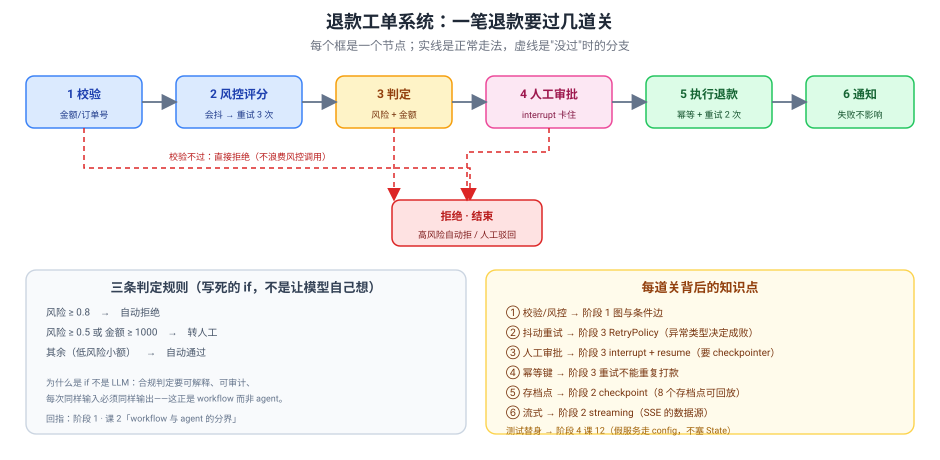

# 实战项目：会审批的退款工单系统

> 所属课程：LangGraph 系统学习 ｜ 学习目标：动手实操 ｜ 预计耗时：4–6 小时
> ✅ 代码实测于 langgraph 1.2.11 / langgraph-checkpoint 4.2.0 / Python 3.12（`uv run` 隔离执行）
> ✅ 测试套件 **16 passed**（`python -m pytest refund_agent/tests/ -q`）

## 🎯 一句话需求

做一个**退款工单系统**：用户提交退款申请，系统自动校验、风控评分、按规则判定（自动通过 / 转人工 / 自动拒绝），涉及人工的卡住等审批，批准后执行退款并通知——**外部接口抖动不能整单失败，重试不能重复打款，出事能回放每一步**。

## ✅ 目标与非功能约束

**功能目标**：
1. 小额低风险全自动走完；高风险自动拒绝；中风险或大额转人工审批
2. 人工批准后自动续跑完成退款与通知
3. 全流程每一步留存档点，可回放、可查看当时状态

**非功能约束**（4 项，门槛要求 ≥2）：

| 类别 | 约束 | 落地在哪 |
|------|------|---------|
| **错误处理** | 外部接口抖动不能整单失败；单个节点失败有兜底 | `RetryPolicy` + 自定义异常类型；`notify` 节点内 try 消化 |
| **安全 / 正确性** | 重试绝不能重复打款 | `_idempotency_key()` 幂等键（`nodes/flow.py`） |
| **可维护性** | 外部依赖可替换、可测试，不接真网络 | `deps.py` 依赖注入 + `clients.py` 测试替身 |
| **可观测** | 每步可追踪、可回放、可流式 | checkpoint 存档 + `stream()` 流式（SSE 数据源） |

## 🗺️ 覆盖知识点地图

> 这是"跨阶段整合"的证据，逐个回指课时。

| 知识点 | 所属阶段 / 课 | 本项目用在何处 | 回指 |
|--------|--------------|---------------|------|
| State 定义与 reducer（累加语义） | 阶段 1 · 课 3 | `state.py` 的 `log: Annotated[list, add]`；测试 `test_log_is_accumulated_not_overwritten` | [课 3](../../stages/1-%E4%BB%8Ecreate_agent%E5%88%B0StateGraph/lessons/03-Graph%20API%20%E7%AC%AC%E4%B8%80%E4%B8%AA%E5%9B%BE.md) |
| 条件边与分支 | 阶段 1 · 课 3 | `graph.py` 的 `route_after_validate` / `route_after_decide` | [课 3](../../stages/1-%E4%BB%8Ecreate_agent%E5%88%B0StateGraph/lessons/03-Graph%20API%20%E7%AC%AC%E4%B8%80%E4%B8%AA%E5%9B%BE.md) |
| workflow 与 agent 的分界 | 阶段 1 · 课 2 | 判定用写死的 if（合规要可解释、可复现），不用 LLM 自由发挥 | [课 2](../../stages/1-%E4%BB%8Ecreate_agent%E5%88%B0StateGraph/lessons/02-LangGraph%E6%98%AF%E4%BB%80%E4%B9%88%EF%BC%88%E5%AE%9A%E4%BD%8D%E4%B8%8E%E5%BF%83%E6%99%BA%E6%A8%A1%E5%9E%8B%EF%BC%89.md) |
| checkpoint 与 thread_id | 阶段 2 · 课 5 | `build_graph(checkpointer=...)`；一工单一个 thread | [课 5](../../stages/2-%E6%89%A7%E8%A1%8C%E6%A8%A1%E5%9E%8B%E4%B8%8E%E7%8A%B6%E6%80%81%E6%8C%81%E4%B9%85%E5%8C%96/lessons/05-Checkpointer%20%E7%9F%AD%E6%9C%9F%E8%AE%B0%E5%BF%86.md) |
| Streaming 流式输出 | 阶段 2 · 课 7 | `service.py::stream()`，`stream_mode=["updates"]` | [课 7](../../stages/2-%E6%89%A7%E8%A1%8C%E6%A8%A1%E5%9E%8B%E4%B8%8E%E7%8A%B6%E6%80%81%E6%8C%81%E4%B9%85%E5%8C%96/lessons/07-Streaming%20%E6%B5%81%E5%BC%8F%E8%BE%93%E5%87%BA.md) |
| Interrupts 人在环中 | 阶段 3 · 课 8 | `human_approve` 用 `interrupt()`；`approve()` 用 `Command(resume=)` | [课 8](../../stages/3-%E5%8F%AF%E6%8E%A7%E6%80%A7%E4%B8%8E%E4%BA%BA%E5%9C%A8%E7%8E%AF%E4%B8%AD/lessons/08-Interrupts%20%E4%BA%BA%E5%9C%A8%E7%8E%AF%E4%B8%AD.md) |
| Time-travel 回放 | 阶段 3 · 课 9 | `history()` / `replay_from()`（实测 8 个存档点） | [课 9](../../stages/3-%E5%8F%AF%E6%8E%A7%E6%80%A7%E4%B8%8E%E4%BA%BA%E5%9C%A8%E7%8E%AF%E4%B8%AD/lessons/09-Time-travel%20%E5%9B%9E%E6%94%BE%E4%B8%8E%E5%88%86%E5%8F%89.md) |
| RetryPolicy 与异常分类 | 阶段 3 · 课 10 | `RISK_RETRY` / `REFUND_RETRY`；`TransientUpstreamError` vs `PermanentUpstreamError` | [课 10](../../stages/3-%E5%8F%AF%E6%8E%A7%E6%80%A7%E4%B8%8E%E4%BA%BA%E5%9C%A8%E7%8E%AF%E4%B8%AD/lessons/10-Fault-tolerance%20%E4%B8%8E%20Subgraphs.md) |
| 项目结构与 langgraph.json | 阶段 4 · 课 12 | `langgraph.json` 的 `graphs.refund_agent`；依赖走 `config["configurable"]` | [课 12](../../stages/4-%E5%B7%A5%E7%A8%8B%E5%8C%96%E4%B8%8E%E4%B8%8A%E7%BA%BF/lessons/12-Application%20structure%20%E4%B8%8E%E6%B5%8B%E8%AF%95.md) |
| 单元与集成测试（假服务） | 阶段 4 · 课 12 | `clients.py` 的 Fake 系列 + `tests/test_refund_flow.py` 三层测试 | [课 12](../../stages/4-%E5%B7%A5%E7%A8%8B%E5%8C%96%E4%B8%8E%E4%B8%8A%E7%BA%BF/lessons/12-Application%20structure%20%E4%B8%8E%E6%B5%8B%E8%AF%95.md) |
| Streaming → SSE（部署接线） | 阶段 4 · 课 13 | `stream()` 的输出即 `/runs/stream` 的本地版（`event: updates`） | [课 13](../../stages/4-%E5%B7%A5%E7%A8%8B%E5%8C%96%E4%B8%8E%E4%B8%8A%E7%BA%BF/lessons/13-Deployment%20%E4%B8%8E%20Observability.md) |
| Store 长期记忆（接入点） | 阶段 2 · 课 6 | `build_graph(store=...)` 预留，可存用户历史退款画像 | [课 6](../../stages/2-%E6%89%A7%E8%A1%8C%E6%A8%A1%E5%9E%8B%E4%B8%8E%E7%8A%B6%E6%80%81%E6%8C%81%E4%B9%85%E5%8C%96/lessons/06-Store%20%E9%95%BF%E6%9C%9F%E8%AE%B0%E5%BF%86.md) |

**跨阶段校验**：覆盖 **4 个阶段**（阶段 1 / 2 / 3 / 4），门槛 ≥3 ✅

## 🚀 运行方式

```bash
# 进入项目实现目录
cd langchain/langgraph/projects/会审批的退款工单系统/实现

# 1) 跑测试（16 项）
uv run --project ../../../../langchain/playground python -m pytest refund_agent/tests/ -q
# 预期：16 passed

# 2) 跑演示（6 个场景）
uv run --project ../../../../langchain/playground python demo.py
# 预期：依次看到自动通过 / 重试成功 / ValueError 不重试 / 人工审批 / 8 个存档点 / 流式输出

# 3) 起 dev server + Studio（可选，需装 langgraph-cli[inmem]）
uv run --project ../../../../langchain/playground --with "langgraph-cli[inmem]" \
  langgraph dev --config ./langgraph.json --no-browser
# 预期：日志给出 Studio UI 的 baseUrl，/ok 返回 {"ok":true}
```

> ⚠️ **路径是相对 CWD 的**（课 12 实测教训）：`langgraph dev` 必须在 `langgraph.json` 所在目录启动，否则 `FileNotFoundError`。

## 📁 目录说明



| 路径 | 内容 |
|------|------|
| `实现/refund_agent/state.py` | 状态定义（含 reducer 累加语义） |
| `实现/refund_agent/clients.py` | 外部服务接口 + 测试替身 + 异常分类 |
| `实现/refund_agent/deps.py` | 依赖注入容器（走 `config["configurable"]`） |
| `实现/refund_agent/nodes/flow.py` | 7 个节点实现 |
| `实现/refund_agent/graph.py` | 建图：条件边 + RetryPolicy + checkpointer |
| `实现/refund_agent/service.py` | 服务层：提交 / 流式 / 审批 / 回放 |
| `实现/refund_agent/tests/` | 三层测试（16 项） |
| `实现/demo.py` | 6 个场景演示 |
| `实现/langgraph.json` | 部署契约（`graphs.refund_agent`） |
| [设计决策.md](设计决策.md) | 3 个权衡点的完整论证 |
| [反例对照.md](反例对照.md) | "能跑但很糟"的版本 + 逐条对比 |
| [验收清单.md](验收清单.md) | 自测项，逐项勾选 |

## 🎬 六个演示场景（对应知识点）

| 场景 | 演示什么 | 实测结果 |
|:--:|---------|---------|
| 1 | 小额自动通过 | `decision=通过`，5 条 log 完整累加 |
| 2 | 风控抖 2 次自己好 | 风控调用 **3 次**后成功 |
| 3 | 抖了却抛 ValueError | 只调 **1 次**直接炸（反例） |
| 4 | 大额转人工 → 批准 | 卡在 `('human_approve',)`，resume 后续跑 |
| 5 | 回放存档点 | **8 个存档点**，log 条数递增可验 |
| 6 | 流式输出 | 5 个节点逐个 `event: updates` |
